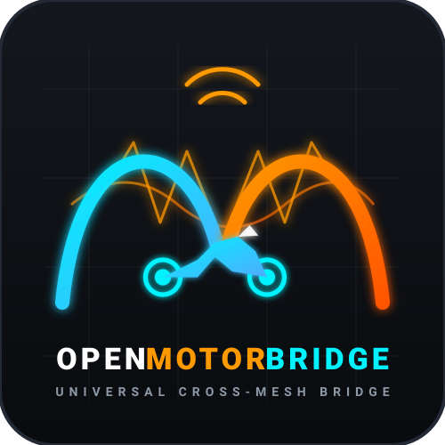
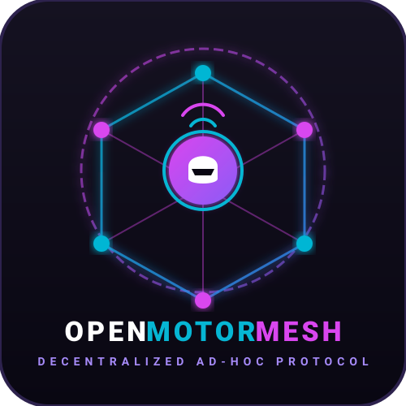

# OpenMotorBridge (v10.0) - Universelle Motorrad-Intercom- & Telemetrie-Bridge

  
  &nbsp;&nbsp;&nbsp;&nbsp;&nbsp;&nbsp;&nbsp;&nbsp;
  

  
  
  
  
  

Die **OpenMotorBridge (OMB)** ist eine offene, herstellerübergreifende Kommunikations- und Telemetrieplattform für Motorräder. Sie verbindet proprietäre Funk- und Mesh-Systeme (z. B. **Sena Mesh 3.0** und **Cardo DMC Gen2**) galvanisch getrennt mit einem offenen **2,4-GHz / 868-MHz OpenMotorMesh (OMM)**, hochpräzisem **GNSS-Tour-Logging (Automotive Dead Reckoning)** und einem **kabellosen WebBLE PWA Cockpit**.

---

## 📚 Inhaltsverzeichnis der Dokumentation

Die modulare technische Gesamtspezifikation gliedert sich in 18 thematisch strukturierte Kapitel:

1. [**01 - Systemarchitektur & Satelliten-Topologie**](docs/de/01_system_architecture.md)  
   *Die 5 standardisierten Funktionsknoten, De-Sensing-Philosophie, HF-Diversität, Whitepaper-Entwurfsentscheidungen und Cockpit-Integration.*

2. [**02 - Intercom-Matrix, Profile & Dynamisches Routing**](docs/de/02_intercom_matrix_profiles.md)  
   *Die 5 OEM-Adapterklassen A-E, LittleFS-Profil-Engine, Zero-Latency PTT (< 1,8 ms) und Audio-Cross-Matrix.*

3. [**03 - Audio-DSP, Akustik & Knowles MEMS Wind-Tracking**](docs/de/03_audio_dsp_acoustics.md)  
   *1500V Bourns Trennung, ES8388 Audio-Codec, Knowles MEMS Fahrtwind-Abtastung & Raised-Cosine Ducking.*

4. [**04 - Mesh-Netzwerk, LoRa & GNSS-Navigation**](docs/de/04_mesh_lora_navigation.md)  
   *OpenMotorMesh (OMM), Dynamic Leader Election (DLE), 868 MHz LoRa Fallback & 10 Hz Multi-GNSS.*

5. [**05 - Stromversorgung, USV-Akkusystem & Power-Gate**](docs/de/05_power_management_ups.md)  
   *LM5164-Q1 72V Buck, BQ24075 USV, TPS25921 Quad-eFuse, Front-Node TPS54302 / SW3526 30W PD & 1-Klick CarPlay Kaltstart.*

6. [**06 - Telemetrie-Blackbox, SDIO-Ringpuffer & WebDAV-Sync**](docs/de/06_telemetry_blackbox_webdav.md)  
   *4-Bit High-Speed SDIO, BGH- und DSGVO-konformer Ringspeicher, ECDSA SHA-256 & automatischer Cloud-Sync.*

7. [**07 - Hardware-Architektur & Platinen-Pinouts (Alle 10 PCBAs)**](docs/de/07_pcba_hardware_pinouts.md)  
   *Alle 10 aktiven Leiterplatten im Detail: Lagenaufbau, Impedanzen, Net-Klassen, Funktionszonen und Pinout-Tabellen (`PCBA 01`, `03`, `05`, `05B`, `05C`, `05D`, `07`, `08`, `09`, `10`).*

8. [**08 - Mechanische Gehäuse, CAD & Referenz-Montagekits**](docs/de/08_enclosures_mechanics_cad.md)  
   *Schraubenlose Dual-Rail Slide-In Monocoques (Typ A & B), Under-Perch Mirror-Pod (`PCBA 05C`), 5-Port Handschuhfach-Hub (`PCBA 05B`), Sensor-Puck (`PCBA 05D`), Radar 2.0 Flügel-Gehäuse mit Garmin-Bajonett sowie 4-Pin IP67 Magnet-Abreißkupplungen.*

9. [**09 - Firmware-Architektur, FreeRTOS & Rollback-OTA**](docs/de/09_firmware_architecture.md)  
   *Multi-Core ESP32-S31 (Main) & ESP32-P4 + ESP32-E22 (Front), Pod-Co-Prozessoren (ESP32-C6), ESP-NOW Low-Latency-Protokoll und ausfallsicheres Dual-Bank OTA.*

10. [**10 - WebApp PWA & Dashboard-Bedienung**](docs/de/10_webapp_pwa_dashboard.md)  
    *Autarkes WebBLE Dashboard, Fahrdynamik-HUD, Front-Node Steuerung (1-Klick Reboot), Begleitfahrzeug- & Kolonnen-Modi, Smart-Keyfob Pager & 4-stufiger GPX-Export.*

11. [**11 - Smart-Managed CarPlay & Android Auto Bridge Architektur (PCBA 05)**](docs/de/11_carplay_android_auto_bridge_architecture.md)  
    *Harley Skyline OS / Boom! Box Integration, CP2AA-Protokollbrücke, virtueller WHIM-Bypass, Quellengefilterte Lenkersteuerung & Headless Dongle Management.*

12. [**12 - Fahrzeug-CAN-Bus-Profile, DBC-JSON-Schema & Universal Telemetrie-Engine**](docs/de/12_can_bus_vehicle_profiles.md)  
    *Datengetriebene LittleFS-Profile für Harley-Davidson, BMW Motorrad, KTM und OBD2, passiver Listen-Only Schutz & EKF-Tunnelführung.*

13. [**13 - Digitale Simulation & Multi-Physik Master-Testbench**](docs/de/13_simulation_testbench.md)  
    *9 modulare Python-Testbenches und 10 HIL-Szenarien für SPICE, Thermik, Transienten, RF und Akustik.*

14. [**14 - EMV-Härtung, Schirmung & ESD-Schutz**](docs/de/14_emv_rf_hardening.md)  
    *Kfz-Transienten nach ISO 7637-2, 2.4 GHz vs 868 MHz Entkopplung, IPC-CC-830B Schutzlack & ISO 16750-3.*

15. [**15 - Stücklisten (BOM) & SMT-Fertigungsdaten (Alle 10 PCBAs)**](docs/de/15_bom_manufacturing.md)  
    *Komplette Bauteilliste für alle 10 aktiven PCBAs, JLCPCB SMT-Bestellcheckliste, Zwei-Kabel-Backbone & COTS-Einkaufsliste.*

16. [**16 - Bauanleitung, Verkabelung & Fahrzeug-Installation**](docs/de/16_build_instructions_assembly.md)  
    *Schritt-für-Schritt Aufbau der schraubenlosen v10 Slide-In Monocoques, 3D-Druck (FDM vs. MJF), Front-Node & Handschuhfach-Hub Montage, seitliche 4-Pin Magnet-Koffer-Durchführung, Smart-Keyfob Zusammenbau & Inbetriebnahme.*

17. [**17 - Automotive-Standards & Normen-Referenzen**](docs/de/17_standards_references.md)  
    *Industrienormen: ISO 7637-2, ISO 16750, ECE R10, RED 2014/53/EU, IEC 61672-1 Class 1 und Bluetooth SIG.*

18. [**18 - Datenschutz (DSGVO), Recht & Konformität**](docs/de/18_legal_compliance_dsgvo.md)  
    *Open-Source-Lizenzen (GPL-3.0, CERN-OHL-S v2, CC BY-SA 4.0), DSGVO/BGH-Konformität & Haftungsausschluss.*

---

## 🛠️ Repository-Übersicht

* **`docs/de/`**: Sämtliche technische Spezifikationen und Designdokumente auf Deutsch.
* **`docs/en/`**: Vollständige technische Spezifikationen auf Englisch.
* **`firmware/main_controller/`**: ESP-IDF / C++ Quellcode für die zentrale Steuerbox (ESP32-S31, PCBA 01).
* **`firmware/front_node/`**: ESP-IDF / C++ Quellcode für den Universal Front-Knoten (ESP32-P4 + ESP32-E22, PCBA 05).
* **`firmware/smart_cartridge/`**: ESP-IDF / C++ Quellcode für die Koffer-Pod-Gateways Pod 1 & 2 (ESP32-C6, PCBA 03).
* **`firmware/radar_submcu/`**: ESP-IDF / C++ Quellcode für Heck-Radar 2.0 Sub-MCU & Halo-Wings (ESP32-C5, PCBA 08).
* **`webapp_pwa/`**: Offlinefähiges WebBLE Dashboard (HTML5, Vanilla JS, CSS3, Service Worker, i18n).
* **`hardware/`**: KiCad Schaltpläne, Gerber-Dateien und 3D-Modelle für das Gehäuse.
* **`tools/audio_testbench/`**: **Interaktives Live Audio DSP Studio & Echtzeit-Simulator** (`python3 tools/audio_testbench/server.py` $\rightarrow$ Web-Audio Testbench mit Live-Mic, Space-PTT, Tacho & Ducking).
* **`tools/simulators/`**: 9 modulare Python-Simulations-Testbenches (`python3 tools/run_all_simulations.py`).

---

## 📜 Lizenzen

* **Hardware & PCB-Layouts:** [CERN-OHL-S v2](https://ohwr.org/project/cernohl/wikis/Documents/CERN-OHL-version-2) (Strongly Reciprocal)
* **Firmware & Web-Dashboard:** [GNU General Public License v3.0 (GPL-3.0)](https://www.gnu.org/licenses/gpl-3.0.html)
* **Dokumentation & 3D-Modelle:** [Creative Commons Attribution-ShareAlike 4.0 International (CC BY-SA 4.0)](https://creativecommons.org/licenses/by-sa/4.0/)

---

## ⚠️ Haftungsausschluss (Disclaimer)

Die in diesem Projekt veröffentlichten Inhalte werden unentgeltlich und auf "AS IS"-Basis zur Verfügung gestellt. Der Nachbau, Einbau und Betrieb erfolgt vollumfänglich auf eigene Verantwortung und eigenes Risiko des Anwenders. Alle genannten Markennamen (Harley-Davidson®, BMW®, Garmin®, Sena®, Cardo®, Apple CarPlay®) sind eingetragene Warenzeichen ihrer jeweiligen Eigentümer.