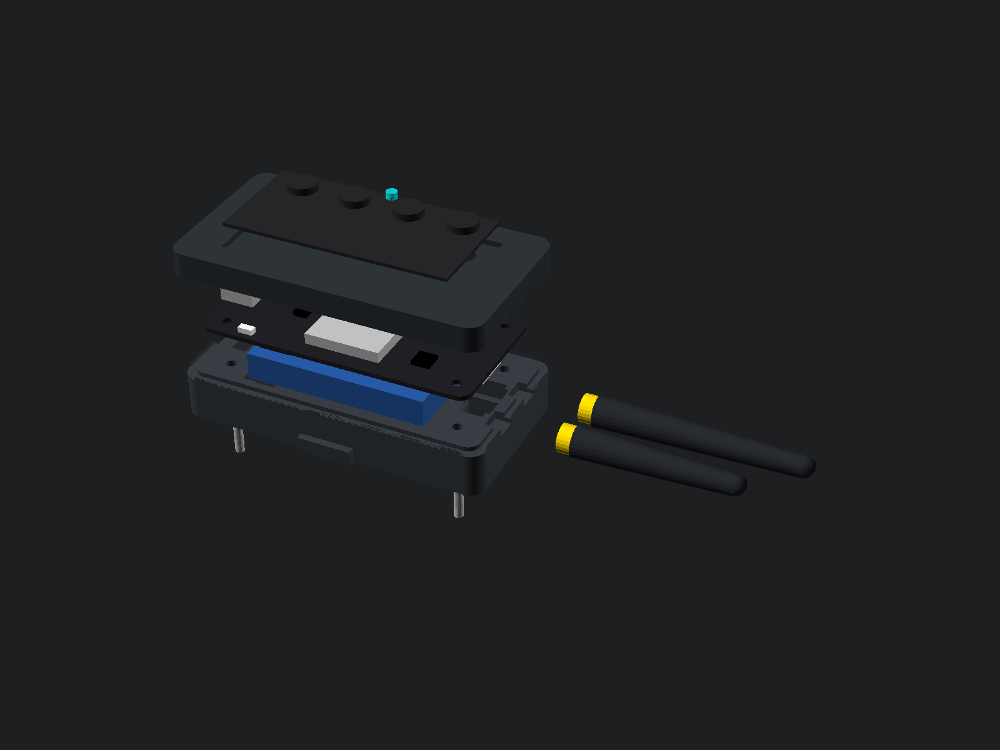
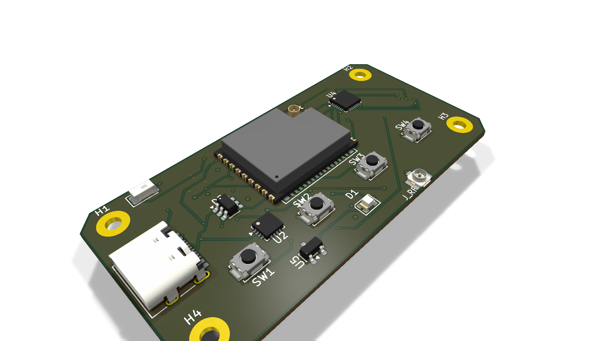
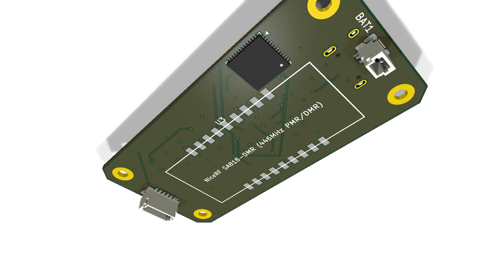
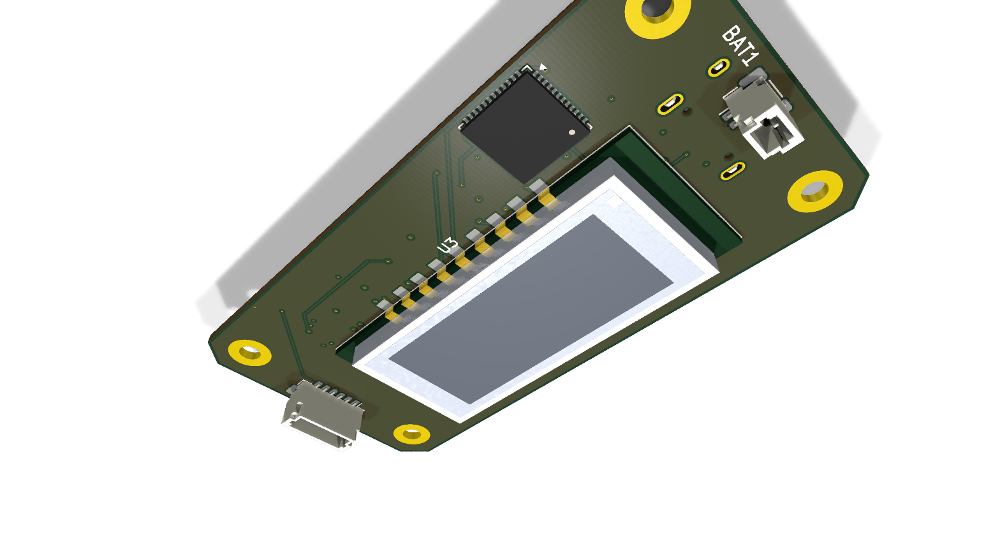
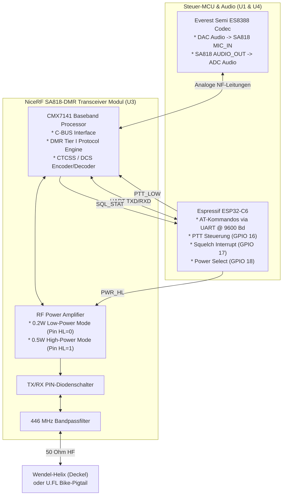

# 04b - OpenMotorMesh (OMM) Universal Tri-Band Intercom-Modul & Pod-Inlays (`PCBA 09/10`): 2.4 GHz HD-Mesh, BT-Mesh/Bridge & 446 MHz PMR/DMR Tier I

Dieses Dokument ist die verbindliche Architekturspezifikation für das vereinheitlichte, quelloffene **OpenMotorMesh (OMM) Universal Tri-Band Intercom- & Funkmodul (`PCBA 09 / PCBA 10`)**. Da sämtliche Bauteile des 2.4-GHz-Mesh-Moduls (`PCBA 09`) auf exakt denselben X/Y-Koordinaten sitzen wie auf der 446-MHz-Platine (`PCBA 10`), vereint die **Universal-Platine (`PCBA 09/10`)** alle **drei unabhängigen Funk-Engines permanent auf einem einzigen $60{,}0 \times 30{,}0 \times 1{,}0\,\text{mm}$ 4-Lagen-Board**:

1. **Engine 1 – OMM 2.4 GHz HD-Mesh (`U1`, `ESP32-C6-MINI-1U`):** High-Definition Ad-hoc-Mesh über 2.4 GHz Wi-Fi 6 / 802.15.4 TDMA mit 6LoWPAN/IPv6-Multicast und Opus-Audio für bis zu 32 Fahrer (über die interne FPC-Antenne am `U1` U.FL-Port).
2. **Engine 2 – Bluetooth Classic BR/EDR & BLE Co-Prozessor (`U6`, `ESP32-PICO-V3-02`):** Nativer Dual-Core Co-Prozessor für Bluetooth Classic HFP 1.7 mSBC (Universal Intercom, Cardo DMC-Bridge, Sena Mesh-Bridge), A2DP Stereo-Audio und BLE 5.x (über die dedizierte Keramik-Chipantenne `ANT1`).
3. **Engine 3 – 446 MHz Analog PMR446 & Digital DMR Tier I (`U3`, `NiceRF SA818-DMR`):** Universeller Jedermannfunk-Transceiver ($0{,}2\,\text{W}$ Helm / $0{,}5\,\text{W}$ Bike) für 100%ige Interoperabilität mit analogen Handfunkgeräten (Midland G7/G9 Pro) und digitalen DMR-Geräten (Midland D-10) über den dedizierten `J_RF` U.FL-Port zur externen SMA-Buchse.

Die Umschaltung zwischen den Einzelmodi (**OMM 2.4 GHz Mesh**, **BT-Mesh / Universal Bridge**, **446 MHz Analog PMR446**, **446 MHz Digital DMR Tier I**) sowie simultanen **Multi-Radio-Kombimodi** erfolgt **zu 100 % rein per Software** (per Taster am Helm, PWA-App oder Zentralbox). Das Modul nutzt den standardisierten **ECE 22.06 UCS-Formfaktor** ($68{,}0 \times 36{,}0 \times 16{,}0\,\text{mm}$) mit integriertem **1000-mAh-LiPo-Akku (`Typ 603040 / 602840`, $3{,}7\,\text{Wh}$)** für **13–18 Stunden** autarke Helmlaufzeit und passt sowohl in den **ECE 22.06 Helmschacht** als auch formschlüssig in die **Kassetten-Inlays von Pod 1 oder Pod 2 (`PCBA 03`)**.

---

# TEIL A: Systemüberblick & Die vereinheitlichte Universal Tri-Band Hardware (`PCBA 09/10`)

## 1. Modul-Konzept, ECE 22.06 UCS-Formfaktor & Trennung der Baugruppen

Um Missverständnissen zwischen der Träger-Mechatronik und dem universellen Intercom-Modul vorzubeugen, trennt OpenMotorBridge v10.0 strikt zwischen **zwei physischen Funktionsebenen**:

```
+---------------------------------------------------------------------------------------------------+
|                   ARCHITEKTUR-TRENNUNG: TRÄGERPLATINE VS. UNIVERSAL OMM-MODUL                     |
+----------------------------------------------------+----------------------------------------------+
| 1. POD-INTERFACEPLATINE (PCBA 03 im Koffer-Pod)    | 2. UNIVERSAL OMM TRI-BAND MODUL (PCBA 09/10) |
+----------------------------------------------------+----------------------------------------------+
| * Verbleibt dauerhaft am Boden des Koffer-Pods     | * Entnehmbares ECE 22.06 UCS-Modul           |
| * 4-Ader Automotive-USB-Bus (12V/PD, USB 2.0)      | * Gehäusemaße: 68.0 x 36.0 x 16.0 mm         |
| * Nativer USB Audio Class 2.0 Link zur Zentralbox  | * Integrierter 1000-mAh-LiPo-Akku (3.7 Wh)   |
|   (Latenz < 0.2 ms, jitterfrei)                    | * BAT1 auf B.Cu direkt unter USB-C Port (J1) |
| * Everest Semi ES8388 24-Bit / 48 kHz Audio-Codec  | * 4x taktile IP67-Taster an Gehäuseoberseite |
| * Null Mechatronik-Verschleiß (keine Hubmagnete!)  | * Wasserdichte stirnseitige USB-C Buchse     |
| * Interner 30W/60W USB-PD Schnellladeport          | * 3 Funk-Engines: OMM 2.4G + BT + 446 MHz    |
| * 8-Pin Kelvin Audio & Power Interface (J_AUDIO)   | * 100 % Software-Umschaltung & Kombimodi     |
| * Null 2.4-GHz/446-MHz-Funk auf Trägerplatine!     | * Nativ digitales USB Audio Class Streaming  |
+----------------------------------------------------+----------------------------------------------+
```

### 1.1 Gegenüberstellung der Bestückungsvarianten & 100% Software-Defined Radio-Modi

Da `PCBA 09` und `PCBA 10` dasselbe identische 4-Lagen-Layout nutzen, ist **`PCBA 10` (`Universal OMM Tri-Band UCS`) die universelle Einheitsplatine**, die sämtliche Funkstandards in Hardware vereint (`PCBA 09` entspricht demselben Layout als optionale reine 2.4-GHz-Bestückung ohne `U3`/`J_RF`):

| Spezifikation | Universal Tri-Band OMM UCS (`PCBA 10 / 09` Vollbestückung) | Optionale 2.4G-Only Bestückung (`PCBA 09` DNP `U3`) |
| :--- | :--- | :--- |
| **Architektur** | **Tri-Band / Triple-Engine („OMB Universal“)** | **Dual-Engine („OMB Lite 2.4G“)** |
| **Engine 1 (2.4 GHz Mesh)** | **Espressif ESP32-C6-MINI-1U (`U1`)**: Wi-Fi 6 / 802.15.4 TDMA Mesh | **Espressif ESP32-C6-MINI-1U (`U1`)**: Wi-Fi 6 / 802.15.4 TDMA Mesh |
| **Engine 2 (BT Classic & BLE)** | **ESP32-PICO-V3-02 (`U6`)**: BT Classic BR/EDR (HFP 1.7, A2DP, Bridge) + BLE | **ESP32-PICO-V3-02 (`U6`)**: BT Classic BR/EDR (HFP 1.7, A2DP, Bridge) + BLE |
| **Engine 3 (446 MHz UHF)** | **NiceRF SA818-DMR (`U3`)**: Analog PMR446 FM + Digital DMR Tier I | Unbestückt (DNP `U3` / `J_RF`), identische Leiterplatte |
| **Modus-Umschaltung** | **100 % per Software** (OMM 2.4G, BT-Mesh/Bridge, PMR446, DMR Tier I & Kombimodi) | **100 % per Software** (OMM 2.4G, BT-Mesh/Bridge & Kombimodus) |
| **Simultaner Kombibetrieb** | **Tri-Band Konferenz & Cross-Band Relay** (2.4G Mesh $\leftrightarrow$ BT $\leftrightarrow$ 446 MHz) | **Dual-Band Konferenz** (2.4G Mesh $\leftrightarrow$ BT-Bridge) |
| **Sendeleistung** | $+20\,\text{dBm}$ (2.4G) + **$0{,}2\,\text{W}$ (Helm) / $0{,}5\,\text{W}$ (Bike, 446 MHz)** | $+20\,\text{dBm}$ ($100\,\text{mW}$ EIRP 2.4 GHz) |
| **Antennen-System** | 1) Interne 2.4G FPC an `U1` U.FL, 2) `ANT1` Keramik (BT), 3) `J_RF` U.FL $\to$ SMA (446 MHz) | 1) 2.4G an `U1` U.FL, 2) `ANT1` Keramik (BT) |
| **Akku & Laufzeit** | **1000 mAh LiPo (`Typ 603040 / 602840`, $40 \times 28 \times 6{,}0\,\text{mm}$, $3{,}7\,\text{Wh}$): 13–18 h** | **1000 mAh LiPo (`Typ 603040 / 602840`, $40 \times 28 \times 6{,}0\,\text{mm}$, $3{,}7\,\text{Wh}$): 16–18 h** |
| **Stecker-Geometrie (`B.Cu`)** | **`BAT1` unter `J1` USB-C** (`Local X=3.45, Y=15.05`), **`J_HELMET` rechts** (`Local X=57.05, Y=14.70`) | **`BAT1` unter `J1` USB-C** (`Local X=3.45, Y=15.05`), **`J_HELMET` rechts** (`Local X=57.05, Y=14.70`) |
| **Gehäuse (ECE 22.06 UCS)** | **$68{,}0 \times 36{,}0 \times 16{,}0\,\text{mm}$** (`UCS_H_BOT = 10.5 mm`, `UCS_H_TOP = 5.5 mm`) | **$68{,}0 \times 36{,}0 \times 16{,}0\,\text{mm}$** (`UCS_H_BOT = 10.5 mm`, `UCS_H_TOP = 5.5 mm`) |

### 1.2 Reine Software-Umschaltung & Simultane Multi-Radio-Kombimodi

Weil alle drei Funk-Frontends über separate Antennen verfügen und gleichzeitig an den Stereo-Codec `ES8388` (`U4`) sowie die Host-MCU `ESP32-C6` (`U1`) angebunden sind, wird der Betriebsmodus ohne jeden Hardware-Eingriff rein in Software gewählt:

* **Einzelmodus 1 – OMM 2.4 GHz HD-Mesh:** Vollduplex Opus-Wideband-Mesh ($24\,\text{kHz}$, $< 18\,\text{ms}$) über `U1`, während `U3` (`SA818-DMR`) per Hardware-Power-Down komplett stromlos geschaltet ist ($I_q < 1\,\mu\text{A}$, ~16–18 h Laufzeit mit 1000 mAh).
* **Einzelmodus 2 – BT-Mesh / Universal Intercom Bridge:** Direkte Kopplung mit Cardo DMC-Bridge, Sena Mesh-Bridge oder Universal HFP Headsets über `U6` (`ESP32-PICO-V3-02`) sowie Smartphone A2DP/BLE.
* **Einzelmodus 3 – 446 MHz Analog PMR446:** 16 Kanäle + 38 CTCSS / 83 DCS Subtöne über `U3` (`SA818-DMR`), kompatibel zu jedem analogen Handfunkgerät (Midland G7/G9 Pro).
* **Einzelmodus 4 – 446 MHz Digital DMR Tier I:** Glasklarer rauschfreier Digitalfunk (4FSK TDMA, AMBE+2, Color Code 1–16) über `U3`, kompatibel zu Midland D-10 & Retevis RT3S.
* **Kombimodus A (`OMM 2.4 GHz + BT-Bridge`):** Simultanes Sprechen im OMM 2.4 GHz Mesh und über die Bluetooth-Bridge zu Cardo/Sena-Fahrern.
* **Kombimodus B (`OMM 2.4 GHz + 446 MHz Cross-Band Relay`):** Das Helm- oder Pod-Modul hält gleichzeitig das 2.4 GHz Vollduplex-Mesh offen und überwacht im Hintergrund Kanal 1–16 auf 446 MHz (Analog PMR446 oder DMR Tier I). Sobald die Rauschsperre (`SA818_SQL`) öffnet, wird der 446-MHz-Funkspruch live ins 2.4-GHz-Mesh eingemischt; per PTT antwortet der Fahrer direkt auf 446 MHz.
* **Kombimodus C (`Full Tri-Band Gateway`):** Simultane Konferenz-Brücke zwischen OMM 2.4 GHz Mesh (`U1`), Bluetooth-Intercom/Smartphone (`U6`) und 446 MHz PMR/DMR (`U3`) über die digitale `ES8388` Audio-Matrix.

---

## 2. Mechanik, 1000-mAh-Akku-Integration & ECE 22.06 UCS-Formfaktor ($68 \times 36 \times 16\,\text{mm}$)

Das Gehäuse des Universal-OMM-Moduls erfüllt exakt die internationale **Universal Communication Solution (UCS) Spezifikation** nach **Helmnorm ECE 22.06** und ist mit **$16{,}0\,\text{mm}$ Gesamthöhe** exakt so flach wie ein Sena 50R Slim ($16\,\text{mm}$) und $7\dots 11\,\text{mm}$ flacher als ein Cardo Packtalk Edge ($23\,\text{mm}$) oder Sena 50S ($27\,\text{mm}$).



*Abbildung 4b.1: 3D-CAD-Ansicht des universellen OMM UCS-Moduls (`omm_ucs_module.scad`). Sichtbar sind die zweischalige PA12-Monocoque-Konstruktion ($68 \times 36 \times 16{,}0\,\text{mm}$ mit `UCS_H_BOT = 10.5 mm` und `UCS_H_TOP = 5.5 mm`), die 4x formschlüssigen DIN 934 M2 Sechskant-Mutterntaschen in der Oberschale, die monolithische Shore 50A Silikon-Tastmatte mit Haptiknoppen, die frontale wasserdichte USB-C Schnittstelle sowie die seitlichen ECE 22.06 Schnapprastnasen.*

```
+-----------------------------------------------------------------------------------------+
|          UCS-GEHÄUSEABMESSUNGEN (68 x 36 x 16 mm) & UNTERSEITEN-GEOMETRIE (B.Cu)        |
+-----------------------------------------------------------------------------------------+
|                                                                                         |
|       |<--------------------------- 68,0 mm -------------------------->|                |
|       +----------------------------------------------------------------+  ^             |
|       | [Rastnase L]                                      [Rastnase R] |  |             |
|       |   |   |<----- 48,0 mm Freier Zentralbereich ----->|    |       |  |             |
|       |   v   |       (X_lokal = 6,0 .. 54,0 mm)          |    v       |  | 36,0 mm     |
|   (=) | [BAT1]|   +-----------------------------------+   | [J_HELMET] |  |             |
|   USB |  2-Pin|   | SA818-DMR (3,2 mm) +              |   |   6-Pin    |  |             |
|   -C  | JST-SH|   | 1000 mAh LiPo 603040 (40x28x6 mm) |   |  JST-SH    |  v             |
|       +----------------------------------------------------------------+                |
|         X=3,45                                                X=57,05                   |
|                                                                                         |
|       |<------------- 16,0 mm Gehäusedicke (10,5 mm Bot + 5,5 mm Top) ->|               |
|       +----------------------------------------------------------------+                |
|       | 1. OBERSCHALE (5,5 mm, PA12 MJF, Dichtnut & 4x DIN 934 M2 Mutterntaschen)       |
|       | ~~~~~~~~~~~~~~~~~ Shore 40A Silikondichtschnur (IP67) ~~~~~~~~~~~~~~~~~        |
|       | 2. PCBA 09/10 (1,0 mm) + SA818-DMR (3,2 mm) + 1000-mAh-LiPo (6,0 mm, 3,7 Wh)    |
|       | 3. UNTERSCHALE (10,5 mm, PA12 MJF, 0,0 mm Überstand & ECE 22.06 Helmrasten)     |
|       +----------------------------------------------------------------+                |
+-----------------------------------------------------------------------------------------+
```

### 2.0 Symmetrische Stecker-Anordnung auf `B.Cu` (`BAT1` unter `J1` USB-C & `J_HELMET` rechts)
Damit der große **1000-mAh-LiPo-Akku (`Typ 603040 / 602840`, $40 \times 28 \times 6{,}0\,\text{mm}$)** keinen einzigen Steckverbinder auf der Platinenunterseite (`B.Cu`) verdeckt, sind die beiden SMD-Stecker an die gegenüberliegenden Stirnseiten außerhalb des $48{,}0\,\text{mm}$ breiten Zentralfachs gerückt:
* **`BAT1` (2-Pin JST-SH Akku-Header auf `B.Cu`):** Sitzt bei **`KiCad (73.45, 100.05)` (`Local X = 3.45 mm, Y = 15.05 mm`, `rot = -90°`)** exakt unterhalb der SMD-USB-C-Buchse `J1` (`F.Cu`), direkt neben dem Lade-IC `U2` (`BQ24075`).
* **`J_HELMET` (6-Pin JST-SH Helm-Audio/PTT-Header auf `B.Cu`):** Sitzt symmetrisch gegenüber am rechten Platinenrand bei **`KiCad (127.05, 99.70)` (`Local X = 57.05 mm, Y = 14.70 mm`, `rot = +90°`)**.
* **Freier Zentralbereich (`Local X = 6.0 .. 54.0 mm`):** Zwischen `BAT1` (endet bei $X = 5{,}6\,\text{mm}$) und `J_HELMET` (beginnt bei $X = 54{,}2\,\text{mm}$) stehen volle **$48{,}0 \times 30{,}0\,\text{mm}$** zur Verfügung. Dort liegen das `SA818-DMR` ($38 \times 16 \times 3{,}2\,\text{mm}$) und die `1000 mAh LiPo`-Zelle ($40 \times 28 \times 6{,}0\,\text{mm}$), während sowohl `BAT1` als auch `J_HELMET` zu 100 % frei zugänglich bleiben.
* **Vertikaler Stack-up ($16{,}0\,\text{mm}$ Gesamtgehäuse):** Von der Trennebene bis zum Gehäuseboden misst die Unterschale `UCS_H_BOT = 10.5 mm` ($9{,}4\,\text{mm}$ lichte Innenhöhe unter `B.Cu` bei $1{,}1\,\text{mm}$ Bodenwandstärke). Damit passen `SA818-DMR` ($3{,}2\,\text{mm}$) + `1000 mAh LiPo` ($6{,}0\,\text{mm}$) = $9{,}2\,\text{mm}$ vollständig bündig und ohne jeden Bodenüberstand ($0{,}0\,\text{mm}$) in die Unterschale!

### 2.1 Verbindliche Befestigungs-Philosophie: Formschlüssige DIN 934 Mutterntaschen
> [!IMPORTANT]
> **Strikter Ausschluss selbstschneidender Schrauben:**
> Das Einschneiden von Gewinden direkt in Kunststoff führt bei mobilen Geräten nach wenigen Wartungszyklen zum Ausleiern des Kunststoffs und zum Totalverlust der Dichtigkeit (IP67-Versagen).
> 
> Beide OMM-Gehäuse nutzen daher **ausnahmslos formschlüssige DIN 934 M2 Sechskantmutter-Taschen** in der Oberschale. Das Modul kann über die 4x M2-Edelstahlschrauben **beliebig oft zerstörungsfrei geöffnet und wieder verschraubt werden** (z. B. für Akkutausch nach Jahren, Reinigung oder Hardware-Upgrades).

### 2.2 Schnittstellen-Architektur: Trennung von Helm-Audio (`J_HELMET`) und USB-C (`J1`)

Der UCS-Standard nach ECE 22.06 normiert die mechanische Kavität, lässt den elektrischen Steckverbinder jedoch bewusst frei. Um Ladebrummen, Windgeräusche und Kabelgewirr im Fahrtwind vollständig auszuschließen, setzt OpenMotorBridge auf eine **strikte Trennung von zwei Schnittstellen**:

1. **`J_HELMET` (Gehäuseboden / B.Cu):** Interner 6-Pin JST-SH Header für Lautsprecher, Mikrofon und PTT direkt durch den Gehäuseboden ins Helminnere.
2. **`J1` (Gerätestirnseite):** Universelle IP67-versiegelte 16-Pin USB-C Buchse – bleibt am Helm 100 % frei für unterbrechungsfreies Laden während der Fahrt und WebUSB-Updates.

```
+-----------------------------------------------------------------------------------------+
|             OMM DUAL-SCHNITTSTELLEN-ARCHITEKTUR (J_HELMET & USB-C J1)                  |
+-----------------------------------------------------------------------------------------+
|                                                                                         |
|  [ OMM UCS-Modul: PCBA 09 oder PCBA 10 ]                                                |
|        |                                                                                |
|        +---> 1x Interner 6-Pin JST-SH Header (J_HELMET, Gehäuseboden / B.Cu)            |
|        |           |                                                                    |
|        |           +--- STANDALONE-BETRIEB IM HELM (AUDIO & PTT):                       |
|        |                Direkt durch den Gehäuseboden (7 x 9 mm Schlitz) ins Helminnere:|
|        |                * Pin 1: HP_OUT_L (Lautsprecher Links, ES8388 LOUT1)            |
|        |                * Pin 2: HP_OUT_R (Lautsprecher Rechts, ES8388 ROUT1)           |
|        |                * Pin 3: AGND_SPK (Stromlose Audiomasse, I = 0 mA)              |
|        |                * Pin 4: MIC_IN+ (Elektret/MEMS-Mikrofonsignal, ES8388 MIC1P)   |
|        |                * Pin 5: AGND_MIC (Stromlose Mikrofonmasse, I = 0 mA)           |
|        |                * Pin 6: BTN_PTT (Hardware-PTT-Tastung gegen Masse)             |
|        |                => Null Kabel im Fahrtwind, kein Ladebrummen (reine 0V DC Audio)|
|        |                                                                                |
|        +---> 1x IP67-versiegelte 16-Pin USB-C Buchse (J1, Gerätestirnseite)             |
|                    |                                                                    |
|                    +--- MODUS 1: LADEN UNTERWEGS WÄHREND DER FAHRT                      |
|                    |    Bleibt am Helm frei zugänglich (mit Silikon-Dichtkappe):        |
|                    |    * Powerbank in Jackentasche oder 20W-Ladeport am Front-Node     |
|                    |    * Simultanbetrieb: Laden + Funken/Musik ohne Unterbrechung      |
|                    |      dank TI BQ24075 Dynamic Power-Path Management!                |
|                    |                                                                    |
|                    +--- MODUS 2: EINSATZ IM POD (SMART CARTRIDGE PCBA 03)               |
|                    |    USB-C auf 8-Pin JST-SH Adapterkabel (Länge 5 cm, 90° gewinkelt):|
|                    |    * Pin 1: PGND (USB-C GND Rückstrom, bis 600 mA Sendepeak)        |
|                    |    * Pin 2: VCC_5V_PROT (USB-C VBUS Speisung & BQ24075 USV-Ladung)  |
|                    |    * Pin 3..5: Nicht belegt (N/C, Analogaudio im Bike entfällt)    |
|                    |    * Pin 6: OMM_DETECT (Offen/NC -> 10k R9 zieht HIGH -> U4 NO)     |
|                    |    * Pin 7: AUDIO_IO_P -> USB-C D+ (Nativer digitaler USB-Audio D+) |
|                    |    * Pin 8: PTT_USB_N -> USB-C D- (Nativer digitaler USB-Audio D-)  |
|                    |    => Reiner digitaler USB-Audiostream, null D/A-Wandlungsverluste!|
|                    |                                                                    |
|                    +--- MODUS 3: FLASHING, DFU & SERVICE (WARTUNG)                      |
|                         Standard USB-C Datenkabel am PC / Web-Browser (WebUSB):         |
|                         * VBUS & GND: 5V Versorgung und Akkuladung                      |
|                         * D+ & D-: ESP32-C6 Nativer USB PHY (GPIO 13/12)                |
|                           Vollwertiges WebUSB/DFU-Flashing, Logging & Firmware-Updates! |
+-----------------------------------------------------------------------------------------+
```

---

# TEIL B: OMM 2.4 GHz HD-Mesh Intercom (`PCBA 09`)

## 3. OMM 2.4 GHz Hardware- & Platinen-Design (`PCBA 09`)


*Abbildung 4.1a: PCBA 09 Top 3D (Aktuelles Routing & Placement) – ESP32-C6 Host-MCU (U1), ES8388 Audio-Codec (U4), BQ24075 PMIC (U2), ME6211 3.3V LDO (U3), IP67 USB-C (J1) und 4-Tasten-Reihe.*


*Abbildung 4.1b: PCBA 09 Bottom 3D (Dual-Engine OMB Lite) – Dedizierter ESP32-PICO-V3-02 Bluetooth Classic/BLE Co-Prozessor (U5) und Johanson 2450AT Chipantenne (ANT1) zur CoEx-freien Funkentkopplung.*

```mermaid
flowchart TD
    subgraph Power["Power & Battery Management (TI BQ24075)"]
        USBC["IP67 USB-C Port\n(5V VBUS & Data)"] -->|5V In| PMIC["TI BQ24075 PMIC\n(Dynamic Power Path)"]
        BAT["1S LiPo 1000 mAh\n(3.7V / 3.7 Wh, Typ 603040\nmit DW01A PCM an BAT1 B.Cu)"] <-->|Charge/Discharge| PMIC
        NTC["NTC 10k Thermistor\n(JEITA 0..45°C)"] -->|Temp Sense| PMIC
        PMIC -->|System Rail 3.8..4.4V| LDO["3.3V LDO Regulator\n(500 mA, Low-Iq)"]
        LDO -->|3.3V Rail| VDD["3.3V Systemnetz"]
    end

    subgraph MCU["Host MCU & RF Core"]
        C6["Espressif ESP32-C6-MINI-1U\n(160 MHz RISC-V, 4 MB Flash)\n* 2.4 GHz Wi-Fi 6 (802.11ax)\n* 802.15.4 TDMA Mesh Radio\n* Bluetooth 5.3 LE\n* U.FL Goldbuchse"]
        ANT["Taoglas FXP73\n2.4 GHz Flex-Dipol (+3.0 dBi)\n(Direkt an U1 U.FL-Port)"] <-->|2.4 GHz RF| C6
        RGB["WS2812B-2020\nRGB Status-LED"] <--|GPIO 11| C6
        KEYS["4x IP67 Mikrotaster\n(Power, Mesh, Vol+, Vol-)"] -->|GPIO 0..3| C6
    end

    subgraph Audio["Audio Frontend (Everest Semi ES8388)"]
        C6 <-->|I2S Bus (MCLK, BCLK, WS, DOUT, DIN)\n+ I2C Control (SCL, SDA)| CODEC["Everest Semi ES8388\n(24-Bit / 96 kHz Stereo Codec)"]
        CODEC -->|Stereo HP Amp (2x 45 mW @ 16 Ohm)| HP["Helmlautsprecher L/R\n(40 mm JBL / Sena HD\nvia 3.5 mm Klinke)"]
        MIC["Mikrofon (ECM / Schwanenhals)\nvia 2-Pin JST-JWPF"] -->|Low-Noise Preamp + MICBIAS| CODEC
    end

    USBC <-->|USB 2.0 D+/D- & WebUSB Flashing| C6
    VDD --> C6
    VDD --> CODEC
```

### 3.1 TDMA Superframe & Protokoll-Stack (Layer 1 bis 4)
* **Layer 1 (TDMA Superframe):** $10{,}0\,\text{ms}$ Superframe-Zyklus (100 Hz). Subframe 0 überträgt Sidelink Synchronization Signals (SLSS); Subframes 1–9 bieten kollisionsfreie Zeitschlitze für bis zu 6 gleichzeitige Vollduplex-Sprecher.
* **Layer 2 (802.11s-Light Duplicate Filter):** 16-Byte Header mit monoton steigender Sequenznummer und 64-Entry Cache verwirft Mehrwege-Duplikate in $< 5\,\mu\text{s}$.
* **Layer 3 (6LoWPAN / IPv6 Multicast):** Komprimiert 40-Byte IPv6 Header auf 2–4 Bytes. Vollständig kollisionsfreies Multicast ohne TCP Head-of-Line Blocking.
* **Layer 4 (Opus over RTP):** 24 kHz Breitband HD mit adaptivem Jitter-Puffer ($20\dots 50\,\text{ms}$) und Packet Loss Concealment (PLC). Systemlatenz: **$< 18\,\text{ms}$**.

### 3.2 Die Triple-Engine / Dual-Engine Architektur: Trennung von Mesh, Bluetooth & 446 MHz („OMB Universal“)

> [!IMPORTANT]
> **Das Flaschenhals-Problem des „Shared Radio“ auf Single-Chip-Systemen:**
> Der ESP32-C6 besitzt hardwareseitig nur **einen einzigen physikalischen 2.4-GHz-Transceiver (LNA/PA/Mischer)**, den sich Wi-Fi 6 (ESP-NOW Mesh) und Bluetooth Low Energy (BLE 5.3) im Time-Division-Multiplexing (TDM) teilen müssen. Zudem beherrscht der ESP32-C6 hardwarebedingt **kein Bluetooth Classic (BR/EDR)**.
> 
> Wenn ein einzelner Chip gleichzeitig Echtzeit-Audio im Mesh (Opus-Frames alle 10–20 ms) und BLE (Smartphone PWA-App, Telemetrie, Scanning) verarbeiten soll, erzwingt der interne Hardware-Coexistence-Arbiter regelmäßige Funk-Umschaltzeiten. Dies führt bei mobilen Funknetzen unweigerlich zu **Mikro-Jitter, Pufferunterläufen und hörbaren Audio-Aussetzern**.

Zur vollständigen Beseitigung dieses Flaschenhalses setzt OpenMotorBridge auf der vereinheitlichten Universal-Platine (`PCBA 09/10`) auf eine kompromisslose **Multi-Engine-Architektur**:

```
+---------------------------------------------------------------------------------------------------+
|                   MULTI-ENGINE ARCHITEKTUR: OMM 2.4 GHz, BT & 446 MHz („OMB UNIVERSAL“)           |
+----------------------------------------------------+----------------------------------------------+
| 1. HOST / MESH-ENGINE: ESP32-C6-MINI-1U (U1)       | 2. BLUETOOTH CO-PROZESSOR: ESP32-PICO-V3 (U6)|
+----------------------------------------------------+----------------------------------------------+
| * 100% dediziertes Wi-Fi 6 / ESP-NOW Mesh (2.4G)   | * Dual-Core 240 MHz Xtensa LX6 MCU           |
| * UND gleichzeitiger SA818-DMR Controller (U3)     | * Integriert: 8 MB SPI Flash + 2 MB PSRAM    |
| * Bluetooth in C6-Firmware KOMPLETT deaktiviert     | * Bluetooth Classic (BR/EDR) + BLE 4.2 / 5.x |
|   (`CONFIG_BT_ENABLED=0`)                          | * Universal Intercom (HFP 1.7 mSBC HD Voice) |
| * Transceiver permanent auf Mesh-Kanal gelockt     | * Cardo DMC-Bluetooth Bridge & Sena Bridge   |
| * Null Radio-Konkurrenz, null CoEx Time-Slicing    | * A2DP HiFi Stereo-Streaming (Musik/Navi)    |
| * Garantierte Audio-Latenz < 15 ms                 | * Smartphone PWA Companion App (BLE GATT)    |
| * Interne U.FL-Dipol-Antenne (Taoglas Flex)        | * Eigene 2.45 GHz Keramik-Chipantenne (ANT1) |
+----------------------------------------------------+----------------------------------------------+
                         |                                          |
                         +------------ High-Speed UART (3 Mbps) ----+
                         |             (Hardware Flow Control)      |
                         v                                          v
                   +------------------------------------------------------+
                   | Everest Semi ES8388 HiFi Stereo Audio Codec (U4)     |
                   | * Hardware & Digital Audio Mixing (2.4G + BT + 446M) |
                   | * Vollduplex Stereo Headset & Mikrofon-Vorverstärker |
                   +------------------------------------------------------+
```

### 3.3 Simultane Doppel-/Dreifach-Verbindung & Cross-Over Bridge (Cardo DMC / Sena / PMR446)

Weil der ESP32-C6 (`U1`), der ESP32-PICO-V3-02 (`U6`) und der NiceRF SA818-DMR (`U3`) über **drei völlig getrennte physikalische HF-Frontends und Antennen** verfügen, entsteht ein echter **Multi-Radio Vollduplex-Betrieb**:

1. **Gleichzeitige Konversation ohne Umschalten:**
   * Der Fahrer spricht kontinuierlich in der OpenMotorMesh-Gruppe (2.4 GHz ESP-NOW) und überwacht parallel den 446-MHz-PMR/DMR-Kanal.
   * **Gleichzeitig** bleibt die Bluetooth-Universal-Intercom-Verbindung zu einem externen Headset (z. B. Sena oder Cardo ohne Mesh) aktiv. Alle Audio-Streams werden im `ES8388` Codec bzw. DSP verzerrungsfrei überlagert.

2. **OpenMotorBridge als Gateway (DMC-, Sena- und 446-MHz-Bridge):**
   * **Cardo DMC-Bluetooth Bridge Integration:** Ein Cardo Packtalk Fahrer aktiviert in der Cardo-App die offizielle Funktion *„DMC-Bluetooth Bridge“*. Das OMM-Modul koppelt sich per Bluetooth an diesem Packtalk. Der Audiostream der gesamten Cardo-DMC-Gruppe wird nun live in das OpenMotorMesh eingespeist – und das OMM-Mesh zurück in die Cardo-Gruppe!
   * **Sena Mesh Intercom Bridge:** Dasselbe Prinzip bindet Sena-Mesh-Gruppen über ein einzelnes gebrücktes Bluetooth-Glied in das OpenMotorMesh ein.
   * **Eigene OMM-Bridge für Fremdfahrer:** Ein Gastfahrer ohne OpenMotorBridge wird per Bluetooth Classic Universal Intercom oder per 446-MHz-Funkgerät an das Helm-Modul gekoppelt und von diesem automatisch für alle OMM-Mesh-Teilnehmer hörbar gemacht.

3. **Autarkes „OMB Universal“ für Reisen & Leihfahrzeuge (z. B. USA-Tour):**
   * Das Modul im ECE 22.06 UCS-Helm benötigt **kein Motorrad und keine Zentralbox**, um voll funktionsfähig zu sein.
   * Mit dem integrierten **1000-mAh-LiPo-Akku (`Typ 603040 / 602840`, $3{,}7\,\text{Wh}$)**, BQ24075 PMIC, ES8388 Codec und den drei Funkstufen ist das Helm-Modul ein vollwertiges, eigenständiges High-End-Intercom (**13–18 Stunden Laufzeit**) für Leihmotorräder, Fahrräder oder Mietwagen.

### 3.4 Inter-MCU Pinbelegung (ESP32-C6 <-> ESP32-PICO-V3-02)

| Signal | ESP32-C6 (`U1`) | ESP32-PICO-V3-02 (`U5/U6`) | Funktion |
| :--- | :--- | :--- | :--- |
| `BT_UART_TX` | GPIO 16 (Pad 18) | IO1 / U0TXD (Pad 41) | Serieller Telemetrie- & Audio-Datenstrom (PICO -> C6) |
| `BT_UART_RX` | GPIO 17 (Pad 19) | IO3 / U0RXD (Pad 40) | Serieller Telemetrie- & Audio-Datenstrom (C6 -> PICO) |
| `BT_UART_RTS` | GPIO 15 (Pad 17) | IO15 / MTDO (Pad 21) | Hardware Flow Control RTS |
| `BT_UART_CTS` | GPIO 14 (Pad 16) | IO13 / MTCK (Pad 20) | Hardware Flow Control CTS |
| `BT_RESET` | GPIO 18 (Pad 20) | EN / CHIP_PU (Pad 9) | Hardware-Reset & Wakeup des Co-Prozessors |
| `BT_BOOT` | GPIO 2 (Pad 8) | IO0 (Pad 23) | Boot-Strap für WebUSB DFU-In-Circuit-Flashing |
| `BT_ANT` | – | LNA_IN (Pad 2) | $50\,\Omega$ HF-Leitung zur Johanson 2450AT18 Chip-Antenne |

---

# TEIL C: OMM 446 MHz Analog & Digital PMR/DMR Modul (`PCBA 10`)

## 4. OMM 446 Motivation & System-Architektur

Das **OMM 446 MHz Intercom-Modul (`PCBA 10`)** schließt die gravierende Lücke zwischen modernen Motorrad-Mesh-Systemen und dem weltweit verbreiteten Jedermannfunk im 446-MHz-Band:

```
+-----------------------------------------------------------------------------------------+
|                  DAS PROBLEM MIT KLASSISCHEN HANDFUNKGERÄTEN AM MOTORRAD                |
+----------------------------------------------------+------------------------------------+
| TRADITIONELLE HANDFUNKGERÄTE (Midland G9 / D-10)   | DIE OPENMOTORBRIDGE-LÖSUNG: PCBA 10|
+----------------------------------------------------+------------------------------------+
| * Klobige Ziegelstein-Gehäuse (122 x 58 x 34 mm)   | * Flache UCS-Modulform: 68 x 36 mm |
| * Dicke Gürtelclips & Drehpotentiometer            | * Passt mechanisch in Helmkavität  |
| * Passen physisch in keinen Kassetten-Schlitten!   | * Passt formschlüssig in Kassetten-|
| * Lange, starre Peitschenantennen (12 bis 24 cm)   |   Schlitten von Bucht 1 und Bucht 2|
| * Teardown zerstört Garantie, Dichtung & Wert      | * Dual-Mode: Analog FM + DMR Tier I|
| * Keine direkte Einbindung ins Cockpit-Display     | * 100% digital steuerbar via UART  |
+----------------------------------------------------+------------------------------------+
```


*Abbildung 4.2a: PCBA 10 Top 3D (Aktuelles Routing & Placement) – ESP32-C6 Host-MCU (U1), ES8388 Audio-Codec (U4), BQ24075 PMIC (U2), ME6211 3.3V LDO (U5), IP67 USB-C (J1) und 4-Tasten-Reihe.*


*Abbildung 4.2b: PCBA 10 Bottom 3D (NiceRF SA818 & Dual-Engine) – NiceRF SA818-DMR Transceiver (U3), ESP32-PICO-V3-02 Bluetooth Co-Prozessor (U6) und Johanson 2450AT Chipantenne (ANT1).*

### 4.1 Technische Platinen-Kenndaten & Lagenaufbau (`PCBA 10 / 09`)
* **Platinen-ID:** `openmotorbridge_omm446_ucs` / `openmotorbridge_omm_ucs` (**`PCBA 10 / PCBA 09` Universal Tri-Band UCS**).
* **Abmessungen:** $60{,}0 \times 30{,}0 \times 1{,}0\,\text{mm}$ ($R = 2{,}5\,\text{mm}$ Eckenverrundung) – identische Einheitsplatine für alle Funkmodi.
* **Lagenaufbau:** 4-Lagen FR4 TG150 ($1{,}0\,\text{mm}$ Materialstärke):
  - Top Layer (`F.Cu`, $35\,\mu\text{m}$ Cu): ESP32-C6 Host-MCU (`U1`), ES8388 Stereo Audio-Codec (`U4`), TI BQ24075 PMIC (`U2`), ME6211C33 LDO (`U5`), 4x Taster (`SW1`–`SW4`), IP67 USB-C (`J1`), WS2812B RGB (`D1`), U.FL Koaxialbuchse (`J_RF` bei `110.2, 113.5`).
  - Inner Layer 1 ($17{,}5\,\mu\text{m}$ Cu): Durchgehende, ununterbrochene Massefläche (`AGND` & `GND` Shielding unter dem SA818-DMR Transceiver).
  - Inner Layer 2 ($17{,}5\,\mu\text{m}$ Cu): Niederohmige Stromversorgungs-Planes ($3{,}3\,\text{V}$ System, $4{,}4\,\text{V}$ PA-Versorgung).
  - Bottom Layer (`B.Cu`, $35\,\mu\text{m}$ Cu): **2-Pin JST-SH LiPo-Anschluss (`BAT1` direkt unterhalb des USB-C Ports `J1` bei `KiCad 73.45, 100.05` / `Local 3.45, 15.05`, `rot = -90°`)**, NiceRF SA818-DMR SMD-Modul (`U3` im freien Zentralbereich `Local X = 6.0 .. 54.0 mm`), ESP32-PICO-V3-02 Bluetooth Co-Prozessor (`U6`), Johanson 2450AT Chipantenne (`ANT1`), **6-Pin Helm-Audio & PTT Header (`J_HELMET` rechts außen bei `KiCad 127.05, 99.70` / `Local 57.05, 14.70`, `rot = +90°`)**.
* **Oberflächenfinish:** ENIG (Electroless Nickel Immersion Gold) für maximale Korrosionsbeständigkeit gegen Schweiß und Kondenswasser.

---

## 5. NiceRF SA818-DMR Transceiver & Funk-Architektur

Das HF-Herzstück von `PCBA 10` ist das ultrakompakte **NiceRF SA818-DMR SMD-Transceiver-Modul** ($38 \times 16 \times 3{,}2\,\text{mm}$):



### 5.1 Die zwei Betriebsmodi: Analog PMR446 vs. Digital DMR Tier I

#### Modus 1: Analog PMR446 (Klasse 3a Kompatibilität)
* **Frequenzbereich:** $446{,}00625\,\text{MHz}$ bis $446{,}19375\,\text{MHz}$ (16 Kanäle im $12{,}5\,\text{kHz}$ Raster).
* **Modulation:** Schmalband-FM (11K0F3E) mit $\pm 2{,}5\,\text{kHz}$ Maximalhub.
* **Subaudio-Selektivruf (Squelch-Kodierung):**
  - **38 CTCSS-Töne:** $67{,}0\,\text{Hz}$ bis $250{,}3\,\text{Hz}$ kontinuierlicher Subton.
  - **83 DCS-Codes:** Digitale 23-Bit-Telegramme zur Vermeidung fremder Funksprüche.
* **100% Interoperabilität:** Voll kompatibel zu allen handelsüblichen PMR446-Funkgeräten im Feld (**Midland G7 Pro, G9 Pro, G11, G13, G15, G18**, Motorola TLKR / T82, Retevis, Baofeng).

#### Modus 2: Digital DMR Tier I (Klasse 3b Kompatibilität)
* **Standard:** ETSI TS 102 361-1 konform (lizenzfreier Digitalfunk im 446-MHz-Band).
* **Modulation:** 2-Slot TDMA mit 4FSK Modulation ($4{,}8\,\text{kbaud} / 9{,}6\,\text{kbps}$ Brutto-Bitrate).
* **Sprachcodec:** AMBE+2 ($2450\,\text{bps}$ Vocoder + $1150\,\text{bps}$ FEC Fehlerschutz).
* **Selektivruf & Adressierung:**
  - 16 programmierbare Digital-Kanäle.
  - **Color Codes 1 bis 16:** Trennt verschiedene Gruppen auf derselben Frequenz digital voneinander.
  - **DMO Direktmodus (Peer-to-Peer):** Volldigitale Sprachübertragung direkt von Modul zu Modul ohne Repeater oder Relaisstationen.
* **Der entscheidende Vorteil gegenüber Analog:** **Glasklare, vollkommen rauschfreie Sprachübertragung bis an die physikalische Empfangsgrenze.** Während Analogfunk bei schwächerem Signal zunehmend verrauscht und unleserlich wird, bleibt DMR glasklar verständlich – erst bei vollständigem Signalabriss bricht die Verbindung digital ab.
* **100% Interoperabilität:** Voll kompatibel zu digitalen Handfunkgeräten wie dem **Midland D-10**, Retevis RT3S, TyT MD-380.

---

## 6. Sendeleistung, Antennensystem & SAR-Konformität

### 6.1 Dual-Power Sendeleistungsumschaltung (0.2 W vs. 0.5 W ERP)
Das SA818-DMR Modul verfügt über einen dedizierten Umschaltpin `HL` (`SA818_PWR_HL`, gesteuert über ESP32-C6 `GPIO 18`):

| Betriebsmodus | Steuersignal `SA818_PWR_HL` | ERP-Sendeleistung | Reichweite (Freifeld) | Anwendungsbereich / Zulassung |
| :--- | :--- | :--- | :--- | :--- |
| **Helm-Modus (Standalone)** | **`LOW` (0 V)** | **$0{,}2\,\text{W}$ ($200\,\text{mW}$)** | **$1{,}5\dots 2{,}5\,\text{km}$** | **SAR-Safe:** Minimale HF-Absorption am Kopf; schont den **1000-mAh-LiPo-Akku (Laufzeit 13–18 h)**. |
| **Bike-Modus (Pod im Koffer)** | **`HIGH` ($3{,}3\,\text{V}$)** | **$0{,}5\,\text{W}$ ($500\,\text{mW}$)** | **$3{,}0\dots 6{,}0\,\text{km}$** | **Maximales PMR446-Gesetzeslimit:** Speisung über 5V-Bordnetz; maximale Reichweite bei Überlandfahrten. |

* **Autonome Modus-Erkennung:** Wird das Modul in den Koffer-Pod (`PCBA 03`) eingesetzt, erkennt der ESP32-C6 die 5V-Bordnetzspeisung an Pin 2 (`VCC_5V_PROT`) und treibt Pin 6 (`OMM_DETECT`) aktiv auf HIGH ($3{,}3\,\text{V}$). Dies schaltet den SPDT-Umschalter `U4` (`TS5A3159DBVR`) auf `PCBA 03` in $< 35\,\text{ns}$ auf den verlustfreien digitalen USB-Audiopfad (`USB_DP` / `USB_DN`) und veranlasst das OMM-Modul zugleich, die Sendeleistung via `SA818_PWR_HL` automatisch von 0,2 W auf 0,5 W hochzuregeln. Außerhalb des Pods fällt das Modul sicherheitshalber in den 0,2-W-Helm-Modus zurück.

### 6.2 Antennen-Architektur: Symmetrischer Twin-SMA-Port ($Y=12{,}5\,\text{mm}$ & $Y=23{,}5\,\text{mm}$) für Helm & Koffer-Pod

Das vereinheitlichte **Universal Tri-Band OMM Modul (`PCBA 09/10`)** nutzt eine durchdachte, **100 % wartungssichere Twin-SMA-Antennenarchitektur** (ohne Kabel im abnehmbaren Deckel):

1. **Standalone-Helmeinsatz (Dauerhaft montierte Twin-Stummelantennen – ECE 22.06 Default):**
   * **Symmetrischer Twin-SMA-Auslass in der Trennebene ($Z = 10{,}5\,\text{mm}$):** An der $+X$-Schmalseite des UCS-Gehäuses sitzen zwischen den beiden M2-Eckverschraubungen ($Y_1 = 7{,}0\,\text{mm}$, $Y_2 = 29{,}0\,\text{mm}$) **zwei wasserdichte IP67 SMA-Bulkhead-Buchsen** mit $11{,}0\,\text{mm}$ Mittenabstand:
     - **Port 1 (`SMA_24G` bei $Y = 12{,}5\,\text{mm}$):** Direkt verbunden mit dem U.FL-Port des `ESP32-C6-MINI-1U` (`U1`, $Y_{\text{mod}} = 8{,}4\,\text{mm}$) – bestückt mit der **$38\,\text{mm}$ 2.4-GHz-Stummelantenne**.
     - **Port 2 (`SMA_446` bei $Y = 23{,}5\,\text{mm}$):** Direkt verbunden mit der U.FL-Buchse `J_RF` des `NiceRF SA818-DMR` ($Y_{\text{mod}} = 31{,}5\,\text{mm}$) – bestückt mit der **$48\,\text{mm}$ 446-MHz-Helical-Stummelantenne**.
   * **Freigang über dem UCS-Helmschacht ($Z = 10{,}5\,\text{mm}$):** Da der ECE 22.06 UCS-Schacht bzw. der Helmklemmsockel (`omm_ucs_helmet_cradle.scad`) nur die unteren $4{,}5\dots 5{,}2\,\text{mm}$ der Unterschale umschließt und die Trennebene dank des 1000-mAh-Akkus bei **$Z = 10{,}5\,\text{mm}$** liegt, schweben beide Stummelantennen ($\varnothing 7{,}0\,\text{mm}$, Unterkante bei $Z = 7{,}0\,\text{mm}$) mit **$1{,}8\,\text{mm}$ vertikalem Freigang** komplett frei oberhalb der Schachtkante und folgen dem hinteren Helmschalen-Radius ($R \approx 135\,\text{mm}$) ohne anzustoßen. Beide Stummel bleiben im Alltag dauerhaft aufgeschraubt – kein Antennenwechsel vor Fahrtantritt nötig!
   * **100 % Wartungssicher beim Aufschrauben (Null Kabel am Deckel):** Beide SMA-Gewindehülsen liegen formschlüssig in der Unterschale (`omm_ucs_bottom_shell`) und werden von der Oberschale nur von oben geklemmt. Beim Öffnen des Gehäuses (z. B. für einen Akkutausch) lässt sich der Deckel komplett kabellos abheben, ohne dass ein U.FL-Pigtail abreißen kann.
   * **Bluetooth/BLE Nahfeld:** Der zweite 2.4-GHz-Funkchip (`ESP32-PICO-V3-02`, `U6`) nutzt seine Onboard-Keramik-Chipantenne (`ANT1`) für die Nahfeld-Kopplung ($1\dots 3\,\text{m}$) zum Smartphone oder Helm-Guest-Bridge.

2. **Pod-Betrieb im Motorrad-Koffer (Geschlossener IP67-Pod & Festeinbau-Booster):**
   * **Clean Architecture ohne Außenlöcher (`has_sma_port = false`):** Die Monocoque-Pods mit Slide-in Deckel nehmen alle Inlays (Sena, Cardo, OMM, Dry Box) mit einem 100 % einheitlichen, glatten Gehäuse ohne störende Radome oder Außenantennen-Durchbrüche auf. Bei den Adventure-Bikes (GS/GSA) entfallen dadurch Hängerisiken an Ästen und Packgurten im Gelände; bei Touring-Bikes (Harley) bleibt der Kofferdeckel absolut lochfrei und dicht.
   * **Interne Antennenabstrahlung durch PA12:** Die Antenne liegt geschützt im Längsschacht des Schlittens (2.4 GHz FPC-Flexantenne wie Taoglas FXP73 bzw. 446-MHz-Helix) und strahlt verlustfrei ($< 0{,}3\,\text{dB}$ Dämpfung) durch den $1{,}8\,\text{mm}$ dielektrischen PA12-Deckel und den Kofferdeckel ab.
   * **Intelligente Software-Leistungsumschaltung (Automatischer Dual-Power Modus):**
     - **Im Helm (Standalone):** Das Modul läuft auf dem **1000-mAh-LiPo-Akku (`Typ 603040 / 602840`, $3{,}7\,\text{Wh}$)**. Die Sendeleistung wird SAR-safe und energiesparend geregelt (2.4 GHz Mesh: $+10\dots +12\,\text{dBm}$, 446 MHz: 0.2 W ERP via `SA818_PWR_HL` = LOW), Laufzeit **13–18 Stunden**.
     - **Im Pod (Festeinbau):** Das Modul erkennt die 5V-Bordnetzspeisung (TI BQ24075) und schaltet automatisch auf die maximalen gesetzlichen Bike-Grenzwerte hoch: 2.4 GHz liefert volle $+20\,\text{dBm}$ (100 mW EIRP), 446 MHz volle 0.5 W ERP (`SA818_PWR_HL` = HIGH).
   * **Optionaler modularer COTS 5V-Booster / LNA für Festeinbau:**
     - Für dauerhafte Festeinbauten (z. B. als Hochleistungs-Relay/Base-Station der Gruppe oder im Support-Van) bietet das Kassetten-Inlay (`cartridge_insert_omm_ucs.scad`) in der geräumigen hinteren Kammer ($48 \times 53\,\text{mm}$) Platz für ein ultrakompaktes $25 \times 15\,\text{mm}$ 5V COTS Bi-Directional Booster-Modul.
     - **Empfangs-LNA (+12 bis +15 dB Gain):** Der integrierte Low-Noise Amplifier fischt schwache Signale aus dem Rauschen und gleicht eventuelle Abschattungen durch Fahrerkörper oder Kofferdeckel spielend aus – Reichweite wie bei einer Außenantenne, aber ohne jedes Außenloch!
     - **100 % Modulare Trennung:** Die Kassetten-Trägerplatine (`PCBA 03`) bleibt vollständig universell für alle Kassetten (Sena/Cardo werden nicht mit ungenutzten HF-Bauteilen belastet). Der Booster wird nur bei echtem OMM-Festeinbau als modulares Zubehör im Schlitten eingesteckt.
     - **Stromversorgung via Y-Abzweig am 8-Pin Header `J_AUDIO_PWR`:** Die 5V-Versorgung des Boosters ($< 100\,\text{mA}$) erfolgt direkt über einen 2-poligen Abzweig von **Pin 1 (`PGND`)** und **Pin 2 (`VCC_5V_PROT`)** des Kassetten-Adapterkabels. Da der Booster-Strom isoliert über `PGND` abfließt und die Audio-Masse `AGND_AUDIO_IN` (Pin 3) stromlos bleibt ($I = 0\,\text{mA}$), bleibt das Kelvin-Grounding zu 100 % erhalten – absolut null Common-Impedance-Einkopplung oder HF-Brummen im Helmaudio!

### 6.3 Schnittstellen-Trennung auf `B.Cu`: Akku (`BAT1` unter `J1`), Helm-Audio (`J_HELMET` rechts) & Externes USB-C (`J1`)

Zur Vermeidung von Windgeräuschen, Kabelgewirr und Brummstörungen sowie für 100 % Zugänglichkeit neben dem 1000-mAh-LiPo-Akku sind die Anschlüsse symmetrisch getrennt:

1. **Interner 2-Pin LiPo-Akku-Header (`BAT1`, 2-Pin JST-SH auf `B.Cu` direkt unter `J1` USB-C):**
   * Sitzt bei **`KiCad (73.45, 100.05)` (`Local X = 3.45 mm, Y = 15.05 mm`, `rot = -90°`)** exakt unterhalb der SMD-USB-C-Buchse `J1` (`F.Cu`) am linken Platinenrand. Dadurch bleibt der Stecker außerhalb des zentralen $48{,}0 \times 30{,}0\,\text{mm}$ Akku-/Transceiver-Fachs (`Local X = 6.0 .. 54.0 mm`) jederzeit frei zugänglich.

2. **Interner Helm-Audio & PTT-Port (`J_HELMET`, 6-Pin JST-SH auf `B.Cu` rechts außen):**
   * Auf der dem Helmschacht zugewandten Platinenunterseite sitzt der 6-Pin Header `J_HELMET` symmetrisch gegenüber von `BAT1` am rechten Platinenrand (`KiCad X=127.05, Y=99.70 mm` bzw. `Local X = 57.05 mm, Y = 14.70 mm`, `rot = +90°`).
   * Der Stecker bleibt neben dem 1000-mAh-Akku komplett unverdeckt, und die Drähte laufen in einem sanften Bogen knickfrei durch den Bodendurchbruch ($9{,}0 \times 9{,}0\,\text{mm}$ bei $X = 55\dots 64\,\text{mm}$) direkt ins Helminnere – **kein einziges Kabel flattert außen im Fahrtwind**.
   * **Kein 5V-Gleichstrom:** Der Anschluss führt ausschließlich passive Audiosignale (`HP_OUT_L`, `HP_OUT_R`, `AGND_SPK`, `MIC_IN+`, `AGND_MIC`, `BTN_PTT`) – vollkommen frei von Ladebrummen oder Schaltreglerstörungen.

2. **Externer USB-C Port (`J1` mit TPU-Kappe):**
   * Bleibt an der Gehäusefront unverändert frei zugänglich.
   * **Laden unterwegs:** Erlaubt das Einstecken einer Powerbank in der Jackentasche oder eines Ladekabels vom Front-Knoten (20W USB-PD), ohne das Helm-Headset abstecken zu müssen.
   * **Duale Update-Wege:** Ermöglicht kabelgebundenes Flashen & Telemetrie via WebUSB sowie drahtloses Firmware-Update via BLE-OTA.
   * **Im Motorrad-Pod:** Wird der USB-C Port beim Einschieben in den Schlitten kontaktiert, um Dauerstrom vom 5V-Bordnetz und optional Audio/PTT zu übertragen.

---

## 7. Vollständiges Pinout & Schaltkreis-Verdrahtung (`PCBA 10`)

### 7.1 ESP32-C6 zu SA818-DMR, Audio-Codec & Peripherie

| Pad / Pin | Signal-Name | Richtung | Peripherie / Funktion | Elektrische Parameter |
| :---: | :--- | :---: | :--- | :--- |
| **`GPIO 2`** | `BTN_PTT` | Input | SW1: Push-To-Talk / MFB (Low-aktiv) | Interner Pullup $45\,\text{k}\Omega$, Boot-Pin |
| **`GPIO 3`** | `BTN_MODE` | Input | SW2: Mode Toggle (Analog FM <-> DMR) | Interner Pullup $45\,\text{k}\Omega$ |
| **`GPIO 4`** | `BTN_CH_UP` | Input | SW3: Kanalwahl Aufwärts (CH 1–16) | Interner Pullup $45\,\text{k}\Omega$ |
| **`GPIO 5`** | `BTN_CH_DOWN` | Input | SW4: Kanalwahl Abwärts (CH 16–1) | Interner Pullup $45\,\text{k}\Omega$ |
| **`GPIO 6`** | `WS2812_DATA` | Output | D1: WS2812B-2020 RGB Statusanzeige | $800\,\text{kHz}$ NZR-Protokoll, 3.3V Pegel |
| **`GPIO 7`** | `CHG_STAT` | Input | BQ24075 /STAT Ladeanzeige | Open-Drain, Pullup auf 3.3V |
| **`GPIO 8`** | `I2C_SDA` | I/O | ES8388 Audio-Codec I2C Control SDA | $4{,}7\,\text{k}\Omega$ Pullup auf 3.3V |
| **`GPIO 9`** | `I2C_SCL` | Output | ES8388 Audio-Codec I2C Control SCL | $4{,}7\,\text{k}\Omega$ Pullup auf 3.3V ($400\,\text{kHz}$) |
| **`GPIO 12`** | `USB_DN` | I/O | USB-C Datenleitung D- | Native USB 2.0 Full-Speed PHY (DFU Flashing) |
| **`GPIO 13`** | `USB_DP` | I/O | USB-C Datenleitung D+ | Native USB 2.0 Full-Speed PHY (DFU Flashing) |
| **`GPIO 14`** | `SA818_TXD` | Output | UART TX -> SA818 RXD (AT-Befehle) | $9600\,\text{Bd}$, 8N1, 3.3V CMOS |
| **`GPIO 15`** | `SA818_RXD` | Input | UART RX <- SA818 TXD (Telemetrie/Status) | $9600\,\text{Bd}$, 8N1, 3.3V CMOS |
| **`GPIO 16`** | `SA818_PTT` | Output | SA818 Sende-Aktivierung | **Low = TX Senden aktiv**, High = RX Empfang |
| **`GPIO 17`** | `SA818_SQL` | Input | SA818 Rauschsperren-Status (Squelch) | **Low = Träger erkannt (Empfang)**, High = Stumm |
| **`GPIO 18`** | `SA818_PWR_HL` | Output | SA818 RF Power Umschaltung | **Low = 0.2W (Helm)**, High = 0.5W (Bike) |
| **`GPIO 19`** | `I2S_MCLK` | Output | ES8388 Master Clock | $12{,}288\,\text{MHz}$ ($256 \times f_s$) |
| **`GPIO 20`** | `I2S_BCLK` | Output | ES8388 Bit Clock | $1{,}536\,\text{MHz}$ ($32 \times f_s$) |
| **`GPIO 21`** | `I2S_WS` | Output | ES8388 Word Select / Frame Sync | $48{,}0\,\text{kHz}$ Audio-Framerate |
| **`GPIO 22`** | `I2S_DOUT` | Output | ES8388 DAC Audio Stream (Sprachausgabe) | I2S Standard Format |
| **`GPIO 23`** | `I2S_DIN` | Input | ES8388 ADC Audio Stream (Mikrofonaufnahme) | I2S Standard Format |

---

## 8. Audio-Frontend, PTT-Steuerung & 8-Pin Kelvin Grounding

### 8.1 Das Brummschleifen-Problem, Kelvin Grounding & Dual-Mode Audio-Umschaltung
Sendet das SA818-DMR Modul mit $0{,}5\,\text{W}$ ERP im 446-MHz-Band, zieht die HF-Endstufe Stromspitzen von bis zu **$600\,\text{mA}$** aus dem 5V-Bordnetz.
* Würde dieser Rückstrom über eine gemeinsame Masse mit dem Audiosignal fließen, erzeugt der Spannungsabfall ($I \times R_{\text{GND}} \approx 600\,\text{mA} \times 0{,}08\,\Omega = 48\,\text{mV}$) ein verheerendes Knattern und Brummen im empfindlichen Mikrofonpfad ($5\dots 15\,\text{mV}$ Nutzsignal).
* **Die Lösung: 8-Pin Kelvin Grounding & Dual-Mode Hardware-Umschaltung auf Header `J_AUDIO_PWR`:**
  - `Pin 1: PGND` führt die $600\,\text{mA}$ Leistungsrückströme direkt zum Schaltregler auf `PCBA 03` ab.
  - `Pin 2: VCC_5V_PROT` speist das Modul über die selbstrückstellende 500mA Polyfuse `F1`.
  - `Pin 3: AGND_AUDIO_IN` ist als Audio-Referenzmasse **vollkommen stromlos** ($I = 0\,\text{mA}$). Es gibt keinen Spannungsabfall ($\Delta V = 0\,\text{mV}$) – das Audiosignal bleibt absolut brumm- und störungsfrei!
  - `Pin 6: OMM_DETECT` bleibt beim 4-poligen USB-C-Anschluss unbeschaltet (**Offen / N/C**). Der $10\,\text{k}\Omega$ Pull-up-Widerstand `R9` auf `PCBA 03` zieht den Steuereingang von `U4` automatisch auf HIGH ($3{,}3\,\text{V}$). Dies schaltet den SPDT-Schalter `U4` (`TS5A3159DBVR`) blitzschnell ($< 35\,\text{ns}$) von Ruhestellung (NC: Analog `VOICE_OUT`) auf Arbeitskontakt (NO: Digital `USB_DP`). (Bei Analog-Kabelbäumen für Sena/Cardo wird Pin 6 im Stecker mit GND gebrückt, um `U4` auf NC zu verriegeln).
  - `Pin 7: AUDIO_IO_P` fungiert im OMM-Betrieb als nativer USB D+ Datenstrom (`USB_DP`), während Pin 8 (`PTT_USB_N`) als nativer USB D- Datenstrom (`USB_DN`) arbeitet. Dadurch wird der Audiostream volldigital, verlustfrei und ohne doppelte D/A-Wandlung direkt zwischen den beiden ESP32-C6 MCUs übertragen!

```
+---------------------------------------------------------------------------------------------------+
|               8-PIN KELVIN GROUNDING & DUAL-MODE AUDIO-ROUTING (J_AUDIO_PWR AUF PCBA 03)          |
+---------------------------------------------------------------------------------------------------+
|                                                                                                   |
|  [ PCBA 09 / 10 OMM MODUL ]                                         [ SMART CARTRIDGE PCBA 03 ]   |
|                                                                                                   |
|  USB-C GND (Rückstrom bis 600 mA) --(Pin 1: PGND)-----------------> LM5164 DC-DC Rückstrommasse    |
|  5V USV-Ladung & Speisung <---------(Pin 2: VCC_5V_PROT)----------- 5V Speisung via F1 Polyfuse    |
|                                                                                                   |
|  (Nicht belegt / N/C) --------------(Pin 3: AGND_AUDIO_IN)--------> Stromlose Audio-Masse (ES8388) |
|  (Nicht belegt / N/C) --------------(Pin 4: AUDIO_IN_L)-----------> ES8388 Codec Line-In Links    |
|  (Nicht belegt / N/C) --------------(Pin 5: AUDIO_IN_R)-----------> ES8388 Codec Line-In Rechts   |
|                                                                                                   |
|  Offen / NC (10k R9 zieht HIGH 3.3V)(Pin 6: OMM_DETECT)-----------> TS5A3159 Control-In & ESP32-C6 |
|                                                                     (Schaltet U4: NC -> NO)       |
|                                                                     (Bei Analog-OEM: Brücke an GND|
|                                                                                                   |
|  Nativer USB 2.0 D+ (Full-Speed) --(Pin 7: AUDIO_IO_P)-----------> U4 Pin NO -> ESP32-C6 USB_DP  |
|                                                                     (Bei Analog-OEM: U4 NC -> Mic)|
|                                                                                                   |
|  Nativer USB 2.0 D- (Full-Speed) --(Pin 8: PTT_USB_N)------------> ESP32-C6 USB_DN               |
|                                                                     (Bei Analog-OEM: Q4 PTT_IO)   |
|                                                                                                   |
+---------------------------------------------------------------------------------------------------+
```

### 8.2 Schnelle Rauschsperre (Fast-Attack Squelch) & PTT-Latenz
* **Empfangs-Erkennung (`SA818_SQL` an GPIO 17):** Erkennt das Modul einen analogen Träger mit passendem CTCSS-Ton bzw. einen DMR-Burst mit passendem Color Code, schaltet Pin `SQL` in **$< 4\,\text{ms}$** auf Low.
* **Unterbrechungsfreies Audio-Routing:** Der ESP32-C6 detektiert die fallende Flanke per GPIO-Interrupt und aktiviert unverzüglich den I2S-Audiopfad zur Zentralbox (`PCBA 01`).
* **Sende-Tastung (PTT):** Wird am Lenker der PTT-Taster gedrückt oder das VAD-Schwellenwert-Event ausgelöst, zieht GPIO 16 `SA818_PTT` auf Low. Die HF-Endstufe schwingt in $< 12\,\text{ms}$ stabil an – keine abgeschnittenen Silben am Satzanfang!

---

## 9. Cockpit-Integration: CarPlay, Android Auto & PWA Funk-Dashboard

Im Pod-Betrieb am Motorrad entfällt die Notwendigkeit, das Modul manuell zu bedienen. Alle Parameter werden vom ESP32-S31 AI Core der Zentralbox über den 4-Draht USB-Bus digital gesteuert und im Dashboard visualisiert:

```
+-----------------------------------------------------------------------------------------+
|                  CARPLAY / PWA DASHBOARD: PMR446 & DMR KONTROLLZENTRALE                 |
+-----------------------------------------------------------------------------------------+
|                                                                                         |
|   +---------------------------------------------------------------------------------+   |
|   |  MODUS: [ (o) ANALOG PMR446 ]   [ ( ) DIGITAL DMR TIER I ]                      |   |
|   +---------------------------------------------------------------------------------+   |
|                                                                                         |
|   KANALWAHL:  < [ KANAL 08 : 446.09375 MHz ] >     (Bergrettung / Wanderkanal)         |
|                                                                                         |
|   SUBTON / CODE: [ CTCSS: 16 (114.8 Hz) v ]        RAUSCHSPERRE: [----||-------] 3/8    |
|                                                                                         |
|   SENDELEISTUNG: [ 0.5 W HIGH (BIKE) ]             STATUS: [ RX: SIGNAL -82 dBm ]       |
|                                                                                         |
|   +---------------------------------------------------------------------------------+   |
|   |                  [  PTT SPRECHEN (LENKERTASTER AKTIV)  ]                        |   |
|   +---------------------------------------------------------------------------------+   |
|                                                                                         |
+-----------------------------------------------------------------------------------------+
```

### 9.1 Automatisierte AT-Kommando-Steuerung (UART-Protokoll)
Der ESP32-C6 übersetzt Touchscreen- und Taster-Eingaben direkt in AT-Kommandos an das SA818-DMR:

1. **Modul-Initialisierung:**
   ```
   TX -> AT+DMOCONNECT\r\n
   RX <- +DMOCONNECT:0\r\n   (Verbindung erfolgreich bestätigt)
   ```
2. **Kanal- und Subton-Konfiguration (Analog FM):**
   ```
   TX -> AT+DMOSETGROUP=0,446.09375,446.09375,0016,3,0\r\n
   RX <- +DMOSETGROUP:0\r\n  (BW=12.5kHz, TX=446.09375, RX=446.09375, CTCSS=16, SQ=3)
   ```
3. **Kanal- und Color-Code-Konfiguration (Digital DMR Tier I):**
   ```
   TX -> AT+DMRSETGROUP=446.09375,446.09375,01,0,0,1\r\n
   RX <- +DMRSETGROUP:0\r\n  (TX=RX=446.09375, ColorCode=1, Slot=1, AllCall)
   ```
4. **Lautstärke & Filter setzen:**
   ```
   TX -> AT+DMOSETVOLUME=6\r\n
   TX -> AT+SETFILTER=1,1,1\r\n (Pre/De-Emphasis Ein, HPF Ein, LPF Ein)
   ```

---

# TEIL D: Vergleichsmatrix, Cross-Bridging & Verifikation

## 10. Cross-Bridging im System: Wie OMM 446 mit Sena, Cardo und OMM 2.4G spricht

Befindet sich in Bucht 1 ein Sena SPIDER X Slim (Mesh 3.0) und in Bucht 2 das OMM 446 Modul (`PCBA 10`), fungiert OpenMotorBridge als universelle Dolmetscher-Zentrale:

```mermaid
flowchart LR
    subgraph PMR["446 MHz Funkzelle (Jedermannfunk)"]
        G9["Midland G9 Pro\n(Analog FM Funker)"] <-->|446.09375 MHz| P10["OMM 446 Modul\n(PCBA 10 in Bucht 2)"]
        D10["Midland D-10\n(Digital DMR Funker)"] <-->|DMR TDMA 4FSK| P10
    end

    subgraph Central["Zentralbox (PCBA 01) DSP Routing Matrix"]
        P10 <-->|4-Draht USB-Bus UAC2 (< 0.2 ms)| DSP["ESP32-S31 AI RISC-V DSP\n* Raised-Cosine Filter\n* Ducking (-12 dB)\n* Voice Activity Detection (VAD)"]
    end

    subgraph SenaNet["Motorrad-Gruppe (Sena Mesh 3.0)"]
        DSP <-->|4-Draht USB-Bus UAC2| SLED["Sena SPIDER X Slim\n(PCBA 03 in Pod 1)"]
        SLED <-->|2.4 GHz Sena Mesh| BIKES["Gruppe (15 Fahrer auf Sena 50S / 60S / Spider)"]
    end
```

1. Ein Wanderer, Streckenposten oder Fahrschüler spricht über ein analoges **Midland G9 Pro** oder ein digitales **Midland D-10** auf PMR Kanal 8.
2. Das OMM 446 Modul in Pod 2 demoduliert das Signal in $< 4\,\text{ms}$ und streamt das Audiosignal digital über den 4-Draht Automotive-USB-Bus (UAC2) zur Zentralbox (`PCBA 01`).
3. Der Audio-DSP auf der Zentralbox pegelt das Signal ein, wendet einen $300\dots 3400\,\text{Hz}$ Bandpassfilter an und injiziert es mit $< 1\,\text{ms}$ Latenz in das Pod-Interface von Pod 1 (Sena SPIDER X Slim).
4. **Ergebnis:** Die gesamte Motorradgruppe hört den Funkspruch glasklar im Sena Mesh 3.0 auf ihren Helmen – **ohne dass ein einziger Fahrer ein PMR-Funkgerät am Helm montieren muss!**

---

## 11. Hardware-Vergleichstabelle: OMM 2.4 GHz vs. OMM 446 vs. OEM

| Kriterium | OEM-Intercoms (Sena Spider / Cardo Edge) | OMM 2.4 GHz HD-Mesh (`PCBA 09`) | OMM 446 PMR/DMR Funk (`PCBA 10`) |
| :--- | :--- | :--- | :--- |
| **Primärer Zweck** | Kompatibilität zu bestehenden Gruppen | Quelloffenes, freies HD-Gruppenmesh | Universelle Handfunk-Interoperabilität |
| **Funkfrequenz** | $2{,}4\,\text{GHz}$ (ISM) | $2{,}4\,\text{GHz}$ (Wi-Fi 6 / 802.15.4) | **$446{,}0\dots 446{,}2\,\text{MHz}$ (PMR446)** |
| **Funkprotokoll** | Proprietär (Sena Mesh 2/3, Cardo DMC) | **Standard: 6LoWPAN / IPv6 Multicast** | **Standard: Analog FM + DMR Tier I** |
| **Sendeleistung** | $100\,\text{mW}$ ($+20\,\text{dBm}$) | $100\,\text{mW}$ ($+20\,\text{dBm}$) | **$200\,\text{mW}$ (Helm) / $500\,\text{mW}$ (Bike)** |
| **Reichweite** | ca. $800\dots 1200\,\text{m}$ pro Hop | ca. $400\dots 800\,\text{m}$ (Mesh-Relay) | **$1{,}5\dots 6{,}0\,\text{km}$ (Schmalband)** |
| **Fremdgeräte** | Streng auf eigene Marke beschränkt | Nur OMM-Knoten & ESP32-C6 | **Alle PMR446- & DMR-Handfunkgeräte!** |
| **Audio-Qualität** | Breitband HD ($16\dots 24\,\text{kHz}$) | **Opus HD ($24\,\text{kHz}$, $< 18\,\text{ms}$)** | Analog Telefonie ($3\,\text{kHz}$) / DMR AMBE+2 |
| **Steckverbinder & Audio** | Proprietäre Klemmleiste / Pogo-Pins | **IP67 USB-C (Laden/DFU/Pod) + 6-Pin JST-SH J_HELMET (Helm Audio/PTT, 0V DC) + SMA Koax-Port** | **IP67 USB-C (Laden/DFU/Pod) + 6-Pin JST-SH J_HELMET (Helm Audio/PTT, 0V DC) + SMA Koax-Port** |
| **Antennen-Optionen** | Proprietäre Klemmleiste / Stummel | **38 mm Stubby (Helm, Default) / Externe Bike-Antenne (Pod)** | **48 mm Stubby (Helm, Default) / Externe Bike-Antenne (Pod)** |
| **Gehäuseform** | Markenindividuell, inkompatibel | **ECE 22.06 UCS ($68 \times 36 \times 16{,}0\,\text{mm}$)** | **ECE 22.06 UCS ($68 \times 36 \times 16{,}0\,\text{mm}$)** |
| **Befestigung** | Verklebt / Schnapphaken | **4x formschlüssige DIN 934 M2 Muttern**| **4x formschlüssige DIN 934 M2 Muttern** |
| **Wartbarkeit & Akku** | Nach Garantieende Elektroschrott | **100% reparierbar, 1000-mAh-LiPo (`BAT1` unter `J1`)**| **100% reparierbar, 1000-mAh-LiPo (`BAT1` unter `J1`)** |
