# 07 - Hardware-Architektur & Platinen-Pinouts (Das standardisierte v10.0 Lineup)

Dieses Dokument bildet die **zentrale, autoritative Hardware-Spezifikation aller aktiven Platinen-Baugruppen (`PCBA 01`, `03`, `05`, `05B`, `05C`, `05D`, `07`, `08`, `09`, `10`)** des OpenMotorBridge Gesamtsystems (v10.0 Standardized Node Architecture), einschließlich Lagenaufbau, Impedanzkontrolle, Net-Klassen, Funktionszonen und vollständigen Pinout-Tabellen.

---

## 1. Systemübersicht des v10.0 Hardware-Lineups

OpenMotorBridge v10.0 ersetzt das frühere experimentelle UWB-Funkbackbone durch einen hochrobusten, geschirmten **4-Ader Automotive-Bus** (`VCC_BUS` 12V/PD, `USB_D-`, `USB_D+`, `GND`). Damit stehen an allen Knoten (Koffer-Pods und Front-Node) zeitgleich **massive Ladeleistung (bis zu 60W USB-PD)** und **hochgeschwindigkeits-stabile native USB 2.0 Datenverbindungen** zur Verfügung – vollkommen immun gegen Funkschatten durch nasses Gepäck, Regenkombis oder Aluminiumkoffer.

```
+----------------------------------------------------------------------------------------+
|                   DAS 10-PLATINEN-LINEUP DER OPENMOTORBRIDGE v10.0                     |
+-------+-------------------------------+---------------+---------+----------------------+
| Baugruppe | Name & Funktion           | Platinenmaße  | Lagen   | Kern-ICs / Bauteile  |
+-------+-------------------------------+---------------+---------+----------------------+
| **PCBA 01**| **Zentralbox Main Controller** | 85 x 55 mm    | 4 Lagen | ESP32-S31-WROOM-1U, USB2517I, |
|       | (Unter Sitzbank, Audio/USV/PD)| (77x47 mm M2.5)| (ENIG)  | 3x QCC3086 BT 5.4 (U9/13/14), |
|       | Dual-Power: 12V & USB-C Service|               |         | LM5164-Q1, LM66100 Ideal-Diode,|
|       | Vertikal-SMD (MicroLock Plus)   |              |         | Quad eFuse, SX1262 LoRa, ES8388|
|       | Triple-QCC3086 Gleichteile     |               |         | BMI270 IMU, CAN-FD Transceiver |
|       |                                |               |         | ANT1 LoRa U.FL, Onboard Keramik|
+-------+-------------------------------+---------------+---------+----------------------+
| **PCBA 03**| **Satelliten-Pod Interface**  | 42 x 48 mm    | 4 Lagen | ESP32-C6, ES8388,    |
|       | (Koffer-Pod 1 & 2 Bodenwanne) | (36x42 mm M2.5| (ENIG)  | 4-Draht Bus, SW3516  |
|       | In-Bag 30W USB-PD Ladebuchse  | 2-seitig SMT  |         | 30W PD, J_AUDIO_PWR  |
+-------+-------------------------------+---------------+---------+----------------------+
| **PCBA 05**| **Universal Front-Knoten**    | 82 x 50 mm    | 4 Lagen | ESP32-S31-WROOM-1U, ESP32-E22,|
|       | (Cockpit Riser Hub & Media)   | (4x M2.5)     | (ENIG)  | Wi-Fi 6E MIMO, Hub,  |
|       | 4-Draht Bus (Zero Tank-Heben!)|               |         | 60W Power, Knowles   |
+-------+-------------------------------+---------------+---------+----------------------+
| **PCBA 05B**| **Handschuhfach-Hub (Archiv)**| 50 x 20 mm    | 2 Lagen | *Historisch archiviert* (ersetzt|
|       | (4-Port Media & Power-Inject) | (2x M2.5)     | (ENIG)  | durch 30W Qi-Puck & USB-C;    |
|       | Harley Skyline OS Upstream    | 2-seitig SMT  |         | entfallen in v10.5+)          |
+-------+-------------------------------+---------------+---------+----------------------+
| **PCBA 05C**| **Symmetrischer Spiegel-Pod** | 18.25 x 14 mm | 2 Lagen | 2x Bernstein BSD LED, |
|       | (2x identisch für Links/Rechts| (M8/M10 Flansch)| (ENIG) | IP67 Taktiltaster (B),|
|       | 100% Software-Defined Gesten) | 2-seitig SMT  |         | TVS ESD, JST-GH 4P   |
+-------+-------------------------------+---------------+---------+----------------------+
| **PCBA 05D**| **Umwelt- & GNSS-Sensor-Puck**| 34 x 34 mm    | 4 Lagen | u-blox SAM-M10Q,     |
|       | (Schnappkorb für Front-Node)  | (Schnapprast) | (ENIG)  | TMP117, OPT3001,     |
|       | I2C/UART/1PPS Umwelt & GNSS   | 100% SMT      |         | JST-GH 8P In (SM08B) |
+-------+-------------------------------+---------------+---------+----------------------+
| **PCBA 07**| **2-in-1 LoRa Smart-Keyfob**  | 38 x 19 mm    | 4 Lagen | ESP32-C3FH4 RISC-V,   |
|       | (Silent Pager, N52 Key & Qi)  | (Tasche M2)   | (ENIG)  | SX1262 LoRa, BQ51050B |
|       | Öffnet Pod-Slide-in Deckel    |               |         | 9mm Piezo-Summer, Qi  |
+-------+-------------------------------+---------------+---------+----------------------+
| **PCBA 08**| **Radar 2.0 Sub-MCU & Wings** | 115 x 65 mm   | 2 Lagen | ESP32-C3/C5 Sub-MCU, |
|       | (Wheeltec 77GHz & V2X Patch)  | (Flügel M3)   | (ENIG)  | Wheeltec MR20 (AoP), |
|       | 12V & Bus Kabelanbindung      |               |         | 36x WS2812B, JST-GH  |
+-------+-------------------------------+---------------+---------+----------------------+
| **PCBA 09**| **OMM 2.4 GHz UCS Intercom**  | 60 x 30 mm    | 2 Lagen | ESP32-C6 RISC-V,     |
|       | (ECE 22.06 Autonom & Pod)     | (UCS M2)      | (ENIG)  | TI BQ24075, ES8388,  |
|       | Nativ Digitales USB-Audio UAC |               |         | 600mAh LiPo, FXP73   |
+-------+-------------------------------+---------------+---------+----------------------+
| **PCBA 10**| **OMM 446 MHz UCS Intercom**  | 60 x 30 mm    | 4 Lagen | NiceRF SA818-DMR,    |
|       | (DMR Tier I & Analog PMR446)  | (UCS M2)      | (ENIG)  | ESP32-C6, BQ24075,   |
|       | Dual-Mode PMR/DMR via USB-Audio| (UCS M2)     | (ENIG)  | ES8388, Helix-Antenne|
+-------+-------------------------------+---------------+---------+----------------------+
```

### 1.1 Gliederung nach Systemkomponenten
1. **Kern-Baugruppen (Standard-Ausstattung jedes Bikes):**
   * **`PCBA 01` (Zentralbox Main Controller):** Zentrale Recheneinheit unter der Sitzbank für Energie-Management, USV, DSP-Mischung, Dual-Bluetooth-Headsets, LoRa-Schwarm und USB-Hub Koordination. Ausgestattet mit **Dual-Power Input** (12V Bordnetz via Molex Micro-Lock Plus `J1` / Gehäuseflansch Deutsch DTM-6 oder 5V USB-C Service-Port `J3` via TI LM66100 Ideal-Dioden-OR-ing für schreibtischbasiertes Flashen ohne 12V-Labornetzteil) und **vertikalen SMD-Steckverbindern (Pointing UP)** (Bordnetz `J1`, 4-Kanal Peripherie-Bus `J6` Micro-Lock Plus 16-Pin, USV-Akku `J5`, Reserve-USB `J7`, USB-C `J3`).
   * **`PCBA 03` (Satelliten-Pod Interface Board):** Universelle Schnittstellenplatine am Boden beider Seitenkoffer-Pods (Pod 1 & Pod 2). Bietet einen integrierten USB-C Schnellladeport (bis 30W/60W) direkt im Koffer und bindet Sena, Cardo oder OMM verlustfrei an den 4-Draht-Bus an.
   * **`PCBA 05` (Universal Front-Knoten):** Cockpit-Einheit am Riser mit ESP32-S31-WROOM-1U + ESP32-E22 Dual-Chip (Dual-Core 320 MHz RISC-V mit nativem 480 Mbps HS USB PHY, softwaremäßig deaktiviertem internem 2.4 GHz Funkteil und externem Wi-Fi 6E MIMO Transceiver via SDIO 3.0), USB-Hub, Qi-Zusatzspeisung und integriertem Knowles SPH0645 MEMS-Mikrofon über dem Gehäuse-Bodenventil. Verbunden über den 4-Draht-Kabelbaum durch den Harley-Kabelkanal (**ZERO Tank-Demontage!**).
   * **`PCBA 05B` (Handschuhfach-Hub, Historisch archiviert):** Vormaliger 4-Port Media- & Power-Injection Hub; in v10.5+ ersetzt durch 30W Fast-Charging mit magnetischem Qi-Ladepuck & USB-C Buchse.
   * **`PCBA 05C` (Symmetrische Under-Perch Spiegel-Pods):** Zwei baugleiche Platinen unter den Spiegelschrauben (Links & Rechts) für bilaterale Totwinkelwarnung (BSD bernsteinfarbene LEDs) und softwaredefinierte Daumentaster (PTT, Voice Assistant, 1-Klick Hazard Pin Drop für Waze, Cam-Tags, SOS).
   * **`PCBA 05D` (Modularer Umwelt- & GNSS-Sensor-Puck):** Schnappbares $38 \times 38 \times 15\,\text{mm}$ Cockpit-Gehäuse ($17{,}2\,\text{mm}$ mit flacher 2,2-mm-Deckelplatte, $21{,}7\,\text{mm}$ gesamte Bauhülle inkl. Rastfüßen) für die $34 \times 34\,\text{mm}$ Platine mit u-blox SAM-M10Q Multi-GNSS Patch-Antenne, thermisch entkoppeltem TMP117 NIST-Temperatursensor und OPT3001 Umgebungslichtsensor.
2. **Empfohlene Erweiterungen & Peripherie:**
   * **`PCBA 07` (2-in-1 LoRa Smart-Keyfob & Silent Pager):** Tragbarer Schlüsselanhänger für 4,5 km Weitbereichs-Alarmierung, N52-Magnetschlüssel zum kontaktlosen Entriegeln des Pod-Slide-in Deckels und induktive Qi-Ladung.
   * **`PCBA 08` (Radar 2.0 Sub-MCU & Warnflügel):** Heckmodul mit 77-GHz-mmWave-Sensorik (AoP), autonomem Brems- und Kollisionsstrobe sowie 5.9 GHz V2X-Uplink, fest über 12V und UART angebunden.
   * **`PCBA 09` / `PCBA 10` (OMM UCS Intercom-Module):** Autarke ECE 22.06 Module für den Helm oder als Plug-in Audio-Engines im Koffer-Pod mit dediziertem ES8388 Audio-Codec / I2S-Audio und USB-DFU/CDC-Telemetrie.
3. **Ersatzlos entfallene Baugruppen (Architektur-Bereinigung v10.0):**
   * **`PCBA 02` (Frühere Pod-Basisplatine):** Vollständig entfallen. Das Pod-Gehäuse ist ein Monocoque mit Slide-in Deckel und Dry-Flap; `PCBA 03` ruht direkt auf Dämpfern am Gehäuseboden.
   * **`PCBA 04` (Heck-Pod 3):** Vollständig gestrichen; LoRa sitzt auf `PCBA 01`, GNSS auf `PCBA 05D`.
   * **`PCBA 06` (MagSafe Frame Dock Platine):** Ersetzt durch handelsübliche 4-Pin IP67 Magnet-Abrissschnittstellen (COTS).
   * **Qorvo DW3110 UWB Transceiver:** Auf allen Platinen ersatzlos gestrichen zugunsten des robusten 4-Draht Automotive-Backbones mit nativer USB 2.0 Datenübertragung und WebUSB.

---

## 2. Fertigungsstandard & JLCPCB 4-Lagen Stackup (JLC04161H-7628)

Für alle 4-Lagen-Platinen (`PCBA 01`, `PCBA 03`, `PCBA 05`, `PCBA 05D` und `PCBA 10`) wird der identische, streng impedanzkontrollierte Lagenaufbau verwendet:

```
+-------------------------------------------------------------+
| Layer 1 (F.Cu - Top): High-Speed Signale, USB-Diff, Bauteile|  (35 µm / 1 oz Cu)
+-------------------------------------------------------------+
| -- Prepreg 7628 (Dielektrikum, Er = 4.4, Dicke 0.2 mm) --   |
+-------------------------------------------------------------+
| Layer 2 (In1.Cu): Durchgängige Massefläche (GND_PWR / AGND) |  (17.5 µm Standard)
+-------------------------------------------------------------+
| -- FR4 Core (Isolationskern, Dicke 1.0 mm) --------------   |
+-------------------------------------------------------------+
| Layer 3 (In2.Cu): Power-Planes (VCC_3V3, VCC_5V, VBUS)      |  (17.5 µm Standard)
+-------------------------------------------------------------+
| -- Prepreg 7628 (Dielektrikum, Er = 4.4, Dicke 0.2 mm) --   |
+-------------------------------------------------------------+
| Layer 4 (B.Cu - Bottom): Sekundär-Routing, Masse-Shield     |  (35 µm / 1 oz Cu)
+-------------------------------------------------------------+
```

### 2.1 Standardisierte Net-Klassen & Leiterbahn-Geometrien
* **`Default`:** Leiterbahnbreite $0{,}20\,	ext{mm}$, Mindestabstand $0{,}20\,	ext{mm}$ (Logiksignale, GPIOs).
* **`Power_5V_12V`:** Leiterbahnbreite $0{,}60\,	ext{mm}$ (Stromtragfähigkeit bis $2{,}2\,	ext{A}$ bei $\Delta T < 10\,^\circ	ext{C}$).
* **`RF_50R`:** Leiterbahnbreite $0{,}35\,	ext{mm}$, Koplanarabstand $0{,}20\,	ext{mm}$ zur Massefläche (50 Ohm Wellenwiderstand für 868 MHz LoRa und 5.9 GHz V2X).
* **`USB_90R_DIFF`:** Leiterbahnbreite $0{,}20\,	ext{mm}$, differentieller Leiterbahnabstand $0{,}15\,	ext{mm}$ ($90\,\Omega \pm 10\,\%$ Differenzimpedanz für USB 2.0 High-Speed 480 Mbps).
* **`Audio_Sensitive`:** Leiterbahnbreite $0{,}25\,	ext{mm}$, Abstand $0{,}30\,	ext{mm}$ (abgeschirmt durch flankierende GND-Leiterbahnen).

---

## 3. PCBA 01: Zentralbox Main Controller (`openmotorbridge_central_box`)

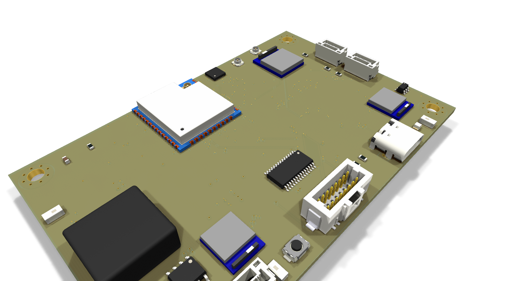
*Abbildung 7.1a: KiCad 3D-Render der Zentralbox-Hauptplatine Top (PCBA 01, 85 x 55 mm, 4 Lagen) mit ESP32-S31-WROOM-1U, Microchip USB2517I 7-Port Hub, 3x Qualcomm QCC3086 BT 5.4 Audio SoCs (U9, U13, U14), LM5164-Q1 100V Buck, BQ24075 USV-Lader U4, Quad-eFuse U12, SX1262 LoRa 868 MHz und vertikal nach oben ragenden SMD-Steckverbindern (J1, J6, J5, J7, J3).*

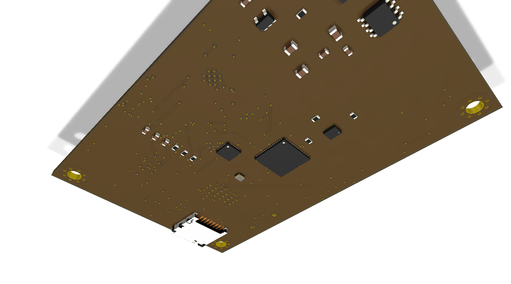
*Abbildung 7.1b: KiCad 3D-Render der Zentralbox-Hauptplatine Bottom mit DM3D MicroSD-Push-Pull-Slot, TI LM66100 Ideal-Dioden-OR-ing Schaltung für Dual-Power (12V Bordnetz vs. USB-C Service), BMI270 6-Achs-IMU, ES8388 Audio-Codec und TCAN334G CAN-FD Transceiver.*


*Abbildung 7.1c: Vektorbasiertes Bestückungs- und Routing-Layout der PCBA 01 (v10.0 Dual-Rail Monocoque Slide-In Standard).*

### 3.1 Technische Platinen-Kenndaten & Top/Bottom-Aufteilung
* **Abmessungen:** $85{,}0 \times 55{,}0\,\text{mm}$ (Außenkontur mit 4x M2.5 Montagebohrungen, $77{,}0 \times 47{,}0\,\text{mm}$ Lochabstand, kompatibel zum Dual-Rail Slide-In Trägerrahmen).
* **Lagenaufbau:** 4 Lagen FR-4 High-TG150 ($1{,}6\,\text{mm}$ Gesamtdicke, $35\,\mu\text{m}$ Cu auf L1/L4, $17{,}5\,\mu\text{m}$ auf L2/L3, ENIG-Goldfinish, Lagenaufbau nach JLCPCB JLC04161H-7628).
* **Dual-Power Input Schaltung:**
  * **12V Bordnetz (Hauptversorgung):** Molex Micro-Lock Plus 1.25mm 6-Pin Vertikal-Header `J1` (interne Silikon-Kabelpeitsche zum Gehäuse-Flansch Deutsch DTM-6), eingangsseitig gegen Verpolung und Transienten geschützt und über Automotive-eFuse abgesichert.
  * **USB-C Service & Flash-Port (`J3`):** 16-Pin USB-C Buchse mit Texas Instruments `LM66100` Ideal-Diode (`D3`) für verlustarmes Ideal-Dioden-OR-ing (Bordnetz vs. USB-VBUS). Ermöglicht den autarken Werkbank-Betrieb, Firmware-Updates via WebUSB/DFU und Sensortests direkt am Schreibtisch über jedes Standard-USB-C-Netzteil (5V) ohne Labornetzteil.
* **Kompakte Vertikal-Steckverbinder (Pointing UP):**
  * Sämtliche internen Anschlüsse sind als ultrakompakte, vertikal nach oben weisende SMT-Stecker ausgeführt. Dadurch werden Biegeschleifen an den Platinenkanten vollständig vermieden und die Kabelpeitschen laufen parallel nach oben in den Kabelkanal des Monocoque-Gehäuses ab.
* **Bestückung Top-Layer (F.Cu):**
  * **Hauptcontroller (`U2`):** Espressif `ESP32-S31-WROOM-1U` (Dual-Core RISC-V @ 320 MHz mit 128-Bit SIMD AI Engine für On-Device Audio-Signalverarbeitung und Sprachfilterung, nativem Bluetooth Classic BR/EDR mit SCO/eSCO, Bluetooth 5.4 LE Audio, 16 MB Flash, 8 MB Octal-PSRAM, externe U.FL Buchse) für Systemsteuerung, FreeRTOS DSP-Pipeline, zentralen geometrischen BLE-Master (Lenkertaster, OEM-Adapter, Action-Cam, Keyfob, TPMS) und CAN-FD Management.
  * **Industrial USB 2.0 Hub Controller (`U8`):** Microchip `USB2517I-JZX` (QFN-64, $-40\,^\circ\text{C}\dots+85\,^\circ\text{C}$ Automotive-Grade) 7-Port High-Speed 480 Mbps Hub mit 24.000 MHz Quarz `Y2`. Bindet alle Peripherieknoten (Front, Pod 1, Pod 2, Radar, Helm-Audio, ESP32 und Service-Port) transparent und synchron an.
  * **Dedizierte Bluetooth 5.4 Audio-Transceiver (`U9`, `U13`, `U14`):** **3× Qualcomm QCC3086** Bluetooth 5.4 Audio SoCs (100% Gleichteile im WLCSP-99 Footprint mit integrierter Keramik-Chipantenne) für Smartphone-Link (`U9`, A2DP Sink, HFP 1.8 Low-Latency Voice-Rückkanal, AVRCP 1.6), Fahrer-Helm (`U13`, aptX Adaptive Hi-Fi, HFP 1.8 Mic-Uplink) und Sozius-Helm (`U14`, A2DP aptX/LC3 Zweitstream, HFP 1.8 Mic-Uplink). Die Auslagerung auf drei separate Qualcomm-Chips garantiert drei vollständig unabhängige, parallele Hi-Fi Streams (aptX Adaptive / LDAC / Snapdragon Sound) ohne HF-TDM-Latenzen, die ein einzelnes Single-Antennen-Radio (wie das interne des S31) physikalisch nicht parallel bedienen kann.
  * **Automotive Power Stage (`U1`):** Texas Instruments `LM5164-Q1` synchroner 100V-Buck-Converter (erzeugt `VCC_5V` aus dem 12V–72V Bordnetz).
  * **LiPo-Lade- & Power-Path-PMIC (`U4`):** Texas Instruments `BQ24075RGTR` (VQFN-16 3x3mm) mit Dynamic Power Path Management (DPPM). Lädt den internen 2.200-mAh-Flach-LiPo (`J5`) automatisch aus `VCC_5V` (LM5164-Q1 oder USB-C `J3`) mit 1,0 A (`R16`), überwacht die Akkutemperatur per NTC (`J5` Pin 3) und puffert Startspannungseinbrüche beim Anlassen des Motors (Cold Crank bis 6,5V) sowie Zündungsabschaltungen unterbrechungsfrei in $< 10\,\mu\text{s}$ auf der Systemspannung `VCC_SYS` (speist den 3.3V Ultra-Low-Noise LDO `U11` `TPS7A0533`).
  * **System-LDO (`U11`):** Texas Instruments `TPS7A0533` Ultra-Low-Noise LDO (speist `VCC_3V3` unterbrechungsfrei aus `VCC_SYS` für ESP32-S31, SX1262 LoRa und Sensorik).
  * **Quad Automotive Smart Switch (`U12`):** HTSSOP-28 4-Kanal-Lastschalter (`TPS4H160-Q1`) zur getrennten Absicherung, Strommessung und thermischen Abschaltung der 4 Peripheriestränge (Front, Pod 1, Pod 2, Radar).
  * **Weitbereichsfunk (`U10`):** Semtech `SX1262` LoRa Transceiver (+22 dBm PA) mit U.FL Buchse `ANT1` zur FXP895 Antenne in der Gehäusedeckeltasche.
  * **Bluetooth Triple-Layout & Antennen-Entkopplung:** Die 3 QCC3086 Transceiver `U9`, `U13` und `U14` nutzen eigene Keramik-Chipantennen. Alle drei Module sind hardwareseitig vollständig HF-entkoppelt.
  * **Status-Anzeige & Bedienelemente:** WS2812B RGB Smart-LED `D1` (an der Südkante rechts neben USB-C `J3`), Pairing-Hardwaretaster `SW1` sowie Vertikalstecker `J1` (Bordnetz 6P), `J6` (Peripherie 16P), `J5` (USV-Akku 4P), `J7` (Reserve USB 4P anstelle von J4) und `J3` (USB-C 16P).
* **Bestückung Bottom-Layer (B.Cu):**
  * **MicroSD-Kartenslot (`J2`):** Hirose `DM3D-SF` Push-Pull MicroSD-Kartenhalter (4-Bit High-Speed SDIO), bündig an der Stirnkante platziert für werkzeugfreien Service-Zugang.
  * **Audio-Codec (`U3`):** Everest Semi `ES8388` 24-Bit / 48 kHz Low-Power Stereo-Audio-Codec (QFN-28).
  * **6-Achs-IMU (`U5`):** Bosch `BMI270` Ultra-Low-Power IMU (I2C) für Wake-on-Motion Diebstahlüberwachung, Schräglagenmessung und Sturzerkennung.
  * **CAN-FD Transceiver (`U6`):** Texas Instruments `TCAN334G` 5 Mbps CAN-FD Transceiver (SOIC-8).
  * **Ideal-Diode Schaltung (`D3`):** Texas Instruments `LM66100` (SOT-23-6) für rückspeisefreien Dual-Power Betrieb.
  * **Analog-LDO (`U11`):** Texas Instruments `TPS7A0533` 3.3V Ultra-Low-Noise LDO für analoge Rails.

---

### 3.2 Platinen-Steckverbinder & Exakte Pinbelegung

<!-- AUTO_CONNECTORS_START: PCBA_01 -->

#### Stecker `J1`: Fahrzeug-Stromversorgung & CAN-Bus Eingang
> **Typ:** `Molex MicroLock Plus 6-Pin 1.25mm SMD Vertikal (5055680671)` | **Gegenstecker:** `Molex 5055650601 (Crimp 5054311000 AWG26-30)`  

| Pin | Signal / KiCad Net | Signal-Typ | Elektrische Spezifikation & Funktion |
| :---: | :--- | :---: | :--- |
| **1** | `KL30_IN` | **Power In (+12V Dauer)** | Batterie-Dauerplus über externe Sicherung (5A) |
| **2** | `KL15_IN` | **Power In (+12V Zündung)** | Zündungsplus für Aufwach-Logik & Sleep-Trigger |
| **3** | `GND_PWR` | **Power Return** | Fahrzeugmasse Leistungsrückstrom |
| **4** | `CAN_H` | **Automotive CAN High** | Fahrzeug-CAN Bus Signal High (HD-LAN) |
| **5** | `CAN_L` | **Automotive CAN Low** | Fahrzeug-CAN Bus Signal Low (HD-LAN) |
| **6** | `GND_SHIELD` | **Shield** | Kabelbaum-Schirmungsanschluss |

#### Stecker `J6`: Automotive 4-Strang USB-Backbone & Power Hub
> **Typ:** `Molex MicroLock Plus 16-Pin 2x08 1.25mm SMD Vertikal (5054331671)` | **Gegenstecker:** `Molex 5054321601 (Crimp 5054311000 AWG26-30)`  

| Pin | Signal / KiCad Net | Signal-Typ | Elektrische Spezifikation & Funktion |
| :---: | :--- | :---: | :--- |
| **1** | `VBUS_FRONT` | **Power Out (+12V/60W)** | Strang 1: Front-Knoten Stromversorgung (eFuse CH1) |
| **2** | `GND_PWR` | **Power Return** | Strang 1: Masse Rückstrom |
| **3** | `BUS1_DM` | **USB 2.0 D-** | Strang 1: Front-Knoten USB 2.0 Datenleitung D- |
| **4** | `BUS1_DP` | **USB 2.0 D+** | Strang 1: Front-Knoten USB 2.0 Datenleitung D+ |
| **5** | `VBUS_POD1` | **Power Out (+12V/30W)** | Strang 2: Koffer-Pod 1 Links Stromversorgung (eFuse CH2) |
| **6** | `GND_PWR` | **Power Return** | Strang 2: Masse Rückstrom |
| **7** | `BUS2_DM` | **USB 2.0 D-** | Strang 2: Pod 1 USB 2.0 Datenleitung D- |
| **8** | `BUS2_DP` | **USB 2.0 D+** | Strang 2: Pod 1 USB 2.0 Datenleitung D+ |
| **9** | `VBUS_POD2` | **Power Out (+12V/30W)** | Strang 3: Koffer-Pod 2 Rechts Stromversorgung (eFuse CH3) |
| **10** | `GND_PWR` | **Power Return** | Strang 3: Masse Rückstrom |
| **11** | `BUS3_DM` | **USB 2.0 D-** | Strang 3: Pod 2 USB 2.0 Datenleitung D- |
| **12** | `BUS3_DP` | **USB 2.0 D+** | Strang 3: Pod 2 USB 2.0 Datenleitung D+ |
| **13** | `VBUS_RADAR` | **Power Out (+12V/15W)** | Strang 4: Heck-Radar 2.0 Stromversorgung (eFuse CH4) |
| **14** | `GND_PWR` | **Power Return** | Strang 4: Masse Rückstrom |
| **15** | `BUS4_DM` | **USB 2.0 D-** | Strang 4: Heck-Radar USB 2.0 Datenleitung D- |
| **16** | `BUS4_DP` | **USB 2.0 D+** | Strang 4: Heck-Radar USB 2.0 Datenleitung D+ |

#### Stecker `J5`: USV Li-Ion Puffer-Akku & NTC-Temperatursensor
> **Typ:** `JST-GH 4-Pin 1.25mm SMD Vertikal (BM04B-GHS-TBT)` | **Gegenstecker:** `JST GHR-04V-S (AWG26-30)`  

| Pin | Signal / KiCad Net | Signal-Typ | Elektrische Spezifikation & Funktion |
| :---: | :--- | :---: | :--- |
| **1** | `BAT_PLUS` | **Power (3.7V Li-Ion)** | Puffer-Akku Pluspol (3.0V - 4.2V) |
| **2** | `GND_PWR` | **Power Return** | Puffer-Akku Masse |
| **3** | `BAT_NTC` | **Analog In** | 10k NTC Thermistor zu GND zur Lade-Temperaturüberwachung |
| **4** | `GND_PWR` | **Power Return** | NTC Referenzmasse |

<!-- AUTO_CONNECTORS_END: PCBA_01 -->

#### 3.2.1 Header J1: Fahrzeug-Bordnetz & CAN-Bus (Molex Micro-Lock Plus 1.25mm 6-Pin SMD Vertikal)
Verbindet die Zentralbox über eine interne geschirmte Kabelpeitsche mit dem fahrzeugseitigen Deutsch DTM04-6P Gehäuseflansch:

```
+---------------------------------------------------------------------------------------------------------------+
| HEADER J1: MOLEX MICRO-LOCK PLUS 6-PIN VERTIKAL (505568-0671) - BORDNETZ & CAN-BUS                            |
+-----+----------------+--------------------------+-------------+---------------------+-------------------------+
| Pin | Signalname     | Signalart / Pegel        | Querschnitt | Kabelbaum-Zweig     | Funktion & Schutz       |
+-----+----------------+--------------------------+-------------+---------------------+-------------------------+
|  1  | KL30_IN        | +9V...+72V DC Dauerplus  | AWG20 0.50² | DTM Pin 1 (Batterie)| Bordnetz Dauerplus (eFuse)|
|  2  | KL15_IN        | +9V...+72V DC Zündung    | AWG22 0.34² | DTM Pin 2 (Zündung) | Zündungs-Sense & Wake-Up|
|  3  | GND_PWR        | Power-Masse (0V)         | AWG20 0.50² | DTM Pin 3 (Batterie)| Zentrale Systemmasse    |
|  4  | CAN_H          | CAN-FD High (ISO 11898-2)| AWG24 0.22² | DTM Pin 4 (Fahrzeug)| Fahrzeug-CAN Bus High   |
|  5  | CAN_L          | CAN-FD Low (ISO 11898-2) | AWG24 0.22² | DTM Pin 5 (Fahrzeug)| Fahrzeug-CAN Bus Low    |
|  6  | GND_SHIELD     | Schirmmasse / Chassis    | AWG20 0.50² | DTM Pin 6 (Rahmen)  | Gehäuse- & Schirmschutz |
| MP1 | GND_PWR        | Mechanische Halterung    | SMT Pad     | PCB Massefläche     | Solder Retention Pad 1  |
| MP2 | GND_PWR        | Mechanische Halterung    | SMT Pad     | PCB Massefläche     | Solder Retention Pad 2  |
+-----+----------------+--------------------------+-------------+---------------------+-------------------------+
```

#### 3.2.2 Header J6: OMB 4-Kanal Peripherie-Bus (Molex Micro-Lock Plus 16-Pin 2x08 Vertikal)
Zentraler Schnittstellen-Header (Molex Micro-Lock Plus `505433-1671`, 1.25mm Raster, vertikal nach oben mit formschlüssiger Verriegelung) zur Speisung und nativer USB 2.0 High-Speed Datenanbindung aller 4 Peripheriestränge (Front, Pod 1, Pod 2, Radar). Jeder Strang besitzt eine eigene eFuse-Strombegrenzung:

```
+---------------------------------------------------------------------------------------------------------------+
| HEADER J6: MOLEX MICRO-LOCK PLUS 16-PIN (2x08) VERTIKAL (505433-1671) - 4 AUTARKE OMB-SYSTEMSTRÄNGE          |
+-----+----------------+--------------------------+-------------+---------------------+-------------------------+
| Pin | Signalname     | Signalart / Pegel        | Querschnitt | Zielkomponente      | Funktion & Schutz       |
+-----+----------------+--------------------------+-------------+---------------------+-------------------------+
|  1  | VBUS_FRONT     | +12V DC (bis 60W / 5.0A) | AWG18 0.75² | Strang 1 (Front)    | Speisung Front-Knoten   |
|  2  | GND_PWR        | Power-Masse (0V)         | AWG18 0.75² | Strang 1 (Front)    | Leistungs-Rückleiter    |
|  3  | BUS1_DM        | USB 2.0 High-Speed D-    | AWG26 0.14² | Strang 1 (Front)    | Hub Port 2 Daten-Uplink |
|  4  | BUS1_DP        | USB 2.0 High-Speed D+    | AWG26 0.14² | Strang 1 (Front)    | Hub Port 2 Daten-Uplink |
+-----+----------------+--------------------------+-------------+---------------------+-------------------------+
|  5  | VBUS_POD1      | +12V DC (bis 30W / 2.5A) | AWG20 0.50² | Strang 2 (Pod 1 L)  | Speisung Pod 1 & Lader  |
|  6  | GND_PWR        | Power-Masse (0V)         | AWG20 0.50² | Strang 2 (Pod 1 L)  | Leistungs-Rückleiter    |
|  7  | BUS2_DM        | USB 2.0 High-Speed D-    | AWG28 0.08² | Strang 2 (Pod 1 L)  | Hub Port 3 Audio/Daten  |
|  8  | BUS2_DP        | USB 2.0 High-Speed D+    | AWG28 0.08² | Strang 2 (Pod 1 L)  | Hub Port 3 Audio/Daten  |
+-----+----------------+--------------------------+-------------+---------------------+-------------------------+
|  9  | VBUS_POD2      | +12V DC (bis 30W / 2.5A) | AWG20 0.50² | Strang 3 (Pod 2 R)  | Speisung Pod 2 & Lader  |
| 10  | GND_PWR        | Power-Masse (0V)         | AWG20 0.50² | Strang 3 (Pod 2 R)  | Leistungs-Rückleiter    |
| 11  | BUS3_DM        | USB 2.0 High-Speed D-    | AWG28 0.08² | Strang 3 (Pod 2 R)  | Hub Port 4 Audio/Daten  |
| 12  | BUS3_DP        | USB 2.0 High-Speed D+    | AWG28 0.08² | Strang 3 (Pod 2 R)  | Hub Port 4 Audio/Daten  |
+-----+----------------+--------------------------+-------------+---------------------+-------------------------+
| 13  | VBUS_RADAR     | +12V geschaltet (1.5A)   | AWG22 0.34² | Strang 4 (Heck-Rad.)| Speisung Radar Wheeltec |
| 14  | GND_PWR        | Power-Masse (0V)         | AWG22 0.34² | Strang 4 (Heck-Rad.)| Masse Heck-Radar        |
| 15  | BUS4_DM        | USB 2.0 High-Speed D-    | AWG24 0.22² | Strang 4 (Heck-Rad.)| Hub Port 5 Telemetrie   |
| 16  | BUS4_DP        | USB 2.0 High-Speed D+    | AWG24 0.22² | Strang 4 (Heck-Rad.)| Hub Port 5 Telemetrie   |
+-----+----------------+--------------------------+-------------+---------------------+-------------------------+
| MP1 | GND_PWR        | Mechanische Halterung    | SMT Pad     | PCB Massefläche     | Solder Retention Pad 1  |
| MP2 | GND_PWR        | Mechanische Halterung    | SMT Pad     | PCB Massefläche     | Solder Retention Pad 2  |
+-----+----------------+--------------------------+-------------+---------------------+-------------------------+
```

#### 3.2.3 Header J5: USV-Akku & NTC-Temperaturfühler (Molex Micro-Lock Plus 1.25mm 4-Pin Vertikal)
Verbindet den internen USV-Pufferakku (2.200 mAh LiPo-Flachzelle) mit dem BQ24075 Lade- & Power-Path-PMIC (`U4`) und dem analogen Spannungs- und Temperaturüberwachungsnetzwerk des ESP32-S31:

```
+---------------------------------------------------------------------------------------------------------------+
| HEADER J5: MOLEX MICRO-LOCK PLUS 4-PIN VERTIKAL (505568-0471) - USV-BATTERIE & THERMISTOR                     |
+-----+----------------+--------------------------+-------------+---------------------+-------------------------+
| Pin | Signalname     | Signalart / Pegel        | Querschnitt | Verbunden mit       | Funktion & Schutz       |
+-----+----------------+--------------------------+-------------+---------------------+-------------------------+
|  1  | BAT_PLUS       | +3.2V...+4.2V DC (Akku +)| AWG22 0.34² | U4 BQ24075 & R12/R13| USV-Ladung & Messung    |
|  2  | GND_PWR        | Power-Masse (Akku -)     | AWG22 0.34² | GND_PWR Masseplane  | Batterie-Masse          |
|  3  | BAT_NTC        | Analog In (0...3.3V)     | AWG26 0.14² | U4 TS & R14 (10k PU)| 10k NTC JEITA Ladestopp |
|  4  | GND_PWR        | Sensor-Masse (0V)        | AWG26 0.14² | GND_PWR Masseplane  | NTC-Rückleitung         |
| MP1 | GND_PWR        | Mechanische Halterung    | SMT Pad     | PCB Massefläche     | Solder Retention Pad 1  |
| MP2 | GND_PWR        | Mechanische Halterung    | SMT Pad     | PCB Massefläche     | Solder Retention Pad 2  |
+-----+----------------+--------------------------+-------------+---------------------+-------------------------+
```

#### 3.2.4 Status-Anzeige D1 & Entfall von Header J4
Die Status-Anzeige erfolgt direkt über die onboard platzierte **WS2812B RGB Smart-LED (`D1`)**, die an der Süd-Vorderkante der Platine unmittelbar rechts neben der USB-C Buchse `J3` sitzt. Ein bündig in die Gehäuse-Frontwand eingelassener PMMA-Lichtleiter (Lightpipe $\varnothing 3{,}2\,\text{mm}$) leitet das Licht verlustfrei nach außen. Der frühere Steckverbinder `J4` (für eine externe LED) ist dadurch vollständig entfallen, wodurch Bauraum und Bestückungskosten an der Platinenkante eingespart werden.

#### 3.2.5 Header J7: Reserve USB Port 7 (Molex Micro-Lock Plus 1.25mm 4-Pin Vertikal)
Führt den 7. Downstream-Port des Microchip USB2517I Hubs für künftige Funktionserweiterungen (z.B. LTE/5G-Modem oder Dashcam) heraus:

```
+---------------------------------------------------------------------------------------------------------------+
| HEADER J7: MOLEX MICRO-LOCK PLUS 4-PIN VERTIKAL (505568-0471) - RESERVE USB 2.0 PORT 7                        |
+-----+----------------+--------------------------+-------------+---------------------+-------------------------+
| Pin | Signalname     | Signalart / Pegel        | Querschnitt | Verbunden mit       | Funktion & Schutz       |
+-----+----------------+--------------------------+-------------+---------------------+-------------------------+
|  1  | VCC_5V         | +5.0V DC (Power Out)     | AWG22 0.34² | 5V Power Plane      | USB VBUS 5V Speisung    |
|  2  | RES_USB_DM     | USB 2.0 D- (Differential)| AWG28 0.08² | USB2517I (Pin 60)   | USB Port 7 Data Minus   |
|  3  | RES_USB_DP     | USB 2.0 D+ (Differential)| AWG28 0.08² | USB2517I (Pin 61)   | USB Port 7 Data Plus    |
|  4  | GND_PWR        | Power-Masse (0V)         | AWG22 0.34² | GND_PWR Masseplane  | USB Masse               |
| MP1 | GND_PWR        | Mechanische Halterung    | SMT Pad     | PCB Massefläche     | Solder Retention Pad 1  |
| MP2 | GND_PWR        | Mechanische Halterung    | SMT Pad     | PCB Massefläche     | Solder Retention Pad 2  |
+-----+----------------+--------------------------+-------------+---------------------+-------------------------+
```

#### 3.2.6 Buchse J3: USB Type-C Service & Flash-Port (16-Pin SMD Receptacle)
Sitzt an der Gehäusefront für schnellen Werkbank-Zugriff, DFU-Flashen und Diagnose:

```
+---------------------------------------------------------------------------------------------------------------+
| BUCHSE J3: USB TYPE-C 16-PIN RECEPTACLE (HRO TYPE-C-31-M-12) - SERVICE & DFU-PORT                             |
+-----+----------------+--------------------------+---------------------+---------------------------------------+
| Pin | Signalname     | Signalart / Pegel        | Verbunden mit       | Funktion & Spezifikation              |
+-----+----------------+--------------------------+---------------------+---------------------------------------+
| A1  | GND_PWR        | Power-Masse (0V)         | GND_PWR Masseplane  | USB-C Systemmasse                     |
| A4  | USBC_VBUS      | +5.0V DC (Power In)      | LM66100 Diode (D3)  | 5V USB Busspannung (Dual-Power Sink)  |
| A5  | CC1            | Konfigurations-Kanal 1   | 5.1 kΩ Pull-Down    | UFP-Erkennung & 5V/3A Aushandlung     |
| A6  | USBC_DP        | USB 2.0 High-Speed D+    | USB2517I Hub Pin 9  | Upstream USB Datenleitung Plus        |
| A7  | USBC_DM        | USB 2.0 High-Speed D-    | USB2517I Hub Pin 8  | Upstream USB Datenleitung Minus       |
| A8  | CC2            | Konfigurations-Kanal 2   | 5.1 kΩ Pull-Down    | UFP-Erkennung & 5V/3A Aushandlung     |
| A9  | USBC_VBUS      | +5.0V DC (Power In)      | LM66100 Diode (D3)  | 5V USB Busspannung (Dual-Power Sink)  |
| A12 | GND_PWR        | Power-Masse (0V)         | GND_PWR Masseplane  | USB-C Systemmasse                     |
| SH1 | GND_SHIELD     | Schirmmasse              | Gehäuseschirmung    | EMV-Schirmgehäuse Lötlasche Links     |
| SH2 | GND_SHIELD     | Schirmmasse              | Gehäuseschirmung    | EMV-Schirmgehäuse Lötlasche Rechts    |
+-----+----------------+--------------------------+---------------------+---------------------------------------+
```

#### 3.2.7 Slot J2: MicroSD-Kartenleser (Hirose DM3D-SF 9-Pin Push-Pull)
Bietet 4-Bit High-Speed SDIO Anbindung an den ESP32-S31 für unterbrechungsfreie Blackbox-Telemetrie und Offline-Karten:

```
+---------------------------------------------------------------------------------------------------------------+
| KARTENSLOT J2: HIROSE DM3D-SF PUSH-PULL MICROSD-HALTER (4-BIT SDIO)                                           |
+-----+----------------+--------------------------+---------------------+---------------------------------------+
| Pin | Signalname     | Signalart / Pegel        | Verbunden mit       | Funktion & Spezifikation              |
+-----+----------------+--------------------------+---------------------+---------------------------------------+
|  1  | SD_DAT2        | Digital I/O (3.3V SDIO)  | ESP32-S31 (Pin 34)  | SDIO Datenleitung 2 (Pull-Up 10k)     |
|  2  | SD_DAT3        | Digital I/O (3.3V SDIO)  | ESP32-S31 (Pin 38)  | SDIO Datenleitung 3 / Card Select     |
|  3  | SD_CMD         | Digital I/O (3.3V SDIO)  | ESP32-S31 (Pin 36)  | SDIO Command / Response Leitung       |
|  4  | VCC_3V3        | Power In (+3.3V DC)      | 3.3V LDO Rail       | MicroSD Betriebsspannung (100nF+10µF) |
|  5  | SD_CLK         | Digital Out (Clock)      | ESP32-S31 (Pin 35)  | SDIO Bus-Takt (bis 40 MHz)            |
|  6  | GND_PWR        | Masse (0V)               | GND_PWR Masseplane  | Versorgungsmasse                      |
|  7  | SD_DAT0        | Digital I/O (3.3V SDIO)  | ESP32-S31 (Pin 37)  | SDIO Datenleitung 0                   |
|  8  | SD_DAT1        | Digital I/O (3.3V SDIO)  | ESP32-S31 (Pin 33)  | SDIO Datenleitung 1                   |
|  9  | SD_CD          | Digital In (Active Low)  | ESP32-S31 (Pin 39)  | Card Detect Schalter (Karte gesteckt) |
| SH  | GND_PWR        | Gehäuseschirmung         | GND_PWR Masseplane  | 3x Schirm- und Halte-Lötpads (SH1-SH3)|
+-----+----------------+--------------------------+---------------------+---------------------------------------+
```

---

### 3.3 Sub-Chips & Peripherie-Bausteine (USB2517I, 3x QCC3086, SX1262, TCAN334G)

<!-- AUTO_SUBCHIPS_START: PCBA_01 -->

#### Sub-Chip `U8`: Microchip USB2517I 7-Port Automotive USB 2.0 Hub (QFN-64 (9x9 mm))
> **Hersteller-Datenblatt:** [Microchip USB2517I 7-Port Automotive USB 2.0 Hub](https://ww1.microchip.com/downloads/en/DeviceDoc/00001692C.pdf) | **Pin-Definition:** [Table 3-1: 64-Pin QFN Pin Descriptions](https://ww1.microchip.com/downloads/en/DeviceDoc/00001692C.pdf#page=12)  

| Pad | Pin-Name | Signal / KiCad Net | Signal-Typ | Ziel / Quelle | Funktion & Elektr. Spezifikation |
| :---: | :--- | :--- | :---: | :--- | :--- |
| 2 | `RESET_N` | `HUB_RESET_N` | **Control In** | U2 (ESP32-S31) | Active-Low Hardware Reset via GPIO |
| 8 | `USBDN_DM7` | `USBC_DM` | **USB D-** | J3 (USB-C Service) | Port 7 Downstream USB D- |
| 9 | `USBDN_DP7` | `USBC_DP` | **USB D+** | J3 (USB-C Service) | Port 7 Downstream USB D+ |
| 16 | `USBUP_DM` | `ESP_USB_DM` | **USB D-** | U2.54 (ESP32-S31) | Upstream Port USB High-Speed D- |
| 17 | `USBUP_DP` | `ESP_USB_DP` | **USB D+** | U2.55 (ESP32-S31) | Upstream Port USB High-Speed D+ |
| 24 | `USBDN_DM1` | `BUS1_DM` | **USB D-** | J6.3 (Strang 1 Front) | Port 1 Downstream USB D- |
| 25 | `USBDN_DP1` | `BUS1_DP` | **USB D+** | J6.4 (Strang 1 Front) | Port 1 Downstream USB D+ |
| 32 | `USBDN_DM2` | `BUS2_DM` | **USB D-** | J6.7 (Strang 2 Pod L) | Port 2 Downstream USB D- |
| 33 | `USBDN_DP2` | `BUS2_DP` | **USB D+** | J6.8 (Strang 2 Pod L) | Port 2 Downstream USB D+ |
| 40 | `USBDN_DM3` | `BUS3_DM` | **USB D-** | J6.11 (Strang 3 Pod R) | Port 3 Downstream USB D- |
| 41 | `USBDN_DP3` | `BUS3_DP` | **USB D+** | J6.12 (Strang 3 Pod R) | Port 3 Downstream USB D+ |
| 48 | `USBDN_DM4` | `BUS4_DM` | **USB D-** | J6.15 (Strang 4 Radar) | Port 4 Downstream USB D- |
| 49 | `USBDN_DP4` | `BUS4_DP` | **USB D+** | J6.16 (Strang 4 Radar) | Port 4 Downstream USB D+ |
| 56 | `USBDN_DM5` | `BT_USB_DM` | **USB D-** | U9.13 (QCC3086) | Port 5 Downstream USB D- an Qualcomm BT Audio SoC |
| 57 | `USBDN_DP5` | `BT_USB_DP` | **USB D+** | U9.14 (QCC3086) | Port 5 Downstream USB D+ an Qualcomm BT Audio SoC |
| 60 | `USBDN_DM6` | `RES_USB_DM` | **USB D-** | J7.3 (Reserve) | Port 6 Downstream USB D- |
| 61 | `USBDN_DP6` | `RES_USB_DP` | **USB D+** | J7.4 (Reserve) | Port 6 Downstream USB D+ |

#### Sub-Chip `U9`: Qualcomm QCC3086 Bluetooth 5.4 Audio Transceiver (Phone Link) (WLCSP / BGA Module)
> **Hersteller-Datenblatt:** [Qualcomm QCC3086 Bluetooth 5.4 Audio Transceiver (Phone Link)](https://www.qualcomm.com/products/technology/audio/qcc30xx-series/qcc3086) | **Pin-Definition:** [Pin Definitions & Audio Interface Routing](https://www.qualcomm.com/products/technology/audio/qcc30xx-series/qcc3086)  

| Pad | Pin-Name | Signal / KiCad Net | Signal-Typ | Ziel / Quelle | Funktion & Elektr. Spezifikation |
| :---: | :--- | :--- | :---: | :--- | :--- |
| 3 | `I2S_MCLK` | `I2S_MCLK` | **Clock In** | U2 (ESP32-S31) | I2S Master Clock 12.288 MHz |
| 4 | `I2S_BCLK` | `I2S_BCLK` | **Clock In** | U2 (ESP32-S31) | I2S Bit Clock 3.072 MHz |
| 5 | `I2S_WS` | `I2S_WS` | **Sync In** | U2 (ESP32-S31) | I2S Word Select / LRCLK 48 kHz |
| 6 | `I2S_DOUT` | `I2S_DOUT` | **Audio In** | U2 (ESP32-S31) | Digital Audio Stream vom Smartphone (A2DP / Anrufer) an ESP32-S31 DSP |
| 7 | `I2S_DIN` | `I2S_DIN` | **Audio Out** | U2 (ESP32-S31) | Helmmikrofon-Audio Stream an QCC3086 Voice-Backchannel zum Smartphone |
| 9 | `UART_TX` | `BT_UART_TX` | **UART Out** | U2 (ESP32-S31) | HCI / AT-Befehle TX zum ESP32-S31 |
| 10 | `UART_RX` | `BT_UART_RX` | **UART In** | U2 (ESP32-S31) | HCI / AT-Befehle RX vom ESP32-S31 |
| 11 | `CHIP_EN` | `BT_EN` | **Control In** | U2 (ESP32-S31) | Power Enable Active High |
| 13 | `USB_DM` | `BT_USB_DM` | **USB D-** | U8.56 (Hub Port 5) | USB Audio Class 2.0 / DFU Datenleitung D- |
| 14 | `USB_DP` | `BT_USB_DP` | **USB D+** | U8.57 (Hub Port 5) | USB Audio Class 2.0 / DFU Datenleitung D+ |
| 15 | `RF_ANT` | `BT_RF_AUDIO` | **RF 2.4 GHz** | ANT2 (U.FL) | Bluetooth 5.4 Antennenport an ANT2 Deckelantenne (Smartphone-Link) |

#### Sub-Chip `U13`: Qualcomm QCC3086 Bluetooth 5.4 Audio Source (Sozius Helm 1) (WLCSP / BGA Module)
> **Hersteller-Datenblatt:** [Qualcomm QCC3086 Bluetooth 5.4 Audio Source (Sozius Helm 1)](https://www.qualcomm.com/products/technology/audio/qcc30xx-series/qcc3086) | **Pin-Definition:** [Pin Definitions & Audio Interface Routing](https://www.qualcomm.com/products/technology/audio/qcc30xx-series/qcc3086)  

| Pad | Pin-Name | Signal / KiCad Net | Signal-Typ | Ziel / Quelle | Funktion & Elektr. Spezifikation |
| :---: | :--- | :--- | :---: | :--- | :--- |
| 4 | `I2S_BCLK` | `I2S_BCLK` | **Clock In** | U2 (ESP32-S31) | I2S Bit Clock 3.072 MHz |
| 5 | `I2S_WS` | `I2S_WS` | **Sync In** | U2 (ESP32-S31) | I2S Word Select / LRCLK 48 kHz |
| 6 | `I2S_DOUT` | `HELM1_I2S_DOUT` | **Audio In** | U2 (ESP32-S31) | Audio-Stream vom DSP an Helm 1 |
| 7 | `I2S_DIN` | `HELM1_I2S_DIN` | **Audio Out** | U2 (ESP32-S31) | Helm 1 Mikrofon-Rückkanal an DSP |
| 9 | `UART_TX` | `HELM1_BT_UART_TX` | **UART Out** | U2 (ESP32-S31) | HCI / AT TX Helm 1 |
| 10 | `UART_RX` | `HELM1_BT_UART_RX` | **UART In** | U2 (ESP32-S31) | HCI / AT RX Helm 1 |
| 11 | `CHIP_EN` | `HELM1_BT_EN` | **Control In** | U2 (ESP32-S31) | Power Enable Helm 1 |
| 13 | `USB_DM` | `HELM1_USB_DM` | **USB D-** | U8 (Hub) | USB D- Helm 1 |
| 14 | `USB_DP` | `HELM1_USB_DP` | **USB D+** | U8 (Hub) | USB D+ Helm 1 |
| 15 | `RF_ANT` | `BT_RF_HELM1` | **RF 2.4 GHz** | ANT3 (Keramik) | BT 5.4 RF Port an Keramikantenne ANT3 |

#### Sub-Chip `U14`: Qualcomm QCC3086 Bluetooth 5.4 Audio Source (Fahrer Helm 2) (WLCSP / BGA Module)
> **Hersteller-Datenblatt:** [Qualcomm QCC3086 Bluetooth 5.4 Audio Source (Fahrer Helm 2)](https://www.qualcomm.com/products/technology/audio/qcc30xx-series/qcc3086) | **Pin-Definition:** [Pin Definitions & Audio Interface Routing](https://www.qualcomm.com/products/technology/audio/qcc30xx-series/qcc3086)  

| Pad | Pin-Name | Signal / KiCad Net | Signal-Typ | Ziel / Quelle | Funktion & Elektr. Spezifikation |
| :---: | :--- | :--- | :---: | :--- | :--- |
| 4 | `I2S_BCLK` | `I2S_BCLK` | **Clock In** | U2 (ESP32-S31) | I2S Bit Clock 3.072 MHz |
| 5 | `I2S_WS` | `I2S_WS` | **Sync In** | U2 (ESP32-S31) | I2S Word Select / LRCLK 48 kHz |
| 6 | `I2S_DOUT` | `HELM2_I2S_DOUT` | **Audio In** | U2 (ESP32-S31) | Audio-Stream vom DSP an Helm 2 |
| 7 | `I2S_DIN` | `HELM2_I2S_DIN` | **Audio Out** | U2 (ESP32-S31) | Helm 2 Mikrofon-Rückkanal an DSP |
| 9 | `UART_TX` | `HELM2_BT_UART_TX` | **UART Out** | U2 (ESP32-S31) | HCI / AT TX Helm 2 |
| 10 | `UART_RX` | `HELM2_BT_UART_RX` | **UART In** | U2 (ESP32-S31) | HCI / AT RX Helm 2 |
| 11 | `CHIP_EN` | `HELM2_BT_EN` | **Control In** | U2 (ESP32-S31) | Power Enable Helm 2 |
| 13 | `USB_DM` | `HELM2_USB_DM` | **USB D-** | U8 (Hub) | USB D- Helm 2 |
| 14 | `USB_DP` | `HELM2_USB_DP` | **USB D+** | U8 (Hub) | USB D+ Helm 2 |
| 15 | `RF_ANT` | `BT_RF_HELM2` | **RF 2.4 GHz** | ANT4 (Keramik) | BT 5.4 RF Port an Keramikantenne ANT4 |

#### Sub-Chip `U10`: Semtech SX1262 LoRa 868 MHz Transceiver (QFN-24 (4x4 mm))
> **Hersteller-Datenblatt:** [Semtech SX1262 LoRa 868 MHz Transceiver](https://semtech.my.salesforce.com/sfc/p/#E0000000JelG/a/2R000000HT76/bvyK.51kF34K_iR49Q04kHjG4s3E2_q2kM8Q6u2k7d4) | **Pin-Definition:** [Section 4: Pinout & Pin Description (QFN-24)](https://semtech.my.salesforce.com/sfc/p/#E0000000JelG/a/2R000000HT76/bvyK.51kF34K_iR49Q04kHjG4s3E2_q2kM8Q6u2k7d4)  

| Pad | Pin-Name | Signal / KiCad Net | Signal-Typ | Ziel / Quelle | Funktion & Elektr. Spezifikation |
| :---: | :--- | :--- | :---: | :--- | :--- |
| 1 | `NRESET` | `LORA_RST` | **Control In** | U2 (ESP32-S31) | Hardware Reset Active Low |
| 10 | `RFI_P / RFO` | `LORA_RF_868` | **RF 868 MHz** | ANT1 (U.FL) | LoRa HF-Ausgang (+22 dBm PA) |
| 14 | `BUSY` | `LORA_BUSY` | **Digital Out** | U2 (ESP32-S31) | LoRa Modem Busy Indicator |
| 15 | `DIO1` | `LORA_DIO1` | **Digital Out** | U2 (ESP32-S31) | LoRa Paket-Interrupt / TX-Done IRQ |
| 18 | `MISO` | `SPI_MISO` | **SPI MISO** | U2 (ESP32-S31) | SPI Serial Data Out |
| 19 | `MOSI` | `SPI_MOSI` | **SPI MOSI** | U2 (ESP32-S31) | SPI Serial Data In |
| 20 | `SCK` | `SPI_SCK` | **SPI CLK** | U2 (ESP32-S31) | SPI Serial Clock |
| 21 | `NSS` | `LORA_NSS` | **SPI CS** | U2 (ESP32-S31) | SPI Chip Select Active Low |

#### Sub-Chip `U6`: TI TCAN334G Automotive 3.3V CAN-FD Transceiver (SOIC-8)
> **Hersteller-Datenblatt:** [TI TCAN334G Automotive 3.3V CAN-FD Transceiver](https://www.ti.com/lit/ds/symlink/tcan334g.pdf) | **Pin-Definition:** [Pin Functions (SOIC-8)](https://www.ti.com/lit/ds/symlink/tcan334g.pdf#page=4)  

| Pad | Pin-Name | Signal / KiCad Net | Signal-Typ | Ziel / Quelle | Funktion & Elektr. Spezifikation |
| :---: | :--- | :--- | :---: | :--- | :--- |
| 1 | `TXD` | `CAN_TX` | **Digital In** | U2 (ESP32-S31) | CAN Sendedaten von ESP32-S31 TWAI |
| 4 | `RXD` | `CAN_RX` | **Digital Out** | U2 (ESP32-S31) | CAN Empfangsdaten an ESP32-S31 TWAI |
| 6 | `CANL` | `CAN_L` | **CAN Bus** | J1.5 | Differenzielle CAN-Bus-Leitung LOW |
| 7 | `CANH` | `CAN_H` | **CAN Bus** | J1.4 | Differenzielle CAN-Bus-Leitung HIGH |

<!-- AUTO_SUBCHIPS_END: PCBA_01 -->

### 3.4 Microchip USB2517I-JZX 7-Port Hub Architektur (`U8`)

Der industrielle 7-Port Hub-Controller bildet das digitale Nervenzentrum der Zentralbox. Er verbindet den Service-Port transparent mit allen Subknoten:

```
+---------------------------------------------------------------------------------------------------------------+
| MICROCHIP USB2517I-JZX (QFN-64): 7-PORT HIGH-SPEED USB 2.0 HUB PORTBELEGUNG                                   |
+----------+--------------------+-----------------------+---------------------+---------------------------------+
| Port     | Signal-Pins (D-/D+)| Netze                 | Ziel-Komponente     | Funktion & Datenstrom           |
+----------+--------------------+-----------------------+---------------------+---------------------------------+
| Upstream | Pin 8 / Pin 9      | USBC_DM / USBC_DP     | Service-Port J3     | Host-Verbindung Laptop / Tablet |
+----------+--------------------+-----------------------+---------------------+---------------------------------+
| Port 1   | Pin 16 / Pin 17    | ESP_USB_DM / ESP_USB_DP| ESP32-S31 (Pin 13/14)| Nativer USB-CDC, DFU & WebUSB  |
| Port 2   | Pin 24 / Pin 25    | BUS1_DM / BUS1_DP     | Header J6 (Pin 3/4) | Front-Knoten PCBA 05            |
| Port 3   | Pin 32 / Pin 33    | BUS2_DM / BUS2_DP     | Header J6 (Pin 7/8) | Koffer-Pod 1 PCBA 03 (Links)    |
| Port 4   | Pin 40 / Pin 41    | BUS3_DM / BUS3_DP     | Header J6 (Pin 11/12)| Koffer-Pod 2 PCBA 03 (Rechts)   |
| Port 5   | Pin 48 / Pin 49    | BUS4_DM / BUS4_DP     | Header J6 (Pin 15/16)| Heck-Radar PCBA 08 (MR20 UART)  |
| Port 6   | Pin 56 / Pin 57    | BT_USB_DM / BT_USB_DP | QCC3086 (Pin 13/14) | USB Audio Class 2.0 Helm-Audio  |
| Port 7   | Pin 60 / Pin 61    | RES_USB_DM / RES_USB_DP| Header J7 (Pin 2/3) | Reserve USB Port für Add-ons    |
+----------+--------------------+-----------------------+---------------------+---------------------------------+
| Takt/RST | Pin 2: RESET_N (Pull-Up 100k) | Pin 4/5: XTALIN/XTALOUT an 24.000 MHz Quarz Y2 (18pF Kondensatoren) |
+----------+----------------------------------------------------------------------------------------------------+
```

---

### 3.4 Qualcomm QCC3086 Bluetooth 5.4 Triple-Transceiver (`U9`, `U13`, `U14`)

Die auf der Zentralbox platzierten **3× Qualcomm QCC3086** Bluetooth 5.4 Transceiver sind 100% identische WLCSP-99 Gleichteile. Sie trennen die Funkkanäle physikalisch vollständig:
* **`U9` (Smartphone-Link):** A2DP Sink für hochauflösende Musik, HFP 1.8 Low-Latency Voice-Rückkanal (< 20 ms Latenz) für Telefonate & Siri/Google Assistant sowie AVRCP 1.6 Lenkersteuerung.
* **`U13` (Fahrer-Helm):** A2DP Source mit aptX Adaptive Hi-Fi (< 20 ms Latenz) und HFP 1.8 Helmmikrofon-Uplink.
* **`U14` (Sozius-Helm):** A2DP Source mit aptX/LC3 Zweitstream und HFP 1.8 Helmmikrofon-Uplink.

```
+---------------------------------------------------------------------------------------------------------------+
| QUALCOMM QCC3086 (BLUETOOTH 5.4 TRANSCEIVER U9 / U13 / U14) - SCHNITTSTELLENBELEGUNG                          |
+-----+----------------+--------------------+-------------------+-----------------------------------------------+
| Pin | Signalname     | Signalart          | Verbunden mit     | Funktion & Protokoll                          |
+-----+----------------+--------------------+-------------------+-----------------------------------------------+
|  1  | VCC_3V3        | Power In (+3.3V)   | 3.3V Power Plane  | Modul-Betriebsspannung                        |
|  2  | GND_PWR        | Masse (0V)         | GND_PWR Plane     | HF- und Systemmasse                           |
|  3  | I2S_MCLK       | Digital In (Clock) | ESP32-S31 (Pin 12)| I2S Master-Clock (12.288 MHz)                 |
|  4  | I2S_BCLK       | Digital In (BitClk)| ESP32-S31 (Pin 30)| I2S Bit-Clock (3.072 MHz)                     |
|  5  | I2S_WS         | Digital In (LRCK)  | ESP32-S31 (Pin 32)| I2S Word-Select / Frame-Sync (48 kHz)         |
|  6  | I2S_DOUT       | Digital In (Audio) | ESP32-S31 (Pin 15)| Stereo-PCM Audiodaten zum QCC3086             |
|  7  | I2S_DIN        | Digital Out (Mic)  | ESP32-S31 (Pin 16)| HFP-Mikrofonaudio zum ESP32 DSP               |
|  8  | GND_PWR        | Masse (0V)         | GND_PWR Plane     | HF-Schirmmasse                                |
|  9  | BT_UART_TX     | Digital Out (UART) | ESP32-S31 (Pin 11)| QCC3086 Telemetrie- und Statusmeldungen       |
| 10  | BT_UART_RX     | Digital In (UART)  | ESP32-S31 (Pin 10)| ESP32 AT-Steuerbefehle                        |
| 11  | BT_EN          | Digital In (Reset) | ESP32-S31 (Pin 9) | Power-Down & Hardware-Reset                   |
| 12  | GND_PWR        | Masse (0V)         | GND_PWR Plane     | HF-Schirmmasse                                |
| 13  | BT_USB_DM      | USB 2.0 D- (Data)  | USB2517I (Pin 56) | USB Audio Class 2.0 High-Res Stream Minus     |
| 14  | BT_USB_DP      | USB 2.0 D+ (Data)  | USB2517I (Pin 57) | USB Audio Class 2.0 High-Res Stream Plus      |
| 15  | BT_RF_ANT      | RF Out (50 Ohm)    | Keramik-Antenne   | Onboard 2.4 GHz Keramik-Chipantenne           |
+-----+----------------+--------------------+-------------------+-----------------------------------------------+
```

---

### 3.5 Quad Automotive Smart High-Side Switch (`U12`)

Der integrierte 4-Kanal High-Side Smart Switch (TI TPS4H160-Q1 im HTSSOP-28 Gehäuse) schützt die 12V-Peripheriezweige vor Kabelkurzschlüssen, Verpolung und Überlastung. Die Steuereingänge IN1–IN4 (Pins 3–6) sind an `VCC_3V3` hardware-aktiviert (autonome Bestromung sobald die 3,3V-Schiene steht; Kaltstarts und gestaffelte Freigabe der Peripherie erfolgen auf Protokoll-/Knotenebene):

```
+---------------------------------------------------------------------------------------------------------------+
| QUAD AUTOMOTIVE SMART SWITCH (HTSSOP-28, TI TPS4H160-Q1): LASTKANAL- & PIN-BELEGUNG                           |
+-------+--------------------+--------------------+--------------------+----------------------------------------+
| Kanal | Eingangs-Pins      | Ausgangs-Pins      | Netzknoten         | Absicherung & Funktion                 |
+-------+--------------------+--------------------+--------------------+----------------------------------------+
| VS    | Pins 20, 21, 22, 23| -                  | KL30_IN            | Bordnetz-Zuleitung 12V DC              |
| CH 1  | Pin 3 (IN1: 3V3)   | Pins 27, 28 (OUT1) | VBUS_FRONT         | Front-Knoten Speisung (PCBA 05)        |
| CH 2  | Pin 4 (IN2: 3V3)   | Pins 25, 26 (OUT2) | VBUS_POD1          | Koffer-Pod 1 Speisung (PCBA 03)        |
| CH 3  | Pin 5 (IN3: 3V3)   | Pins 17, 18 (OUT3) | VBUS_POD2          | Koffer-Pod 2 Speisung (PCBA 03)        |
| CH 4  | Pin 6 (IN4: 3V3)   | Pins 15, 16 (OUT4) | VBUS_RADAR         | Heck-Radar Speisung (PCBA 08)          |
| DIAG  | Pin 14 (DIAG_EN)   | -                  | VCC_3V3            | Diagnosefunktionen aktiviert           |
| CL    | Pin 11 (CL)        | -                  | GND_PWR            | Strombegrenzungs-Referenz              |
| GND   | Pins 1, 12, EP (29)| -                  | GND_PWR            | Bausteinmasse & Thermal Pad (13 Vias)  |
| NC/NC | Pins 2, 19, 24     | -                  | NC                 | Nicht intern verbunden                 |
+-------+--------------------+--------------------+--------------------+----------------------------------------+
```

---

### 3.6 ESP32-S31-WROOM-1U (`U2`) Vollständige Pinout-Matrix

<!-- AUTO_PINOUT_START: PCBA_01 -->

| Pad | Signal / KiCad Net | ESP32 GPIO | Firmware Define | Ziel / IC | Signal-Typ & Elektr. Spezifikation |
| :---: | :--- | :---: | :--- | :--- | :--- |
| 3 | `ESP_EN` | - | - | R2 / C1 / SW1 | **Power/Reset** – Chip Enable / Hardware Reset (Active High with RC delay) |
| 4 | `SPI_SCK` | GPIO 2 | `PIN_MAIN_LORA_SCK` | U10.20 | **SPI2_CLK** – LoRa Semtech SX1262 SPI Serial Clock |
| 5 | `KL15_SENSE` | GPIO 3 | `PIN_MAIN_KL15_SENSE` | R3 / D4 / Q1 | **Digital In** – Zündungserkennung (KL15 Ignition Sense) |
| 6 | `SPI_MISO` | GPIO 4 | `PIN_MAIN_LORA_MISO` | U10.18 | **SPI2_MISO** – LoRa Semtech SX1262 SPI Master In Slave Out |
| 7 | `SPI_MOSI` | GPIO 5 | `PIN_MAIN_LORA_MOSI` | U10.19 | **SPI2_MOSI** – LoRa Semtech SX1262 SPI Master Out Slave In |
| 8 | `HELM1_EN` | GPIO 43 | `PIN_MAIN_HELM1_EN` | U13.9 | **GPIO / Control** – Qualcomm QCC3086 Helm 1 Transmitter Hardware Enable (Active High) |
| 9 | `BT_EN` | GPIO 1 | `PIN_MAIN_BT_EN` | U9.11 | **Digital Out** – Qualcomm QCC3086 Enable / Reset Control |
| 10 | `BT_UART_RX` | GPIO 2 | `PIN_MAIN_BT_UART_RX` | U9.10 | **UART1_RX** – Qualcomm QCC3086 Host Control Protocol RX |
| 11 | `BT_UART_TX` | GPIO 3 | `PIN_MAIN_BT_UART_TX` | U9.9 | **UART1_TX** – Qualcomm QCC3086 Host Control Protocol TX |
| 12 | `I2S_MCLK` | GPIO 35 | `PIN_MAIN_I2S_MCLK` | U3.1 / U9.1 | **I2S_MCLK** – Audio Master Clock (ES8388 Codec & QCC3086) |
| 13 | `HELM1_UART_TX` | GPIO 33 | `PIN_MAIN_HELM1_UART_TX` | U13.41 | **UART2_TX** – Qualcomm QCC3086 Helm 1 UART Data Receive (QCC TX -> S31 RX) |
| 14 | `HELM1_UART_RX` | GPIO 34 | `PIN_MAIN_HELM1_UART_RX` | U13.40 | **UART2_RX** – Qualcomm QCC3086 Helm 1 UART Command Transmit (S31 TX -> QCC RX) |
| 15 | `I2S_DOUT` | GPIO 17 | `PIN_MAIN_I2S_DOUT` | U3.4 / U9.4 | **I2S_DOUT** – Audio Serial Data Out (Playback) |
| 16 | `I2S_DIN` | GPIO 18 | `PIN_MAIN_I2S_DIN` | U3.5 / U9.5 | **I2S_DIN** – Audio Serial Data In (Record / Mic) |
| 17 | `I2C_SDA` | GPIO 22 | `PIN_MAIN_I2C_SDA` | U3.28 / U5.13 | **I2C_SDA** – On-Board I2C Bus Data (ES8388 0x10, BMI270 0x68) |
| 18 | `I2C_SCL` | GPIO 23 | `PIN_MAIN_I2C_SCL` | U3.27 / U5.12 | **I2C_SCL** – On-Board I2C Bus Clock (400 kHz Fast-Mode) |
| 19 | `LORA_DIO1` | GPIO 14 | `PIN_MAIN_LORA_DIO1` | U10.15 | **Digital In / IRQ** – LoRa SX1262 Multi-Purpose Interrupt DIO1 |
| 20 | `LORA_BUSY` | GPIO 21 | `PIN_MAIN_LORA_BUSY` | U10.14 | **Digital In** – LoRa SX1262 Internal State Busy Indicator |
| 21 | `CAN_TX` | GPIO 26 | `PIN_MAIN_CAN_TX` | U6.1 | **TWAI_TX** – Automotive CAN-FD Transceiver Transmit |
| 22 | `CAN_RX` | GPIO 27 | `PIN_MAIN_CAN_RX` | U6.4 | **TWAI_RX** – Automotive CAN-FD Transceiver Receive |
| 23 | `LORA_RST` | GPIO 7 | `PIN_MAIN_LORA_RST` | U10.1 | **Digital Out** – LoRa SX1262 Hardware Reset (Active Low) |
| 24 | `LORA_NSS` | GPIO 10 | `PIN_MAIN_LORA_NSS` | U10.21 | **SPI_CS** – LoRa SX1262 SPI Chip Select (Active Low) |
| 25 | `BAT_NTC` | GPIO 15 | `PIN_MAIN_BAT_NTC_ADC` | J5.3 | **ADC_IN** – UPS 10k NTC Akkutemperaturüberwachung (JEITA) |
| 27 | `ESP_BOOT` | GPIO 0 | `PIN_MAIN_BOOT_PAIR_BTN` | SW1 | **Digital In** – Boot Mode Strapping Pin / Pairing Taster |
| 28 | `RGB_LED_DATA` | GPIO 48 | `PIN_MAIN_RGB_LED_DATA` | D1.4 / J4.1 | **Digital Out** – Onboard Status-LED WS2812B-2020 Data |
| 29 | `HELM2_EN` | GPIO 44 | `PIN_MAIN_HELM2_EN` | U14.9 | **GPIO / Strapping** – Qualcomm QCC3086 Helm 2 Transmitter Hardware Enable (Active High) |
| 30 | `I2S_BCLK` | GPIO 16 | `PIN_MAIN_I2S_BCLK` | U3.2 / U9.2 | **I2S_BCLK** – Audio Bit Clock (ES8388 Codec & QCC3086) |
| 31 | `BAT_SENSE` | GPIO 1 | `PIN_MAIN_BAT_SENSE_ADC` | R12 / R13 | **ADC_IN** – USV LiPo Akkuspannungsmessung (Spannungsteiler) |
| 32 | `I2S_WS` | GPIO 47 | `PIN_MAIN_I2S_WS` | U3.3 / U9.3 | **I2S_WS** – Audio Word Select / Frame Sync |
| 33 | `SD_DAT1` | GPIO 33 | `PIN_MAIN_SD_DAT1` | J2.8 | **SDIO_D1** – MicroSD Blackbox Data Line 1 |
| 34 | `SD_DAT2` | GPIO 34 | `PIN_MAIN_SD_DAT2` | J2.1 | **SDIO_D2** – MicroSD Blackbox Data Line 2 |
| 35 | `SD_CLK` | GPIO 55 | `PIN_MAIN_SD_CLK` | J2.5 | **SDIO_CLK** – MicroSD Blackbox High-Speed Clock (50 MHz) |
| 36 | `SD_CMD` | GPIO 36 | `PIN_MAIN_SD_CMD` | J2.3 | **SDIO_CMD** – MicroSD Blackbox Command / Response Line |
| 37 | `SD_DAT0` | GPIO 37 | `PIN_MAIN_SD_DAT0` | J2.7 | **SDIO_D0** – MicroSD Blackbox Data Line 0 |
| 38 | `SD_DAT3` | GPIO 38 | `PIN_MAIN_SD_DAT3` | J2.2 | **SDIO_D3** – MicroSD Blackbox Data Line 3 |
| 39 | `SD_CD` | GPIO 39 | `PIN_MAIN_SD_CD` | J2.9 | **Digital In** – MicroSD Card Detect Switch (Active Low) |
| 54 | `ESP_USB_DM` | - | `PIN_MAIN_USB_DM` | U8.16 | **USB_HS_DM** – Native USB 2.0 Host Controller Data Minus |
| 55 | `ESP_USB_DP` | - | `PIN_MAIN_USB_DP` | U8.17 | **USB_HS_DP** – Native USB 2.0 Host Controller Data Plus |
| 63 | `BLE_RF_2G4` | - | - | ANT3 | **RF_50_OHM** – 2.4 GHz BLE RF Output to Ceramic Chip Antenna |

<!-- AUTO_PINOUT_END: PCBA_01 -->

---

### 3.7 Systemweite Funk-Architektur, Frequenztrennung & Geometrischer BLE-Master

In OpenMotorBridge v10.0 ist die drahtlose Kommunikation strikt nach **HF-Physik, geometrischem Schwerpunkt und Frequenztrennung** strukturiert:

```
+---------------------------------------------------------------------------------------------------------------+
|                            GEOMETRISCHE FUNK-TOPOLOGIE DES MOTORRADS (v10.0)                                  |
+---------------------------------------------------------------------------------------------------------------+
|                                    [ LENKER / COCKPIT: FRONT NODE ]                                           |
|                                       • 5 GHz / 6 GHz Wi-Fi (C5 / E22)                                        |
|                                       • Wireless Android Auto / Apple CarPlay (10 cm)                         |
|                                       • High-Speed Dashcam Video-Sync & PWA Webserver                         |
|                                       • Befreit von BLE (keine Kanalüberlastung!)                             |
|                                                       ▲                                                       |
|                                                       │  Kabel 2 Strang 1: USB 2.0 High-Speed                 |
|                                                       │  (480 Mbps) + 12V 60W (MicroLock+ 16P)                |
|                                                       ▼                                                       |
|     [ POD 1 LINKS: 50 cm ]             [ ZENTRALBOX: GEOMETRISCHER SCHWERPUNKT ]        [ POD 2 RECHTS: 50 cm ]|
|  • OEM-Adapter (Sena Mesh)           • ESP32-S31 BLE-Master: Johanson Keramik (ANT3) • OEM-Adapter (Cardo Edge)|
|  • In-Bag Ladeelektronik             • Bündelt BLE: Taster, Cams, Keyfob, TPMS       • In-Bag Ladeelektronik  |
|                                      • 3x Qualcomm QCC3086: Phone, Rider, Pillion Audio                       |
|                                      • SX1262 LoRa: 868 MHz Schwarm & SOS (U.FL ANT1)                        |
|                                      • S31 Wi-Fi: IM NORMALBETRIEB AUS (Null Störung)                         |
|                                                       ▲                                                       |
|                                                       │  Kabel 2 Strang 4: USB 2.0 High-Speed                 |
|                                                       │  (480 Mbps) + 12V 1.5A (MicroLock+ 16P)                |
|                                                       ▼                                                       |
|                                           [ HECK: RADAR NODE ]                                                |
|                                       • ESP32-C5 Sub-MCU mit 5 GHz V2X                                        |
|                                       • Wheeltec MR20 Radar & 36-LED Halo                                     |
|                                       • 100% kabelgebundene Datenübertragung                                  |
+---------------------------------------------------------------------------------------------------------------+
```

1. **Zentralbox (PCBA 01) als geometrischer BLE-Master & Triple-Antennen-Topologie:**
   * **Symmetrische Abstände:** Die Zentralbox sitzt mittig auf der Batteriebrücke unter der Sitzbank und hat zu beiden Koffer-Pods links und rechts exakt denselben kurzen Abstand von nur ca. $50\,\text{cm}$, zum Lenker ca. $90\,\text{cm}$ und zum Fahrer ca. $30\,\text{cm}$.
   * **Strikte HF-Trennung durch Triple-Antennen:**
     - **`ANT1` (U.FL, Taoglas FXP895, 868 MHz):** Externe Monocoque-Gehäusedeckelantenne für den `SX1262` LoRa Transceiver (Diebstahl-Sentry & Notfall-Schwarmrettung).
     - **`ANT2` (2.4 GHz Keramik):** Onboard-Keramikantennen für die Qualcomm `QCC3086` Triple-Transceiver. Völlig getrennt vom Fahrzeug-BLE, um Audio-Aussetzer bei aptX Adaptive durch Pod- oder Cam-Scans auszuschließen.
     - **`ANT3` (SMD-Keramikchip, Johanson 2450AT18D0100, $3.2 \times 1.6\,\text{mm}$):** On-board am linken Platinenrand bei $(X = 117.8\,\text{mm}, Y = 88.25\,\text{mm})$ mit $180^\circ$-Drehung (HF-Speisung nach innen) und $>65\,\text{mm}$ Abstand zu `ANT1`/`ANT2`. Dient dem `ESP32-S31` BLE 5.4 Controller für verlustfreie 360°-Nahfeldsteuerung ohne störende Pigtail-Verkabelung.
   * **Zentrale Event-Verarbeitung:** Sämtliche Steuer- und Sensordaten (OEM-Adapter PTT-Status in beiden Koffer-Pods, BMW WonderWheel / Lenkertaster, Action-Cam Trigger, Smart Keyfob und Reifendruck TPMS) laufen direkt per BLE im `ESP32-S31` ein. Dadurch entfällt jede Bus-Latenz über USB.
   * **Wi-Fi-Deaktivierung im Normalbetrieb:** Das interne 2,4-GHz-WLAN des `ESP32-S31` bleibt im Fahrbetrieb deaktiviert, um jegliche HF-Interferenzen mit den direkt benachbarten Qualcomm `QCC3086` (Helm- & Phone-Audio) auszuschließen.
2. **Front Node (PCBA 05 v10) als Cockpit-WLAN & Infotainment-Spezialist:**
   * **Strikte Frequenztrennung (5 GHz / 6 GHz):** Der Front-Knoten spannt das Cockpit-WLAN auf 5 GHz (bzw. 6 GHz Wi-Fi 6E) auf. Da dieses Band physikalisch weit vom 2,4-GHz-Band der Zentralbox entfernt ist, arbeiten Helm-Bluetooth und Cockpit-WLAN völlig störungsfrei parallel.
   * **Line-of-Sight zum Smartphone:** Kurze Distanz zum Smartphone für schnellen Touren- und Telemetriedownload sowie direkte Werksnavi-Spracheinkopplung via FSC-BT802.
   * **Kein BLE-Overhead:** Der Front Node benötigt keinen eigenen BLE-Master-Stack.
3. **Radar Node (PCBA 08 v10) mit 5.9 GHz C-ITS / V2X (ESP32-C5):**
   * Der `ESP32-C5` nutzt seinen Transceiver im 802.11p OCB Promiscuous-Modus (ETSI ITS-G5 auf 5,9 GHz, Kanäle 176/180) zum Empfang unverschlüsselter Car-to-X Broadcasts (Architektur analog zu *OpenTrafficMap* / *CITS-to-go*):
     - **SPATEM / SPaT & GLOSA:** Ampelphasen-Countdown (Restrot / Restgrün) und Geschwindigkeitsempfehlung für die „Grüne Welle“ im Cockpit / HUD.
     - **CAM & DENM:** Frühwarnung vor herannahenden Einsatzfahrzeugen (Blaulicht-Vorrang), ÖPNV, vorausliegenden Stauenden, Pannenstellen und Gefahren.
   * Sämtliche Daten (Radartargets des Wheeltec MR20, C-ITS Telemetrie und Trigger für den 36-LED-Halo) werden zu 100 % kabelgebunden und störungsfrei über das geschirmte Micro-Lock-Plus-USB-Kabel (Kabel 2 Strang 4, USB 2.0 @ 480 Mbps) mit der Zentralbox synchronisiert.

---

---

## 4. Koffer-Pod Gehäusedesign & Entfall von PCBA 02

In OpenMotorBridge v10.0 ist das Kassetten-Schachtsystem vollständig abgelöst:
1. **Monolithisches Pod-Gehäuse mit Slide-in Deckel:** Das Gehäuse verbleibt fest im Koffer. Der Slide-in Deckel verriegelt selbsttätig und öffnet kontaktlos über den N52-Magneten im Smart-Keyfob (`PCBA 07`).
2. **Zwischendeckel (Dry-Flap):** Eine schützende EPDM-Blende schirmt die unten liegende Platine `PCBA 03` hermetisch gegen Tropfwasser beim Kofferöffnen ab.
3. **4-Draht-Backbone & Magnet-Abrissschnittstelle:** Die Zuleitung führt über ein 4-adriges geschirmtes Kabel (12V Bordnetz, GND, USB 2.0 D+/D-) und trennt sich an der Koffer-Teilungskante zerstörungsfrei über eine 4-Pin IP67 Magnetkupplung.

---

## 5. PCBA 03: Satelliten-Pod Interface Board (`openmotorbridge_pod_interface`)

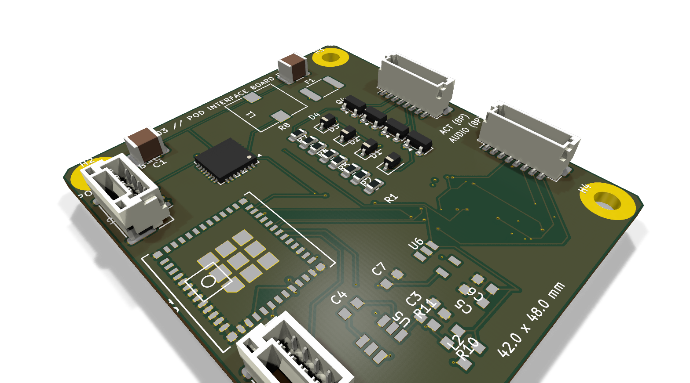
*Abbildung 7.3a: KiCad 3D-Render der Satelliten-Pod Platine (PCBA 03, 42 x 48 mm) mit ESP32-C6 Host MCU, SW3516 30W USB-PD Ladecontroller, ES8388 Audio-Codec, getrenntem Stirnseiten-Bus & USB-C Abgang sowie rückwärtigen Intercom- und Mechatronik-Headern.*

### 5.1 Technische Platinen-Kenndaten & Architektur
* **Abmessungen:** $42{,}0 \times 48{,}0\,\text{mm}$ (4x M2.5 Befestigungsbohrungen auf $36{,}0 \times 42{,}0\,\text{mm}$ mit Schwingungsdämpfern direkt am Boden der Koffer-Pod Wanne).
  * **Länge in X ($42{,}0\,\text{mm}$):** Strikt nach vorne begrenzt (nur der Raumgewinn durch den Entfall der Kassetten-Frontblende). Der gesamte Raum hinter der Platine bleibt zu 100 % für die OEM-Cradles (Cardo Air-Mount, Sena SPIDER-Schale, OMM) und die 15–85 mm Aktuatorschiene reserviert.
  * **Breite in Y ($48{,}0\,\text{mm}$):** Nutzt die lichte Weite der Pod-Wanne ($63\,\text{mm}$) und der Aktuatorschiene ($54\,\text{mm}$) voll aus. Verdoppelt die Platinenfläche ($2016\,\text{mm}^2$ statt bisher $875\,\text{mm}^2$), schafft massive durchgehende GND-Planes und entzerrt das 4-Lagen-Routing.
* **Lagenaufbau:** 4 Lagen FR-4 High-TG150 ($1{,}6\,\text{mm}$ Dicke, L2 durchgehende GND-Plane, L3 Power-Plane, ENIG-Goldfinish).
* **Entfallene Altlasten (Flächenbereinigung):**
  * **DW3110 UWB Subsystem:** IC `U2`, 38.4 MHz Quarz `Y1`, U.FL Buchse `ANT_UWB` und HF-Keepouts ersatzlos gestrichen.
  * **4-Pin SWD Header (`J_PROG`):** Entfällt vollständig, da der ESP32-C6 über integrierte USB-Serial/JTAG Peripherie verfügt (Flashen & DFU direkt über USB).
  * **Blade-Slot Kontakte (`J_DC_IN` / `PAD1`, `PAD2`):** Die alten 10mm Kassetten-Messerkontakte entfallen.
* **4-Pin Bus-Eingang (`J_BUS` / 4-Pin JST-GH 1.25mm SMD):**
  * Sitzt an der **linken Stirnkante unten** (exakt an der Position des früheren Blade-Slots).
  * Direkter, geradliniger Leitungsweg (< 15 mm) zur Kofferwandtülle ohne Biegeschleifen.
  * Führt die 4 Adern des Strangs von der Zentralbox: `VCC_BUS` (+12V...+20V Bordnetz/PD, abgesichert 30W), `GND`, `USB_D+`, `USB_D-`.
* **Integrierte 30W USB-PD Ladezone & Gehäusebuchsen-Abgang (`J_USB_OUT` / 4-Pin JST-GH 1.25mm SMD):**
  * **Controller:** Ismartware `SW3516` oder Injoinic `IP6538` (QFN-32, $5 \times 5\,\text{mm}$) synchroner Step-Down Konverter mit integriertem USB-PD 3.0 / PPS / QC4+ Protokollcontroller und $7 \times 7\,\text{mm}$ geschirmter Speicherinduktivität ($10\,\mu\text{H}$).
  * **Header `J_USB_OUT`:** Sitzt an der **linken Stirnkante oben**.
* **Stirnseitige interne Anschlüsse & Gehäuse-Buchsenanordnung:**
  * **Anordnung an der kurzen Gehäusestirnwand (Port A & Port B):** Beide Buchsen sitzen horizontal exakt mittig ($Y = 35{,}0\,\text{mm}$) und sind vertikal übereinander gestapelt:
    * **Port A (Bus-Buchse):** Oberhalb der Mitte bei $Z = 26{,}5\,\text{mm}$ (mit M8-Schutzkragen bzw. dichter Kabelverschraubung zur Zentralbox).
    * **Port B (USB-C Ladedose):** Unterhalb der Mitte bei $Z = 11{,}5\,\text{mm}$ (mit $7\,\text{mm}$ tief eingelassener Steckertasche für bündige wasserdichte TPU-Schutzkappe).
  * **Interne Silikon-Kabelpeitschen:** Die Verbindung von der Platine zu den Gehäusebuchsen erfolgt über kurze, hochflexible Silikonkabel von den stirnseitigen Headern `J_BUS` bzw. `J_USB_OUT`. Sämtliche Einsteck-, Rüttel- und Hebelkräfte werden zu 100 % vom stabilen PA12-Monocoque abgefangen – die Platine bleibt völlig zug- und schwingungsfrei!
  * **100 % Symmetriegarantie (Links = Rechts):** Da beide Koffer-Pods an der Stirnseite identisch orientiert sind, bleibt die USB-C Ladedose an beiden Fahrzeugseiten ergonomisch gleich zugänglich.
* **Rückwärtige Schnittstellen (Geräteseite, nach rechts in die Gerätekammer):**
  * **`J_AUDIO_PWR` (8-Pin JST-SH 1.0mm, oben rechts):** Direkte Verbindung zur OEM-Kabelpeitsche des Intercoms (Sena, Cardo, OMM, Midland).
  * **`J_ACT` (8-Pin JST-SH 1.0mm, unten rechts):** Direkte Verbindung zu bis zu 4 Aktuatorkanälen (Hubmagnete / Servos auf der universellen Aktuatorschiene `012_universal_actuator_slide_bracket.scad`).
  * **Vorteil:** Durch den räumlichen Abstand zwischen Audio (oben) und Aktorik (unten) streuen Schaltimpulse der Magnete nicht in die analogen Audioleitungen ein. Beide Kabelstränge laufen parallel nach hinten ab – null Kabelkreuzungen über der Platine!
* **Kommunikations-, Leistungs- & Audio-ICs:**
  * `U1`: Espressif `ESP32-C6-MINI-1U` RISC-V MCU zur Ladeüberwachung, Codec-Steuerung, Aktorik und USB-Audio-Brücke.
  * `U_PD`: Ismartware `SW3516` (QFN-32, $5 \times 5\,\text{mm}$) synchroner 30W USB-PD 3.0 / PPS / QC4+ Step-Down Wandler mit $7 \times 7\,\text{mm}$ geschirmter Speicherinduktivität `L_PD` ($10\,\mu\text{H}$) und 1210er Festpolymer-Filterkondensatoren.
  * `U3`: Everest Semi `ES8388` 24-Bit / 48 kHz Low-Noise Audio-Codec.
  * `U4`: TI `TS5A23157` (MSOP-10) 2-Kanal SPDT Analog/USB-Schalter zur automatischen Umschaltung zwischen analogem Headset-Audio und digitalem OMM-USB-Host via Pin 6 (`OMM_DETECT`).
  * `U7`: WCH `CH554E` (MSOP-10) USB 2.0 Full-Speed Host Controller, angebunden über eine 3.0 Mbps UART-Brücke an den ESP32-C6 (GPIO 20 / GPIO 21).
  * `C8`: 100 nF 0603 Stützkondensator für die 3.3V-Versorgung von U7.
  * `R9`: 100 kΩ 0603 Pull-Up-Widerstand an `OMM_DETECT` (3.3V im Leerlauf).
  * `Q1..Q4`: 4x N-Kanal Power-MOSFETs (`AO3400A`, 30V/4A) mit 4x Freilaufdioden (`1N4148WS`, D1..D4) für 4 unabhängige Schaltkanäle.
  * `F1`: 1812 SMD Polyfuse (PPTC) zur Absicherung der 5V Aktorik- und Peripherieversorgung (`VCC_5V_PROT`).

### 5.2 Externe Steckverbinder & Schnittstellen (J_BUS, J_USB_OUT, J_ACT, J_AUDIO_PWR)

<!-- AUTO_CONNECTORS_START: PCBA_03 -->

#### Stecker `J1`: J_BUS (Backbone Bus-Eingang von Zentralbox)
> **Typ:** `JST-GH 4-Pin 1.25mm SMD Vertikal (BM04B-GHS-TBT)` | **Gegenstecker:** `JST GHR-04V-S (AWG26-30)`  

| Pin | Signal / KiCad Net | Signal-Typ | Elektrische Spezifikation & Funktion |
| :---: | :--- | :---: | :--- |
| **1** | `VCC_BUS` | **Power In (+12V...+20V)** | Bordnetz-/PD-Speisung von Zentralbox (abgesichert 30W) |
| **2** | `GND` | **Power Return** | Leistungs- und Signalmasse |
| **3** | `USB_DP` | **USB 2.0 D+** | USB 2.0 High-Speed D+ zur Zentralbox |
| **4** | `USB_DM` | **USB 2.0 D-** | USB 2.0 High-Speed D- zur Zentralbox |
| **MP** | `GND` | **Shield** | Rastlaschen auf Masse-Plane gelegt |

#### Stecker `J2`: J_USB_OUT (In-Bag 30W USB-PD Ladedose)
> **Typ:** `JST-GH 4-Pin 1.25mm SMD Vertikal (BM04B-GHS-TBT)` | **Gegenstecker:** `JST GHR-04V-S (AWG26-30)`  

| Pin | Signal / KiCad Net | Signal-Typ | Elektrische Spezifikation & Funktion |
| :---: | :--- | :---: | :--- |
| **1** | `VBUS_30W` | **Power Out (+5V..+20V)** | Geregelte 30W USB-PD Ladespannung (SW3516) |
| **2** | `GND` | **Power Return** | Ladeleistungs-Rückstrom |
| **3** | `CC1` | **PD Config** | Configuration Channel 1 für USB-PD Aushandlung |
| **4** | `CC2` | **PD Config** | Configuration Channel 2 für USB-PD Aushandlung |
| **MP** | `GND` | **Shield** | Rastlaschen auf Masse-Plane |

#### Stecker `J3`: J_ACT (4-Kanal Mechatronik-Aktuatorschiene)
> **Typ:** `JST-SH 8-Pin 1.0mm SMD Vertikal (BM08B-SRSS-TB)` | **Gegenstecker:** `JST SHR-08V-S-B (AWG28-30)`  

| Pin | Signal / KiCad Net | Signal-Typ | Elektrische Spezifikation & Funktion |
| :---: | :--- | :---: | :--- |
| **1** | `GND` | **Power Return** | Massebezug |
| **2** | `GND` | **Power Return** | Massebezug |
| **3** | `ACT_4` | **Open-Drain Out** | Aktuator 4 (Mesh-Taste, geschaltet via Q4 AO3400A) |
| **4** | `ACT_3` | **Open-Drain Out** | Aktuator 3 (Center-Taste, geschaltet via Q3 AO3400A) |
| **5** | `ACT_2` | **Open-Drain Out** | Aktuator 2 (Minus-Taste, geschaltet via Q2 AO3400A) |
| **6** | `ACT_1` | **Open-Drain Out** | Aktuator 1 (Plus-Taste, geschaltet via Q1 AO3400A) |
| **7** | `VCC_5V_PROT` | **Power Out (+5V)** | Polyfuse-geschützte 5V Speisung für Aktuatoren |
| **8** | `VCC_5V_PROT` | **Power Out (+5V)** | Polyfuse-geschützte 5V Speisung für Aktuatoren |
| **MP** | `GND` | **Shield** | Rastlaschen auf Masse |

#### Stecker `J4`: J_AUDIO_PWR (Hybrid Intercom & OMM Module Header)
> **Typ:** `JST-SH 8-Pin 1.0mm SMD Vertikal (BM08B-SRSS-TB)` | **Gegenstecker:** `JST SHR-08V-S-B (AWG28-30)`  

| Pin | Signal / KiCad Net | Signal-Typ | Elektrische Spezifikation & Funktion |
| :---: | :--- | :---: | :--- |
| **1** | `GND` | **Power Return** | Gemeinsame Signal- und Lastmasse |
| **2** | `VCC_5V_PROT` | **Power Out (+5V)** | Polyfuse-geschützte 5V Speisung (F1 1.1A gesichert) |
| **3** | `GND` | **Power Return** | Massebezug |
| **4** | `POD_IO_DP_L` | **Dual-Mode I/O** | Modus A: Line-In Links / Modus B: OMM USB D+ |
| **5** | `POD_IO_DM_R` | **Dual-Mode I/O** | Modus A: Line-In Rechts / Modus B: OMM USB D- |
| **6** | `OMM_DETECT` | **Control In** | Mode-Sense (HIGH 3.3V = Analog-Codec, LOW 0V = Digital-OMM USB Host) |
| **7** | `VOICE_OUT` | **Analog Audio Out** | Modus A: Sprache vom ES8388 DAC an Headset Mic-In |
| **8** | `PTT_BTN` | **Digital In** | Hardware PTT-Taster (Active-Low gegen Masse, 10k PU) |
| **MP** | `GND` | **Shield** | Rastlaschen auf Masse |

<!-- AUTO_CONNECTORS_END: PCBA_03 -->

### 5.3 Sub-Chips & Peripherie-Bausteine (CH554E, TS5A23157, ES8388)

<!-- AUTO_SUBCHIPS_START: PCBA_03 -->

#### Sub-Chip `U7`: WCH CH554E USB 2.0 Full-Speed Host Controller (MSOP-10)
> **Hersteller-Datenblatt:** [WCH CH554E USB 2.0 Full-Speed Host Controller](https://www.wch-ic.com/downloads/CH554DS1_PDF.html) | **Pin-Definition:** [Section 3: Pin Definitions (MSOP-10)](https://www.wch-ic.com/downloads/CH554DS1_PDF.html#page=5)  

| Pad | Pin-Name | Signal / KiCad Net | Signal-Typ | Ziel / Quelle | Funktion & Elektr. Spezifikation |
| :---: | :--- | :--- | :---: | :--- | :--- |
| 3 | `RXD1 / P1.6` | `CH554_UART_TX` | **UART In** | U1.26 (ESP32-C6 GPIO20) | 3.0 Mbps UART RX vom ESP32-C6 (TX) |
| 4 | `TXD1 / P1.7` | `CH554_UART_RX` | **UART Out** | U1.27 (ESP32-C6 GPIO21) | 3.0 Mbps UART TX zum ESP32-C6 (RX) |
| 5 | `GND` | `GND` | **Power Return** | GND Plane | Massebezug |
| 6 | `UDM` | `OMM_USB_DM` | **USB D-** | U4.7 (TS5A23157) | USB 2.0 Host Datenleitung D- zum OMM-Modul via U4/J4 |
| 7 | `UDP` | `OMM_USB_DP` | **USB D+** | U4.9 (TS5A23157) | USB 2.0 Host Datenleitung D+ zum OMM-Modul via U4/J4 |
| 8 | `GND` | `GND` | **Power Return** | GND Plane | Massebezug |
| 9 | `V33` | `VCC_3V3` | **Power In** | 3.3V Rail (C8 100nF) | 3.3V Versorgungsspannung |
| 10 | `VCC` | `VCC_3V3` | **Power In** | 3.3V Rail | 3.3V Versorgungsspannung |

#### Sub-Chip `U4`: TI TS5A23157 Dual SPDT Analog/USB-Switch (MSOP-10)
> **Hersteller-Datenblatt:** [TI TS5A23157 Dual SPDT Analog/USB-Switch](https://www.ti.com/lit/ds/symlink/ts5a23157.pdf) | **Pin-Definition:** [Pin Functions (MSOP-10 / VSSOP-10)](https://www.ti.com/lit/ds/symlink/ts5a23157.pdf#page=3)  

| Pad | Pin-Name | Signal / KiCad Net | Signal-Typ | Ziel / Quelle | Funktion & Elektr. Spezifikation |
| :---: | :--- | :--- | :---: | :--- | :--- |
| 1 | `1IN` | `OMM_DETECT` | **Control In** | J4.6 / R9 Pull-Up | Steuereingang Schalter 1 (HIGH=Analog Codec, LOW=Digital OMM) |
| 2 | `1NO` | `AUDIO_IN_L` | **Analog Audio In** | U3.8 (ES8388 LIN1) | Schließer 1: Analog Line-In Links vom OEM Headset |
| 3 | `GND` | `GND` | **Power Return** | GND Plane | Massebezug |
| 4 | `2NO` | `AUDIO_IN_R` | **Analog Audio In** | U3.9 (ES8388 RIN1) | Schließer 2: Analog Line-In Rechts vom OEM Headset |
| 5 | `2IN` | `OMM_DETECT` | **Control In** | J4.6 / R9 Pull-Up | Steuereingang Schalter 2 |
| 6 | `2COM` | `POD_IO_DM_R` | **Dual-Mode I/O** | J4.5 | Gemeinsamer Kontakt 2 zu Pin 5 des Hybrid-Steckers J4 |
| 7 | `2NC` | `OMM_USB_DM` | **USB D-** | U7.6 (CH554E UDM) | Öffner 2: Digital USB D- Verbindung zum CH554E Host |
| 8 | `V+` | `VCC_3V3` | **Power In** | 3.3V Rail | 3.3V Versorgungsspannung |
| 9 | `1NC` | `OMM_USB_DP` | **USB D+** | U7.7 (CH554E UDP) | Öffner 1: Digital USB D+ Verbindung zum CH554E Host |
| 10 | `1COM` | `POD_IO_DP_L` | **Dual-Mode I/O** | J4.4 | Gemeinsamer Kontakt 1 zu Pin 4 des Hybrid-Steckers J4 |

#### Sub-Chip `U3`: Everest Semi ES8388 24-Bit Audio Codec (QFN-28 (4x4 mm))
> **Hersteller-Datenblatt:** [Everest Semi ES8388 24-Bit Audio Codec](http://www.everest-semi.com/pdf/ES8388%20DS.pdf) | **Pin-Definition:** [Pin Configuration & Description (QFN-28)](http://www.everest-semi.com/pdf/ES8388%20DS.pdf#page=4)  

| Pad | Pin-Name | Signal / KiCad Net | Signal-Typ | Ziel / Quelle | Funktion & Elektr. Spezifikation |
| :---: | :--- | :--- | :---: | :--- | :--- |
| 1 | `MCLK` | `I2S_MCLK` | **Clock In** | U1.15 (ESP32-C6) | I2S Master Clock (12.288 MHz) |
| 2 | `BCLK` | `I2S_BCLK` | **Clock In** | U1.16 (ESP32-C6) | I2S Bit Clock (3.072 MHz) |
| 3 | `LRCK` | `I2S_WS` | **Sync In** | U1.19 (ESP32-C6) | I2S Word Select / Frame Sync (48 kHz) |
| 4 | `DSOUT` | `I2S_DIN` | **Audio Out** | U1.24 (ESP32-C6) | Digitalisiertes Mikrofon-Signal an MCU |
| 5 | `DSIN` | `I2S_DOUT` | **Audio In** | U1.20 (ESP32-C6) | Downlink Audio vom DSP zum DAC |
| 8 | `LIN1` | `AUDIO_IN_L` | **Analog In** | U4.2 (via J4.4) | Analoger Audio-Eingang Links vom OEM-Intercom |
| 9 | `RIN1` | `AUDIO_IN_R` | **Analog In** | U4.4 (via J4.5) | Analoger Audio-Eingang Rechts vom OEM-Intercom |
| 12 | `LOUT1` | `VOICE_OUT` | **Analog Out** | J4.7 | Analoger Mikrofon-Pegel Ausgang an OEM-Headset Mic-In |
| 20 | `SCL` | `I2C_SCL` | **I2C SCL** | U1.13 (ESP32-C6) | I2C Taktleitung zur Codec-Registerprogrammierung |
| 21 | `SDA` | `I2C_SDA` | **I2C SDA** | U1.23 (ESP32-C6) | I2C Datenleitung zur Codec-Registerprogrammierung |

<!-- AUTO_SUBCHIPS_END: PCBA_03 -->

### 5.4 ESP32-C6-MINI-1U (`U1`) Vollständige Pinout-Matrix

<!-- AUTO_PINOUT_START: PCBA_03 -->

| Pad | Signal / KiCad Net | ESP32 GPIO | Firmware Define | Ziel / IC | Signal-Typ & Elektr. Spezifikation |
| :---: | :--- | :---: | :--- | :--- | :--- |
| 3 | `VCC_3V3` | - | - | 3.3V Power Rail | **Power** – Betriebsspannung ESP32-C6 (3.0V - 3.6V) |
| 5 | `PTT_BTN` | GPIO 2 | `PIN_POD_PTT_BTN` | J4.8 | **Digital In** – Hardware PTT-Taster Eingang (Active Low, 10k Pull-Up) |
| 6 | `ACT3_GATE` | GPIO 3 | `PIN_ACT3_CENTER` | Q3 Gate (AO3400A) | **Digital Out** – Mechatronik Aktuator 3 Gate (Center / Phone Taste) |
| 8 | `VCC_3V3` | - | - | VCC_3V3 Pull-Up | **Power/Reset** – Chip Enable / Hardware Reset |
| 9 | `ACT4_GATE` | GPIO 4 | `PIN_ACT4_MESH` | Q4 Gate (AO3400A) | **Digital Out** – Mechatronik Aktuator 4 Gate (Mesh Taste) |
| 10 | `ACT1_GATE` | GPIO 5 | `PIN_ACT1_PLUS` | Q1 Gate (AO3400A) | **Digital Out** – Mechatronik Aktuator 1 Gate (Plus / Vol+ Taste, Active High via Q1 AO3400A) |
| 12 | `OMM_DETECT` | GPIO 0 | `PIN_OMM_DETECT` | J4.6 / U4.1, U4.5 / R9 Pull-Up | **Digital In** – OMM Kabelerkennung (HIGH = Sena/Cardo via Codec, LOW = OMM via CH554E USB-Host) |
| 13 | `I2C_SCL` | GPIO 1 | `PIN_CODEC_I2C_SCL` | U3.27 / SW3516 | **I2C_SCL** – I2C Taktleitung (SCL) für ES8388 Audio-Codec & SW3516 30W Ladecontroller |
| 15 | `I2S_MCLK` | GPIO 6 | `PIN_I2S_MCLK` | U3.1 | **I2S_MCLK** – I2S Master-Clock (12.288 MHz an ES8388 Audio-Codec) |
| 16 | `I2S_BCLK` | GPIO 7 | `PIN_I2S_BCLK` | U3.2 / J4 | **I2S_BCLK** – I2S Bit-Clock (3.072 MHz) |
| 17 | `USB_DM` | GPIO 12 | `PIN_POD_USB_DM` | J1.4 | **USB_D-** – Backbone USB 2.0 D- (J_BUS Pin 4) |
| 18 | `USB_DP` | GPIO 13 | `PIN_POD_USB_DP` | J1.3 | **USB_D+** – Backbone USB 2.0 D+ (J_BUS Pin 3) |
| 19 | `I2S_WS` | GPIO 14 | `PIN_I2S_WS` | U3.3 / J4 | **I2S_WS** – I2S Word Select / Frame Sync (48 kHz LRCLK an ES8388 & J4) |
| 20 | `I2S_DOUT` | GPIO 15 | `PIN_I2S_DOUT` | U3.4 / J4 | **I2S_DOUT** – I2S Serial Data Out (DAC Data an ES8388 & OMM via TMUX1574) |
| 22 | `ACT2_GATE` | GPIO 8 | `PIN_ACT2_MINUS` | Q2 Gate (AO3400A) | **Digital Out** – Mechatronik Aktuator 2 Gate (Minus / Vol- Taste, Active High via Q2 AO3400A) |
| 23 | `I2C_SDA` | GPIO 9 | `PIN_CODEC_I2C_SDA` | U3.28 / SW3516 | **I2C_SDA** – I2C Datenleitung (SDA) für ES8388 Audio-Codec & SW3516 |
| 24 | `I2S_DIN` | GPIO 18 | `PIN_I2S_DIN` | U3.5 / J4 | **I2S_DIN** – I2S Serial Data In (ADC Data vom ES8388 & OMM via TMUX1574) |
| 26 | `CH554_UART_TX` | GPIO 20 | `PIN_CH554_UART_TX` | U7.3 (CH554E RXD1) | **UART_TX** – High-Speed UART TX (2 Mbps) zu CH554E USB-Host Controller |
| 27 | `CH554_UART_RX` | GPIO 21 | `PIN_CH554_UART_RX` | U7.4 (CH554E TXD1) | **UART_RX** – High-Speed UART RX (2 Mbps) vom CH554E USB-Host Controller |

<!-- AUTO_PINOUT_END: PCBA_03 -->

### 5.5 Funktionsweise der Hardware- und Protokoll-Umschaltung

| Pin | Signalname | Signalart | Funktion & Spezifikation (internes Kabel zu Port A) |
| :---: | :--- | :---: | :--- |
| **1** | **`VCC_BUS`** | Power In (+12V...+20V) | Bordnetz- / PD-Speisung von Zentralbox (AWG20, abgesichert 30W) |
| **2** | **`GND`** | Power Return | Leistungs- und Signalmasse |
| **3** | **`USB_DP`** | High-Speed Data | USB 2.0 Datenleitung D+ zur Zentralbox (ESP32-S3 Host) |
| **4** | **`USB_DM`** | High-Speed Data | USB 2.0 Datenleitung D- zur Zentralbox (ESP32-S3 Host) |
| **MP** | **`GND`** | Schirmung | Rastlaschen des JST-GH Steckers auf GND-Plane gelegt |

### 5.3 Pinbelegung des internen 30W USB-C Gehäuseabgangs (`J_USB_OUT` / 4-Pin JST-GH 1.25mm)

| Pin | Signalname | Signalart | Funktion: Internes Silikonkabel zur Gehäusewand (Port B) |
| :---: | :--- | :---: | :--- |
| **1** | **`VBUS_30W`** | Power Out | Geregelte 5V/9V/12V/15V/20V USB-PD Ladespannung (bis 30W) |
| **2** | **`GND`** | Power Return | Rückstrom Ladeleistung (AWG20 Silikonader) |
| **3** | **`CC1`** | PD Config In/Out | Configuration Channel 1 für USB-PD 3.0 / PPS Aushandlung |
| **4** | **`CC2`** | PD Config In/Out | Configuration Channel 2 für USB-PD 3.0 / PPS Aushandlung |
| **MP** | **`GND`** | Schirmung | Rastlaschen des JST-GH Steckers auf GND-Plane |

### 5.4 Pinbelegung des Audio-Power-Headers (`J_AUDIO_PWR` / 8-Pin JST-SH 1.0mm) & Dual-Mode Umschaltlogik

Der 8-polige Schnittstellenverbinder `J4` (`J_AUDIO_PWR`) an der rechten Platinenkante schaltet je nach eingestecktem Peripheriegerät vollautomatisch zwischen **analogem OEM-Intercom-Betrieb (Sena / Cardo / Midland)** und **digitalem USB-Host-Betrieb für das OpenMotorMesh-Modul (PCBA 09 / PCBA 10)** um.

| Pin | Netzname (PCB) | Richtung | Modus A: Analog-Intercom (Sena / Cardo / Midland) | Modus B: Digital-OMM (PCBA 09 / PCBA 10) |
| :---: | :--- | :---: | :--- | :--- |
| **1** | **`GND`** | Power Return | **Leistungs- und Audio-Rückstrom:** Gemeinsame Masse ($0{,}2\dots 0{,}6\,\text{A}$) | **USB- und System-Masse:** Rückstrom Lader & HF-Endstufe |
| **2** | **`VCC_5V_PROT`** | Power Out (+5V) | **Headset-Ladespannung:** Polyfuse-geschützte 5V Speisung für Headset-Akku im Fahrbetrieb | **USB VBUS:** Normgerechte 5V USB-Versorgung für den OMM BQ24075 PMIC |
| **3** | **`GND`** | System GND | Referenz- und Schirmmasse | Referenz- und Schirmmasse |
| **4** | **`POD_IO_DP_L`** | Dual-Mode I/O | **Analog `AUDIO_IN_L` (via U4 NO, IN=HIGH):** Line-Out Lautsprecher Links vom Headset $\rightarrow$ ES8388 ADC | **Digital `OMM_USB_DP` (via U4 NC, IN=LOW):** USB 2.0 D+ Verbindung zum CH554E USB Host |
| **5** | **`POD_IO_DM_R`** | Dual-Mode I/O | **Analog `AUDIO_IN_R` (via U4 NO, IN=HIGH):** Line-Out Lautsprecher Rechts vom Headset $\rightarrow$ ES8388 ADC | **Digital `OMM_USB_DM` (via U4 NC, IN=LOW):** USB 2.0 D- Verbindung zum CH554E USB Host |
| **6** | **`OMM_DETECT`** | Control In $\leftarrow$ | **Offen / 3.3V HIGH (Pull-Up R9 100k):** Hält U4 im Analog-Audiomodus | **GND-Brücke im USB-C Kabel (0V LOW):** Zieht Signal auf Masse $\rightarrow$ U4 schaltet auf USB-Host |
| **7** | **`VOICE_OUT`** | Audio Out $\rightarrow$ | **Analoges Mikrofonsignal:** Sprache vom ES8388 DAC (Pin 12) $\rightarrow$ OEM Headset Mic-In | **N/C (nicht genutzt):** OMM empfängt und sendet Sprache volldigital über USB |
| **8** | **`PTT_BTN`** | Digital In $\leftarrow$ | **Hardware-PTT:** Tastereingang direkt auf ESP32-C6 GPIO 2 (Tastung gegen GND) | **N/C (optional):** PTT wird beim OMM digital als Flag in den USB-Datenframes übertragen |
| **MP** | **`GND`** | Schirmung | Beidseitige SMD-Montagelaschen des JST-SH Steckers auf GND-Plane | Beidseitige SMD-Montagelaschen des JST-SH Steckers auf GND-Plane |

#### 5.4.1 Funktionsweise der Hardware- und Protokoll-Umschaltung

1. **Umschalter-Logik (`U4`, TS5A23157):**
   - Das Signal `OMM_DETECT` steuert die beiden Steuereingänge `1IN` und `2IN` des SPDT-Schalters `U4`.
   - **Leerlauf / Analog-Headset:** Solange kein OMM-Modul angeschlossen ist (oder ein passives Adapterkabel für Sena/Cardo ohne Pin-6-GND-Brücke genutzt wird), zieht der onboard 100 kΩ Pull-Up-Widerstand `R9` das Netz `OMM_DETECT` auf logisch HIGH ($3{,}3\,\text{V}$). Dadurch verbindet `U4` die Pins `POD_IO_DP_L` und `POD_IO_DM_R` mit den analogen Line-In Eingängen `AUDIO_IN_L` und `AUDIO_IN_R` des Audio-Codecs ES8388 (`U3`).
   - **OMM-Modul gesteckt:** Im Verbindungskabel zum OpenMotorMesh-Modul (bzw. auf der OMM-Platine PCBA 09 / PCBA 10) ist Pin 6 direkt mit GND gebrückt. Sobald der Stecker kontaktiert, wird `OMM_DETECT` auf 0 V (LOW) gezogen. `U4` schaltet verzögerungsfrei auf die USB-Datenleitungen `OMM_USB_DP` und `OMM_USB_DM` des CH554E-Controllers um.

2. **USB-Host-Architektur mit CH554E (`U7`):**
   - **Das Architektur-Problem:** Der ESP32-C6 (`U1`) auf PCBA 03 arbeitet als nativer USB 2.0 Full-Speed Client am Backbone-Bus zur Zentralbox (`PCBA 01`). Da der ESP32-C6 nur eine einzige USB-Schnittstelle besitzt und diese als Device belegt ist, kann er nicht zeitgleich als USB-Host für das OMM-Modul agieren.
   - **Die Lösung via CH554E:** Der kompakte 8-Bit RISC-USB-Mikrocontroller WCH `CH554E` (MSOP-10) agiert als autonomer, dedizierter **USB 2.0 Full-Speed Host** für das OMM-Modul. Das OMM-Modul (PCBA 09 / PCBA 10) bleibt damit ein stromsparender Standard-USB-Client (Device) und muss keinen Host-Modus betreiben.
   - **Inter-Chip-Kommunikation mit 3.0 Mbps & komprimierten Codecs:** Der CH554E ist über eine vollduplex **3.0 Mbps UART-Verbindung** (`CH554_UART_TX` / `CH554_UART_RX` an ESP32-C6 GPIO 20 / GPIO 21, Teiler $F_{sys}/8$ am CH554E) angebunden. Da im System **kein unkomprimiertes PCM** übertragen wird, sondern strikt komprimierte Audioströme (**Opus HD 24k** für Mesh-Sprache und Stereo-Musiksharing sowie **DMR AMBE+2 / Codec2 / Opus Voice 6–8 kbps** für den 446-MHz-Funk), summiert sich die Netto-Datenrate aller aktiven Kanäle auf lediglich **$\approx 180\,\text{kbps}$** ($\approx 23\,\text{kB/s}$). Bei $3{,}0\,\text{Mbps}$ Netto-Kapazität ($\approx 300\,\text{kB/s}$) beträgt die Busauslastung gerade einmal **$7{,}5\,\%$** – mit über $90\,\%$ Puffer für Jitter, Latenz-Bursts und Bus-DFU!
   - **Die 5 bidirektionalen Audioströme im System:**
     1. **Stream 1 (Upstream): Voice-Mesh** (2.4 GHz Mesh-Intercom von Fahrern im Konvoi via Opus 24k Wideband, $\sim 24\,\text{kbps}$).
     2. **Stream 2 (Upstream): Voice-Funk** (446 MHz PMR/DMR von Funkteilnehmern via AMBE+2 / Codec2 / Opus Voice, $1{,}2\dots 6\,\text{kbps}$).
     3. **Stream 3 (Upstream): Audio-Mesh** (Stereo-Musiksharing von einem Gruppenmitglied via Opus Stereo, $48\dots 64\,\text{kbps}$).
     4. **Stream 4 (Downlink): Voice-Mic-TX** (Fahrer-Helmmikrofon nach DSP-Entstörung zur Aussendung an Mesh und PMR/DMR via Opus 24k, $\sim 24\,\text{kbps}$).
     5. **Stream 5 (Downlink): Audio-Master-Mix** (Lokale Navigation vom Front-Node / Smartphone CarPlay/Android Auto, Radar-Gefahrenton und Systemansagen via Opus Stereo, $48\dots 64\,\text{kbps}$).
     - *Hinweis zum theoretischen 6. Stream:* Ein gleichzeitiges Abspielen zweier unterschiedlicher Musikquellen (z. B. lokales Spotify über CarPlay und zeitgleiches Musiksharing eines Gruppenpartners aus dem Mesh ins selbe Gehör) ist akustisch widersinnig. Die Audio-Matrix schaltet bei Medien exklusiv (lokale Musik ODER Mesh-Music-Sharing), weshalb zu jedem Zeitpunkt maximal **5 reale Ströme** übertragen werden.
   - **Kanaltrennung bis zur Zentralbox:** Funk-Sprache, Mesh-Sprache und geteilte Musik werden im OMM-Modul nicht zu einem flachen Mono-Mix verschmolzen, sondern als getrennte Sub-Streams im Frameformat belassen. Der ESP32-S31 DSP in der Zentralbox kann so autonomes Ducking (-18 dB Musik bei Spracherkennung), getrennte Lautstärken und 3D-Spatial-Panning (z. B. Funkstimme links, Mesh zentriert) verlustfrei berechnen.
   - **Keine zusätzlichen Leitungen erforderlich:** Da die 5V-Versorgung (`VCC_5V_PROT`) an Pin 2 ohnehin für das Laden des Headsets vorhanden ist, fungiert sie beim OMM-Modul direkt als USB-VBUS. Es werden exakt nur 2 Datenleitungen (D+ und D-) geschaltet, wodurch die kompakte 8-Pin Belegung von `J4` vollständig gewahrt bleibt.

### 5.5 Pinbelegung des Mechatronik-Aktuator-Headers (`J_ACT` / 8-Pin JST-SH 1.0mm)

| Pin | Signalname | Signalart | Funktion & Schutz |
| :---: | :--- | :---: | :--- |
| **1** | **`GND`** | Power Return | Leistungs-Masse für Aktorikstufe |
| **2** | **`GND`** | Power Return | Leistungs-Masse für Aktorikstufe |
| **3** | **`ACT_4`** | Open-Drain Out | Geschaltete Spulenmasse Aktuator 4 (via AO3400A Q4 / Freilaufdiode D4) |
| **4** | **`ACT_3`** | Open-Drain Out | Geschaltete Spulenmasse Aktuator 3 (via AO3400A Q3 / Freilaufdiode D3) |
| **5** | **`ACT_2`** | Open-Drain Out | Geschaltete Spulenmasse Aktuator 2 (via AO3400A Q2 / Freilaufdiode D2) |
| **6** | **`ACT_1`** | Open-Drain Out | Geschaltete Spulenmasse Aktuator 1 (via AO3400A Q1 / Freilaufdiode D1) |
| **7** | **`VCC_5V_PROT`** | Power Out (+5V) | Speisung für Aktuatorspulen (polyfuse-abgesichert via F1) |
| **8** | **`VCC_5V_PROT`** | Power Out (+5V) | Speisung für Aktuatorspulen (polyfuse-abgesichert via F1) |
| **MP** | **`GND`** | Schirmung | SMD-Montagelaschen auf GND-Plane |

---

## 6. PCBA 04: Heck-Pod 3 (Ersatzlos entfallen)

Die Heckplatine `PCBA 04` und das zugehörige Heckgehäuse Pod 3 sind vollständig gestrichen:
* Der Semtech SX1262 LoRa-Transceiver arbeitet direkt auf der Zentralbox (`PCBA 01`).
* Das u-blox SAM-M10Q GNSS-Modul arbeitet im modularen Sensor-Puck des Front-Knotens (`PCBA 05`).

---

## 7. PCBA 05: Universal Front-Knoten (`openmotorbridge_front_node`)

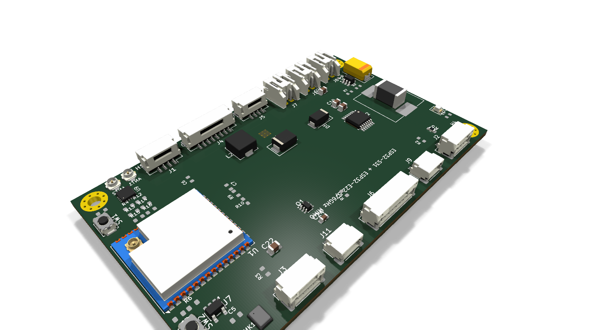
*Abbildung 7.5a: KiCad 3D-Render des Universal Front-Knotens Top (PCBA 05, 82 x 50 mm) mit ESP32-S31 Dual-Core RISC-V Host MCU (native 480 Mbps USB HS PHY, internes 2.4G aus), ESP32-E22 Companion Radio (Wi-Fi 6E 5/6 GHz 2x2 MIMO mit Dual-U.FL Ports via SDIO 3.0), USB2514Bi Industrial Hub, modularer Sensor-Puck Schnittstelle, Knowles MEMS Akustiksensor, 60W Power Engine (SW3526 30W USB-PD, TPS54302 5V Buck, TPS2051B Dongle Gate, TPS1H100 Aux Switch) und modularen JST Automotive-Verbindern.*

### 7.1 Technische Platinen-Kenndaten & v10 Dual-Chip Architektur (ESP32-S31 + ESP32-E22)
* **Abmessungen:** $82{,}0 \times 50{,}0\,\text{mm}$ mit 4x M2.5 Montagebohrungen ($75{,}0 \times 43{,}0\,\text{mm}$ Lochabstand, Gehäuseaußenmaß $98 \times 68 \times 25\,\text{mm}$ im geschlossenen IP68-Monocoque-Gehäuse am Lenker-Riser).
* **Lagenaufbau:** 4 Lagen FR-4 High-TG150 ($1{,}6\,\text{mm}$, ENIG-Goldfinish, impedanzkontrolliert 50 $\Omega$ Single-Ended / 90 $\Omega$ Differential USB & SDIO).
* **Host Microcontroller (`U1`, ESP32-S31-WROOM-1U):**
  * Dual-Core RISC-V Prozessor mit bis zu 320 MHz, AI-SIMD-Pipeline und nativem High-Speed USB 2.0 PHY (480 Mbps).
  * **2.4 GHz Funk softwaremäßig deaktiviert:** Das interne 2.4-GHz-Funkteil wird in der Firmware (`front_node_config.h`) dauerhaft abgeschaltet, um den Lenkerbereich funktechnisch zu 100 % sauber zu halten und Interferenzen mit den benachbarten Systemen auszuschließen.
  * Native 480 Mbps USB-Verbindung direkt über Stecker `J1` (4-Draht Automotive-Backbone zur Zentralbox `PCBA 01`) für zentrales Bus-DFU, Telemetrie und CDC-NCM Ethernet-Tethering.
* **Wireless Companion Radio (`U9`, ESP32-E22-WROOM-2X2):**
  * Hochperformanter Wi-Fi 6E Transceiver im 5 GHz und 6 GHz Band mit 2x2 MIMO.
  * Dual U.FL Antennenanschlüsse (`ANT1` Main, `ANT2` MIMO) direkt auf der Platinenoberseite für verlustarme Pigtails zu externen Gehäuse- oder Riser-Antennen.
  * Hochgeschwindigkeits-Anbindung an den Host-MCU `ESP32-S31` über einen 4-Bit SDIO 3.0 Bus (`SDIO_CLK`, `SDIO_CMD`, `SDIO_D0..D3`, `E22_IRQ`, `E22_EN`).
  * **Strikte 5/6 GHz Frequenztrennung:** Cockpit-WLAN und Telemetrie laufen exklusiv auf 5/6 GHz. Dadurch keinerlei Interferenz mit dem Qualcomm QCC3086 / S31 Bluetooth / BLE-Mesh der Zentralbox.
* **Infotainment Audio Bridge (`U2`, Feasycom FSC-BT802 / CSR8670):**
  * Dediziertes Bluetooth 5.1 Dual-Mode Audio-Subsystem zur verzögerungsfreien drahtlosen Koppelung an die Motorrad-Headunit (Harley-Davidson SkylineOS / Boom! Box GTS).
  * Digitale I2S-Audioverbindung (`BT_I2S_BCLK`, `BT_I2S_WS`, `BT_I2S_DOUT`, `BT_I2S_DIN`) direkt zum Host-MCU `ESP32-S31` (`U1`) für bidirektionales Streaming (Nav-Ansagen, Musik, Mikrofon).
  * AT-Command UART-Steuerkanal (`BT_UART_TX`, `BT_UART_RX`) an GPIO 43/44 des `ESP32-S31` zur automatischen Profilumschaltung und Statusüberwachung.
  * U.FL Antennenanschluss (`ANT4` / `BT_RF_ANT`) für verlustfreie HF-Abstrahlung aus dem Front-Node Gehäuse.
* **Automotive-Backbone Anbindung (`J1`, Strang 1):** Geschirmtes 4-Ader-Kabel von der Zentralbox (12V-20V Bordnetz, GND, USB 2.0 D+/D-), verlegt durch den Harley-Kabelkanal unter der Tankkonsole (**ZERO Tank-Demontage!**).
* **60W USB-PD Power-Engine (Power-Master):**
  * Low-Dropout Verpolschutz (`Q3`, AO3401A P-Kanal MOSFET mit R19/R20 100k Gate-Widerständen): Ersetzt verlustbehaftete Schottky-Dioden und minimiert den Eingangsabfall auf < 5 mV ($R_{\text{DS(on)}} \le 25\,\text{m}\Omega$). Stellt im 5V-USB-Werkstattbetrieb (Zentraler USB-C Service-Port J3 an PCBA 01) sicher, dass die vollen ~4,95 V bis 5,00 V verlustfrei am TPS54302 anliegen und das Gesamtsystem stabil weit über der UVLO-Abschaltschwelle (typ. 4,30 V, max. 4,50 V) bootet. (Hinweis: Ein Netzteil oder Hub, das unter Last derart einbricht, dass keine 4,75 V mehr gehalten werden, ist elektrotechnisch defekt/ausschussreif und taugt auch zum Laden moderner Smartphones nicht; mit jedem normgerechten 5V-USB-Netzteil ist der Betrieb durch Q3 uneingeschränkt garantiert).
  * TPS54302 Synchronous Buck Converter (`U3`): Erzeugt stabile +5V (bis 3A) für Peripherie, Pods und WS2812B.
  * SW3526 Synchronous Buck-Boost Fast-Charge Controller (`U5`): Bis 30W USB-PD (PPS, QC4+, AFC, FCP) für Smartphone-Schnellladen am Lenker oder Handschuhfach-Hub (`PCBA 05B`).
  * TLV75533P Low-Noise LDO (`U7`): Liefert saubere +3.3V Systemspannung für ESP32-S31, ESP32-E22 und Sensoren.
  * TPS2051B Load Switch (`U4`): Softwaregesteuertes Power-Gating für den CP2AA Dongle an `J5` (Szenario B) mit Fault-Reporting und 0.0 µA Deep-Sleep.
  * TPS1H100 Smart High-Side Switch (`Q2`): Schaltbarer 12V High-Side Ausgang (`J_AUX_LIGHT`) für LED-Zusatzscheinwerfer oder Heizgriff-Steuerung.
* **Modularer Sensor-Puck ("Körbchen") Schnittstelle (`J_SENSOR_EXT` / `J6` / 8-Pin JST-GH):**
  * Führt Versorgungsspannung (`3V3`, `GND`), I2C-Bus (`SCL`, `SDA`) sowie dedizierte GNSS-Hardwareleitungen (`TIMEPULSE` 1PPS, `GNSS_TXD`, `GNSS_RXD`, `GNSS_RESET_N`) zum schnappbaren Sensor-Puck ([`sensor_puck_environmental.scad`](../../hardware/cad/scad/04_front_node/parts/sensor_puck_environmental.scad)).
  * Beherbergt u-blox SAM-M10Q Multi-GNSS, TI TMP117 Präzisionsthermometer und OPT3001 Umgebungslichtsensor (Knowles I2S MEMS sitzt direkt geschützt auf der Unterseite von PCBA 05).
  * Am Motorrad direkt oben auf den Front-Node gerastet; im Auto/Van per 1,5m Verlängerungskabel absetzbar an der Windschutzscheibe.
* **Peripherie-Ausgänge & Gehäuse-Ports (100% modulare JST-GH SMD-Buchsen horizontal):**
  * **Südflanke / Cockpit-Wand (zum Lenker / Fahrer, Y = 116,50 mm in KiCad / Y = 0 mm im Gehäuse, 3x Oval-Durchbrüche $11{,}0 \times 5{,}5\,\text{mm}$):**
    * **`CKPT 1` (Rechts auf Gehäuse, Gehäuse-Mitte $X = 33{,}50\,\text{mm}$):**
      * `J3` (JST-GH 4P, $X_{\text{rel}} = 19{,}73\,\text{mm}$, Gehäuse $X = 27{,}73\,\text{mm}$): Rechter Spiegel-Pod ([`PCBA 05C`](#73-pcba-05c-symmetrischer-under-perch-spiegel-pod)) (BSD Amber LED + Taster).
      * `J11` (JST-GH 4P, $X_{\text{rel}} = 31{,}24\,\text{mm}$, Gehäuse $X = 39{,}24\,\text{mm}$): Rechtes Cockpit Speaker Corner Pod Display (I2C Bus + 3.3V + GND).
    * **`SENSOR` (Mitte auf Gehäuse, Gehäuse-Mitte $X = 53{,}25\,\text{mm}$):**
      * `J6` (JST-GH 8P, $X_{\text{rel}} = 45{,}25\,\text{mm}$, Gehäuse $X = 53{,}25\,\text{mm}$): Umwelt- & GNSS-Sensor-Puck ([`PCBA 05D`](#74-pcba-05d-modularer-umwelt--gnss-sensor-puck)) nach oben in den Schnappkorb.
    * **`CKPT 2` (Links auf Gehäuse, Gehäuse-Mitte $X = 73{,}00\,\text{mm}$):**
      * `J9` (JST-GH 4P, $X_{\text{rel}} = 59{,}26\,\text{mm}$, Gehäuse $X = 67{,}26\,\text{mm}$): Linkes Cockpit Speaker Corner Pod Display (I2C Bus + 3.3V + GND).
      * `J2` (JST-GH 4P, $X_{\text{rel}} = 70{,}77\,\text{mm}$, Gehäuse $X = 78{,}77\,\text{mm}$): Linker Spiegel-Pod ([`PCBA 05C`](#73-pcba-05c-symmetrischer-under-perch-spiegel-pod)) (BSD Amber LED + Taster).
    * **Software-Defined Cockpit Ports:** Die Zuordnung von `CKPT 1` und `CKPT 2` zur linken bzw. rechten Lenkerseite ist in der Firmware **100 % frei konfigurierbar** (1-Klick Swap in WebUI oder automatischer Setup-Wizard *"Bitte linken Spiegeltaster drücken"*). Dadurch **entfällt jegliches Überkreuzen von Kabeln am Riser**.
  * **Nordflanke / Fahrzeug- & Zubehör-Wand (nach vorne / unten, Y = 73,35 mm in KiCad / Y = 68 mm im Gehäuse):**
    * **`MAIN` (Gehäuse-Mitte $X = 34{,}30\,\text{mm}$, Oval-Port $11{,}0 \times 5{,}5\,\text{mm}$):**
      * `J1` (JST-GH 4P, $X_{\text{rel}} = 19{,}73\,\text{mm}$, Gehäuse $X = 27{,}73\,\text{mm}$): 4-Ader Automotive-Backbone (12V Bordnetz, GND, USB 2.0 D+/D- zur Zentralbox).
      * `J4` (JST-GH 8P, $X_{\text{rel}} = 32{,}85\,\text{mm}$, Gehäuse $X = 40{,}85\,\text{mm}$): Handschuhfach-Hub ([`PCBA 05B`](#72-pcba-05b-handschuhfach-hub--cockpit-breakout-openmotorbridge_cockpit_breakout)) Verbindung (30W PD, CC1/CC2, 5V, USB DN3).
    * **`DONGLE` (Gehäuse-Mitte $X = 54{,}00\,\text{mm}$, Oval-Port $11{,}0 \times 5{,}5\,\text{mm}$):**
      * `J5` (JST-GH 4P, $X_{\text{rel}} = 45{,}98\,\text{mm}$, Gehäuse $X = 53{,}98\,\text{mm}$): USB-Downstream 2 mit fernsteuerbarem Kaltstart-Reset (`TPS2051B`).
    * **`AUX 12V` (Gehäuse-Mitte $X = 63{,}35\,\text{mm}$, Mini-Port $6{,}5 \times 4{,}5\,\text{mm}$):**
      * `J7` (JST-GH 2P, $X_{\text{rel}} = 55{,}35\,\text{mm}$, Gehäuse $X = 63{,}35\,\text{mm}$): Geschalteter 12V High-Side Ausgang (bis 2.5 A / 30 W, `TPS1H100`) für Zusatzscheinwerfer oder Heizgriffe.
    * **`NAV 12V` (Gehäuse-Mitte $X = 71{,}48\,\text{mm}$, Mini-Port $6{,}5 \times 4{,}5\,\text{mm}$):**
      * `J10` (JST-GH 2P, $X_{\text{rel}} = 63{,}48\,\text{mm}$, Gehäuse $X = 71{,}48\,\text{mm}$): Dauerhafte 12V / 15W Cockpit-Speisung für Garmin Zūmo XT2 / Tread / Chigee AIO-5 / Carpuride.
    * **`CAM 5V` (Gehäuse-Mitte $X = 79{,}60\,\text{mm}$, Mini-Port $6{,}5 \times 4{,}5\,\text{mm}$):**
      * `J8` (JST-GH 2P, $X_{\text{rel}} = 71{,}60\,\text{mm}$, Gehäuse $X = 79{,}60\,\text{mm}$): Entstörte 5V / 10W Speisung für GoPro / Insta360 Action-Cam am Lenker.

---

### 7.1.1 Port-Matrix & Einsatz-Szenarien

| Gehäuse-Port | PCB-Header | Spezifikation / Signal | Beschriftung | Szenario A: Touring (Skyline OS / GTS & Handschuhfach) | Szenario B: Universal (RKS, GS/GSA, Low Rider ST, Naked) |
| :--- | :--- | :--- | :--- | :--- | :--- |
| **Cockpit Rechts** | `J3` | JST-GH 4P (5V, BSD LED, Taster, GND) | `CKPT 1` | **Aktiv:** Rechter Spiegel-Pod ([`PCBA 05C`](#73-pcba-05c-symmetrischer-under-perch-spiegel-pod)) | **Aktiv:** Rechter Spiegel-Pod ([`PCBA 05C`](#73-pcba-05c-symmetrischer-under-perch-spiegel-pod)) |
| **Cockpit Rechts** | `J11` | JST-GH 4P (3.3V, GND, I2C SCL/SDA) | `CKPT 1` | **Aktiv:** Speaker Corner Display Rechts | **Blindstopfen** (keine Verkleidungs-Lautsprecher) |
| **Cockpit Mitte** | `J6` | JST-GH 8P (3.3V, GND, I2C, 1PPS, UART, RST)| `SENSOR` | **Aktiv:** Sensor-Puck ([`PCBA 05D`](#74-pcba-05d-modularer-umwelt--gnss-sensor-puck)) oben gerastet | **Aktiv:** Sensor-Puck ([`PCBA 05D`](#74-pcba-05d-modularer-umwelt--gnss-sensor-puck)) oben gerastet |
| **Cockpit Links** | `J9` | JST-GH 4P (3.3V, GND, I2C SCL/SDA) | `CKPT 2` | **Aktiv:** Speaker Corner Display Links | **Blindstopfen** (keine Verkleidungs-Lautsprecher) |
| **Cockpit Links** | `J2` | JST-GH 4P (5V, BSD LED, Taster, GND) | `CKPT 2` | **Aktiv:** Linker Spiegel-Pod ([`PCBA 05C`](#73-pcba-05c-symmetrischer-under-perch-spiegel-pod)) | **Aktiv:** Linker Spiegel-Pod ([`PCBA 05C`](#73-pcba-05c-symmetrischer-under-perch-spiegel-pod)) |
| **Fahrzeug West** | `J1` | JST-GH 4P (12V-20V, GND, USB HS D+/D-)| `MAIN` | **IMMER Aktiv:** 4-Draht Lifeline von Zentralbox [`PCBA 01`](#1-pcba-01-zentralbox-main-controller) | **IMMER Aktiv:** 4-Draht Lifeline von Zentralbox [`PCBA 01`](#1-pcba-01-zentralbox-main-controller) |
| **Fahrzeug West** | `J4` | JST-GH 8P (30W PD, CC1/CC2, 5V, USB DN3)| `MAIN` | **Aktiv:** Dual-Rail Lifeline zu Handschuhfach-Hub ([`PCBA 05B`](#72-pcba-05b-handschuhfach-hub--cockpit-breakout-openmotorbridge_cockpit_breakout)) | **Optional:** Lenker-USB-C Lader oder **Blindstopfen** |
| **Fahrzeug Mitte** | `J5` | JST-GH 4P (5V gated, USB DN2 D+/D-) | `DONGLE` | **Blindstopfen:** CarPlay-Dongle sitzt im Handschuhfach an [`PCBA 05B`](#72-pcba-05b-handschuhfach-hub--cockpit-breakout-openmotorbridge_cockpit_breakout) | **NUR aktiv** bei Nachrüst-CP/AA Display; sonst **Blindstopfen** |
| **Fahrzeug Ost 1** | `J7` | JST-GH 2P (12V switched, max 2.5A) | `AUX 12V`| **Optional:** Zusatzscheinwerfer oder **Mini-Blindstopfen** | **Optional:** Zusatzscheinwerfer oder **Mini-Blindstopfen** |
| **Fahrzeug Ost 2** | `J10` | JST-GH 2P (12V dauerhaft, max 1.5A) | `NAV 12V`| **Mini-Blindstopfen:** Werks-Display (Skyline OS / GTS) aktiv | **Aktiv:** 12V Speisung für Garmin Zūmo XT2 / Chigee AIO-5 |
| **Fahrzeug Ost 3** | `J8` | JST-GH 2P (5V BC1.2 DCP, max 2.0A) | `CAM 5V` | **Mini-Blindstopfen:** Bei Action-Cam Fahrt mit Mini-Kabelstopfen | **Mini-Blindstopfen:** Bei Action-Cam Fahrt mit Mini-Kabelstopfen |

> [!IMPORTANT]
> **Poka-Yoke Überspannungsschutz & Kennzeichnung:**
> Um versehentliche Zerstörung empfindlicher 5V-Peripherie (Action-Cams) durch Anstecken an 12V-Ports zuverlässig zu verhindern, sind alle Durchbrüche im HP MJF PA12 Gehäuse **0,5 mm tief und unverlierbar mit Spannung und Funktion geprägt** (`CAM 5V`, `NAV 12V`, `AUX 12V`, `DONGLE`, `MAIN`, `CKPT 1`, `SENSOR`, `CKPT 2`). Zusätzlich tragen alle TPU-Blindstopfen und Kabel-Dichteinsätze erhabene Buchstabenkürzel (`CAM`, `NAV`, `AUX`, `DONGLE`).

---

### 7.1.2 ESP32-S31-WROOM-1U (`U1`) Vollständige Pinout-Matrix auf PCBA 05

<!-- AUTO_PINOUT_START: PCBA_05 -->

| Pad | Signal / KiCad Net | ESP32 GPIO | Firmware Define | Ziel / IC | Signal-Typ & Elektr. Spezifikation |
| :---: | :--- | :---: | :--- | :--- | :--- |
| 3 | `ESP_EN` | - | - | R1 / C3 / SW1 | **Power/Reset** – Chip Enable / Hardware Reset |
| 4 | `GNSS_TIMEPULSE` | GPIO 2 | - | J6.5 | **Digital In** – u-blox SAM-M10Q 1-PPS Timepulse Synchronization |
| 5 | `GNSS_TXD` | GPIO 3 | - | J6.6 | **UART_RX** – u-blox SAM-M10Q Primary NMEA / UBX Stream RX |
| 6 | `MIC_I2S_WS` | GPIO 4 | `PIN_MIC_I2S_WS` | MK1.2 | **I2S_WS** – Fahrtwindmikrofon Knowles SPH0645 Word Select |
| 7 | `MIC_I2S_BCLK` | GPIO 5 | `PIN_MIC_I2S_BCLK` | MK1.3 | **I2S_BCLK** – Fahrtwindmikrofon Knowles SPH0645 Bit Clock |
| 8 | `BTN_SIG_L_N` | GPIO 8 | `PIN_BTN_SIG_L` | J2.3 | **Digital In** – Linker Spiegeltaster (PTT / Intercom / HFP) |
| 9 | `BTN_SIG_R_N` | GPIO 9 | `PIN_BTN_SIG_R` | J3.3 | **Digital In** – Rechter Spiegeltaster (Action-Cam Tagging / Mode) |
| 10 | `GNSS_RXD` | GPIO 6 | - | J6.7 | **UART_TX** – u-blox SAM-M10Q Configuration Stream TX |
| 11 | `GNSS_RESET_N` | GPIO 7 | - | J6.8 | **Control Out** – u-blox SAM-M10Q Hardware Reset (Active Low) |
| 12 | `MIC_I2S_DATA` | GPIO 35 | `PIN_MIC_I2S_DATA` | MK1.1 | **I2S_DATA** – Fahrtwindmikrofon Knowles SPH0645 Serial Data |
| 13 | `BT_UART_TX` | GPIO 33 | `PIN_BT_UART_TX` | U2.18 | **UART_TX** – AT Command TX an Feasycom FSC-BT802 Pin 18 (CSR8670) |
| 14 | `BT_UART_RX` | GPIO 34 | `PIN_BT_UART_RX` | U2.17 | **UART_RX** – AT Command RX von Feasycom FSC-BT802 Pin 17 (CSR8670) |
| 15 | `GPIO15` | GPIO 15 | - | Testpunkt | **GPIO** – General Purpose I/O (Reserve) |
| 16 | `GPIO16` | GPIO 16 | - | Testpunkt | **GPIO** – General Purpose I/O (Reserve) |
| 17 | `I2C_SDA` | GPIO 22 | `PIN_I2C_SDA` | J6.3 / J9.4 / J11.4 | **I2C_SDA** – Cockpit I2C Data (Sensoren & Dual OLEDs) |
| 18 | `I2C_SCL` | GPIO 23 | `PIN_I2C_SCL` | J6.4 / J9.3 / J11.3 | **I2C_SCL** – Cockpit I2C Clock (400 kHz Fast-Mode) |
| 19 | `WS2812B_DIN` | GPIO 24 | `PIN_WS2812B_DIN` | LED1.4 | **Digital Out** – Onboard RGB-Status-LED WS2812B-2020 Data |
| 20 | `BSD_LED_LEFT` | GPIO 25 | `PIN_BSD_LED_L` | Q1.2 -> J2.2 | **Digital Out** – Toter-Winkel-Warn-LED Spiegel Links (BSD) |
| 21 | `BSD_LED_RIGHT` | GPIO 26 | `PIN_BSD_LED_R` | Q1.5 -> J3.2 | **Digital Out** – Toter-Winkel-Warn-LED Spiegel Rechts (BSD) |
| 22 | `AUX_LIGHT_EN` | GPIO 27 | `PIN_AUX_LIGHT_EN` | Q2.3 -> J7.1 | **Digital Out** – Zusatzscheinwerfer High-Power Schaltausgang (12V/10A via MOSFET) |
| 23 | `BT_I2S_BCLK` | GPIO 7 | `PIN_BT_I2S_BCLK` | U2.15 | **I2S_BCLK** – Digital Audio I2S Bit Clock an U2 Feasycom FSC-BT802 (CSR8670) |
| 24 | `BT_I2S_WS` | GPIO 10 | `PIN_BT_I2S_WS` | U2.12 | **I2S_WS** – Digital Audio I2S Word Select / Frame Sync an U2 Feasycom FSC-BT802 |
| 25 | `BT_I2S_DOUT` | GPIO 15 | `PIN_BT_I2S_DOUT` | U2.13 | **I2S_DOUT** – Digital Audio I2S Serial Data Out an U2 (PCM_IN vom FSC-BT802) |
| 27 | `ESP_BOOT` | GPIO 0 | - | SW2 | **Strapping** – Boot Mode Strapping Pin / Service Taster |
| 28 | `BT_I2S_DIN` | GPIO 48 | `PIN_BT_I2S_DIN` | U2.14 | **I2S_DIN** – Digital Audio I2S Serial Data In von U2 (PCM_OUT vom FSC-BT802) |
| 29 | `GPIO29` | GPIO 29 | - | Testpunkt | **GPIO** – General Purpose I/O (Reserve) |
| 30 | `SDIO_CLK` | GPIO 35 | - | U9.10 | **SDIO_CLK** – ESP32-E22 Wi-Fi 6E SDIO Clock (50 MHz) |
| 31 | `SDIO_CMD` | GPIO 36 | - | U9.11 | **SDIO_CMD** – ESP32-E22 Wi-Fi 6E SDIO Command Line |
| 32 | `SDIO_D0` | GPIO 37 | - | U9.12 | **SDIO_D0** – ESP32-E22 Wi-Fi 6E SDIO Data Line 0 |
| 33 | `SDIO_D1` | GPIO 33 | - | U9.13 | **SDIO_D1** – ESP32-E22 Wi-Fi 6E SDIO Data Line 1 |
| 34 | `SDIO_D2` | GPIO 34 | - | U9.14 | **SDIO_D2** – ESP32-E22 Wi-Fi 6E SDIO Data Line 2 |
| 35 | `SDIO_D3` | GPIO 38 | - | U9.15 | **SDIO_D3** – ESP32-E22 Wi-Fi 6E SDIO Data Line 3 |
| 36 | `E22_EN` | GPIO 59 | - | U9.3 | **Digital Out** – ESP32-E22 Wi-Fi 6E Chip Enable / Power Gate |
| 37 | `E22_IRQ` | GPIO 60 | - | U9.16 | **Digital In** – ESP32-E22 Wi-Fi 6E Interrupt Request |
| 38 | `BT_RST` | GPIO 56 | `PIN_BT_RST` | U2.4 | **Digital Out** – Feasycom FSC-BT802 Hardware Reset Active Low (RESETB) |
| 39 | `BT_EN` | GPIO 57 | `PIN_BT_EN` | U2.3 | **Digital Out** – Feasycom FSC-BT802 Power Enable Active High (VREGENABLE) |
| 54 | `USB_UP_DM` | - | - | J1.4 | **USB_DM** – Native USB 2.0 High-Speed D- (Direct 4-Wire Backbone zu Zentralbox) |
| 55 | `USB_UP_DP` | - | - | J1.3 | **USB_DP** – Native USB 2.0 High-Speed D+ (Direct 4-Wire Backbone zu Zentralbox) |

<!-- AUTO_PINOUT_END: PCBA_05 -->

### 7.1.3 Single-Chip Bluetooth 5.1 Architektur (FSC-BT802 / CSR8670)

> [!NOTE]
> **Architektur-Upgrade auf Single-Chip Bluetooth-Transceiver:**  
> Der vormalige Sub-MCU `U10` (ESP32-C3FH4) und der USB-Hub `U2` (`USB2514Bi`) wurden auf `PCBA 05` vollständig entfernt und konsolidiert. Die Infotainment-, Headset- und Lautsprecheranbindung an Harley SkylineOS / Boom! Box erfolgt nun direkt und verlustfrei über den **Feasycom FSC-BT802** (Qualcomm CSR8670 Dual-Mode BT 5.1 Audio-Transceiver, `U2`) via Onboard-Keramikantenne `ANT3` (`Johanson 2450AT18A100`).

### 7.1.4 Externe Steckverbinder & Schnittstellen (J1..J11)

<!-- AUTO_CONNECTORS_START: PCBA_05 -->

#### Stecker `J1`: Backbone Bus-Eingang von Zentralbox (Molex J6.1-4)
> **Typ:** `JST-GH 4-Pin 1.25mm SMD Horizontal (SM04B-GHS-TB)` | **Gegenstecker:** `JST GHR-04V-S (AWG26-30)`  

| Pin | Signal / KiCad Net | Signal-Typ | Elektrische Spezifikation & Funktion |
| :---: | :--- | :---: | :--- |
| **1** | `VIN_60W` | **Power In (+12V/60W)** | Bordnetz-/PD-Speisung von Zentralbox |
| **2** | `GND` | **Power Return** | Masse Leistungsrückstrom |
| **3** | `USB_UP_DP` | **USB 2.0 D+** | USB 2.0 High-Speed D+ direkt zu ESP32-S31 (U1.55) |
| **4** | `USB_UP_DM` | **USB 2.0 D-** | USB 2.0 High-Speed D- direkt zu ESP32-S31 (U1.54) |
| **MP** | `GND` | **Shield** | Rastlaschen auf Masse |

#### Stecker `J4`: Handschuhfach Qi / 5V Aux Power Receptacle
> **Typ:** `JST-GH 6-Pin 1.25mm SMD Horizontal (SM06B-GHS-TB)` | **Gegenstecker:** `JST GHR-06V-S (AWG24-28)`  

| Pin | Signal / KiCad Net | Signal-Typ | Elektrische Spezifikation & Funktion |
| :---: | :--- | :---: | :--- |
| **1** | `VBUS_PD1_OUT` | **Power Out (5-20V/30W)** | USB Power Delivery von SW3526 (U5) für Handschuhfach |
| **2** | `GND` | **Power Return** | Masse Leistungsrückstrom für USB-PD |
| **3** | `USB_DN1_CC1` | **USB-PD CC1** | Configuration Channel 1 von SW3526 (U5) |
| **4** | `USB_DN1_CC2` | **USB-PD CC2** | Configuration Channel 2 von SW3526 (U5) |
| **5** | `VCC_5V` | **Power Out (+5V/3A)** | Dauerhafte 5V Hilfsspannung von TPS54302 (U3) |
| **6** | `GND` | **Power Return** | Gemeinsame Signal- und Lastmasse |
| **MP** | `SHIELD` | **Shield** | Gehäuseschirmung |

#### Stecker `J7`: Zusatzscheinwerfer High-Power Schaltausgang (Aux Lights)
> **Typ:** `JST-GH 2-Pin 1.25mm SMD Horizontal (SM02B-GHS-TB)` | **Gegenstecker:** `JST GHR-02V-S (AWG20-24)`  

| Pin | Signal / KiCad Net | Signal-Typ | Elektrische Spezifikation & Funktion |
| :---: | :--- | :---: | :--- |
| **1** | `+12V_AUX` | **Power Out (+12V/10A)** | Geschaltete 12V für High-Power LED Scheinwerfer |
| **2** | `GND` | **Power Return** | Lastmasse Rückstrom |
| **MP** | `GND` | **Shield** | Rastlaschen auf Masse |

#### Stecker `J10`: Navi-Stromversorgungsbuchse (Garmin Zūmo / TomTom)
> **Typ:** `JST-GH 2-Pin 1.25mm SMD Horizontal (SM02B-GHS-TB)` | **Gegenstecker:** `JST GHR-02V-S (AWG24-28)`  

| Pin | Signal / KiCad Net | Signal-Typ | Elektrische Spezifikation & Funktion |
| :---: | :--- | :---: | :--- |
| **1** | `+12V_PROT` | **Power Out (+12V/2A)** | Polyfuse-geschützte 12V Speisung für Navi-Cradle |
| **2** | `GND` | **Power Return** | Masse Leistungsrückstrom |
| **MP** | `GND` | **Shield** | Rastlaschen auf Masse |

#### Stecker `J8`: Action-Cam 5V Stromversorgung (GoPro / Insta360)
> **Typ:** `JST-GH 2-Pin 1.25mm SMD Horizontal (SM02B-GHS-TB)` | **Gegenstecker:** `JST GHR-02V-S (AWG24-28)`  

| Pin | Signal / KiCad Net | Signal-Typ | Elektrische Spezifikation & Funktion |
| :---: | :--- | :---: | :--- |
| **1** | `VCC_5V` | **Power Out (+5V/3A)** | Dauerhafte 5V Speisung für Cockpit Action-Cam |
| **2** | `GND` | **Power Return** | Masse Leistungsrückstrom |
| **MP** | `GND` | **Shield** | Rastlaschen auf Masse |

#### Stecker `J2`: CKPT 1: Under-Perch Spiegel-Pod Links (PCBA 05C)
> **Typ:** `JST-GH 4-Pin 1.25mm SMD Horizontal (SM04B-GHS-TB)` | **Gegenstecker:** `JST GHR-04V-S (AWG28-30)`  

| Pin | Signal / KiCad Net | Signal-Typ | Elektrische Spezifikation & Funktion |
| :---: | :--- | :---: | :--- |
| **1** | `VCC_5V` | **Power Out (+5V)** | Speisespannung für bernsteinfarbene BSD Warn-LEDs |
| **2** | `BSD_LED_L_N` | **Open-Drain Out** | Geschaltete Masse für linke BSD Warn-LED |
| **3** | `BTN_SIG_L_N` | **Digital In** | Daumentaster Links (Active Low, interner Pull-Up) |
| **4** | `GND` | **Power Return** | Gemeinsame Schalter- und Signalmasse |
| **MP** | `GND` | **Shield** | Rastlaschen auf Masse |

#### Stecker `J3`: CKPT 2: Under-Perch Spiegel-Pod Rechts (PCBA 05C)
> **Typ:** `JST-GH 4-Pin 1.25mm SMD Horizontal (SM04B-GHS-TB)` | **Gegenstecker:** `JST GHR-04V-S (AWG28-30)`  

| Pin | Signal / KiCad Net | Signal-Typ | Elektrische Spezifikation & Funktion |
| :---: | :--- | :---: | :--- |
| **1** | `VCC_5V` | **Power Out (+5V)** | Speisespannung für bernsteinfarbene BSD Warn-LEDs |
| **2** | `BSD_LED_R_N` | **Open-Drain Out** | Geschaltete Masse für rechte BSD Warn-LED |
| **3** | `BTN_SIG_R_N` | **Digital In** | Daumentaster Rechts (Active Low, interner Pull-Up) |
| **4** | `GND` | **Power Return** | Gemeinsame Schalter- und Signalmasse |
| **MP** | `GND` | **Shield** | Rastlaschen auf Masse |

#### Stecker `J6`: GNSS & Umweltsensor-Puck Interconnect (PCBA 05D)
> **Typ:** `JST-GH 8-Pin 1.25mm SMD Horizontal (SM08B-GHS-TB)` | **Gegenstecker:** `JST GHR-08V-S (AWG28-30)`  

| Pin | Signal / KiCad Net | Signal-Typ | Elektrische Spezifikation & Funktion |
| :---: | :--- | :---: | :--- |
| **1** | `VCC_3V3` | **Power Out (+3.3V)** | Sensor-Versorgung 3.3V LDO |
| **2** | `GND` | **Power Return** | Sensor-Masse |
| **3** | `I2C_SDA` | **I2C SDA** | I2C Datenleitung für TMP117 / OPT3001 / BMP390 |
| **4** | `I2C_SCL` | **I2C SCL** | I2C Taktleitung für Umweltsensoren |
| **5** | `GNSS_TIMEPULSE` | **Sync In** | u-blox SAM-M10Q 1-PPS Hochpräzisions-Zeittakt |
| **6** | `GNSS_TXD` | **UART In** | u-blox SAM-M10Q NMEA/UBX TX an ESP32-S31 RX (U1.5) |
| **7** | `GNSS_RXD` | **UART Out** | ESP32-S31 TX (U1.10) an u-blox SAM-M10Q RX |
| **8** | `GNSS_RESET_N` | **Control Out** | Hardware Reset für SAM-M10Q |
| **MP** | `GND` | **Shield** | Rastlaschen auf Masse |

#### Stecker `J9`: OLED / HUD Displayanschluss Links (Optional)
> **Typ:** `JST-GH 4-Pin 1.25mm SMD Horizontal (SM04B-GHS-TB)` | **Gegenstecker:** `JST GHR-04V-S (AWG28-30)`  

| Pin | Signal / KiCad Net | Signal-Typ | Elektrische Spezifikation & Funktion |
| :---: | :--- | :---: | :--- |
| **1** | `VCC_3V3` | **Power Out (+3.3V)** | Display-Speisung |
| **2** | `GND` | **Power Return** | Display-Masse |
| **3** | `I2C_SCL` | **I2C SCL** | I2C Takt für linkes Cockpit-Display |
| **4** | `I2C_SDA` | **I2C SDA** | I2C Daten für linkes Cockpit-Display |
| **MP** | `GND` | **Shield** | Rastlaschen auf Masse |

#### Stecker `J11`: OLED / HUD Displayanschluss Rechts (Optional)
> **Typ:** `JST-GH 4-Pin 1.25mm SMD Horizontal (SM04B-GHS-TB)` | **Gegenstecker:** `JST GHR-04V-S (AWG28-30)`  

| Pin | Signal / KiCad Net | Signal-Typ | Elektrische Spezifikation & Funktion |
| :---: | :--- | :---: | :--- |
| **1** | `VCC_3V3` | **Power Out (+3.3V)** | Display-Speisung |
| **2** | `GND` | **Power Return** | Display-Masse |
| **3** | `I2C_SCL` | **I2C SCL** | I2C Takt für rechtes Cockpit-Display |
| **4** | `I2C_SDA` | **I2C SDA** | I2C Daten für rechtes Cockpit-Display |
| **MP** | `GND` | **Shield** | Rastlaschen auf Masse |

<!-- AUTO_CONNECTORS_END: PCBA_05 -->

### 7.1.5 Sub-Chips & Peripherie-Bausteine (Feasycom FSC-BT802)

<!-- AUTO_SUBCHIPS_START: PCBA_05 -->

#### Sub-Chip `U2`: Feasycom FSC-BT802 Bluetooth 5.1 Dual-Mode Modul (CSR8670) (27-Pad SMD Module (9.7x11.5 mm))
> **Hersteller-Datenblatt:** [Feasycom FSC-BT802 Bluetooth 5.1 Dual-Mode Modul (CSR8670)](https://www.feasycom.com/uploads/20210323/FSC-BT802-Datasheet.pdf) | **Pin-Definition:** [Table 3-1: Pin Descriptions](https://www.feasycom.com/uploads/20210323/FSC-BT802-Datasheet.pdf#page=6)  

| Pad | Pin-Name | Signal / KiCad Net | Signal-Typ | Ziel / Quelle | Funktion & Elektr. Spezifikation |
| :---: | :--- | :--- | :---: | :--- | :--- |
| 1 | `GND` | `GND` | **Power Return** | Ground Plane | Modul-Masse |
| 2 | `VDD_IO` | `VCC_3V3` | **Power In (+3.3V)** | 3.3V Rail | I/O Versorgungsspannung |
| 3 | `VREGENABLE` | `BT_EN` | **Control In** | U1.39 (ESP32-S31) | Power Enable Active High |
| 4 | `RESETB` | `BT_RST` | **Control In** | U1.38 (ESP32-S31) | Hardware Reset Active Low |
| 6 | `VBAT` | `VCC_3V3` | **Power In (+3.3V)** | 3.3V Rail | Batterie-/Hauptversorgung |
| 12 | `PCM_SYNC` | `BT_I2S_WS` | **Clock In** | U1.24 (ESP32-S31) | I2S Word Select / Frame Sync |
| 13 | `PCM_IN` | `BT_I2S_DOUT` | **Audio In** | U1.25 (ESP32-S31) | I2S Audio RX von S31 MCU |
| 14 | `PCM_OUT` | `BT_I2S_DIN` | **Audio Out** | U1.28 (ESP32-S31) | I2S Audio TX zur S31 MCU |
| 15 | `PCM_CLK` | `BT_I2S_BCLK` | **Clock In** | U1.23 (ESP32-S31) | I2S Bit Clock |
| 17 | `UART_RX` | `BT_UART_RX` | **UART In** | U1.14 (ESP32-S31) | AT Command RX |
| 18 | `UART_TX` | `BT_UART_TX` | **UART Out** | U1.13 (ESP32-S31) | AT Command TX |
| 19 | `RF_ANT` | `BT_RF_ANT` | **RF 2.4 GHz** | ANT3 (Johanson 2450AT18A100) | 50 Ohm RF-Ausgang an Keramikantenne |
| 25 | `GND` | `GND` | **Power Return** | Ground Plane | HF/Modul Masse |
| 27 | `GND` | `GND` | **Power Return** | Ground Plane | HF Ground Return |

<!-- AUTO_SUBCHIPS_END: PCBA_05 -->

#### 7.1.6 Detail-Pinbelegung Header J4: Handschuhfach-Hub Lifeline (JST-GH 1.25mm 8-Pin Horizontal)
Verbindet den Universal Front-Knoten (`PCBA 05`) über ein 8-adriges geschirmtes Spezialkabel direkt mit dem Handschuhfach-Breakout-Hub (`PCBA 05B`):

| Pin | Signalname | Typ | Pegel / Strom | Funktion & Beschreibung |
| :-: | :--- | :---: | :---: | :--- |
| **1** | `VBUS_PD1_OUT` | Power Out | 5V / 9V / 12V / 15V (bis 30W) | Dedizierte USB-PD Schnelllade-Leistung vom SW3526 (`U5`), direkt durchgeleitet zu `J3` Phone |
| **2** | `GND` | Power | 0 V / Rückleiter | Leistungsmasse für USB-PD Schnellladepfad |
| **3** | `USB_DN1_CC1` | Analog/Dig | $0\,\text{V} - 5{,}5\,\text{V}$ | Configuration Channel 1 für native USB-PD Aushandlung zwischen Smartphone und SW3526 |
| **4** | `USB_DN1_CC2` | Analog/Dig | $0\,\text{V} - 5{,}5\,\text{V}$ | Configuration Channel 2 für native USB-PD Aushandlung zwischen Smartphone und SW3526 |
| **5** | `VCC_5V` | Power Out | $5{,}0\,\text{V} \pm 2\,\%$ (max. 3.0A) | Stabile 5V-Systemspannung vom TPS54302 (`U3`) für Dongle, Media und Hub-Controller |
| **6** | `GND` | Power | 0 V / Systemmasse | Systemmasse für 5V-Logik und USB 2.0 Datenbus |
| **7** | `USB_DN3_DP` | USB Diff | $90\,\Omega \text{ diff}, 480\,\text{Mbps}$ | USB 2.0 High-Speed Data Plus (Downstream 3 von USB2514Bi zum Upstream des Hubs `PCBA 05B`) |
| **8** | `USB_DN3_DM` | USB Diff | $90\,\Omega \text{ diff}, 480\,\text{Mbps}$ | USB 2.0 High-Speed Data Minus (Downstream 3 von USB2514Bi zum Upstream des Hubs `PCBA 05B`) |
| **MP**| `SHIELD` | Shield | Gehäusemasse / PE | 360°-Kabelschirmung & Zugentlastung (SMD-Lötlaschen) |

#### 7.1.4 Pinbelegung Header J6: Sensor-Puck Lifeline (`J_SENSOR_EXT`, JST-GH 1.25mm 8-Pin Horizontal)
Verbindet den Universal Front-Knoten (`PCBA 05`) über ein 8-adriges geschirmtes Kabel direkt mit dem Umwelt- und GNSS-Sensor-Puck (`PCBA 05D`):

| Pin | Signalname | Typ | Pegel / Strom | Funktion & Beschreibung |
| :-: | :--- | :---: | :---: | :--- |
| **1** | `VCC_3V3` | Power Out | $3{,}3\,\text{V} \pm 2\,\%$ (max. 300 mA) | Stabilisierte Systemspannung für SAM-M10Q, TMP117 und OPT3001 |
| **2** | `GND` | Power | 0 V / Systemmasse | Signal- und HF-Rückleiter (direkte Masseanbindung) |
| **3** | `I2C_SDA` | Bidi Open-Drain | $0\,\text{V} - 3{,}3\,\text{V}$ | I2C Datenbus (SAM-M10Q DDC `0x42`, OPT3001 `0x44`, TMP117 `0x48`) vom ESP32-S31 GPIO17 |
| **4** | `I2C_SCL` | Out Open-Drain | $0\,\text{V} - 3{,}3\,\text{V}$ (400 kHz) | I2C Taktbus (Fast-Mode) vom ESP32-S31 GPIO18 |
| **5** | `GNSS_TIMEPULSE` | Digital In | $0\,\text{V} - 3{,}3\,\text{V}$ | Hochpräziser 1PPS Hardware-Zeitsynchronisations-Puls von SAM-M10Q zu ESP32-S31 GPIO4 |
| **6** | `GNSS_TXD` | Digital In | $0\,\text{V} - 3{,}3\,\text{V}$ (UART) | High-Speed Serieller Datenstrom (NMEA-0183 / UBX Protokoll) von SAM-M10Q TXD zu ESP32-S31 GPIO5 RX |
| **7** | `GNSS_RXD` | Digital Out | $0\,\text{V} - 3{,}3\,\text{V}$ (UART) | Serieller Steuerkanal vom ESP32-S31 GPIO10 TX zu SAM-M10Q RXD (Konfiguration, Satellitenauswahl) |
| **8** | `GNSS_RESET_N` | Digital Out | $0\,\text{V} - 3{,}3\,\text{V}$ | Hardware-Reset (Active-Low, 10k Pull-up R3 auf Puck) vom ESP32-S31 GPIO11 zu SAM-M10Q RESET_N |
| **MP**| `SHIELD` | Shield | Gehäusemasse / PE | Kabelschirmung & Zugentlastung (SMD-Lötlaschen) |

---

### 7.2 PCBA 05B: Handschuhfach-Hub & Cockpit Breakout (Historisch archiviert)

> [!NOTE]
> **Architekturstand v10.5+:** Die Platine `PCBA 05B` und externe CarPlay/AA-Dongles sind im aktuellen Systemstand vollständig **historisch archiviert und entfallen**. Die Versorgung des Handschuhfachs erfolgt über eine reine 2-adrige DC-Speisung (30W PD) zu einem magnetischen Qi-Ladepuck (15W induktiv) und einer USB-C Buchse. Die Dokumentation bleibt zu Referenzzwecken erhalten:

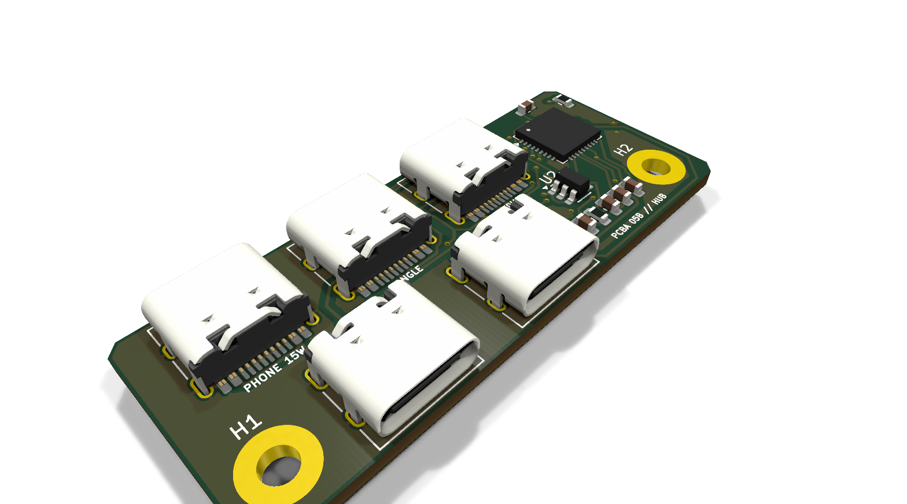
*Abbildung 7.5c: KiCad 3D-Render des kompakten Handschuhfach-Hubs (PCBA 05B, 50,0 x 20,0 mm). Aktiver 4-Port Automotive USB 2.0 High-Speed Hub (Microchip USB2514Bi) mit gegenüberliegenden USB-C Reihen (2x Nordkante: FRONT / HOST, 3x Südkante: PHONE 15W / DONGLE / MEDIA) und rückseitiger CC-Beschaltung für Harley-Davidson Skyline OS / Boom! Box GTS.*

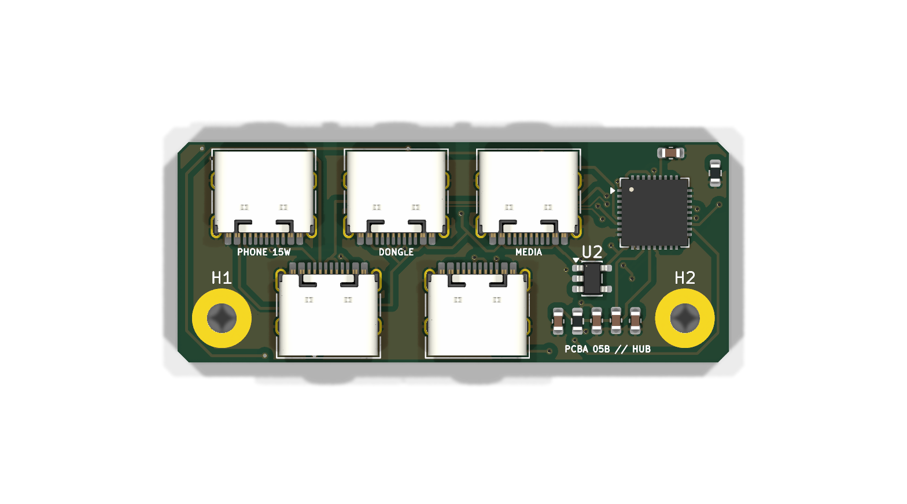
*Abbildung 7.5d: Bestückungs-Draufsicht PCBA 05B (50,0 x 20,0 mm) mit 5x USB-C Buchsen, M2.5 Befestigungsbohrungen (H1/H2 im 42 mm Abstand) und Microchip USB2514Bi Controller.*

#### 7.2.1 Technische Platinen-Kenndaten & Port-Topologie
* **Abmessungen:** $50{,}0 \times 20{,}0 \times 1{,}6\,\text{mm}$, 2 Lagen FR-4 High-TG150, ENIG-Goldfinish (2x M2.5 Montagebohrungen im 42 mm Abstand).
* **Hub-Controller (`U1`):** Microchip `USB2514Bi-AEZG` (QFN-36, $-40\,^\circ\text{C}\dots+85\,^\circ\text{C}$ Automotive-Grade) 4-Port High-Speed 480 Mbps USB-Hub.
* **Master-Rollenverteilung:**
  * **Daten-Master (USB 2.0 Host):** **Skyline OS** an `J1 SKYLINE_HOST` ist der alleinige Host für alle Daten.
  * **Power-Master:** Der Universal Front-Knoten (`PCBA 05`) speist den Hub über `J2 FRONT_NODE` mit geregelter Versorgungsleistung aus seiner 60W Power-Engine.
* **Dual-Edge USB-C Architektur (5x USB-C Buchsen):**
  * **Nordkante (Zuleitung / Host):** 2x USB-C Buchsen (`J1 SKYLINE_HOST` zur OEM Head-Unit und `J2 FRONT_NODE` zum Universal Front-Knoten `PCBA 05` für Headset-Emulation & Strom).
  * **Südkante (Geräteanschlüsse im Handschuhfach):** 3x USB-C Buchsen (`J4 DONGLE` für Wireless CarPlay/AA, `J5 MEDIA` für USB-Speichersticks, `J3 PHONE_CHARGE` für Smartphone-Schnellladung).

#### 7.2.2 Pinbelegung der 5 USB-C Buchsen auf PCBA 05B

| Buchse | Signalname / Belegung | Typ | Funktion & Beschreibung |
| :---: | :--- | :---: | :--- |
| **`J1`** | **`SKYLINE_HOST`** (Upstream)<br>A6/B6: `USB_UP_DP`<br>A7/B7: `USB_UP_DM`<br>A4/B4/A9/B9: `VBUS_HOST_SENSE`<br>A5: `NET_J1_CC1`, B5: `NET_J1_CC2` | USB-C 16P | **OEM Upstream Host:** Verbindet zum werkseitigen USB-C Port der Harley-Davidson Boom! Box GTS / Skyline OS Head Unit. Reiner Daten-Host ohne Stromentnahme. |
| **`J2`** | **`FRONT_NODE`** (Dual-Rail Lifeline)<br>A4/B4/A9/B9: `VBUS_PD_30W`<br>A5: `PD_CC1`, B5: `PD_CC2`<br>A8/B8 (SBU1/SBU2): `VCC_5V`<br>A6/B6: `USB_DN3_DP`<br>A7/B7: `USB_DN3_DM`<br>A1/B1/A12/B12: `GND` | USB-C 24P | **Dual-Rail Front-Node Lifeline:** Führt getrennte 30W USB-PD Ladeleistung (isoliert direkt zu `J3`), native CC1/CC2 PD-Signalisierung, stabile 5V Systemspannung (für Dongle `J4`, Media `J5` und Hub-LDO `U2`) und USB 2.0 High-Speed Daten vom Front-Knoten (Header `J4`) zu. |
| **`J4`** | **`DONGLE`** (Downstream 1)<br>A6/B6: `USB_DN1_DP`<br>A7/B7: `USB_DN1_DM`<br>A4/B4/A9/B9: `VCC_5V`<br>A5: `NET_J4_CC1`, B5: `NET_J4_CC2` | USB-C 16P | **Wireless CarPlay / AA Adapter:** Gesteuerter USB-Port für Ottocast / CarlinKit Dongle mit ferngesteuertem Kaltstart-Reset über Front Node. Speisung aus dem separaten 5V-Netzteil (`TPS54302`). |
| **`J5`** | **`MEDIA`** (Downstream 2)<br>A6/B6: `USB_DN2_DP`<br>A7/B7: `USB_DN2_DM`<br>A4/B4/A9/B9: `VCC_5V`<br>A5: `NET_J5_CC1`, B5: `NET_J5_CC2` | USB-C 16P | **Media Storage:** Freier USB 2.0 Port für Musik-USB-Sticks, Dashcam-Export oder Software-Updates (5V Speisung). |
| **`J3`** | **`PHONE_CHARGE`** (Downstream 4 & 30W PD)<br>A4/B4/A9/B9: `VBUS_PD_30W`<br>A5: `PD_CC1`, B5: `PD_CC2`<br>A6/B6: `NET_PHONE_D` (DP)<br>A7/B7: `NET_PHONE_D` (DM)<br>A1/B1/A12/B12: `GND` | USB-C 24P | **Dedizierter 30W Smartphone-Schnellladeport:** Exklusiver USB-PD Pfad (5V/9V/12V/15V bis 3A) direkt vom Front-Node SW3526 Controller mit nativer CC-Aushandlung. Vollständig vom Dongle-Strompfad isoliert (Brownout-Schutz!). Gleichzeitige USB 2.0 Datenanbindung an den Hub. |

---

### 7.3 PCBA 05C: Ultra-Kompakter Bilateral-Symmetrischer Under-Perch Spiegel-Pod (`openmotorbridge_mirror_pod`)

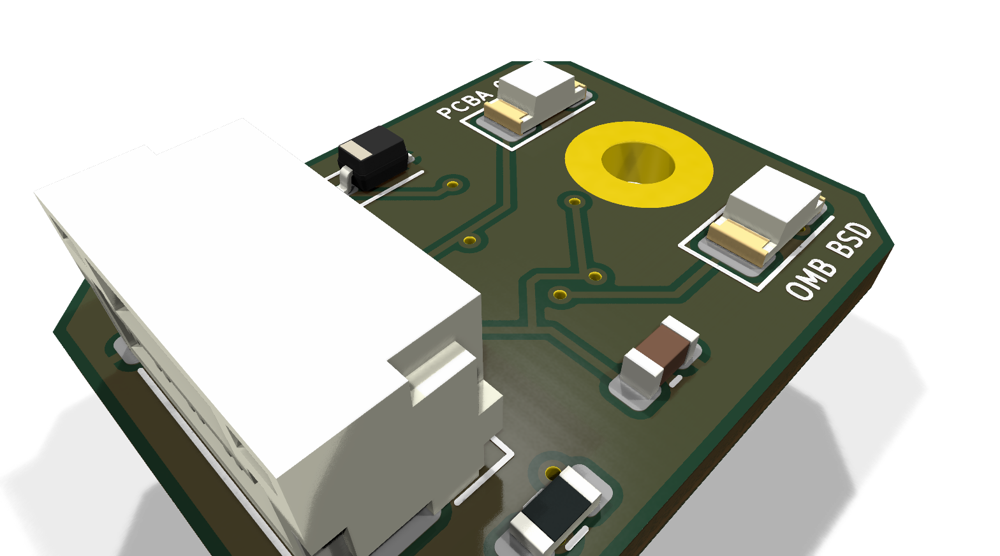
*Abbildung 7.5e: 3D-CAD-Ansicht des ultra-kompakten, bilateral-symmetrischen Under-Perch Spiegel-Pods (PCBA 05C, 18,25 x 14,0 mm, Z-Stacking beidseitig SMT) mit dualen Bernstein BSD Totwinkel-Warn-LEDs (LED1/LED2 ober- und unterhalb der M2-Befestigung bei X=15,0 mm), unterseitigem IP67-Kurzhubtaster (Omron B3SL-1002P auf B.Cu bei X=9,0 mm) und horizontalem JST-GH 4-Pin SMD-Steckverbinder an der Stirnseite (X=3,5 mm).*

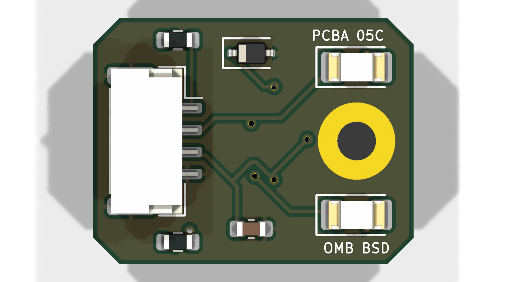
*Abbildung 7.5f: Bestückungs-Draufsicht PCBA 05C mit TVS-Diode D1, Entprellkondensator C1 und getrennten Vorwiderständen R1/R2 für maximale Redundanz und Sonnenlicht-Sichtbarkeit.*

#### 7.3.1 Technische Platinen-Kenndaten & Bestückung
* **Abmessungen:** 18,25 x 14,0 mm (43 % kürzer durch Z-Stacking), 2 Lagen FR4 High-TG150 (1,6 mm, ENIG-Goldfinish).
* **Bilateral-Symmetrisches Universal-Design:** Die Platine ist entlang der Mittellinie ($Y = 7{,}0\,\text{mm}$) zu 100 % achsensymmetrisch konstruiert. Dadurch wird **nur noch ein einziger Platinentyp für beide Lenkerseiten (Links & Rechts)** gefertigt. Beim Spiegeln des Gehäuses (`mirror([0, 1, 0])`) bleiben Stirnseiten-Stecker, zentraler M2-Schraubdom und unterseitiger Daumentaster exakt auf $Y=0$, während die beiden synchronen LEDs lediglich ihre Plätze ober- und unterhalb des Schraublochs tauschen.
* **Bauform:** Beidseitiges Z-Stacking SMT (`F.Cu` & `B.Cu`), Formfaktor passgenau für [`under_perch_mirror_pod.scad`](../../hardware/cad/scad/05_accessories/under_perch_mirror_pod.scad).
* **Bestückung:**
  * **Duale `LED1` & `LED2` (Bernstein BSD Totwinkel-Warn-LEDs auf `F.Cu`):** Zwei Hochleistungs-SMD-LEDs (1206, 590 nm Amber, 120° Abstrahlwinkel), symmetrisch oberhalb ($X = 15{,}0\,\text{mm}, Y = 11{,}2\,\text{mm}$) und unterhalb ($X = 15{,}0\,\text{mm}, Y = 2{,}8\,\text{mm}$) des M2-Schraublochs (`H1` bei $X = 15{,}0\,\text{mm}, Y = 7{,}0\,\text{mm}$). Strahlen gemeinsam durch den $38^\circ$-Stadion-Diffusortrichter im Gehäusedeckel für doppelte Leuchtkraft bei direkter Sonneneinstrahlung.
  * **`SW1` (Taktiler Daumen-Mikrotaster auf `B.Cu`):** IP67-versiegelter Kurzhub-Mikrotaster (Omron B3SL-1002P, mittig auf der Platinenunterseite bei $X = 9{,}0\,\text{mm}, Y = 7{,}0\,\text{mm}$) mit spürbarem 300g Druckpunkt für zuverlässige Bedienung mit Winterhandschuhen.
  * **Entprellung & ESD-Schutz:** 100 nF RC-Glied (`C1` bei $X = 9{,}0\,\text{mm}, Y = 12{,}0\,\text{mm}$) zur Hardware-Entprellung und bidirektionale TVS-Diode (`D1`, PESD5V0S1BL bei $X = 9{,}0\,\text{mm}, Y = 2{,}0\,\text{mm}$) gegen elektrostatische Entladungen.
  * **Steckverbinder (`J1`):** 4-polige JST-GH SMD Buchse (`SM04B-GHS-TB`, 1.25 mm Raster) stirnseitig bei $X = 3{,}50\,\text{mm}, Y = 7{,}0\,\text{mm}$ (Kabel führt axial am Lenkerrohr entlang).

#### 7.3.2 Pinbelegung des Spiegel-Pod Headers (`J1` / 4-Pin JST-GH)

| Pin | Signalname | Signalart | Funktion & Pegel |
| :---: | :--- | :---: | :--- |
| **1** | **`VCC_LED`** | Power In (+5V / +12V) | Geschützte Anodenspeisung für Totwinkel-LED |
| **2** | **`BSD_LED_N`** | Kathode (Low-Side) | Geschaltete Masse vom Front-Node MOSFET (Radar-Warnung) |
| **3** | **`BTN_SIG_N`** | Digital In (Active-Low)| Tastersignal gegen Masse, entprellt mit 100 nF RC-Glied |
| **4** | **`GND`** | Masse (0V) | Gemeinsame Signal- und Rückmasse |

#### 7.3.3 100 % Software-Defined Tasterbelegung via PWA-Dashboard
Beide Taster sind hardwareseitig identisch und können über das PWA-Dashboard völlig frei auf 5 Gesten-Events gemappt werden (`SHORT_CLICK`, `DOUBLE_CLICK`, `TRIPLE_CLICK`, `LONG_PRESS`, `HOLD_GATE`):
* **Werks-Default Links:** `HOLD_GATE` -> PTT Intercom; `TRIPLE_CLICK` -> Siri/Google Assistant; `DOUBLE_CLICK` -> Mesh-Kanalwechsel.
* **Werks-Default Rechts:** `SHORT_CLICK` -> Action-Cam Highlight-Tag (Insta360/GoPro BLE); `LONG_PRESS` -> Videoaufnahme Start/Stop; 3s Halten -> 868 MHz LoRa Notfall-SOS.
* **Frei belegbare Aktionen:** 1-Klick Hazard Pin Drop (Waze/OpenTrafficMap), Radar-Stummschaltung 30s, Garagentoröffner (Shelly/Home Assistant), Zusatzscheinwerfer, Heizgriffe.

---

### 7.4 PCBA 05D: Schnappbarer Sensor-Puck (`openmotorbridge_sensor_puck`)

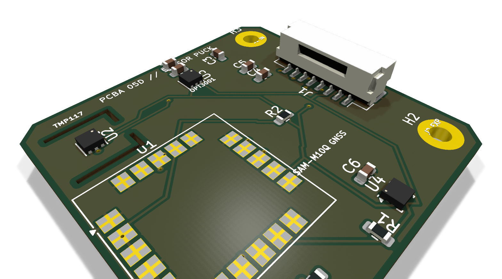
*Abbildung 7.5g: 3D CAD-Ansicht des schnappbaren 4-Lagen Sensor-Pucks (PCBA 05D, 34 x 34 mm) mit u-blox SAM-M10Q Patch-Antenne, thermischem Doppel-L-Schlitz für TMP117 und horizontaler 8-Pin JST-GH Buchse.*

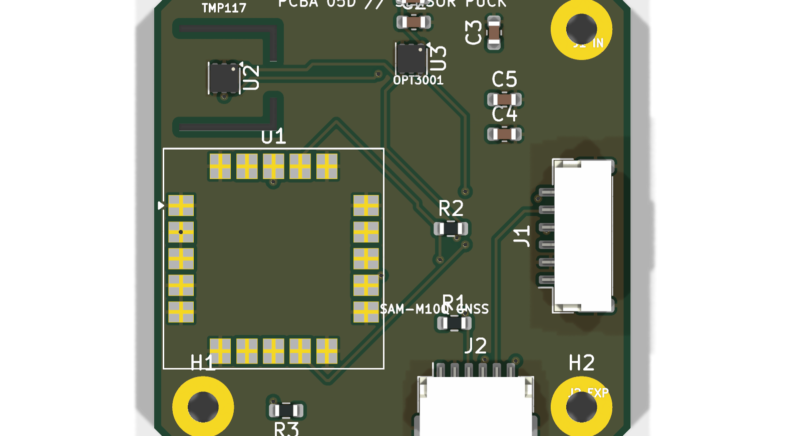
*Abbildung 7.5h: Bestückungs-Draufsicht PCBA 05D.*

#### 7.4.1 Technische Platinen-Kenndaten & Bestückung
* **Abmessungen:** $34{,}0 \times 34{,}0\,\text{mm}$ mit $2{,}0\,\text{mm}$ Eck-Fasen, 4 Lagen FR-4 High-TG150 ($1{,}6\,\text{mm}$, ENIG-Goldfinish, Layer 2: 100% durchgehende HF-GND-Plane für GNSS-Patch, Layer 3: 3.3V Power-Plane).
* **Befestigung:** Formschlüssig in maßgeschneidertem $38{,}0 \times 38{,}0 \times 15{,}0\,\text{mm}$ Schnapp-Gehäuse ([`sensor_puck_environmental.scad`](../../hardware/cad/scad/04_front_node/parts/sensor_puck_environmental.scad), $34{,}8 \times 34{,}8\,\text{mm}$ Innenkavität mit $0{,}35\,\text{mm}$ Passluft, Schnappdeckel & Rastfüßen) direkt im oberen Dock des Front-Node Gehäusedeckels oder abgesetzt an der Windschutzscheibe via 1,5m JST-GH Verlängerung. Die Nordwand ist vollständig geschlossen (kein `J2`-Durchbruch), was maximale Wetterfestigkeit (IP67) garantiert.
* **Bestückung:**
  * **`U1` (u-blox SAM-M10Q):** Multi-Konstellations-GNSS-Modul (GPS, GLONASS, Galileo, BeiDou) mit integrierter $15{,}5 \times 15{,}5\,\text{mm}$ Keramik-Patch-Antenne.
  * **`U2` (TI TMP117AIDRVR):** NIST-rückführbarer Digital-Temperatursensor ($\pm 0{,}1^\circ\text{C}$ Genauigkeit) auf einer durch einen $0{,}8\,\text{mm}$ U-förmigen Frässchlitz thermisch entkoppelten Platinen-Zunge im laminaren Front-Lufteinlass zur Glatteiswarnung ohne Motorabwärme-Beeinflussung.
  * **`U3` (TI OPT3001DNPR):** Umgebungslichtsensor mit menschlicher Augencharakteristik unter der oberen $\varnothing 4{,}5\,\text{mm}$ optischen Gehäuseöffnung (Lux-Messung zur automatischen Umschaltung Tag/Nacht-Modus in PWA und Instrumenten).
  * **`U4` (Bosch Sensortec BMP390):** Ultra-präziser barometrischer Druck- und Höhensensor im 10-Pin LGA-2x2mm-Gehäuse (I2C-Adresse `0x76`) für präzise Steig-/Sinkraten, Höhenprofile und Wettertrend-Erkennung.
  * **`J1` (Primary In / Lifeline):** 8-polige JST-GH SMD Buchse (`SM08B-GHS-TB`, 1.25 mm Raster) horizontal nach Osten (`+X`) zum Front-Node Kabelstrang.
  *(Hinweis zur Architektur-Bereinigung v10.0: Die ungenutzte Daisy-Chain Buchse `J2` und die I2S-Signalleitungen wurden ersatzlos gestrichen. Anstelle von `J2` wurde der Bosch BMP390 Barometer `U4` integriert. Die 8-polige JST-GH Verbindung führt die vollständige Sensorik- und GNSS-Anbindung: I2C für TMP117, OPT3001 & BMP390, UART TX/RX für High-Speed Telemetrie/Konfiguration, 1PPS Timepulse für hochgenaue Zeitsynchronisation sowie Hardware-Reset an den ESP32-S31 des Front-Knotens. Das Knowles SPH0645 I2S MEMS-Mikrofon sitzt wettergeschützt direkt auf der Unterseite von `PCBA 05`).*

#### 7.4.2 Pinbelegung des Sensor-Puck Primary In (`J1` / 8-Pin JST-GH)

| Pin | Signalname | Signalart | Funktion auf PCBA 05D & Bus-Verhalten |
| :---: | :--- | :--- :| :--- |
| **1** | **`VCC_3V3`** | Power (+3.3V) | Stabilisierte Systemspannung (versorgt L3 Power-Plane, U1, U2, U3, U4) |
| **2** | **`GND`** | Masse (0V) | Signal- und HF-Rückmasse (direkte Anbindung an L2 Solid GND-Plane) |
| **3** | **`I2C_SDA`** | Bidi Open-Drain | I2C Datenbus (SAM-M10Q DDC Addr `0x42`, OPT3001 Addr `0x44`, TMP117 Addr `0x48`, BMP390 Addr `0x76`) |
| **4** | **`I2C_SCL`** | Input Open-Drain | I2C Taktbus (400 kHz Fast-Mode vom Front-Node) |
| **5** | **`GNSS_TIMEPULSE`** | Digital Out | 1PPS Hardware-Zeitsynchronisations-Puls vom SAM-M10Q (Pin 7) |
| **6** | **`GNSS_TXD`** | Digital Out | UART Serieller Datenstrom (NMEA/UBX Telemetrie) vom SAM-M10Q (Pin 13) |
| **7** | **`GNSS_RXD`** | Digital In | UART Serieller Steuerkanal zum SAM-M10Q (Pin 14) |
| **8** | **`GNSS_RESET_N`** | Digital In | Active-Low Hardware Reset zum SAM-M10Q (Pin 18, 10k Pull-up R3 nach 3.3V) |
| **MP** | **`GND`** | Schirmung | Rastlaschen der JST-GH Buchse auf Gehäuse- & GND-Plane |

---

## 8. PCBA 06: MagSafe Frame Dock (Ersatzlos entfallen)

Die separate Platine `PCBA 06` ist in v10.0 **vollständig und ersatzlos entfallen**:
* Da über die fahrzeugseitige Koffer-Trennstelle ausschließlich 2-Draht DC-Gleichspannung geführt wird, kommt anstelle einer proprietären Leiterplatte ein **industrieller 2-Pin Magnet-Pogo-Steckverbinder (IP68 COTS)** zum Einsatz.
* Kurzschlussschutz und Überlastbegrenzung erfolgen zentral auf `PCBA 01` durch den **TI TPS4H160-Q1 Smart Switch**.

---

## 9. PCBA 07: 2-in-1 LoRa Smart-Keyfob (`openmotorbridge_smart_keyfob`)

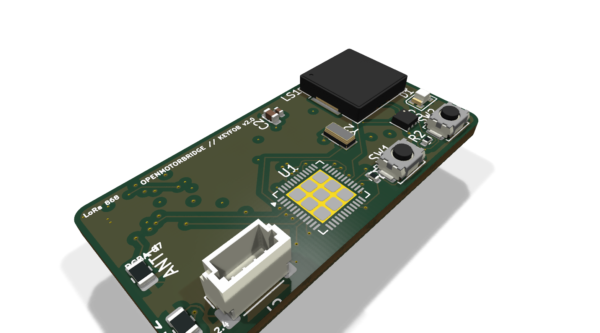

*Abbildung 7.7: 3D-Render der ultrakompakten PCBA 07 Trägerplatine (38,0 x 19,0 mm, 4 Lagen) mit ESP32-C3FH4 RISC-V MCU (embedded 4MB Flash), Semtech SX1262 LoRa Transceiver, TI BQ51050BRHLR All-in-One Qi-Empfänger- & LiPo-Direktladeregler, CUI CPT-9019S 9mm Piezo-Summer und zentriertem 3-Element-Bedienfeld (SW1, RGB-LED, SW2).*

### 9.1 Technische Platinen-Kenndaten & Lötfreie Qi-Montage
* **Abmessungen:** $38{,}0 \times 19{,}0 \times 1{,}0\,\text{mm}$ (4-Lagen FR-4, ENIG-Goldfinish).
* **Kern-Chips:**
  * Espressif `ESP32-C3FH4` SoC (32-bit RISC-V @ 160 MHz, Bluetooth Low Energy 5.0, integrierter 4 MB SPI-Flash, internes LDO-Decoupling, QFN-32 $5 \times 5\,\text{mm}$, 0,5 mm Pitch).  
    *(100 % einheitlicher ESP-IDF Toolchain-Stack wie alle anderen OMB-Knoten; interner kalibrierter RTC-Oszillator eliminiert den externen 32-kHz-Uhrenquarz; einziger HF-Quarz ist `Y1` 40.000 MHz).*
  * Semtech `SX1262` LoRa Transceiver (868.5 MHz Kanal 3, empfängt Alarme bis zu 4,5 km Reichweite).
  * Texas Instruments `BQ51050BRHLR` All-in-One Qi-Wireless-Receiver & integrierter Li-Ion/LiPo-Direktlader (VQFN-20 $3{,}5 \times 4{,}5\,\text{mm}$). Ersetzt den bisherigen BQ51003 BGA und separaten BQ25100 Lade-IC vollständig – lädt die LiPo-Zelle direkt ohne 5V-Zwischenwandler.
  * CUI Devices `CPT-9019S-SMT` 9-mm-Piezo-Summer (`LS1`, 85 dBA @ 10 cm, 2.7–4.0 kHz Resonanzfrequenz) zur durchdringenden akustischen Alarmierung durch dicke Motorrad-Lederjacken.
  * Texas Instruments `TPS7A0233PDBVR` Ultra-Low-$I_q$ 3.3V LDO (`U6`, SOT-23-5, $I_q = 25\,\text{nA}$).
* **Zentrierte 3-Element-Bedienfeld-Ergonomie:**
  * `SW1` (Arm / Disarm): $X = 117{,}0\,\text{mm}$.
  * `D1` (WS2812B-2020 RGB-Status-LED): $X = 122{,}5\,\text{mm}$ – exakt zentriert zwischen den beiden Tastern unter dem PMMA-Lichtleiter.
  * `SW2` (Panic / SOS): $X = 128{,}0\,\text{mm}$.
  * **$11{,}0\,\text{mm}$ echter Fingerabstand** zwischen SW1 und SW2 verhindert Fehlbedienungen mit Motorradhandschuhen; der 9-mm-Piezo-Summer `LS1` liegt frei und isoliert auf der rechten Platinenhälfte ($X = 133{,}5\,\text{mm}$).
* **100 % Lötfreie Induktionsspulen- & Akku-Montage (`J3`, `J1` & `J2`):**
  * Die 24–28 mm Qi-Empfängerspule wird über einen ultrakompakten **2-poligen JST-SH SMD-Header (`J3`, `BM02B-SRSS-TB`, 1.00 mm Raster)** vibrationsfest auf `B.Cu` angesteckt.
  * Der 180–200 mAh LiPo-Pouch-Akku (mit integrierter PCM-Schutzschaltung) wird über einen baugleichen **2-poligen JST-SH SMD-Header (`J1`, `BM02B-SRSS-TB`, 1.00 mm Raster)** auf `B.Cu` angesteckt.
  * Der 4-polige **JST-SH SMD-Header (`J2`, `BM04B-SRSS-TB`, 1.00 mm Raster)** dient als native USB/UART-Programmierschnittstelle (`VCC_3V3`, `USB_DM`, `USB_DP`, `GND`).

### 9.2 Vollständige Pinbelegung des ESP32-C3FH4 SoC (PCBA 07 `U1`)

<!-- AUTO_PINOUT_START: PCBA_07 -->

| Pad | Signal / KiCad Net | ESP32 GPIO | Firmware Define | Ziel / IC | Signal-Typ & Elektr. Spezifikation |
| :---: | :--- | :---: | :--- | :--- | :--- |
| 1 | `BLE_ANT_50R` | - | - | ANT2 (2.4 GHz Antenna) | **RF_50_OHM** – 2.4 GHz BLE HF-Antennenausgang (LNA_IN) |
| 2 | `VCC_3V3` | - | - | 3.3V Power Rail | **Power** – Analoge Betriebsspannung 3.3V |
| 3 | `VCC_3V3` | - | - | 3.3V Power Rail | **Power** – Analoge Betriebsspannung 3.3V |
| 4 | `BAT_SENSE` | GPIO 0 | `KEYFOB_PIN_BAT_SENSE` | R10/R11 (100k/100k) | **ADC1_CH0** – Analoge Akkuspannungsmessung LiPo |
| 5 | `LORA_DIO1` | GPIO 1 | `KEYFOB_PIN_LORA_DIO1` | U2.15 (SX1262) | **Digital In / IRQ** – SX1262 LoRa Packet RX/TX Interrupt |
| 6 | `LORA_MISO` | GPIO 2 | `KEYFOB_PIN_LORA_MISO` | U2.18 (SX1262) | **FSPI_MISO** – SX1262 LoRa SPI Master In Slave Out (FSPIQ) |
| 7 | `ESP_EN` | - | - | R3/C3 | **Power/Reset** – Chip Enable / Hardware Reset |
| 8 | `LORA_MOSI` | GPIO 3 | `KEYFOB_PIN_LORA_MOSI` | U2.19 (SX1262) | **FSPI_MOSI** – SX1262 LoRa SPI Master Out Slave In (FSPID) |
| 9 | `LORA_SCK` | GPIO 4 | `KEYFOB_PIN_LORA_SCK` | U2.20 (SX1262) | **FSPI_CLK** – SX1262 LoRa SPI Serial Clock (FSPIHD/CLK) |
| 10 | `LORA_NSS` | GPIO 5 | `KEYFOB_PIN_LORA_NSS` | U2.21 (SX1262) | **FSPI_CS** – SX1262 LoRa Chip Select (Active Low) |
| 11 | `VCC_3V3` | - | - | 3.3V Power Rail | **Power** – Betriebsspannung RTC Domäne |
| 12 | `LORA_BUSY` | GPIO 6 | `KEYFOB_PIN_LORA_BUSY` | U2.14 (SX1262) | **Digital In** – SX1262 LoRa Transceiver Busy Line |
| 13 | `LORA_RESET` | GPIO 7 | `KEYFOB_PIN_LORA_RESET` | U2.1 (SX1262) | **Digital Out** – SX1262 LoRa Transceiver Hardware Reset |
| 14 | `LED_DATA` | GPIO 8 | `KEYFOB_PIN_LED_DATA` | D1.4 | **Digital Out** – WS2812B-2020 Smart RGB Status-LED Datenleitung |
| 15 | `BTN_ARM_N` | GPIO 9 | `KEYFOB_PIN_BTN_ARM_N` | SW1 | **Digital In** – Arm / Disarm Taster (Active-Low, Boot Strapping) |
| 16 | `BTN_SOS_N` | GPIO 10 | `KEYFOB_PIN_BTN_SOS_N` | SW2 | **Digital In** – SOS Panik-Alarm Taster (Active-Low) |
| 17 | `VCC_3V3` | - | - | 3.3V Power Rail | **Power** – Betriebsspannung CPU Domäne |
| 18 | `NC` | - | - | NC | **SIP_FLASH_NC** – Intern für C3FH4 SIP Flash belegt (darf extern nicht kontaktiert werden) |
| 19 | `NC` | - | - | NC | **SIP_FLASH_NC** – Intern für C3FH4 SIP Flash belegt (darf extern nicht kontaktiert werden) |
| 20 | `NC` | - | - | NC | **SIP_FLASH_NC** – Intern für C3FH4 SIP Flash belegt (darf extern nicht kontaktiert werden) |
| 21 | `NC` | - | - | NC | **SIP_FLASH_NC** – Intern für C3FH4 SIP Flash belegt (darf extern nicht kontaktiert werden) |
| 22 | `NC` | - | - | NC | **SIP_FLASH_NC** – Intern für C3FH4 SIP Flash belegt (darf extern nicht kontaktiert werden) |
| 23 | `NC` | - | - | NC | **SIP_FLASH_NC** – Intern für C3FH4 SIP Flash belegt (darf extern nicht kontaktiert werden) |
| 24 | `NC` | - | - | NC | **SIP_FLASH_NC** – Intern für C3FH4 SIP Flash belegt (darf extern nicht kontaktiert werden) |
| 25 | `USB_DM` | GPIO 18 | `KEYFOB_PIN_USB_DM` | J2.2 (USB D-) | **USB_D-** – Nativer USB Serial/JTAG Controller D- |
| 26 | `USB_DP` | GPIO 19 | `KEYFOB_PIN_USB_DP` | J2.3 (USB D+) | **USB_D+** – Nativer USB Serial/JTAG Controller D+ |
| 27 | `BUZZER_PWM` | GPIO 20 | `KEYFOB_PIN_BUZZER_PWM` | LS1 (CPT-9019S) | **LEDC_PWM** – Akustischer Pager 9mm Piezo-Summer PWM |
| 28 | `CHG_STAT` | GPIO 21 | `KEYFOB_PIN_CHG_STAT` | U3.5 (BQ51050B) | **Digital In** – Qi Wireless Ladestatus (Active-Low) |
| 29 | `XTAL2` | - | - | Y1.3 (40 MHz) | **Oscillator** – 40 MHz Quarz Oszillator Eingang N |
| 30 | `XTAL1` | - | - | Y1.1 (40 MHz) | **Oscillator** – 40 MHz Quarz Oszillator Eingang P |
| 31 | `VCC_3V3` | - | - | 3.3V Power Rail | **Power** – Analoge Versorgungsspannung 3.3V |
| 32 | `VCC_3V3` | - | - | 3.3V Power Rail | **Power** – Analoge Versorgungsspannung 3.3V |
| 33 | `GND` | - | - | GND Plane mit Thermal Vias | **Power Ground** – Zentrales Massepads & Kühlung |

<!-- AUTO_PINOUT_END: PCBA_07 -->

### 9.3 Sub-Chips & Peripherie-Bausteine (SX1262 LoRa & BQ51050B Qi-Lader)

<!-- AUTO_SUBCHIPS_START: PCBA_07 -->

#### Sub-Chip `U2`: Semtech SX1262 LoRa 868 MHz Transceiver (QFN-24 (4x4 mm))
> **Hersteller-Datenblatt:** [Semtech SX1262 LoRa 868 MHz Transceiver](https://semtech.my.salesforce.com/sfc/p/#E0000000JelG/a/2R000000HT76/bvyK.51kF34K_iR49Q04kHjG4s3E2_q2kM8Q6u2k7d4) | **Pin-Definition:** [Section 4: Pinout & Pin Description (QFN-24)](https://semtech.my.salesforce.com/sfc/p/#E0000000JelG/a/2R000000HT76/bvyK.51kF34K_iR49Q04kHjG4s3E2_q2kM8Q6u2k7d4)  

| Pad | Pin-Name | Signal / KiCad Net | Signal-Typ | Ziel / Quelle | Funktion & Elektr. Spezifikation |
| :---: | :--- | :--- | :---: | :--- | :--- |
| 1 | `NRESET` | `LORA_RST` | **Control In** | U1 (ESP32-C3) | Hardware Reset Active Low |
| 10 | `RFI_P / RFO` | `LORA_RF_868` | **RF 868 MHz** | Johanson 868M Chip-Antenne | LoRa HF-Ausgang |
| 14 | `BUSY` | `LORA_BUSY` | **Digital Out** | U1 (ESP32-C3) | LoRa Busy Status |
| 15 | `DIO1` | `LORA_DIO1` | **Digital Out** | U1 (ESP32-C3) | LoRa Interrupt IRQ |
| 18 | `MISO` | `SPI_MISO` | **SPI MISO** | U1 (ESP32-C3) | SPI Data Out |
| 19 | `MOSI` | `SPI_MOSI` | **SPI MOSI** | U1 (ESP32-C3) | SPI Data In |
| 20 | `SCK` | `SPI_SCK` | **SPI CLK** | U1 (ESP32-C3) | SPI Clock |
| 21 | `NSS` | `LORA_NSS` | **SPI CS** | U1 (ESP32-C3) | SPI Chip Select Active Low |

#### Sub-Chip `U4`: TI BQ51050BRHLR Qi Wireless Power Receiver & Li-Ion Charger (VQFN-20 / RHL-20 (4.5x3.5 mm))
> **Hersteller-Datenblatt:** [TI BQ51050BRHLR Qi Wireless Power Receiver & Li-Ion Charger](https://www.ti.com/lit/ds/symlink/bq51050b.pdf) | **Pin-Definition:** [Table 6-1: Pin Functions (RHL-20)](https://www.ti.com/lit/ds/symlink/bq51050b.pdf#page=4)  

| Pad | Pin-Name | Signal / KiCad Net | Signal-Typ | Ziel / Quelle | Funktion & Elektr. Spezifikation |
| :---: | :--- | :--- | :---: | :--- | :--- |
| 1 | `PGND` | `GND` | **Power Ground** | GND Plane | Leistungsmasse |
| 2 | `AC1` | `QI_AC1` | **AC In** | J3.1 (Qi Spule) | Resonanz-Empfangsspule AC1 |
| 3 | `BOOT1` | `QI_BOOT1` | **Bootstrap** | C5 (10nF zu AC1) | Bootstrap Kondensator 1 |
| 4 | `BAT` | `VBAT` | **Power Out** | J1.1 (LiPo Akku) | Li-Ion Ladeausgang (4.20V) |
| 5 | `CLAMP1` | `QI_CLAMP1` | **Resonance** | C7 (470nF zu AC1) | Serienresonanz Clamp 1 |
| 6 | `COMM1` | `QI_COMM1` | **Communication** | C9 (47nF zu AC1) | Qi Modulationskapazität 1 |
| 7 | `/CHG` | `CHG_STAT` | **Open-Drain Out** | U1.28 (ESP32-C3) | Ladezustand Active-Low (10k Pullup) |
| 8 | `AD_EN` | `GND` | **Control In** | GND Plane | Adapter Enable deaktiviert |
| 9 | `AD` | `GND` | **Power In** | GND Plane | Kabel-Adaptereingang auf Masse |
| 10 | `/EN1` | `GND` | **Control In** | GND Plane | Wireless Rx Freigabe 1 |
| 11 | `/EN2` | `GND` | **Control In** | GND Plane | Wireless Rx Freigabe 2 |
| 12 | `ILIM` | `QI_ILIM` | **Analog** | R3 (1.5k zu GND) | Ladestrom-Programmierung (~200mA) |
| 13 | `TS/CTRL` | `QI_TS` | **Analog** | R4 (10k zu GND) | Temperatursinn / Normalbetrieb |
| 14 | `FOD` | `QI_FOD` | **Analog** | R5 (200R zu GND) | Fremdkörpererkennungs-Kalibrierung |
| 15 | `COMM2` | `QI_COMM2` | **Communication** | C10 (47nF zu AC2) | Qi Modulationskapazität 2 |
| 16 | `CLAMP2` | `QI_CLAMP2` | **Resonance** | C8 (470nF zu AC2) | Serienresonanz Clamp 2 |
| 17 | `BOOT2` | `QI_BOOT2` | **Bootstrap** | C6 (10nF zu AC2) | Bootstrap Kondensator 2 |
| 18 | `RECT` | `QI_RECT` | **Power Out** | C11 (4.7uF zu GND) | Gleichrichterausgang Filter |
| 19 | `AC2` | `QI_AC2` | **AC In** | J3.2 (Qi Spule) | Resonanz-Empfangsspule AC2 |
| 20 | `PGND` | `GND` | **Power Ground** | GND Plane | Leistungsmasse |
| 21 | `EPAD` | `GND` | **Power Ground** | GND Plane mit Thermal Vias | Thermisches Massepad (PGND) |

<!-- AUTO_SUBCHIPS_END: PCBA_07 -->

### 9.4 Externe Steckverbinder (J1 LiPo, J3 Qi-Spule)

<!-- AUTO_CONNECTORS_START: PCBA_07 -->

#### Stecker `J1`: LiPo Akku-Anschluss (150 mAh Zelle)
> **Typ:** `JST-SH 2-Pin 1.0mm SMD Vertikal (BM02B-SRSS-TB)` | **Gegenstecker:** `JST SHR-02V-S-B (AWG28-30)`  

| Pin | Signal / KiCad Net | Signal-Typ | Elektrische Spezifikation & Funktion |
| :---: | :--- | :---: | :--- |
| **1** | `VBAT` | **Power In (+3.7V)** | LiPo Akku Pluspol (3.0V .. 4.2V) |
| **2** | `GND` | **Power Return** | LiPo Akku Masse |
| **MP** | `GND` | **Shield** | Rastlaschen auf Masse |

#### Stecker `J3`: Qi Drahtlos-Ladespule Eingang
> **Typ:** `JST-SH 2-Pin 1.0mm SMD Vertikal (BM02B-SRSS-TB)` | **Gegenstecker:** `JST SHR-02V-S-B (AWG28-30)`  

| Pin | Signal / KiCad Net | Signal-Typ | Elektrische Spezifikation & Funktion |
| :---: | :--- | :---: | :--- |
| **1** | `QI_AC1` | **AC In** | Resonanz-Empfangsspule Anschluss 1 |
| **2** | `QI_AC2` | **AC In** | Resonanz-Empfangsspule Anschluss 2 |
| **MP** | `GND` | **Shield** | Rastlaschen auf Masse |

<!-- AUTO_CONNECTORS_END: PCBA_07 -->

| QFN-32 Pin | Signalname | Signal-Typ | ESP-IDF GPIO | Funktion / Hardware-Verbindung |
| :---: | :--- | :---: | :---: | :--- |
| **1** | `BLE_ANT_50R` | RF 2.4G | LNA_IN | 50-Ohm-Leitung zur Johanson 2450AT Keramik-Chipantenne (`ANT2`) |
| **2, 3** | `VCC_3V3` | Power In | VDD3P3 | +3.3V VDD Hauptversorgung |
| **4** | `BAT_SENSE` | Analog In | `GPIO0` (ADC1_CH0) | LiPo-Akkuspannungsteiler (100k/100k) zur Ladezustandsmessung |
| **5** | `LORA_DIO1` | Digital In | `GPIO1` | IRQ-Interruptleitung von SX1262 (Empfang 0xFE Alarmpaket) |
| **6** | `LORA_MISO` | Digital In | `GPIO2` (FSPIQ) | SPI Master-In Slave-Out von Semtech SX1262 (`U2`) |
| **7** | `CHIP_EN` | Reset In | CHIP_PU | Reset / Enable (10k Pull-Up an 3.3V, 100nF an GND) |
| **8** | `LORA_MOSI` | Digital Out | `GPIO3` (FSPID) | SPI Master-Out Slave-In zu SX1262 (`U2`) |
| **9** | `LORA_SCK` | Digital Out | `GPIO4` (FSPIHD) | SPI Serial Clock zu SX1262 (`U2`) |
| **10** | `LORA_NSS` | Digital Out | `GPIO5` (FSPIWP) | SPI Chip-Select (Active-Low) zu SX1262 (`U2`) |
| **11** | `VCC_3V3` | Power In | VDD3P3_RTC | +3.3V RTC-Versorgung |
| **12** | `LORA_BUSY` | Digital In | `GPIO6` (FSPICLK) | Busy-Statusleitung von SX1262 (`U2`) |
| **13** | `LORA_RESET` | Digital Out | `GPIO7` (FSPICS0) | Hardware-Resetleitung zu SX1262 (`U2`) |
| **14** | `LED_DATA` | Digital Out | `GPIO8` (Strapping) | Datenleitung für WS2812B-2020 RGB-Status-LED (`D1`) |
| **15** | `BTN_ARM_N` | Digital In | `GPIO9` (Strapping Boot) | Scharfschalt-Taster `SW1` (Arm/Disarm, Active-Low, 10k Pull-Up; Bootloader-Einsprung bei Reset) |
| **16** | `BTN_SOS_N` | Digital In | `GPIO10` | Notfall-Paniktaster `SW2` (SOS/Alarm, Active-Low, 10k Pull-Up) |
| **17** | `VCC_3V3` | Power In | VDD3P3_CPU | +3.3V CPU-Core-Versorgung |
| **18–24** | `NC` | Internal | - | Interne 4 MB Flash-Verbindungen (FH4 SIP Package, extern offen gelassen) |
| **25** | `USB_DM` | USB D- | `GPIO18` | Nativer USB CDC / JTAG D- Datenanschluss zu `J2` Pin 2 |
| **26** | `USB_DP` | USB D+ | `GPIO19` | Nativer USB CDC / JTAG D+ Datenanschluss zu `J2` Pin 3 |
| **27** | `BUZZER_PWM` | PWM Out | `GPIO20` | 2.7 kHz / 4.0 kHz PWM für CUI 9mm Piezo-Summer (`LS1`) |
| **28** | `CHG_STAT` | Digital In | `GPIO21` | Ladezustandsmeldung von TI BQ51050B Pin 14 (Active-Low / Open-Drain) |
| **29** | `XTAL_N` | Analog | - | 40.000 MHz HF-Präzisionsquarz `Y1` Pin 3 |
| **30** | `XTAL_P` | Analog | - | 40.000 MHz HF-Präzisionsquarz `Y1` Pin 1 |
| **31, 32**| `VCC_3V3` | Power In | VDDA | +3.3V Analog-Versorgung |
| **33 (EP)**| `GND` | Power | - | Exposed Ground & Thermal Pad (auf GND-Innenlage durchkontaktiert) |

---

## 10. PCBA 08: 77 GHz mmWave Radar Sub-MCU & Warnflügel (`openmotorbridge_radar_submcu`)

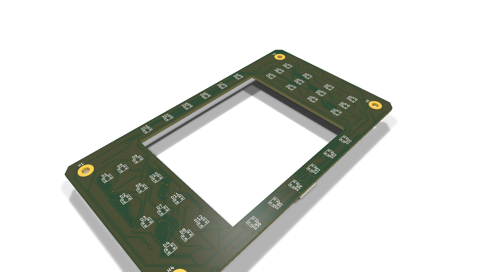

*Abbildung 7.8a: 3D CAD-Ansicht der gerouteten PCBA 08 Top-Seite (115 x 65 mm) mit mittigem 61 x 51 mm Radarausschnitt für das Wheeltec MR20 Horn-Array und 36x WS2812B-2020 Halo-Warnflügel-LEDs.*

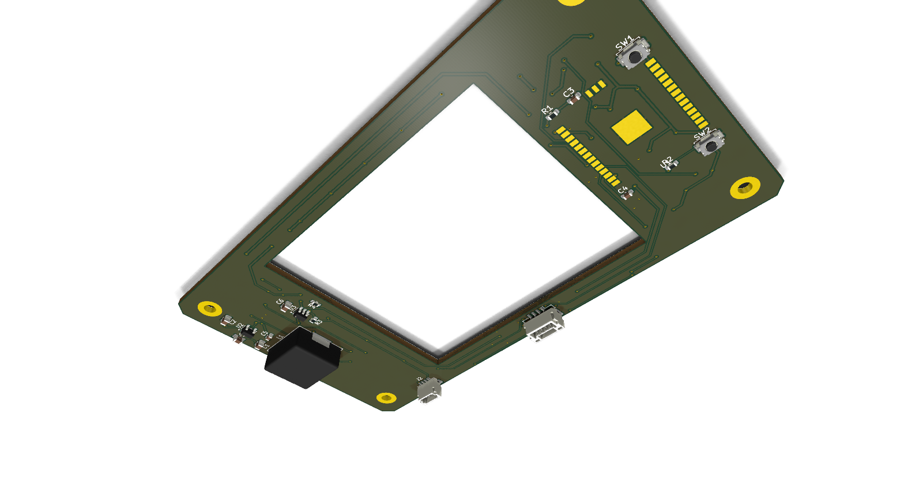

*Abbildung 7.8b: 3D CAD-Ansicht der PCBA 08 Bottom-Seite – Rechts: 12V -> 5V/3.3V TI TPS54302 Buck- und TPS7A0533 LDO-Power-Stage; Links: ESP32-C3-WROOM-02U Sub-MCU mit U.FL-Goldport; Unten: Senkrechte JST-GH (J1, Bus/12V) und JST-SH (J2, Radar) Steckverbinder.*

### 10.1 Technische Platinen-Kenndaten & Lagenaufbau
* **Abmessungen:** $115{,}0 \times 65{,}0 \times 1{,}6\,\text{mm}$ ($R = 5{,}0\,\text{mm}$ Außenkantenrundung).
* **Zentraler Radarausschnitt:** $61{,}0 \times 51{,}0\,\text{mm}$ formschlüssig für das 77-GHz-Hornantennenarray des Wheeltec MR20 mmWave-Radars.
* **Lagenaufbau:** 2-Lagen FR-4 High-TG150, $1{,}6\,\text{mm}$ Materialstärke, $35\,\mu\text{m}$ Cu (1 oz), ENIG-Goldfinish (Electroless Nickel Immersion Gold).
* **Befestigung:** 4x M3 Montagelöcher ($\varnothing 3{,}2\,\text{mm}$) mit $107{,}0 \times 57{,}0\,\text{mm}$ Rastermaß zur schwingungsgedämpften Direktverschraubung im Monocoque-Flügelgehäuse ([`radar_mr20_housing.scad`](../../hardware/cad/scad/05_accessories/radar_mr20_housing.scad)).
* **Design-Regeln:** OMB-v10 Standard ($0{,}127\,\text{mm}$ Trace/Clearance, $0{,}25\,\text{mm}$ Microvias mit $0{,}15\,\text{mm}$ Laserdrill, $0{,}05\,\text{mm}$ Restring).

### 10.2 Bestückung & Schaltungsarchitektur

1. **Top Layer (`F.Cu`) – 36-LED Halo-Warnflügel (`D1` bis `D36`):**
   * 36x ultrahelle **WS2812B-2020** Addressable RGB-LEDs im kompakten $2{,}0 \times 2{,}0\,\text{mm}$ PLCC-4 Gehäuse.
   * **Symmetrische Flügelführung:** 18 LEDs auf dem linken Flügel, 18 LEDs auf dem rechten Flügel.
   * **Störungsfreie Daisy-Chain:** Die Datenleitung läuft von MCU-Pin GPIO8 (`WS2812_DATA`) über Serienwiderstand direkt an `DIN` von D1 und wird über `DOUT` bis D36 durchgeschleift. Das Kettenende an D36 Pad 4 ist sauber als `no_connect` abgeschlossen.
   * **Direkte 5V-Speisung:** Vollflächige 5V-Powerplane auf `F.Cu` zur verlustarmen Stromzuführung bis zu $1{,}8\,\text{A}$ bei simultanem Weiß-Strobe (Blind-Spot / Prio-1 Kollisionswarnung).

2. **Bottom Layer (`B.Cu`) – Getrenntes Power- & MCU-Layout:**
   * **Rechte Hälfte (Integrierte 12V-Power-Stage):**
     - **Texas Instruments TPS54302DDCR (`U3`):** 3A synchroner Abwärtswandler (400 kHz, 4.5V–28V Vin) im SOT-23-6 Gehäuse. Wandelt die geschaltete 12V-Bordnetzspannung (`VCC_12V`) mit $\approx 92\,\%$ Wirkungsgrad in stabile $5{,}0\,\text{V}$ (`VCC_5V`) für die 36 LEDs und das Radar.
     - **Texas Instruments TPS7A0533PDBVR (`U2`):** Ultra-Low-Quiescent-Current LDO ($I_Q = 1\,\mu\text{A}$) im SOT-23-5 Gehäuse. Erzeugt die saubere, hochstabile $3{,}3\,\text{V}$ Versorgungsspannung (`VCC_3V3`) für die Host-MCU.
     - **Filterung & Stützung:** 4.7 µH Shielded Power Inductor (`L1`, SMD 4040), $10\,\mu\text{F}$ / 50V Keramik-Eingangskondensator (`C_IN1`), $22\,\mu\text{F}$ / 16V Ausgangskondensator (`C_OUT1`) sowie $100\,\text{nF}$ Bootstrap-Kondensator (`C_BOOT`).
   * **Linke Hälfte (Sub-MCU & Funksubsystem):**
     - **Espressif ESP32-C5-WROOM-1U (`U1`):** 32-Bit RISC-V Dual-Band Sub-MCU (2.4 GHz + 5 GHz / 5.9 GHz V2X) @ 160/240 MHz mit 4 MB SPI Flash und werksseitigem U.FL-Goldport. Ermöglicht neben der Radardatenauswertung den autarken Empfang von Car-to-X / ITS-G5 Meldungen (802.11p OCB) am Fahrzeugheck.
     - **Boot- & Reset-Schaltung:** Taktiler SMD-Mikrotaster `SW1` (Boot-Mode auf GPIO9), Pull-Up-Widerstände `R1` ($10\,\text{k}\Omega$ für `ESP_EN`), `R2` ($10\,\text{k}\Omega$ für `ESP_IO9_BOOT`) sowie Entkopplungskondensatoren `C3`/`C4` ($100\,\text{nF}$).

3. **Senkrechte Steckverbinder nach hinten (`B.Cu`):**
   * Zur Vermeidung abknickender Kabel im Gehäusehohlraum sind beide Steckbuchsen senkrecht nach hinten montiert:
     - **`J1` (Zentralbox-Bus & Power):** 4-poliger **JST-GH** Header (`BM04B-GHS-TBT`, 1.25 mm Raster mit formschlüssiger Verriegelung).
     - **`J2` (Radar-Direktanschluss):** 4-poliger **JST-SH** Header (`BM04B-SRSS-TB`, 1.00 mm Raster).

---

### 10.3 Steckverbinder-Pinbelegung

<!-- AUTO_CONNECTORS_START: PCBA_08 -->

#### Stecker `J1`: Backbone Bus-Eingang von Zentralbox (Molex J6.13-16)
> **Typ:** `JST-GH 4-Pin 1.25mm SMD Vertikal (BM04B-GHS-TBT)` | **Gegenstecker:** `JST GHR-04V-S (AWG26-30)`  

| Pin | Signal / KiCad Net | Signal-Typ | Elektrische Spezifikation & Funktion |
| :---: | :--- | :---: | :--- |
| **1** | `VCC_BUS` | **Power In (+12V/15W)** | Bordnetz-Speisung von Zentralbox (eFuse CH4) |
| **2** | `GND` | **Power Return** | Leistungs- und Signalmasse |
| **3** | `USB_DP` | **USB 2.0 D+** | USB 2.0 High-Speed D+ zur Zentralbox |
| **4** | `USB_DM` | **USB 2.0 D-** | USB 2.0 High-Speed D- zur Zentralbox |
| **MP** | `GND` | **Shield** | Rastlaschen auf Masse |

#### Stecker `J2`: MR20 77 GHz Radar-Modul Verbindung
> **Typ:** `JST-SH 4-Pin 1.0mm SMD Vertikal (BM04B-SRSS-TB)` | **Gegenstecker:** `JST SHR-04V-S-B (AWG28-30)`  

| Pin | Signal / KiCad Net | Signal-Typ | Elektrische Spezifikation & Funktion |
| :---: | :--- | :---: | :--- |
| **1** | `VCC_5V` | **Power Out (+5V)** | +5V Radar-Sensor Versorgung |
| **2** | `GND` | **Power Return** | Sensor-Masse |
| **3** | `RADAR_TX` | **UART In** | Objekt-Target Stream vom Radar-Modul |
| **4** | `RADAR_RX` | **UART Out** | Konfigurationsbefehle an Radar-Modul |

<!-- AUTO_CONNECTORS_END: PCBA_08 -->

#### Header `J1` – Zentralbox Bus- & Bordnetz-Anbindung (JST-GH 4-Pin Vertikal)
| Pin | Signalname | Signal-Typ | Beschreibung |
| :---: | :--- | :---: | :--- |
| **1** | `VCC_12V` | Power In | +12V geschaltetes Bordnetz (Peitsche 3 der Zentralbox) |
| **2** | `GND` | Power | Zentralmasse / Power Return |
| **3** | `BUS_DP` | USB 2.0 D+ | Differenzielles Datenpaar (Port 5 USB2517I Hub) / Native USB DFU |
| **4** | `BUS_DM` | USB 2.0 D- | Differenzielles Datenpaar (Port 5 USB2517I Hub) / Native USB DFU |
| **MP**| `GND` | Shield | Mechanische SMD-Schirmlaschen |

#### Header `J2` – Wheeltec MR20 77-GHz-Radar-Interface (JST-SH 4-Pin Vertikal)
| Pin | Signalname | Signal-Typ | Beschreibung |
| :---: | :--- | :---: | :--- |
| **1** | `VCC_5V` | Power Out | +5.0V geregelte Speisung für das MR20 Radarmodul (max. 400 mA) |
| **2** | `GND` | Power | Signal- und Versorgungsmasse |
| **3** | `MR20_TX` | UART In | 115.200 Baud Radar-Zielvektoren vom MR20 (an MCU GPIO4 / U1 Pin 4) |
| **4** | `MR20_RX` | UART Out | Konfigurationskommandos zum MR20 (von MCU GPIO5 / U1 Pin 5) |
| **MP**| `GND` | Shield | Mechanische SMD-Schirmlaschen |

---

### 10.4 Vollständige Pinbelegung der Host-MCU U1 (ESP32-C5-WROOM-1U)

<!-- AUTO_PINOUT_START: PCBA_08 -->

| Pad | Signal / KiCad Net | ESP32 GPIO | Firmware Define | Ziel / IC | Signal-Typ & Elektr. Spezifikation |
| :---: | :--- | :---: | :--- | :--- | :--- |
| 1 | `GND` | - | - | Systemmasse | **Power Ground** – Power Ground |
| 2 | `VCC_3V3` | - | - | 3.3V Power Rail | **Power** – Betriebsspannung ESP32-C5 |
| 3 | `ESP_EN` | - | - | R1 / C1 / SW1 | **Power/Reset** – Chip Enable / Hardware Reset |
| 4 | `MR20_TX` | GPIO 2 | `PIN_MR20_RX` | J2.3 (MR20 TX) | **UART_RX** – Radar Zielvektoren Datenstrom vom Wheeltec MR20 mmWave Modul (115200 Baud) |
| 5 | `MR20_RX` | GPIO 3 | `PIN_MR20_TX` | J2.4 (MR20 RX) | **UART_TX** – Radar Konfigurationsbefehle zum Wheeltec MR20 mmWave Modul |
| 12 | `WS2812_DATA` | GPIO 10 | `PIN_NEOPIXEL` | D1..D36 (Halo Wings) | **Digital Out** – 36-LED Warnflügel Bitstream (18 Links / 18 Rechts für Brems-, Warn- & Abstands-Glow) |
| 13 | `BUS_DM` | GPIO 13 | `PIN_RADAR_USB_DM` | J1.4 | **USB_D-** – Backbone USB 2.0 Client Data Minus zur Zentralbox |
| 14 | `BUS_DP` | GPIO 14 | `PIN_RADAR_USB_DP` | J1.3 | **USB_D+** – Backbone USB 2.0 Client Data Plus zur Zentralbox |
| 15 | `ESP_IO28_BOOT` | GPIO 28 | `PIN_RADAR_BOOT` | SW1 | **Digital In** – Boot Mode Strapping Pin / Manueller Service-Taster |

<!-- AUTO_PINOUT_END: PCBA_08 -->

### 10.4.1 Sub-Chips (Wheeltec MR20 77GHz Radar)

<!-- AUTO_SUBCHIPS_START: PCBA_08 -->

#### Sub-Chip `U_MR20`: Wheeltec MR20 77 GHz mmWave FMCW Radar Sensor (Antenna-on-Package (AoP))
> **Hersteller-Datenblatt:** [Wheeltec MR20 77 GHz mmWave FMCW Radar Sensor](https://wheeltec.net) | **Pin-Definition:** [MR20 4-Pin Interface Header](https://wheeltec.net)  

| Pad | Pin-Name | Signal / KiCad Net | Signal-Typ | Ziel / Quelle | Funktion & Elektr. Spezifikation |
| :---: | :--- | :--- | :---: | :--- | :--- |
| 1 | `VCC_5V` | `VCC_5V` | **Power In** | U3.3 (TPS54302) | +5V Speisung für 77GHz Radar-Frontend |
| 2 | `GND` | `GND` | **Power Return** | GND Plane | Massebezug |
| 3 | `TX` | `RADAR_TX` | **UART Out** | U1 (ESP32-C5 RX) | 20 Hz Radar Objekt-Target Stream (921.6 kbps) |
| 4 | `RX` | `RADAR_RX` | **UART In** | U1 (ESP32-C5 TX) | Radar Konfigurations- und Schwellenwerte |

<!-- AUTO_SUBCHIPS_END: PCBA_08 -->

| Modul-Pad | Signalname | MCU GPIO / Funktion | Beschreibung / Hardware-Verbindung |
| :---: | :--- | :--- | :--- |
| **1** | `GND` | Masse | Systemmasse (Rückleitung) |
| **2** | `VCC_3V3` | Power In | +3.3V Versorgungsspannung von TI TPS7A0533 (`U2`) |
| **3** | `ESP_EN` | CHIP_PU | Chip-Enable mit $10\,\text{k}\Omega$ Pull-up `R1` und $100\,\text{nF}$ `C3` |
| **4** | `MR20_TX` | GPIO2 / U0RXD | Radar UART RX (empfängt 20 Hz Zielvektoren von J2 Pin 3) |
| **5** | `MR20_RX` | GPIO3 / U0TXD | Radar UART TX (sendet Konfigurationspakete an J2 Pin 4) |
| **6** | `WS2812_DATA` | GPIO10 | High-Speed RMT/SPI-Datenstrom zu DIN der ersten Halo-LED `D1` |
| **7..12** | *NC* | Reserviert | Nicht belegt / frei |
| **13** | `BUS_DM` | GPIO13 / USB_D- | Native USB 2.0 D- zur Zentralbox (`J1` Pin 4) |
| **14** | `BUS_DP` | GPIO14 / USB_D+ | Native USB 2.0 D+ zur Zentralbox (`J1` Pin 3) |
| **15** | `ESP_IO28_BOOT`| GPIO28 / BOOT | Boot-Strapping Pin mit $10\,\text{k}\Omega$ Pull-up `R2` und Taster `SW1` |
| **16** | `GND` | Masse | Systemmasse |
| **17..28** | *NC* | Reserviert | Nicht belegt / frei |
| **29** | `GND` | Thermal EP | Unterseitiges Thermal Pad / HF-Masse |
| **30** | `GND` | Masse | Randabschluss-Masse |
| **31** | *NC* | Reserviert | Nicht belegt |
| **32** | `GND` | Masse | Randabschluss-Masse |

---

### 10.5 5.9 GHz C-ITS / ITS-G5 Funk-Subsystem & Radar-Telemetrie
* **Autonomer V2X-Uplink:**
  * Über die U.FL-Goldbuchse und ein kurzes $40\,\text{mm}$ RG-178 Koaxialkabel wird die externe 5.9 GHz Keramik-Patchantenne in der seitlichen Gehäuseaussparung angesteuert.
  * Unterstützt ETSI ITS-G5 (802.11p OCB) auf den V2X-Sicherheitskanälen 176 und 180:
    - **SPATEM / SPaT:** Live-Ampelphasen und sekundengenauer Restrot-/Restgrün-Countdown im Cockpit.
    - **GLOSA:** Geschwindigkeitsempfehlung zur Nutzung der „Grünen Welle“.
    - **MAPEM:** Spurgenaue Kreuzungsgeometrie zur Vermeidung falscher Ampelsignalisierungen.
    - **CAM:** Positionsmeldungen von Rettungsfahrzeugen (Blaulichtvorrang), Bussen/Bahnen und vernetzten Serien-Pkw.
    - **DENM:** Dezentrale Gefahrenmeldungen (Stauenden, Glatteis, Pannen, Unfälle).
* **Lokale Edge-AI TTC-Berechnung:**
  * Das MR20 mmWave-Frontend liefert 20-Hz-Rohzielvektoren (Distanz, Relativgeschwindigkeit, Azimutwinkel).
  * Die Sub-MCU berechnet in Echtzeit Time-to-Collision ($\text{TTC} = \frac{d}{v_{\text{rel}}}$).
  * Bei $\text{TTC} < 2{,}5\,\text{s}$ wird autonom und ohne USB-Latenz das Prio-1 Warnflügel-Stroboskop ausgelöst und simultan ein USB-Interrupt (`USB_PKT_RADAR_TARGETS` mit `URGENT`-Flag) an die Zentralbox gesendet, der das Helm-Audio um $-12\,\text{dB}$ absenkt und den Warn-Ping einspielt.

### 10.6 Hardware Power-On Self-Test (POST) 36-LED Diagnose-Matrix

Beim Einschalten der Zündung (KL15) führt das System für **2,5 Sekunden einen optischen POST-Diagnosemodus** durch. Die 36 kreisförmig um die Radaröffnung angeordneten WS2812B-LEDs sind in **18 funktionale 2er-Gruppen** ($18 \times 2 = 36$) unterteilt:

```text
                          TOP BROW: D13 .. D18 (6 LEDs = 3 Paare)
                      +-------------------------------------------+
                      |   [GNSS]       [LoRa Mesh]      [V2X/Wi-Fi]|
                      +-------------------------------------------+
   LEFT WING                                                                 RIGHT WING
   D1 .. D12 (12 LEDs = 6 Paare)                                             D19 .. D30 (12 LEDs = 6 Paare)
 +---------------------------+   +-------------------------------------+   +---------------------------+
 | D1/D2:   Front Node       |   |                                     |   | D19/D20: Pod 2 Funk       |
 | D3/D4:   CAN-Bus          |   |         WHEELTEC MR20               |   | D21/D22: 4-Draht USB Bus  |
 | D5/D6:   Pod 1 Intercom   |   |       77-GHz mmWave Radar           |   | D23/D24: BSD Spiegel R    |
 | D7/D8:   BSD Spiegel L    |   |                                     |   | D25/D26: RDKS Hinten      |
 | D9/D10:  RDKS Vorne       |   |                                     |   | D27/D28: Dallas DS18B20   |
 | D11/D12: Actioncam BLE    |   |                                     |   | D29/D30: MicroSD Logger   |
 +---------------------------+   +-------------------------------------+   +---------------------------+
                      +-------------------------------------------+
                      |   [12V KL15]     [18650 USV]     [77GHz Radar]|
                      +-------------------------------------------+
                         BOTTOM CHIN: D31 .. D36 (6 LEDs = 3 Paare)
```

#### Das 2-LED-Prinzip pro Funktion:
* **LED A (Links / Oben): Hardware- & Bus-Präsenz:**
  - **Grün:** Subsystem antwortet auf Bus (1-Wire ROM-ID, I2C ACK, UART Ping, USB/BLE Link OK).
  - **Gelb:** Handshake / Bootloader aktiv.
  - **Blinkend Rot:** Hardware fehlt / Kurzschluss / Bus-Timeout.
  - **Dunkel:** Komponente im Fahrzeugprofil als „nicht installiert / optional“ deklariert.
* **LED B (Rechts / Unten): Funktionszustand & Datenstrom:**
  - **Grün:** Normalbetrieb aktiv (Datenstrom fließt, gültiger 3D-Fix, Reifendruck im Soll).
  - **Gelb:** Initialisierung (z. B. GNSS sucht Satelliten, Straßenglätte $T \le +3^\circ\text{C}$).
  - **Rot:** Sensorfehler / Plausibilitätsfehler.

#### Zuordnung der 18 Motorrad-Subsysteme:
1. **Linker Flügel (Cockpit, Bus & linke Fahrzeugseite):**
   * **D1 / D2:** Front-Node (PCBA 05) 4-Draht Automotive USB-PD Link & Cockpit-Versorgung (KL15).
   * **D3 / D4:** Motorrad CAN-Bus (HD-LAN / K-CAN) Transceiver & Telemetrie-Datenstrom.
   * **D5 / D6:** Pod 1 (Koffereinschub Links PCBA 03) 4-Draht USB-Bus & Ladezustand bereit.
   * **D7 / D8:** BSD Spiegelwarnung Links (Header `J9`) N-MOSFET & Treiberkreis bereit.
   * **D9 / D10:** RDKS Vorne (Bluetooth LE Reifendrucksensor) Datenpaket empfangen & Druck im Soll.
   * **D11 / D12:** Actioncam BLE Shutter Link gekoppelt & Kamera aufnahmebereit.
2. **Rechter Flügel (Funk, Heck & rechte Fahrzeugseite):**
   * **D19 / D20:** Pod 2 (Koffereinschub Rechts PCBA 03) 4-Draht USB-Bus & Ladezustand bereit.
   * **D21 / D22:** Automotive USB 2.0 Backbone Link & WebUSB Enumeration aktiv.
   * **D23 / D24:** BSD Spiegelwarnung Rechts (Header `J9`) N-MOSFET & Treiberkreis bereit.
   * **D25 / D26:** RDKS Hinten (Bluetooth LE Reifendrucksensor) Datenpaket empfangen & Druck im Soll.
   * **D27 / D28:** Dallas DS18B20 Straßentemperatursensor (`J6`) 1-Wire ansprechbar & plausibel.
   * **D29 / D30:** MicroSD-Karte & Telemetrie-Blackbox SDIO 4-Bit gemountet & Logging aktiv.
3. **Oberer Brauenbogen (Navigation, Mesh & RF):**
   * **D13 / D14:** u-blox SAM-M10Q Multi-GNSS I2C Link & 3D-Fix ($\ge 6$ Satelliten).
   * **D15 / D16:** Semtech SX1262 LoRa (OpenMotorMesh 868 MHz) SPI PLL-Lock & Mesh-Beacon.
   * **D17 / D18:** 5.9 GHz ITS-G5 / Wi-Fi 6 (V2X) HF-Transceiver aktiv & PWA-Hotspot online.
4. **Unterer Kinnbogen (Versorgung & Radartransceiver):**
   * **D31 / D32:** Bordnetz 12V Versorgungsspannung stabil ($11{,}5\dots 14{,}8\,\text{V}$) & KL15 Gate geschlossen.
   * **D33 / D34:** Interne 18650 USV-Batterieladung `BQ25895` & Kapazität $> 50\,\%$.
   * **D35 / D36:** Wheeltec MR20 77-GHz Radartransceiver 20 Hz UART Target-Cluster & keine Tracking-Fehler.

#### Nicht-blockierende Architektur (Zubehör-Sicher):
* **Kein Radar installiert / Garmin Varia:** Wird kein Radar 2.0 Sub-MCU auf dem UART detektiert oder ist `radar_type: "none"` konfiguriert, startet die Zentralbox **asynchron in $< 800\,\text{ms}$** ohne blockierende Wartezeiten.
* **Cockpit-Quittierung:** Die beiden **BSD-Spiegel-LEDs (`J9`) leuchten für 1,0 Sekunde bernsteinfarben**, um dem Fahrer beim Start sofortige visuelle Rückmeldung zu geben.
* **Begleitfahrzeug (Kit 5):** Da Begleit-Vans kein Heckradar montieren, wird die Diagnosetelemetrie direkt auf dem Tablet-Dashboard der PWA dargestellt.

---

### 10.7 Konfigurierbare Warn-Makros & Lichtmuster-Management

Alle optischen Warn- und Lichtmakros der Radar 2.0 Sub-MCU sind über **NVS-Bitmasken frei konfigurierbar** (`RadarMacroConfigBits_t`), um sowohl lokalen Zulassungsvorschriften (ECE / StVZO) als auch Fahrerwünschen gerecht zu werden:

| Makro ID | Name & Funktion | Auslöser & Dynamik | Config-Flag (JSON / NVS) | Default |
| :--- | :--- | :--- | :--- | :---: |
| **`0x01`** | **Welcome & POST Sweep** | 2,5s 18-Paar Diagnose-Matrix $\rightarrow$ Sweep-Wisch ins Rücklicht | `post_matrix_enabled` | `true` |
| **`0x02`** | **ESS Notbrems-Strobe** | $4{,}5\,\text{Hz}$ Vollintensitäts-Rot-Strobe bei Verzögerung $a_x < -0{,}6\,\text{g}$ | `ess_strobe_enabled` | `true` |
| **`0x03`** | **Warnblink-Bake** | $1{,}2\,\text{Hz}$ Bernstein-Doppelblitz (*„Blitz-Blitz-Pause“*) bei Fahrzeugstillstand mit Warnblinker | `hazard_beacon_enabled` | `true` |
| **`0x04`** | **Diebstahlabwehr-Strobe**| $12\,\text{Hz}$ desorientierender Weiß/Rot-Strobe + Spiegelflash bei Alarmauslösung | `theft_strobe_enabled` | `true` |
| **`0x05`** | **Konvoi- / Follow-Me-Puls**| Sanft pulsierendes Wischlicht für Tourguides und Besenfahrzeuge | `convoy_marker_enabled` | `false` |
| **`0x06`** | **Drängler-Abstandswarner** | Nach innen laufender Warn-Wisch bei extremem Auffahren ($d < 3\,\text{m}, v > 50$) | `tailgating_guard_enabled` | `false` |
| **`0x07`** | **Standlicht (Astro-Dim)** | Sanftes rotes Positionslicht (18%-50% PWM, tageszeitabhängig gedimmt via Solar-Engine) | `ambient_glow_enabled` | `true` |

* **PWA & Lenkerbedienung:** Jedes Makro kann in der PWA unter *Beleuchtung & Sicherheit* geschaltet und getestet werden. Im Stand ($v = 0\,\text{km/h}$) startet 4-maliges Tippen der Harley TRIP-Taste oder des Front-Node PTT-Tasters den POST-Diagnoselauf für 10 Sekunden.

---

## 11. PCBA 09 / 10: OMM Universal Tri-Band & 2.4 GHz Autonomes Intercom-Modul (`openmotorbridge_omm_ucs`)

Die Platinen **`PCBA 09`** und **`PCBA 10`** nutzen dasselbe vereinheitlichte $60{,}0 \times 30{,}0 \times 1{,}0\,\text{mm}$ Layout für das OpenMotorMesh (OMM) UCS-System ($68{,}0 \times 36{,}0 \times 16{,}0\,\text{mm}$ Gehäuse mit **1000-mAh-LiPo-Akku `Typ 603040 / 602840`**). Da jedes Bauteil von `PCBA 09` auf exakt denselben X/Y-Koordinaten sitzt wie auf `PCBA 10`, bildet `PCBA 10` die **Universal Tri-Band Einheitsplatine** (OMM 2.4 GHz Mesh + BT-Mesh/Bridge + 446 MHz Analog PMR446 & Digital DMR Tier I mit **100 % Software-Umschaltung & Kombimodi**), während `PCBA 09` derselben Platine als optionale 2.4-GHz-Bestückungsvariante (ohne `U3` / `J_RF`) entspricht.

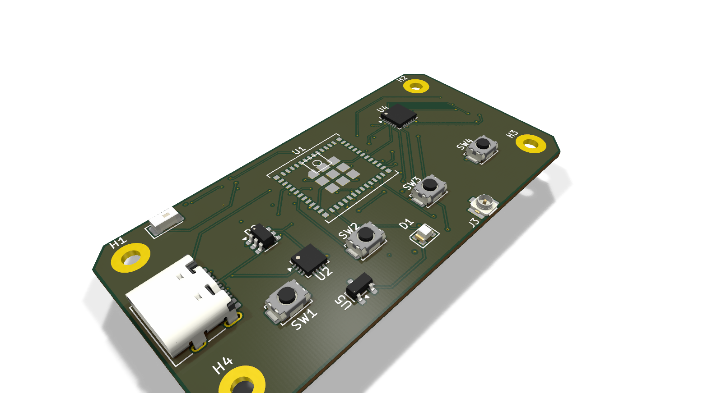
*Abbildung 7.9a: PCBA 09 Top 3D (Aktuelles Routing & Placement) – ESP32-C6 Host-MCU (U1), ES8388 Audio-Codec (U4), BQ24075 PMIC (U2), ME6211 3.3V LDO (U3/U5), IP67 USB-C (J1) und 4-Tasten-Reihe.*

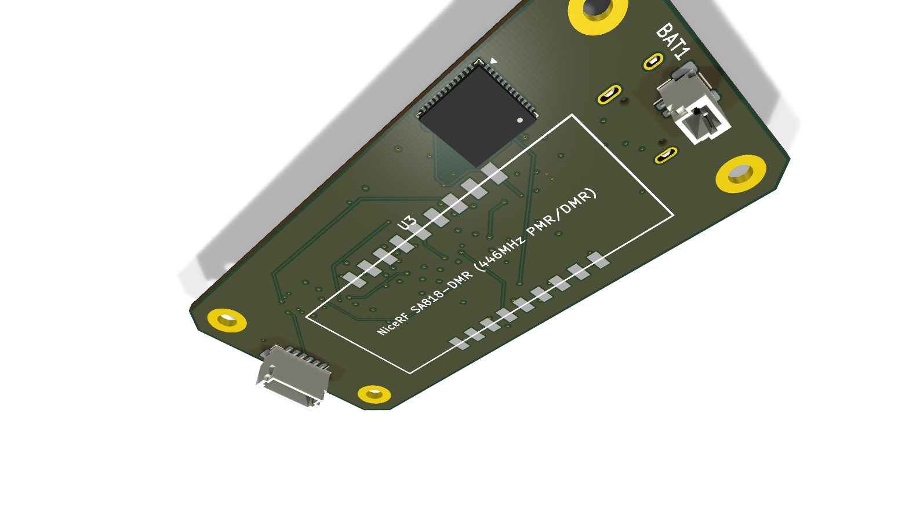
*Abbildung 7.9b: PCBA 09 Bottom 3D (Dual-Engine OMB Lite) – 2-Pin LiPo-Header `BAT1` direkt unterhalb von `J1` USB-C (`Local X=3.45, Y=15.05`), dedizierter ESP32-PICO-V3-02 Bluetooth Classic/BLE Co-Prozessor (U5), Johanson 2450AT Chipantenne (ANT1) und 6-Pin Helm-Header `J_HELMET` rechts außen (`Local X=57.05, Y=14.70`).*

### 11.1 Technische Platinen-Kenndaten & Lagenaufbau
* **Abmessungen:** $60{,}0 \times 30{,}0 \times 1{,}0\,\text{mm}$ ($R = 2{,}5\,\text{mm}$ Kantenradius).
* **Lagenaufbau:** 2/4-Lagen FR-4 High-TG150, $1{,}0\,\text{mm}$ Materialstärke, $35\,\mu\text{m}$ Cu (1 oz), ENIG-Goldfinish (Electroless Nickel Immersion Gold).
* **Befestigung:** 4x M2-Montagelöcher ($\varnothing 2{,}2\,\text{mm}$) mit $52{,}0 \times 22{,}0\,\text{mm}$ Rastermaß für formschlüssige DIN 934 M2 Mutterntaschen im $68{,}0 \times 36{,}0 \times 16{,}0\,\text{mm}$ UCS-Gehäuse.

### 11.2 Bestückung & Schaltkreis-Architektur

1. **Host-Mikrocontroller (`U1`):**
   * **Espressif ESP32-C6-MINI-1U** (32-Bit RISC-V Single-Core @ 160 MHz, 512 kB SRAM, 4 MB Quad-SPI Flash, integrierte U.FL-Goldbuchse).
   * Unterstützt 2.4 GHz Wi-Fi 6 ($802.11\text{ax}$), IEEE 802.15.4 (deterministischer TDMA Mesh-Stack) und Bluetooth 5.3 LE / LE Audio LC3.
2. **Power-Management & Lade-IC (`U2`):**
   * **Texas Instruments BQ24075RGTR** (QFN-16 3x3mm) mit Dynamic Power Path Management (DPPM).
   * Unterbrechungsfreie Umschaltung zwischen USB-C 5V-Speisung (Bordnetz über Kassetten-Schlitten oder Powerbank) und dem internen **1000-mAh-LiPo-Akku (`Typ 603040 / 602840`, $40 \times 28 \times 6{,}0\,\text{mm}$, $3{,}7\,\text{Wh}$)** in $< 10\,\mu\text{s}$ ohne MCU-Reboot (13–18 h autarke Helmlaufzeit). Der interne Akku dient im Kassettenbetrieb als unterbrechungsfreie Stromversorgung (USV).
   * Einstellbarer Ladestrom ($500\,\text{mA}$), JEITA-konforme Temperaturüberwachung über NTC-Thermistor ($10\,\text{k}\Omega$). Im Helmbetrieb steuert die MCU bei schwachem Akku autonome Sprachansagen über den Codec `ES8388` ein (20 %: *„Battery low“*, 10 %: *„Battery critical“*, 5 %: *„Battery empty – shutting down“*).
3. **Audio-Frontend Stereo Codec (`U4`):**
   * **Everest Semi ES8388** (QFN-28 4x4mm): Ultra-Low-Power Stereo Audio Codec mit 24-Bit / 96 kHz I2S-Interface.
   * Getrennte linke und rechte Kopfhörer-Treiber ($2\times 45\,\text{mW}$ @ $16\,\Omega$ / $25\,\text{mW}$ @ $32\,\Omega$) für echten Stereo-Klang (A2DP-Musik, räumliche Navigationshinweise, LE Audio).
   * Rauscharmer Differenz-Mikrofon-Vorverstärker ($+0\dots +30\,\text{dB}$ Gain) mit programmierbarer interner `MICBIAS`-Erzeugung ($2{,}0\dots 2{,}8\,\text{V}$) für Schwanenhals- und Klebemikrofone.
4. **2.4-GHz-HF-Antennensystem & Dual-/Triple-Engine:**
   * **Host MCU (`U1`):** Nutzt direkt den werkseitig integrierten U.FL-Goldport auf dem `ESP32-C6-MINI-1U` Modul.
   * **Helm-Default:** Im Helmbetrieb wird die ultrakompakte Stummelantenne bzw. interne FPC-Antenne genutzt.
   * **Bluetooth Co-Prozessor (`U5/U6`):** Der `ESP32-PICO-V3-02` arbeitet auf eine eigene Johanson 2450AT Keramik-Chipantenne (`ANT1`, SMD 3216) für Nahfeld-Kopplungen zum Smartphone, Cardo/Sena-Bridge oder Cockpit-Display.
5. **Bedienung & Sensorik:**
   * 4x taktile IP67-Mikrotaster (`SW1` bis `SW4`, C&K KMT0 / Alps SKRK) auf `F.Cu`.
   * 1x RGB Status-LED (`D1`, WS2812B-2020) zur Einkopplung in den Gehäuse-Lichtleiter.
6. **Schnittstellen & Symmetrische Steckverbinder-Anordnung (`B.Cu`):**
   * `J1`: Wasserdichte IP67 USB-C Buchse (16-Pin) auf `F.Cu` bündig an der linken Stirnkante (`X=73.50, Y=100.00`) mit USBLC6-2SC6 TVS-ESD-Schutzarray (Laden unterwegs via Powerbank/Front-Node, WebUSB DFU Flashing, Kassetten-Einschubkontakt).
   * **`BAT1`: 2-polige JST-SH Micro-Buchse (`BM02B-SRSS-TB` Vertikal) auf `B.Cu` direkt unterhalb des USB-C Ports `J1` (`KiCad X=73.45, Y=100.05 mm` / `Local X=3.45, Y=15.05 mm`, `rot = -90°`)** zum **1S LiPo Pouch-Akku (1000 mAh `Typ 603040 / 602840`, $40 \times 28 \times 6{,}0\,\text{mm}$ mit integriertem PCM)**.
   * **`J_HELMET`: 6-Pin JST-SH 1.0mm SMD Vertikal-Header (`BM06B-SRSS-TB`) auf `B.Cu` symmetrisch gegenüber am rechten Platinenrand (`KiCad X=127.05, Y=99.70 mm` / `Local X=57.05, Y=14.70 mm`, `rot = +90°`)**. Führt reines, brummfreies Audio ins Helminnere. Zwischen `BAT1` und `J_HELMET` bleibt ein **komplett freier $48{,}0 \times 30{,}0\,\text{mm}$ Zentralbereich (`Local X = 6.0 .. 54.0 mm`)** für Transceiver & 1000-mAh-Akku, sodass beide Stecker zu 100 % unverdeckt bleiben.

### 11.3 Vollständige GPIO-Pinbelegung (ESP32-C6-MINI-1U)

<!-- AUTO_PINOUT_START: PCBA_09 -->

| Pad | Signal / KiCad Net | ESP32 GPIO | Firmware Define | Ziel / IC | Signal-Typ & Elektr. Spezifikation |
| :---: | :--- | :---: | :--- | :--- | :--- |
| 3 | `VCC_3V3` | - | - | 3.3V Power Rail | **Power** – Betriebsspannung ESP32-C6 |
| 5 | `BTN_1` | GPIO 2 | `OMM_PIN_SW_POWER` | SW1 / J_HELMET.6 | **Digital In** – Multifunktionstaster 1 (Power / PTT / MFB, Active Low) |
| 6 | `BTN_2` | GPIO 3 | `OMM_PIN_SW_MESH` | SW2 | **Digital In** – Mesh Taster 2 (Tri-Band Betriebsmodus-Umschaltung) |
| 8 | `VCC_3V3` | - | - | VCC_3V3 Pull-Up | **Power/Reset** – Chip Enable / Hardware Reset |
| 9 | `BTN_3` | GPIO 4 | `OMM_PIN_SW_VOL_UP` | SW3 | **Digital In** – Taster 3 (Lautstärke + / Kanal +) |
| 10 | `BTN_4` | GPIO 5 | `OMM_PIN_SW_VOL_DOWN` | SW4 | **Digital In** – Taster 4 (Lautstärke - / Kanal -) |
| 12 | `WS2812_DATA` | GPIO 0 | `OMM_PIN_WS2812B` | D1.4 | **Digital Out** – Onboard WS2812B-2020 Smart RGB Status-LED |
| 13 | `CHG_STAT` | GPIO 1 | `OMM_PIN_CHG_STAT` | U5.5 (BQ24075) | **Digital In** – Akku-Ladestatus BQ24075 (/STAT Active-Low) |
| 15 | `I2C_SCL` | GPIO 6 | `OMM_PIN_I2C_SCL` | U2.27 (ES8388) | **I2C_SCL** – ES8388 Audio-Codec I2C Taktleitung |
| 16 | `I2C_SDA` | GPIO 7 | `OMM_PIN_I2C_SDA` | U2.28 (ES8388) | **I2C_SDA** – ES8388 Audio-Codec I2C Datenleitung |
| 17 | `USB_DN` | GPIO 12 | `OMM_PIN_USB_DN` | J1.A7/B7 | **USB_D-** – USB Data Minus (UAC Audio / CDC Telemetrie) |
| 18 | `USB_DP` | GPIO 13 | `OMM_PIN_USB_DP` | J1.A6/B6 | **USB_D+** – USB Data Plus (UAC Audio / CDC Telemetrie) |
| 25 | `I2S_MCLK` | GPIO 19 | `OMM_PIN_I2S_MCLK` | U2.1 (ES8388) | **I2S_MCLK** – ES8388 Audio-Codec Master-Clock (12.288 MHz) |
| 26 | `I2S_BCLK` | GPIO 20 | `OMM_PIN_I2S_BCLK` | U2.2 (ES8388) | **I2S_BCLK** – ES8388 Audio-Codec Bit-Clock |
| 27 | `I2S_WS` | GPIO 21 | `OMM_PIN_I2S_WS` | U2.3 (ES8388) | **I2S_WS** – ES8388 Audio-Codec Word Select / Frame Sync (48 kHz) |
| 28 | `I2S_DOUT` | GPIO 22 | `OMM_PIN_I2S_DOUT` | U2.4 (ES8388) | **I2S_DOUT** – ES8388 Audio-Codec DAC Serial Data Out (Headphone Left/Right) |
| 29 | `I2S_DIN` | GPIO 23 | `OMM_PIN_I2S_DIN` | U2.5 (ES8388) | **I2S_DIN** – ES8388 Audio-Codec ADC Serial Data In (Mikrofon-Signal) |

<!-- AUTO_PINOUT_END: PCBA_09 -->

### 11.3.1 Sub-Chips (ES8388 Codec & BQ24075 Lader)

<!-- AUTO_SUBCHIPS_START: PCBA_09 -->

#### Sub-Chip `U4`: Everest Semi ES8388 24-Bit Audio Codec (QFN-28 (4x4 mm))
> **Hersteller-Datenblatt:** [Everest Semi ES8388 24-Bit Audio Codec](http://www.everest-semi.com/pdf/ES8388%20DS.pdf) | **Pin-Definition:** [Pin Configuration & Description (QFN-28)](http://www.everest-semi.com/pdf/ES8388%20DS.pdf#page=4)  

| Pad | Pin-Name | Signal / KiCad Net | Signal-Typ | Ziel / Quelle | Funktion & Elektr. Spezifikation |
| :---: | :--- | :--- | :---: | :--- | :--- |
| 1 | `MCLK` | `I2S_MCLK` | **Clock In** | U1 (ESP32-C6) | I2S Master Clock (12.288 MHz) |
| 2 | `BCLK` | `I2S_BCLK` | **Clock In** | U1 (ESP32-C6) | I2S Bit Clock (3.072 MHz) |
| 3 | `LRCK` | `I2S_WS` | **Sync In** | U1 (ESP32-C6) | I2S Word Select (48 kHz) |
| 4 | `DSOUT` | `I2S_DIN` | **Audio Out** | U1 (ESP32-C6) | Digitalisiertes Mikrofon-Signal an MCU |
| 5 | `DSIN` | `I2S_DOUT` | **Audio In** | U1 (ESP32-C6) | Mesh/Funk Audio Stream zum Kopfhörer DAC |

#### Sub-Chip `U2`: TI BQ24075 Li-Ion Akkulader & Power-Path PMIC (QFN-16 (3x3 mm))
> **Hersteller-Datenblatt:** [TI BQ24075 Li-Ion Akkulader & Power-Path PMIC](https://www.ti.com/lit/ds/symlink/bq24075.pdf) | **Pin-Definition:** [Pin Functions (QFN-16)](https://www.ti.com/lit/ds/symlink/bq24075.pdf#page=4)  

| Pad | Pin-Name | Signal / KiCad Net | Signal-Typ | Ziel / Quelle | Funktion & Elektr. Spezifikation |
| :---: | :--- | :--- | :---: | :--- | :--- |
| 13 | `IN` | `VBUS_USB` | **Power In (+5V)** | J1 (USB-C) | 5V Ladespannungseingang über USB-C |
| 2 | `OUT` | `SYS_PWR` | **Power Out** | LDO / System Rail | System-Betriebsspannung mit unterbrechungsfreier Umschaltung |
| 3 | `BAT` | `BAT_3V7` | **Power (3.7V)** | LiPo Akku | Li-Ion Akku Lade- und Entladeanschluss |
| 11 | `CHG` | `CHG_STAT` | **Digital Out** | U1 (ESP32-C6) | Ladestatusanzeige (Active Low) |

<!-- AUTO_SUBCHIPS_END: PCBA_09 -->

| Modul-Pad | ESP32-C6 GPIO | Netzname | Signal-Typ | Funktion / Hardware-Verbindung |
| :---: | :---: | :--- | :--- | :--- |
| **Pad 8** | **`GPIO 2`** | `BTN_PWR` | Digital In (Pullup) | SW1 (Power / MFB Taster, Low-aktiv, Boot-Pin) |
| **Pad 9** | **`GPIO 3`** | `BTN_MESH` | Digital In (Pullup) | SW2 (Mesh / Group Umschaltung, Low-aktiv) |
| **Pad 4** | **`GPIO 4`** | `BTN_VOL_UP` | Digital In (Pullup) | SW3 (Lautstärke +, Kanalwahl +, Low-aktiv) |
| **Pad 5** | **`GPIO 5`** | `BTN_VOL_DOWN` | Digital In (Pullup) | SW4 (Lautstärke -, Kanalwahl -, Low-aktiv) |
| **Pad 6** | **`GPIO 6`** | `WS2812_DATA` | Digital Out | D1 (WS2812B-2020 RGB Statusanzeige & Lichtleiter) |
| **Pad 7** | **`GPIO 7`** | `CHG_STAT` | Digital In (Pullup) | BQ24075 /STAT Ladezustandsanzeige (Low-aktiv) |
| **Pad 10** | **`GPIO 8`** | `I2C_SDA` | Open-Drain | ES8388 Register Control SDA (4.7k Pullup) |
| **Pad 11** | **`GPIO 9`** | `I2C_SCL` | Open-Drain | ES8388 Register Control SCL (4.7k Pullup) |
| **Pad 3** | **`GPIO 2 / PTT`**| `PTT_IO` | Digital In (Pullup) | Hardware-PTT-Eingang von J_HELMET Pin 6 / Lenkertaster |
| **Pad 21** | **`GPIO 19`** | `I2S_MCLK` | Digital Out | ES8388 Master Clock (12.288 MHz) |
| **Pad 22** | **`GPIO 20`** | `I2S_BCLK` | Digital Out | ES8388 Bit Clock (1.536 MHz) |
| **Pad 23** | **`GPIO 21`** | `I2S_WS` | Digital Out | ES8388 Frame Sync / Word Select (48 kHz) |
| **Pad 24** | **`GPIO 22`** | `I2S_DOUT` | Digital Out | ES8388 DAC Data Out (Stereo-Lautsprecher L/R) |
| **Pad 25** | **`GPIO 23`** | `I2S_DIN` | Digital In | ES8388 ADC Data In (Mikrofon) |
| **U.FL** | **RF 2.4G** | `RF_ANT` | 50 Ohm Koaxial | ESP32-C6 integrierte U.FL-Buchse -> Koax-Pigtail -> SMA-Durchführung |

### 11.4 Externe Steckverbinder (J1 USB-C & J2 Helm-Audio)

<!-- AUTO_CONNECTORS_START: PCBA_09 -->

#### Stecker `J1`: USB-C IP67 Service- & Ladeport
> **Typ:** `USB-C 12-Pin IP67 Wasserdicht SMD (TYPE-C-31-M-12)` | **Gegenstecker:** `Standard USB-C Kabel`  

| Pin | Signal / KiCad Net | Signal-Typ | Elektrische Spezifikation & Funktion |
| :---: | :--- | :---: | :--- |
| **A1/B12** | `GND` | **Power Return** | Massebezug |
| **A4/B9** | `VBUS_USB` | **Power In (+5V)** | 5V USB Ladespannung für BQ24075 |
| **A6/B6** | `USB_DP` | **USB D+** | USB 2.0 Full-Speed D+ zu ESP32-C6 |
| **A7/B7** | `USB_DM` | **USB D-** | USB 2.0 Full-Speed D- zu ESP32-C6 |

#### Stecker `J2`: UCS ECE 22.06 Helm-Headset Audio-Interface
> **Typ:** `JST-SH 6-Pin 1.0mm SMD Vertikal (BM06B-SRSS-TB)` | **Gegenstecker:** `JST SHR-06V-S-B (AWG28-30)`  

| Pin | Signal / KiCad Net | Signal-Typ | Elektrische Spezifikation & Funktion |
| :---: | :--- | :---: | :--- |
| **1** | `HELMET_SPK_L` | **Analog Out** | Lautsprecher Links (32 Ohm Treiber) |
| **2** | `HELMET_SPK_R` | **Analog Out** | Lautsprecher Rechts (32 Ohm Treiber) |
| **3** | `GND` | **Power Return** | Gemeinsame Lautsprecher- und Mikrofonmasse |
| **4** | `HELMET_MIC_P` | **Analog In** | Mikrofonsignal Positiv (Bias 2.2V) |
| **5** | `HELMET_PTT` | **Digital In** | Helm PTT-Taster gegen Masse |
| **6** | `GND` | **Power Return** | Schirmmasse |

<!-- AUTO_CONNECTORS_END: PCBA_09 -->

#### 11.4.1 Detailbeschreibung Multi-Use USB-C (`J1`)

Der stirnseitige USB-C Port `J1` (`TYPE-C-31-M-12_IP67`) dient als universelle Schnittstelle für **Laden (5V Bordnetz / Powerbank)**, **WebUSB/DFU-Flashing** und die **digitale USB-Audio-Anbindung** im Kassetten-Schlitten (`PCBA 03`):

| USB-C Pins | Netzname | Signal-Typ | Funktion & Kassetten-Verbindung (`J_AUDIO_PWR`) |
| :---: | :--- | :--- | :--- |
| **A1, B12, A12, B1, SH** | `GND` / `PGND` | Power Ground | Pin 1 Kassetten-Header `J_AUDIO_PWR` & Schirmung: Führt Lade- & Betriebs-Rückstrom |
| **A4, B9, A9, B4** | `VBUS_5V` | Power In (+5V) | Pin 2 Kassetten-Header `VCC_5V_PROT` & USB-Ladekabel: 5V Speisung & BQ24075 USV-Ladung |
| **A6, B6 (`DP1`, `DP2`)** | `USB_DP` | USB 2.0 PHY | Pin 7 Kassetten-Header `AUDIO_IO_P` $\rightarrow$ ESP32-C6 GPIO 13 (via TVS `D2`): **Digital-Audio USB D+ & WebUSB** |
| **A7, B7 (`DN1`, `DN2`)** | `USB_DN` | USB 2.0 PHY | Pin 8 Kassetten-Header `PTT_USB_N` $\rightarrow$ ESP32-C6 GPIO 12 (via TVS `D2`): **Digital-Audio USB D- & WebUSB** |
| **A5 (`CC1`)** | `CC1` | USB-C UFP | $5{,}1\,\text{k}\Omega$ Pull-Down nach GND (UFP Sink-Erkennung für Standard 5V Speisung) |
| **B5 (`CC2`)** | `CC2` | USB-C UFP | $5{,}1\,\text{k}\Omega$ Pull-Down nach GND (UFP Sink-Erkennung für Standard 5V Speisung) |
| **A8, B8 (`SBU1`, `SBU2`)** | `NC` | Nicht belegt | Frei / Nicht beschaltet (Analogaudio verbleibt 100 % auf `J_HELMET` auf B.Cu) |

> [!NOTE]
> **Digitales USB-Audio statt analoger Wandlung:**
> Im Kassettenbetrieb am Bike wird das Audiosignal zwischen der Host-MCU auf `PCBA 03` und dem OMM-Modul (`PCBA 09`) rein digital als USB-Audiostream (UAC / ESP-USB-Serial) über `USB_DP` und `USB_DN` übertragen. Es finden im Kassetten-Einschub keinerlei verlustbehaftete D/A- oder A/D-Wandlungen statt; Common-Impedance-Brummschleifen sind physikalisch ausgeschlossen. Analoges Audio für Helmlautsprecher und Mikrofon wird ausschließlich über den separaten Header `J_HELMET` (Platinenunterseite) geführt.

### 11.5 Belegung des 6-Pin Internen Helm-Audio & PTT Steckverbinders (`J_HELMET`)

Der auf der Platinenunterseite (`B.Cu`) platzierte 6-polige Header `J_HELMET` (JST-SH 1.0 mm, LCSC `C136657`) führt alle analogen Audio- und Steuersignale für den Helmeinsatz heraus. Durch die strikte Trennung von 5V Ladespannung (verbleibt ausschließlich auf USB-C `J1`) ist die Verbindung zu 100 % brumm- und störungsfrei:

| Pin # | Netzname (KiCad / Funktion) | Signal-Typ | Ziel / Helm-Headset Peripherie | Elektrische Spezifikation |
| :---: | :--- | :--- | :--- | :--- |
| **1** | **`AUDIO_OUT_L`** (`HP_OUT_L`) | Audio Out | Linker Helmlautsprecher (Tip 3.5mm Klinke) | ES8388 `LOUT1`, $45\,\text{mW}$ @ $16\,\Omega$, AC-gekoppelt |
| **2** | **`AUDIO_OUT_R`** (`HP_OUT_R`) | Audio Out | Rechter Helmlautsprecher (Ring 3.5mm Klinke) | ES8388 `ROUT1`, $45\,\text{mW}$ @ $16\,\Omega$, AC-gekoppelt |
| **3** | **`AGND_SPK`** | Audio Ground | Lautsprecher-Masse (Sleeve 3.5mm Klinke) | Stromlose Analogmasse ($I = 0\,\text{mA}$), kein Ladestrom |
| **4** | **`VOICE_IN`** (`MIC_IN+`) | Audio In | Mikrofon-Kapsel (2-Pin Micro-JST Pin 1) | ES8388 `MIC1P` mit programmierbarem `MICBIAS` (2.2V) |
| **5** | **`AGND_MIC`** | Mic Ground | Mikrofon-Rückleitung (2-Pin Micro-JST Pin 2) | Getrennte, rauscharme Vorverstärker-Masse |
| **6** | **`BTN_1`** (`BTN_PTT`) | Digital In | Helm-PTT-Taster / Kinn-Klicker | ESP32-C6 GPIO 2, interner $45\,\text{k}\Omega$ Pullup, schaltet gegen GND |

---

## 12. PCBA 10: OMM Universal Tri-Band (2.4 GHz Mesh + BT-Mesh/Bridge + 446 MHz PMR/DMR) Intercom-Modul (`openmotorbridge_omm446_ucs`)

Die Platine **`PCBA 10`** ist das vereinheitlichte **Universal Tri-Band Open-Source-Hardwaremodul**, das sämtliche Komponenten von `PCBA 09` (2.4 GHz OMM-Mesh auf `U1` + Bluetooth Classic/BLE Co-Prozessor auf `U6`) auf exakt denselben X/Y-Koordinaten enthält und zusätzlich den lizenzfreien Jedermannfunk im 446-MHz-Band (`U3` NiceRF SA818-DMR + `J_RF` U.FL) integriert. Damit erfolgt die Umschaltung zwischen **OMM 2.4 GHz Mesh**, **BT-Mesh / Bridge**, **446 MHz Analog PMR446**, **446 MHz Digital DMR Tier I** sowie simultanen **Kombimodi** zu **100 % rein per Software**:
* **Formfaktor-Gleichheit:** Exakt identische Außenmaße ($60{,}0 \times 30{,}0 \times 1{,}0\,\text{mm}$) und Montagepunkte wie `PCBA 09` im $68{,}0 \times 36{,}0 \times 16{,}0\,\text{mm}$ ECE 22.06 UCS-Gehäuse.
* **Universal-Einsatz:** Passt mechanisch und elektrisch sowohl in standardisierte ECE 22.06 UCS-Helmmulden als auch in den Kassetten-Schlitten (`PCBA 03`) am Motorrad.
* **Tri-Band HF-Funk:** 2.4 GHz OMM HD-Mesh (`U1`), Bluetooth Classic HFP/A2DP/Bridge (`U6`), Analog-FM (16 PMR446 Kanäle, CTCSS/DCS) und Digital-DMR Tier I (16 digitale Kanäle, TDMA 4FSK, glasklare Sprache ohne Rauschen auf `U3`).


*Abbildung 7.10a: PCBA 10 Top 3D (Aktuelles Routing & Placement) – ESP32-C6 Host-MCU (U1), ES8388 Audio-Codec (U4), BQ24075 PMIC (U2), ME6211 3.3V LDO (U5), IP67 USB-C (J1), U.FL Buchse (J_RF) und 4-Tasten-Reihe.*

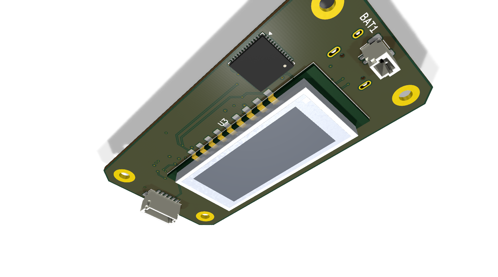
*Abbildung 7.10b: PCBA 10 Bottom 3D (Universal Tri-Band: SA818-DMR & Dual-Engine) – 2-Pin LiPo-Header `BAT1` direkt unter `J1` USB-C (`Local X=3.45, Y=15.05`), NiceRF SA818-DMR Transceiver (U3), ESP32-PICO-V3-02 Bluetooth Co-Prozessor (U6), Johanson 2450AT Chipantenne (ANT1) und 6-Pin Helm-Header `J_HELMET` rechts außen (`Local X=57.05, Y=14.70`).*

### 12.1 Technische Platinen-Kenndaten & Lagenaufbau
* **Abmessungen:** $60{,}0 \times 30{,}0 \times 1{,}0\,\text{mm}$ ($R = 2{,}5\,\text{mm}$ Kantenradius).
* **Lagenaufbau:** 4-Lagen FR-4 High-TG150, $1{,}0\,\text{mm}$ Materialstärke, $35\,\mu\text{m}$ Cu (Außenlagen) / $17{,}5\,\mu\text{m}$ Cu (Innenlagen für GND-Shielding und Power-Planes), ENIG-Goldfinish.
* **Befestigung:** 4x M2-Montagelöcher ($\varnothing 2{,}2\,\text{mm}$) mit $52{,}0 \times 22{,}0\,\text{mm}$ Rastermaß für formschlüssige DIN 934 M2 Mutterntaschen im $68{,}0 \times 36{,}0 \times 16{,}0\,\text{mm}$ 3D-Druck-Gehäuse.

### 12.2 Bestückung & Schaltkreis-Architektur

1. **Dual-Mode 446-MHz-Funktransceiver-Modul (`U3`):**
   * **NiceRF SA818-DMR** (Ultrakompaktes $446\,\text{MHz}$ Transceiver-Modul mit integriertem DSP, CMX7141 Baseband und PA):
     * **Analog PMR446:** 16 Kanäle ($446{,}00625\dots 446{,}19375\,\text{MHz}$), $12{,}5\,\text{kHz}$ Kanalraster, 38 CTCSS-Subtöne und 83 DCS-Digitalcodes.
     * **Digital DMR Tier I:** ETSI TS 102 361-1 konform, 2-Slot TDMA 4FSK Modulation, Color Code 1–16, Direktmodus (DMO) ohne Repeater.
   * **Dual-Power Umschaltung (Software- & Hardware-gesteuert):**
     * **0,2 W ERP (Helm-Modus / SAR-Safe):** Aktiv bei Standalone-Betrieb in der Helmmulde. Minimiert HF-Absorption am Kopf und thermische Verlustleistung (Reichweite ca. 1,5–2,5 km).
     * **0,5 W ERP (Bike-Modus / High-Power):** Aktiv bei Erkennung des Kassetten-Schlittens via I2C/GPIO. Schöpft das gesetzliche PMR446-Limit voll aus (Reichweite ca. 3–6 km im Freifeld).
2. **Host-Mikrocontroller, 2.4 GHz Mesh-Engine & Steuer-MCU (`U1`):**
   * **Espressif ESP32-C6-MINI-1U** (32-Bit RISC-V Single-Core @ 160 MHz):
     * Betreibt das **2.4 GHz OMM HD-Mesh** (Wi-Fi 6 / 802.15.4 TDMA) über den integrierten U.FL-Port und steuert parallel das SA818-DMR per UART über AT-Kommandos (Frequenz, CTCSS, DMR Color Code, Squelch, RF Power).
     * Unterstützt WebUSB DFU Flashing und digitales USB-Audio über den USB-C Port.
3. **Power-Management mit unterbrechungsfreier 1000-mAh-USV (`U2`):**
   * **Texas Instruments BQ24075RGTR** mit Dynamic Power Path Management (DPPM).
   * Ermöglicht das **Laden während des Betriebs** über USB-C (5V Bordnetz / Powerbank) bei gleichzeitig stabiler 3.3V- und PA-Speisung.
   * Fällt die externe 5V-Versorgung ab (z. B. Zündung aus oder Kassettenwechsel), übernimmt der interne **1000-mAh-LiPo-Akku (`Typ 603040 / 602840`, $40 \times 28 \times 6{,}0\,\text{mm}$, $3{,}7\,\text{Wh}$)** unterbrechungsfrei in $< 10\,\mu\text{s}$ als USV (**13–18 Stunden** autarke Helmlaufzeit).
4. **Audio-Frontend Stereo Codec (`U4`):**
   * **Everest Semi ES8388**: Verarbeitet und mischt die Audio-Signale von 2.4 GHz Mesh (`U1` I2S), Bluetooth (`U6`) und SA818-DMR (`U3` `LIN2` / `ROUT2`) vollduplex.
   * Stereo Headphone-Verstärker für Helm-Lautsprecher (`LOUT1` / `ROUT1`).
   * Differenzieller Mikrofon-Eingang mit zuschaltbarem Windgeräuschfilter und integriertem Noise-Gate.
5. **Tri-Band Antennensystem (Twin-SMA an $+X$-Stirnseite bei $Y=12{,}5\,\text{mm}$ & $Y=23{,}5\,\text{mm}$):**
   * **2.4 GHz OMM-Mesh-Pfad (`SMA_24G` bei $Y = 12{,}5\,\text{mm}$, $Z = 10{,}5\,\text{mm}$):** Nutzt den integrierten U.FL-Port auf dem `ESP32-C6-MINI-1U` (`U1`) über ein $50\,\text{mm}$ Koax-Pigtail zur ersten IP67 SMA-Bulkhead-Buchse in der Trennebene ($38\,\text{mm}$ 2.4-GHz-Stummelantenne am Helm bzw. Pod-Antenne).
   * **PMR/DMR 446-MHz-Pfad (`SMA_446` bei $Y = 23{,}5\,\text{mm}$, $Z = 10{,}5\,\text{mm}$):** Der HF-Ausgang des NiceRF SA818-DMR speist die U.FL-Buchse `J_RF` (`F.Cu`, $X = 110{,}2, Y = 113{,}5\,\text{mm}$). Ein zweites $50\,\text{mm}$ Koax-Pigtail führt ohne Leitungskreuzung zur zweiten IP67 SMA-Bulkhead-Buchse ($48\,\text{mm}$ 446-MHz-Stummelantenne am Helm bzw. 446-MHz-Pod-Antenne / 5V-Booster). Beide SMA-Buchsen sitzen fest in der Unterschale (100 % kabelloser Deckel beim Aufschrauben) und ragen bei $Z = 10{,}5\,\text{mm}$ frei über den UCS-Helmschachtrand ($Z = 5{,}2\,\text{mm}$) hinaus.
   * **Bluetooth Co-Prozessor (`U6`):** Der `ESP32-PICO-V3-02` arbeitet auf seine eigene Johanson 2450AT Keramik-Chipantenne (`ANT1`) für Nahfeld-Kopplungen und Cardo/Sena-Bridge.
6. **Bedienelemente & Symmetrische Steckverbinder-Anordnung (`B.Cu`):**
   * 4x taktile Mikrotaster (`SW1` bis `SW4`): PTT / MFB, Mode (Software-Umschaltung 2.4G / BT / Analog PMR / DMR / Kombi), Ch+/Vol+, Ch-/Vol-.
   * 1x WS2812B-2020 RGB Status-LED (`D1`, RX Grün, TX Rot, DMR Blau, Mesh Cyan, Chg Gelb).
   * `J1`: Wasserdichte IP67 USB-C Buchse (16-Pin) auf `F.Cu` (`X=73.50, Y=100.00`) für 5V Laden, WebUSB DFU und Kassetten-Einschub.
   * **`BAT1`: 2-polige JST-SH Micro-Buchse (`BM02B-SRSS-TB` Vertikal) auf `B.Cu` direkt unterhalb des USB-C Ports `J1` (`KiCad X=73.45, Y=100.05 mm` / `Local X=3.45, Y=15.05 mm`, `rot = -90°`)** zum **1S LiPo Pouch-Akku (1000 mAh `Typ 603040 / 602840`, $40 \times 28 \times 6{,}0\,\text{mm}$ mit integriertem PCM)**.
   * **`J_HELMET`: 6-Pin JST-SH 1.0mm SMD Vertikal-Header (`BM06B-SRSS-TB`) auf `B.Cu` symmetrisch gegenüber am rechten Platinenrand (`KiCad X=127.05, Y=99.70 mm` / `Local X=57.05, Y=14.70 mm`, `rot = +90°`)** – identische Belegung und Platzierung wie PCBA 09. Beide Stecker auf `B.Cu` liegen außerhalb des $48{,}0 \times 30{,}0\,\text{mm}$ Zentralfachs (`Local X = 6.0 .. 54.0 mm`) und bleiben zu 100 % frei zugänglich.

### 12.3 Vollständige GPIO-Pinbelegung (ESP32-C6 zu SA818-DMR & Peripherie)

<!-- AUTO_PINOUT_START: PCBA_10 -->

| Pad | Signal / KiCad Net | ESP32 GPIO | Firmware Define | Ziel / IC | Signal-Typ & Elektr. Spezifikation |
| :---: | :--- | :---: | :--- | :--- | :--- |
| 3 | `VCC_3V3` | - | - | 3.3V Power Rail | **Power** – Betriebsspannung ESP32-C6 |
| 5 | `BTN_1` | GPIO 2 | `OMM_PIN_SW_POWER` | SW1 / J_HELMET.6 | **Digital In** – Multifunktionstaster 1 (Power / Funk-PTT / MFB, Active Low) |
| 6 | `BTN_2` | GPIO 3 | `OMM_PIN_SW_MESH` | SW2 | **Digital In** – Funk-Modustaster 2 (PMR446 Analog / DMR Tier I Digital Umschaltung) |
| 8 | `VCC_3V3` | - | - | VCC_3V3 Pull-Up | **Power/Reset** – Chip Enable / Hardware Reset |
| 9 | `BTN_3` | GPIO 5 | `OMM_PIN_SW_VOL_UP` | SW3 | **Digital In** – Taster 3 (Funk-Kanal Up / Lautstärke +) |
| 10 | `BTN_4` | - | `OMM_PIN_SW_VOL_DOWN` | SW4 | **Digital In** – Taster 4 (Funk-Kanal Down / Lautstärke -) |
| 12 | `WS2812_DATA` | GPIO 4 | `OMM_PIN_WS2812B` | D1.4 | **Digital Out** – Onboard WS2812B-2020 Smart RGB Status-LED |
| 13 | `CHG_STAT` | GPIO 6 | `OMM_PIN_CHG_STAT` | U5.5 (BQ24075) | **Digital In** – Akku-Ladestatus BQ24075 (/STAT Active-Low) |
| 15 | `I2C_SCL` | - | `OMM_PIN_I2C_SCL` | U2.27 (ES8388) | **I2C_SCL** – ES8388 Audio-Codec I2C Taktleitung |
| 16 | `I2C_SDA` | GPIO 7 | `OMM_PIN_I2C_SDA` | U2.28 (ES8388) | **I2C_SDA** – ES8388 Audio-Codec I2C Datenleitung |
| 17 | `USB_DN` | GPIO 8 | `OMM_PIN_USB_DN` | J1.A7/B7 | **USB_D-** – USB Data Minus (UAC Audio / CDC Telemetrie) |
| 18 | `USB_DP` | GPIO 9 | `OMM_PIN_USB_DP` | J1.A6/B6 | **USB_D+** – USB Data Plus (UAC Audio / CDC Telemetrie) |
| 19 | `SA818_TXD` | - | `OMM_PIN_SA818_TXD` | U3.17 (SA818 RXD) | **UART_TX** – SA818-DMR Transceiver AT-Kommando Schnittstelle TXD |
| 20 | `SA818_RXD` | GPIO 12 | `OMM_PIN_SA818_RXD` | U3.18 (SA818 TXD) | **UART_RX** – SA818-DMR Transceiver Status / Telemetrie RXD |
| 22 | `SA818_PTT` | GPIO 0 | `OMM_PIN_SA818_PTT` | U3.15 (SA818 PTT) | **Digital Out** – SA818 Funk-Sendeaktivierung (Hardware PTT, Active Low) |
| 23 | `SA818_SQL` | GPIO 1 | `OMM_PIN_SA818_SQL` | U3.14 (SA818 SQL) | **Digital In** – SA818 Funk-Rauschsperre / Carrier Trägererkennung (Squelch, Active Low) |
| 24 | `SA818_PWR_HL` | GPIO 17 | `OMM_PIN_SA818_PWR_HL` | U3.16 (SA818 H/L) | **Digital Out** – SA818 Sendeleistungsumschaltung (0 = 0.2W Helm / 1 = 0.5W Bike Pod) |
| 25 | `I2S_MCLK` | - | `OMM_PIN_I2S_MCLK` | U2.1 (ES8388) | **I2S_MCLK** – ES8388 Audio-Codec Master-Clock (12.288 MHz) |
| 26 | `I2S_BCLK` | GPIO 16 | `OMM_PIN_I2S_BCLK` | U2.2 (ES8388) | **I2S_BCLK** – ES8388 Audio-Codec Bit-Clock |
| 27 | `I2S_WS` | - | `OMM_PIN_I2S_WS` | U2.3 (ES8388) | **I2S_WS** – ES8388 Audio-Codec Word Select / Frame Sync (48 kHz) |
| 28 | `I2S_DOUT` | GPIO 18 | `OMM_PIN_I2S_DOUT` | U2.4 (ES8388) | **I2S_DOUT** – ES8388 Audio-Codec DAC Serial Data Out |
| 29 | `I2S_DIN` | GPIO 19 | `OMM_PIN_I2S_DIN` | U2.5 (ES8388) | **I2S_DIN** – ES8388 Audio-Codec ADC Serial Data In |

<!-- AUTO_PINOUT_END: PCBA_10 -->

### 12.3.1 Sub-Chips (SA818-DMR & ES8388 Codec)

<!-- AUTO_SUBCHIPS_START: PCBA_10 -->

#### Sub-Chip `U3`: NiceRF SA818-DMR Tier I & Analog PMR446 Funk-Transceiver (18-Pad SMD Module)
> **Hersteller-Datenblatt:** [NiceRF SA818-DMR Tier I & Analog PMR446 Funk-Transceiver](https://www.nicerf.com/item/dmr-walkie-talkie-module-sa818-dmr) | **Pin-Definition:** [Section 3: Pin Definitions (18-Pad Module)](https://www.nicerf.com/item/dmr-walkie-talkie-module-sa818-dmr)  

| Pad | Pin-Name | Signal / KiCad Net | Signal-Typ | Ziel / Quelle | Funktion & Elektr. Spezifikation |
| :---: | :--- | :--- | :---: | :--- | :--- |
| 1 | `ANT` | `RF_446M_ANT` | **RF 446 MHz** | J3 (U.FL / Helix) | 446 MHz Funk-Antennenanschluss (1W TX / RX) |
| 4 | `PTT` | `SA818_PTT` | **Digital In** | U1 (ESP32-C6) | Sendetaste PTT (Active Low = Senden) |
| 5 | `PD / SLEEP` | `SA818_PD` | **Digital In** | U1 (ESP32-C6) | Power Down / Sleep Mode |
| 6 | `AUDIO_IN` | `VOICE_MIC_DMR` | **Analog Audio In** | U4.12 (ES8388) | Sprach-Modulationseingang vom Codec |
| 7 | `AUDIO_OUT` | `VOICE_RX_DMR` | **Analog Audio Out** | U4.8 (ES8388) | Empfangenes Sprachsignal an Codec ADC |
| 8 | `SQ / CARRIER` | `SA818_SQ` | **Digital Out** | U1 (ESP32-C6) | Squelch / Trägererkennung (Carrier Detect) |
| 9 | `UART_TX` | `SA818_UART_TX` | **UART Out** | U1 (ESP32-C6) | Konfigurations-UART TX (Kanal, CTCSS, DMR ID) |
| 10 | `UART_RX` | `SA818_UART_RX` | **UART In** | U1 (ESP32-C6) | Konfigurations-UART RX |

#### Sub-Chip `U4`: Everest Semi ES8388 24-Bit Audio Codec (QFN-28 (4x4 mm))
> **Hersteller-Datenblatt:** [Everest Semi ES8388 24-Bit Audio Codec](http://www.everest-semi.com/pdf/ES8388%20DS.pdf) | **Pin-Definition:** [Pin Configuration & Description (QFN-28)](http://www.everest-semi.com/pdf/ES8388%20DS.pdf#page=4)  

| Pad | Pin-Name | Signal / KiCad Net | Signal-Typ | Ziel / Quelle | Funktion & Elektr. Spezifikation |
| :---: | :--- | :--- | :---: | :--- | :--- |
| 1 | `MCLK` | `I2S_MCLK` | **Clock In** | U1 (ESP32-C6) | I2S Master Clock (12.288 MHz) |
| 2 | `BCLK` | `I2S_BCLK` | **Clock In** | U1 (ESP32-C6) | I2S Bit Clock (3.072 MHz) |
| 3 | `LRCK` | `I2S_WS` | **Sync In** | U1 (ESP32-C6) | I2S Word Select (48 kHz) |
| 4 | `DSOUT` | `I2S_DIN` | **Audio Out** | U1 (ESP32-C6) | Empfangenes Funk-Audio digital an ESP32-C6 |
| 5 | `DSIN` | `I2S_DOUT` | **Audio In** | U1 (ESP32-C6) | Sendesprache digital vom ESP32-C6 zum Funkmodul |

<!-- AUTO_SUBCHIPS_END: PCBA_10 -->

| Modul-Pad | ESP32-C6 GPIO | Netzname | Signal-Typ | Funktion / Hardware-Verbindung |
| :---: | :---: | :--- | :--- | :--- |
| **Pad 8** | **`GPIO 2`** | `BTN_PTT` | Digital In (Pullup) | Taster SW1: Push-To-Talk / MFB (Low-aktiv, Boot-Pin) |
| **Pad 9** | **`GPIO 3`** | `BTN_MODE` | Digital In (Pullup) | Taster SW2: Analog FM / Digital DMR Toggle |
| **Pad 4** | **`GPIO 4`** | `BTN_CH_UP` | Digital In (Pullup) | Taster SW3: Kanalwahl Aufwärts (CH 1–16) |
| **Pad 5** | **`GPIO 5`** | `BTN_CH_DOWN` | Digital In (Pullup) | Taster SW4: Kanalwahl Abwärts (CH 16–1) |
| **Pad 6** | **`GPIO 6`** | `WS2812_DATA` | Digital Out | D1 (WS2812B RGB Statusanzeige RX/TX/DMR) |
| **Pad 7** | **`GPIO 7`** | `CHG_STAT` | Digital In (Pullup) | BQ24075 /STAT Ladezustand (Low-aktiv) |
| **Pad 10** | **`GPIO 8`** | `I2C_SDA` | Open-Drain | ES8388 Register SDA (4.7k Pullup) |
| **Pad 11** | **`GPIO 9`** | `I2C_SCL` | Open-Drain | ES8388 Register SCL (4.7k Pullup) |
| **Pad 14** | **`GPIO 12`** | `USB_DN` | USB 2.0 PHY | USB-C D- (WebUSB Firmware-Flashing & DFU via D2) |
| **Pad 15** | **`GPIO 13`** | `USB_DP` | USB 2.0 PHY | USB-C D+ (WebUSB Firmware-Flashing & DFU via D2) |
| **Pad 16** | **`GPIO 14`** | `SA818_TXD` | Digital Out (UART) | ESP32 TX -> SA818-DMR RXD (AT-Steuerbefehle @ 9600 Bd) |
| **Pad 17** | **`GPIO 15`** | `SA818_RXD` | Digital In (UART) | ESP32 RX <- SA818-DMR TXD (Status & Telemetrie) |
| **Pad 18** | **`GPIO 16`** | `SA818_PTT` | Digital Out | SA818 PTT Steuerung (Low = Sendebetrieb aktiv) |
| **Pad 19** | **`GPIO 17`** | `SA818_SQL` | Digital In | SA818 Squelch-Ausgang (Low = Träger erkannt / Empfang) |
| **Pad 20** | **`GPIO 18`** | `SA818_PWR_HL` | Digital Out | SA818 RF Power Select: Low = 0.2W (Helm), High = 0.5W (Bike) |
| **Pad 21** | **`GPIO 19`** | `I2S_MCLK` | Digital Out | ES8388 Master Clock (12.288 MHz) |
| **Pad 22** | **`GPIO 20`** | `I2S_BCLK` | Digital Out | ES8388 Bit Clock (1.536 MHz) |
| **Pad 23** | **`GPIO 21`** | `I2S_WS` | Digital Out | ES8388 Frame Sync (48 kHz) |
| **Pad 24** | **`GPIO 22`** | `I2S_DOUT` | Digital Out | ES8388 DAC Out (Lautsprecher / Audio zu Zentralbox) |
| **Pad 25** | **`GPIO 23`** | `I2S_DIN` | Digital In | ES8388 ADC In (Mikrofon von Helm / Central DSP) |
| **J_RF** | **RF 446M** | `RF_ANT` | 50 Ohm Koaxial | U.FL Buchse (`B.Cu`) -> Koax-Pigtail -> IP67 SMA-Durchführung |

### 12.4 Externe Steckverbinder (J1 USB-C & J2 Helm-Audio)

<!-- AUTO_CONNECTORS_START: PCBA_10 -->

#### Stecker `J1`: USB-C IP67 Service- & Ladeport
> **Typ:** `USB-C 12-Pin IP67 Wasserdicht SMD (TYPE-C-31-M-12)` | **Gegenstecker:** `Standard USB-C Kabel`  

| Pin | Signal / KiCad Net | Signal-Typ | Elektrische Spezifikation & Funktion |
| :---: | :--- | :---: | :--- |
| **A1/B12** | `GND` | **Power Return** | Massebezug |
| **A4/B9** | `VBUS_USB` | **Power In (+5V)** | 5V USB Ladespannung für BQ24075 |
| **A6/B6** | `USB_DP` | **USB D+** | USB 2.0 Full-Speed D+ zu ESP32-C6 |
| **A7/B7** | `USB_DM` | **USB 2.0 D-** | USB 2.0 Full-Speed D- zu ESP32-C6 |

#### Stecker `J2`: UCS ECE 22.06 Helm-Headset Audio-Interface
> **Typ:** `JST-SH 6-Pin 1.0mm SMD Vertikal (BM06B-SRSS-TB)` | **Gegenstecker:** `JST SHR-06V-S-B (AWG28-30)`  

| Pin | Signal / KiCad Net | Signal-Typ | Elektrische Spezifikation & Funktion |
| :---: | :--- | :---: | :--- |
| **1** | `HELMET_SPK_L` | **Analog Out** | Lautsprecher Links (32 Ohm Treiber) |
| **2** | `HELMET_SPK_R` | **Analog Out** | Lautsprecher Rechts (32 Ohm Treiber) |
| **3** | `GND` | **Power Return** | Gemeinsame Lautsprecher- und Mikrofonmasse |
| **4** | `HELMET_MIC_P` | **Analog In** | Mikrofonsignal Positiv (Bias 2.2V) |
| **5** | `HELMET_PTT` | **Digital In** | Helm PTT-Taster gegen Masse |
| **6** | `GND` | **Power Return** | Schirmmasse |

<!-- AUTO_CONNECTORS_END: PCBA_10 -->

#### 12.4.1 Detailbeschreibung Multi-Use USB-C (`J1`)

Identisch beschaltet wie bei PCBA 09: Dient als universelle Schnittstelle für **Laden (5V Bordnetz / Powerbank)**, **WebUSB/DFU-Flashing** und den **Kassetten-Einschubkontakt** im Smart Cartridge (`PCBA 03`).

### 12.5 Belegung des 6-Pin Internen Helm-Audio & PTT Steckverbinders (`J_HELMET`)

Der Header `J_HELMET` auf `B.Cu` ist **100 % anschlusskompatibel zu PCBA 09**:

| Pin # | Netzname (KiCad / Funktion) | Signal-Typ | Ziel / Helm-Headset Peripherie | Elektrische Spezifikation |
| :---: | :--- | :--- | :--- | :--- |
| **1** | **`AUDIO_OUT_L`** (`HP_OUT_L`) | Audio Out | Linker Helmlautsprecher (Tip 3.5mm Klinke) | ES8388 `LOUT1`, $45\,\text{mW}$ @ $16\,\Omega$, AC-gekoppelt |
| **2** | **`AUDIO_OUT_R`** (`HP_OUT_R`) | Audio Out | Rechter Helmlautsprecher (Ring 3.5mm Klinke) | ES8388 `ROUT1`, $45\,\text{mW}$ @ $16\,\Omega$, AC-gekoppelt |
| **3** | **`AGND_SPK`** | Audio Ground | Lautsprecher-Masse (Sleeve 3.5mm Klinke) | Stromlose Analogmasse ($I = 0\,\text{mA}$), kein Ladestrom |
| **4** | **`VOICE_IN`** (`MIC_IN+`) | Audio In | Mikrofon-Kapsel (2-Pin Micro-JST Pin 1) | ES8388 `MIC1P` mit programmierbarem `MICBIAS` (2.2V) |
| **5** | **`AGND_MIC`** | Mic Ground | Mikrofon-Rückleitung (2-Pin Micro-JST Pin 2) | Getrennte, rauscharme Vorverstärker-Masse |
| **6** | **`BTN_1`** (`BTN_PTT`) | Digital In | Helm-PTT-Taster / Kinn-Klicker | ESP32-C6 GPIO 2, interner $45\,\text{k}\Omega$ Pullup, schaltet gegen GND |
