# 08 - Mechanische Gehäuse, CAD-Konstruktion & Dichtungssystem (Alle Baugruppen)

*(Hinweis: Sämtliche CAD- und 3D-Baugruppenansichten werden im Zuge der finalen Render-Phase aktualisiert).*

Dieses Dokument spezifiziert die mechanische Konstruktion, das Thermomanagement, das IP67/IP69K-Gehäusedesign, die Kinematik des Auto-Eject-Schnellwechselsystems sowie alle CAD- und STL-Modelle aller Gehäuse-Baugruppen der OpenMotorBridge v10.0 Standardized Node Architecture:
1. **Zentrale Steuerbox (Typ A):** 3-teiliges Sandwich-Gehäuse mit Zwischenboden ($70{,}0 \times 10{,}0\,\text{mm}$ offene Kabelbucht), integrierter Akku-Wanne mit schwenkbarer Akkubrücke (Doppel-Antennennest für Taoglas FXP895 LoRa-868 und Taoglas FXP73 2.4-GHz mit $0{,}8\,\text{mm}$ Schutzblende und C-Clip Zugsicherung), 100 % kabelfreiem Gehäusedeckel, Unterwannen-Bodenkammer ($12{,}0 \times 12{,}0 \times 0{,}8\,\text{mm}$) als geschlossene Reserve-Kavität (historische UWB-Aufnahme), rückseitigem SMA-Antennendurchgang mit wasserdichter $0{,}4\,\text{mm}$ Knockout-Membran (ab Werk IP68/IP69K geschlossen) und planarem 4-Layer Kupfer-Wärmespreader.
2. **Universeller Koffer-Satelliten-Pod (Typ B):** Baugleiches Monocoque-Gehäuse für beide Satelliten-Pods (Pod 1 & 2 Audio/Intercom, 2x symmetrisch) mit werkzeuglosem Slide-in Deckel, verdeckter FOB-Magnetverriegelung (Öffnen über Smart-Keyfob), innenliegendem Zwischendeckel (Dry-Flap), integrierter Koffer-USB-Ladebuchse (5V/12V PD bis zu 30W/60W), direkter EPDM-Nestaufnahme für OEM-Intercoms (Sena SPIDER X Slim, Cardo Packtalk Edge, OMM 2.4 GHz UCS, Midland PMR446) oder 100 % wasserdichter Dry-Box sowie 4-Draht-Automotive-Bus mit 4-Pin IP67 Magnet-Abrissschnittstelle.
3. **Universal Front-Knoten (Typ C):** Ultrakompakter Cockpit- & Sensor-Hub ($98{,}0 \times 68{,}0 \times 25{,}0\,\text{mm}$) für die $82 \times 50\,\text{mm}$ 4-Lagen PCBA 05 mit 4-in-1 Universal-Befestigungssystem (AMPS, Riser-Klemme, Silentblöcke, 3M Dual-Lock), Direktanbindung an die symmetrischen Dual Under-Perch Spiegel-Pods, 4-adrigem Automotive-Backbone (ohne Tankdemontage!), integriertem u-blox SAM-M10Q GNSS, TI TMP117 / OPT3001 Sensoren im Anströmbereich und Knowles MEMS Windgeräusch-Mikrofon.
4. **2-in-1 LoRa Smart-Keyfob & Pager (Typ D):** Ultrakompakter Taschenbegleiter ($58{,}0 \times 34{,}0 \times 13{,}0\,\text{mm}$) aus PA12-MJF mit umlaufendem TPU-Kantenschutz, integriertem N52-Neodym-Auswerferschlüssel, $0{,}5\,\text{mm}$ Mu-Metall-Flussschirmung, MagSafe/Qi-Induktionsladeaufnahme, LRA-Haptikmotor und drahtlosem SX1262 LoRa/BLE Alarm-Pager.
5. **Fahrzeugspezifische Referenz-Montagekits (Zero-Drill):** Vollständig konstruierte, zerstörungsfreie Bolt-On Montagekits für CVO Road Glide ST (Kit 1), Road King Special (Kit 2), Classic Bagger & Cruiser (Kit 3) sowie Adventure & Touring Enduros (BMW GS, KTM Adventure, Africa Twin - Kit 4 mit minimalem Unterbrücken-Radarträger).

---

## 1. Gehäuse Typ A: Zentrale Steuerbox (3-Teiliges Sandwich-Design)

Das Basisgehäuse der Zentralbox ist als modulares, 3-teiliges IP67/IP69K-Sandwichgehäuse aus **PA12 (MJF-Verfahren)** oder **Aluminium-Druckguss** konzipiert, das speziell für raue Motorrad-Bedingungen (Vibrationen bis $20\,\text{g}$, Spritzwasser, Hitzestau unter der Sitzbank) ausgelegt ist:

- **Außenabmessungen:** $110{,}0 \times 74{,}0 \times 38{,}0\,\text{mm}$ (L x B x H; Unterwanne $17{,}0\,\text{mm}$, Oberwanne $15{,}0\,\text{mm}$, Deckel $6{,}0\,\text{mm}$).
- **Befestigung:** 4x integrierte Ecklaschen an der Unterwanne mit **Lochabstand $128{,}0 \times 56{,}0\,\text{mm}$** für schwingungsdämpfende **M4 Silentblöcke (Shore 50A EPDM)** zur Entkopplung hochfrequenter Motorvibrationen.
- **Lichte Innenmaße:** $105{,}0 \times 69{,}0 \times 32{,}0\,\text{mm}$ (optimiert für die $85{,}0 \times 55{,}0\,\text{mm}$ 4-Layer Hauptplatine PCBA 01 mit symmetrischem Randabstand von $10{,}0\,\text{mm}$ in X und $7{,}0\,\text{mm}$ in Y).
- **Material & Fertigung:** PA12 im HP Multi Jet Fusion (MJF) 3D-Druck (min. $2{,}5\dots 3{,}0\,\text{mm}$ Wandstärke), kugelgestrahlt, im Heißbad chemisch geglättet und hydrophob versiegelt.
- **Schutzart:** IP67 / IP69K (strahlwasser- und tauchdicht bis $1\,\text{m}$ Wassertiefe sowie dampfstrahlbeständig).
- **100% Lötkolben-Freie Montage & Beliebig Oft Verschraubbar:** Alle Schraubverbindungen nutzen ausnahmslos formschlüssig ins PA12 eingedruckte **DIN 934 Sechskantmutter-Taschen** (M2, M2.5, M3, M4, M5). Selbstschneidende Gewinde in Kunststoff sind vollständig eliminiert: Gehäuse können beliebig oft geöffnet und wieder verschraubt werden, ohne dass Gewinde ausleiern oder Gehäuseteile nach einmaliger Demontage unbrauchbar werden. Messing-Gewindeeinsätze sind vollständig eliminiert.

### 1.1 3D-CAD-Modell & 3-Schichten-Sandwichaufbau

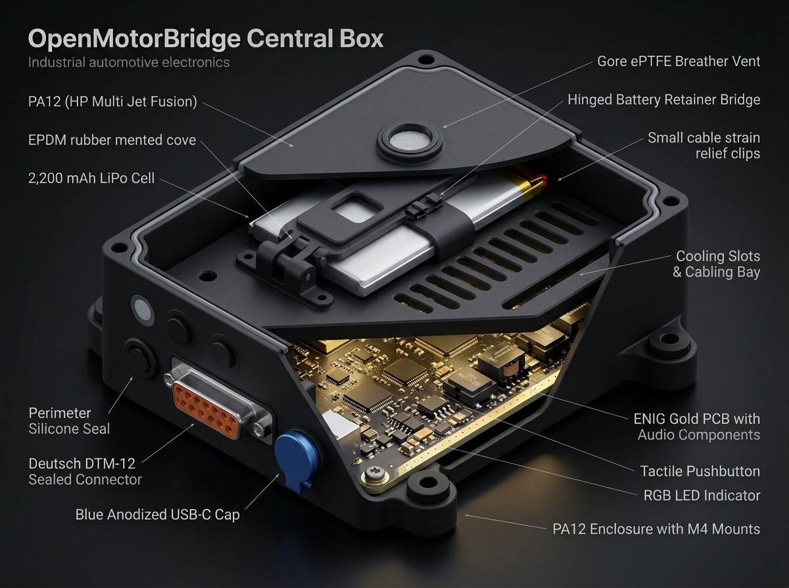

*Abbildung 8.1: Photorealistischer 3D-CAD-Schräganschnitt der zentralen Steuerbox. Sichtbar sind die 3 Schichten im geschlossenen Verbund: Unterwanne mit 4-Layer-Platine (ENIG) auf M2.5 Dämpfern, Zwischenboden mit offener 70x10mm Kabelbucht und Konvektionsschlitzen, oberes Akku-Fach mit 1S LiPo-USV-Batterie (2.200 mAh) unter der schwenkbaren Akkubrücke mit Antennenkapselung und Zugentlastung, automotiver Deutsch DTM Flansch, Taster SW1, USB-C Servicekappe sowie 100% kabelfreier Deckel mit Gore-Membran.*

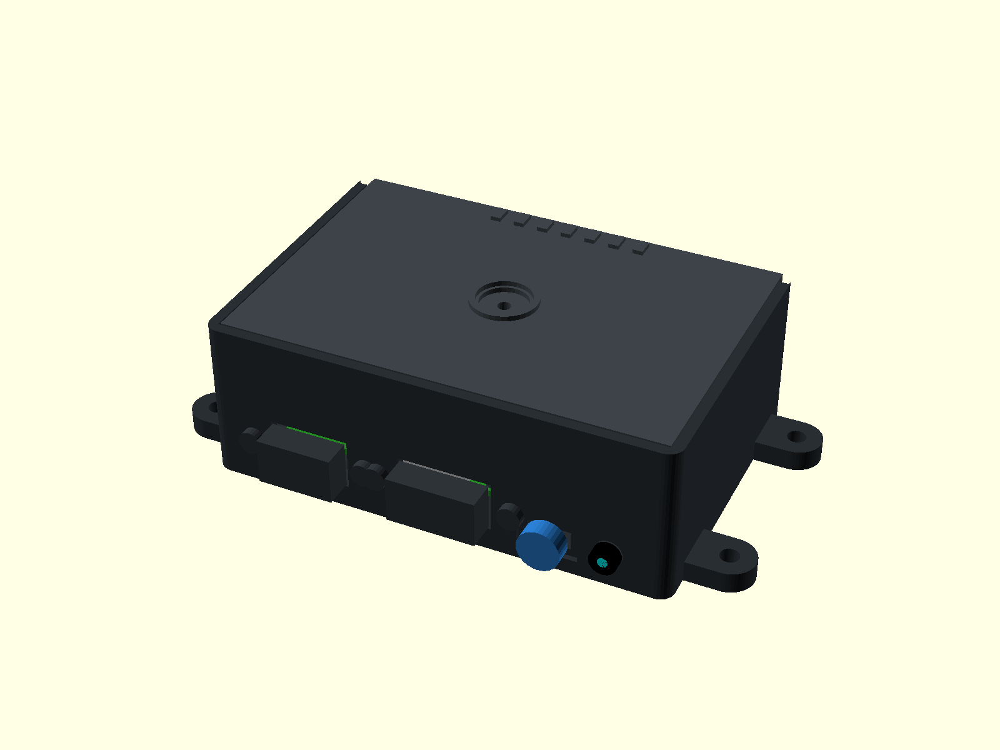

*Abbildung 8.2: 3D-CAD-Konstruktionsübersicht der zentralen Steuerbox (Typ A).*

```
+------------------------------------------------------------+  ^
| 1. GEHÄUSEDECKEL (6,0 mm Höhe / 3,0 mm Wandstärke)         |  |
|    * Gore ePTFE Druckausgleichsmembran (Ø 7,0 mm)          |  | 38,0 mm
|    * Umlaufende Nut mit Shore 40A Silikon-Profildichtung   |  | Gesamt-
|    * 100% kabelfreier Deckel (keine Antennen im Deckel;    |  | höhe
|      absolut stressfreies Abnehmen bei Wartung & Service)  |  |
|    * Durchgängig massiver PA12-Deckel (>2,5 mm Wandung)    |  |
+------------------------------------------------------------+  |
| 2. OBERWANNE MIT ZWISCHENBODEN (15,0 mm Höhe)              |  |
|    * Vordere Stirnwand (Alle Anschlüsse & Anzeige):        |  |
|      - Automotive Flansch (Kabelbaum J1 & J_PERIPH)        |  |
|      - Taster SW1 (Silikon-Dichtkappe, Pairing & Reset)    |  |
|      - Wasserdichter USB-C Service-Port (Alu-Schraubkappe) |  |
|      - Diffuser PMMA-Lichtleiter (Ø 3,2 mm) für WS2812B RGB|  |
|    * Schwenkbare Akkubrücke (RC-Scharnier & Schnapphaken): |  |
|      - Hält 1S LiPo (2.200 mAh) mit 1.0mm EPDM vibrationsfest|  |
|      - Integrierte Nester für Taoglas FXP895 (LoRa 868 MHz)|  |
|        und Taoglas FXP73 (2.4 GHz) mit Schutzabdeckung     |  |
|      - Integrierte C-Clip Zugsicherung für Koax- & DC-Kabel|  |
|    * Zwischenboden (Optimierte Zirkulationsebene):         |  |
|      - 70,0 x 10,0 mm offene Kabelbucht an der Stirnseite  |  |
|      - 9x Konvektions- & Druckausgleichsschlitze           |  |
+------------------------------------------------------------+  |
| 3. UNTERWANNE (17,0 mm Höhe - Geschlossene Monocoque-Wanne)|  |
|    * 4-Layer Hauptplatine (85 x 55 mm) auf M2.5 Standdomen |  |
|      (77 x 47 mm Lochabstand, DIN 934 M2.5 Mutterntaschen) |  |
|    * Integrierte Kavität (12 x 12 x 0,8 mm) im Boden       |  |
|      als Bauraumreserve / historische UWB-Aufnahme         |  |
|    * Formschlüssige DIN 934 M3 Sechskant-Nut-Pockets       |  |
|    * 4x M4 Silentblock-Befestigungsohren (vibrationsfest)  |  |
|    * 100% geschlossener PA12-Wannenboden (>2,2 mm Wandung) |  |
+------------------------------------------------------------+  v
```

### 1.2 3D-Explosionsdarstellung & Schichtaufbau (1:1:1 CAD Fitting)

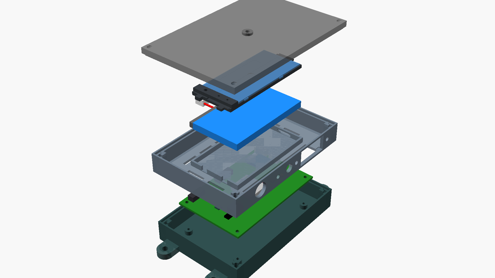

*Abbildung 8.3: 1:1:1 euklidische CAD-Explosionsdarstellung der Zentralbox entlang der vertikalen Z-Achse.*

### 1.3 3D-Röntgenansicht & Zusammenbau-Fitting

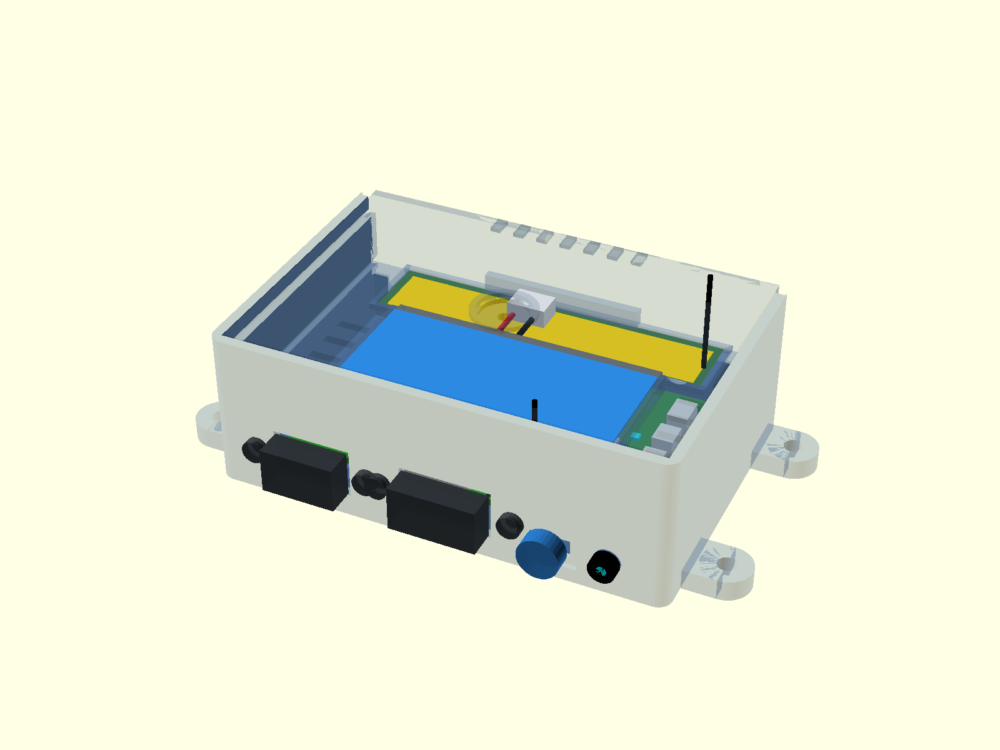

*Abbildung 8.4: Transparente 3D-Röntgenansicht der vollständig geschlossenen Zentralbox. Erkennbar sind die spielfreien Bauteilfreiräume, die geschützte Akku-Lagerung unter der schwenkbaren Akkubrücke, die durchgängige Konvektion über die 9 Zwischenbodenschlitze, der scheuerfreie Kabelverlauf durch die offene 70x10mm Kabelbucht zum automotiven Flansch und die rückseitige 0,4mm Knockout-Membran für den SMA-Port.*

### 1.4 Maßstabsgetreuer Längs- & Querschnitt (X-Z Thermik & Y-Z Kabelführung)

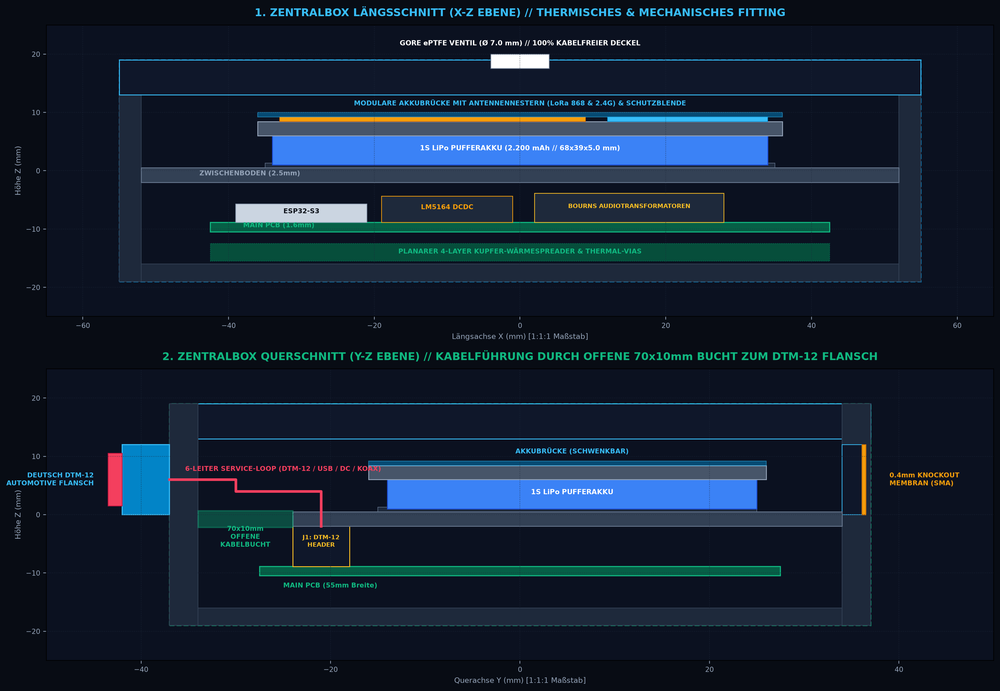

*Abbildung 8.5: Exakte 2D-Schnittansichten der Zentralbox (X-Z und Y-Z Ebenen).*

---

## 2. Thermomanagement & Planare PCB-Entwärmung (Kupferbolzenfrei)

Die Gesamtabwärme der Zentralbox liegt im normalen Fahrbetrieb bei lediglich **$\approx 1{,}5\,\text{W}$** (Peak bei maximaler Schnellladung: $2{,}45\,\text{W}$).

```
       4-LAYER LEITERPLATTE (PLANARER KUPFER-WÄRMESPREADER)
+--------------------------------------------------------+
| [ LM5164 Buck ]     [ BQ24075 UPS ]     [ ESP32-S3 ]   | <-- Bauelemente (SMD)
|   (100V DCDC)       (Power-Path)        (Dual-Core)    |
+--------------------------------------------------------+
| ####################################################### | <-- Layer 2: Durchgehende Solid GND Plane
+--------------------------------------------------------+
| ####################################################### | <-- Layer 3: Split Power / GND Planes
+--------------------------+-----------------------------+     (JLC04161H-7628 Standard, 93.5 cm² Fläche)
                           |
 +-------------------------v-----------------------------+
 | 11x ZWISCHENBODEN-KONVEKTIONSSCHLITZE & INNENLUFT     | <-- Freie Zirkulation in 210 cm³
 | (Wärme verteilt sich homogen im gesamten Gehäuse)     |     Luftvolumen & Gore ePTFE-Vent
 +-------------------------+-----------------------------+
                           v
          Abgabe über PA12-Gehäuseoberfläche (300 cm²) an Fahrtwind
```

1. **Planare 4-Layer PCB-Entwärmung ($85 \times 55\,\text{mm}$):** Die durchgehenden Kupfer-Innenlagen der FR4-Platine (JLC04161H-7628 Standard mit $17{,}5\,\mu\text{m}$ bzw. optional $35\,\mu\text{m}$) leiten die geringe Abwärme von $\approx 1{,}5\,\text{W}$ blitzschnell ab ($\lambda = 390\,\text{W/(m}\cdot\text{K)}$) und verteilen sie homogen über die gesamte Platinenfläche - ganz ohne mechanische Kühlkörper oder Kupferbolzen.
2. **11x Optimierte Konvektionsschlitze im Zwischenboden:** 5 Schlitze an der Rückkante ($Y = 58\,\text{mm}$), 4 an den Flanken und 2 an der Front lassen die Luft ungehindert in die Deckelkammer aufsteigen.
3. **Thermische Sicherheitsmargen im Extrem-Stresstest (Stau bei $45\,^\circ\text{C}$ Hitze + $13\,^\circ\text{C}$ Motorwärme = $58\,^\circ\text{C}$ unter Sitz):**
   * **LM5164-Q1:** $T_j = 93{,}8\,^\circ\text{C}$ (Zulässig bis $+150\,^\circ\text{C}$ $\rightarrow$ $+56{,}2\,^\circ\text{C}$ Reserve).
   * **ESP32-S3:** $T_j = 90{,}2\,^\circ\text{C}$ (Zulässig bis $+105\,^\circ\text{C}$ $\rightarrow$ $+14{,}8\,^\circ\text{C}$ Reserve).
   * **3.3V LDO:** $T_j = 110{,}4\,^\circ\text{C}$ (Zulässig bis $+125\,^\circ\text{C}$).
   * **1S LiPo Akku:** Verbleibt in der oberen Kammer sicher unter $60\,^\circ\text{C}$ (JEITA-NTC pausiert Ladevorgang bei $> 45\,^\circ\text{C}$).

### 2.2 Oberwanne: 1S LiPo-Akkuaufnahme & Zwischenboden-Durchführungen
* **Integrierte LiPo-Akkutasche:** Auf der Oberseite des Zwischenbodens sitzt eine formschlüssige Aussparung ($68{,}0 \times 39{,}0 \times 5{,}0\,\text{mm}$) für eine ultra-flache **2.200 mAh 1S LiPo-Pufferzelle** (Typ 504068 oder 503870). Durch die gezielte Vergrößerung der horizontalen Grundfläche statt der Bauhöhe bleibt die gesamte Gehäusehöhe der Zentralbox strikt bei **$38{,}0\,\text{mm}$**, sodass unter der Motorradsitzbank kein einziger Millimeter Freigang verloren geht.
* **100 % freier Querschnitt aller 11 Konvektionsschlitze:** Das Akkubett ist zentral bei $X = 17{,}0\dots 88{,}0\,\text{mm}$ und $Y = 13{,}0\dots 55{,}0\,\text{mm}$ platziert. Dadurch halten alle 11 Lüftungsschlitze (5 an der Rückwand, 4 an den Flanken, 2 an der Front) mindestens $2{,}5\dots 4{,}5\,\text{mm}$ Randabstand ein. Die Kaminwirkung und Innenluft-Zirkulation für die Abwärme von LM5164-Q1 und BQ24075 im Unterdeck bleibt uneingeschränkt erhalten.
* **Vibrationssicherung via schwenkbare Akkubrücke ([`main_box_battery_bridge.stl`](../../hardware/cad/stl/01_main_box/main_box_battery_bridge.stl)):** Ein formschlüssig einrastender, monolithischer PA12-Niederhalter mit Steckscharnier links ($X=17\,\text{mm}$) und elastischem RC-Schnappverschluss rechts ($X=88\,\text{mm}$) drückt die Zelle über einen $1{,}0\,\text{mm}$ EPDM-Moosgummistreifen vibrationsfest (geprüft bis $20\,\text{g}$) ein – komplett schrauben- und werkzeuglos öffenbar.
* **Integrierte Antennenkapselung & Zugsicherung:** Die Oberseite der Brücke beherbergt geschützte Nester für die Taoglas FXP895 (LoRa 868 MHz) und Taoglas FXP73 (2.4 GHz) unter einer $0{,}8\,\text{mm}$ PA12-Clip-Schutzblende. Formschlüssige C-Clips ($\varnothing 1{,}2\,\text{mm}$) am Scharnierende absorbieren alle Zugkräfte der Koaxial- und DC-Leitungen.
* **Molex Micro-Fit 3.0 Akkuanschluss (`J_BAT`):**
  * Pin 1: `VBAT+` ($+3{,}7\,\text{V}$ LiPo Pluspol über BQ24075)
  * Pin 2: `GND` (LiPo Masse mit integriertem Murata 10k NTC Temperaturfühler für JEITA-Ladeüberwachung)
* **Offene Stirnseiten-Kabelbucht ($70{,}0 \times 10{,}0\,\text{mm}$):**
  * Großzügige, zur Front ($Y=0\,\text{mm}$) hin vollkommen offene Ausklinkung ($X = 18\dots 88\,\text{mm}$) im Zwischenboden.
  * Lässt sämtliche Leitungen (Automotive Flachbandkabel, 10-Pin USB-C Flachband, 12V Strom, LiPo-Akkukabel, 868 MHz LoRa Koax und 2.4 GHz Koax) beim Aufsetzen der Oberwanne völlig frei und ohne Fädel- oder Quetschgefahr hineingleiten.

---

## 3. Stirnseitige Anschlüsse, Antennen-Aufnahmen & Rückwand-Option

```
                  VORDERE STIRNWAND DER OBERWANNE
+-------------------------------------------------------------+
| +------------+  +--------+  +----------+  +---------------+ |
| | 1. USB-C   |  | 2. RGB |  | 3. SW1   |  | 4. Deutsch    | |
| |    Service |  |    LED |  |    Pair/ |  |    Automotive | |
| |    Alukappe|  |  Ø3.2mm|  |    Reset |  |    Flansch    | |
| +------------+  +--------+  +----------+  +---------------+ |
+-------------------------------------------------------------+
```

1. **Automotive Flansch (Zwei-Kabel-Architektur J1 & J_PERIPH):** Automotive-Flansch mit integrierter Silikondichtung und 2x M3-Verschraubung ($28{,}0\,\text{mm}$ Lochabstand). Führt die Zwei-Kabel-Architektur der Zentralbox nach außen: Kabel 1 (6-Pin Deutsch DTM06-6S `J1`: KL30, KL15, GND, CAN-H, CAN-L, Shield) und Kabel 2 (16-Pin Automotive Header `J_PERIPH`: 4 Stränge à 4 Adern für Front-Knoten 60W, Pod 1 30W, Pod 2 30W und Heck-Radar MR20 12V/Telemetrie).
2. **Taster SW1 (`SW_PAIR_RESET`):** Wasserdichter IP67-Minitaster mit Silikon-Dichtkappe und M7-Gewindehülse. Dient dem Bluetooth/Audio-Pairing (3s Betätigung) sowie dem vollständigen Werksreset & NVS Key Purge (10s Betätigung).
3. **USB-C Service-Port:** Wasserdichte Rundflansch-Buchse mit unverlierbarer blau eloxierter Aluminium-Schraubkappe und EPDM-O-Ring für Firmware-Updates, ESP-IDF Telemetrie und Notfall-Diagnose.
4. **RGB-Status-LED Sichtfenster:** Diffuser PMMA-Linsenkörper ($\varnothing\,3{,}2\,\text{mm}$) mit umlaufendem O-Ring, der das Licht der onboard WS2812B RGB-LED direkt auf die Frontblende spiegelt (Zustandsanzeige: Grün = Betrieb/Mesh OK, Blau = BT Audio Stream, Orange = Warnung/Radar aktiv, Rot = Sabotage/Alarm).

### 3.1 Integrierte Antennen-Aufnahmen & HF-Transparenz

OpenMotorBridge nutzt ein duales, vollständig gehäuseintegriertes Antennenkonzept ohne störende äußere Antennenstummel bei maximaler Reichweite:
1. **LoRa 868 MHz Primärantenne (Taoglas FXP895):**
   * Formschlüssig in die Oberseite der schwenkbaren Akkubrücke (`013_battery_antenna_bridge.scad`) eingelassenes Antennennest ($86{,}0 \times 16{,}0 \times 1{,}0\,\text{mm}$) unter einer $0{,}8\,\text{mm}$ PA12-Clip-Schutzblende.
   * Die Antenne strahlt horizontal polarisiert nach oben durch den $2{,}5\,\text{mm}$ dünnen, HF-neutralen PA12-Deckel ($\varepsilon_r \approx 2{,}3\dots 2{,}7$, $\tan\delta \approx 0{,}015$). Dies garantiert eine maximale Rundum-Reichweite von bis zu $15\,\text{km}$ im OMM-Mesh.
   * Der Gehäusedeckel (`020_lid_plate.scad`) bleibt hierbei zu 100 % passiv und kabelfrei – bei Wartungsarbeiten kann er gefahrlos abgenommen werden, ohne U.FL-Koaxialleitungen zu belasten oder abzureißen.
2. **Wi-Fi 4 / BLE 5.0 Antenne für ESP32-S3 (Taoglas FXP73):**
   * Ebenfalls formschlüssig auf der Akkubrücke gelagert ($47{,}0 \times 7{,}5 \times 0{,}8\,\text{mm}$). Sie versorgt den ESP32-S3-WROOM-1U (`U2`) verlustfrei mit 2.4-GHz-HF für das Web-Interface und OTA-Firmware-Updates.
3. **LoRa 868 MHz Sekundäroption (SMA-Bulkhead mit 0,4 mm Knockout-Membran für Carbon-Bikes & Rallye):**
   * In der hinteren Stirnwand der Oberwanne (`012_front_cutouts.scad`) befindet sich an $X = 85{,}0\,\text{mm}$ ein vorbereiteter SMA-Antennenanschluss ($\varnothing\,6{,}5\,\text{mm}$ Durchbruch mit $\varnothing\,9{,}5 \times 1{,}2\,\text{mm}$ O-Ring-Senkung).
   * **Ab Werk 100 % hermetisch dicht (IP68/IP69K):** Eine integrierte $0{,}4\,\text{mm}$ dünne PA12-Knockout-Membran versiegelt das Gehäuse standardmäßig vollständig.
   * **Werkzeugloses Durchstoßen bei Bedarf:** Wird für Carbon-Heckverkleidungen oder Rallye-Einsätze eine externe Whip-Antenne benötigt, lässt sich die $0{,}4\,\text{mm}$ Membran mit einem kleinen Dorn/Schraubendreher sauber herausdrücken und eine IP67 SMA-Einbaubuchse mit O-Ring montieren.
4. **Historische UWB-Antennentasche (v10.0 Reserve-Bauraum):**
   * Die im Boden der Unterwanne (`00_lower_deck.scad`) eingelassene Tasche ($12{,}0 \times 12{,}0 \times 0{,}8\,\text{mm}$) diente in früheren Prototypen der Aufnahme der Taoglas FXUWB10 UWB-Antenne für den entfallenen DW3110-Transceiver. In v10.0 bleibt dieser Gehäusebereich als mechanische Reserve frei bzw. wird durch den massiven PA12-Boden planar geschlossen. Sämtliche fahrzeuginterne Daten- und Audioverbindungen laufen über den geschirmten 4-Ader Automotive-Bus.
   * Der Wannenboden bleibt nach unten mit $>2{,}2\,\text{mm}$ PA12-Wandung 100% hermetisch geschlossen und spritzwasserdicht.
5. **Bluetooth 5.4 / LE Audio (Qualcomm QCC3084):**
   * Nutzt die onboard 2.4-GHz-Keramik-Chipantenne mit optimiertem Keepout-Bereich auf `PCBA 01`. Die Abstrahlung erfolgt verlustfrei durch die PA12-Wandungen und den Zwischenboden zu den Helm-Headsets und Smartphone-Docks.

---

## 4. Gehäusesystem Typ B: Universeller Satelliten-Pod (Slide-in Deckel & Integrierte Dry-Box)

In OpenMotorBridge v10.0 entfällt das frühere System modularer Wechselkassetten (mit doppeltem Gehäusetunnel, Poka-Yoke-Führungsschienen, V4A-Auswerferfedern und elektromechanischen Tauchanker-Stößeln) vollständig.

Stattdessen setzen die beiden Satelliten-Pods (Pod 1 im linken Seitenkoffer, Pod 2 im rechten Seitenkoffer) auf ein **ultrakompaktes, direktes Monocoque-Gehäuse mit werkzeuglosem Slide-in Deckel, verdeckter FOB-Magnetverriegelung, schützendem Zwischendeckel (Dry-Flap) und integrierter Koffer-USB-Ladebuchse**:

1. **Typ B (Universelles Monocoque-Pod-Gehäuse):** Ein zu 100 % bilaterales Monocoque-Gehäuse ($150{,}0 \times 70{,}0 \times 38{,}0\,\text{mm}$ mit $145{,}0 \times 65{,}0 \times 32{,}0\,\text{mm}$ lichter Innenkammer – **über 40 % mehr Nutzvolumen** als die früheren Kassetten), das dauerhaft im Seitenkoffer, am Heckrahmen oder an Sturzbügeln montiert wird.
2. **Slot-in Deckel mit 4-Zahn-Zentralverriegelung:** Ein formschlüssig in den Gehäuseschacht eingreifender Deckel (Slot-In), der über 4 seitliche Riegelzähne (2 je Flanke) formschlüssig in die Seitenwände einrastet. Ein ergonomischer zentraler Federschieber spannt die Rückstellfeder und zieht die Zähne zum Öffnen ein.
3. **Unsichtbare FOB-Magnetentriegelung:** Die Verriegelung kann zusätzlich über den Smart-Keyfob (`PCBA 07` mit N52-Neodym-Magnet) berührungslos gesichert und freigegeben werden – 100 % werkzeuglos, ohne sichtbare Schlösser, vandalismus- und diebstahlsicher.
4. **Zweizonen-Aufbau mit Zwischendeckel (Dry-Flap):**
   * **Untere Zone:** Beherbergt die Trägerplatine `PCBA 03` ($42{,}0 \times 48{,}0\,\text{mm}$) mit nativer USB-PD Speisung und dem 4-Draht Automotive-Backbone.
   * **Chassis-montierte Buchsen an der kurzen Gehäusestirnwand (Port A & Port B):** Beide Schnittstellen sitzen horizontal exakt mittig ($Y = 35{,}0\,\text{mm}$) auf der kurzen Gehäuseseite und sind vertikal übereinander gestapelt:
     * **Port A (Bus-Schnittstelle, oben bei $Z = 26{,}5\,\text{mm}$):** Wettergeschützte formbündige 4-Pin IP67 Magnet-Abrissschnittstelle (HytePro Style), die über ein internes 4-adriges Silikon-Flachbandkabel (`VCC_BUS`, `USB_D-`, `USB_D+`, `GND`) direkt mit dem Header `J_BUS` auf `PCBA 03` verbunden ist.
     * **Port B (USB-C Ladedose, unten bei $Z = 11{,}5\,\text{mm}$):** Tief eingelassene ($7{,}0\,\text{mm}$), formschlüssige USB-C Buchse (30W USB-PD), die über ein 4-adriges internes Silikonkabel mit dem Header `J_USB_OUT` auf `PCBA 03` verbunden ist.
     * Dies garantiert 100 % bilaterale Symmetrie (linke und rechte Koffer-Pods ergonomisch identisch) und fängt sämtliche mechanische Steck- und Zugkräfte direkt im PA12-Gehäuse ab – die Platine bleibt völlig zug- und schwingungsfrei.
   * **Zwischendeckel-Spritzschutzblende (Dry-Flap):** Ein aufklappbarer oder herausnehmbarer Silikon-/EPDM-Zwischendeckel schirmt die Platine und Kabelanschlüsse vollständig gegen Schmutz und Nässe ab.
   * **Obere Zone (Direktaufnahme für OEM-Intercoms oder Dry-Box):** Bietet mit $145 \times 65\,\text{mm}$ Grundfläche enorm viel Raum für Sena SPIDER X Slim, Cardo Packtalk Edge, OMM 2.4 GHz UCS oder Midland PMR446. Wird kein Intercom genutzt, fungiert das gesamte Fach als hermetische **Mini-Dry-Box** für Fahrzeugpapiere, Bargeld und Notfallschlüssel.

---

### 4.1 3D-CAD-Modell & Anschnitt des Satelliten-Pods (Typ B)

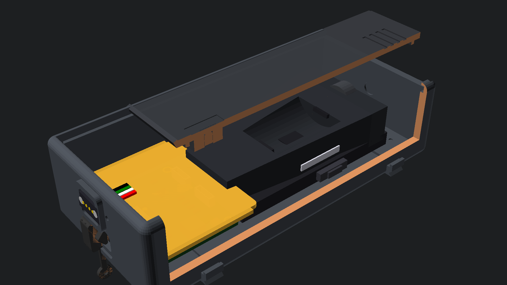

*Abbildung 8.6: Photorealistischer 3D-CAD-Schräganschnitt des universellen Satelliten-Pods (Typ B). Deutlich erkennbar ist die echte Slot-In Führungsmechanik: Die Gehäusewände laufen bis zur vollen Gehäusehöhe von $Z = 38{,}0\,\text{mm}$ durch. Auf der Innenseite beider Seitenwände befindet sich eine tiefe horizontale C-Nut (Führungsrille bei $Z = 32{,}0\dots 35{,}2\,\text{mm}$), in welcher die Führungsfedern des Slide-In Deckels gleiten. Darüber befindet sich eine massive, $2{,}8\,\text{mm}$ starke obere Haltenase (Dach/Hinterschnitt der Wand), die den Deckel nach oben hin formschlüssig sperrt – ein Abheben oder Aushebeln nach oben ist physisch unmöglich (kein Auflegedeckel!). Der Deckel kann ausschließlich horizontal über den hinteren Einschubschlitz ein- und ausgefahren werden. Im Inneren sichtbar: die tiefliegende PCBA 03 unter der EPDM-Dry-Flap, stirnseitig Port A (oben) und Port B (unten) sowie das Cardo Packtalk Edge mit aufgerasteter ultraflacher 2D-Kipphebel-Drückerplatte unterhalb des Deckels.*

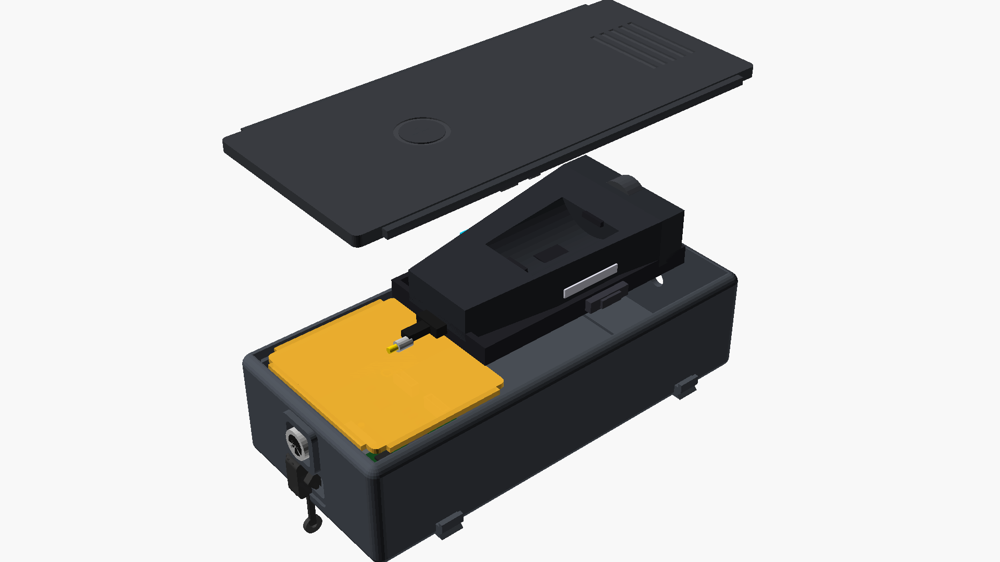

*Abbildung 8.7: 3D-CAD-Explosionsdarstellung des universellen Satelliten-Pods mit horizontaler Einschubkinematik: Der Slide-in Deckel wird nach hinten entlang der X-Achse aus dem hinteren Einschubschlitz herausgefahren. Erkennbar sind die durchgehenden seitlichen Führungsfedern des Deckels, die tiefen C-Profil-Führungsnuten der Gehäusewände mit oberer Haltenase, die Monocoque-Wanne mit Rohrsattel, Port A Magnetkupplung und Port B USB-C Buchse, PCBA 03 Trägerplatine auf M2.5 Elastomer-Dämpfern, EPDM-Dry-Flap Schutzblende, die auf das Cardo Air-Mount Cradle geklickte ultraflache 2D-Kipphebelplatte (zur automatischen zündungsgekoppelten Tastenbetätigung beim Ein-/Ausschalten), das Cardo Packtalk Edge sowie die rückseitige geschlossene SMA-Knockout-Membran).*

---

### 4.2 Kinematik des Slide-in Deckels (C-Nut-Führungsrille mit oberer Haltenase & 100 % innenliegender FOB-Diebstahlschutz)

Das Öffnen und Verschließen des Satelliten-Pods erfolgt als echter **Slide-In (Schiebedeckel)** mit horizontalem Einschub entlang einer verdeckten C-Führungsrille:

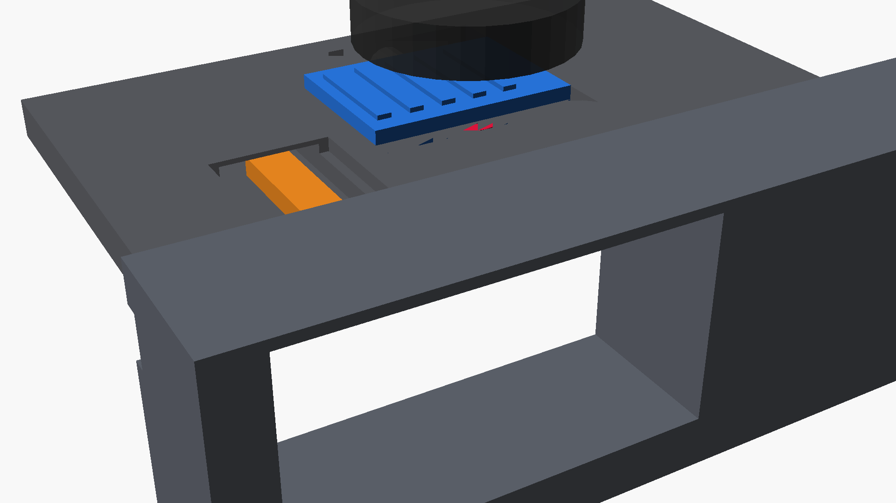

*Abbildung 8.8: 3D-CAD-Schnittansicht des 100 % innenliegenden FOB-Verriegelungsmechanismus: Aus Sicherheits- und Vandalismusschutzgründen existieren auf der Außenseite des Deckels keinerlei Tasten, Schieber oder Hebelwerkzeuge. Ein interner, federbelasteter Edelstahl-/Neodym-Riegelbolzen (Silber, $\varnothing\,4{,}0 \times 6{,}0\,\text{mm}$) sitzt in einer Sacklochbohrung auf der Deckelunterseite. Beim vollständigen Einschieben des Deckels schnappt der Bolzen durch die Rückstellfeder (Gold) nach unten in die Rastbohrung der vorderen Schottwand ein und blockiert den Deckel formschlüssig. Nähert sich der Smart-Keyfob (PCBA 07) der außen markierten RFID-Zone, zieht das N52-Magnetfeld den Bolzen kontaktlos nach oben in den Deckel – der Deckel kann nun nach hinten herausgeschoben werden.*

```
      SLIDE-IN C-NUT MIT OBERER HALTENASE & 100 % INNENLIEGENDER FOB-MAGNETRIEGEL
=================================================================================

            AUSSENBEREICH (GLATTE, VOLLKOMMEN MANIPULATIONSSICHERE DECKELFLÄCHE)
  ------------------------------------+------------------------------------------
   [SMART-KEYFOB PCBA 07]             |  GLATTE DECKELOBERFLÄCHE (Z = 35.2 mm)
    (N52 Neodym-Magnet)               |  (Keine Schieber, keine Knöpfe von außen!)
             v                        |
       +-----------+                  |    +-----------------------------+
       | N52 MAGNET|                  |    | OBERE WAND-HALTENASE (DACH) | (Z=35.2..38mm)
       |   (Key)   |                  |    | Sperrt Deckel nach OBEN!    |
       +-----+-----+                  |    +--------------+--------------+
  ===========|========================+===================|======================
   SLIDE-IN  | (Magnetfeld zieht      |  SLIDE-IN DECKEL  | [C-FÜHRUNGSRILLE]
   DECKEL    v  Bolzen nach oben)     |  (mit seitlichen  v  (Z=32.0..35.2mm)
        +----+----+                   |   Führungsfedern im Wandprofil)
        | [FEDER] | (Rückstellfeder)  |
        +----+----+                   |
             |                        |
        +----+----+                   |
        | RIEGEL- |                   |
        | BOLZEN  |                   |
  ------+----+----+-------------------+------------------------------------------
   GEHÄUSE-  | (Im verriegelten Zustand taucht Bolzen 3 mm in Gehäusewand ein!)
   BODEN     v
        [RASTBOHRUNG]  <-- 100 % INNENLIEGEND! Von außen physisch unzugänglich!
```

1. **Horizontales Einschieben in die C-Nut (Kein Auflegedeckel!):**
   * Die linke und rechte Seitenwand des Monocoque-Gehäuses sind nicht nach oben offen abgeschnitten, sondern bilden ein massives **C-Profil**.
   * Die eigentliche **Führungsrille ($Z = 32{,}0\dots 35{,}2\,\text{mm}$)** ist auf der Innenseite der Gehäusewand $2{,}0\,\text{mm}$ tief eingefräst/eingespritzt.
   * Oberhalb dieser Rille ragt die Gehäusewand als **massive obere Haltenase ($Z = 35{,}2\dots 38{,}0\,\text{mm}$)** nach innen.
   * Die Führungsfedern des Deckels gleiten vollständig unterhalb dieser Haltenase. Ein vertikales Abheben oder Aufhebeln ist formschlüssig zu 100 % gesperrt – der Deckel kann nur horizontal nach hinten entlang der X-Achse ausgefahren werden!

2. **100 % Innenliegende Diebstahlsicherung (Zero-External-Access):**
   * **Manipulationssicherheit:** Ein außenliegender Schieber oder Knopf würde es jedem Passanten am geparkten Motorrad ermöglichen, den Deckel zu öffnen und Intercom, Papiere oder Notgeld zu entwenden.
   * Der OpenMotorBridge Verriegelungsmechanismus liegt daher **zu 100 % im Gehäuseinneren**.
   * Die Deckeloberseite ist plan, fugenlos und bietet keinerlei Angriffsfläche für Aufhebelwerkzeuge.

3. **Berührungsloses Entriegeln über den Smart-Keyfob (`PCBA 07`):**
   * Der Fahrer legt seinen Smart-Keyfob auf die dezent markierte Zielzone der Deckeloberseite.
   * Das starke Magnetfeld des integrierten N52-Neodymkerns überwindet die interne Rückstellfeder und hebt den Edelstahl-Riegelbolzen um $3{,}5\,\text{mm}$ nach oben in den Deckel.
   * Der Deckel ist frei und kann mit dem Daumen über die hinteren Griffrippen nach hinten herausgeschoben werden.
   * **Stromlos & wartungsfrei:** Rein mechanisch und permanentmagnetisch – $0\,\text{mA}$ Ruhestrom, kein Batterieverschleiß, unempfindlich gegen Schlamm, Frost und Wasser.

3. **Verdeckte Innenverschraubung & Sabotageschutz:**
   * Die M4/M5-Edelstahlschrauben zur Befestigung des Pod-Gehäuses im Koffer oder am Rahmenrohr liegen im Inneren des Gehäuses unterhalb der Elektronikbucht.
   * Bei geschlossenem und verriegeltem Deckel sind die Schrauben für Werkzeuge physisch unzugänglich.
   * Jeder Versuch, den Pod gewaltsam abzureißen, wird über die 6-Achs-IMU der Zentralbox erkannt und alarmiert den Fahrer in $< 50\,\text{ms}$ über LoRa (868 MHz) auf dem Taschen-Pager.

---

### 4.3 Innenarchitektur: Zweizonen-Aufbau, Zwischendeckel & Koffer-USB

Das Innere des Satelliten-Pods ist modular in zwei vertikal getrennte Ebenen gegliedert:

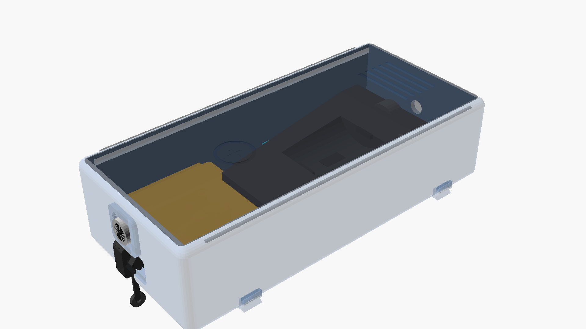

*Abbildung 8.9: Transparente 3D-Röntgenansicht (X-Ray) des vollständig geschlossenen Monocoque-Satelliten-Pods. Erkennbar sind die tiefliegende 4-Lagen Trägerplatine PCBA 03 auf M2.5 Elastomer-Dämpfern, die stirnseitige Leitungsführung zur Port A Bus-Verschraubung und zur Port B USB-C Ladedose, die abdichtende EPDM-Dry-Flap sowie die im oberen Geräteraum integrierte Aktuatorschiene.*

```
            POD-INNENAUFBAU: ZWEIZONEN-ARCHITEKTUR & DRY-FLAP
+-----------------------------------------------------------------------------+
| SLIDE-IN DECKEL (Formschlüssig geführt, Silikondichtung IP67, FOB-Rastung)  |
+-----------------------------------------------------------------------------+
| OBERE ZONE: GERÄTEKAMMER / DRY-BOX                                          |
| * OEM-Intercom (Sena SPIDER X Slim, Cardo Packtalk Edge, OMM UCS, Midland)  |
| * ODER: 100% wasserdichte Mini-Dry-Box für Papiere, Geld, Schlüssel         |
+ - - - - - - - - - - - - - - - - - - - - - - - - - - - - - - - - - - - - - - +
| ZWISCHENDECKEL / DRY-FLAP (Aufklappbare EPDM/Silikon-Schutzblende)         |
+ - - - - - - - - - - - - - - - - - - - - - - - - - - - - - - - - - - - - - - +
| UNTERE ZONE: ELEKTRONIK & VERSORGUNG                                        |
| * PCBA 03 Trägerplatine (42x48 mm, MCU, ES8388, SW3516 30W PD, 4-Ader-Bus)  |
| * Port A Bus-Buchse an Stirnwand oben (M8/Verschraubung, internes Silikonkabel) |
| * Port B USB-PD Ladedose an Stirnwand unten (30W PD, internes Silikonkabel)   |
+-----------------------------------------------------------------------------+
```

1. **Untere Elektronik-Zone (`PCBA 03`):**
   * Die Platine [PCBA 03](07_pcba_hardware_pinouts.md#5-pcba-03-satelliten-pod-interface-board-openmotorbridge_pod_interface) ($42{,}0 \times 48{,}0\,\text{mm}$) ist auf 4x M2.5 Schwingungsdämpfern direkt am Gehäuseboden verschraubt ($36{,}0 \times 42{,}0\,\text{mm}$ Lochabstand).
   * **Front-Begrenzung in X ($42{,}0\,\text{mm}$):** Nutzt ausschließlich den durch den Wegfall der früheren Kassettenfront gewonnenen Bauraum nach vorne. Der gesamte hintere Gehäuseraum ($88\,\text{mm}$ Restlänge) bleibt uneingeschränkt für OEM-Cradles (Cardo Air-Mount, Sena SPIDER-Schale, OMM) und die universelle Doppel-Schiebeschlitten-Aktuatorschiene (`012_universal_actuator_slide_bracket.scad`) reserviert.
   * **Breite in Y ($48{,}0\,\text{mm}$):** Schöpft die lichte Wannenbreite ($63\,\text{mm}$) optimal aus, verdoppelt die Platinenfläche und ermöglicht massives 4-Lagen-Routing mit großzügigen Masseflächen zur Wärmeabfuhr des 30W Step-Down Wandlers.
   * **Kurze Gehäusestirnwand (Fahrzeugschnittstellen):**
     * Beide Buchsen sind horizontal exakt mittig auf der kurzen Stirnseite platziert ($Y = 35{,}0\,\text{mm}$) und vertikal übereinander angeordnet:
     * **Port A (oben, $Z = 26{,}5\,\text{mm}$):** Chassis-montierte Bus-Buchse (4-Draht Automotive Backbone `VCC_BUS`, `GND`, `USB_D+`, `USB_D-`), angebunden über ein internes 4-adriges Silikon-Flachbandkabel an den Header `J_BUS` (4-Pin JST-GH).
     * **Port B (unten, $Z = 11{,}5\,\text{mm}$):** Chassis-montierte USB-C Ladebuchse (30W USB-PD), angebunden über ein 4-adriges flexibles Silikonkabel an den Platinen-Header `J_USB_OUT` (4-Pin JST-GH). Gewährleistet 100 % bilaterale Symmetrie für linken und rechten Koffer-Pod und schützt die Leiterplatte vollständig vor Zug- und Hebelkräften.
   * **Rückwärtige Schnittstellen (Gerätekammer):**
     * **`J_AUDIO_PWR` (8-Pin JST-SH, oben rechts):** Verbindung zur OEM-Kabelpeitsche des Intercoms (`AUDIO_IN_L/R`, `AUDIO_IO_P`, `OMM_DETECT`, `PTT_BTN`, `VCC_5V_PROT`, `GND`).
     * **`J_ACT` (8-Pin JST-SH, unten rechts):** Ansteuerung der 5V Kaltstart-Hubmagnete auf der Aktuatorschiene (4 Kanäle `ACT_1`..`ACT_4` mit Flyback-Dioden `D1`..`D4`, dualem `VCC_5V_PROT` und dualem `GND`).
     * Durch räumlichen Abstand sind Audio- und Aktuatorleitungen optimal entkoppelt; beide Kabelstränge laufen parallel nach hinten ab.

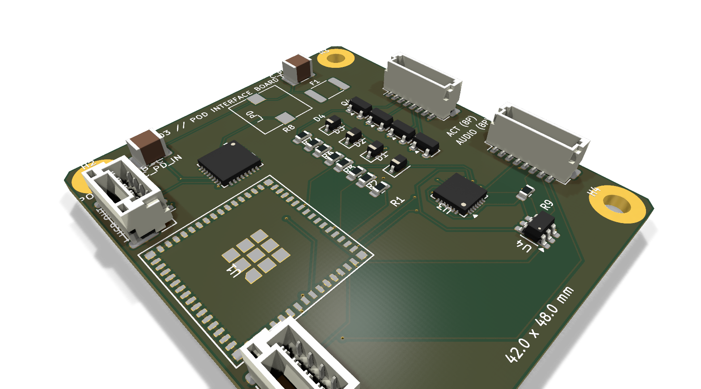

*Abbildung 8.10: Photorealistisches 3D-CAD-Rendering der Trägerplatine PCBA 03 ($42{,}0 \times 48{,}0\,\text{mm}$) mit 100 % Bestückung auf der Top-Layer F.Cu: 30W USB-PD Schnellladezone mit SW3516 und 7x7 mm Power-Induktor, ESP32-C6-MINI-1U Host-MCU, ES8388 24-Bit Stereo-Codec, 4-Kanal Aktuator-MOSFET-Array (Q1..Q4) sowie stirnseitigen JST-GH Headern `J_BUS` und `J_USB_OUT`.*

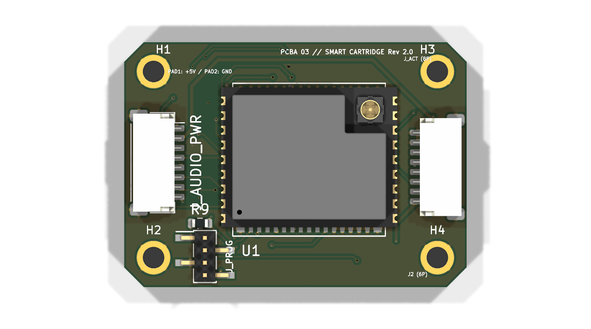

*Abbildung 8.11: Orthografische Draufsicht (Top-Layer F.Cu) der PCBA 03 mit 1,0 mm Eckenfasen, 4x M2.5 Entkopplungsbohrungen ($36{,}0 \times 42{,}0\,\text{mm}$ Raster) und klarer Zonierung in Stromversorgung, Signalverarbeitung und Automotive-Schnittstellen.*

2. **Zwischendeckel-Spritzschutzblende (Dry-Flap):**
   * Über der `PCBA 03` sitzt eine schwenkbare oder einschiebbare Zwischenblende aus hochflexiblem Shore 50A Silikon/EPDM.
   * Sie dichtet die Platine, Lötanschlüsse und Stecker hermetisch gegen die obere Kammer ab.
   * Beim Öffnen des Slide-in Deckels im Regen oder bei nassen Gepäckstücken kann kein Tropfwasser auf die empfindliche Leiterplatte gelangen.

3. **Obere Gerätekammer & Hermetische Dry-Box:**
   * **Mit Intercom:** Dient als passgenaues Nest für das jeweilige Kommunikationsmodul. Das Modul ruht auf vibrationsdämpfenden EPDM-Schaumpolstern und wird über eine kurze, vorkonfektionierte OEM-Kabelpeitsche direkt an `PCBA 03` angesteckt.
   * **Ohne Intercom (Dry-Box-Modus):** Bleibt die Kammer leer, bietet der $120 \times 55 \times 18\,\text{mm}$ große Raum ein vollwertiges, trockenes und diebstahlgeschütztes Staufach für Fahrzeugdokumente, Kreditkarten, Notfall-Bargeld oder Mauttransponder.

---

### 4.4 Direkte Intercom-Integration & Raumgewinn (Entfall der Kassetten)

Durch den vollständigen Entfall der Kassetten-Führungsschienen, Doppelwände, Ausstoßfedern und Verriegelungsriegel vergrößert sich die lichte Innenkammer dramatisch auf **$145{,}0 \times 65{,}0 \times 32{,}0\,\text{mm}$** – ein **Reingewinn an nutzbarem Innenvolumen von über 40 %** gegenüber dem früheren Kassettensystem!

In der folgenden 4-Varianten-Inspektionsansicht (mit ergonomisch angeschnittener Vorderwand) ist die enorme Geräumigkeit und die tiefliegende `PCBA 03` mit ihrem 4-adrigen Silikon-Flachbandkabel zur stirnseitigen 4-Pin Magnetkupplung (Port A) deutlich erkennbar:

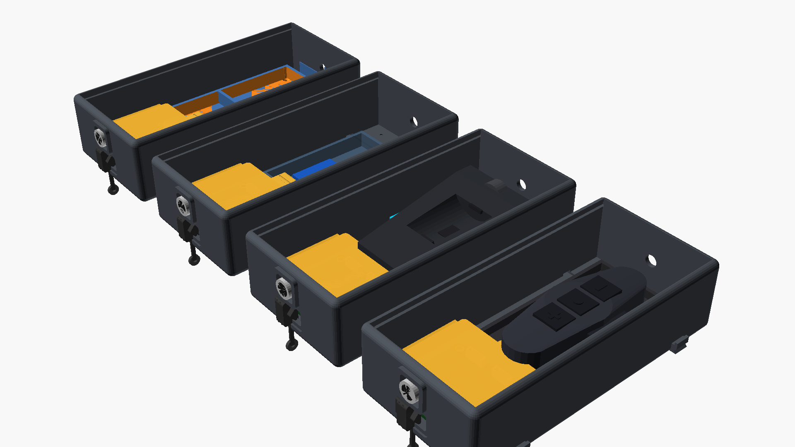

*Abbildung 8.12: Die universellen modularen Geräte-Einleger des Monocoque-Satelliten-Pods im 4-Varianten-Vergleich mit freigelegtem Innenraum (v.l.n.r.): 1. Sena SPIDER X Slim im formschlüssigen EPDM-Bett, 2. Cardo Packtalk Edge auf OEM Air-Mount Magnethalterung, 3. OMM 2.4 GHz UCS Transceiver mit 5V RF-Booster, 4. Hermetische Mini-Dry-Box mit Notschlüssel- und Papiere-Fächern. Alle Varianten nutzen dieselbe Monocoque-Wanne, dieselbe PCBA 03 Trägerplatine, dieselbe schützende Dry-Flap und die bündige 4-Pin IP67 Magnet-Abrissschnittstelle – 100 % kassettenfrei mit maximalem Raumgewinn.*

1. **Sena SPIDER X Slim (Referenz-Setup):**
   * Das extrem flache OEM-Gerät wird formschlüssig in ein EPDM-Formsitzbett in die obere Kammer gelegt.
   * Die werksseitige 3-adrige Sena-Kabelpeitsche (DC-Power, Audio-Out, Mic-In) wird direkt auf den vorkonfektionierten JST-Stecker von `PCBA 03` gesteckt.
   * Die Bedienung (Mesh Ein/Aus, Kanalwechsel, Lautstärke) erfolgt **100 % digital** über die Bluetooth 5.4 LE Audio-Schnittstelle des Qualcomm QCC3084 auf der Zentralbox oder die programmierbaren Under-Perch Lenkertaster – **null Verschleißteile, null Stößel-Justage!**

2. **Cardo Packtalk Edge / Pro:**
   * Die originale **Cardo Air-Mount Magnethalterung** wird mit 2x M3-Schrauben direkt im Gehäusebett fixiert.
   * Das Cardo-Gerät klickt mit seiner OEM-Magnethalterung ein. Die originale Cardo-Audiopeitsche führt an der Rückseite des Cradles heraus, verläuft geschützt unter dem Cradle hindurch und mündet unter dem EPDM-Zwischendeckel direkt in `PCBA 03` (Header `J_AUDIO_PWR`).
   * **Die Hardware-Realität geschlossener OEM-Headsets (Power-On / Power-Off):**
     * Während native OMB-Transceiver (OMM 2.4 GHz UCS) echtes **USB-Power-On** beherrschen (booten vollautomatisch, sobald 5V anliegen), besitzen kommerzielle Intercoms (Cardo Packtalk Edge/Neo, Sena SPIDER X/50S) **weder USB-Power-On noch Bluetooth-Wakeup im ausgeschalteten Zustand**:
       * Ist ein Headset ausgeschaltet, schläft sein interner Prozessor – ein Aufwecken über BLE ist technisch unmöglich.
       * Zum Einschalten bei Zündung-AN (KL15) müssen beim Cardo zwingend **Media-Taste + Intercom-Taste simultan für 2,0 s** gedrückt werden!
       * Zum Ausschalten beim Parken (um die interne Batterie nicht zu leeren) muss dieselbe Tastenkombination erneut gedrückt werden.
   * **Die mechatronische Lösung: Die ultraflache 2D-Kipphebel-Drückerplatte (`012_universal_actuator_slide_bracket.scad`):**
     * Um das Headset vollautomatisch zündungsgekoppelt ein- und auszuschalten, ohne mit dem Slide-in Deckel zu kollidieren, wurde eine spezialisierte **2D-Kipphebel-Drückerplatte** entwickelt:

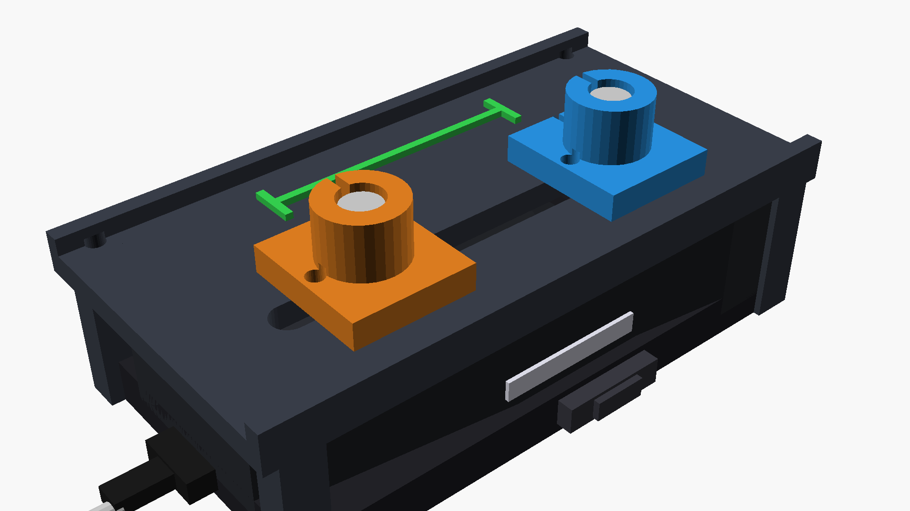

*Abbildung 8.13: Die ultraflache 2D-Kipphebel-Drückerplatte (`012_universal_actuator_slide_bracket.scad`) aufgerastet auf dem Cardo Air-Mount Cradle: 1. Bauhöhe nur $6{,}5\,\text{mm}$ (passt mit $> 4\,\text{mm}$ Sicherheitsabstand in den $10{,}5\,\text{mm}$ Freiraum unter dem Slide-in Deckel). 2. Flachliegende Horizontal-Aktuatoren treiben zwei $90^\circ$-Winkelhebel an – vertikale Spulenkollisionen sind ausgeschlossen. 3. Alle Schwenklager und Dome ragen nach UNTEN in den Freiraum neben den Tasten, die Oberseite bleibt plan. 4. Exakte 2D-Tastenanpassung: Vorderer Hebel (orange) bei $X = 22{,}0\,\text{mm}, Y = 13{,}0\,\text{mm}$ (Media/Power); hinterer Hebel (blau) bei $X = 63{,}0\,\text{mm}, Y = 28{,}0\,\text{mm}$ (Intercom/Power – $15\,\text{mm}$ Tiefenversatz in Y!). Weiche Shore A50 TPU-Pads drücken beide Tasten bei Zündung-AN simultan für 2,0 s. Das Flachbandkabel führt nach vorne unter der Dry-Flap direkt an `J_ACT` auf `PCBA 03`.*

3. **OpenMotorMesh (OMM 2.4 GHz UCS Transceiver Bed):**
   * Das UCS-Modul ($78 \times 44 \times 14\,\text{mm}$) und der 5V RF-Power-Booster ($32 \times 24 \times 9\,\text{mm}$) ruhen in einem maßgefertigten, formschlüssigen EPDM-Equipmentbett ($90 \times 52\,\text{mm}$).
   * Das OMM-System beherrscht echtes **USB-Power-On**: Sobald die Zentralbox bei KL15 die 5V/12V-Bordbusspannung freigibt, bootet der Transceiver vollautomatisch ohne jegliche mechanische Tasterbetätigung.
   * Die Audio- und Datenübertragung erfolgt verlustfrei und volldigital über ein kurzes 90° USB-C Flachbandkabel direkt an `PCBA 03` (USB Audio Class 2.0). Ein internes Koaxialkabel verbindet den SMA-Ausgang direkt mit der Rückwand-Antennendurchführung.

4. **PMR446 Handfunkgeräte & Midland Intercoms:**
   * Kompakte PMR446-Funkgeräte oder Midland-Module (BTR1 / BT Mini) werden über vorkonfektionierte Spiralkabel-Adapterpeitschen an `PCBA 03` angebunden.
   * Die Hardware-PTT wird über den integrierten Open-Drain MOSFET auf `PCBA 03` gesteuert – getriggert durch den linken Lenker-Daumentaster.

---

### 4.5 Das 4-Draht Automotive-Backbone (Power & USB 2.0)

Die Zuleitung von der Zentralbox zu beiden Seitenkoffer-Pods erfolgt über einen robusten, geschirmten **4-adrigen Automotive-Kabelbaum** ($4 \times 0{,}34\,\text{mm}^2$, FLRY-B):

| Ader | Kennzeichnung | Signal | Funktion & Schutz |
| :---: | :--- | :---: | :--- |
| **1** | **Rot (RD)** | **`VCC_BUS`** | Geschaltete DC-Speisung (12V Bordnetz, bis zu 60W USB-PD von Zentralbox) |
| **2** | **Weiß (WH)** | **`USB_D-`** | USB 2.0 High-Speed Datenleitung (invertiert), geschützt durch TVS-Diode |
| **3** | **Grün (GN)** | **`USB_D+`** | USB 2.0 High-Speed Datenleitung (nicht-invertiert), geschützt durch TVS-Diode |
| **4** | **Schwarz (BK)** | **`GND`** | Gemeinsame Power- und Signalmasse |

* **Koffer-Trennstelle (4-Pin Magnet-Abrissschnittstelle):**
  * An der Koffer-Trennkante sitzt eine formbündige, wasserdichte **4-Pin Magnet-Abrissschnittstelle (IP67)**.
  * Beim Abnehmen des Koffers trennt sich die Magnetverbindung völlig zerstörungsfrei und ohne Werkzeug.
  * Eine integrierte eFuse auf der Zentralbox (`PCBA 01`) schaltet die Speisung bei Kurzschluss (z. B. durch Schmutz oder Metallkontakt an der Trennstelle) in $< 1\,\mu\text{s}$ ab und reaktiviert sich nach Beseitigung der Störung automatisch.
* **Vorteile der 4-Draht-Architektur gegenüber UWB:**
  * **100 % Verbindungsstabilität:** Keine HF-Dämpfung durch nasses Gepäck, nasse Regenkombis oder Koffer-Aluminiumschalen.
  * **Echte USB-Ladeleistung im Koffer:** Bis zu 30W/60W Schnellladeleistung direkt im Gepäck.
  * **Zero-Disassembly Firmware-Updates:** Jedes Intercom und die Pod-MCU können direkt über WebUSB vom Smartphone oder Laptop aus geflasht werden.

---

## 5. Gehäuse Typ C: Universal Front-Knoten (Cockpit- & Sensor-Hub)

Das Gehäuse des Front-Knotens wurde speziell für die geschützte Montage in Motorrad-Frontverkleidungen (Batwing, Sharknose, BMW GS/RT Schnabel) oder an Sturzbügeln entwickelt:

- **Außenabmessungen:** Kompakte **$98{,}0 \times 68{,}0 \times 25{,}0\,\text{mm}$** (L x B x H, passend für die $82 \times 50\,\text{mm}$ 4-Lagen PCBA 05).
- **Material:** HP Multi Jet Fusion (MJF) PA12, schwarz kugelgestrahlt und chemisch geglättet.
- **Schutzart:** IP67 (tauch- und strahlwasserdicht) mit integrierter Gore-Tex Druckausgleichsmembran (ePTFE Vent) gegen Kondenswasserbildung.
- **Automotive-Backbone-Integration:** Die Anbindung zur Zentralbox erfolgt über das geschirmte 4-adrige Automotive-Kabel (12V Bordnetz, GND, USB 2.0 D+/D-), das ohne Tankdemontage durch den Harley-Kabelkanal bzw. BMW-Rahmenstrang geführt wird (**ZERO Tank-Demontage!**).
- **Laminarer GNSS- & Klima-Sensor-Puck:** Die Sensorik (u-blox SAM-M10Q Multi-GNSS Patch-Modul mit $15 \times 15\,\text{mm}$ Groundplane, TI TMP117 Labor-Temperatursensor $\pm 0{,}1\,^\circ\text{C}$ Glatteis-Wächter und TI OPT3001 Umgebungslichtsensor) ist direkt im Anströmbereich des Riser/Schnabels platziert.

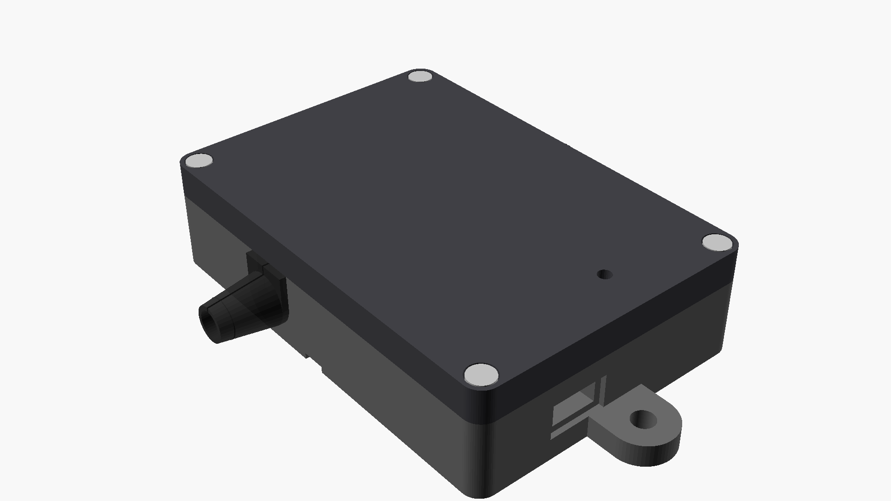

*Abbildung 8.18: Geschlossenes Front-Node IP67-Gehäuse.*

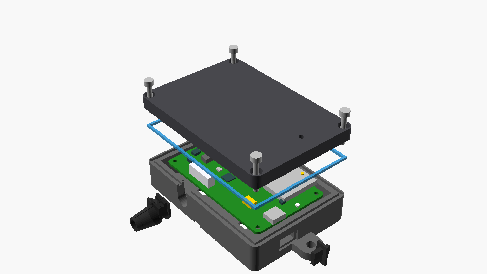

*Abbildung 8.19: 3D-Explosionsdarstellung des Front-Knotens entlang der Z-Achse.*

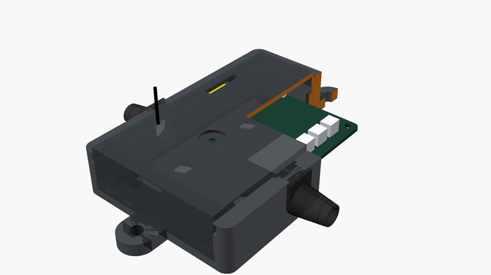

*Abbildung 8.20: Transparente 3D-Schnittansicht des Front-Knotens mit Knowles MEMS Schallkanal, UWB-Antennentasche im Boden und VBUS-Lastschalter.*

### 5.1 Das 4-in-1 Universal-Befestigungssystem des Front-Knotens

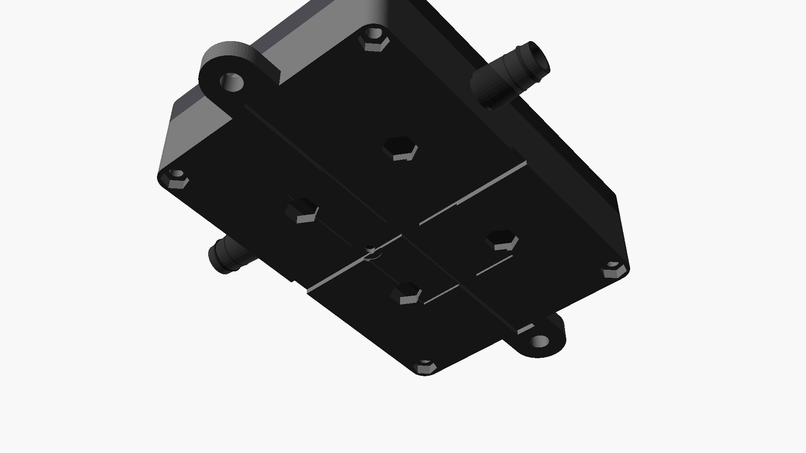

*Abbildung 8.21: Gehäuseunterseite des Front-Knotens mit AMPS-Bohrbild, $120^\circ$ V-Nut Rohrbett, EPDM-Spannnasen, Silentblock-Lochungen und 3M Dual-Lock Klettnuten.*

```
+----------------------------------------------------------------------------------------+
|                   DAS 4-IN-1 UNIVERSAL-BEFESTIGUNGSSYSTEM (BODENANSICHT)               |
+----------------------------------------------------------------------------------------+
| 1. AMPS-LOCHBILD (30 x 38 mm):                                                         |
|    * 4x formschlüssige DIN 934 M4 Nut-Pockets im AMPS-Raster (100 % lötkolbenfrei!)   |
|    * Kompatibel mit allen RAM-Mount Kugeladaptern, Garmin-Haltern & Cockpitstreben     |
+----------------------------------------------------------------------------------------+
| 2. ROHRBÜGEL-PRISMA (120° V-Nut):                                                      |
|    * Integrierte Hohlkehle passend für Rohrdurchmesser von Ø 22 mm bis Ø 32 mm         |
|    * 4x Einhängenasen für 2x wetterfeste EPDM-Spannringe (BMW GS / Sturzbügel)         |
|    * 100 % werkzeuglose Schnellmontage ohne Lackkratzer                                |
+----------------------------------------------------------------------------------------+
| 3. SILENTBLOCK-SCHWINGUNGSENTKOPPLUNG:                                                 |
|    * Eckbohrungen für M4 Silentblöcke (Shore 50A EPDM)                                 |
|    * Isoliert hochfrequente Vibrationen im Verkleidungsschnabel von Einzylinder- / V2  |
+----------------------------------------------------------------------------------------+
| 4. 3M DUAL-LOCK KLETTNUTEN:                                                            |
|    * 2x eingefräste 20 mm Nuten für selbstklebendes 3M Dual-Lock Pilzkopfband          |
|    * Perfekt für ebene Kunststoff-Innenflächen in Batwing- oder Sharknose-Verkleidungen |
+----------------------------------------------------------------------------------------+
```

#### 5.1.1 Montage an runden Metallstangen unterm Fairing (Verkleidungsgeweih Ø 12–22 mm)

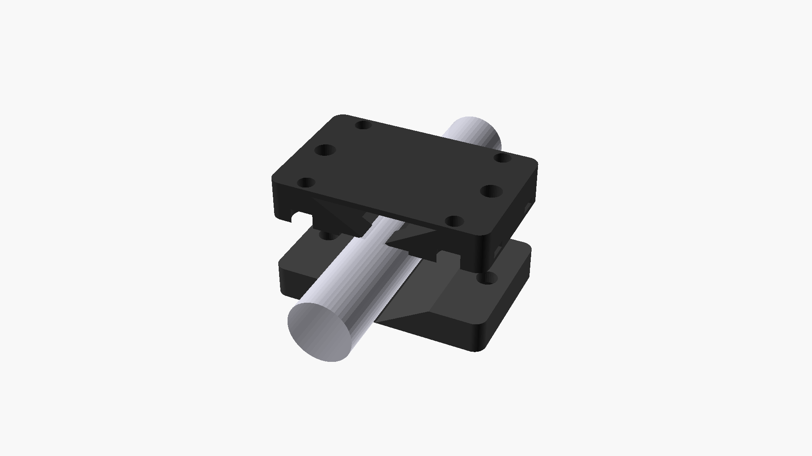

*Abbildung 8.21b: Die modulare 2-teilige Verkleidungs-Rohrschelle (`front_node_fairing_tube_clamp.stl`) mit 120° V-Prisma, EPDM-Dämpfungseinlage und AMPS-Verschraubung an einer Ø 16 mm Verkleidungsstrebe.*

Viele Touren- und Adventure-Motorräder besitzen unter der Verkleidung ("unterm Fairing") stabile, runde Tragrohre und Metallstreben des sogenannten **Verkleidungsgeweihs** bzw. Cockpitrahmens:
* **Harley-Davidson Road Glide (Sharknose FLTRX / CVO ST):** Das innere Verkleidungsgeweih besteht aus massiven runden Stahlrohren mit **Ø 16 mm (5/8") bis Ø 19 mm (3/4")**.
* **Harley-Davidson Street Glide / Electra Glide (Batwing FLHX):** Runde Verkleidungs-Haltestreben hinter den Lautsprecher- und Scheinwerferbuchten (**Ø 16–19 mm**).
* **BMW R 1200 / 1250 / 1300 GS & GSA:** Serienmäßiger runder Edelstahl- / Aluminiumbügel (**Ø 12 mm**) direkt hinter/über dem TFT-Display und unter dem Windschild.
* **Adventure & Rally Bikes (Yamaha Ténéré 700, KTM Adventure, Ducati DesertX, Africa Twin):** Runde Navigations- und Verkleidungsstreben (**Ø 12 mm, Ø 16 mm oder Ø 22 mm**).

**Vorteile der Montage an den runden Metallstangen unterm Fairing:**
1. **100 % unsichtbarer Stealth-Einbau:** Der Lenker, die Riser und die Sichtflächen des Cockpits bleiben vollkommen frei von Zusatzkästchen und Kabelwirrwarr.
2. **Kürzeste Signal- & USB-Wege:** Der Front-Knoten sitzt wenige Zentimeter neben dem OEM-USB-Kabelbaum, dem Display-CAN und dem drahtlosen CarPlay/AA Dongle (Ottocast).
3. **Maximaler Witterungsschutz:** Vollständig geschützt vor Regen, Fahrtwind, Insektenschlag und UV-Strahlung.
4. **Zwei Montage-Optionen:**
   * **Option A (2-teilige Verkleidungs-Rohrschelle `front_node_fairing_tube_clamp.stl`):** Das Basisteil wird mit 4x M4 Senkkopfschrauben von unten in die unverlierbaren AMPS-Muttern der Front-Node Unterwanne geschraubt (wahlweise 0° längs oder 90° quer zum Gehäuse). Die Klemmschelle (`front_node_fairing_tube_clamp_cap.stl`) wird mit 2x M5x25 mm Edelstahlschrauben und DIN 985 Stoppmuttern über das Verkleidungsrohr gespannt. Eine 1,2 mm EPDM-Gummieinlage schützt den Lack und eliminiert Vibrationen.
   * **Option B (Werkzeuglose 90°-Kreuztunnel):** Die in der Unterwanne integrierten 5,5 mm Führungstunnel erlauben das direkte Verzurren an beliebigen Rohrstangen mittels UV-fester Hochleistungs-Kabelbinder oder Edelstahl-Schlauchschellen mit EPDM-Zwischenlage.

### 5.2 Schnittstellen- & Gehäuselayout des Front-Knotens (Die IP68 Monocoque 2-Kabelstrang-Architektur)

Die Schnittstellenarchitektur von PCBA 05 ($82 \times 50\,\text{mm}$, [`openmotorbridge_front_node.kicad_pcb`](../../hardware/kicad_front_node/openmotorbridge_front_node.kicad_pcb)) setzt in v9.6 auf eine hermetisch dichte **IP68 Monocoque-Unterwanne mit genau zwei abgedichteten Rundkabel-Auslässen** anstelle der früheren 12 Einzel-Steckverbinder an offenen EPDM-Dichtkämmen:

> [!NOTE]
> **Hintergrund der Konsolidierung (Entfall der 12-Port EPDM-Kämme & 2. Ladekreis):**
> 1. **IP68 Dichtigkeit statt flatterndem Deckel:** Die früheren 70 mm breiten Gehäuseaussparungen an den 98 mm Längsflanken führten zu massiver Schwächung des Gehäusedeckels. In der Flankenmitte fehlte der vertikale Anpressdruck, wodurch Dichtkämme unter Vibrationen und Temperaturschwankungen undicht wurden. Das neue Monocoque-Gehäuse besitzt rundum geschlossene, formstabile Wände mit umlaufender Nut für eine 1,5 mm NBR/EPDM-Dichtschnur und 6-fach symmetrische Verschraubung.
> 2. **Vertikaler Bauraum:** Gesteckte JST-PH Buchsenleisten beanspruchten mit Biegeradius 17,1 mm vertikale Höhe in einer 25,0 mm Box – Leitungen wurden direkt unterm Deckel um 90° abgeknickt.
> 3. **Wegfall redundanter Ladekreise:** Smartphone-Schnellladen am Lenker (BMW GS / Road King) und Laden im Handschuhfach (Road Glide) schließen sich fahrzeugbezogen gegenseitig aus. Der redundante zweite 20W-Ladekreis `U8` (SC8102/SW3526), die Speicherdrossel `L3` und die Ports `J5_MP3` sowie `J6_AUX` entfallen ersatzlos. Ein einziger 20W USB-PD Regler (`U5`) speist die benötigte Ladezone.
> 4. **Wirtschaftlichkeit:** Anstelle von vier verschiedenen 10er-Packungen teurer Micro-Steckverbinder (80–100 € Beschaffungsaufwand) nutzt das System handelsübliche Standard-COTS-Kabel.

```
                         FRONT-KNOTEN IP68 MONOCOQUE-LAYOUT (TOP-VIEW)
+-----------------------------------------------------------------------------------------------------------------------------+
+------------------------------------+-------------------------------------------------+--------------------------------------+
| LINKE FLANKE / WEST (X = 0 mm)     |              INNENRAUM (PCBA 05, 82 x 50 mm)    | RECHTE FLANKE / OST (X = 98 mm)      |
|                                    |                                                 |                                      |
| * Vollwandiges MJF PA12 Monocoque  | * ESP32-S3-WROOM-1-N16R8 Dual-Core MC           | * J7: IP67 USB-C Service-Buchse mit  |
|   (100 % geschlossen, 0 Schlitze)  | * USB2514B Automotive 4-Port USB 2.0 Hub        |   formschlüssigem TPU-Schutzstopfen  |
| * Schirmt interne Leistungsschaltung| * Single SC8102 / SW3526 20W USB-PD Controller  |   (100 % hermetisch verschließbar)   |
|   - D4: SMCJ24CA 24V TVS-Diode     | * L2: Geschirmte Hochstrom-Speicherdrossel      | * SW1 (Boot) & SW2 (Reset) Taster    |
|   - U3 / L1: TPS54302 5V/3A Buck   | * MK1: MSM261S4030 / SPH0645 I2S MEMS-Mikrofon  | * LED1: WS2812B RGB Statusanzeige    |
|   - U6: TCAN334G CAN-Transceiver   | * K1: CPC1017N 120 Ohm Bus-Terminierungs-Relais |   (Polycarbonat-Lichtleiter-Dom)     |
|   - K1: CPC1017N CAN Auto-Sensing  | * Q1: DMN63D8LDW Spiegel-BSD Treiber-Stufe      |                                      |
|   - Q2: DMP3017SFG Verpolschutz    | * U4: TPS2051B USB-Power-Gate (Dongle-Kaltstart)|                                      |
| * M4/M5 Silentblock-Flanschohr     | * U7: TLV75533P 3.3V Ultra-Low-Noise LDO        | * M4/M5 Silentblock-Flanschohr       |
|   (Mitte Y = 34.0 mm, Z = 0..5 mm) | * J_COCKPIT: 16-Pin Dual-Row 2.0 mm SMT-Header  |   (Mitte Y = 34.0 mm, Z = 0..5 mm)   |
|                                    | * J_VEHICLE: 12-Pin Dual-Row 2.0 mm SMT-Header  |                                      |
+------------------------------------+-------------------------------------------------+--------------------------------------+
|       AUSLASS 1 (SÜDFLANKE): COCKPIT-STRANG         |          AUSLASS 2 (NORDFLANKE): FAHRZEUG-STRANG                      |
|       Geschirmtes Rundkabel Ø 6.0 mm (16-adrig)     |          Geschirmtes Rundkabel Ø 6.5 mm (12-adrig)                    |
|       mit TPU-Dichtmanschette / Knickschutztülle    |          mit TPU-Dichtmanschette / Knickschutztülle                  |
|       ==> Führt zum Cockpit-Satelliten-Verteiler    |          ==> Führt zum Fahrzeug-Satelliten-Verteiler (5 Ports)        |
+-----------------------------------------------------+-----------------------------------------------------------------------+
```

1. **Die zwei hermetischen Rundkabel-Auslässe ($\varnothing 6{,}0\,\text{mm}$ / $\varnothing 6{,}5\,\text{mm}$):**
   - **Auslass 1 (Cockpit-Kabelstrang, Südflanke):** Führt ein 16-adriges geschirmtes Rundkabel vom Platinen-Header `J_COCKPIT` (16-Pin Dual-Row 2.0 mm Verriegelungsstecker) durch eine TPU-Knickschutztülle direkt zum **Cockpit-Satelliten-Verteilerblock**. Beinhaltet: USB Upstream Host (Harley Skyline / Boom! Box), CP2AA Wireless Dongle Strom & Daten, Smartphone USB-PD 20W Fast-Charge Lade- und CC-Leitungen, Action-Cam / Navi 5V-Speisung sowie PTT-Lenkertastersignal.
   - **Auslass 2 (Fahrzeug-Kabelstrang, Nordflanke):** Führt ein 12-adriges geschirmtes Rundkabel vom Platinen-Header `J_VEHICLE` (12-Pin Dual-Row 2.0 mm Verriegelungsstecker) durch eine TPU-Dichtmanschette zum **Fahrzeug-Satelliten-Verteilerblock**. Beinhaltet: 12V Zündungsplus (KL15) & Power-GND, CAN-Bus differenziell (CAN_H, CAN_L), Totwinkel-Spiegel-LEDs L/R (BSD), 12V geschalteten Zusatzscheinwerfer-Ausgang sowie die 4-polige I2C-Sensorleitung (+3.3V, GND, SDA, SCL) zum abgesetzten Sensor-Puck.
2. **Rechte Schmalseite / Ostflanke ($X = 98{,}0\,\text{mm}$):**
   - **Service & Diagnose:** IP67 wasserdichte USB-C Service-Buchse (`J7`, $Y_{\text{tub}} = 24{,}1\,\text{mm}$) mit unverlierbarem TPU-Schutzstopfen (`front_node_usbc_cap_tpu.stl`) zum direkten Flashen, Debuggen und WebSerial-Konfiguration ohne Werkzeug und ohne Gehäuseöffnung.
   - **100 % Hermetisch:** Da der Sensorbus direkt über das Nordkabel `J_VEHICLE` zum Fahrzeug-Satelliten geführt wird, entfällt der separate Kabeldurchbruch `J12` an der Ostwand vollständig – die rechte Flanke bleibt dauerhaft absolut dicht.
   - **Taster & Status:** Miniaturtaster `SW1` (Boot) und `SW2` (Reset) unter elastischer TPU-Dichtmembran; Polycarbonat-Lichtleiter im Deckel für die **WS2812B RGB-Status-LED** (`LED1`): Grün = OK, Blau = 4-Draht Automotive-USB Backbone aktiv, Gelb = USB-Enumeration / CP2AA Dongle Boot, Rot = CAN-Fehler / Failsafe.
3. **Linke Schmalseite / Westflanke ($X = 0\,\text{mm}$):**
   - Vollwandige Monocoque-Schutzwand ohne jede Gehäusedurchbrechung. Maximaler Stoß-, Vibrations- und Spritzwasserschutz für die direkt dahinterliegende Leistungselektronik (TVS-Diode `D4`, 12V Buck `U3`, CAN-Transceiver `U6`, Optorelais `K1`, PMOS-Verpolschutz `Q2`).
4. **Gehäuseunterseite ($Z = 0\,\text{mm}$):**
   - **Historische UWB-Antennentasche:** Formschlüssige Vertiefung ($11 \times 11 \times 0{,}6\,\text{mm}$) diente in früheren Prototypen der Aufnahme der Taoglas FXUWB10 Flex-Antenne. In v10.0 durch das geschirmte 4-Draht Automotive-Bus-Backbone abgelöst.
   - **MEMS-Akustikkanal:** Schallkanal ($\varnothing 2{,}5\,\text{mm}$) mit wasserdichter, ölabweisender Gore ePTFE-Schutzmembran ($\varnothing 6{,}0 \times 0{,}8\,\text{mm}$) für das Sipeed MSM261S4030 / Knowles SPH0645 $I^2S$ Mikrofon (`MK1`) zur dynamischen Geschwindigkeits-Lautstärkeanpassung (Speed-Volume-Control).

---

### 5.3 Die modularen Satelliten-Verteilerblöcke („Lego-Prinzip“)

Anstatt empfindliche Einzelstecker im Spritzwasserbereich des Motorrads zu verteilen, münden die beiden Hauptkabelstränge in zwei spezialisierte, kompakte Satellitenblöcke:

```
                            DAS MODULARE SATELLITEN-PRINZIP
 +-----------------------------------+             +-----------------------------------+
 |   COCKPIT-SATELLITENBLOCK         |             |   FAHRZEUG-SATELLITENBLOCK        |
 |   (cockpit_breakout_block.scad)   |             |   (vehicle_breakout_block.scad)   |
 +-----------------------------------+             +-----------------------------------+
 | * 5x Standard USB-C Buchsen:      |             | * 5x Wasserdichte Raststeckverbinder|
 |   - [ PHONE 20W ] USB-PD Fast-Chg |             |   (JST-JWPF IP67 / JST-SM COTS):  |
 |   - [ DONGLE ] CP2AA Wireless Hub |             |   - [ 12V IN ] KL15 & Power-GND   |
 |   - [ HOST ] Skyline / Boom! Box  |             |   - [ CAN BUS ] Differenziell     |
 |   - [ CAM 5V ] Power-Only (DCP)   |             |   - [ MIRROR BSD ] Spiegel-LEDs   |
 |   - [ NAVI 5V ] Power-Only (DCP)  |             |   - [ AUX LIGHT ] 12V Aux / Navi  |
 | * Schraubklemme für PTT-Taster    |             |   - [ GNSS / CLIMATE PUCK ] 4P I2C|
 | * Mechanische Zug- & Rüttelsicher-|             | * 60s Schnelltausch im Defektfall |
 |   ung: 3D-Klemmspange mit 2x M3   |             +-----------------------------------+
 +-----------------------------------+                               |
                   \                                                 /
                    \----------- Schwalbenschwanz-Kupplung ---------/
                                  (Dovetail-Schienenverbinder)
                                              |
                                              v
                          [ KOMBI-BLOCK FÜR VERKLEIDUNGS-MOTORRÄDER ]
                          (Road Glide Sharknose / Batwing Fairing)
```

1. **Cockpit-Satellit (`cockpit_breakout_block.scad`):**
   - **Anschlüsse:** Robuste, eindeutig laserbeschriftete **Standard-USB-C-Buchsen** (`[ PHONE 20W ]`, `[ DONGLE ]`, `[ HOST ]`, `[ CAM 5V ]`, `[ NAVI 5V ]`) sowie eine 2-polige Schraub-/Federklemme für den PTT-Lenkertaster.
   - **Power-Only für Cam & Navi:** Action-Cams (GoPro, Insta360) und USB-Navis (Garmin, TomTom, Beeline) sind als reine Stromversorgungs-Ports (BC 1.2 DCP mit intern gebrückten Datenleitungen) ausgelegt. Dadurch wird zuverlässig verhindert, dass angeschlossene Kameras oder Navis in den blockierenden PC-Massenspeicher- oder Webcam-Modus wechseln. Auf der Front-Node-Platine werden somit keinerlei USB-Hub-Datenkanäle verschwendet.
   - **Integrierte mechanische Zug- und Rüttelsicherung:** Eine formschlüssige 3D-gedruckte Klemmleiste, die mit zwei M3-Inbusschrauben fixiert wird, spannt die Steckerhälse aller eingesteckten USB-C-Kabel unlösbar fest. Selbst stärkste Motor- und Fahrbahnvibrationen führen zu keinem Wackelkontakt oder Lösen der Stecker.
   - **COTS-Kabel-Freiheit:** Der Fahrer kann handelsübliche Standard-USB-C-Kabel beliebig konfigurieren (20 cm kurz, gewinkelt, geflochten) – kein teures Sonderzubehör erforderlich.

   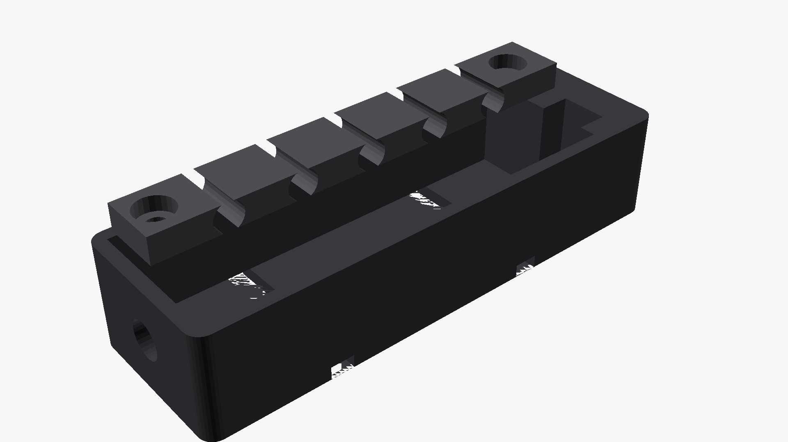

2. **Fahrzeug-Satellit (`vehicle_breakout_block.scad`):**
   - **5 abgedichtete COTS-Ports:** Ausgestattet mit industriellen, codierten COTS-Raststeckern (JST-JWPF IP67 wasserdicht oder JST-SM mit Schutztülle) für:
     - `[ 12V IN ]`: KL15 Zündungsplus & Power-GND (2-Pin)
     - `[ CAN BUS ]`: CAN_H, CAN_L, Masse (3-Pin)
     - `[ MIRROR BSD ]`: Totwinkel-Spiegel-LEDs links & rechts (3-Pin)
     - `[ AUX LIGHT ]`: Geschalteter 12V Zusatzscheinwerfer oder Aktivhalterung (2-Pin)
     - `[ GNSS / CLIMATE PUCK ]`: 4-poliger I2C-Sensorport (+3.3V, GND, SDA, SCL) für den externen u-blox SAM-M10Q / TMP117 / OPT3001 Sensor-Puck im Verkleidungsschnabel
   - **12V-Aktivhalterungen:** Für Motorrad-Navis mit 12V-Aktivhalterung (z. B. Garmin Zūmo XT/XT2 Motorradhalterung oder BMW ConnectedRide Cradle) erfolgt die Stromversorgung direkt über den geschalteten 12V-Ausgang des Fahrzeug-Satelliten.
   - **Wartungsfreundlichkeit:** Bei Beschädigung eines Spiegels mit Radar-LED, eines Zusatzscheinwerfers oder eines Sensors wird die Komponente in 60 Sekunden werkzeuglos abgesteckt und getauscht, ohne das Hauptgehäuse öffnen zu müssen.

   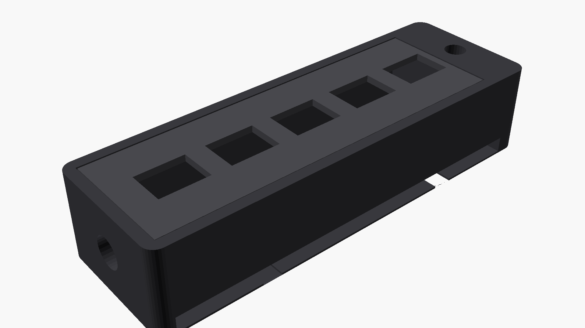

3. **Modulare Kombinierbarkeit ("Lego-Prinzip"):**
   - **Getrennt montiert (BMW GS Adventure & Harley Road King Special):** Der Cockpit-Satellit sitzt direkt am Lenker bzw. Scheibenhalter; der Fahrzeug-Satellit sitzt fest am Rahmen oder Schnabel. Dadurch wird **kein einziges unnötiges Kabel über das bewegliche Lenkkopflager** geführt!
   - **Zusammengeclipst (Harley Road Glide / Sharknose & Batwing Fairing):** Beide Satellitenblöcke besitzen an den Gehäuseflanken formschlüssige Schwalbenschwanz-Führungen (Dovetail). Sie lassen sich mit einem Klick zu einer kompakten, gemeinsamen Verteilereinheit zusammenstecken und im Handschuhfach oder hinter dem Innenverkleidungsträger montieren.

   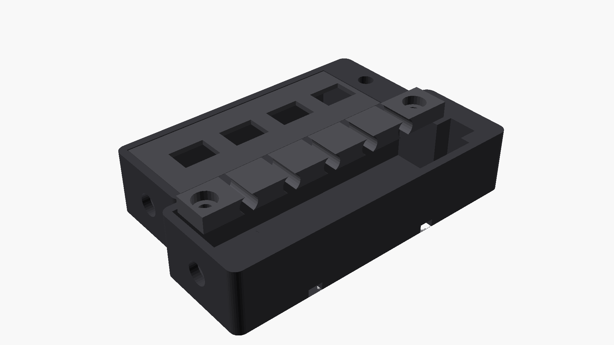

---

### 5.4 Fahrzeugspezifische Montage- & Integrationskonzepte

Die Kombination aus IP68 Monocoque-Front-Knoten und modularen Satelliten löst die spezifischen Herausforderungen der drei maßgeblichen Fahrzeug-Archetypen:

```
+-----------------------------------------------------------------------------------------------------+
|                              MONTAGEKONZEPTE NACH FAHRZEUG-ARCHETYP                                 |
+------------------------------------+--------------------------------+-------------------------------+
| BMW GS / GSA ADVENTURE             | HARLEY ROAD KING SPECIAL (RKS) | HARLEY ROAD GLIDE / TOURING   |
+------------------------------------+--------------------------------+-------------------------------+
| * Montageort: Am Verkleidungsgeweih| * Montageort: Tief an Riser-   | * Montageort: Am inneren      |
|   unter dem Schnabel hinter den    |   Basis / Gabelbrücke unter    |   Verkleidungsgeweih          |
|   Seitenverkleidungen (wie ezCAN)  |   Scheinwerfer & Windschild    |   (Ø 16-19 mm Rohr mit        |
| * Kabelführung: Genau 1 geschirm-  | * "Front-to-Back Flip":        |   front_node_fairing_clamp)   |
|   ter Cockpit-Strang führt entlang |   - Kabel treten NACH VORNE    | * Satelliten: Cockpit- &      |
|   der originalen BMW Bremsleitungs-|     in den Nacelle-Schatten aus|   Fahrzeug-Satellit per       |
|   führung zum Lenkersatelliten     |   - Fahrer blickt auf cleane,  |   Dovetail zu einem Kombi-    |
| * Fahrzeug-Satellit verbleibt      |     geschlossene Gehäusewand   |   Block vereint im            |
|   fest am Rahmen / Geweih          |   - Integrierte Mikro-Halterung|   Verkleidungshohlraum        |
| * Zero Kabelgewirr am Lenkkopf     |     für SAM-M10Q GNSS-Puck     | * Kürzeste Wege zu Display,   |
|                                    | * Kein CAN nach vorne (Zentral-|   Ottocast & Handschuhfach    |
|                                    |   box übernimmt CAN am Diagn.) |                               |
+------------------------------------+--------------------------------+-------------------------------+
```

1. **BMW R 1200 / 1250 / 1300 GS & Adventure (Schnabel- & Geweihmontage):**
   - Das Front-Node-Gehäuse wird mit seiner universellen 4-in-1 Bodenaufnahme oder Silentblöcken geschützt im Hohlraum unter dem Schnabel hinter den Seitenverkleidungen am vorderen Verkleidungsgeweih montiert (in direkter Analogie zu professionellen Steuergeräten wie Hex ezCAN oder Denali CANsmart).
   - Vom Front-Node führt **genau ein** abgedichtetes Cockpit-Mantelkabel ($\varnothing 6{,}0\,\text{mm}$) vibrations- und scheuergeschützt entlang der werkseitigen BMW Bremsleitungs- und Kabelbaumführung am Lenkkopf nach oben zum Lenker.
   - Am Lenker stellt der Cockpit-Satellit die USB-PD 20W Ladebuchse für die Smartphone-Halterung (SP Connect / QuadLock) und den PTT-Taster bereit. Der Fahrzeug-Satellit verbleibt fest am Rahmen/Geweih; Zusatzscheinwerfer und Spiegel-LEDs werden direkt dort eingesteckt.
2. **Harley-Davidson Road King Special (RKS) & Naked Cruiser ("Front-to-Back Flip"):**
   - Bei puristischen Motorrädern ohne Verkleidung sitzt der Front-Knoten tief an der Lenker-Riser-Basis bzw. der oberen Gabelbrücke vor dem Lenker.
   - **Das "Front-to-Back Flip" Montageprinzip:** Das Gehäuse wird um $180^\circ$ gedreht montiert:
     - Die beiden Rundkabel-Auslässe treten **nach vorne** aus und verschwinden unsichtbar im toten optischen Schatten der massiven Scheinwerfer-Nacelle bzw. der Gabelabdeckung.
     - Die dem Fahrer zugewandte Gehäusewand ist eine vollkommen geschlossene, homogene Sichtfläche ohne sichtbare Stecker, Buchsen oder Schraubenköpfe.
     - Auf dieser Fahrerseite ist eine formschlüssige **Mikro-Halterung für den externen u-blox SAM-M10Q GNSS-Puck** integriert, der über ein kurzes, verdecktes Sensorkabel am Port `[ GNSS / CLIMATE PUCK ]` des Fahrzeug-Satelliten angebunden ist. Der Fahrer sieht eine elegante, technisch hochwertige Einheit anstelle von Kabelwirrwarr.
     - Da die Road King Special kein Cockpit-CAN-Display besitzt, wird kein CAN-Bus nach vorne geführt – die Zentralbox unter der Sitzbank übernimmt das CAN-Logging direkt am 6-poligen HD-Diagnosestecker.
   - **Die 3 flexiblen Cockpit-Betriebsmodi (Zero-Hardware-Change):**
     Durch den modularen Cockpit-Satelliten ([`cockpit_breakout_block.scad`](../../hardware/cad/scad/04_front_node/cockpit_breakout_block.scad)) stehen dem Fahrer an einem Naked Bike / RKS drei vollwertige, steckbare Betriebskonzepte zur Verfügung – ohne dass auch nur eine einzige Platine oder Gehäusekomponente getauscht werden muss:
     
     | Modus | Smartphone / `[ PHONE 20W ]` | `[ HOST ]` Port | `[ DONGLE ]` Port | `[ NAVI 5V ]` / `[ CAM 5V ]` |
     | :--- | :--- | :--- | :--- | :--- |
     | **Modus A: Purist / SP Connect** *(Default)* | Smartphone am Lenker (Navigation & Display) | *Frei / Reserve* | *Frei* | Action-Cam (GoPro / Insta360) |
     | **Modus B: Classic Navi** | Smartphone in Tasche (geladen) | *Frei* | *Frei* | Garmin Zūmo XT / TomTom Rider |
     | **Modus C: Smart-Screen Upgrade** *(Optional)* | Smartphone in Tasche (geladen) | **Carpuride / Chigee Screen** | **Ottocast CP2AA Dongle** | Action-Cam (GoPro / Insta360) |

     * **Das clevere Prinzip von Modus C (Standalone Smart-Screen):**
       * Anstelle eines OEM-Radios (wie bei der Road Glide) wird ein handelsüblicher 5"- oder 7"-Motorrad-Touchscreen (Carpuride W502/W702, Chigee AIO-5, Ottocast Screen) an den Port **`[ HOST ]`** angeschlossen. Der Screen fungiert als USB-Host-Anzeigeeinheit.
       * Über den internen Automotive-Hub (`USB2514B`) auf PCBA 05 kommuniziert dieser Screen direkt mit dem Wireless-Dongle am Port **`[ DONGLE ]`**. Selbst extrem günstige Nachrüst-Displays, die ab Werk nur *kabelgebundenes* CarPlay/Android Auto beherrschen, werden dadurch sofort **vollwertig drahtlos (Wireless CarPlay & Wireless Android Auto)**!
       * **Zero-Power-Penalty:** Ein 5"- oder 7"-Screen zieht bei maximaler Sonnenlicht-Helligkeit ca. 5V @ 1,5–2,0A (7,5–10W). Da der Smart-Screen das separate Navigationsgerät ersetzt, entfällt der Strombedarf von `[ NAVI 5V ]` komplett – das Strom-Budget wird 1:1 vom Screen genutzt. Der 5V/3A Buck-Regler (`U3`) bleibt thermisch im grünen Bereich.
       * **Helm-Audio & PTT:** Navigationsansagen und Musik werden weiterhin in voller Klangtreue direkt vom Smartphone via Bluetooth / OMM an das Helm-Headset (Cardo/Sena) gestreamt. Der PTT-Taster an der Cockpit-Leiste triggert wie gewohnt Siri / Google Assistant.
       * **Rüttelfeste Montage:** Das kurze 20 cm USB-C-Kabel zum Screen wird durch die 3D-Klemmspange des Cockpit-Satelliten unlösbar gesichert.
3. **Harley-Davidson Road Glide / Street Glide (Touring Sharknose & Batwing Fairing):**
   - Der Front-Knoten wird mit der 2-teiligen Rohrschelle ([`front_node_fairing_tube_clamp.scad`](../../hardware/cad/scad/04_front_node/front_node_fairing_tube_clamp.scad)) direkt an die runden Stahlrohre (Ø 16–19 mm) des inneren Verkleidungsgeweihs geklemmt.
   - Beide Satellitenblöcke werden über die Schwalbenschwanzführung zu einem gemeinsamen Kombi-Block zusammengesteckt und im Verkleidungshohlraum oder der Media-Bay platziert.
   - Kürzeste Wege zu Harley Skyline OS / Boom! Box GTS, Ottocast CP2AA Wireless Dongle und Kaltluft-Sensorik.
4. **Bagger & Touring Cockpit-Glance-Displays: Symmetrische Dual Speaker Corner-Pods ([`cockpit_speaker_corner_pod.scad`](../../hardware/cad/scad/04_front_node/cockpit_speaker_corner_pod.scad)):**
   - **Fahrpraxis & Ergonomie:** Bei modernen Touring-Baggern lädt das Fahrer-Smartphone wetter- und vibrationsgeschützt im rechten Handschuhfach (Media-Compartment) via USB-PD (schützt optische Bildstabilisatoren vor Vibrationen und Akkus vor Überhitzung in der Sonne). Für sicherheitskritische Blicke (Glanceable Telemetry) benötigt der Fahrer jedoch eine reflexionsarme, permanente Anzeige im primären Sichtfeld.
   - **Ausschluss ungeeigneter Montagepositionen:**
     - *Riser-Abdeckung:* Auf der Lenker-Riser-Platte der CVO ST befindet sich die exklusive, gefräste "CVO ST / Screamin' Eagle 121 High Output" Modellplakette – diese darf aus Werterhaltungs- und Ästhetikgründen keinesfalls überdeckt werden.
     - *Windschild-Unterkante:* Eine Montage über dem Display erfordert sichtbare Kabelquerungen über das riesige 12.3" Skyline OS Display.
     - *Handschuhfach-Deckel:* Liegen viel zu tief außerhalb des primären Sichtfelds (im Knie-/Tankbereich).
   - **Die Sieger-Position: Untere innere Ecken der Rockford Fosgate Stage II Lautsprechergitter:**
     - Zwei formschlüssige Display-Pods ([`cockpit_speaker_corner_pod.scad`](../../hardware/cad/scad/04_front_node/cockpit_speaker_corner_pod.scad)) clipsen direkt an die unteren inneren Kanten der beiden Lautsprechergitter, die das 12.3" Skyline OS Display symmetrisch flankieren.
     - **Vollständiger Markenerhalt:** Die oberen Rockford Fosgate Schriftzüge und das Harley-Davidson Bar & Shield Emblem bleiben zu 100 % sichtbar und unberührt.
     - **Unsichtbare Kabelführung (Zero Fairing Disassembly):** Die Zuleitung taucht an der inneren Unterkante direkt in die natürliche Schattenfuge des Lautsprecher-Gehäuses ein und läuft verdeckt nach unten in den Lenkkopf-/Gabelbrückenbereich zum Front-Node (`PCBA 05`). **0 cm sichtbares Kabel, 0 Schrauben an der Verkleidung lösen!**
     - **Elektronik- & Display-Architektur:** Zwei sonnenlichttaugliche Displays (z. B. 1.28" Round oder 1.69" IPS) werden lokal vom ESP32-S3 des Front-Nodes (`PCBA 05`) per High-Speed SPI/QSPI angesteuert (links: 24/77 GHz Heckradar-Abstandsbalken & Totwinkel; rechts: Turn-by-Turn Pfeile, TPMS-Reifendrücke, Intercom-Sprechstatus und Smartphone-Ladezustand). Telemetriedaten fließen über den 4-Draht Automotive-Bus.

---

## 6. Fahrzeugspezifische Referenz-Montagekits (Zero-Drill / Bolt-On)

Während die 5 Hardware-Gehäuse (Typ A bis E) zu **100 % universell und einheitlich standardisiert** sind, liefert OpenMotorBridge für ausgewählte Motorradplattformen komplett durchentwickelte, schraub- und klebefreie Referenz-Montagekits. Diese nutzen originale Werksbefestigungspunkte oder elastische Spannsysteme, um das Gesamtsystem ohne Lackschäden oder irreversible Karosseriebohrungen perfekt ins Fahrzeug zu integrieren.

---

### 6.1 Referenz-Kit 1: Harley-Davidson CVO Road Glide ST (2024+) & New Touring Platform (v10.0)

Für High-Performance Bagger mit werkseitiger Einzelsitzbank und Forged-Carbon-Hutze (FLTRXSTSE):
Aufgrund der werkseitigen Showa Inverted-Remote-Reservoir-Stoßdämpfer mit dicken Hydraulikleitungen und des 2024er Heckabschlusses integriert das v10.0 Referenzkit alle Knoten zu 100 % zerstörungsfrei und ohne Verkleidungs- oder Tankdemontage:

```
          CVO ROAD GLIDE ST (2024+) GESAMTSYSTEM-INTEGRATION (v10.0)
+-----------------------------------------------------------------------------+
| 1. COCKPIT (Lenker-Riser, Spiegelfuß & Lautsprecher-Ecken):                 |
|    * Front-Node (PCBA 05) am Riser / Gabelbrücke (Zero Fairing Removal)     |
|    * Symmetrische Dual Under-Perch Spiegel-Pods (PTT & BSD-Warn-LEDs)        |
|    * Dual Speaker Corner-Pods: 2x Cockpit-Displays an Rockford-Gittern      |
|      (Radar-Balken, Turn-by-Turn, TPMS, Akku - 0 cm sichtbares Kabel)       |
|    * Handschuhfach-Hub: 2-Port USB-Hub im Fach von UNTEN durch OEM-Tülle    |
|    * SAM-M10Q GNSS + TMP117 + Knowles MEMS im laminaren Fahrtwind           |
+-----------------------------------------------------------------------------+
| 2. VERKABELUNG (Backbone Wire Caddy - Zero Tank Lifting):                   |
|    * 4-Draht Automotive Bus (USB-PD & USB 2.0) verlegt per Nylon-Einzug     |
|      in 5 Minuten durch den offenen Rahmentunnel unter der Tankkonsole      |
|    * Zero Tank-Demontage, Zero Tank-Anheben!                                |
+-----------------------------------------------------------------------------+
| 3. MITTE (Unter Sitzbank):                                                  |
|    * Zentralbox mittig auf Batteriebrücke (ESP32-S31 AI-Host, QCC3084 Audio,|
|      SX1262 LoRa 868 MHz & Multi-Port Automotive USB-PD Engine bis 60 W)   |
|    * USV-Pufferung via 1S LiPo (2.200 mAh) für 24/7 Diebstahl-Sentry        |
+-----------------------------------------------------------------------------+
| 4. HECK (Unter Forged Carbon Hutze & Kennzeichen):                          |
|    * Forged-Carbon-Hutze schließt plan mit OEM-Rändelschraube ab (100% frei |
|      von Elektronik/Kabeln - keine Quetschungen an der Rändelschraube!)     |
|    * Radar mittig unter dem Kennzeichen (radar_license_plate_bracket.scad)  |
|      gespeist über 4-Draht Bus, mit Abtropfschlaufe (Drip-Loop) & Deflector |
+-----------------------------------------------------------------------------+
| 5. KOFFER (100% Zero-Drill OEM Ø 19 mm Egress & Magnet-Abreißkupplung):     |
|    * Pod 1 (Sena) im linken Koffer, Pod 2 (Cardo) im rechten Koffer         |
|    * Vorkonfektionierter Stecker gleitet durch nackte OEM Ø 19 mm Bohrung   |
|    * Geteilte TPU-Dichtung (010_saddlebag_hole_grommet_split.scad)          |
|    * U-geschlitzte C-Tunnel-Distanzscheibe (360° Hebel-Drehung, 0 Quetschung|
|    * 2-Pin/4-Pin IP68 Magnet-Abreißkupplung am Rahmen (werkzeugloses Lösen) |
|    * Integrierte Koffer-USB-Ladedose (5V/12V PD bis 30W) zum Laden im Koffer|
+-----------------------------------------------------------------------------+
```

#### A. Heck-Integration: 100 % OEM-Bündigkeit & Freigängigkeit
* **Original Forged-Carbon-Hutze bleibt unberührt:** In v10.0 entfällt der Heck-Pod 3 und das interne Skeleton Dock ersatzlos. Die originale Forged-Carbon-Hutze der CVO ST schließt mit ihrer umlaufenden Dichtlippe vollkommen plan auf dem Heckkotflügel ab und wird mit der werksseitigen Rändelschraube wackelfrei gehalten. Da kein Kabel darunter gequetscht werden muss, bleibt der Lack zu 100 % geschützt.
* **Außentemperatur- & GNSS-Sensorik:** Liegt thermisch vollkommen entkoppelt von Auspuff- und Motorwärme im laminaren Fahrtwindkanal am Riser-Frontknoten mit dem NIST-Präzisionssensor TI TMP117 ($\pm 0{,}1\,^\circ\text{C}$) und dem u-blox SAM-M10Q Multi-GNSS mit freier Zenit-Sicht.
* **Radar-Montage:** Erfolgt mittig unter dem Kennzeichen über den vibrationsfesten Kennzeichenträger ([`radar_license_plate_bracket.scad`](../../hardware/cad/scad/02_pod_base/radar_license_plate_bracket.scad)), gespeist über Strang 3 mit Abtropfschlaufe. Vollständige Freigängigkeit zu den Showa Inverted-Remote-Reservoirs garantiert.

#### B. Koffer-Integration: 100 % Zero-Drill Durchführung (OEM Ø 19 mm) & Magnet-Abreißkupplung
* **100 % Zero-Drill Durchgang:** Weder Kofferboden noch Kofferwände werden angebohrt. Nach Entnahme der werkseitigen OEM-Vollgummitülle bietet die vordere Kofferbohrung einen freien Durchgang von **$\varnothing 19{,}0\,\text{mm}$**.
* **Werkzeuglose Stecker-Durchführung:** Der fertig vorkonfektionierte Stecker des Kabelbaums (USB-C / JST-GH) gleitet berührungsfrei durch das freie $\varnothing 19\,\text{mm}$ Loch. Kein Auspinnen, kein Drahtabschneiden, kein Löten!
* **Geteilte TPU-Dichtung & U-Tunnel-Distanzscheibe:** Die zweischalige EPDM/TPU-Dichtung ([`010_saddlebag_hole_grommet_split.scad`](../../hardware/cad/scad/02_pod_base/parts/010_saddlebag_hole_grommet_split.scad)) schließt das Loch wasserdicht (IP67) um Kabel und M8-Stahlhülse ab. Unter der OEM-$\varnothing 25\,\text{mm}$-Unterlegscheibe sitzt die seitlich geschlitzte 4 mm PA12-CF/Alu Distanzscheibe (C-Clip): Sie leitet 100 % der Anzugskraft metallisch auf die Hülse, während das Kabel druckfrei durch den Tunnel austritt und der OEM-Spannhebel 360° frei rotieren kann.
* **Werkzeuglose Kofferdemontage (Magnet-Abreißfunktion):** Am Rahmen sitzt die HytePro Magnetkupplung (`cots_pogo_magnetic_2pin`, IP68). Beim Lösen der OEM-Hebel trennt sich die Verbindung bei $10\dots 15\,\text{N}$ selbsttätig. Im Kofferinneren wird kein Stecker angefasst!
* **Slide-in Deckel & FOB-Magnetverriegelung:** Beide Pods sitzen vorzugsweise im Kofferdeckel. Der Deckel schließt formschlüssig und wird bei Annäherung des OMB Smart-Keyfobs magnetisch entriegelt.
* **Zwischendeckel (Dry-Flap):** Eine nach innen federnde Spritzschutzklappe hält Elektronik und Intercoms auch bei geöffnetem Kofferdeckel im Starkregen absolut trocken.
* **Koffer-USB-Ladedose:** Jeder Pod stellt im Kofferinneren eine vollwertige USB-C Buchse (5V/12V PD bis 30W) bereit, um Actioncams, Smartphones oder Helmpolster-Trockner während der Fahrt zu laden.
* **Maximale HF-Isolation ($> 40\,\text{dB}$):** Sena (links) und Cardo (rechts) sind über $60\,\text{cm}$ voneinander getrennt, mit Heckfender und Rahmen als HF-Schild.

---

### 6.2 Referenz-Kit 2: Harley-Davidson Bagger (FL Touring) vs. Cruiser (Softail Plattform)

OpenMotorBridge v10.0 differenziert strikt und präzise zwischen der **FL Touring Plattform (Bagger)** und der **Softail Plattform (Cruiser)**:

```
    HARLEY-DAVIDSON TOURING-BAGGER VS. SOFTAIL-CRUISER ARCHITEKTUR
+-----------------------------------------------------------------------------+
| A. TOURING-BAGGER (Road Glide, Street Glide, CVO, CVO ST, Road King Special):|
|    * KOFFER: 100% IDENTISCHE werksseitige Hartschalenkoffer (Saddlebags).   |
|      Zero-Drill OEM Ø 19 mm Egress (010_saddlebag_hole_grommet_split.scad), |
|      U-Tunnel-Distanzscheibe (360° Hebel-Freilauf) & Magnet-Abreißkupplung. |
|      2x Koffer-Pods (30W PD) mit Universal-Aktorik ("One Size Fits All").   |
|    * MITTE: Zentralbox auf Batteriebrücke, Backbone im Rahmentunnel-Caddy.  |
|    * DIE 2 SYSTEMUNTERSCHIEDE:                                               |
|      1. Faired Bagger (RG/SG/CVO): Front-Node in Verkleidung, Dual Speaker   |
|         Corner Pods (Displays), 5-Port Handschuhfach Hub (30W PD + Dongle). |
|      2. Road King Special (RKS): Unverkleideter Bagger. Smartphone/Garmin   |
|         direkt am Lenker, Front-Node im "Front-to-Back Flip" an Nacelle/Riser|
|         (kein Handschuhfach-Hub erforderlich).                              |
+-----------------------------------------------------------------------------+
| B. SOFTAIL-CRUISER (Low Rider ST, Fat Bob, Breakout, Heritage Classic):     |
|    * RAHMEN-MONTAGE: Modelle ohne Koffer montieren Pod 1 & 2 extern an      |
|      Rahmenrohren / Heckstreben (analog zum BMW GS Rohrkäfig-Dock).         |
|      Wetterfester Outdoor-USB-Port mit IP68 Kappe & Starkregen-Manschette.  |
|    * KOFFER-CRUISER: Heritage Classic / Sport Glide nutzen Koffer-Pods.     |
|    * HECK-RADAR: Optionaler Under-Fender Radar-Mount mit Spritzwasserschirm |
|      (radar_center_underfender_mount.scad) für gecleante Custom/Bobber-Hecks|
+-----------------------------------------------------------------------------+
```

#### 6.2.1 Cockpit-Halterungen: Smartphone, Navi & Action-Cam Stromversorgung (60W Front Engine)

Für alle Harley-Davidson Cockpit-Konzepte stehen robuste, vibrationsentkoppelte Lösungen zur Verfügung:

1. **Smartphone- & Navihalterung (COTS SP Connect / QuadLock & Garmin Zūmo):**
   * **Montage:** Über universelle 1-Zoll / 1,25-Zoll Lenkerklemme oder AMPS-4-Loch-Flansch an den Risern oder der inneren Verkleidungsstrebe.
   * **Speisung:** Direkt angebunden an den 60W USB-PD Zweig des Front-Knotens (`PCBA 05`). Liefert bis zu **27W USB-PD Fast Charging** für das Smartphone am Lenker sowie **15W Dauerleistung (Power-Only)** für dedizierte Motorrad-Navis (Garmin Zūmo XT2 / Tread / Chigee AIO-5 / Carpuride). Da keine USB-Host Datenleitungen anliegen, bootet das Navi sofort in den Routenbetrieb ohne PC-Verbindungsdialog.
   * **Handschuhfach-Laden (Faired Bagger):** Alternativ lädt das Smartphone wetter- und vibrationsgeschützt im rechten Handschuhfach über den **4-Port Handschuhfach Hub** ([`glovebox_power_injection_hub.scad`](../../hardware/cad/scad/04_front_node/glovebox_power_injection_hub.scad)) mit thermisch begrenzten **30W USB-PD**.

2. **Action-Cam Dauerstromversorgung (10W Power-Only via wetterfestem USB-C):**
   * **Reales Bordnetz statt induktiver Verluste:** Auf verkleidungsinterne Qi-Kamera-Docks wird bewusst verzichtet (hohe thermische Verluste durch dicke ABS-Wände, Ineffizienz).
   * **Direkte Front-Node Anbindung:** Eine wetterfeste, formschlüssig dichtende USB-C Zuleitung führt direkt von Port `J8` des Front-Knotens zur Action-Cam (GoPro Hero 12/13, Insta360 X3/X4, DJI Osmo) am Lenker oder Verkleidungsbug. Das Kabel muss nicht umständlich durch das Handschuhfach und dessen Bodentülle geführt werden.
   * **Power-Only / BC 1.2 DCP Beschaltung:** Die Datenleitungen `D+` und `D-` sind im Kamerastecker kurzgeschlossen ($R < 200\,\Omega$) und besitzen null Verbindung zum `USB2514B` Host-Controller. Die Action-Cam erkennt ein Hochstrom-Ladegerät und verharrt niemals im PC-Verbindungs- oder Webcam-Modus.
   * **Automatischer BLE-Shutter:** Startet und stoppt die Kameraaufzeichnung automatisch bei Zündung EIN/AUS und setzt Video-Bookmarks per Doppelklick am rechten Under-Perch Taster.

3. **4-Port Handschuhfach Media & Power-Injection Hub (`glovebox_power_injection_hub.scad`):**
   * Kompaktes Gehäuse ($72 \times 46 \times 22\,\text{mm}$) für das rechte Medienfach von Touring-Baggern.
   * Gespeist vom Front-Node (`PCBA 05`) über ein kombiniertes High-Power & USB 2.0 High-Speed Kabel.
   * Tappt den werksseitigen OEM USB-C Port zur Head Unit (Skyline OS / Boom! Box GTS).
   * Bietet:
     - Port 1: **30W USB-PD Schnellladeport** für Smartphone (thermisch optimiert gegen Akkuhitzestau).
     - Port 2: **10W geschalteter Dongle-Port** für Wireless CarPlay / Android Auto (Ottocast / CarlinKit) mit automatischer Notabschaltung bei Überhitzung.
     - Port 3: **Freier USB 2.0 Media-Port** für USB-Sticks mit FLAC/MP3-Musik oder OEM-Softwareupdates.
     - Port 4: **Harley Headset-Emulation via USB** direkt zur Head Unit für native Apple CarPlay Aktivierung und verlustfreies Helmmikrofon-Streaming.
   * **Ergebnis:** Alle angeschlossenen Geräte verbleiben zu 100 % im Handschuhfach. Null externe Kabeldurchzüge!

4. **Modularer Snap-On Environmental Sensor-Puck ("Körbchen" / `sensor_puck_environmental.scad`):**
   * Kompaktes aerodynamisches Gehäuse ($44 \times 44 \times 15\,\text{mm}$), das u-blox SAM-M10Q Multi-GNSS, TI TMP117 Präzisionsthermometer, OPT3001 Umgebungslichtsensor und Knowles MEMS-Mikrofon beherbergt.
   * **Am Motorrad:** Rastet formschlüssig direkt oben auf den Deckel des Front-Node Monocoques ein.
   * **Im Auto / Support-Van:** Unclip mit einem Handgriff; wird über ein 1,5m Verlängerungskabel an den Dashboard-/Windschutzscheiben-Adapter ([`car_dashboard_wedge_dock.scad`](../../hardware/cad/scad/05_accessories/car_dashboard_wedge_dock.scad)) angedockt.

5. **Universal Doppel-Schiebeschlitten Mechatronik-Aktorik ("One Size Fits All" / `012_universal_actuator_slide_bracket.scad`):**
   * Universeller Montageeinsatz im Boden der Koffer-Pods (Pod 1 & Pod 2).
   * Zwei unabhängige Schiebeschlitten auf Längsnuten erlauben die stufenlose X-Justage von **15 mm bis 85 mm** Tastenabstand.
   * Klemmt zwei 5V Mini-Hubmagnete mit weichen Shore A50 Silikon-Puffern direkt über die OEM-Einschalttasten beliebiger Headsets (z. B. Cardo Packtalk Edge Intercom + Media bei 50 mm Distanz, Sena 50S/Spider, Midland).
   * **Vorteil:** Eliminiert individuelle 3D-Druck-Kassetten für jedes Headsetmodell. Löst den Kaltstart bei Zündung-AN durch 2,0s Simultanimpuls absolut verlässlich – **ohne Standby-Batteriefraß, ohne Platinenlöten und ohne Pod-Ausbau!**

#### 6.2.2 Front-Node Montage an der Road King Special ("Front-to-Back Flip" & GNSS-Puck Dock)

Bei unverkleideten Custom- und Bagger-Bikes wie der **Harley-Davidson Road King Special (FLHRXS)** existiert kein geschützter Verkleidungsraum vor dem Fahrer. Eine intuitive Montage mit Kabelauslässen zum Fahrer hin würde den Cockpitbereich optisch zerstören und Befestigungsbügel ins Sichtfeld rücken. OpenMotorBridge löst dies über das **„Front-to-Back Flip“-Montageprinzip**:

```
            ROAD KING SPECIAL "FRONT-TO-BACK FLIP" MONTAGE
                 (Blick von oben auf die Gabelbrücke)

                 FAHRTRICHTUNG / NACH VORNE
               [ SCHEINWERFER-NACELLE (SCHATTEN) ]
                               ^
                               |
               Kabelauslässe treten NACH VORNE aus:
               * Auslass 1: Cockpit-Strang (16-polig) -> Nacelle
               * Auslass 2: Fahrzeug-Strang (12-polig) -> Nacelle
                 +--------------------------------+
                 |    FRONT-NODE GEHÄUSEWANNE     |
                 |  (180° um die Z-Achse gedreht) |
                 +--------------------------------+
                 | [SAM-M10Q GNSS-PUCK DOCK]      |  <-- Fahrer sieht nur das
                 +--------------------------------+      flache GNSS-Auge!
                               ^
                  VÖLLIG GESCHLOSSENE DESIGNWAND
                    (Keine Stecker, keine Bügel)
                               |
                        FAHRER-BLICKFELD
                    [ LENKER / RISER-BASIS ]
```

1. **Montageort & Orientierung:**
   - Der Front-Node wird tief an der **Lenker-Riser-Basis bzw. der oberen Gabelbrücke** direkt vor dem Lenker montiert.
   - Das Gehäuse wird um **$180^\circ$ gedreht** verbaut: Die beiden abgedichteten Rundkabel-Auslässe ($\varnothing 6{,}0\,\text{mm}$) treten **nach vorne** in den toten optischen Schatten der massiven Scheinwerfer-Nacelle aus.
2. **Die fahrerseitige Sichtblende mit GNSS-Puck-Dock (`sam_m10q_rks_puck_dock.scad`):**
   - Die dem Fahrer zugewandte Gehäusewand ist eine vollkommen geschlossene, plane Designfläche ohne sichtbare Stecker, Buchsen oder Schraubenköpfe.
   - In diese Wand ist eine formschöne **Mikro-Halterung für den externen u-blox SAM-M10Q GNSS-Puck** integriert. Der Puck wird über ein ultrakurzes, verdeckt verlegtes Kabel direkt am 5. Port des Fahrzeug-Satelliten (`[ GNSS / CLIMATE PUCK ]`) angebunden.
   - **Ergebnis:** Anstelle von Haltebügeln oder Kabelsalat blickt der Fahrer auf eine minimalistische, hochwertige Instrumentenfläche mit integriertem GNSS-Auge.
3. **Satelliten & Leitungsverlauf:**
   - **Cockpit-Satellit:** Sitzt dezent unter der linken Schalterarmatur oder seitlich am Riser. Bietet die USB-PD 20W Buchse für die Smartphone-Halterung (SP Connect / QuadLock) und die PTT-Klemme.
   - **Fahrzeug-Satellit:** Sitzt unsichtbar im Hohlraum der Lampen-Nacelle. Greift dort Zündungsplus (KL15 Standlicht) und Masse ab und speist die Totwinkel-Spiegel-LEDs.
   - **Zero CAN über den Tank:** Da die Road King Special kein CAN-Cockpit-Display besitzt, wird **kein CAN-Bus-Kabel nach vorne** verlegt. Die Zentralbox unter der Sitzbank greift den CAN-Bus direkt am 6-poligen Harley-Diagnosestecker ab.

---

### 6.3 Referenz-Kit 3: Adventure & Touring Enduros (BMW GS / GSA, KTM Adventure, Africa Twin) (v10.0)

Für großvolumige Reiseenduros und Offroad-Tourer mit offenem Gitterrohr-Heckrahmen, Rohrgepäckbrücke und optionalem Aluminium-3-Koffersystem (z. B. Touratech Zega Pro/Evo, BMW Adventure oder Wunderlich):

```
            ADVENTURE BIKE (BMW GS / KTM / AFRICA TWIN) INTEGRATION (v10.0)
+-----------------------------------------------------------------------------+
| 1. COCKPIT (Windschild / Navigationsstrebe / Spiegelfuß):                   |
|    * Front-Node (PCBA 05) via 2-teiliger Klemmschelle an Ø 12 mm GPS-Strebe|
|      über TFT-Display oder am Schnabel-Subframe                             |
|    * All-in-One Under-Perch Spiegel-Pod am linken Spiegelfuß: Taktiler      |
|      PTT-Taster & gerichtete bernsteinfarbene BSD-Radar-Warn-LED            |
|    * SAM-M10Q GNSS + TMP117 Glatteis-Wächter im laminaren Fahrtwind        |
+-----------------------------------------------------------------------------+
| 2. VERKABELUNG (Das GS-Telelever-Dilemma vs. Harley-Kanal):                 |
|    * 4-Draht Automotive Bus (USB-PD & USB 2.0) von Zentralbox zum Cockpit   |
|    * Erfordert 20 min sorgfältige Verlegung: Tankseitenblende anheben,      |
|      Parallellauf zum BMW-Hauptkabelbaum, Telelever-Bogen am Steuerkopf     |
|      mit 50 mm Bewegungsschlaufe (verhindert Abscheren beim Einfedern!)     |
+-----------------------------------------------------------------------------+
| 3. MITTE (Unter Fahrersitz / Werkzeugfach):                                 |
|    * Zentralbox spritzwassergeschützt auf 4x M4 Silentblöcken               |
|    * ESP32-S31 AI-Host, QCC3084 Audio, SX1262 LoRa 868 MHz & USB-PD Engine  |
|    * 12V Speisung direkt von Batterie & OBD-2 Diagnosestecker unter Sitzbank|
+-----------------------------------------------------------------------------+
| 4. VORDERER HECKRAHMEN / SEITENBEREICH (Koffer-Pods 1 & 2):                 |
|    * Variante A (GSA & Heavy Duty): An der Innenseite der Rundrohr-         |
|      Kofferträger (Ø 18 mm) im geschützten GSA Cage Dock (45 mm Totraum)    |
|    * Variante B (Standard-GS ohne Koffer): Im Transition Dock unter der     |
|      Sitzbank in der optischen "Bügelfalte" am Fahrer-/Sozius-Übergang       |
|    * Slide-in Deckel mit FOB-Magnetriegel, Dry-Flap & interner USB-Ladedose |
|    * Strikt fahrzeugfest montiert (niemals im Inneren von Alukoffern!)      |
+-----------------------------------------------------------------------------+
| 5. HECK (Minimaler Radarträger unter Gepäckbrücke):                         |
|    * Minimaler "Adventure Rack Radar Mount" unter der Gepäckbrücke          |
|    * Schwenkbare Hirth-Aufnahme für Wheeltec MR20 77 GHz mit 45°-Spoiler    |
|    * Gespeist über 4-Draht Bus; Topcases bleiben uneingeschränkt abnehmbar  |
+-----------------------------------------------------------------------------+
```

#### 6.3.1 Front-Node Montage am BMW GS Verkleidungsgeweih & Telelever-Kabelführung

Auf der BMW R 1200 / 1250 / 1300 GS und GS Adventure wird der Front-Node nach dem Vorbild professioneller Zusatzsteuergeräte (Hex ezCAN, Denali CANsmart) vibrations- und witterungsgeschützt montiert:

1. **Montageort an der Navigationsstrebe:**
   - Der Front-Node wird über die 2-teilige Rohrschelle direkt an der serienmäßigen $\varnothing 12\,\text{mm}$ Navigationsstrebe über dem 6.5" TFT-Display befestigt.
   - Liefert ungestörte Zenitsicht für das u-blox SAM-M10Q GNSS, Kaltluft-Sensorik (TMP117) und versorgt Smartphone-Halterungen (QuadLock Wireless Head) oder Garmin Zūmo Cradles.
2. **Die GS/GSA-Kabelführung im Praxis-Vergleich zur Harley:**
   - Während das 4-Draht-Kabel bei der Harley Touring in 5 Minuten per Einzugsfeder durch den offenen Rahmentunnel geschoben werden kann, erfordert die BMW GS/GSA durch ihren 20L/30L-Tank und die **Telelever-Vorderradführung** eine sorgfältigere Verlegung:
   - Die obere Tankseitenblende (Torx T25) wird gelöst und leicht angehoben. Das geschirmte 4-adrige Kabel wird parallel zum originalen BMW-Kabelbaum an den Rahmenrohren nach vorne geführt.
   - **Crucial Telelever Loop:** Am Lenkkopf muss das Kabel **exakt dem Radius der werksseitigen Bremsleitungen** folgen. Vor dem Festziehen der Kabelbinder wird die Lenkung von Anschlag zu Anschlag gedreht und die Federung komprimiert: Das Kabel darf weder auf Zug geraten noch zwischen Gabelbrücke und Telelever-Längslenker eingeklemmt werden!
3. **Symmetrische Dual Under-Perch Spiegel-Pods (Links & Rechts):**
   - Jeweils formschlüssig unter die linke und rechte Spiegelschraube der BMW-Armatur geklemmt.
   - **Links:** Der linke Daumen bedient den PTT-Taster blind; die bernsteinfarbene Warn-LED strahlt direkt in den linken Rückspiegel (Überholverkehr links).
   - **Rechts:** Der rechte Daumen markiert Action-Cam Highlights / Bookmarks; die bernsteinfarbene Warn-LED strahlt in den rechten Rückspiegel (Verkehr rechts beim Wiedereinscheren).
   - Echte 360° bilaterale Totwinkel-Überwachung ohne Blickabwendung.

#### 6.3.2 Kassetten-Pods 1 & 2 (Seitenmodule) - Die zwei Montage-Varianten

Auf Reiseenduros existieren je nach Einsatzzweck und Koffersystem zwei grundverschiedene Montagepositionen:

* **Variante A: BMW F850 GSA / R 1200 / R 1250 / R 1300 GS Adventure & Heavy-Duty Rohrträger (Touratech, Givi Outback, Hepco&Becker): Das "GSA Cage Dock"**
  * **Montage:** An den Innenseiten der massiven $\varnothing 18\,\text{mm}$ Edelstahl-Kofferträger im geschützten Rahmendreieck über das hochbelastbare **GSA Cage Dock** ([`adventure_gsa_cage_dock.scad`](../../hardware/cad/scad/02_pod_base/adventure_gsa_cage_dock.scad)).
  * **Design-Philosophie (Expedition Armor + Stealth Niche):**
    Kombiniert die unzerstörbare Optik professioneller Rallye- & Expeditions-Ausrüstung mit einer vollständigen Nischen-Integration: Der Pod wandert tief in den ca. $45\,\text{mm}$ breiten, sonst ungenutzten Totraum zwischen Alukoffer-Wand und Heckrahmen/Radkasten.
  * **4x Spanngurt-Freisparungen für Pod-Außenlaschen:**
    Das Pod-Grundgehäuse (`pod_base_housing.scad`) besitzt 4x außenliegende Spanngurt-Ösen ($X = 25{,}0\,\text{mm}$ und $X = 125{,}0\,\text{mm}$, Kragweite $3{,}0\,\text{mm}$). Im $176{,}0\,\text{mm}$ langen GSA Cage Dock (`CADDY_TOTAL_L`) sind 4x korrespondierende Freisparungstaschen ($14{,}0 \times 4{,}0 \times 8{,}5\,\text{mm}$) bei $X = 37{,}0\,\text{mm}$ und $X = 137{,}0\,\text{mm}$ in die Seitenwangen eingeformt. Das Gehäuse gleitet saugend und ohne Klemmen formschlüssig bis auf den Dockboden.
  * **Erweiterter Querkabelkanal & 2-Draht DC-Zugentlastung:**
    Der rückseitige Kabelkanal überspannt mit $52{,}0\,\text{mm}$ Querspannweite sowohl Port A ($Y = 34{,}5\,\text{mm}$) als auch Port B ($Y = 50{,}5\,\text{mm}$). Eine integrierte Mini-Kabelbinderbrücke ($2{,}5 \times 1{,}2\,\text{mm}$) im geschützten Rohrsattelschatten fängt das 2-adrige Automotive-Versorgungskabel ($2 \times 0{,}5\,\text{mm}^2$, $\varnothing 3{,}6\,\text{mm}$ PUR/FLRY) vibrationsfest ab. Das Kabel wird scheuerfrei im Rohrschatten zur Zentralbox geführt.

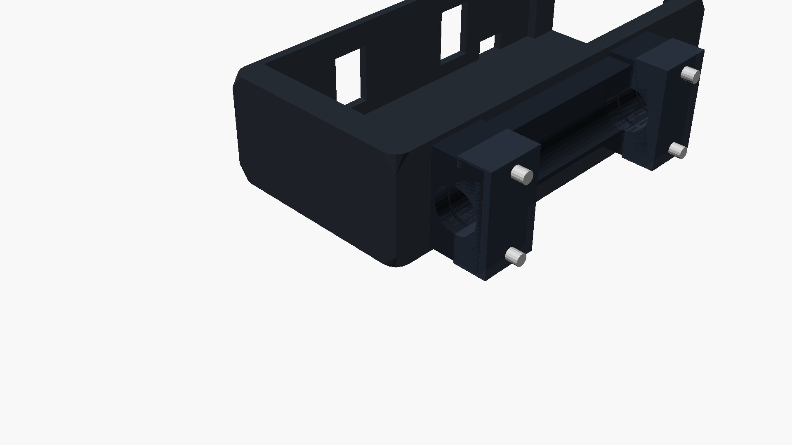

*Abbildung 8.29-A: CAD-Detailansicht des Heavy-Duty GSA Cage Docks (`adventure_gsa_cage_dock.scad`). Zu sehen sind der tief eingelassene Sena SPIDER X Slim Pod 1 im schützenden PA12-CF-Panzerkäfig, die 4x Spanngurt-Freisparungstaschen in den Seitenwangen, die breite 95 mm Doppel-Rohrsattelbasis für Ø 18 mm Edelstahlrohre mit 4x M5 V4A-Verschraubung und DIN 985 Stoppmuttertaschen, die 45°-Schotter-Abweiserkeile gegen Steinschlag vom Hinterrad sowie die verdeckte 2-Draht DC-Kabelrinne mit Kabelbinderbrücke im Rohrschatten.*

* **Variante B: Standard-BMW GS und nackte Reiseenduros (ohne Rohr-Kofferträger)**
  * **Montage:** Über ein zweiteiliges, aerodynamisch skulpturiertes **Transition Dock** ([`adventure_transition_dock.scad`](../../hardware/cad/scad/02_pod_base/adventure_transition_dock.scad)) in Kombination mit einer verdeckten **Unter-Sitzbank-Sattelbrücke** ([`adventure_underseat_cross_rail.scad`](../../hardware/cad/scad/02_pod_base/adventure_underseat_cross_rail.scad)).
  * **Positionierung:** Exakt in der optischen "Bügelfalte" am Übergang von der Fahrer- zur Soziussitzbank entlang des $\varnothing 28\,\text{mm}$ Heckrahmenrohrs.
  * **Zweiteilige Shell-Architektur (Basis-Wanne & Bügelfalten-Deckel):**
    - **Untere Trägerbasis (`adventure_transition_dock_base.stl`):** Nimmt das Standard-Pod-Gehäuse (`pod_base_housing.stl`) formschlüssig auf. 4x laterale Taschen ($X = 25{,}0\,\text{mm}$ und $X = 125{,}0\,\text{mm}$) betten die Spanngurt-Ösen des $150\,\text{mm}$ Pods in der $151\,\text{mm}$ Trägerbasis bündig ein (Gesamtlänge $207{,}0\,\text{mm}$). Die monolithische Inboard-Zunge greift mit 2x M4-Verschraubungen direkt in die Unter-Sitzbank-Sattelbrücke (`adventure_underseat_cross_rail.scad`), wodurch jegliches Verdrehmoment neutralisiert wird (Zero-Torque / Zero-Drill).
    - **Aerodynamischer Bügelfalten-Deckel (`adventure_transition_dock_lid.stl`):** Schließt die Kontur der GS-Karosserie nahtlos ab. Die Trennfuge zwischen Basis und Deckel liegt unsichtbar exakt auf dem scharfen Scheitel der seitlichen Bügelfalten-Charakterlinie ($Z_{\text{crease}} = 22{,}0\,\text{mm}$). Ein $22^\circ$-Keil an der Stirnseite geht bündig in das Sitzbankpolster über – kein Verhaken mit Motorradhose, Knieschleifern oder Stiefeln beim Aufsteigen.
    - **Zwei parametrische Deckel-Varianten (`lid_mode`):**
      1. `"open_intercom"`: Präzise ausgeformte Sicht- und Bedienblende, die die Tasten von Sena SPIDER X Slim oder Cardo Packtalk Edge bündig auf OEM-Niveau einrahmt.
      2. `"closed_smooth"`: Vollständig geschlossener, fugenloser Aerodynamik-Cowl für den Einsatz mit IP67-Blindkassetten oder autarken OMM-Funkkassetten.
    - **Verschraubung:** 4x M3 Torx-Zylinderschrauben (DIN 7985 / ISO 7380) sichern den Deckel schwingungsfest von oben in Messing-Gewindeeinsätze der Basiswanne.
  * **Integrierte 2-Draht DC-Führung zur Sattelbrücke:**
    Die vordere Schnauzenkammer nimmt das 2-adrige DC-Kabel formschlüssig auf und leitet es über die rahmenseitige Brückenzunge nahtlos in die Kabelrinne der Unter-Sitzbank-Sattelbrücke (`adventure_underseat_cross_rail.stl`) – unsichtbar unter dem Sitzbankschaum direkt zur Zentralbox verlegt.

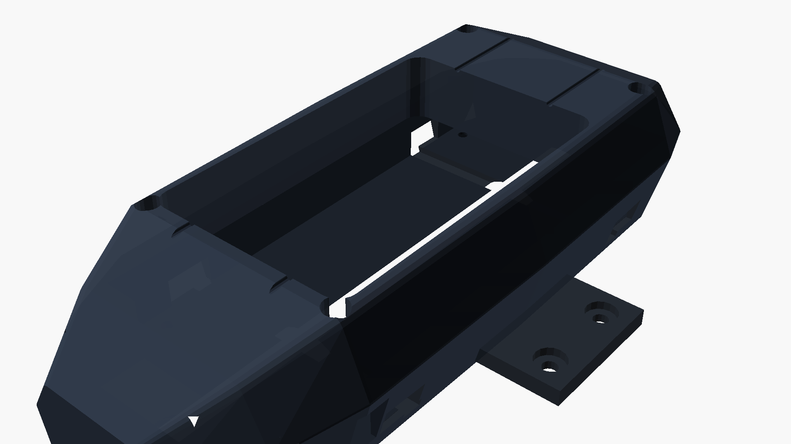

*Abbildung 8.29-B: CAD-Detailansicht des GS Transition Docks mit Unter-Sitzbank-Sattelbrücke. Erkennbar sind die aerodynamische Bügelfalten-Halbschale (`adventure_transition_dock_base.stl`), der aufgesetzte Styling-Deckel (`adventure_transition_dock_lid.stl`), die Freisparungen für die Pod-Spanngurtlaschen, die M4-Sattelbrückenanbindung und die geschützte 2-Draht DC-Kabelüberleitung zur Unter-Sitzbank-Sattelbrücke.*

---

#### 6.4.2 Standalone Heck-Radar - Der minimale "Adventure Rack Radar Mount" (`adventure_rack_radar_mount.scad`)

Da der Heck-Pod 3 und dessen große Balkonwanne vollständig entfallen sind, benötigt die Reiseenduro am Heck lediglich einen **minimalen, hochfesten und schottergeschützten Radarträger**:

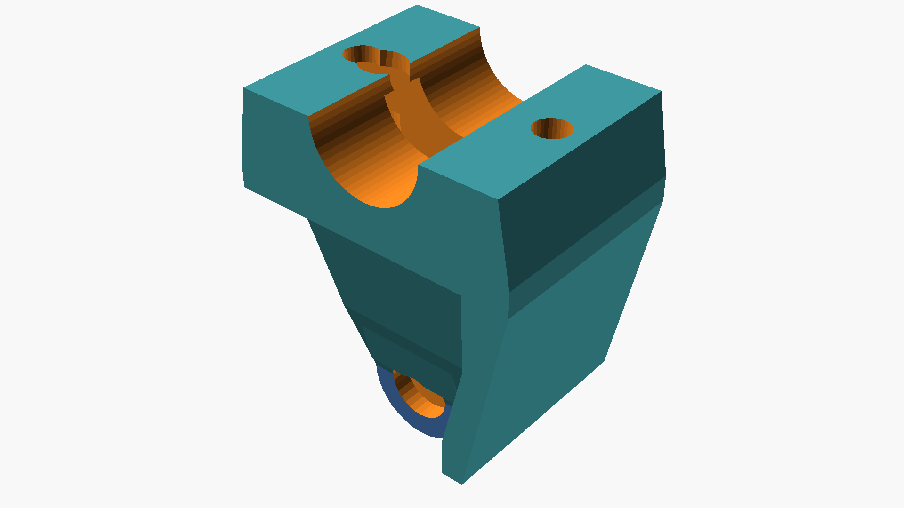

*Abbildung 8.29-B: 3D-CAD-Modell des Adventure Rack Radar Mounts (`adventure_rack_radar_mount.scad`). Sichtbar sind der $\varnothing 18{,}2\,\text{mm}$ Rohrsattel für Standard-Gepäckbrückenrohre, die von unten zugänglichen M5-Verschraubungen, der integrierte $45^\circ$-Offroad-Steinschlag- und Schmutzfänger-Spoiler, die $7{,}0\,\text{mm}$ Clevis-Gabel mit radialer 36-Zahn Hirth-Formschlussverzahnung ($10^\circ$-Rastung) sowie die DIN 934 M5 Sechskantmutter-Tasche.*

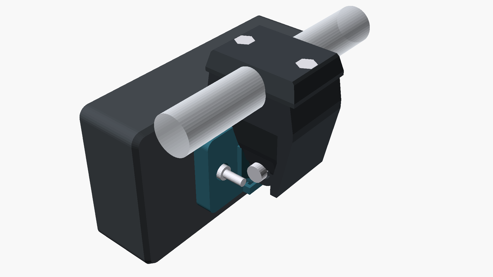

*Abbildung 8.29-C: Vollständige 3D-Baugruppe der Adventure-Gepäckbrücken-Radarmontage. Zu sehen sind das $\varnothing 18\,\text{mm}$ Edelstahlrohr der Gepäckbrücke, die obere Klemmschellen-Kappe (`adventure_rack_radar_clamp_cap.stl`), der Unterzugsträger mit Schotterschutz-Keil, die 2x M4 verschraubte Schwerlast-Neigungswiege (`radar_swivel_tilt_cradle.scad`) sowie das hermetisch abgedichtete Radar 2.0 Gehäuse (`radar_mr20_housing.scad`).*

1. **Direkte Gepäckbrücken-Unterzugsmontage ($\varnothing 18{,}0\,\text{mm}$ Rohre):**
   * Der schlanke Halter ([`adventure_rack_radar_mount.scad`](../../hardware/cad/scad/02_pod_base/adventure_rack_radar_mount.scad)) klemmt direkt an die hinteren Querrohre ($\varnothing 18\,\text{mm}$) der originalen BMW GS/GSA-Gepäckbrücke sowie Zubehörträgern von Touratech, Wunderlich, Hepco&Becker oder Givi.
   * Zweiteilige Klemmschellen-Architektur: Untere Trägerbasis + obere Klemmschellen-Kappe ([`adventure_rack_radar_clamp_cap.stl`](../../hardware/cad/stl/02_pod_base/adventure_rack_radar_clamp_cap.stl)).
2. **100 % Lötkolbenfrei & Wartung von unten (Topcase-Baseplate-Kompatibilität):**
   * Die Verschraubung erfolgt über 2x M5 Zylinderschrauben (DIN 912), die in **versenkte DIN 934 M5 Sechskant-Muttertaschen** in der oberen Kappe greifen (keine anfälligen Messing-Schmelzgewinde).
   * **Montagefreundlicher Schraubenzugang von unten:** Die Schraubenköpfe sitzen versenkt auf der Unterseite der Trägerbasis. Dadurch kann der Halter gelöst, ausgerichtet oder demontiert werden, **ohne** eine darüber montierte Aluminium-Topcase-Trägerplatte abnehmen zu müssen.
3. **Optimierte Schwerpunkt-Gelenkhöhe ($Z_{\text{drop}} = 46{,}0\,\text{mm}$):**
   * Das ca. $180\,\text{g}$ schwere Radar 2.0 Gehäuse ($71\,\text{mm}$ Bauhöhe) benötigt ausreichend Schwenkraum unterhalb der Gepäckbrückenrohre.
   * Der definierte Tiefgang von $46\,\text{mm}$ stellt einen Schwenkbereich von $\pm 18^\circ$ Neigungswinkel sicher (Nivellierung bei wechselnder Sozius- und Kofferbeladung), ohne dass das Gehäuse an Gepäckbrücke oder Topcase-Boden anstößt.
4. **Schlagfester $45^\circ$-Offroad-Schotterschutz (Roost & Mud Deflector):**
   * Bei grobstolligen Enduroreifen (z. B. Continental TKC 80, Michelin Anakee Wild) wird Schotter und Schlamm mit hoher Geschwindigkeit vom Hinterrad nach oben gegen das Heck geschleudert.
   * Ein massiver, nach vorne gerichteter $45^\circ$-Abweiserkeil (Breite $34\,\text{mm}$) schirmt das Hirth-Gelenk, die Neigungswiege und die unterseitige M8-Kabelverschraubung wirksam gegen Steinschlag und Schlammbeschuss ab.
5. **Formschlüssiges Hirth-Zahnscheiben-Gelenk & Universelle M4-Schwerlastwiege:**
   * Die $7{,}0\,\text{mm}$ Clevis-Gabel nimmt die zentrale Actioncam-Zunge der universellen Neigungswiege ([`radar_swivel_tilt_cradle.scad`](../../hardware/cad/scad/02_pod_base/radar_swivel_tilt_cradle.scad)) spielfrei auf.
   * Zwei beidseitige 36-Zahn Hirth-Rosetten ($10^\circ$-Raster) garantieren absoluten Formschluss – ein vibrationsbedingtes Absacken oder Nachgeben über Wellblechpisten und Schlaglöcher ist physikalisch ausgeschlossen.
   * Das Radar 2.0 Gehäuse wird über 2x M4 V4A-Schrauben direkt von vorne in die internen DIN 934 M4 Muttern des Gehäuses geklemmt.
6. **Geschützte Kabelverbindung im Rohrschatten:**
   * Das M8-Sensorkabel tritt durch einen verdeckten $\varnothing 6{,}0\,\text{mm}$ Führungskanal unmittelbar hinter dem Trägerrohr aus und wird im Rohrschatten entlang des Heckrahmens zur Zentralbox geführt. Direkt gespeist über Strang 4 des 16-Pin Automotive Kabelbaums (Radar-Telemetrie über isolierten High-Speed Bus/UART).

---

#### 6.4.3 Unsichtbarer Magnet-Diebstahlschutz im Fernreise-Einsatz

Auf frei zugänglichen Reiseenduros und bei Zwischenstopps auf Fernreisen schützt der hermetisch gekapselte Magnetverschluss die modularen Einschubkassetten (Sena, Cardo, OMM) zuverlässig gegen Gelegenheitsdiebstahl:
* **100 % Schlamm-, Staub- & Eissicherheit:** Hermetisch ohne Schlüsselloch im Inneren des Pods gekapselt.
* **Verdeckte Entriegelung:** Kontaktlos in Sekundenbruchteilen über den N52-Magnetschlüssel des Smart-Keyfobs.

---

### 6.5 Universal Kofferdeckel-Dock (`saddlebag_lid_dock.scad`)

Das universelle Kofferdeckel-Dock ([`saddlebag_lid_dock.scad`](../../hardware/cad/scad/02_pod_base/saddlebag_lid_dock.scad)) wurde speziell für die geschützte, vibrationsfeste und 100 % zerstörungsfreie Innenmontage der Satelliten-Pods 1 (Sena Mesh) und 2 (Cardo DMC) in Motorrad-Seitenkoffern entwickelt (Referenz: Harley-Davidson One-Touch Hartschalenkoffer 2014-2024+):

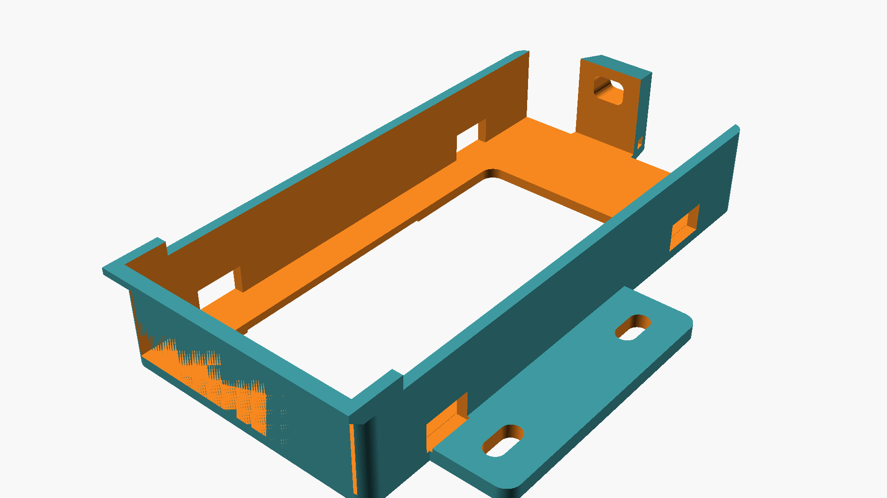

*Abbildung 8.30: 3D-CAD-Visualisierung des Kofferdeckel-Docks (`saddlebag_lid_dock.scad`) mit eingesetztem transluzentem Satelliten-Pod (1:1 Passung im $151 \times 71\,\text{mm}$ Innenbett). Sichtbar sind der inboard gerichtete $22\,\text{mm}$ breite Torx-Montageflansch für die originalen Harley-Scharnierschrauben (Lochabstand $52\,\text{mm}$), die frontale Kabelschnauze mit integrierter Zugentlastung für die 2-Draht DC-Spannungsversorgung (M8 / FLRY-B Leitung parallel zum Deckel-Fangband zur MagSafe-Abreißkupplung), die umlaufende Halbschale mit EPDM-Spannbandschlitzen und die obere Tropfkante über dem Kassetteneinschub.*

#### 6.5.1 Zero-Drill-Befestigung & Mechanisches Konzept
1. **Nutzung originaler Befestigungspunkte (Zero-Drill):**
   * Der $4\,\text{mm}$ dicke Montageflansch greift die beiden werksseitigen M5 / Torx T20-Schrauben des Scharnier- bzw. Fangbandbeschlags ab (Lochabstand $52\,\text{mm}$).
   * Großzügige Langlöcher ($\varnothing 5{,}6 \times 9{,}0\,\text{mm}$) ermöglichen den Ausgleich von Fertigungstoleranzen der ABS-Koffer.
   * **Keine Bohrungen im Koffer:** Das Motorrad und die Koffer bleiben zu 100 % im unversehrten Originalzustand (Werterhalt & Dichtigkeit garantiert).
2. **Alternative / Zusätzliche Klebemontage (3M VHB):**
   * Auf der Unterseite sind vier definierte Taschen ($18 \times 12 \times 0{,}8\,\text{mm}$) für 3M VHB Hochleistungs-Acrylatschaum-Klebebänder eingelassen, um eine optionale Montage an glatten Kofferinnenwänden von Kunststoff-Koffersystemen (z. B. BMW Vario-Kunststoffkoffer) zu ermöglichen.

> [!CAUTION]
> **Striktes Montageverbot im Inneren von Aluminium-Koffern (Faradayscher Käfig!):**  
> * **HF-Physik:** Aluminiumbleche schirmen 2,4-GHz-Funkwellen (Sena Mesh, Cardo DMC, OMM 2.4 GHz, Bluetooth) und 6,5-GHz-UWB mit $> 60\dots 80\,\text{dB}$ Dämpfung fast vollständig ab. Ein Pod im geschlossenen Alukoffer leidet unter einem **vollständigen Funk-Blackout**!
> * **Gepäck-Abtrennung bei Reiseenduros:** Alukoffer (BMW GS Adventure, Touratech Zega, Givi Trekker Outback) werden im Camp, Hotel oder vor anspruchsvollen Offroad-Etappen regelmäßig komplett vom Fahrzeug abgenommen. Wären Pod 1 und 2 am oder im Koffer montiert, verliert das Motorrad beim Abstellen des Gepäcks seine gesamte Kommunikations- und Intercom-Infrastruktur!
> * **Die verbindliche Lösung für Reiseenduros:** Bei Aluminium-Koffersystemen werden Pod 1 und 2 **stets fahrzeugfest am Motorrad montiert**:
>   1. **Variante A (Edelstahl-Rohrkofferträger):** Heavy-Duty GSA Cage Dock ([`adventure_gsa_cage_dock.scad`](../../hardware/cad/scad/02_pod_base/adventure_gsa_cage_dock.scad)) im geschützten $45\,\text{mm}$ Totraum zwischen Kofferinnenwand und Heckrahmen. Der Pod strahlt ungehindert nach oben und vorn ab und verbleibt bei Kofferabnahme sicher am Bike!
>   2. **Variante B (Nackte Heckrahmen):** Aerodynamisches Transition Dock ([`adventure_transition_dock.scad`](../../hardware/cad/scad/02_pod_base/adventure_transition_dock.scad)) in der Sitzbank-Bügelfalte entlang des Heckrahmenrohrs.
> * *Kofferdeckel-Docks (`saddlebag_lid_dock.scad`) sind ausschließlich für funkdurchlässige ABS-/Kunststoffkoffer (z. B. Harley-Davidson Touring, BMW Vario-Kunststoffschalen) vorgesehen.*
3. **Halbschalen-Architektur ($H = 26\,\text{mm}$):**
   * Die $3\,\text{mm}$ dicke PA12-Wanne ($151{,}0 \times 71{,}0\,\text{mm}$ Innenmaß, $154{,}0\,\text{mm}$ Wannen-Außenlänge, Gesamtlänge inkl. Flansch und Snout $174\,\text{mm}$) umschließt das Pod-Gehäuse ($150 \times 70 \times 38\,\text{mm}$) formschlüssig bis auf halbe Höhe. Sie nutzt die großzügigen Platzverhältnisse in Harley-Davidson Touring Kofferdeckeln ($> 450\,\text{mm}$ lichte Länge) optimal aus.
   * Der Slide-in Deckel bleibt von hinten voll zugänglich und kann mit dem Smart-Keyfob in Sekunden entriegelt und geöffnet werden, ohne das Dock zu demontieren.
4. **Schutz vor Tropfwasser (Overhead Drip Lip):**
   * Über dem Gehäuseeingang kragt eine integrierte **Tropfkante ($16 \times 2\,\text{mm}$ mit $30^\circ$-Dachschräge)** aus. Sie leitet Kondenswasser oder herablaufende Regentropfen beim Öffnen des Kofferdeckels zuverlässig seitlich an der Gehäuse-Dichtfuge vorbei.
5. **Vibrationsfeste EPDM-Sicherung:**
   * Zwei seitliche Durchbrüche ($25 \times 3\,\text{mm}$) nehmen ein elastisches Spannband auf, das den Pod bei harten Fahrbahnschlägen spielfrei in der Wanne arretiert.
6. **4x Spanngurt-Freisparungstaschen ($X = 26{,}0\,\text{mm}$ und $X = 126{,}0\,\text{mm}$):**
   * Das Pod-Grundgehäuse (`pod_base_housing.scad`) besitzt 4x seitlich um $3{,}0\,\text{mm}$ auskragende Spanngurt-Ösen (Gesamtbreite $76\,\text{mm}$ gegenüber nominal $70\,\text{mm}$).
   * In die Seitenwände des Kofferdeckel-Docks sind 4x korrespondierende Freisparungstaschen ($14{,}0 \times 4{,}0 \times 8{,}5\,\text{mm}$) eingeformt.
   * Der Pod lässt sich vollkommen plan und ohne Zwangskräfte bis auf den Dockboden einsetzen; die Wannenstruktur bleibt maximal formstabil.

#### 6.5.2 Kabelführung, Zündungsplus & Werkstattsichere MagSafe-Abreißkupplung

Die Verkabelung der Kofferdeckel-Pods löst das fundamentale Praxiskriterium des Alltags- und Werkstattbetriebs: **Zündungsgesteuerter Dauerstrom ohne Akku-Sorgen bei gleichzeitiger 100 % zerstörungsfreier Kofferdemontage ("Mechaniker-Sicherheit")**.

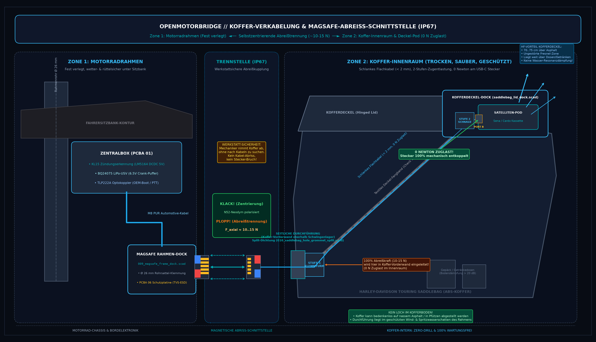

*Abbildung 8.30b: CAD-Systemarchitektur der Koffer-Verkabelung mit selbstzentrierender MagSafe-Abreißkupplung (IP67). Dargestellt sind die zündungsgesteuerte 5V-Versorgung über die Zentralbox (KL15/BQ24075-USV), das rahmenfeste MagSafe-Dock (`009_magsafe_frame_dock.scad`) mit PCBA 06 TVS-Schutz, die zerstörungsfreie magnetische Abreißtrennung (~10-15 N) bei Kofferabnahme durch Werkstattmechaniker, die 100 % bohrfreie Durchführung an der Koffer-Vorderwand (oberhalb des Schwingenlagers) über die OEM Ø 19,0 mm Bohrung mit geteilter TPU-Dichtung (`010_saddlebag_hole_grommet_split.scad`) und U-geschlitzter Tunnel-Distanzscheibe (Kofferboden und Kofferwände bleiben 100 % intakt und ungebohrt), die lastfreie Flachkabelführung parallel zum Deckel-Fangband sowie die Stufe-2-Zugentlastung am Kofferdeckel-Dock mit 0 Newton Zugkraft am USB-C Port B.*

1. **Intelligente Stromversorgung & USV-Pufferung über die Zentralbox (Klemme 15 / BQ24075):**
   * Die Koffer-Pods werden **nicht direkt unreguliert** aus dem Bordnetz gespeist, sondern zentral und konditioniert von der **Zentralbox** unter der Sitzbank versorgt.
   * **Zündungsgesteuerter Wake-Up & USV-Pufferung:** Die Zentralbox erfasst das Zündungsplus (Klemme 15, z. B. am Harley P&A-Zubehörstecker). Bei Zündung EIN regelt der LM5164-Q1 Step-Down auf saubere $5{,}0\,\text{V}$ herunter und der integrierte **LiPo-USV-Pufferakku (BQ24075)** fängt selbst härteste Startspannungseinbrüche (Cold Crank bis $6{,}5\,\text{V}$) unterbrechungsfrei in $8{,}5\,\mu\text{s}$ ab - die Koffer-Pods und Funkmodule rebooten niemals beim Anlassen des Motors.
   * **Automatisierter OEM-Boot per Optokoppler:** Sobald die Versorgungsspannung steht, triggert die Zentralbox über galvanisch getrennte **Toshiba TLP222A Optokoppler** die Tasten-/Power-Einschaltsequenz der OEM-Headset-Adapter (Sena Mesh / Cardo DMC) in den Kassetten.
   * **Null Akku-Wartung & automatischer Shutdown:** Die Intercom-Module schalten vollautomatisch mit der Fahrzeugzündung ein und aus. Das Risiko, vor der Fahrt das Laden zu vergessen oder mit leerem Headset-Akku dazustehen, ist zu 100 % eliminiert.
2. **Werkstattsichere 2-Pin Magnet-Pogo Abreißkupplung (IP68 COTS):**
   * In Vertragswerkstätten lösen Mechaniker bei Inspektionen, Reifen- oder Bremsenwechseln die Kofferbefestigungen und heben den Koffer in Sekunden ab, ohne nach nachgerüsteten Kabeln zu suchen. Eine feste Schraub- oder Klickverbindung würde hier unweigerlich abreißen.
   * Die **2-polige IP68-Magnet-Pogo-Abreißkupplung mit N52-Neodym-Magneten und vergoldeten Federkontakten** (z. B. HytePro M411) trennt sich bei ca. $10\dots 15\,\text{N}$ axialer Zugkraft **völlig verschleiß- und zerstörungsfrei**.
   * Beim Wiedereinsetzen des Koffers zieht sich die Kupplung durch die magnetische Polung vollautomatisch zentrierend zusammen (*Klack*) – die 5V-Versorgung steht sofort wieder unterbrechungsfrei zur Verfügung.
3. **Zwei-Zonen-Kabelarchitektur (Reine DC-Speisung):**
   * **Zone 1 (Außen am Bike):** Robustes 4-Draht Automotive-Kabel (AWG22/28 PUR / FLRY) von der Zentralbox (16-Pin Automotive Kabelbaum Strang 2 & 3) zum stationären Rahmendock.
   * **Zone 2 (Im Koffer):** Da der Kofferinnenraum trocken, sauber und witterungsgeschützt ist, kommt ein extrem schlankes, leichtes 2-adriges Flachbandkabel ($< 2\,\text{mm}$ Dicke) zum Einsatz. Es trägt nicht auf, nimmt kein Koffervolumen weg und beansprucht die Dichtkanten nicht.
4. **Direktanschluss an die Schacht-Federkontakte des Pods:**
   * Das schlanke Koffer-Kabel läuft parallel zum textilen Deckel-Fangband in den Kofferdeckel und führt über eine formschlüssige Bodendichtung direkt zu den beiden massiven vergoldeten Federkontakten im Schachtboden des Pods.
   * Im Kofferinneren befinden sich **keinerlei zusätzliche Adapterplatinen, Zwischenstecker oder Lötstellen**.
5. **100 % Zero-Drill Durchführung & 2-Stufen-Zugentlastung ([`010_saddlebag_hole_grommet_split.scad`](../../hardware/cad/scad/02_pod_base/parts/010_saddlebag_hole_grommet_split.scad)):**
   * **Montageort (100 % Bohrungsfrei):** Der Kabelausgang nutzt die originale vordere Befestigungsbohrung an der Koffer-Vorderwand (oberhalb des Schwingenlagers, zum Fahrzeugrahmen gewandt). Weder Kofferboden noch Kofferwände werden gebohrt (Werterhalt & Rissvermeidung!).
   * **Vorteile gegenüber Kofferboden:**
     - **100 % Spritzwasser- & Dreckschutz:** Am Kofferboden sammelt sich Regenwasser und Straßengischt vom Hinterrad. Die vordere OEM-Verschraubung liegt im absoluten Wind- und Gischt-Schatten des Rahmens.
     - **Kein Scheuern oder Quetschen bei Bodenkontakt:** Auf den unteren Gummi-Auflagern lastet das gesamte dynamische Koffergewicht. Die obere Befestigung trägt kein Fahrbahngewicht.
   * **Stufe 1 (OEM Ø 19,0 mm Bohrung, Geteilte TPU-Dichtung & U-Tunnel-Distanzscheibe):**
     - *Stecker-Durchgang:* Nach Entnahme der werkseitigen OEM-Vollgummitülle bietet die Kofferbohrung **$\varnothing 19{,}0\,\text{mm}$ lichten Durchgang**. Das vorkonfektionierte Kabel samt Stecker (USB-C / JST-GH) gleitet berührungsfrei durch die freie Bohrung (kein Auspinnen, kein Drahtabschneiden, kein Löten).
     - *Geteilte TPU-Dichtung:* Die zweischalige EPDM/TPU-Dichtung ([`010_saddlebag_hole_grommet_split.scad`](../../hardware/cad/scad/02_pod_base/parts/010_saddlebag_hole_grommet_split.scad)) dichtet die $\varnothing 19\,\text{mm}$ Wandbohrung mit umlaufenden Doppellippen zuverlässig ab (IP67). Durch den Achsversatz des Kabelkanals ($Y = 6{,}0\,\text{mm}$) bleibt ein massiver Dichtsteg zur M8-Stahlhülsen-Verschraubung ($Y = -2{,}0\,\text{mm}$) erhalten.
     - *U-Tunnel-Distanzscheibe:* Unter der $\varnothing 25\,\text{mm}$ OEM-Stahlunterlegscheibe wird eine C-förmig geschlitzte 4 mm PA12-CF/Alu Distanzscheibe seitlich über das Kabel geschoben. Sie leitet den axialen Spanndruck des OEM-Bolzens zu 100 % metallisch auf die Hülse ab, während das Kabel quetschfrei im 4 mm Tunnel verläuft und der OEM-Spannhebel 360° frei rotieren kann.
     - *Integrierter Klemmturm:* Sichert das Kabel formschlüssig gegen Axialzug ($10\dots 15\,\text{N}$ Magnet-Abreißkraft).
   * **Stufe 2 (Kofferdeckel & 2-Draht DC-Schnauze):** Im Schnauz des Kofferdeckel-Docks ([`saddlebag_lid_dock.scad`](../../hardware/cad/scad/02_pod_base/saddlebag_lid_dock.scad)) sind dedizierte $\varnothing 4{,}4\,\text{mm}$ Klemmkanäle und Kabelbinder-Rillen integriert, die das 2-adrige DC-Kabel vibrationsfest und zugentlastet fixieren.
   * **Ergebnis:** Die interne Verkabelung und die Pod-Kontakte unterliegen **0 Newton dynamischer oder statischer Zugkraft**.

#### 6.5.3 HF-Physik: Warum Kofferdeckel statt Kofferboden?

Die Platzierung der Intercom-Pods im Kofferdeckel ($\approx 70\dots 75\,\text{cm}$ über Fahrbahnniveau) löst fundamentale hochfrequenztechnische Probleme:

| Kriterium | Montage am Kofferboden / Seitenwand | Montage im Kofferdeckel (OpenMotorBridge) | Physikalische Begründung |
| :--- | :--- | :--- | :--- |
| **Flüssigkeitsdämpfung** | **Massive Dämpfung ($> 20\,\text{dB}$)** | **Keine Dämpfung ($0\,\text{dB}$)** | 2,4 GHz ist die Resonanzfrequenz von Wasser ($2\dots 4\,\text{dB/cm}$ Verlust). Kalte Getränkedosen / Wasserflaschen liegen am Boden und blockieren die Line-of-Sight (LOS). Im Deckel liegt der Pod weit über dem Gepäck. |
| **Fresnel-Zonen-Höhe** | Bodennah ($30\,\text{cm}$), starke Reflexion an Asphalt | Optimal ($70\dots 75\,\text{cm}$ über Asphalt) | Die erste Fresnel-Zone zu Gruppenmitgliedern (Helme auf $1{,}2\dots 1{,}5\,\text{m}$) bleibt frei von Bodenhindernissen und Fahrbahninterferenzen. |
| **Gehäuse-Dämpfung** | ABS-Kofferwand ($< 0{,}2\,\text{dB}$) | ABS-Kofferdeckel ($< 0{,}2\,\text{dB}$) | ABS-Kunststoff ist für 2,4 GHz dielektrisch nahezu transparent ($\epsilon_r \approx 2{,}6$, $\tan\delta \approx 0{,}005$). |
| **Schließgestänge** | Im Schwenkbereich | $> 15\,\text{cm}$ Abstand zum Gestänge | Die metallische One-Touch Striker Bar reflektiert nur lokal und verursacht bei $\lambda = 12{,}5\,\text{cm}$ keinerlei Abschattung nach vorne/oben. |
| **HF-Entkopplung** | $< 20\,\text{dB}$ bei benachbarter Montage | **$> 40\,\text{dB}$ Raumdiversität** | Sena (linker Koffer) und Cardo (rechter Koffer) sind $> 60\,\text{cm}$ getrennt; Heckfender und Rahmen dienen als HF-Schirm $\implies$ 0 De-Sensing. |

#### 6.5.4 Das COTS 2-Pin Magnet-Rahmendock (`cots_magnetic_frame_dock.scad`) & Befestigungskonzepte

Mit der Umstellung auf die **reine 4-Ader Automotive-Bus-Architektur** (`VCC_BUS`, `GND`, `USB_D-`, `USB_D+`) und dem Entfall der proprietären Platine `PCBA 06` wird die Koffer-Trennstelle über einen industriellen COTS Magnet-Pogo-Steckverbinder (IP68 COTS) oder eine robuste Rundsteckverbindung realisiert.

> [!IMPORTANT]
> **Warum das alte Rahmendock (`009_magsafe_frame_dock.scad`) NICHT für COTS-Stecker passt:**
> * Das historische Gehäuse `009_magsafe_frame_dock.scad` wurde exklusiv um die Platine `PCBA 06` ($28{,}0 \times 11{,}5\,\text{mm}$) herum konstruiert. Es besaß eine zentrale Schraubsäule, die **mitten durch das Bohrloch der Platine** führte, sowie rückseitig eine Aufnahme für M8-Rundstecker und vorderseitig einen 5-Pin Apple-MagSafe-Ausschnitt.
> * Ein industrieller COTS 2-Pin Magnetstecker besitzt **weder eine Platine noch eine zentrale Schraubenbohrung** und hat völlig andere Außenmaße ($12{,}4 \times 5{,}4\,\text{mm}$ Front bzw. $\varnothing 10\,\text{mm}$). Er kann mechanisch unmöglich in das alte `009_magsafe_frame_dock.scad` eingesetzt werden!
> * Für COTS-Steckverbinder existieren daher **zwei praxiserprobte Montagekonzepte**:

---

##### Konzept A: Der elastische Inline-Breakaway-Kabelstrang (Standard für Adventure & Touring)
* **Mechanischer Aufbau:** Die 4-Pin COTS-Magnetkupplung sitzt als **fliegende Kabelkupplung (Inline Breakaway)** direkt im Leitungsverlauf zwischen fahrzeugseitigem Strang (vom 16-Pin Automotive Hauptkabelbaum) und Koffer-Vorderwand.
* **Zugentlastung & Schutz:** Die Lötstellen an den Pogo-Pins sind mit 2-Komponenten-Polyurethan oder Epoxidharz vergossen und mit doppelwandigem, innenklebendem Schrumpfschlauch (Polyolefin 3:1 mit Heißschmelzkleber) mechanisch armiert.
* **Fahrzeugführung:** Ein flexibler EPDM-Clip oder Mini-Kabelbinder an der Soziusfußrasten-Aufnahme oder am Heckrahmenrohr hält die fahrzeugseitige Buchse schwingungsfrei im Wind- und Spritzwasserschatten.
* **Funktion:** Beim Abnehmen des Koffers reißt die Magnetkupplung bei ca. $10\dots 15\,\text{N}$ axialer Zugkraft zerstörungsfrei und werkzeuglos ab – ohne starre Gehäuseschale am Rahmen!

---

##### Konzept B: Das dedizierte COTS-Rahmendock (`cots_magnetic_frame_dock.scad`)
Für Motorräder (z. B. Harley-Davidson Touring, CVO ST oder Bagger), bei denen eine **dauerhaft feste, formschöne und starre Rahmenmontage** am $\varnothing 25{,}4\dots 28{,}6\,\text{mm}$ ($1"\dots 1{,}125"$) Rahmenrohr unter der Sitzbank gewünscht ist, steht das neu konstruierte **COTS 2-Pin Magnet-Rahmendock** ([`cots_magnetic_frame_dock.scad`](../../hardware/cad/scad/02_pod_base/parts/cots_magnetic_frame_dock.scad)) zur Verfügung:

1. **Formschlüssiges COTS-Nest OHNE Platine:**
   * Die vordere Kammer ($12{,}8 \times 5{,}8 \times 8{,}5\,\text{mm}$) bettet die COTS 2-Pin Magnet-Pogo Buchse (HytePro M411) spielfrei ein.
   * **Integrierter Haltekragen (Positive Retaining Shoulder):** Ein hinter dem Steckerkopf liegender, umlaufender Hinterschnitt ($14{,}8 \times 7{,}2 \times 2{,}2\,\text{mm}$) stützt den Flansch des Steckverbinders formschlüssig gegen das Gehäuse ab. Zieht der Mechaniker den Koffer ab, werden die $10\dots 15\,\text{N}$ Abreißkraft direkt in das massive Dockgehäuse eingeleitet – der Stecker kann physikalisch nicht aus dem Dock herausgezogen werden.
2. **Integrierte Stufe-1 Kabel-Zugentlastung:**
   * Hinter der Kontaktkammer führt ein $\varnothing 4{,}4\,\text{mm}$ Kabeltunnel das 2-adrige Versorgungskabel ($2 \times 0{,}5\,\text{mm}^2$ PUR/FLRY) nach hinten.
   * Ein integrierter Querschlitz ($2{,}8 \times 1{,}5\,\text{mm}$) nimmt einen Mini-Kabelbinder auf, der die Kabelummantelung schwingungsfest und vibrationssicher festklemmt.
3. **Zweiteilige Rohrklemmschelle (100 % lötkolbenfrei mit Captive Nuts):**
   * **Untere Trägerbasis (`cots_magnetic_frame_dock_body.stl`):** Beherbergt die $\varnothing 26\,\text{mm}$ Rohrsattelkehle, die Steckerkammer und vier **versenkte DIN 934 M3 Sechskant-Muttertaschen** auf der Unterseite.
   * **Obere Klemmschellen-Kappe (`cots_magnetic_frame_clamp.stl`):** Umgreift das Rahmenrohr von oben und wird mit 4x M3 Zylinderschrauben (DIN 912 M3 $\times$ 16 mm) von oben verschraubt.
   * Vier innere Reibungsrippen ($0{,}6\,\text{mm}$) verhindern jedes Verdrehen auf dem pulverbeschichteten Rahmenrohr.

---

##### Hinweis zu Legacy-Aufbauten (`009_magsafe_frame_dock.scad` [Legacy])
Die historische Konstruktion [`009_magsafe_frame_dock.scad`](../../hardware/cad/scad/02_pod_base/parts/009_magsafe_frame_dock.scad) verbleibt ausschließlich als Legacy-Referenz für Bestandsaufbauten, die noch die proprietäre Platine `PCBA 06` mit M8-Schraubstecker und zentraler M2.5 Schraube verwenden. Bei Neuaufbauten ist für Festmontagen zwingend [`cots_magnetic_frame_dock.scad`](../../hardware/cad/scad/02_pod_base/parts/cots_magnetic_frame_dock.scad) einzusetzen!

---

### 6.6 Entkoppeltes Kennzeichen-Radar-Bracket & Dual-Radar-Optionen

Auf Cruisern und Baggern wird das Heckradar diskret und mittig unter dem Kennzeichen an der Kennzeichen-Radarhalterung ([`radar_license_plate_bracket.scad`](../../hardware/cad/scad/02_pod_base/radar_license_plate_bracket.scad)) montiert:

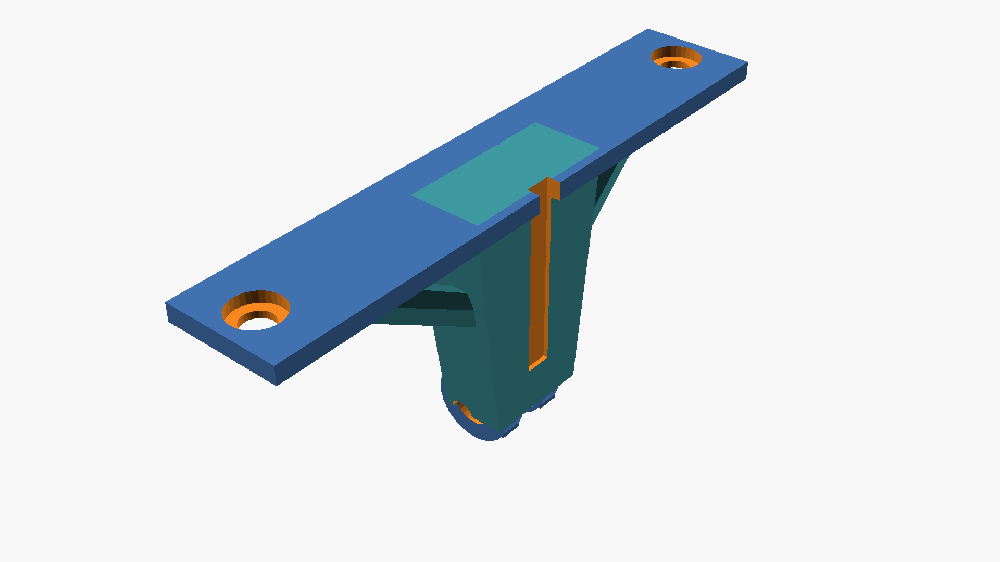

*Abbildung 8.32: 3D-CAD-Modell des entkoppelten Kennzeichen-Radarhalters mit M6-Klemmung, M5-Schwenkscharnier, bionischer 36-Zahn Hirth-Verzahnung und verdecktem rückseitigem M8/M5-Kabelkanal.*

* **Rechtliche Vorschrift (§ 10 Abs. 6 FZV / ECE R138):**
  Das Kennzeichen muss von oben in einem vertikalen Winkel von **mindestens $+30^\circ$ vollständig und ohne Verdeckung** einsehbar sein.
* **Vermeidung des Dachüberstand-Problems:**
  Durch die Platzierung des Radars **unter** dem Kennzeichen muss die obere Pod-Konsole nicht weit nach hinten auskragen. Der $+30^\circ$-Sichtbereich auf die Zulassungs- und TÜV-Plaketten bleibt zu $100\,\%$ frei.
* **Schwingungs- und Vibrationsfestigkeit (Formschluss-Hirth-Gelenk):**
  Das Radar sitzt direkt an der massiven Grundplatte ohne langen Hebelarm. Die Gabelwangen besitzen eine integrierte formschlüssige 36-Zahn Hirth-Rosette ([`011_gopro_hirth_lock.scad`](../../hardware/cad/scad/02_pod_base/parts/011_gopro_hirth_lock.scad)).

#### Option 1: Legacy Garmin Varia mmWave-Radar (24 GHz)
* Verwendet das diebstahlhemmende Garmin Varia Dock ([`radar_varia_gopro_lock_dock.scad`](../../hardware/cad/scad/02_pod_base/radar_varia_gopro_lock_dock.scad)) mit Bajonettverschluss und verdeckter M3-Sicherheitsmadenschraube.

#### Option 2: Radar 2.0 - 77 GHz mmWave (Wheeltec MR20) & 36-LED Warnflügel (`radar_mr20_housing.scad`)
Für maximale Reichweite ($90\,\text{m}$), weite $\pm 60^\circ$ ($120^\circ$) Winkelerfassung, autarke optische Warnung und 5.9 GHz ITS-G5 (V2X) Car-to-X Vernetzung steht das dedizierte Radar 2.0 Flügel-Gehäuse zur Verfügung:
1. **Formschlüssiges PA12-MJF Flügel-Gehäuse:**
   * Außenmaße: $121{,}0 \times 71{,}0 \times 34{,}0\,\text{mm}$ (Breite x Höhe x Tiefe).
   * Rückseitige Aufnahme: Symmetrisches $40\,\text{mm}$ DIN 934 M4-Mutterntaschen-Lochbild (100 % lötkolbenfrei) für das **Schwerlast-Neigegelenk** ([`radar_swivel_tilt_cradle.scad`](../../hardware/cad/scad/02_pod_base/radar_swivel_tilt_cradle.scad)), monolithischer Garmin Quarter-Turn Bajonett-Zapfen (kompatibel mit `radar_varia_gopro_lock_dock.scad` und Standard-Varia-Haltern) sowie untere Hirth-Gelenklasche.
2. **Glattes dielektrisches Polycarbonat-Radom-Sichtfenster:**
   * Vor dem Horn-Array des MR20, den beiden 18-LED Neopixel-Warnflügeln und der 5.9 GHz V2X-Patchantenne sitzt ein transparentes, planes $116 \times 66 \times 1{,}6\,\text{mm}$ PC-Sichtfenster mit 4x M2.5 Torx-Eckverschraubung.
   * Absolut ruß-, graphit- und metallfrei zur Gewährleistung von 100 % HF-Transparenz bei 77 GHz und 5.9 GHz.
3. **Interner Splitter- & Kabelbaum-Hohlraum:**
   * Der originale Kabelstrang des MR20 und das Signal-/Strom-Adaptermodul finden **vollständig im inneren Gehäusehohlraum ($108 \times 58 \times 20\,\text{mm}$)** hinter der PCBA 08 Platz.
   * Keine unschönen externen Kabelpeitschen oder DC-Hohlstecker außerhalb des Gehäuses!
4. **Schwerlast-Neigegelenk & Actioncam-Hirth-System (`radar_swivel_tilt_cradle.scad`):**
   * **Warum eine komplett starre Montage in der Praxis unmöglich ist:** Gesetzliche Kennzeichenwinkel variieren fahrzeugspezifisch zwischen $20^\circ$ und $> 45^\circ$, und das Fahrwerkniveau verändert sich durch Fahrergewicht, Gepäckbeladung und Soziusbetrieb. Ein 77-GHz-Radarsensor benötigt zur Erzielung seiner vollen $90\,\text{m}$-Erfassungsreichweite eine präzise waagerechte Ausrichtung der Hauptabstrahlachse ($\pm 2^\circ$). Eine starre Halterung ohne Nickwinkel-Justage würde bei vielen Motorrädern direkt in den Asphalt oder nutzlos in den Himmel strahlen.
   * **Die OMB-Lösung (Verschraubte Gehäusebasis + Actioncam-Gelenk):** Das $180\,\text{g}$ schwere Radar 2.0 Gehäuse wird von der Rückseite her über zwei **M4-Stahlschrauben** ($40\,\text{mm}$ Stichmaß) unlösbar mit der Adapterplatte [`radar_swivel_tilt_cradle.scad`](../../hardware/cad/scad/02_pod_base/radar_swivel_tilt_cradle.scad) verschraubt. Zwei zylindrische Passungs-Bosse nehmen 100 % der Scherkräfte auf.
   * **Formschluss-Arretierung im Schwerpunkt:** Direkt auf Höhe des Massenschwerpunkts ($Z = 0$) ragt eine $6{,}0\,\text{mm}$ Actioncam/GoPro-Zunge mit beidseitiger 36-Zahn Hirth-Verzahnung nach hinten in die $7{,}0\,\text{mm}$ Gabel des Kennzeichenträgers. Eine einzige durchgehende M5-Klemmschraube (DIN 912 mit DIN 934 M5 Mutter) verriegelt den Nickwinkel unlösbar in $10^\circ$-Schritten.
   * **Sicherheits-Vorteil:** Durch die Adapterplatte baut das System zwar ca. $18\,\text{mm}$ tiefer nach hinten auf, doch im harten Fahrbetrieb (Bodenwellen, Bahnübergänge, Schlaglöcher mit $> 25\,g$) ist ein Abreißen, Ausrasten oder Schwingbruch absolut physikalisch ausgeschlossen!
5. **Wasser- & Gischt-Dichtigkeit von unten (Schutz gegen Reifenspritzwasser):**
   * **Monolithische Spritzwasser-Schutzhaube (Roost-Deflector):** Da die Unterseite bei Montage unter dem Fender oder Kennzeichen im direkten Wurfbereich des vom Hinterrad aufgewirbelten Wassers liegt, besitzt das Gehäuse vor der M8-Kabelverschraubung eine angeformte Schutzschürze mit scharfer Abtropfkante. Hochgeschwindigkeits-Gischt und Steinschlag prallen an der Wandung ab und erreichen die Dichtmanschette gar nicht erst.
   * **IP68/IP69K EPDM-O-Ring-Kammer:** Die M8-Bohrung besitzt eine zylindrische $\varnothing 11{,}5 \times 2{,}2\,\text{mm}$ Dichtkammer, die den EPDM-Dichtring der Kabelverschraubung allseitig umschließt und Verdrängung unter Vibration verhindert.
   * **JST-JWPF 2-Pin Steckverbinder:** Im Gehäuseinneren ist das 2-adrige FLRY-B Kabel über einen wasserdichten JST-JWPF Stecker redundanz-gesichert.
   * **Abtropfschlaufe (Drip-Loop):** Das Zuleitungskabel verläuft geschützt im rückseitigen Kanal der Trägerwirbelsäule und wird in einem nach unten hängenden Bogen von unten in die Verschraubung geführt. Oberflächenwasser tropft durch die Schwerkraft vor dem Eintritt ab.

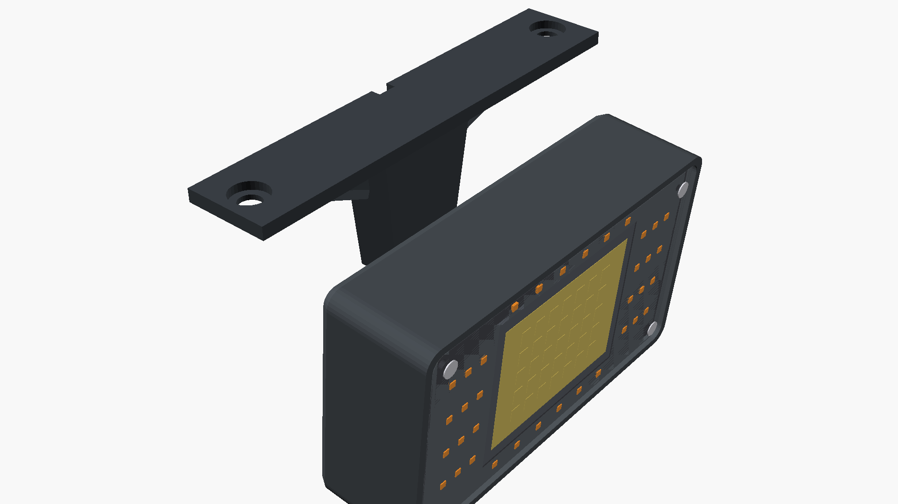

*Abbildung 8.32b: 3D-CAD-Ansicht der fertigen Radar 2.0 Gesamt-Baugruppe (`radar_tilt_mount_assembly_cad.png`). Das Radar 2.0 Flügel-Gehäuse ist über die Schwerlast-Cradle und das Hirth-Neigegelenk mittig unter dem Kennzeichenträger aufgehängt. Die Hauptabstrahlachse und die optischen 36-LED-Warnflügel sind optimal auf den nachfolgenden Verkehr ausgerichtet, während das Kennzeichen nach oben $100\,\%$ frei bleibt.*

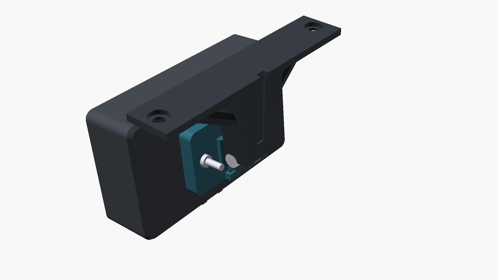

*Abbildung 8.32c: 3D-CAD-Rückansicht des Schwerlast-Neigegelenks (`radar_tilt_mount_assembly_rear_cad.png`). Sichtbar sind die unlösbare 2x M4 Gehäuseverschraubung, die bionische 36-Zahn Hirth-Formschluss-Rastung in der Gabel des Trägers sowie die M5-Klemmschraube mit versenktem DIN 934 Schrauben- und Mutternsitz.*

---

### 6.7 Custom-Bikes & Bobber: Stealth Center-Underfender Mount vs. Seitlicher Kennzeichenhalter

Auf vielen Custom-Bikes, Bobbern, Choppern und modifizierten Softails (z. B. Breakout, Fat Boy, Sportster S, Indian Scout) montieren Besitzer einen **seitlichen Kennzeichenhalter**, um den breiten Hinterreifen ($180\dots 260\,\text{mm}$) optisch vollständig freizulegen und den Heckfender extrem kurz ("Short-Cut") zu halten. 

Obwohl diese Lösung ästhetisch oft kritisiert wird (asymmetrische Störung der Linienführung), stellt sich in der Praxis die entscheidende Frage: **Wo wird bei solchen Maschinen das Garmin Varia mmWave-Radar platziert?**

#### 6.7.1 Warum Radar am seitlichen Kennzeichenhalter lebensgefährlich ist (Die 3 K.O.-Kriterien)

Das mmWave-Radar darf **unter keinen Umständen** an den seitlichen Kennzeichenhalter montiert werden:

1. **Tödliche RF-Abschattung (Blind Spot im rechten Hecksektor):**
   * Das mmWave-Radar (24 GHz / 77 GHz) sendet in einem horizontalen Fächer von ca. $\pm 20^\circ$ bis $\pm 22{,}5^\circ$ ($40^\circ\dots 45^\circ$ Gesamtkegel).
   * Bei einer linken Achsmontage ($25\dots 35\,\text{cm}$ Versatz zur Fahrzeuglängsachse) verdeckt der breite Hinterreifen ($200\dots 260\,\text{mm}$ Karkasse + Felge) den gesamten Signalpfad nach rechts-hinten.
   * **Konsequenz:** Fahrzeuge, die auf mehrspurigen Straßen oder Autobahnen von rechts hinten auflaufen, rechts überholen oder im toten Winkel mitschwimmen, werden vom Radar **vollständig übersehen**.
2. **100 % ungefederte Massen ($20\dots 30\,g$ Schockbelastung):**
   * Seitliche Halter sind starr an der Schwinge oder direkt auf der Radachse verschraubt.
   * Jeder Schlaglochstoß hämmert mit $20\dots 30\,g$ ungedämpft in den Ausleger. Durch den langen Hebelarm entstehen immense dynamische Biegemomente (Kuhschwanz-Vibrationen), die Bajonettverschlüsse und Leiterplatten-Lötstellen in kürzester Zeit zerstören.
3. **Schräglagen-Asymmetrie & Boden-Clutter:**
   * In Linkskurven sinkt das Radar durch den $30\,\text{cm}$-Hebelarm extrem nah an den Asphalt ab (führt zu Multipath-Bodenreflexionen und Falschalarmen), während es in Rechtskurven steil in den Himmel gerichtet ist.

#### 6.7.2 Die OpenMotorBridge-Architektur: Striktes Entkopplungsprinzip & Stealth Center-Underfender Mount

Für OpenMotorBridge gilt das fundamentale Sicherheitsprinzip: **Das Radar sitzt IMMER zentriert in der Fahrzeug-Symmetrieachse und an der gefederten Masse.**

Hierfür wurde der **Stealth Center Under-Fender Mount** ([`02_pod_base/radar_center_underfender_mount.scad`](../../hardware/cad/scad/02_pod_base/radar_center_underfender_mount.scad)) entwickelt:

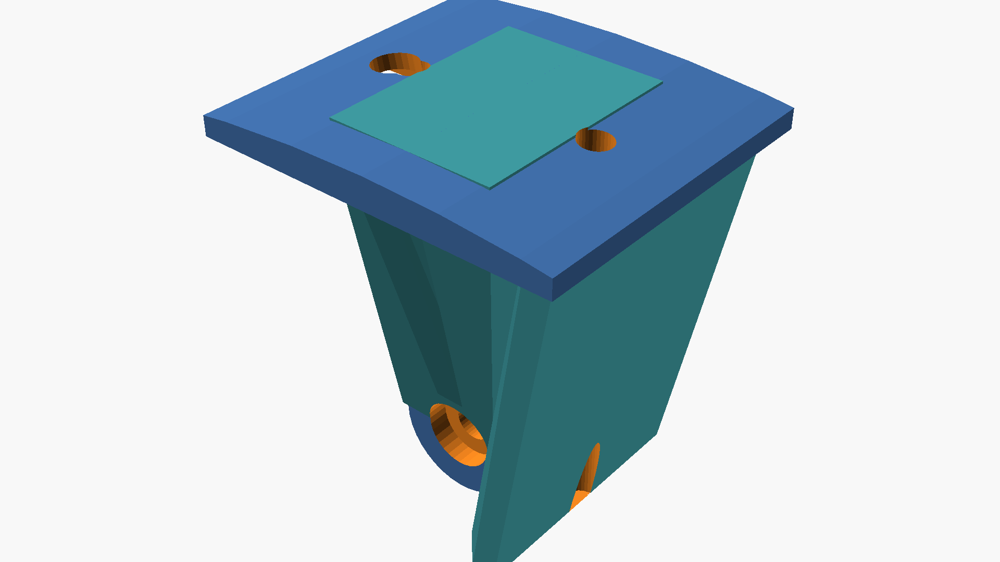

*Abbildung 8.33: 3D-CAD-Modell des Stealth Center Under-Fender Mounts (`radar_center_underfender_mount.scad`). Sichtbar sind die gewölbte Basisflansch-Sattelplatte ($R = 210\,\text{mm}$) für Schraub- oder 3M-VHB-Klebemontage, der tiefergesetzte Tragarm ($Z_{\text{drop}} = 46\,\text{mm}$), der nach vorne gerichtete $42\,\text{mm}$ breite Schmutzfänger-Spoiler gegen direktes Hinterrad-Spritzwasser, die Clevis-Gabel mit radialer 36-Zahn Hirth-Formschluss-Rastung ($10^\circ$-Ausrichtung) und der verdeckte M8-Kabelschacht zur Kotflügel-Innenseite.*

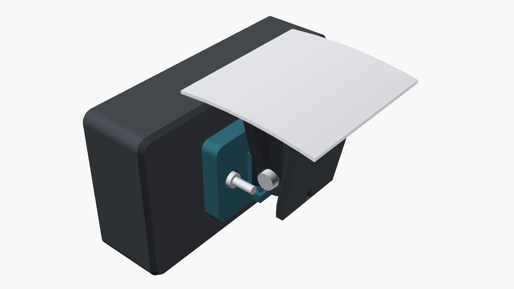

*Abbildung 8.33-B: 3D-CAD-Baugruppe der Stealth-Underfender-Montage. Sichtbar sind das Heckkotflügel-Segment, der Stealth Under-Fender Mount mit integriertem Spritzwasser-Schmutzfänger-Spoiler, die 2x M4 verschraubte Schwerlast-Neigungswiege (`radar_swivel_tilt_cradle.scad`), die M5-Klemmschraube mit DIN 934 Stoppmuttertasche und das spritzwassergeschützte Radar 2.0 Gehäuse (`radar_mr20_housing.scad`).*

1. **Nahtlose Stealth-Ästhetik für Custom-Hecks:**
   * Der Halter sitzt direkt mittig unter der Abschlusskante des Heckkotflügels oder an den inneren Fender-Struts. Von hinten ist das Radar im Schatten des Kotflügels kaum wahrnehmbar und wirkt wie eine winzige, edle Designer-Rückleuchte. Der breite Hinterreifen bleibt optisch zu $100\,\%$ frei.
2. **Gefederte Masse & Schwingungsschutz:**
   * Da die Montage am Fender / Rahmen (gefederte Masse) erfolgt, reduzieren sich Fahrbahnschläge von $25\,g$ auf unkritische $2\dots 4\,g$.
3. **Optimierte Schwerpunkt-Gelenkhöhe ($Z_{\text{drop}} = 46{,}0\,\text{mm}$):**
   * Das $180\,\text{g}$ schwere Radar 2.0 Gehäuse ($71\,\text{mm}$ Bauhöhe) benötigt ausreichend Schwenkraum unter der Kotflügelwölbung.
   * Durch den auf $46\,\text{mm}$ dimensionierten Tiefgang verbleiben $10{,}5\,\text{mm}$ Resthöhe zur Kotflügelunterseite, was einen Schwenkbereich von $\pm 20^\circ$ für die Fahrbahnausrichtung bei tiefergelegten Bobbern oder wechselnder Dämpfervorspannung ermöglicht.
4. **Integrierter Schmutzfänger-Spoiler (Roost Deflector Shield):**
   * Bei Montage direkt im Kotflügel wirbelt der rotierende Hinterreifen Wasser und Schlamm mit hoher Umfangsgeschwindigkeit direkt gegen die Vorderseite des Halters.
   * Ein monolithisch angeformter, $42\,\text{mm}$ breiter Schutzschild (Schmutzfänger-Spoiler) schirmt das Drehgelenk, die Neigungswiege und die unterseitige M8-Kabelverschraubung zu $100\,\%$ gegen den direkten Reifen-Wasserstrahl ab.
5. **Formschluss-Hirth-Gelenk & Universelle M4-Neigungswiege (100 % Lötkolbenfrei):**
   * Die $7{,}0\,\text{mm}$ Clevis-Gabel nimmt die zentrale Actioncam-Zunge der universellen Neigungswiege ([`radar_swivel_tilt_cradle.scad`](../../hardware/cad/scad/02_pod_base/radar_swivel_tilt_cradle.scad)) auf.
   * Zwei beidseitige 36-Zahn Hirth-Rosetten ($10^\circ$-Raster) garantieren absoluten Formschluss gegen vibrationsbedingtes Absacken der Neigung.
   * Auf der rechten Clevis-Wange ist eine Sechskant-Muttertasche für eine DIN 934 M5 Mutter integriert; auf der linken Wange sitzt eine Zylindersenkung für den M5 Schraubenkopf.
   * Das Radar 2.0 Gehäuse wird über 2x M4 Schrauben direkt in die internen DIN 934 M4 Muttern des Gehäuses verschraubt – vollkommen lötkolbenfrei und schlaglochfest.
6. **Flexible Montage (Kleben oder Schrauben):**
   * **3M VHB 5952:** Breite plane Auflagefläche für bohrungsfreie Montage auf makellosen Custom-Lackierungen.
   * **2x M4/M5 Senkkopfschrauben:** Zentraler Bohrungsabstand von $26\,\text{mm}$ für formschlüssige Verschraubung an vorhandenen Fender-Bohrungen.
7. **Verdeckte M8-Kabelführung:**
   * Das M8-Kabel verschwindet sofort nach oben durch einen integrierten $\varnothing 6{,}0\,\text{mm}$ Schacht an die Kotflügelinnenseite und läuft dort geschützt im serienmäßigen Kabelkanal nach vorne zur Zentralbox.

---

### 6.8 Begleitfahrzeug-, Support-Van- & Rallye-Kit (Referenz-Kit 5: Car Support Kit)

Für den professionellen Einsatz in Begleitfahrzeugen (Support-Vans bei geführten Motorrad-Touren, Besenfahrzeugen, Orga-Transportern bei Alpentouren) sowie in Pkw-Kolonnen (z. B. Sportwagen-Rallyes) bildet das **Referenz-Kit 5** ein autarkes Gesamtsystem. Es ermöglicht die lückenlose Überwachung aller Teilnehmer-Bikes über das 868-MHz-LoRa-Mesh ohne jede Mobilfunk- oder Cloud-Abhängigkeit.

Mechanisch und fahrzeugintegrativ basiert das Car Support Kit auf durchdachten, schraub- und bohrungsfreien Komponenten:
1. Dem **Universal Sonnenblenden-Clip für Pod 1 & 2 (2x)** ([`car_sun_visor_pod_clip.scad`](../../hardware/cad/scad/05_accessories/car_sun_visor_pod_clip.scad) / [`car_sun_visor_pod_clip.stl`](../../hardware/cad/stl/05_accessories/car_sun_visor_pod_clip.stl)) zur reflexionsfreien Abstrahlung durch die Frontscheibe.
2. Dem kompakten **Cockpit-Satellitenblock (`PCBA 05B`)** in der Mittelkonsole / Armlehne mit $75\,\text{cm}$ Schleppketten-Kabel zum Front-Node unterm Fahrersitz.
3. Der **Unter-Sitz-Montage** von Front-Node (Fahrersitz) und Zentralbox (Beifahrersitz) mit thermischem Schutz und kreuzungsfreier Leitungsführung.
4. Der **externen 868-MHz-Magnetfuß-Dachantenne** mit $2{,}5\,\text{m}$ RG-174 Koaxialkabel für ungehinderte $360^\circ$-Rundumreichweite ($15\dots 25\,\text{km}$) zur Motorradgruppe.
5. Dem abgesetzten **SAM-M10Q Multi-GNSS-Puck** an der A-Säule / Scheibenbasis.

---

#### 6.8.1 Universal Sonnenblenden-Clip für Pod 1 & Pod 2 (`car_sun_visor_pod_clip.scad`)

Moderne Automobile besitzen selten feste Heck-Hutablagen, und die geschlossene Blechkarosserie dämpft Funkwellen wie ein Faradayscher Käfig. Das Car Support Kit nutzt daher **zwei baugleiche Universal-Clips** an beiden Sonnenblenden:
* **Fahrer-Sonnenblende:** Nimmt **Pod 1** auf (z. B. Sena SPIDER X Slim oder OMM 2.4 GHz Swap Cartridge).
* **Beifahrer-Sonnenblende:** Nimmt **Pod 2** auf (z. B. Cardo Packtalk Edge oder Midland PMR446).

```text
EINSATZMODI DES CAR-SUPPORT-KITS:
* Modus A (Begleitwagen für Motorrad-Gruppe):
  - Fahrer-Sonnenblende: Pod 1 mit Sena SPIDER X Slim (Mesh 3.0 / 2.0 Kanal 1-9)
  - Beifahrer-Sonnenblende: Pod 2 mit Cardo Packtalk Edge (DMC Gen 2 Gruppe)
  - Ermöglicht dem Tourguide/Besenfahrer die simultane Sprachverbindung in beide Welten!
* Modus B (Reine Autokolonne / Rallye):
  - Fahrer-Sonnenblende: Pod 1 mit OMM 2.4 GHz Swap-Kassette (Kanal-Hopping Mesh)
  - Beifahrer-Sonnenblende: Pod 2 mit Midland PMR446 (Jedermannfunk / analoger Fallback)
```

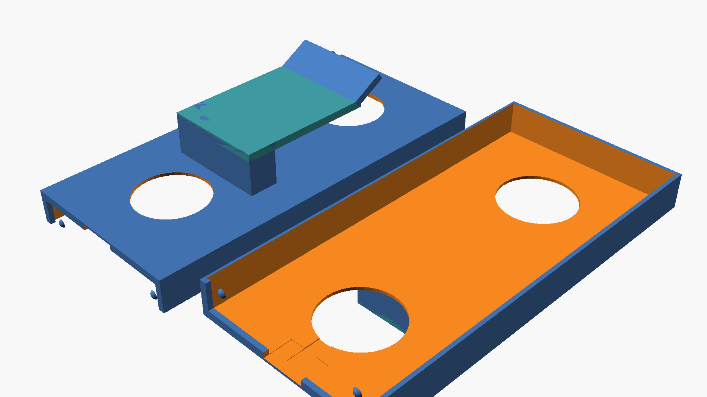

*Abbildung 8.33b: 3D-CAD-Ansicht des Universal Sonnenblenden-Clips für Pod 1 & 2 (`car_sun_visor_pod_clip.scad`). Rechts: Obere Pod-Aufnahmewanne ($139 \times 73\,\text{mm}$) mit seitlichen Haltebacken, Eck-Kugelrastungen für vibrationsfesten Formschluss und stirnseitigem Kabelauslass. Links: Ansicht der Gehäuseunterseite mit solidem U-Kanal-Verbindungssteg, flexibler Federspange (14,5 mm Ruheschlitz für 14-22 mm Sonnenblendendicke), transversalen Anti-Rutsch-Rippen und 30°-Einführschräge.*

* **Strikte Trennung von Aufnahmewanne und Klemmfeder (100 % freier Bauraum):**
  * In der finalen Geometrie sitzt die elastische Federspange strikt auf der **Außen-Unterseite** ($Z \le 0$). 
  * Das obere Aufnahmefach für Pod 1 oder Pod 2 ist zu $100\,\%$ frei und ungehindert zugänglich. Der Pod wird flach von oben eingedrückt und rastet an den seitlichen Gehäuselippen formschlüssig ein.
* **Universelle Passform für alle Kfz-Sonnenblenden ($14\dots 22\,\text{mm}$):**
  * Der Federbügel aus PETG oder zähem PA12-MJF besitzt eine Tiefe von $58\,\text{mm}$ und eine Breite von $42\,\text{mm}$.
  * Eine aufgewölbte $30^\circ$-Einführlippe erlaubt das einhändige Aufschieben auf die Blende ohne Kraftaufwand oder Werkzeug.
  * Drei abgerundete Rippen verhindern zuverlässig ein Verrutschen bei Fahrzeugerschütterungen, ohne das empfindliche Leder oder Textil der Sonnenblende zu beschädigen.
* **Hemisphärische HF-Freisicht ($180^\circ$ zum Himmel):**
  * An der oberen Windschutzscheibenkante platziert, strahlen die Mesh- und Bluetooth-Antennen ungedämpft durch das Glas nach vorne und oben ab.
  * Keine Reflexionen an metallischen Karosserieblechen oder Dachträgern.
* **Diebstahlschutz durch Tarnoptik:**
  * Von außen durch die getönte Frontscheibe betrachtet, wirkt der Clip wie eine unauffällige Maut-Box (Telepass / Bip&Go / Toll Collect) oder ein werkseitiger Garagentor-Transponder.

---

#### 6.8.2 Front-Node & Zentralbox Montage im Pkw (Die v10.0 All-in-One Core Unit)

In v10.0 entfällt der frühere Zwang, Zentralbox und Front-Node im Auto zwingend getrennt auf Fahrer- und Beifahrersitz zu verteilen:  
Da Ultra-Wideband (UWB) komplett durch den drahtgebundenen 4-Draht Automotive USB-PD Bus ersetzt wurde, gibt es **keine HF-Nahfeld-Übersteuerung (De-Sensing)** mehr. Zentralbox (`PCBA 01`) und Front-Node (`PCBA 05`) werden im Begleitfahrzeug ab sofort als **kompakte, gemeinsame „All-in-One Car Support Core Unit“** zusammen montiert!

> [!NOTE]
> **Warum das Armaturenbrett tabu bleibt, aber beide Boxen zusammenrücken:**
> 1. **Die thermische Schonung ($< 35\,^\circ\text{C}$):** Auf dem Armaturenbrett herrschen im Sommer hinter der Windschutzscheibe $85\dots 95\,^\circ\text{C}$. Die gemeinsame Core Unit wird daher im thermisch kühlen Fußraum unter dem Beifahrersitz oder im Mitteltunnel platziert.
> 2. **Gemeinsame 12V-Einspeisung:** Es wird nur noch eine einzige 12V-Zuleitung (Zigarettenanzünder oder Bordnetz-Zündungsplus) benötigt. Kein Y-Kabel-Wirrwarr quer durch den Fahrzeuginnenraum!
> 3. **Direkt-Bus:** Die 4-Draht-Verbindung zwischen Zentralbox und Front-Node schrumpft auf ein ultrakurzes $10\,\text{cm}$ internes Patchkabel.

```
            v10.0 PKW ALL-IN-ONE CORE-UNIT & SATELLITEN-TOPOLOGIE
+-----------------------------------------------------------------------------------------+
| WINDSCHUTZSCHEIBE / A-SÄULE OBEN:              SONNENBLENDEN:                           |
| [ SAM-M10Q GPS-Puck an Scheibenbasis ]         [ Pod 1 (Fahrer) & Pod 2 (Beifahrer) ]   |
| (Freie Sicht im Mautbox-Scheibenfenster)       (2.4 GHz strahlt unbedämpft nach vorn)   |
+-----------------------------------------------------------------------------------------+
       ^                                                        ^
       | Dünnes I2C-Sensorkabel                                 | 2x 4-Draht USB-PD Zuleitungen
+---------------------------------------------------------------+-------------------------+
| UNTERM BEIFAHRERSITZ ODER IM MITTELTUNNEL:                                              |
| [ GEMEINSAME CAR SUPPORT CORE UNIT (PCBA 01 + PCBA 05) ]                                |
| * Zentralbox (ESP32-S31 AI-Host, QCC3084 Audio, SX1262 LoRa Notfunk, LiPo-USV)          |
| * Front-Node (Automotive USB-Hub, 20W PD Ottocast-Bypass, Cockpit-Audio-Routing)       |
| * Interner 10 cm 4-Draht Bus (USB-PD / USB 2.0); gemeinsame 12V-Bordnetzeinspeisung     |
| * SMA-Ausgang: 2,5 m RG-174 Koaxialkabel nach hinten zur 868-MHz-Magnetfuß-Dachantenne  |
+-----------------------------------------------------------------------------------------+
       |
       v 75 cm geschirmtes Kabel
+-----------------------------------------------------------------------------------------+
| MITTELKONSOLE / MITTELARMLEHNE (Der einzige sichtbare Bedienpunkt):                     |
| [ COCKPIT-BEDIENBLOCK & AAWIRELESS / CARPLAY CLEAN POWER-INJECTION ]                    |
| * [ HOST ]: USB-Kabel zum Werks-Radio (Reine Datenverbindung D+/D-, VBUS blockiert)     |
| * [ DONGLE 5V/3A ]: AAWireless / Ottocast / Carlinkit sauber versorgt (keine Reboots!)  |
| * [ PHONE 20W ]: USB-PD Schnellladekabel für Smartphone                                 |
| * [ BTN_PTT ]: Taster an Schalthebel oder Handbremse                                    |
+-----------------------------------------------------------------------------------------+
```

1. **Vorteile der zusammengefassten Core Unit:**
   * **10-Minuten-Rüstzeit:** Das Gesamtsystem lässt sich in jedem Begleitwagen, Mietfahrzeug oder Rallye-Van in 10 Minuten ohne Werkzeug installieren.
   * **Sternförmige Leitungsführung:** Alle Leitungen gehen von einem einzigen Punkt aus (nach oben zur Scheibe/Dach, zur Mittelkonsole und zu den Sonnenblenden).
   * **Optimaler Hitzeschutz:** Unterm Beifahrersitz herrscht der kühlste Bereich der Fahrgastzelle – kein Sonnenlicht, ständige Kühlung durch die Fußraum-Klimadüsen. Der 2.200-mAh LiPo-USV-Akku wird thermisch geschont.
   * **Stabile Stromversorgung & AAWireless / CarPlay Power-Bypass:** Der interne 12V-Schaltregler liefert saubere $5\,\text{V}\,/\,3\,\text{A}$ ($15\,\text{W}$) an den AAWireless- / Ottocast-Adapter. Zum OEM-Media-Port des Autos führt nur ein reines USB-Datenkabel (`D+`, `D-`, `GND` bei getrenntem `VBUS`). Dadurch entfallen die gefürchteten Abstürze und Bootloops durch überlastete Werks-USB-Buchsen ($500\,\text{mA}$) vollständig!

---

#### 6.8.3 Funk-Architektur im Auto-Kit: Externe Magnetfuß-Dachantenne als Default

Im Pkw-Einsatz dämpft die Stahlkarosserie (Faradayscher Käfig) Funkwellen im Innenraum um $20\dots 30\,\text{dB}$. Eine interne LoRa-Antenne unterm Sitz erreicht real nur $500\dots 1.000\,\text{m}$ – bei einer geführten Motorradtour oder Rallye verliert der Begleitwagen die Gruppe hinter der ersten Bergkuppe sofort.

Daher ist im **Referenz-Kit 5 (Car Support Kit)** die **externe Magnetfuß-Dachantenne standardmäßiger Lieferumfang (Default)**:
1. **Rückseitiger SMA-Anschluss an der Zentralbox:** Die $0{,}4\,\text{mm}$ Knockout-Membran auf der Rückseite der Zentralbox wird durchstoßen und eine IP67 SMA-Einbaubuchse mit U.FL-Pigtail zu `ANT1` auf `PCBA 01` montiert.
2. **Kompakter 868-MHz-Magnetfuß auf dem Autodach:**
   - Ein gummierter Miniatur-Magnetfuß ($\varnothing 30\,\text{mm}$) mit $8\,\text{cm}$ flexiblem Edelstahlstrahler haftet kratzfrei auf dem Fahrzeugdach.
   - Das gesamte Fahrzeugdach dient als ideale, metallische HF-Groundplane ($+3\,\text{dBi}$ Gewinn, $360^\circ$ Rundumabstrahlung).
   - **$15\dots 25\,\text{km}$ echte LoRa-Reichweite** zur Motorradgruppe – selbst über Gebirgspässe hinweg!
3. **Flüsterleise Kabeldurchführung:**
   - Das $2{,}5\,\text{m}$ lange, nur $2{,}8\,\text{mm}$ dünne RG-174 Koaxialkabel wird unterm Teppich nach hinten geführt und einfach durch die elastische Gummidichtung der Heckklappe nach außen gelegt. Die Dichtung schließt absolut wasser- und windgeräuschfrei ab.

---

#### 6.8.4 Telemetrie: Autarke Bluetooth-OBD2-Kopplung vs. Festverdrahtung

Für die Fahrzeugdaten (Geschwindigkeit, Drehzahl, Tankstand, Kühlmitteltemperatur nach ISO 15765-4) unterstützt das System zwei praxiserprobte Wege:
1. **Kabelgebundenes 90°-Flachbandkabel zum Fahrzeug-Satelliten (Günstig, robust & pedalfrei):**
   - Ein ultraflaches, $80\,\text{cm}$ langes $90^\circ$-Winkelkabel ([`cable_obd2_flat_jwpf_3p`](../../data/bom_parts.json)) baut an der OBD2-Buchse nur ca. $10\,\text{mm}$ auf und führt die Leitungen (Pin 6 CAN_H, Pin 14 CAN_L, Pin 4/5 GND) direkt hinter die Schweller-/Teppichverkleidung zum Fahrzeug-Satelliten ([`vehicle_breakout_block`](#)) an der Fahrersitzbasis.
   - **Vorteil:** Kein teurer Zusatz-Dongle nötig, absolut null Funkstrecke, und keine Kollisionsgefahr mit der Kupplung beim Schalten.
2. **Drahtloser BLE-Dongle (Plug & Play / Mietwagen):**
   - Für Fahrzeuge, bei denen die OBD2-Buchse frei liegt (z. B. Handschuhfach, Mittelkonsole) oder kein Kabel gelegt werden soll. Die Zentralbox fungiert als BLE-Master und koppelt sich autark mit einem *vGate iCar Pro BLE 4.0* oder *OBDLink CX*. (Tipp bei beengtem Pedalraum: Falls ein vorhandener langer BT-Dongle stört, kann ein ultraflaches 10-cm-Flachband-Verlängerungskabel genutzt werden, um den Dongle hinter die Fußraumverkleidung zu legen).
3. **Live-Broadcasting im OMM-Mesh:**
   - Die erfasste Pkw-Telemetrie wird automatisch in die 25-Byte OMM-Radar-Pings eingespeist. Alle Motorradfahrer sehen Tankstand und Position des Begleitwagens live auf ihren Displays.

---

## 7. Gehäuse Typ D: 2-in-1 LoRa Smart-Keyfob & Pager (`smart_keyfob_pager.scad`)

Der **OpenMotorBridge 2-in-1 Smart-Keyfob** ([`smart_keyfob_pager.scad`](../../hardware/cad/scad/05_accessories/smart_keyfob_pager.scad)) löst die gravierenden Schwächen herkömmlicher Motorrad-Schlüsseltransponder (schwache Knopfzellen, Kälteempfindlichkeit, fehlender Rückkanal und Notwendigkeit separater Kassettenwerkzeuge). Er vereint einen ultrastarken N52-Neodym-Entriegelungsschlüssel und einen autarken 868-MHz-LoRa-Alarmpager in einem ergonomischen, taschentauglichen Gehäuse:

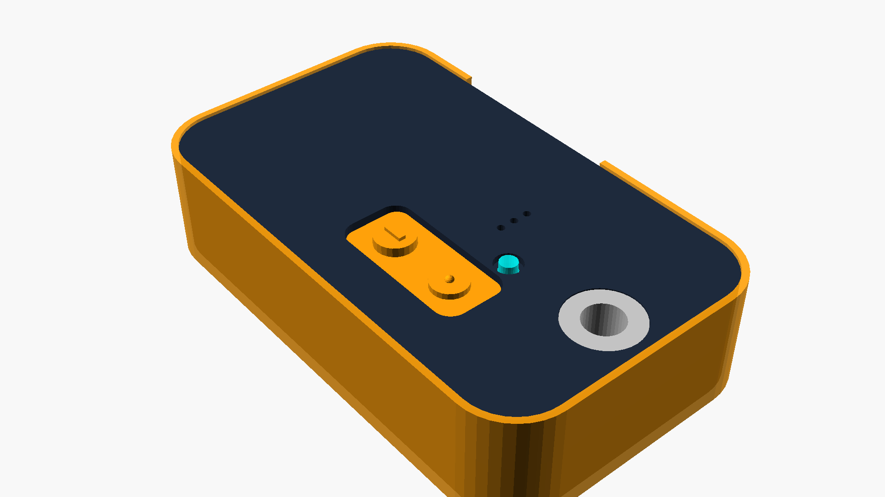

*Abbildung 8.34: 3D-CAD-Gesamtansicht des 2-in-1 LoRa Smart-Keyfobs (`smart_keyfob_pager.scad`). Sichtbar sind das ergonomisch gerundete PA12-MJF Gehäuse ($58 \times 34 \times 13\,\text{mm}$), der umlaufende orangefarbene TPU-Kantenschutz, die 316L-Edelstahl-Schlüsselringöse sowie der seitlich eingelassene N52-Neodym-Auswerferschlüssel mit taktilem Ausrichtungssteg.*

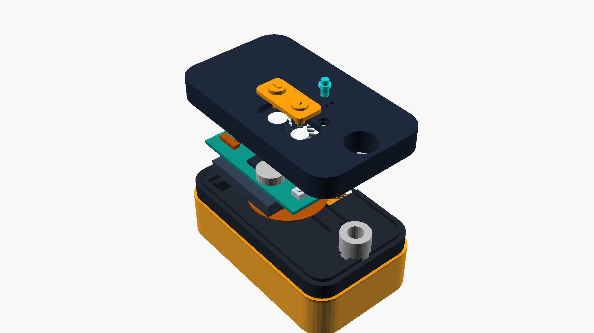

*Abbildung 8.35: 3D-CAD-Explosionsdarstellung des Smart-Keyfobs. Von unten nach oben: PA12-MJF Unterschale mit rückseitiger MagSafe-Zentrierringtasche, 180-200 mAh LiPo-Pouch-Zelle ($25 \times 18 \times 3{,}8\,\text{mm}$), PCBA 07 Trägerplatine ($38 \times 19\,\text{mm}$), Semtech SX1262 LoRa Transceiver, LRA-Haptikmotor, Mu-Metall-Flussleitblech ($0{,}5\,\text{mm}$), N52-Neodym-Schlüsselblock ($20 \times 10 \times 5\,\text{mm}$) und Oberschale mit Diffusor-Bohrung für die RGB-Statusanzeige.*

### 7.1 Mechanischer Aufbau, Taster-Ergonomie & IP67-Dichtungsarchitektur
* **Außenabmessungen:** $58{,}0 \times 34{,}0 \times 13{,}0\,\text{mm}$ (Länge x Breite x Dicke; Unterschale $6{,}5\,\text{mm}$, Oberschale $6{,}5\,\text{mm}$).
* **Materialien & Fertigung:** Hochfestes PA12 im HP Multi Jet Fusion (MJF) Verfahren, kugelgestrahlt, chemisch geglättet und hydrophob versiegelt.
* **Stoßabsorbierender TPU-Kantenschutz:** Umlaufender $0{,}8\,\text{mm}$ TPU-95A Schutzrahmen (Orange `#ff9f0a`) mit Freisparung für die seitliche Magnetkontaktfläche. Schützt Gehäuse und Elektronik zuverlässig bei Stürzen auf Asphalt aus bis zu $2\,\text{m}$ Höhe.
* **Integrierter N52 Neodym-Schlüsselblock ($20 \times 10 \times 5\,\text{mm}$):**
  * Auf der schmalen Längsseite formschlüssig eingepresst mit korrosionsfester Ni-Cu-Ni Dreifachbeschichtung (silbern-metallisch glänzend, in den CAD-Renderings deutlich sichtbar) und mit einem taktilen Nordpol-Ausrichtungssteg versehen.
  * Tritt der Keyfob an den $X = 64\,\text{mm}$ Zielkreis des Pod-Gehäuses heran, zieht das konzentrierte B-Feld ($B_r \approx 1{,}48\,\text{T}$) den innenliegenden Stahlanker an und entriegelt die Auswerferfedern.
* **0,5 mm Weicheisen- / Mu-Metall-Abschirmblech (Flux Shield):**
  * Direkt hinter dem N52-Magneten platziert. Schirmt die interne Elektronik (SX1262 LoRa-Transceiver, Nordic BLE-SoC, 180 mAh LiPo-Pouch-Akku) hermetisch gegen magnetische Sättigung ab und lenkt den magnetischen Fluss zu 100 % nach außen auf die Gehäusewand.
* **Stummer Alarm-Pager mit LRA-Vibrationsmotor:**
  * Ein $\varnothing 10 \times 3{,}6\,\text{mm}$ Linear Resonant Actuator (LRA) warnt den Fahrer bei Erschütterung, unbefugtem Aufbocken oder Kassettenhebeln lautlos über haptische Vibrationsmuster in der Jackentasche.
* **MagSafe / Qi Induktiv-Ladeaufnahme:**
  * Auf der Rückseite ist ein magnetischer Ausrichtungsring ($\varnothing 28\,\text{mm}$ außen, $\varnothing 22\,\text{mm}$ innen) integriert. Der Keyfob rastet während der Fahrt auf dem MagSafe Cockpit-Dock (`009_magsafe_frame_dock.stl`) mit Standard-Qi-Ladeeinheit magnetisch ein und wird induktiv nachgeladen.

#### 7.1.1 Taster-Ergonomie & Fixierte Platinenposition (Unten-Rechts-Cluster)
Auf der Trägerplatine `PCBA 07` ([`openmotorbridge_smart_keyfob.kicad_pcb`](../../hardware/kicad_smart_keyfob/openmotorbridge_smart_keyfob.kicad_pcb)) sitzen zwei SMD-Kurzhubtaster der Bauform Alps SKRK ($3{,}9 \times 2{,}9 \times 1{,}5\,\text{mm}$):
* `SW1` (`BTN_ARM`): Platziert bei $X = 125{,}5\,\text{mm}, Y = 86{,}75\,\text{mm}$ (Gehäusekoordinate $X \approx 30{,}5\,\text{mm}, Y \approx 9{,}5\,\text{mm}$).
* `SW2` (`BTN_SOS`): Platziert bei $X = 134{,}0\,\text{mm}, Y = 86{,}75\,\text{mm}$ (Gehäusekoordinate $X \approx 39{,}0\,\text{mm}, Y \approx 9{,}5\,\text{mm}$).

Beide Schalter befinden sich zwingend in der **unteren rechten Ecke der Platine** (nur $2{,}25\,\text{mm}$ von der Platinenkante entfernt). Sie können auf dem PCB aus Platz- und Routing-Gründen (HF-Masseflächen für die 868-MHz- und BLE-Chipantennen im linken Platinenbereich, Flucht-Routing des Nordic nRF52840 und Akkupads) nicht verschoben werden. 

Das Gehäuse integriert hierfür ein formschlüssiges **2-Tasten-Bedienfeld auf der Gehäuseoberseite**:
1. **Taste 1 (`ARM / MUTE` – `SW1`):** Erhabene, ergonomisch geriffelte Tastenkappe mit Schloss-Symbolik zur blinden Bedienung mit Motorradhandschuhen (Scharf-/Unscharfschalten, Quittierung und Stummschaltung von Alarmen, Freigabe der Kassettenentnahme).
2. **Taste 2 (`SOS / PAIR` – `SW2`):** Leicht vertiefte Schutzkappe mit fühlbarem Tastpunkt. Verhindert versehentliche Hosentaschen-Auslösungen (Firmware erfordert 3 Sekunden Dauerdruck für Notruf-Broadcast oder BLE-Pairing).
3. **Integrierte Betätigungsstößel (Plungers):** An der Unterseite der Tasten ragen zylindrische Stößel ($h = 3{,}7\,\text{mm}$) durch Passungsbohrungen der Oberschale direkt auf die Druckpunkte der Alps-SKRK-Schalter.

#### 7.1.2 Reale LED-Position & Akustikaustritt (D1 & LS1)
* **Status-RGB-LED (`D1` WS2812B-2020):** Sitzt auf der Platine bei $X = 135{,}9\,\text{mm}, Y = 82{,}3\,\text{mm}$ (Gehäusekoordinate $X \approx 40{,}9\,\text{mm}, Y \approx 15{,}5\,\text{mm}$) – also ebenfalls **unten rechts**, direkt neben `SW2`! Anstelle einer offenen Bohrung setzt die Oberschale hier einen eingepressten transparenten **PMMA-Lichtleiter (Lichtleitstab mit Bund)** ein, der das Licht der SMD-LED verlustfrei und spritzwasserdicht an die Gehäuseoberfläche leitet.
* **Piezo-Signalgeber (`LS1` CUI CPT-9019S):** Sitzt bei $X = 131{,}25\,\text{mm}, Y = 75{,}25\,\text{mm}$ (Gehäusekoordinate $X \approx 36{,}25\,\text{mm}, Y \approx 20{,}5\,\text{mm}$). Drei $0{,}8\,\text{mm}$ Mikrobohrungen in der Oberschale liegen exakt zentriert über dem Resonanzkörper.

#### 7.1.3 Schraubenlose PCB-Klemmung & Akku-Kammertrennung
Wie hält die Leiterplatte im Gehäuse, ohne dass Schrauben das dichte HF-Layout schwächen?
1. **Umlaufende Stütz-Schultern (PCB Resting Ledges):** An den Innenwänden der Unterschale läuft auf Höhe $Z = 5{,}0\,\text{mm}$ ein formschlüssiger Absatz um, auf dem der Platinenrand spielfrei aufliegt.
2. **Eck-Zentrierstege (Corner Alignment Stops):** Vier Führungsstege ($R = 0{,}55\,\text{mm}$, Höhe $1{,}0\,\text{mm}$) an den Außenecken der Stützschulter fassen die $R = 1{,}5\,\text{mm}$ Außenradien der Leiterplatte formschlüssig ein und arretieren sie in X- und Y-Richtung gegen jedes Verrutschen, ohne dass Löcher in der Platine nötig sind.
3. **Niederhalterippen in der Oberschale:** Monolithisch angeformte Klemmrippen an den Seitenwangen der Oberschale ($X = 6{,}0\dots 30{,}0\,\text{mm}$) drücken beim Fügen elastisch auf die bauteilfreien Längsränder der Leiterplatte und spannen diese klapperfrei und vibrationsfest ein.
4. **Schichtaufbau Unterseite (Gehäuseboden -> Qi-Spule -> Ferrit -> LiPo-Akku -> PCB):**
   - **Ebene 1 (Ganz unten, $Z = 1{,}0\dots 1{,}6\,\text{mm}$):** Auf dem Innenboden der Unterschale ist eine kreisrunde Senkung ($\varnothing 24{,}5\,\text{mm} \times 0{,}6\,\text{mm}$) eingeformt. Hier liegt die ultra-flache **Qi-Empfängerspule** ($\varnothing 24\,\text{mm} \times 0{,}3\,\text{mm}$ Flachspule) exakt deckungsgleich über dem äußeren MagSafe-Neodym-Zentrierring ($\varnothing 28\,\text{mm}$).
   - **Ebene 2 ($Z = 1{,}6\dots 1{,}9\,\text{mm}$):** Direkt auf der Oberseite der Qi-Spule liegt eine hochpermeable **Ferrit-Schirmfolie ($0{,}3\,\text{mm}$)**. Sie schirmt den magnetischen Wechselfluss (110–205 kHz) des Laders zu 100 % gegen den darüberliegenden Akku und das PCB ab, verhindert Wirbelstromverluste/Erwärmung und bündelt das Magnetfeld nach außen.
   - **Ebene 3 ($Z = 1{,}9\dots 5{,}0\,\text{mm}$):** Auf der geschirmten Ferritfolie ruht die rechteckige **LiPo-Pouch-Zelle** ($25 \times 18 \times 3{,}8\,\text{mm}$) in ihrer $26 \times 18\,\text{mm}$ Führungswanne.
   - **Ebene 4 ($Z = 5{,}0\dots 6{,}0\,\text{mm}$):** Auf der Stützschulter liegt die Leiterplatte `PCBA 07` ($38 \times 19 \times 1{,}0\,\text{mm}$). Die Spulen-Anschlussdrähte steigen links nach oben und werden über den ultrakompakten 2-poligen JST-ACH SMD-Header `J_QI` ($1{,}2\,\text{mm}$ Raster, nur $1{,}4\,\text{mm}$ Bauhöhe) **100 % lötfrei** an den TI BQ51003 Receiver angesteckt.

#### 7.1.4 4-Pin SWD-Programmierstecker (`J_SWD`): Prototypen-Flashen & Großserien-Option
Im 3D-CAD-Modell der Platine (`pcba07_smart_keyfob_3d.png`) ist der 4-polige Pfostenstecker `J_SWD` ($X = 108{,}75\,\text{mm}, Y = 85{,}4\,\text{mm}$) platziert (Pin 1: `VCC_3V3`, Pin 2: `SWDIO`, Pin 3: `SWDCLK`, Pin 4: `GND`).

* **Empfehlung für Prototypen-Bestellungen (z. B. 5 Testplatinen bei JLCPCB / Eurocircuits):**
  * **Voll bestücken lassen:** Für die Entwicklung und Kleinserien-Prototypen wird die standardisierte 4-polige $1{,}27\,\text{mm}$ SMD-Stiftleiste ([`PinHeader_1x04_P1.27mm_Vertical_SMD_Pin1Left`](../../hardware/kicad_smart_keyfob/openmotorbridge_smart_keyfob.kicad_pcb)) **ganz normal mitbestückt** (`dnp no` in KiCad).
  * **Passt dank Gehäuse-Freisparung vollständig ins Gehäuse:** In der Oberschale ([`smart_keyfob_pager.scad`](../../hardware/cad/scad/05_accessories/smart_keyfob_pager.scad)) ist an der Innendecke direkt über `J_SWD` ($X = 11{,}2\dots 16{,}2\,\text{mm}, Y = 16{,}0\dots 23{,}0\,\text{mm}$) eine $1{,}2\,\text{mm}$ tiefe Freisparungstasche eingelassen. Dadurch stehen **$5{,}4\,\text{mm}$ lichte Gesamthöhe** über der Platine zur Verfügung. Eine Standard-1.27mm-Stiftleiste (Stiftlänge typ. $3{,}0\dots 4{,}0\,\text{mm}$) findet dort berührungsfrei Platz.
  * **Flashen auf der Werkbank:** Ein handelsüblicher SWD-Programmer (J-Link, ST-Link V2/V3, CMSIS-DAP oder ESP-Prog) wird einfach über ein 4-poliges $1{,}27\,\text{mm}$-Adapterkabel (oder Buchsenleiste) direkt aufgesteckt.

* **Alternative bei unbestückten Pads (z. B. für Großserie / DNP):**
  * Werden Platinen ohne Stiftleiste gefertigt (um Bauteilkosten zu sparen oder eine absolut plane Platinenoberfläche zu behalten), stehen auf der Platine vier vergoldete SMD-Pads ($1{,}5 \times 0{,}65\,\text{mm}$) im $1{,}27\,\text{mm}$-Raster zur Verfügung.
  * **Flashen via Pogo-Pin Klemme:** Die Pads werden mit einem handelsüblichen **1.27 mm 4-Pin Pogo-Pin Hand-Prüfadapter** (Federkontakt-Klemme mit 4 Nadelspitzen für ca. 5–8 € auf Amazon/AliExpress) für die 5 Sekunden des Bootloader-Flashens von Hand kontaktiert.
  * **Flashen via fliegende Litzen:** Alternativ können für die Laborinbetriebnahme temporär vier dünne Kupferlackdrähte oder Litzen an die Pads gelötet und nach dem Flashen wieder abgelötet werden.

* **Drahtlose Updates nach dem ersten Flashen (BLE OTA DFU):**
  * Der SWD-Port wird **nur ein einziges Mal** benötigt, um den Bootloader (Nordic Open DFU / Adafruit nRF52) und die Initial-Firmware auf den nRF52840 zu flashen.
  * Alle nachfolgenden Firmware-Updates erfolgen im Alltag zu 100 % drahtlos über **Bluetooth Low Energy OTA DFU** via Smartphone-PWA oder über den gesicherten LoRa-Kanal. Das Gehäuse muss danach nie wieder geöffnet werden.

#### 7.1.5 Akku-Kabelführung & Quetschschutz (J_BAT 100 % Lötfreie Steckverbindung & Anti-Pinch Kabelbucht)
Ein kritischer Aspekt bei ultrakompakten Schlüsseltranspondern ist die Führung der Akkuleitungen:
* **Herausforderung:** Der LiPo-Akku (180–200 mAh, $25 \times 18 \times 3{,}8\,\text{mm}$) liegt in der Unterschale **unterhalb** der Platine ($Z = 1{,}2\dots 5{,}0\,\text{mm}$). Der 2-polige Akku-Steckanschluss `J_BAT` (JST-ACH $1{,}2\,\text{mm}$ SMD-Header, $1{,}4\,\text{mm}$ Bauhöhe, Pin 1: `VBAT+`, Pin 2: `GND-`) befindet sich jedoch auf der **Oberseite (`F.Cu`)** der Platine bei KiCad $X = 132{,}34\,\text{mm}, Y = 81{,}0\,\text{mm}$ (Gehäusekoordinaten $X \approx 37{,}34\,\text{mm}, Y \approx 15{,}0\,\text{mm}, Z = 6{,}0\,\text{mm}$). Da die Platine durchgehend geschlossen ist (keine Ausfräsung, um HF-Masse und Schirmung nicht zu schwächen), müssen die Leitungen um die Platinenkante herumgeführt werden.
* **Formschlüssige Anti-Pinch Kabelbucht (Cable Routing Trench):**
  In die Unterschale ist am rechten Platinenende ($X = 31{,}0\dots 44{,}5\,\text{mm}$, $Y = 11{,}5\dots 18{,}5\,\text{mm}$, Breite $7{,}0\,\text{mm}$) ein tiefergelegter Kanal ($Z = 3{,}2\dots 5{,}0\,\text{mm}$, Tiefe $1{,}8\,\text{mm}$ unter Platinenniveau) eingeformt.
* **Spannungsfreier Bogen um die Stirnkante ($X = 43{,}0\,\text{mm}$):**
  Die hochflexiblen AWG 28 / AWG 30 Silikonadern ($\varnothing 0{,}95\,\text{mm}$, Rot `VBAT+`, Schwarz `GND-`) treten am Akkukopf bei $X \approx 31{,}0\,\text{mm}$ aus, laufen unter der unbestückten Unterseite der Platine im Kanal nach rechts, steigen im $1{,}5\,\text{mm}$ breiten Freiraum vor der massiven Heck-Schottwand ($X = 43{,}0\dots 44{,}5\,\text{mm}$) auf $Z = 6{,}8\,\text{mm}$ an und biegen in einer sanften Schleife ohne Knickung zurück auf den Header `J_BAT` ($X = 37{,}34\,\text{mm}$), wo der vorkonfektionierte 2-Pin JST-ACH Stecker **100 % lötfrei angesteckt** wird.
* **Kabeldom & Null-Klemmkraft in der Oberschale:**
  Die Oberschale hält über diesem gesamten Kabelbereich ($X > 30{,}0\,\text{mm}$, $Y = 11{,}0\dots 19{,}0\,\text{mm}$) ihre volle Kavitätenhöhe ($Z = 6{,}0\dots 8{,}5\,\text{mm}$, lichte Höhe $> 2{,}5\,\text{mm}$ über PCB). Die Klemmrippen der Oberschale enden strikt bei $X = 30{,}0\,\text{mm}$. Beim Zusammenfügen und Verschweißen/Verschrauben des Gehäuses wirkt daher **keinerlei Quetsch- oder Klemmkraft** auf die Leitungen.
* **Vibrations-Scheuerschutz:**
  Die Kanten der Kabelbucht sind mit Radien $R \ge 1{,}2\,\text{mm}$ verrundet. Über die Stirnkante der FR4-Platine wird im Bereich des Kabeldurchtritts ein $0{,}05\,\text{mm}$ dünnes Polyimid-Isolierband (Kapton-Tape) geklebt, das ein Durchscheuern der Silikonisolierung bei extremen Motorrad-Vibrationen dauerhaft verhindert.

#### 7.1.6 Vollwandige Schottwand-Isolation der Schlüsselring-Öse
* **Keine Kollision mit der Elektronik:** Der Elektronik-Innenraum endet strikt bei $X = 44{,}5\,\text{mm}$. Die Trägerplatine schließt bei $X = 43{,}0\,\text{mm}$ ab.
* **Massive Heck-Schottwand:** Der Gehäuseabschnitt von $X = 44{,}5\,\text{mm}$ bis $X = 58{,}0\,\text{mm}$ ist ein **vollmassiver PA12-MJF Block**. Die Schlüsselring-Bohrung ($\varnothing 4{,}5\,\text{mm}$) bei $X = 52{,}5\,\text{mm}$ durchdringt ausschließlich diesen Vollmaterial-Bereich.
* **Eingepresste 316L Edelstahl-Hülse:** Eine massive Edelstahlbuchse ($\varnothing 8{,}5\,\text{mm}$ außen, $\varnothing 4{,}5\,\text{mm}$ innen, $13{,}0\,\text{mm}$ Länge) schützt das Kunststoffauge gegen Durchscheuern durch Metall-Schlüsselringe. Ein Durchtritt von Schlüsselringen oder Wasser in den Elektronikraum ist physikalisch zu 100 % ausgeschlossen.

#### 7.1.7 IP67-Wasserdichtigkeitsarchitektur
Motorrad-Schlüsseltransponder sind stundenlangen Starkregenfahrten in durchnässten Kombijacken, Gischt beim Motorradwaschen und Pfützenstürzen ausgesetzt. OpenMotorBridge setzt ein 5-Stufen-Dichtungskonzept nach **IP67** (Staubdicht + 30 Minuten Untertauchen bis 1 m Wassertiefe) um:
1. **Nut-und-Feder-Labyrinthdichtung:** Die Unterschale besitzt an der Gehäusetrennfuge ($Z = 6{,}5\,\text{mm}$) einen umlaufenden, $0{,}8\,\text{mm}$ breiten und $0{,}9\,\text{mm}$ hohen Dichtsteg (Feder), der formschlüssig in eine korrespondierende Nut der Oberschale mit EPDM-/Silikon-Dichtschnur oder Ultraschall-Schweißnaht (Energy Director) greift.
2. **Elastomere Silikon-/TPU-Tastmatte:** Das Tastenfeld wird durch eine durchgehende, $0{,}8\,\text{mm}$ dicke elastomere Silikonmembran mit umlaufender Dichtlippe gegen die Gehäusewanne abgedichtet.
3. **Transparenter PMMA-Lichtleiter mit Presspassung:** Die LED-Öffnung wird durch einen eingepressten Acrylglas-Zylinder mit Haltebund hermetisch verschlossen.
4. **Hydrophobe ePTFE-Akustikmembran (Gore-Tex IP67):** Hinter den Buzzer-Schalllöchern klebt innen eine mikroporöse ePTFE-Membran (Gore GAW112), die Schallwellen des Signalgebers ungehindert austreten lässt, flüssiges Wasser und Staubpartikel jedoch vollständig sperrt.
5. **Vollständig hermetische Schlüsselring-Öse:** Null Dichtungsrisiko am Schlüsselbund durch die monolithische PA12-Schottwand.

#### 7.1.8 Qi-Induktionsladen & Magnetische Wechselwirkungen (EMV, Wirbelströme & MagSafe-Physik)
Bei der Kombination von ultrastarken Permanentmagneten ($B_r \approx 1{,}48\,\text{T}$) mit hochfrequentem induktivem Laden ($110\dots 205\,\text{kHz}$) treten komplexe elektromagnetische und thermische Wechselwirkungen auf, die durch die Gehäuse- und Materialarchitektur gelöst sind:

1. **Koppelabstand zum Ladepad ($d \approx 2{,}0\dots 2{,}2\,\text{mm}$):**
   * Das Gesamgehäuse ist zwar $12{,}0\,\text{mm}$ dick, der Keyfob wird jedoch mit seiner **Rückseite (Unterseite)** flach auf das Ladepad / Cockpit-Dock aufgelegt (selbstzentrierend durch den MagSafe-Ring).
   * Die $1{,}0\,\text{mm}$ dünne PA12-MJF Bodenwand trennt die Sendespule des Docks von der internen Qi-Empfängerspule. Der gesamte magnetische Koppelabstand liegt bei lediglich ca. $2{,}0\,\text{mm}$. Gemäß Qi-Spezifikation (zulässig bis $5{,}0\,\text{mm}$) liegt das System im **optimalen Koppelbereich** ($k \approx 0{,}8$) mit hohem Wirkungsgrad ($> 75\,\%$) und geringer Erwärmung.

2. **Einfluss der Permanentmagnete auf das Qi-Wechselfeld (Vermeidung von Ferritsättigung):**
   * *Gefahr:* Wenn ein starkes statisches Gleichfeld ($B_{DC}$) das rückseitige Ferritschild der Qi-Spule durchdringt, gerät das Ferrit in die **magnetische Sättigung** ($B_{sat} \approx 0{,}3\dots 0{,}45\,\text{T}$). Dadurch bricht seine Permeabilität ein ($\mu_r \rightarrow 1$), die Spuleninduktivität fällt ab, die Schirmwirkung kollabiert und Wirbelströme erhitzen den LiPo-Akku.
   * *Lösung beim MagSafe-Ring (Qi2 MPP Prinzip):* Der MagSafe-Zentrierring ist kein Vollmagnet unter der Spule, sondern ein **radial außerhalb liegender Kreisring** ($\varnothing 28\,\text{mm}$ außen, $\varnothing 22\,\text{mm}$ innen). Er besteht aus multipolaren Ringsegmenten mit rückseitigem Weicheisen-Rückschlussring (Flux Keeper). Im Spulenzentrum, wo Spule und Ferrit liegen, ist das Gleichfeld nahezu ausgelöscht ($B_{DC} < 15\,\text{mT} \ll B_{sat}$).
   * *Lösung beim seitlichen N52-Auswerferschlüssel:* Der große Schlüsselblock ($20 \times 10 \times 5\,\text{mm}$) sitzt in $> 10\,\text{mm}$ Distanz an der Längswand und ist durch ein **$0{,}5\,\text{mm}$ Mu-Metall- / Weicheisenblech** abgeschirmt. Dessen statischer Fluss tritt ausschließlich nach außen aus und erreicht die Qi-Kavität nicht.

3. **Einfluss des Qi-Wechselfeldes auf die Permanentmagnete (Wirbelstrom- & Hitzeschutz):**
   * *Gefahr:* Sinter-NdFeB ist ein **elektrisch leitfähiges Metall** ($\rho \approx 1{,}5 \times 10^{-6}\,\Omega\cdot\text{m}$). Ein HF-Wechselfeld induziert Wirbelströme, die den Magneten induktiv erhitzen. Standard-Neodym verliert ab $80^\circ\text{C}$ irreversibel an Magnetkraft (thermische Entmagnetisierung).
   * *Lösung:* Das Wechselfeld der Sendespule wird durch deren eigenen Ferritkern streng nach oben in die $\varnothing 24\,\text{mm}$ Empfängerspule gebündelt und trifft nicht auf die Magnetringe. 
   * *Hochtemperatur-Güte N52SH:* Für den Auswerferschlüssel wird die Automobil-Güte **N52SH (Super High Temp)** eingesetzt. Sie ist bis **$150^\circ\text{C}$** temperaturfest, sodass selbst bei starker Sonneneinstrahlung auf dem Tank oder warmer Schnellladung kein Remanenzverlust auftritt.
   * *Dynamische Entmagnetisierung ausgeschlossen:* Die Koerzitivfeldstärke von N52SH liegt bei $H_{cJ} > 1600\,\text{kA/m}$ (über $2{,}0\,\text{Tesla}$ Gegenfeld erforderlich). Das Qi-Wechselfeld erreicht maximal $5\dots 15\,\text{mT}$ – es ist somit um den Faktor $> 100$ zu schwach, um die Elementarmagnete des Neodyms zu beeinflussen.

### 7.2 Architekturentscheidung: Warum N52-Permanentmagnet + LoRa + MagSafe statt UWB / aktiver Servos?

| Kriterium | Aktive Bluetooth / UWB Verriegelung | N52-Permanentmagnet + LoRa Pager (OpenMotorBridge) |
| :--- | :--- | :--- |
| **Notentriegelung bei leerer Batterie** | **Unmöglich** (Kassette bleibt im Motorrad gefangen) | **100 % Zuverlässig** (Permanentmagnet funktioniert rein physikalisch ohne Strom) |
| **Ruhestromverbrauch am Schlüsselbund** | 15-45 mA (UWB-Transceiver leert Knopfzelle in Wochen) | **< 50 nA Standby** (Monatelange Standzeit, lädt induktiv am Cockpit-Dock) |
| **Mechanische Robustheit & Bauraum** | Miniatur-Servomotor blockiert bei Schmutz/Vibration | **Formschlüssiger N52-Neodymblock** (Unverwüstlich, keine beweglichen Teile im Key) |
| **Reichweite für Diebstahl-Pager** | 10-30 m (Bluetooth LE bricht hinter Wänden ab) | **Bis zu 4,5 km** (Semtech SX1262 LoRa 868 MHz durchdringt Hotelwände & Garagen) |
| **Falschalarm-Unterdrückung** | Oft Fehlalarme durch reine Erschütterungssensoren | **Zero-False-Alarm:** Entriegelung durch rechtmäßigen Besitzer via BLE-Präsenz erkannt |

---

## 8. Cockpit-Zubehör & Ergonomie-Bedienelemente (`05_accessories/`)

### 8.1 Symmetrische Dual Under-Perch Spiegel-Pods (`under_perch_mirror_pod.scad`)

Die **symmetrischen Dual Under-Perch Spiegel-Pods** ([`under_perch_mirror_pod.scad`](../../hardware/cad/scad/05_accessories/under_perch_mirror_pod.scad)) integrieren Taster und Radar-Warnanzeige in eine elegante, formschlüssige Baugruppe unter beiden Spiegelschrauben:

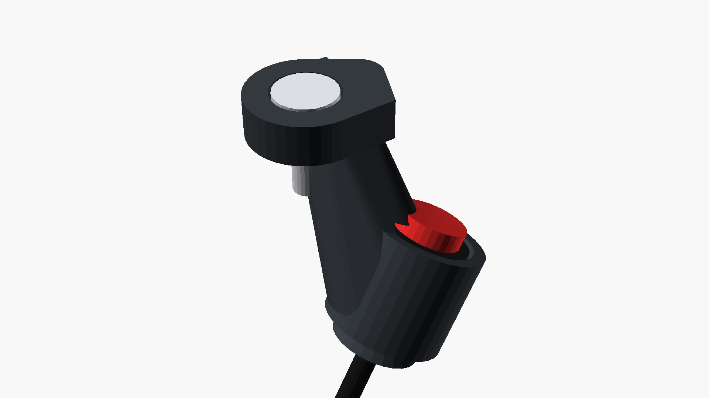

*Abbildung 8.36: 3D-CAD-Ansicht des Under-Perch Spiegel-Pods (`under_perch_mirror_pod_cad.png`). Dargestellt sind der M8/M10-Spiegelflansch mit Verdrehschutz zur Armatur, der ergonomische Daumen-Tasterdom (IP67-Mikrotaster) sowie der nach oben zum Spiegelglas ausgerichtete Diffusortrichter für die bernsteinfarbene Totwinkel-Warn-LED (BSD).*

* **Symmetrische Ergonomie & Funktionsaufteilung (Links & Rechts):**
  * **Linker Under-Perch Pod (Kommunikation & Audio):**
    * **Taktiler Daumen-PTT-Taster:** Latenzfreie Push-to-Talk-Funkübertragung für Sena, Cardo, Midland oder OMM Mesh; Dreifachklick aktiviert Siri / Google Assistant.
    * **Linke Totwinkel-Warn-LED (BSD Amber):** Strahlt blendfrei im $38^\circ$-Winkel direkt in das linke Spiegelglas, sobald das Heck-Radar ein sich von hinten links näherndes Fahrzeug erfasst.
  * **Rechter Under-Perch Pod (Action-Cam & Media-Bookmarks):**
    * **Taktiler Daumen-Taster für Action-Cam:** Kurzdruck setzt sofort einen Highlight-Marker / Bookmark im laufenden Video (BLE-Kopplung mit Insta360 X3/X4, GoPro Hero 11/12/13 oder DJI Osmo Action 4/5); langer Druck startet oder stoppt die Aufnahme (bzw. 3s Halten für Notfall-SOS).
    * **Rechte Totwinkel-Warn-LED (BSD Amber):** Strahlt blendfrei in das rechte Spiegelglas, wenn sich ein Fahrzeug im toten Winkel rechts befindet (lebensrettend beim Wiedereinscheren nach Überholvorgängen).
  * **Bilateraler Sicherheitsgewinn:** Der Fahrer erhält eine intuitive, seitengetrennte Totwinkelwarnung direkt im Blickfeld des Spiegels, den er instinktiv ansteuert.

* **Mechanische & Elektronische Vorteile:**
  * **0 mm Lenkerrohr-Bedarf:** Verbraucht keinen Millimeter auf dem geraden Lenkerrohr. Die oberen Armaturenklemmen bleiben zu **100 % frei für Zusatzschalter (z. B. Klappenauspuff)**.
  * **Baugleiche Platine (`PCBA 05B`):** Beide Pods nutzen exakt dieselbe Miniatur-Leiterplatte (`PCBA 05B` All-in-One Under-Perch Board). Die Zuordnung Links/Rechts erfolgt über den Kabelstrang (`J_POD_L` bzw. `J_POD_R` am Front-Node).
  * **Universelle Befestigung:** Klemmung direkt unter dem Spiegelgewinde (M8 / M10 / M12 oder Harley-Torx-Schraube).
  * **Pkw-Integration (Reference Kit 5 - Chase Van):** Im Begleitfahrzeug entfällt die Lenkermontage. Ein optionaler Taster ruht in der Mittelkonsole/Schalthebel, während die Sprachsteuerung primär drahtlos über CarPlay oder Headset erfolgt.

#### 8.1.1 Software-Defined Multi-Action Tasterarchitektur & Aktionskatalog

Die Funktionen der beiden physischen Daumentaster sind **zu 100 % softwaredefiniert** und keineswegs starr an eine Funktion gekoppelt. Die werkseitige Aufteilung (Links = PTT/Intercom, Rechts = Action-Cam) stellt lediglich das optimierte **Werks-Default-Profil** dar.

Über das lokale **OMB PWA-Dashboard** kann jeder Taster (Links und Rechts völlig unabhängig) frei programmiert und mit multiplen Gesten belegt werden.

* **Hardware-Ebene (Zero-Hardcoding):**
  * Auf `PCBA 05B` arbeitet ein hochzuverlässiger, IP67-versiegelter taktiler Mikrotaster (`SW1`) mit spürbarem Druckpunkt ($300\,\text{g}$ Betätigungskraft, optimal taktiles Feedback auch mit dicken Leder-Winterhandschuhen).
  * Der Taster schaltet als aktives Low-Signal gegen Masse, geschützt durch ein 100 nF RC-Entprellglied und eine bidirektionale TVS-Diode gegen elektrostatische Entladungen (ESD).
  * Das Signal wird über den 4-poligen JST-GH Kabelbaum direkt an interruptfähige GPIOs des Front-Node MCU (`PCBA 05`) geleitet.

* **Firmware Gesten-Erkennungs-Engine (Front-Node & ESP32-S3):**
  Die Firmware tastet die Signale flankengesteuert mit einer zustandsbasierten Gesten-Engine ab:
  1. `SHORT_CLICK` (Kurzdruck $< 300\,\text{ms}$, Pause $> 250\,\text{ms}$): Schneller Impuls für Marker, Toggles oder Fotoauslösung.
  2. `DOUBLE_CLICK` (Zweifachklick innerhalb von $400\,\text{ms}$): Für sekundäre Funktionen oder Weiterschalten.
  3. `TRIPLE_CLICK` (Dreifachklick innerhalb von $500\,\text{ms}$): Gezielter Aufruf von Systemdiensten (z. B. Sprachassistent).
  4. `LONG_PRESS` (Langer Druck $> 800\,\text{ms}$ bis zum Loslassen): Bestätigungskritische Aktionen wie Aufnahmestart oder Moduswechsel.
  5. `HOLD_GATE` (Kontinuierlich aktiv solange gedrückt): Klassischer Gate-Zustand für Halbduplex-Sprechfunk (PTT aktiv bei Tastendruck, sofort stumm beim Loslassen).

* **Der OMB-Aktionskatalog (Frei zuweisbar via PWA):**

| Kategorie | Aktions-ID | Beschreibung | Typische Belegung |
| :--- | :--- | :--- | :--- |
| **Intercom & Voice** | `INTERCOM_PTT_GATE` | Push-to-Talk aktiv solange gedrückt (Sena / Cardo / OMM / PMR446) | Links: `HOLD_GATE` |
| | `INTERCOM_TOGGLE` | Einmal drücken = Funkkanal offen, nochmal drücken = geschlossen | Alternativ |
| | `VOICE_ASSISTANT` | Triggert Siri / Google Assistant via Bluetooth HFP am QCC3084 | Links: `TRIPLE_CLICK` |
| | `MIC_MUTE_TOGGLE` | Helmmikrofon sofort stummschalten (Mute-Funktion) | Frei wählbar |
| | `MESH_CHANNEL_NEXT` | Schaltet die Mesh-Gruppenkanäle durch (Open Mesh 1 bis 9) | Links: `DOUBLE_CLICK` |
| **Action-Cam & Media** | `CAM_HIGHLIGHT_TAG` | Sendet BLE-Bookmark an Insta360, GoPro oder DJI (setzt Highlight-Tag im Video) | Rechts: `SHORT_CLICK` |
| | `CAM_RECORD_TOGGLE` | Startet oder stoppt die Videoaufnahme der Action-Cam via BLE | Rechts: `LONG_PRESS` |
| | `CAM_PHOTO_SNAP` | Schießt sofort ein Standbild / Foto in maximaler Sensorauflösung | Alternativ |
| | `MEDIA_PLAY_PAUSE` | Musikwiedergabe pausieren / fortsetzen | Frei wählbar |
| | `MEDIA_TRACK_NEXT` | Nächster Musiktitel im CarPlay / Android Auto Stream | Frei wählbar |
| **Navigation & Community**| `HAZARD_PIN_DROP` | **1-Klick Gefahrenstellen-Meldung:** Setzt sofort GPS-Marker und meldet via Companion-App Gefahren (Schlagloch, Ölspur, Blitzer, Panne) an Waze, Apple Maps oder OpenTrafficMap | Frei wählbar |
| | `NAV_ZOOM_IN` / `OUT` | Stufenweises Zoomen der Cockpit-Kartenansicht | Frei wählbar |
| | `NAV_MUTE_PROMPTS` | Stummschaltung von Navigationsansagen für 10 Minuten | Frei wählbar |
| **Sicherheit & Radar** | `RADAR_MUTE_30S` | Schaltet akustische Radar-Warntöne für 30s im dichten Stop-and-Go-Verkehr stumm | Frei wählbar |
| | `EMERGENCY_SOS_BROADCAST`| Sendet 868 MHz LoRa Notfall-Beacon mit GPS-Koordinaten an alle Gruppenmitglieder | Rechts: 3s `LONG_PRESS` |
| **Smart Vehicle / Home** | `GARAGE_DOOR_TRIGGER` | Sendet Webhook/BLE-Signal an Home Assistant oder Shelly zur Garagentoröffnung | Frei wählbar |
| | `AUX_LIGHTS_TOGGLE` | Schaltet Zusatzscheinwerfer über den geschalteten Front-Node Ausgang | Frei wählbar |
| | `HEATED_GRIPS_CYCLE` | Schaltet Heizgriff-Stufen durch (0% $\rightarrow$ 33% $\rightarrow$ 66% $\rightarrow$ 100%) | Frei wählbar |

* **Auslieferungs-Profil (Factory Default Profile):**
  * **Linker Taster:** `HOLD_GATE` $\rightarrow$ `INTERCOM_PTT_GATE`; `TRIPLE_CLICK` $\rightarrow$ `VOICE_ASSISTANT`; `DOUBLE_CLICK` $\rightarrow$ `MESH_CHANNEL_NEXT`.
  * **Rechter Taster:** `SHORT_CLICK` $\rightarrow$ `CAM_HIGHLIGHT_TAG`; `LONG_PRESS` $\rightarrow$ `CAM_RECORD_TOGGLE`; 3s Halten $\rightarrow$ `EMERGENCY_SOS_BROADCAST`.

### 8.2 Spiegel-Totwinkel-LED Gehäuse (`bsd_mirror_indicator_pod.scad`)

Das **Spiegel-Totwinkel-LED Gehäuse** ([`bsd_mirror_indicator_pod.scad`](../../hardware/cad/scad/05_accessories/bsd_mirror_indicator_pod.scad)) integriert die Radarwarnung (Port `J9` am Front-Node) aerodynamisch und blendfrei in das Cockpit:

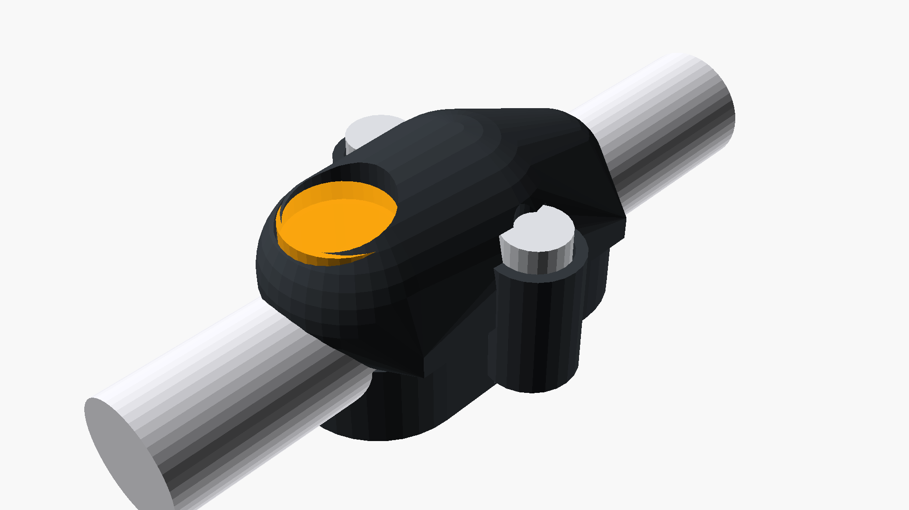

*Abbildung 8.37: 3D-CAD-Ansicht des aerodynamischen Spiegel-Totwinkel-Pods (`bsd_mirror_indicator_pod_cad.png`). Sichtbar sind die strömungsgünstige Tropfenform auf dem Ø 10 mm Spiegelarm, die 2-Punkt M3-Edelstahl-Klemmschelle, die 38° nach innen zum Fahrerhelm gerichtete Blendschutzhaube sowie die bernsteinfarbene Diffusorlinse.*

* **Optische & Gesetzliche Sicherheit (StVZO / ECE R50):**
  * **Gezielte Fahrer-Projektion:** Der um 38° nach innen geneigte Lichttunnel projiziert das gelb/rote Radar-Stroboskoplicht exakt in das periphere Sichtfeld des Fahrerhelms.
  * **100 % Blendfreiheit:** Ein 3,8 mm tiefer Visier-Überhang und die blickdichte Vorderwand schirmen das Licht vollständig nach vorne und zur Seite ab. Kein Blenden des Gegenverkehrs, kein Irritieren anderer Verkehrsteilnehmer - voll TÜV-konform.
  * **Universalklemmung:** Zweiteilige Halbschale für Ø 10 mm (Harley, BMW, KTM) und Ø 12 mm Spiegelarme mit verdeckter Kabelführung zu Port `J9`.

### 8.3 Radar 2.0 mmWave Flügel-Gehäuse & Garmin-Bajonett (`radar_mr20_housing.scad`)

Das **Radar 2.0 Flügel-Gehäuse** ([`radar_mr20_housing.scad`](../../hardware/cad/scad/05_accessories/radar_mr20_housing.scad)) integriert das 77-GHz-mmWave-Sensormodul Wheeltec MR20, die geroutete Trägerplatine PCBA 08 (mit 36-LED Warnflügeln und ESP32-C5 Dual-Band Sub-MCU), den Garmin Quarter-Turn Bajonettverschluss sowie die autarke 5.9 GHz ITS-G5 (V2X) Keramik-Patchantenne:

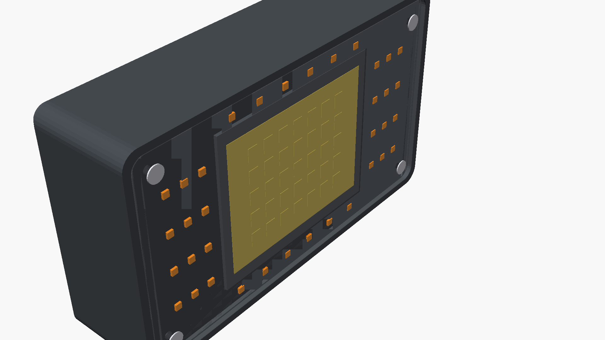

*Abbildung 8.38: 3D-CAD-Frontansicht des Radar 2.0 Flügel-Gehäuses (`radar_mr20_housing_cad.png`). Sichtbar sind das symmetrische $121 \times 71 \times 34\,\text{mm}$ PA12-MJF Monocoque-Gehäuse, der plane PC-Radom-Fensterrahmen ($116 \times 66 \times 1{,}6\,\text{mm}$) mit 4x M2.5 Torx-Eckverschraubung, der zentrierte $61 \times 51\,\text{mm}$ Radarausschnitt für das MR20 77-GHz-Horn-Array, die beidseitigen LED-Warnflügel-Kammern sowie die linke Antennenkammer für die 5.9 GHz V2X-Keramik-Patchantenne.*

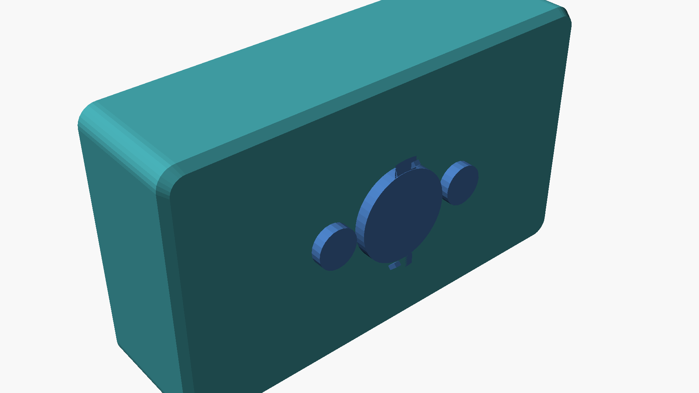

*Abbildung 8.38b: 3D-CAD-Rückansicht des Radar 2.0 Gehäuses (`radar_mr20_housing_bayonet_cad.png`). Dargestellt sind der monolithische Garmin Quarter-Turn Bajonett-Zapfen (kompatibel mit `radar_varia_gopro_lock_dock.scad` und allen Standard-Varia-Haltern), die federnde Rastklinken-Diebstahlsicherung, das symmetrische DIN 934 M4-Mutterntaschen-Lochbild ($40\,\text{mm}$ Stichmaß, 100 % lötkolbenfrei) sowie die zentrierte M8-IP67-Kabeldurchführung für den 2-poligen JST-JWPF 12V-Bordnetzanschluss am Gehäuseboden.*

* **Konstruktionsmerkmale & HF-Architektur:**
  * **Symmetrisches Flügel-Rechteck ($121{,}0 \times 71{,}0 \times 34{,}0\,\text{mm}$):** Optimale aerodynamische Schaufelform, die sich harmonisch an Kennzeichenträger und Heckfender anschmiegt.
  * **Integrierte 5.9 GHz V2X Keramik-Patchantennen-Kammerturm:** Auf der linken Gehäuseflanke ist eine Rastkammer für $20 \times 20\,\text{mm}$ oder $25 \times 25\,\text{mm}$ Keramik-Patchantennen monolithisch eingeformt. Dies garantiert maximale Antennenreichweite ohne Gehäusedämpfung und ohne interne PCB-Antennen-Verluste.
  * **Großzügiger Adapter- & Verkabelungsraum ($112 \times 62 \times 17\,\text{mm}$):** Nimmt den originalen MR20-Zwischenadapter und Kabelbaum-Schlaufen knickfrei im Gehäuseinneren auf.
  * **Optisches PC-Radom & IP67-Dichtung:** Glattes, unstrukturiertes Polycarbonat ($116 \times 66 \times 1{,}6\,\text{mm}$) mit umlaufender EPDM-Schnurnut garantiert 0 dB RF-Dämpfung bei 77 GHz und Schlagfestigkeit nach IK08.
  * **Integrierter Spritzwasser-Schutzspoiler (Roost-Deflector am Gehäuseboden):** Unmittelbar vor der M8-Kabelverschraubung schützt eine monolithische PA12-Schutzschürze mit scharfer Abtropfkante das Gewinde und die Dichtung gegen direkt von der Reifenkarkasse aufgewirbeltes Schmutzwasser, Rollsplitt und Hochdruck-Gischt.

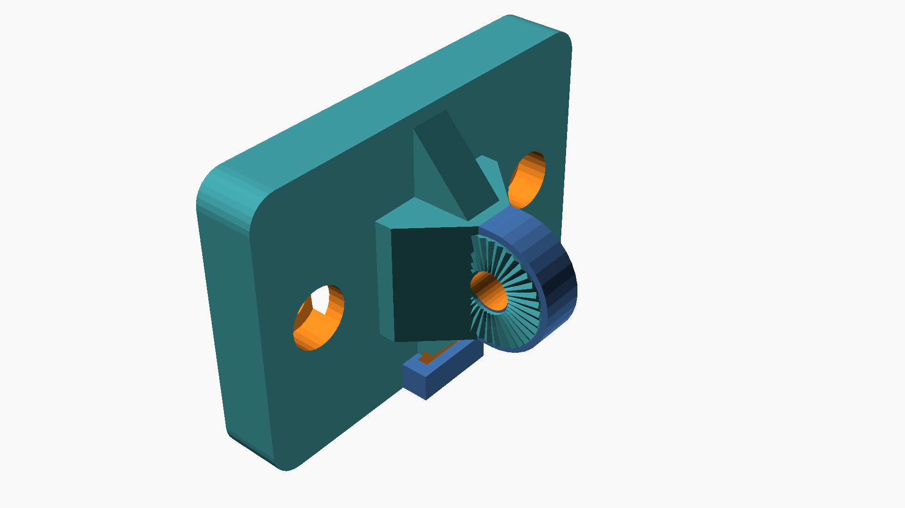

*Abbildung 8.38c: 3D-CAD-Ansicht des Schwerlast-Neigegelenks (`radar_swivel_tilt_cradle_cad.png`). Sichtbar sind die massive $58 \times 40 \times 8{,}5\,\text{mm}$ PA12-Adapterplatte mit 2x M4-Schraubensenkungen ($40\,\text{mm}$ Stichmaß), die zentrierte $\varnothing 34\,\text{mm}$ Garmin-Freimachung, die bionische 36-Zahn Hirth-Zunge auf Schwerpunkt-Höhe ($Z = 0$) sowie die integrierte Kabelbinder-Zugentlastung.*

* **Die 3 Montagekonzepte im Vergleich (Mechanik, Justage & Dauerfestigkeit):**
  1. **Option A: Schwerlast-Neigegelenk (`radar_swivel_tilt_cradle.scad`) mit 2x DIN 934 M4 Schraubverbindung & Actioncam-Hirth-Gelenk – ⭐ OMB-Standard (100 % lötkolbenfrei & schlaglochfest!):**
     * **Warum eine starre Montage physikalisch versagt:** Motorrad-Kennzeichenhalter weisen konstruktions- und herstellerbedingt stark unterschiedliche Anstellwinkel auf (von legalen $30^\circ$ bis zu extremen $45^\circ$ bei Custom-Hecks). Zudem verändert sich der Nickwinkel der Maschine im Fahrbetrieb drastisch durch Fahrergewicht, Federungsabstimmung, Gepäckzuladung und Soziusbetrieb. Ein 77-GHz-Radarsensor mit $90\,\text{m}$ Reichweite benötigt zwingend eine präzise Horizontalausrichtung der Strahlungskeule ($\pm 2^\circ$). Eine starre Halterung ohne Neigungsverstellung würde bei Bodenwellen oder Beladung den Radarkegel in den Asphalt oder nutzlos in den Himmel lenken.
     * **Zweiteiliges Actioncam-Prinzip (Gehäuse verschrauben + Gelenkachse arretieren):** Das fertig montierte, abgedichtete Radar 2.0 Gehäuse wird von der Rückseite her über zwei **DIN 912 M4 $\times$ 12 mm Stahlschrauben** ($40\,\text{mm}$ Stichmaß) direkt in die innenliegenden formschlüssigen DIN 934 M4-Muttern der Gehäuserückwand mit der massiven Adapterplatte ([`radar_swivel_tilt_cradle.scad`](../../hardware/cad/scad/02_pod_base/radar_swivel_tilt_cradle.scad)) verschraubt. Formschlüssige Passungs-Bosse nehmen 100 % der dynamischen Scherkräfte auf.
     * **Formschluss-Arretierung im Schwerpunkt ($Z = 0$):** Auf der Rückseite der Adapterplatte ragt eine $6{,}0\,\text{mm}$ breite Actioncam/GoPro-kompatible Zunge mit beidseitiger 36-Zahn Hirth-Rosette ($10^\circ$-Rastung) direkt in die Gabel des Kennzeichenträgers ([`radar_license_plate_bracket.scad`](../../hardware/cad/scad/02_pod_base/radar_license_plate_bracket.scad)) oder Unterfender-Halters. Eine durchgehende DIN 912 M5-Klemmschraube mit DIN 934 M5 Mutter fixiert den Nickwinkel unlösbar und verdrehsicher.
     * **Verliersicherheit bei Schlaglöchern:** Die Konstruktion baut durch die Adapterplatte zwar ca. $18\,\text{mm}$ tiefer nach hinten auf. Dafür ist der Massenschwerpunkt des ca. $180\,\text{g}$ schweren Gesamtsystems direkt in der Drehachse aufgehängt – Schwingbrüche an Einzellug-Füßchen oder das Ausrasten von Kunststoff-Bajonetten bei $25\,g$-Schlaglochstößen sind physikalisch ausgeschlossen!
     * **Kein Einschmelzen, kein Lötkolben, kein Kunststoff-Gewindeschneiden:** Sämtliche Gewinde nutzen formschlüssig eingedruckte DIN 934 Sechskantmutter-Taschen (M2, M4, M5). Gehäuse können beliebig oft demontiert und wieder zusammengebaut werden, ohne dass Gewinde verschleißen.
  2. **Option B: Garmin Quarter-Turn Bajonettverschluss (Schnellwechsel / Leichtbau):**
     * Ermöglicht das werkzeuglose Aufsetzen und Verriegeln durch $90^\circ$-Drehung in Standard-Garmin-Varia-Cradles oder das OMB-Diebstahlschutz-Dock ([`radar_varia_gopro_lock_dock.scad`](../../hardware/cad/scad/02_pod_base/radar_varia_gopro_lock_dock.scad)).
     * **Stabilitäts- und Vibrationsbewertung:** Das originale Garmin-Bajonett wurde für leichte Fahrrad-Radare (Garmin Varia RTL515, ca. $71\,\text{g}$) konstruiert. Das vollwertige Radar 2.0 System (PA12-Monocoque + MR20 77-GHz-Horn + PCBA 08 mit 36 LEDs + V2X-Patch) wiegt ca. **$180\,\text{g}$**. Auf dem Motorrad (Einzylinder-Vibrationen, Schotterpisten, Schlaglöcher) stößt ein reines Kunststoff-Bajonett an seine Ermüdungsgrenze. Option B ist ideal für Schnellwechsel an Fahrrädern oder CNC-Alu-Haltern; für die permanente Motorrad-Festmontage ist Option A klar überlegen.
  3. **Option C: Untere Clevis-Zunge (Optional):**
     * Nur für leichte Einzelsensoren ohne LED-Flügel vorgesehen, da der Hebelarm von $35\,\text{mm}$ unter dem Schwerpunkt bei $180\,\text{g}$ hohe Biegemomente erzeugt.

* **Dichtigkeit & Spritzwasserschutz von unten (Fender- & Reifenspritzbereich):**
  * **Das Problem:** Bei der Montage unter dem Heckfender oder Kennzeichen befindet sich die Gehäuseunterseite im direkten Abwurfbereich der Reifengischt. Das rotierende Hinterrad schleudert bei Regen Wasser und Straßenschmutz mit hoher Geschwindigkeit wie ein Hochdruckreiniger gegen das Heck.
  * **Die 4-Stufen-Schutzarchitektur:**
    1. **Monolithischer Roost-Deflector:** Die an der Unterseite angeformte Schutzschürze fängt die Vorwärtsgischt des Reifens mechanisch ab.
    2. **IP68/IP69K EPDM-O-Ring-Kammer:** Die M8-Kabelverschraubung drückt ihren O-Ring in eine formschlüssige Kammer ($\varnothing 11{,}5 \times 2{,}2\,\text{mm}$) am Gehäuseboden. Der O-Ring kann unter Dauervibration nicht seitlich ausweichen.
    3. **JST-JWPF 2-Pin Innenstecker:** Das 2-adrige FLRY-B Kabel führt zu einem vollständig silikongedichteten JST-JWPF Stecker im trockenen Gehäuseinnenraum (doppelte Dichtungsbarriere).
    4. **Abtropfschlaufe (Drip-Loop) im Träger:** Das Kabel wird verdeckt im Rückseitenkanal des Kennzeichenträgers geführt und tritt in einem Bogen von unten in die Verschraubung ein. Durch die Schwerkraft tropft abfließendes Wasser an der tiefsten Stelle des Bogens auf die Fahrbahn ab, anstatt zur Dichtung zu kriechen.

### 8.4 Harley Touring: Handschuhfach Media- & Power-Injection Hub (`glovebox_power_injection_hub.scad`) & Cockpit-Peripherie

Der **4-Port Handschuhfach Media- & Power-Injection Hub** ([`glovebox_power_injection_hub.scad`](../../hardware/cad/scad/04_front_node/glovebox_power_injection_hub.scad)) löst die Stromversorgungs- und Infotainment-Herausforderungen im rechten Handschuhfach (Media-Compartment) der Harley-Davidson Touring Bagger (Street Glide, Road Glide, CVO, CVO ST) **zu 100 % bohrungsfrei und werterhaltend**:

#### 8.4.1 Systemarchitektur & Clean Power-Injection

```text
 +-------------------------------------------------------------------------+
 | HARLEY TOURING RECHTES HANDSCHUHFACH (CVO / ST / RG / SG)               |
 |                                                                         |
 |  +-------------------------------------------------------------------+  |
 |  | 4-PORT HANDSCHUHFACH HUB (glovebox_power_injection_hub.scad)      |  |
 |  | * Port 1 (30W USB-PD): Smartphone Fast-Charging im Fach           |  |
 |  | * Port 2 (Geschaltet 10W): Wireless CarPlay / AA Dongle im Fach   |  |
 |  | * Port 3 (Service/USB-Stick): Freier Medienport im Fach           |  |
 |  | * Port 4 (USB Headset-Emulation): Direktanbindung Headunit (GTS)  |  |
 |  |   --> Reine Fach-interne Peripherie! Zero externe Kabeldurchzüge!  |  |
 |  +-----------------------------------+-------------------------------+  |
 |                                      ^                                  |
 |                                      | Werkseitige Unterseiten-Tülle    |
 =======================================|===================================
   Handschuhfach-Boden (100% Zero-Drill! Dichtung bleibt hermetisch dicht)
                                        |
       Zuleitung von Front-Node PCBA 05 (Power & USB 2.0 für Headset-Emulation)
       [Action-Cam & Navi werden DIREKT am Front-Node angeschlossen - kein Umweg!]
```

1. **Mechanischer Aufbau & Zero-Drill Montage:**
   * **Passgenaue Bodenaufnahme:** Das kompakte Gehäuse ([`glovebox_power_injection_hub.stl`](../../hardware/cad/stl/04_front_node/glovebox_power_injection_hub.stl)) liegt vibrationsgedämpft am Boden des rechten Handschuhfachs.
   * **OEM-Tüllen-Durchstich:** Die Zuleitung erfolgt ausschließlich von *unten* durch die ab Werk vorhandene Harley-Gummitülle. Die umlaufende Fach-Türdichtung bleibt unberührt, sodass das Handschuhfach absolut regendicht verschließt.
2. **Infotainment Clean-Power Injection & Harley Headset-Emulation via USB:**
   * **Harley Headset-Emulation via USB (Port 4):** Über das integrierte High-Speed Datenpaar der Zuleitung meldet sich OpenMotorBridge an der Headunit (Skyline OS / Boom! Box GTS) als vollwertiges MFi / USB Audio Class Headset an. Apple CarPlay wird sofort freigeschaltet; Sprachbefehle und Intercom-Mikrofone werden digital ohne analoges Brummen direkt in die Headunit eingespeist.
   * **Keine Headunit-Bootloops:** Handelsübliche Wireless CarPlay / Android Auto Dongles (Ottocast U2-Air, Carlinkit 5.0, AAWireless) überfordern die schwach dimensionierte 500 mA OEM-USB-Buchse der Headunit (Skyline OS / Boom! Box GTS), was zu plötzlichen Reboots führt. Der OMB Hub trennt die Stromversorgung hardwareseitig ab und speist den Dongle aus einer dedizierten, gefilterten 5V/2A (10W) Schiene, während die USB-Datenleitungen (`D+`, `D-`) verlustfrei an die Headunit durchgeschleift werden.
   * **30W Smartphone Fast-Charging:** Ein zweiter interner USB-C Port lädt das im Fach verstaute Smartphone mit vollem USB-PD Ladestrom (bis zu 30W).
3. **Direktes Action-Cam Kabel am Front-Node (Power-Only / BC 1.2 DCP):**
   * Statt ineffizienter und hitzeintensiver induktiver Qi-Übertragung durch die 2,8 mm dicke ABS-Verkleidungswand wird eine **direkte, wettergeschützte 10W USB-C Zuleitung (Power-Only / BC 1.2 DCP)** aus der 60W Power-Engine des Front-Knotens an die Actioncam (Insta360 X3/X4, GoPro Hero, DJI Osmo Action) geführt.
   * **Kein Kabelumweg durch das Handschuhfach:** Das Action-Cam Kabel muss weder ins Handschuhfach hinein noch aus der Bodentülle herausgeführt werden, sondern verläuft direkt am Cockpitträger / Riser zur Kamerahalterung.
   * **Schutz vor PC-Modus:** Die Datenleitungen `D+` und `D-` sind im Kamerastecker kurzgeschlossen ($R < 200\,\Omega$) und besitzen keinerlei Verbindung zum Host-Hub. Die Kamera erkennt ein reines Bordnetz-Ladegerät, startet bei Zündung-AN sofort die Schleifenaufnahme und blockiert niemals in einem "PC verbunden / Webcam / MTP"-Dialog!
   * Smartphone-Qi-Ladung erfolgt bei Bedarf am Lenker über industrieerprobte COTS-Halterungen (SP Connect / QuadLock Wireless Charging Head).
4. **Modulares Schnapp-Sensor-Puck ("Körbchen", `sensor_puck_environmental.scad`):**
   * Die hochsensible Umgebungssensorik (u-blox SAM-M10Q GNSS, TI TMP117 Temperatursensor, OPT3001 Umgebungslichtsensor und Knowles I2S MEMS Fahrtwind-Mikrofon) ist in einer **modularen Schnapp-Kapsel** ([`sensor_puck_environmental.stl`](../../hardware/cad/stl/04_front_node/sensor_puck_environmental.stl)) untergebracht.
   * Auf dem Motorrad rastet das Körbchen formschlüssig direkt auf der Front-Node Unterwanne ein.
   * Im Begleitfahrzeug (Car-Kit) oder bei Sonderbauten kann das Körbchen mit einem Griff ausgeklinkt und über ein dünnes 1,5 m langes 6-Pin Verbindungskabel an optimal exponierter Stelle (z. B. an der Frontscheibenbasis via [`car_dashboard_wedge_dock.scad`](../../hardware/cad/scad/05_accessories/car_dashboard_wedge_dock.scad)) platziert werden.

---

## 9. CAD-Dateistruktur & OpenSCAD-Modulbaukasten (STL-Bibliothek)

Die CAD-Dateistruktur von OpenMotorBridge folgt einer strengen hierarchischen CSG-Architektur (Constructive Solid Geometry):
- **Hauptverzeichnisse (`01_main_box/`, `02_pod_base/`, `03_pod_cartridges/`, `04_front_node/`, `05_accessories/`)**: Enthalten **ausschließlich monolithische, direkt 3D-druckbare Produktions-STLs** (100 % single-manifold, wasserdicht, 0 frei schwebende Körper).
- **Unterordner (`components/`)**: Enthalten die parametrischen CSG-Einzelkomponenten (z. B. unbeschnittene Basiskörper, Flansche, Schraubdome, Dichtkämme und PCB-/Akku-Dummies) für Baugruppenmontagen und modulare Adaptionen.

### 9.1 Druckfertige Produktions-STLs (Hauptverzeichnisse)

| Baugruppe | Funktion / Bauteil | Druckfertige STL-Datei | Parametrischer OpenSCAD Code |
| :--- | :--- | :--- | :--- |
| **Zentralbox** | Unterwanne mit Dichtnut & Halteohren | `01_main_box/main_box_lower_case.stl` | `01_main_box/00_lower_deck.scad` |
| **Zentralbox** | Oberwanne mit Zwischenboden | `01_main_box/main_box_mid_tray.stl` | `01_main_box/01_upper_deck.scad` |
| **Zentralbox** | Gehäusedeckel mit Gore-Vent | `01_main_box/main_box_lid.stl` | `01_main_box/02_colsure.scad` |
| **Satelliten-Pod**| 5-seitiges Monocoque-Gehäuse (Tunnel) | `02_pod_base/pod_base_housing.stl` | `02_pod_base/pod_base_housing.scad` |
| **Satelliten-Pod**| Universelle 2-fach Aktuator-Schlittenschiene (15–85 mm stufenlos) | `02_pod_base/012_universal_actuator_slide_bracket.stl` | `02_pod_base/parts/012_universal_actuator_slide_bracket.scad` |
| **Adventure Radar**| Gepäckbrücken-Radarträger Basis (Ø 18 mm Rohr) | `02_pod_base/adventure_rack_radar_mount.stl` | `02_pod_base/adventure_rack_radar_mount.scad` |
| **Adventure Radar**| Gepäckbrücken-Radarträger Klemmschelle Kappe | `02_pod_base/adventure_rack_radar_clamp_cap.stl` | `02_pod_base/adventure_rack_radar_mount.scad` |
| **Adventure Pods 1/2**| GS Transition Dock Basis-Wanne (Bügelfalten-Unterteil) | `02_pod_base/adventure_transition_dock_base.stl` | `02_pod_base/adventure_transition_dock.scad` |
| **Adventure Pods 1/2**| GS Transition Dock Karosserie-Deckel (Bügelfalten-Cowl) | `02_pod_base/adventure_transition_dock_lid.stl` | `02_pod_base/adventure_transition_dock.scad` |
| **Adventure-Kit** | Unter-Sitzbank-Sattelbrücke (Traverse links-rechts) | `02_pod_base/adventure_underseat_cross_rail.stl` | `02_pod_base/adventure_underseat_cross_rail.scad` |
| **Adventure Pods 1/2**| GSA Heavy-Duty Cage Dock Gehäusekorpus (Ø 18 mm Rohr) | `02_pod_base/adventure_gsa_cage_dock_body.stl` | `02_pod_base/adventure_gsa_cage_dock.scad` |
| **Adventure Pods 1/2**| GSA Heavy-Duty Klemmschelle Kappe (Ø 18 mm Rohr) | `02_pod_base/adventure_gsa_clamp_cap.stl` | `02_pod_base/adventure_gsa_cage_dock.scad` |
| **Adventure Pods 1/2**| GSA Rohrträger-Klemmschelle Basis (Minimal-Option) | `02_pod_base/adventure_pannier_rack_clamp_base.stl` | `02_pod_base/adventure_pannier_rack_clamp.scad` |
| **Adventure Pods 1/2**| GSA Rohrträger-Klemmschelle Kappe (Minimal-Option) | `02_pod_base/adventure_pannier_rack_clamp_cap.stl` | `02_pod_base/adventure_pannier_rack_clamp.scad` |
| **Rahmendock** | MagSafe Rahmen-Dock Gehäuseoberteil (Rohrsattel, Flügel & M2.5 Nut-Pocket) | `02_pod_base/components/009_magsafe_frame_dock.stl` | `02_pod_base/parts/009_magsafe_frame_dock.scad` |
| **Rahmendock** | MagSafe Rohrschellen-Bügel (Ø 26 mm) | `02_pod_base/components/009_magsafe_frame_clamp.stl` | `02_pod_base/parts/009_magsafe_frame_dock.scad` |
| **Rahmendock** | MagSafe Rahmen-Dock Gehäuseunterteil (PCB-Ledge & M2.5 Senkung) | `02_pod_base/components/009_magsafe_frame_lid.stl` | `02_pod_base/parts/009_magsafe_frame_dock.scad` |
| **Kofferdeckel-Dock** | Harley One-Touch Kofferdeckel-Dock Halbschale | `02_pod_base/saddlebag_lid_dock.stl` | `02_pod_base/saddlebag_lid_dock.scad` |
| **Radarhalter** | Entkoppelte Kennzeichen-Radarhalterung | `02_pod_base/radar_license_plate_bracket.stl` | `02_pod_base/radar_license_plate_bracket.scad` |
| **Radarhalter** | Stealth Center Under-Fender Radar-Mount (Custom / Bobber) | `02_pod_base/radar_center_underfender_mount.stl` | `02_pod_base/radar_center_underfender_mount.scad` |
| **Radar-Gelenk** | Radar 2.0 Schwerlast-Neigegelenk (Actioncam/GoPro-Hirth-Cradle) | `02_pod_base/radar_swivel_tilt_cradle.stl` | `02_pod_base/radar_swivel_tilt_cradle.scad` |
| **Radar-Zubehör** | Garmin Varia Quarter-Turn Anti-Theft Lock Dock | `02_pod_base/radar_varia_gopro_lock_dock.stl` | `02_pod_base/radar_varia_gopro_lock_dock.scad` |
| **Kassette** | Universeller Basisschlitten mit Dichtung | `03_pod_cartridges/cartridge_base_sled.stl` | `03_pod_cartridges/00_base_sled.scad` |
| **Kassette** | Magnetischer Diebstahlschutz-Rastbolzen (Sägezahn-Mechanik) | `03_pod_cartridges/cartridge_magnetic_lock_latch.stl` | `03_pod_cartridges/parts/05_magnetic_lock_latch.scad` |
| **Kassette** | Sena SPIDER X Slim Adapterkassette | `03_pod_cartridges/cartridge_insert_sena.stl` | `03_pod_cartridges/parts/01_insert_sena.scad` |
| **Kassette** | Cardo Packtalk Edge Adapterkassette | `03_pod_cartridges/cartridge_insert_cardo.stl` | `03_pod_cartridges/parts/02_insert_cardo.scad` |
| **Kassette** | IP67 Blindkassette (wasserdichte Dry Box)| `03_pod_cartridges/cartridge_insert_blindkassette.stl` | `03_pod_cartridges/parts/03_insert_blindkassette.scad` |
| **Kassette** | OMM 2.4 GHz UCS-Inlaykassette | `03_pod_cartridges/cartridge_insert_omm_ucs.stl` | `03_pod_cartridges/cartridge_omm_transceiver.scad` |
| **Kassette** | OMM 2.4 GHz Antennen-Halterung | `03_pod_cartridges/cartridge_antenna_bracket_omm.stl` | `03_pod_cartridges/parts/04_antenna_bracket_omm.scad` |
| **Front-Knoten** | Unterwanne mit 4-in-1 Boden & Ohren | `04_front_node/front_node_lower_tub.stl` | `04_front_node/00_front_node_tub.scad` |
| **Front-Knoten** | Gehäusedeckel mit LED & FPC-Tasche | `04_front_node/front_node_upper_lid.stl` | `04_front_node/01_front_node_lid.scad` |
| **Front-Knoten** | EPDM/TPU Dichtkamm-Paar mit Steg | `04_front_node/front_node_cable_glands_tpu.stl` | `04_front_node/02_front_node_cable_glands.scad` |
| **Front-Knoten** | TPU USB-C Staubschutzstopfen | `04_front_node/front_node_usbc_cap_tpu.stl` | `04_front_node/03_front_node_usbc_plug.scad` |
| **Front-Knoten** | Verkleidungs-Rohrschelle (Ø 12–22 mm, AMPS) | `04_front_node/front_node_fairing_tube_clamp.stl` | `04_front_node/front_node_fairing_tube_clamp.scad` |
| **Front-Knoten** | Modulares Schnapp-Sensor-Puck ("Körbchen" für GNSS/Temp/MEMS) | `04_front_node/sensor_puck_environmental.stl` | `04_front_node/parts/sensor_puck_environmental.scad` |
| **Front-Knoten** | Handschuhfach 4-Port Media- & Power-Injection Hub | `04_front_node/glovebox_power_injection_hub.stl` | `04_front_node/glovebox_power_injection_hub.scad` |
| **Smart-Keyfob** | PA12-MJF Unterschale mit MagSafe-Tasche | `05_accessories/smart_keyfob_lower_shell.stl` | `05_accessories/smart_keyfob_pager.scad` |
| **Smart-Keyfob** | PA12-MJF Oberschale mit Tastenbett & Diffusor-Bohrung | `05_accessories/smart_keyfob_upper_shell.stl` | `05_accessories/smart_keyfob_pager.scad` |
| **Smart-Keyfob** | TPU Stoßdämpfer-Kantenband (Orange) | `05_accessories/smart_keyfob_tpu_rim.stl` | `05_accessories/smart_keyfob_pager.scad` |
| **Smart-Keyfob** | Silikon-Dicht-Tastmatte (Dual-Keypad, Orange) | `05_accessories/smart_keyfob_silicone_keypad.stl` | `05_accessories/smart_keyfob_pager.scad` |
| **Tasterhalter** | Under-Perch Tasterhalter für M4 Harley-Armatur | `05_accessories/under_perch_switch_bracket.stl` | `05_accessories/under_perch_switch_bracket.scad` |
| **Tasterhalter** | Spiegelschaft-Adapterplatte für M8/M10 | `05_accessories/under_perch_mirror_plate.stl` | `05_accessories/under_perch_switch_bracket.scad` |
| **Spiegel-Radar** | BSD Spiegel-Totwinkel-Pod Oberteil (38° Trichter) | `05_accessories/bsd_mirror_upper_pod.stl` | `05_accessories/bsd_mirror_indicator_pod.scad` |
| **Spiegel-Radar** | BSD Spiegel-Klemmschelle Unterteil (Ø 10 mm) | `05_accessories/bsd_mirror_lower_clamp.stl` | `05_accessories/bsd_mirror_indicator_pod.scad` |
| **Spiegel-Radar** | BSD Diffusorlinse (Bernstein / transluzent) | `05_accessories/bsd_mirror_lens.stl` | `05_accessories/bsd_mirror_indicator_pod.scad` |
| **Radar 2.0** | Wheeltec MR20 77GHz Gehäuse mit JST-JWPF 2-Pin Flansch & Radome | `05_accessories/radar_mr20_housing.stl` | `05_accessories/radar_mr20_housing.scad` |
| **Auto-Zubehör** | Begleitfahrzeug / Auto Universal Sonnenblenden-Clip für Pod 1 & 2 | `05_accessories/car_sun_visor_pod3_clip.stl` | `05_accessories/car_sun_visor_pod3_clip.scad` |
| **Kassette** | Universelle 2D-Langloch-Rasterplatte & seitliche Aktuator-Ausleger | `03_pod_cartridges/cartridge_universal_actuator_rails.stl` | `03_pod_cartridges/cartridge_universal_actuator_rails.scad` |

### 9.2 Baukasten-Komponenten & Dummies (`components/`-Verzeichnisse)

In den `components/`-Verzeichnissen liegen die isolierten Basiskörper (vor Differenzoperationen) und Zubehörteile:
- **`01_main_box/components/`**: `01_lower_tub_empty.stl`, `02_corner_screws_enclosure.stl`, `03_pcb_standoffs.stl`, `04_mounting_ears.stl`, `05_sealing_groove.stl`, `06_mid_tray_frame.stl`, `07_mid_partition_floor.stl`, `08_lid_plate.stl`, `dummy_main_pcb.stl`, `dummy_lipo_battery.stl`.
- **`02_pod_base/components/`**: `01_pod_tunnel_base.stl`, `02_pod_rear_m8_gland.stl`, `03_pod_bulkhead_partition.stl`, `04_pod_guide_grooves.stl`, `05_pod_strap_hooks.stl`, `06_fender_curved_saddle.stl`, `07_pod_slide_dock_core.stl`, `011_gopro_hirth_lock.stl` (Radiale Formschluss-Verzahnung), `dummy_m8_connector.stl`.
- **`03_pod_cartridges/components/`**: `dummy_adapter_pcb.stl`, `cartridge_insert_omm_ucs.stl`.
- **`04_front_node/components/`**:
  - `01_front_node_base_tub.stl`: Monolithischer, abgerundeter Basiskörper mit ausgehöhlter Innenkammer (Grundquader im CSG-Verfahren).
  - `02_pcb_standoffs.stl`: 4x M2.5 Schraubdome für PCBA05.
  - `03_mounting_ears.stl`: 2x M4/M5 Schwingungsdämpfer-Flanschohren.
  - `dummy_front_node_pcb.stl`: 3D-Prüfdummy der PCBA05 mit Steckverbinder-Höhenprofilen.

---

## 10. Fertigungsspezifikation & 3D-Druck Parameter (HP MJF vs. FDM)

### 10.1 Industrieller 3D-Druck (HP MJF PA12)
* **Verfahren:** HP Multi Jet Fusion (MJF), schwarz eingefärbt, kugelgestrahlt und chemisch dampfgeglättet.
* **Toleranzen:** $\pm 0{,}15\,\text{mm}$ (DIN ISO 2768-m).
* **Eigenschaften:** Isotrope Zugfestigkeit $48\,\text{MPa}$, temperaturbeständig bis $+95\,^\circ\text{C}$, $100\,\%$ porenfrei.

### 9.2 Heimischer FDM-Druck (Bambu Lab / Prusa / Voron)
* **Materialien:** ASA oder PETG (niemals Standard-PLA!).
* **Wandlinien:** 4 bis 5 Perimeter ($1{,}6\dots 2{,}0\,\text{mm}$ massiv).
* **Infill:** $25\dots 40\,\%$ Gyroid.
* **Flow:** $102\dots 104\,\%$ zur Mikroporenabdichtung.
