# 07 - Hardware Architecture & Board Pinouts (The Standardized v10.0 Lineup)

This document serves as the **authoritative hardware specification for all active board assemblies (`PCBA 01`, `03`, `05`, `05B`, `07`, `08`, `09`, `10`)** of the OpenMotorBridge system (v10.0 Standardized Node Architecture), detailing layer stackups, controlled impedance classes, zoning concepts, and complete pinout tables.

---

## 1. Overview of the v10.0 Hardware Lineup

OpenMotorBridge v10.0 replaces the legacy experimental UWB wireless backbone with a heavy-duty, shielded **4-wire automotive backbone** (`VCC_BUS` 12V/PD, `USB_D-`, `USB_D+`, `GND`). This provides all nodes (saddlebag pods and front node) with **massive charging power (up to 60W USB-PD)** and **rock-solid native USB 2.0 data throughput** simultaneously -- completely impervious to RF shadowing from wet rain suits, soaked luggage, or aluminum panniers.

```
+----------------------------------------------------------------------------------------+
|                     OPENMOTORBRIDGE v10.0 HARDWARE LINEUP                              |
+-------+-------------------------------+---------------+---------+----------------------+
| Assy  | Name & Function               | PCB Outline   | Layers  | Key ICs / Components |
+-------+-------------------------------+---------------+---------+----------------------+
| **PCBA 01**| **Central Box Main Controller**| 85 x 55 mm    | 4 Layer | ESP32-S31-WROOM-1U, USB2517I,|
|       | (Under-Seat, Audio/UPS/PD)    | (77x47 mm M2.5)| (ENIG)  | QCC3084 BT 5.4, LM5164-Q1,   |
|       | Dual-Power: 12V & USB-C Service|               |         | LM66100 Ideal-Diode, Quad eFuse,|
|       | Vertical SMD (Micro-Lock Plus)|               |         | SX1262 LoRa, ES8388, BMI270, CAN|
|       | Triple-Antenna Topology        |               |         | ANT1 LoRa U.FL, ANT2 BT U.FL,  |
|       |                                |               |         | ANT3 BLE Johanson 2450AT Chip  |
+-------+-------------------------------+---------------+---------+----------------------+
| **PCBA 03**| **Satellite Pod Interface**   | 42 x 48 mm    | 4 Layer | ESP32-C6, ES8388,    |
|       | (Saddlebag Pod 1 & 2 Tub Floor| (36x42 mm M2.5| (ENIG)  | 4-Wire Bus, SW3516   |
|       | In-Bag 30W USB-PD Charge Port | 2-Sided SMT   |         | 30W PD, J_AUDIO_PWR  |
+-------+-------------------------------+---------------+---------+----------------------+
| **PCBA 05**| **Universal Front Node**      | 82 x 50 mm    | 4 Layer | ESP32-S31-WROOM-1U, ESP32-E22,|
|       | (Cockpit Riser Hub, GNSS/Sens)| (4x M2.5)     | (ENIG)  | Wi-Fi 6E MIMO, Hub,  |
|       | 4-Wire Bus (Zero Tank Lift!)  |               |         | 60W Power, Knowles   |
+-------+-------------------------------+---------------+---------+----------------------+
| **PCBA 05B**| **Glovebox Hub**              | 50 x 20 mm    | 2 Layer | Microchip USB2514Bi, |
|       | (4-Port Media & Power-Inject) | (2x M2.5)     | (ENIG)  | 5x USB-C (2N / 3S),  |
|       | Harley Skyline OS Upstream    | 2-Sided SMT   |         | 15W Phone Fast-Charge|
+-------+-------------------------------+---------------+---------+----------------------+
| **PCBA 05C**| **Symmetrical Mirror Pod**    | 18.25 x 14 mm | 2 Layer | 2x Amber BSD LED,    |
|       | (2x Identical for Left/Right  | (M8/M10 Stud) | (ENIG)  | IP67 Tactile Sw (B), |
|       | 100% Software-Defined Gestures)| 2-Sided SMT  |         | TVS ESD, JST-GH 4P   |
+-------+-------------------------------+---------------+---------+----------------------+
| **PCBA 05D**| **Env & GNSS Sensor Puck**    | 34 x 34 mm    | 4 Layer | u-blox SAM-M10Q,     |
|       | (Snap-On Basket for FrontNode)| (Snap-Fit)    | (ENIG)  | TMP117, OPT3001,     |
|       | I2C/UART/1PPS Env & GNSS      | 100% SMT      |         | JST-GH 8P In (SM08B) |
+-------+-------------------------------+---------------+---------+----------------------+
| **PCBA 07**| **2-in-1 LoRa Smart-Keyfob**  | 38 x 19 mm    | 4 Layer | ESP32-C3FH4 RISC-V,   |
|       | (Silent Pager, N52 Key & Qi)  | (Pocket M2)   | (ENIG)  | SX1262 LoRa, BQ51050B |
|       | Opens Pod Slide-in Lid Latch  |               |         | 9mm Piezo Buzzer, Qi  |
+-------+-------------------------------+---------------+---------+----------------------+
| **PCBA 08**| **Radar 2.0 Sub-MCU & Wings** | 115 x 65 mm   | 2 Layer | ESP32-C3/C5 Sub-MCU, |
|       | (Wheeltec 77GHz & V2X Patch)  | (Wing M3)     | (ENIG)  | Wheeltec MR20 (AoP), |
|       | 12V & Bus Hardwire Link       |               |         | 36x WS2812B, JST-GH  |
+-------+-------------------------------+---------------+---------+----------------------+
| **PCBA 09**| **OMM 2.4 GHz UCS Intercom**  | 60 x 30 mm    | 2 Layer | ESP32-C6 RISC-V,     |
|       | (ECE 22.06 Standalone & Pod)  | (UCS M2)      | (ENIG)  | TI BQ24075, ES8388,  |
|       | Native Digital USB Audio UAC  |               |         | 600mAh LiPo, FXP73   |
+-------+-------------------------------+---------------+---------+----------------------+
| **PCBA 10**| **OMM 446 MHz UCS Intercom**  | 60 x 30 mm    | 4 Layer | NiceRF SA818-DMR,    |
|       | (DMR Tier I & Analog PMR446)  | (UCS M2)      | (ENIG)  | ESP32-C6, BQ24075,   |
|       | Dual-Mode PMR/DMR via USB-Audio| (UCS M2)     | (ENIG)  | ES8388, Helical Ant. |
+-------+-------------------------------+---------------+---------+----------------------+
```

### 1.1 Breakdown by System Component
1. **Core Assemblies (Standard on Every Motorcycle):**
   * **`PCBA 01` (Central Box Main Controller):** Central under-seat compute hub for power management, UPS, DSP audio mixing, dual Bluetooth headsets, LoRa mesh, and USB Hub coordination. Equipped with **Dual-Power Input** (12V vehicle power via Molex Micro-Lock Plus `J1` / Deutsch DTM-6 bulkhead or 5V USB-C Service Port `J3` via TI LM66100 ideal-diode OR-ing for benchtop flashing without a 12V lab power supply) and **vertical SMD headers (Pointing UP)** (Vehicle Power `J1`, 4-channel periphery bus `J6` Micro-Lock Plus 16-Pin, UPS battery `J5`, spare USB `J7`, USB-C `J3`).
   * **`PCBA 03` (Satellite Pod Interface Board):** Universal interface board mounted on the floor of both saddlebag pods (Pod 1 & Pod 2). Provides an integrated USB-C fast-charging port (up to 30W/60W) directly inside the bag and connects Sena, Cardo, or OMM losslessly to the 4-wire bus.
   * **`PCBA 05` (Universal Front Node):** Cockpit module at the handlebar riser for Multi-GNSS (SAM-M10Q), ram-air environmental sensing, ambient microphone, and Qi accessory power. Connected via the 4-wire backbone routed through the Harley wire caddy (**ZERO tank lifting required!**).
   * **`PCBA 05B` (Symmetrical Under-Perch Mirror Pods):** Two identical boards clamped under the mirror perch studs (Left & Right) for bilateral Blind Spot Detection (BSD amber LEDs) and software-defined thumb switches (PTT, Voice Assistant, 1-Click Hazard Pin Drop for Waze, Cam-Tags, SOS).
2. **Peripheral & Extension Modules:**
   * **`PCBA 07` (2-in-1 LoRa Smart-Keyfob & Silent Pager):** Wearable silent pager keyfob for 4.5 km alert range, N52 magnetic key for contactless release of the pod slide-in lid, and Qi inductive charging.
   * **`PCBA 08` (Radar 2.0 Sub-MCU & Warning Wings):** Tail module featuring 77-GHz mmWave sensor (AoP), autonomous collision strobe, and 5.9 GHz V2X uplink, hardwired via 12V and UART.
   * **`PCBA 09` / `PCBA 10` (OMM UCS Intercom Modules):** Standalone ECE 22.06 modules for helmets or plug-in audio engines in the saddlebag pods with dedicated ES8388 audio codec / I2S audio and USB-DFU/CDC telemetry.
3. **Retired Assemblies (Architecture Consolidation v10.0):**
   * **`PCBA 02` (Former Pod Base Board):** Completely eliminated. The pod housing is a monocoque with slide-in lid and dry-flap; `PCBA 03` rests directly on dampers at the housing floor.
   * **`PCBA 04` (Rear Pod 3):** Completely eliminated; LoRa resides on `PCBA 01`, GNSS on `PCBA 05`.
   * **`PCBA 06` (MagSafe Frame Dock Board):** Replaced by standard COTS 4-pin IP67 magnetic breakaway couplers.
   * **Qorvo DW3110 UWB Transceiver:** Retired across all boards in favor of the robust 4-wire automotive backbone with native USB 2.0 data and WebUSB flashing.

---

## 2. JLCPCB 4-Layer Stackup & Controlled Impedances (JLC04161H-7628)

All 4-layer boards (`PCBA 01` and `PCBA 05`) utilize the identical, strictly impedance-controlled stackup:

```
+-------------------------------------------------------------+
| Layer 1 (F.Cu - Top): High-Speed Signals, USB-Diff, Parts   |  (35 µm / 1 oz Cu)
+-------------------------------------------------------------+
| -- Prepreg 7628 (Dielectric, Er = 4.4, Thickness 0.2 mm) -- |
+-------------------------------------------------------------+
| Layer 2 (In1.Cu): Continuous Ground Plane (GND_PWR / AGND)  |  (17.5 µm Standard)
+-------------------------------------------------------------+
| -- FR4 Core (Isolation Core, Thickness 1.0 mm) ------------ |
+-------------------------------------------------------------+
| Layer 3 (In2.Cu): Power Planes (VCC_3V3, VCC_5V, VBUS)      |  (17.5 µm Standard)
+-------------------------------------------------------------+
| -- Prepreg 7628 (Dielectric, Er = 4.4, Thickness 0.2 mm) -- |
+-------------------------------------------------------------+
| Layer 4 (B.Cu - Bottom): Secondary Routing, Ground Shield   |  (35 µm / 1 oz Cu)
+-------------------------------------------------------------+
```

### 2.1 Standardized Net Classes
* **`Default`:** Trace width $0.20\,	ext{mm}$, clearance $0.20\,	ext{mm}$ (logic signals, GPIOs).
* **`Power_5V_12V`:** Trace width $0.60\,	ext{mm}$ (current capability up to $2.2\,	ext{A}$ at $\Delta T < 10\,^\circ	ext{C}$).
* **`RF_50R`:** Trace width $0.35\,	ext{mm}$, coplanar gap $0.20\,	ext{mm}$ to ground (50 Ohm characteristic impedance for 868 MHz LoRa and 5.9 GHz V2X).
* **`USB_90R_DIFF`:** Trace width $0.20\,	ext{mm}$, differential pair spacing $0.15\,	ext{mm}$ ($90\,\Omega \pm 10\,\%$ differential impedance for USB 2.0 High-Speed 480 Mbps).
* **`Audio_Sensitive`:** Trace width $0.25\,	ext{mm}$, clearance $0.30\,	ext{mm}$ (shielded by flanking ground guard traces).

---

## 3. PCBA 01: Central Box Main Controller (`openmotorbridge_central_box`)

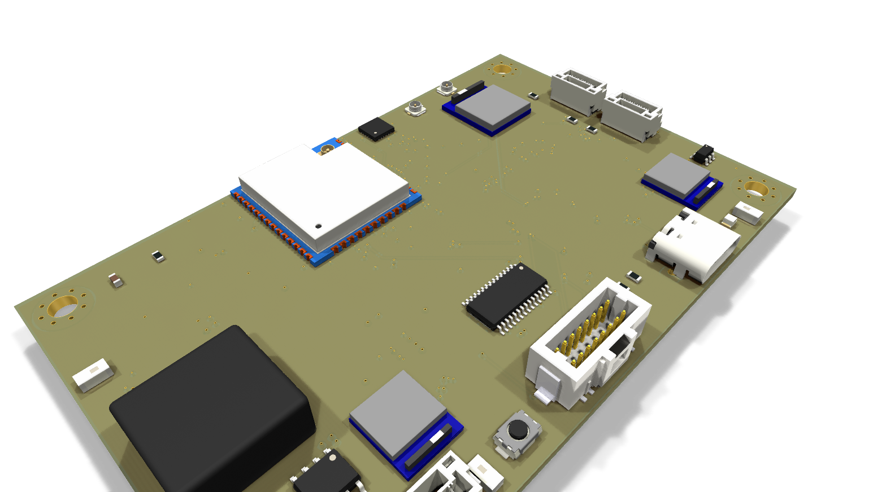
*Figure 7.1a: KiCad 3D Render of Central Box Host PCB Top (PCBA 01, 85 x 55 mm, 4 Layers) featuring ESP32-S31-WROOM-1U, Microchip USB2517I 7-Port Hub, Qualcomm QCC3084 BT 5.4 Audio SoC, LM5164-Q1 100V Buck, BQ24075 UPS Charger U4, Quad eFuse U12, SX1262 LoRa 868 MHz, and vertical SMD connectors (J1, J6, J5, J4, J7, J3) pointing UP.*

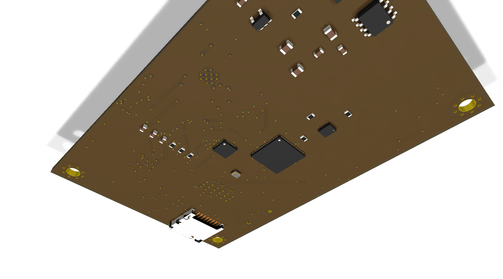
*Figure 7.1b: KiCad 3D Render of Central Box Host PCB Bottom featuring Hirose DM3D MicroSD Push-Pull Slot, TI LM66100 Ideal-Diode OR-ing Circuit for Dual-Power (12V vehicle power vs. USB-C 5V Service), BMI270 6-Axis IMU, ES8388 Audio Codec, and TCAN334G CAN-FD Transceiver.*

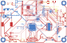
*Figure 7.1c: Vector-based component placement and routing layout of PCBA 01 (v10.0 Dual-Rail Monocoque Slide-In Standard).*

### 3.1 Board Specifications & Stackup
* **Dimensions:** $85.0 \times 55.0\,\text{mm}$ (Outer contour with 4x M2.5 mounting holes, $77.0 \times 47.0\,\text{mm}$ grid spacing, fully compatible with the Dual-Rail Slide-In chassis).
* **Layer Stackup:** 4 Layers FR-4 High-TG150 ($1.6\,\text{mm}$ overall thickness, $35\,\mu\text{m}$ Cu on outer layers L1/L4, $17.5\,\mu\text{m}$ on inner planes L2/L3, ENIG gold finish, impedance-controlled stackup JLCPCB JLC04161H-7628).
* **Dual-Power Input Circuitry:**
  * **12V Vehicle Power (Primary):** Molex Micro-Lock Plus 1.25mm 6-Pin vertical header `J1` (connected via internal silicone harness to the external Deutsch DTM04-6P bulkhead connector), fully reverse-polarity and surge-protected, backed by automotive eFuses.
  * **USB-C Service & Flash Port (`J3`):** 16-Pin USB-C Receptacle featuring a Texas Instruments `LM66100` Ideal Diode (`D3`) for ultra-low forward drop OR-ing (Vehicle 12V vs. USB 5V VBUS). Enables complete benchtop development, WebUSB/DFU flashing, and sensor calibration using any standard USB-C power source without requiring an external 12V lab power supply.
* **Compact Vertical SMD Headers (Pointing UP):**
  * All internal connectors are surface-mounted vertical headers pointing upward into the housing's overhead wiring trough. This eliminates sharp wire bends around the PCB edges and allows the PCBA to slide in and out of the enclosure without mechanical resistance.
* **Top-Layer Components (F.Cu):**
  * **Main Compute Hub (`U2`):** Espressif `ESP32-S31-WROOM-1U` (Dual-Core RISC-V @ 320 MHz with 128-bit SIMD AI Engine for on-device voice/audio filtering, 16 MB Flash, 8 MB Octal-PSRAM, external U.FL RF connector) handling system management, FreeRTOS DSP audio mixing, central geometric BLE Master (handlebar controls, saddlebag OEM adapters, action cams, keyfob, TPMS), and CAN-FD management.
  * **Industrial USB 2.0 Hub Controller (`U8`):** Microchip `USB2517I-JZX` (QFN-64, $-40\,^\circ\text{C}\dots+85\,^\circ\text{C}$ automotive rating) 7-Port High-Speed 480 Mbps Hub with 24.000 MHz crystal `Y2`. Interconnects Front Node, Pod 1, Pod 2, Radar, Helmet Audio, ESP32, and Service Port synchronously.
  * **Dedicated Helmet Audio SoC (`U9`):** **Qualcomm QCC3084** Bluetooth 5.4 Audio SoC module ($13 \times 18\,\text{mm}$ with integrated ceramic chip antenna) for Dual-A2DP (aptX HD, Low Latency), LE Audio Auracast broadcast, HFP 1.8 Wideband Voice, and native USB Audio Class 2.0 link to Hub `U8`.
  * **Automotive Power Stage (`U1`):** Texas Instruments `LM5164-Q1` synchronous 100V buck converter (delivers `VCC_5V` from 12V–72V vehicle supply).
  * **LiPo Charger & Power-Path PMIC (`U4`):** Texas Instruments `BQ24075RGTR` (VQFN-16 3x3mm) with Dynamic Power Path Management (DPPM). Automatically charges the internal 2,200 mAh flat LiPo cell (`J5`) from `VCC_5V` (LM5164-Q1 or USB-C `J3`) at 1.0 A (`R16`), monitors cell temperature via NTC (`J5` Pin 3) and buffers starter crank voltage dips (down to 6.5V) and ignition-off rundowns seamlessly in $< 10\,\mu\text{s}$ on `VCC_SYS` (feeding the 3.3V ultra-low-noise LDO `U11` `TPS7A0533`).
  * **System LDO (`U11`):** Texas Instruments `TPS7A0533` ultra-low-noise LDO (supplies `VCC_3V3` glitch-free from `VCC_SYS` for ESP32-S31, SX1262 LoRa, and sensors).
  * **Quad Automotive eFuse Smart Switch (`U12`):** Texas Instruments `TPS4H160-Q1` HTSSOP-28 4-channel solid-state load switch providing dedicated current limiting, telemetry, and fault isolation for all 4 periphery branches (Front, Pod 1, Pod 2, Radar).
  * **Long-Range Telemetry (`U10`):** Semtech `SX1262` LoRa Transceiver (+22 dBm PA) with U.FL connector `ANT1` linked to the Taoglas FXP895 antenna embedded in the lid.
  * **Status & Interface Controls:** WS2812B RGB Smart-LED `D1`, pairing tactile switch `SW1`, plus vertical connectors `J1` (Power/CAN 6P), `J6` (Periphery Bus 16P), `J5` (UPS Battery 4P), `J7` (Spare USB 4P), and `J3` (USB-C 16P).
* **Bottom-Layer Components (B.Cu):**
  * **MicroSD Socket (`J2`):** Hirose `DM3D-SF` push-pull MicroSD card holder (4-Bit High-Speed SDIO) positioned at the front edge for tool-free card swapping.
  * **Audio Codec (`U3`):** Everest Semi `ES8388` 24-Bit / 48 kHz low-power stereo audio codec (QFN-28).
  * **6-Axis Motion Sensor (`U5`):** Bosch `BMI270` ultra-low-power IMU (I2C) for wake-on-motion theft surveillance and crash logging.
  * **CAN-FD Transceiver (`U6`):** Texas Instruments `TCAN334G` 5 Mbps CAN-FD transceiver (SOIC-8).
  * **Ideal Diode Circuit (`D3`):** Texas Instruments `LM66100` (SOT-23-6) for reverse-current-free Dual-Power OR-ing.
  * **Analog LDO (`U11`):** Texas Instruments `TPS7A0533` 3.3V ultra-low-noise LDO for clean analog and sensor rails.

---

### 3.2 PCB Connectors & Exact Pinout Tables

<!-- AUTO_CONNECTORS_START: PCBA_01 -->

#### Connector `J1`: Fahrzeug-Stromversorgung & CAN-Bus Eingang
> **Type:** `Molex MicroLock Plus 6-Pin 1.25mm SMD Vertikal (5055680671)` | **Mating Connector:** `Molex 5055650601 (Crimp 5054311000 AWG26-30)`  

| Pin | Signal / KiCad Net | Signal Type | Electrical Specification & Function |
| :---: | :--- | :---: | :--- |
| **1** | `KL30_IN` | **Power In (+12V Dauer)** | Batterie-Dauerplus über externe Sicherung (5A) |
| **2** | `KL15_IN` | **Power In (+12V Zündung)** | Zündungsplus für Aufwach-Logik & Sleep-Trigger |
| **3** | `GND_PWR` | **Power Return** | Fahrzeugmasse Leistungsrückstrom |
| **4** | `CAN_H` | **Automotive CAN High** | Fahrzeug-CAN Bus Signal High (HD-LAN) |
| **5** | `CAN_L` | **Automotive CAN Low** | Fahrzeug-CAN Bus Signal Low (HD-LAN) |
| **6** | `GND_SHIELD` | **Shield** | Kabelbaum-Schirmungsanschluss |

#### Connector `J6`: Automotive 4-Strang USB-Backbone & Power Hub
> **Type:** `Molex MicroLock Plus 16-Pin 2x08 1.25mm SMD Vertikal (5054331671)` | **Mating Connector:** `Molex 5054321601 (Crimp 5054311000 AWG26-30)`  

| Pin | Signal / KiCad Net | Signal Type | Electrical Specification & Function |
| :---: | :--- | :---: | :--- |
| **1** | `VBUS_FRONT` | **Power Out (+12V/60W)** | Strang 1: Front-Knoten Stromversorgung (eFuse CH1) |
| **2** | `GND_PWR` | **Power Return** | Strang 1: Masse Rückstrom |
| **3** | `BUS1_DM` | **USB 2.0 D-** | Strang 1: Front-Knoten USB 2.0 Datenleitung D- |
| **4** | `BUS1_DP` | **USB 2.0 D+** | Strang 1: Front-Knoten USB 2.0 Datenleitung D+ |
| **5** | `VBUS_POD1` | **Power Out (+12V/30W)** | Strang 2: Koffer-Pod 1 Links Stromversorgung (eFuse CH2) |
| **6** | `GND_PWR` | **Power Return** | Strang 2: Masse Rückstrom |
| **7** | `BUS2_DM` | **USB 2.0 D-** | Strang 2: Pod 1 USB 2.0 Datenleitung D- |
| **8** | `BUS2_DP` | **USB 2.0 D+** | Strang 2: Pod 1 USB 2.0 Datenleitung D+ |
| **9** | `VBUS_POD2` | **Power Out (+12V/30W)** | Strang 3: Koffer-Pod 2 Rechts Stromversorgung (eFuse CH3) |
| **10** | `GND_PWR` | **Power Return** | Strang 3: Masse Rückstrom |
| **11** | `BUS3_DM` | **USB 2.0 D-** | Strang 3: Pod 2 USB 2.0 Datenleitung D- |
| **12** | `BUS3_DP` | **USB 2.0 D+** | Strang 3: Pod 2 USB 2.0 Datenleitung D+ |
| **13** | `VBUS_RADAR` | **Power Out (+12V/15W)** | Strang 4: Heck-Radar 2.0 Stromversorgung (eFuse CH4) |
| **14** | `GND_PWR` | **Power Return** | Strang 4: Masse Rückstrom |
| **15** | `BUS4_DM` | **USB 2.0 D-** | Strang 4: Heck-Radar USB 2.0 Datenleitung D- |
| **16** | `BUS4_DP` | **USB 2.0 D+** | Strang 4: Heck-Radar USB 2.0 Datenleitung D+ |

#### Connector `J5`: USV Li-Ion Puffer-Akku & NTC-Temperatursensor
> **Type:** `JST-GH 4-Pin 1.25mm SMD Vertikal (BM04B-GHS-TBT)` | **Mating Connector:** `JST GHR-04V-S (AWG26-30)`  

| Pin | Signal / KiCad Net | Signal Type | Electrical Specification & Function |
| :---: | :--- | :---: | :--- |
| **1** | `BAT_PLUS` | **Power (3.7V Li-Ion)** | Puffer-Akku Pluspol (3.0V - 4.2V) |
| **2** | `GND_PWR` | **Power Return** | Puffer-Akku Masse |
| **3** | `BAT_NTC` | **Analog In** | 10k NTC Thermistor zu GND zur Lade-Temperaturüberwachung |
| **4** | `GND_PWR` | **Power Return** | NTC Referenzmasse |

<!-- AUTO_CONNECTORS_END: PCBA_01 -->

#### 3.2.1 Header J1: Vehicle Power & CAN Bus (Molex Micro-Lock Plus 1.25mm 6-Pin SMD Vertical)
Connects via internal silicone wire harness to the external Deutsch DTM04-6P bulkhead connector:

```
+---------------------------------------------------------------------------------------------------------------+
| HEADER J1: MOLEX MICRO-LOCK PLUS 6-PIN VERTICAL (505568-0671) - VEHICLE POWER & CAN-BUS                       |
+-----+----------------+--------------------------+-------------+---------------------+-------------------------+
| Pin | Signal Name    | Signal Type / Level      | Wire Gauge  | Harness Branch      | Function & Protection   |
+-----+----------------+--------------------------+-------------+---------------------+-------------------------+
|  1  | KL30_IN        | +9V...+72V DC Constant+  | AWG20 0.50² | DTM Pin 1 (Battery) | Constant 12V Main (eFuse)|
|  2  | KL15_IN        | +9V...+72V DC Ignition+  | AWG22 0.34² | DTM Pin 2 (Ignition)| Ignition Sense & Wake-Up|
|  3  | GND_PWR        | Power Ground (0V)        | AWG20 0.50² | DTM Pin 3 (Battery) | Central System Ground   |
|  4  | CAN_H          | CAN-FD High (ISO 11898-2)| AWG24 0.22² | DTM Pin 4 (Vehicle) | Vehicle CAN-FD Bus High |
|  5  | CAN_L          | CAN-FD Low (ISO 11898-2) | AWG24 0.22² | DTM Pin 5 (Vehicle) | Vehicle CAN-FD Bus Low  |
|  6  | GND_SHIELD     | Chassis Shield Ground    | AWG20 0.50² | DTM Pin 6 (Chassis) | Enclosure & Cable Drain |
| MP1 | GND_PWR        | Mechanical Mounting Pad  | SMT Pad     | PCB Ground Plane    | Solder Retention Pad 1  |
| MP2 | GND_PWR        | Mechanical Mounting Pad  | SMT Pad     | PCB Ground Plane    | Solder Retention Pad 2  |
+-----+----------------+--------------------------+-------------+---------------------+-------------------------+
```

#### 3.2.2 Header J6: OMB 4-Channel Periphery Bus (Molex Micro-Lock Plus 16-Pin 2x08 Vertical)
Central high-speed interface (Molex Micro-Lock Plus `505433-1671`, 1.25mm pitch, vertical top-entry with positive latching) supplying power and native USB 2.0 data to Front Node, Pod 1, Pod 2, and Radar:

```
+---------------------------------------------------------------------------------------------------------------+
| HEADER J6: MOLEX MICRO-LOCK PLUS 16-PIN (2x08) VERTICAL (505433-1671) - 4 INDEPENDENT OMB SYSTEM BRANCHES     |
+-----+----------------+--------------------------+-------------+---------------------+-------------------------+
| Pin | Signal Name    | Signal Type / Level      | Wire Gauge  | Target Component    | Function & Protection   |
+-----+----------------+--------------------------+-------------+---------------------+-------------------------+
|  1  | VBUS_FRONT     | +12V DC (up to 60W/5.0A) | AWG18 0.75² | Branch 1 (Front)    | Front Node Power Feed   |
|  2  | GND_PWR        | Power Ground (0V)        | AWG18 0.75² | Branch 1 (Front)    | Power Return Lead       |
|  3  | BUS1_DM        | USB 2.0 High-Speed D-    | AWG26 0.14² | Branch 1 (Front)    | Hub Port 2 Data Uplink  |
|  4  | BUS1_DP        | USB 2.0 High-Speed D+    | AWG26 0.14² | Branch 1 (Front)    | Hub Port 2 Data Uplink  |
+-----+----------------+--------------------------+-------------+---------------------+-------------------------+
|  5  | VBUS_POD1      | +12V DC (up to 30W/2.5A) | AWG20 0.50² | Branch 2 (Pod 1 L)  | Pod 1 Power & Charger   |
|  6  | GND_PWR        | Power Ground (0V)        | AWG20 0.50² | Branch 2 (Pod 1 L)  | Power Return Lead       |
|  7  | BUS2_DM        | USB 2.0 High-Speed D-    | AWG28 0.08² | Branch 2 (Pod 1 L)  | Hub Port 3 Audio/Data   |
|  8  | BUS2_DP        | USB 2.0 High-Speed D+    | AWG28 0.08² | Branch 2 (Pod 1 L)  | Hub Port 3 Audio/Data   |
+-----+----------------+--------------------------+-------------+---------------------+-------------------------+
|  9  | VBUS_POD2      | +12V DC (up to 30W/2.5A) | AWG20 0.50² | Branch 3 (Pod 2 R)  | Pod 2 Power & Charger   |
| 10  | GND_PWR        | Power Ground (0V)        | AWG20 0.50² | Branch 3 (Pod 2 R)  | Power Return Lead       |
| 11  | BUS3_DM        | USB 2.0 High-Speed D-    | AWG28 0.08² | Branch 3 (Pod 2 R)  | Hub Port 4 Audio/Data   |
| 12  | BUS3_DP        | USB 2.0 High-Speed D+    | AWG28 0.08² | Branch 3 (Pod 2 R)  | Hub Port 4 Audio/Data   |
+-----+----------------+--------------------------+-------------+---------------------+-------------------------+
| 13  | VBUS_RADAR     | +12V switched (1.5A max) | AWG22 0.34² | Branch 4 (Radar)    | Rear Radar Power Supply |
| 14  | GND_PWR        | Power Ground (0V)        | AWG22 0.34² | Branch 4 (Radar)    | Ground Rear Radar       |
| 15  | BUS4_DM        | USB 2.0 High-Speed D-    | AWG24 0.22² | Branch 4 (Radar)    | Hub Port 5 Telemetry    |
| 16  | BUS4_DP        | USB 2.0 High-Speed D+    | AWG24 0.22² | Branch 4 (Radar)    | Hub Port 5 Telemetry    |
+-----+----------------+--------------------------+-------------+---------------------+-------------------------+
| MP1 | GND_PWR        | Mechanical Mounting Pad  | SMT Pad     | PCB Ground Plane    | Solder Retention Pad 1  |
| MP2 | GND_PWR        | Mechanical Mounting Pad  | SMT Pad     | PCB Ground Plane    | Solder Retention Pad 2  |
+-----+----------------+--------------------------+-------------+---------------------+-------------------------+
```

#### 3.2.3 Header J5: UPS Battery & NTC Thermistor (Molex Micro-Lock Plus 1.25mm 4-Pin Vertical)
Connects the internal UPS backup cell (LiFePO4 or LiPo) to the analog voltage and temperature sensing network of the ESP32-S31:

```
+---------------------------------------------------------------------------------------------------------------+
| HEADER J5: MOLEX MICRO-LOCK PLUS 4-PIN VERTICAL (505568-0471) - UPS BATTERY & THERMISTOR                       |
+-----+----------------+--------------------------+-------------+---------------------+-------------------------+
| Pin | Signal Name    | Signal Type / Level      | Wire Gauge  | Connected to        | Function & Protection   |
+-----+----------------+--------------------------+-------------+---------------------+-------------------------+
|  1  | BAT_PLUS       | +3.2V...+4.2V DC (Cell +)| AWG22 0.34² | U4 BQ24075 & R12/R13| UPS Charging & Sensing  |
|  2  | GND_PWR        | Power Ground (Cell -)    | AWG22 0.34² | GND_PWR Plane       | Battery Negative Lead   |
|  3  | BAT_NTC        | Analog In (0...3.3V)     | AWG26 0.14² | U4 TS & R14 (10k PU)| 10k NTC JEITA Guard     |
|  4  | GND_PWR        | Sensor Ground (0V)       | AWG26 0.14² | GND_PWR Plane       | NTC Return Ground       |
| MP1 | GND_PWR        | Mechanical Mounting Pad  | SMT Pad     | PCB Ground Plane    | Solder Retention Pad 1  |
| MP2 | GND_PWR        | Mechanical Mounting Pad  | SMT Pad     | PCB Ground Plane    | Solder Retention Pad 2  |
+-----+----------------+--------------------------+-------------+---------------------+-------------------------+
```

#### 3.2.4 Status Indicator D1 & Elimination of Header J4
System status is indicated directly via the onboard **WS2812B RGB Smart-LED (`D1`)**, positioned on the south front edge directly to the right of USB-C socket `J3`. A flush-mounted PMMA light pipe ($\varnothing 3.2\,\text{mm}$) integrated into the enclosure front wall channels light outward with zero transmission loss. The former external connector `J4` has thus been eliminated without replacement, saving component cost and board edge clearance.

#### 3.2.5 Header J7: Spare USB Port 7 (Molex Micro-Lock Plus 1.25mm 4-Pin Vertical)
Exposes Downstream Port 7 of the USB2517I Hub for future modular expansions (e.g. cellular modem or dashcam):

```
+---------------------------------------------------------------------------------------------------------------+
| HEADER J7: MOLEX MICRO-LOCK PLUS 4-PIN VERTICAL (505568-0471) - SPARE USB 2.0 PORT 7                          |
+-----+----------------+--------------------------+-------------+---------------------+-------------------------+
| Pin | Signal Name    | Signal Type / Level      | Wire Gauge  | Connected to        | Function & Protection   |
+-----+----------------+--------------------------+-------------+---------------------+-------------------------+
|  1  | VCC_5V         | +5.0V DC (Power Out)     | AWG22 0.34² | 5V Power Plane      | USB VBUS 5V Supply      |
|  2  | RES_USB_DM     | USB 2.0 D- (Differential)| AWG28 0.08² | USB2517I (Pin 60)   | Port 7 USB Data Minus   |
|  3  | RES_USB_DP     | USB 2.0 D+ (Differential)| AWG28 0.08² | USB2517I (Pin 61)   | Port 7 USB Data Plus    |
|  4  | GND_PWR        | Power Ground (0V)        | AWG22 0.34² | GND_PWR Plane       | USB Ground              |
| MP1 | GND_PWR        | Mechanical Mounting Pad  | SMT Pad     | PCB Ground Plane    | Solder Retention Pad 1  |
| MP2 | GND_PWR        | Mechanical Mounting Pad  | SMT Pad     | PCB Ground Plane    | Solder Retention Pad 2  |
+-----+----------------+--------------------------+-------------+---------------------+-------------------------+
```

#### 3.2.6 Port J3: USB Type-C Service & Flash Port (16-Pin SMD Receptacle)
Mounted on the front panel for benchtop debugging, firmware flashing, and configuration:

```
+---------------------------------------------------------------------------------------------------------------+
| PORT J3: USB TYPE-C 16-PIN RECEPTACLE (HRO TYPE-C-31-M-12) - SERVICE & DFU FLASH PORT                         |
+-----+----------------+--------------------------+---------------------+---------------------------------------+
| Pin | Signal Name    | Signal Type / Level      | Connected to        | Function & Specification              |
+-----+----------------+--------------------------+---------------------+---------------------------------------+
| A1  | GND_PWR        | Power Ground (0V)        | GND_PWR Plane       | USB-C System Ground                   |
| A4  | USBC_VBUS      | +5.0V DC (Power In)      | LM66100 Diode (D3)  | 5V USB Bus Supply (Dual-Power Sink)   |
| A5  | CC1            | Config Channel 1         | 5.1 kΩ Pull-Down    | UFP Discovery & 5V/3A Power Request   |
| A6  | USBC_DP        | USB 2.0 High-Speed D+    | USB2517I Hub Pin 9  | Upstream USB Data Line Plus           |
| A7  | USBC_DM        | USB 2.0 High-Speed D-    | USB2517I Hub Pin 8  | Upstream USB Data Line Minus          |
| A8  | CC2            | Config Channel 2         | 5.1 kΩ Pull-Down    | UFP Discovery & 5V/3A Power Request   |
| A9  | USBC_VBUS      | +5.0V DC (Power In)      | LM66100 Diode (D3)  | 5V USB Bus Supply (Dual-Power Sink)   |
| A12 | GND_PWR        | Power Ground (0V)        | GND_PWR Plane       | USB-C System Ground                   |
| SH1 | GND_SHIELD     | Shield Ground            | Housing Shield      | EMI Enclosure Solder Retention Left   |
| SH2 | GND_SHIELD     | Shield Ground            | Housing Shield      | EMI Enclosure Solder Retention Right  |
+-----+----------------+--------------------------+---------------------+---------------------------------------+
```

#### 3.2.7 Slot J2: MicroSD Card Reader (Hirose DM3D-SF 9-Pin Push-Pull)
Provides 4-Bit High-Speed SDIO connection to the ESP32-S31 for uninterrupted telemetry logging:

```
+---------------------------------------------------------------------------------------------------------------+
| CARD SLOT J2: HIROSE DM3D-SF PUSH-PULL MICROSD SOCKET (4-BIT SDIO)                                            |
+-----+----------------+--------------------------+---------------------+---------------------------------------+
| Pin | Signal Name    | Signal Type / Level      | Connected to        | Function & Specification              |
+-----+----------------+--------------------------+---------------------+---------------------------------------+
|  1  | SD_DAT2        | Digital I/O (3.3V SDIO)  | ESP32-S31 (Pin 34)  | SDIO Data Line 2 (10k Pull-Up)        |
|  2  | SD_DAT3        | Digital I/O (3.3V SDIO)  | ESP32-S31 (Pin 38)  | SDIO Data Line 3 / Card Select        |
|  3  | SD_CMD         | Digital I/O (3.3V SDIO)  | ESP32-S31 (Pin 36)  | SDIO Command / Response Line          |
|  4  | VCC_3V3        | Power In (+3.3V DC)      | 3.3V LDO Rail       | MicroSD Power Supply (100nF+10µF)     |
|  5  | SD_CLK         | Digital Out (Clock)      | ESP32-S31 (Pin 35)  | SDIO Bus Clock (up to 40 MHz)         |
|  6  | GND_PWR        | Ground (0V)              | GND_PWR Plane       | Supply Ground                         |
|  7  | SD_DAT0        | Digital I/O (3.3V SDIO)  | ESP32-S31 (Pin 37)  | SDIO Data Line 0                      |
|  8  | SD_DAT1        | Digital I/O (3.3V SDIO)  | ESP32-S31 (Pin 33)  | SDIO Data Line 1                      |
|  9  | SD_CD          | Digital In (Active Low)  | ESP32-S31 (Pin 39)  | Card Detect Switch (Card Inserted)    |
| SH  | GND_PWR        | Enclosure Shield         | GND_PWR Plane       | 3x Ground Retention Pads (SH1-SH3)    |
+-----+----------------+--------------------------+---------------------+---------------------------------------+
```

---

### 3.3 Sub-Chips & Peripheral Components (USB2517I, QCC3084, SX1262, TCAN334G)

<!-- AUTO_SUBCHIPS_START: PCBA_01 -->

#### Sub-Chip `U8`: Microchip USB2517I 7-Port Automotive USB 2.0 Hub (QFN-64 (9x9 mm))
> **Manufacturer Datasheet:** [Microchip USB2517I 7-Port Automotive USB 2.0 Hub](https://ww1.microchip.com/downloads/en/DeviceDoc/00001692C.pdf) | **Pin Definitions:** [Table 3-1: 64-Pin QFN Pin Descriptions](https://ww1.microchip.com/downloads/en/DeviceDoc/00001692C.pdf#page=12)  

| Pad | Pin Name | Signal / KiCad Net | Signal Type | Target / Source | Function & Electrical Spec |
| :---: | :--- | :--- | :---: | :--- | :--- |
| 2 | `RESET_N` | `HUB_RESET_N` | **Control In** | U2 (ESP32-S31) | Active-Low Hardware Reset via GPIO |
| 8 | `USBDN_DM7` | `USBC_DM` | **USB D-** | J3 (USB-C Service) | Port 7 Downstream USB D- |
| 9 | `USBDN_DP7` | `USBC_DP` | **USB D+** | J3 (USB-C Service) | Port 7 Downstream USB D+ |
| 16 | `USBUP_DM` | `ESP_USB_DM` | **USB D-** | U2.54 (ESP32-S31) | Upstream Port USB High-Speed D- |
| 17 | `USBUP_DP` | `ESP_USB_DP` | **USB D+** | U2.55 (ESP32-S31) | Upstream Port USB High-Speed D+ |
| 24 | `USBDN_DM1` | `BUS1_DM` | **USB D-** | J6.3 (Strang 1 Front) | Port 1 Downstream USB D- |
| 25 | `USBDN_DP1` | `BUS1_DP` | **USB D+** | J6.4 (Strang 1 Front) | Port 1 Downstream USB D+ |
| 32 | `USBDN_DM2` | `BUS2_DM` | **USB D-** | J6.7 (Strang 2 Pod L) | Port 2 Downstream USB D- |
| 33 | `USBDN_DP2` | `BUS2_DP` | **USB D+** | J6.8 (Strang 2 Pod L) | Port 2 Downstream USB D+ |
| 40 | `USBDN_DM3` | `BUS3_DM` | **USB D-** | J6.11 (Strang 3 Pod R) | Port 3 Downstream USB D- |
| 41 | `USBDN_DP3` | `BUS3_DP` | **USB D+** | J6.12 (Strang 3 Pod R) | Port 3 Downstream USB D+ |
| 48 | `USBDN_DM4` | `BUS4_DM` | **USB D-** | J6.15 (Strang 4 Radar) | Port 4 Downstream USB D- |
| 49 | `USBDN_DP4` | `BUS4_DP` | **USB D+** | J6.16 (Strang 4 Radar) | Port 4 Downstream USB D+ |
| 56 | `USBDN_DM5` | `BT_USB_DM` | **USB D-** | U9.13 (QCC3084) | Port 5 Downstream USB D- an Qualcomm BT Audio SoC |
| 57 | `USBDN_DP5` | `BT_USB_DP` | **USB D+** | U9.14 (QCC3084) | Port 5 Downstream USB D+ an Qualcomm BT Audio SoC |
| 60 | `USBDN_DM6` | `RES_USB_DM` | **USB D-** | J7.3 (Reserve) | Port 6 Downstream USB D- |
| 61 | `USBDN_DP6` | `RES_USB_DP` | **USB D+** | J7.4 (Reserve) | Port 6 Downstream USB D+ |

#### Sub-Chip `U9`: Qualcomm QCC3084 Bluetooth 5.4 Audio SoC (WLCSP / BGA Module)
> **Manufacturer Datasheet:** [Qualcomm QCC3084 Bluetooth 5.4 Audio SoC](https://www.qualcomm.com/products/technology/audio/qcc30xx-series/qcc3084) | **Pin Definitions:** [Pin Definitions & Audio Interface Routing](https://www.qualcomm.com/products/technology/audio/qcc30xx-series/qcc3084)  

| Pad | Pin Name | Signal / KiCad Net | Signal Type | Target / Source | Function & Electrical Spec |
| :---: | :--- | :--- | :---: | :--- | :--- |
| 3 | `I2S_MCLK` | `I2S_MCLK` | **Clock In** | U2 (ESP32-S31) | I2S Master Clock 12.288 MHz |
| 4 | `I2S_BCLK` | `I2S_BCLK` | **Clock In** | U2 (ESP32-S31) | I2S Bit Clock 3.072 MHz |
| 5 | `I2S_WS` | `I2S_WS` | **Sync In** | U2 (ESP32-S31) | I2S Word Select / LRCLK 48 kHz |
| 6 | `I2S_DOUT` | `I2S_DOUT` | **Audio In** | U2 (ESP32-S31) | Digital Audio Stream vom ESP32-S31 DSP zum Helm |
| 7 | `I2S_DIN` | `I2S_DIN` | **Audio Out** | U2 (ESP32-S31) | Helmmikrofon-Audio Stream an den DSP |
| 9 | `UART_TX` | `BT_UART_TX` | **UART Out** | U2 (ESP32-S31) | HCI / AT-Befehle TX zum ESP32-S31 |
| 10 | `UART_RX` | `BT_UART_RX` | **UART In** | U2 (ESP32-S31) | HCI / AT-Befehle RX vom ESP32-S31 |
| 11 | `CHIP_EN` | `BT_EN` | **Control In** | U2 (ESP32-S31) | Power Enable Active High |
| 13 | `USB_DM` | `BT_USB_DM` | **USB D-** | U8.56 (Hub Port 5) | USB Audio Class 2.0 / DFU Datenleitung D- |
| 14 | `USB_DP` | `BT_USB_DP` | **USB D+** | U8.57 (Hub Port 5) | USB Audio Class 2.0 / DFU Datenleitung D+ |
| 15 | `RF_ANT` | `BT_RF_AUDIO` | **RF 2.4 GHz** | ANT2 (U.FL) | Bluetooth 5.4 Dual-A2DP / Auracast Antennenport |

#### Sub-Chip `U10`: Semtech SX1262 LoRa 868 MHz Transceiver (QFN-24 (4x4 mm))
> **Manufacturer Datasheet:** [Semtech SX1262 LoRa 868 MHz Transceiver](https://semtech.my.salesforce.com/sfc/p/#E0000000JelG/a/2R000000HT76/bvyK.51kF34K_iR49Q04kHjG4s3E2_q2kM8Q6u2k7d4) | **Pin Definitions:** [Section 4: Pinout & Pin Description (QFN-24)](https://semtech.my.salesforce.com/sfc/p/#E0000000JelG/a/2R000000HT76/bvyK.51kF34K_iR49Q04kHjG4s3E2_q2kM8Q6u2k7d4)  

| Pad | Pin Name | Signal / KiCad Net | Signal Type | Target / Source | Function & Electrical Spec |
| :---: | :--- | :--- | :---: | :--- | :--- |
| 1 | `NRESET` | `LORA_RST` | **Control In** | U2 (ESP32-S31) | Hardware Reset Active Low |
| 10 | `RFI_P / RFO` | `LORA_RF_868` | **RF 868 MHz** | ANT1 (U.FL) | LoRa HF-Ausgang (+22 dBm PA) |
| 14 | `BUSY` | `LORA_BUSY` | **Digital Out** | U2 (ESP32-S31) | LoRa Modem Busy Indicator |
| 15 | `DIO1` | `LORA_DIO1` | **Digital Out** | U2 (ESP32-S31) | LoRa Paket-Interrupt / TX-Done IRQ |
| 18 | `MISO` | `SPI_MISO` | **SPI MISO** | U2 (ESP32-S31) | SPI Serial Data Out |
| 19 | `MOSI` | `SPI_MOSI` | **SPI MOSI** | U2 (ESP32-S31) | SPI Serial Data In |
| 20 | `SCK` | `SPI_SCK` | **SPI CLK** | U2 (ESP32-S31) | SPI Serial Clock |
| 21 | `NSS` | `LORA_NSS` | **SPI CS** | U2 (ESP32-S31) | SPI Chip Select Active Low |

#### Sub-Chip `U6`: TI TCAN334G Automotive 3.3V CAN-FD Transceiver (SOIC-8)
> **Manufacturer Datasheet:** [TI TCAN334G Automotive 3.3V CAN-FD Transceiver](https://www.ti.com/lit/ds/symlink/tcan334g.pdf) | **Pin Definitions:** [Pin Functions (SOIC-8)](https://www.ti.com/lit/ds/symlink/tcan334g.pdf#page=4)  

| Pad | Pin Name | Signal / KiCad Net | Signal Type | Target / Source | Function & Electrical Spec |
| :---: | :--- | :--- | :---: | :--- | :--- |
| 1 | `TXD` | `CAN_TX` | **Digital In** | U2 (ESP32-S31) | CAN Sendedaten von ESP32-S31 TWAI |
| 4 | `RXD` | `CAN_RX` | **Digital Out** | U2 (ESP32-S31) | CAN Empfangsdaten an ESP32-S31 TWAI |
| 6 | `CANL` | `CAN_L` | **CAN Bus** | J1.5 | Differenzielle CAN-Bus-Leitung LOW |
| 7 | `CANH` | `CAN_H` | **CAN Bus** | J1.4 | Differenzielle CAN-Bus-Leitung HIGH |

<!-- AUTO_SUBCHIPS_END: PCBA_01 -->

### 3.4 Microchip USB2517I-JZX 7-Port Hub Architecture (`U8`)

```
+---------------------------------------------------------------------------------------------------------------+
| MICROCHIP USB2517I-JZX (QFN-64): 7-PORT HIGH-SPEED USB 2.0 HUB PORT MAPPING                                   |
+----------+--------------------+-----------------------+---------------------+---------------------------------+
| Port     | Signal Pins (D-/D+)| Nets                  | Target Component    | Function & Data Stream          |
+----------+--------------------+-----------------------+---------------------+---------------------------------+
| Upstream | Pin 8 / Pin 9      | USBC_DM / USBC_DP     | Service Port J3     | Host Connection (PC / Tablet)   |
+----------+--------------------+-----------------------+---------------------+---------------------------------+
| Port 1   | Pin 16 / Pin 17    | ESP_USB_DM / ESP_USB_DP| ESP32-S31 (Pin 13/14)| Native USB CDC, DFU & WebUSB   |
| Port 2   | Pin 24 / Pin 25    | BUS1_DM / BUS1_DP     | Header J6 (Pin 3/4) | Front Node PCBA 05              |
| Port 3   | Pin 32 / Pin 33    | BUS2_DM / BUS2_DP     | Header J6 (Pin 7/8) | Saddlebag Pod 1 PCBA 03 (Left)  |
| Port 4   | Pin 40 / Pin 41    | BUS3_DM / BUS3_DP     | Header J6 (Pin 11/12)| Saddlebag Pod 2 PCBA 03 (Right) |
| Port 5   | Pin 48 / Pin 49    | BUS4_DM / BUS4_DP     | Header J6 (Pin 15/16)| Rear Radar PCBA 08 (MR20 UART)  |
| Port 6   | Pin 56 / Pin 57    | BT_USB_DM / BT_USB_DP | QCC3084 (Pin 13/14) | USB Audio Class 2.0 Helmet Audio|
| Port 7   | Pin 60 / Pin 61    | RES_USB_DM / RES_USB_DP| Header J7 (Pin 2/3) | Spare USB Port for Expansions   |
+----------+--------------------+-----------------------+---------------------+---------------------------------+
| Clock/RST| Pin 2: RESET_N (100k Pull-Up) | Pin 4/5: XTALIN/XTALOUT linked to 24.000 MHz Crystal Y2 (18pF Caps)       |
+----------+----------------------------------------------------------------------------------------------------+
```

---

### 3.4 Qualcomm QCC3084 Bluetooth 5.4 Audio SoC Module (`U9`)

```
+---------------------------------------------------------------------------------------------------------------+
| QUALCOMM QCC3084 (15-PIN MODULE WITH DEDICATED U.FL RF PORT ANT2) - SYSTEM PINOUT                              |
+-----+----------------+--------------------+-------------------+-----------------------------------------------+
| Pin | Signal Name    | Signal Type        | Connected to      | Function & Protocol                           |
+-----+----------------+--------------------+-------------------+-----------------------------------------------+
|  1  | VCC_3V3        | Power In (+3.3V)   | 3.3V Power Rail   | Module Operating Voltage                      |
|  2  | GND_PWR        | Ground (0V)        | GND_PWR Plane     | RF and System Ground                          |
|  3  | I2S_MCLK       | Digital In (Clock) | ESP32-S31 (Pin 12)| I2S Master Clock (12.288 MHz)                 |
|  4  | I2S_BCLK       | Digital In (BitClk)| ESP32-S31 (Pin 30)| I2S Bit Clock (3.072 MHz)                     |
|  5  | I2S_WS         | Digital In (LRCK)  | ESP32-S31 (Pin 32)| I2S Word Select / Frame Sync (48 kHz)         |
|  6  | I2S_DOUT       | Digital In (Audio) | ESP32-S31 (Pin 15)| Stereo PCM Audio Stream to QCC3084            |
|  7  | I2S_DIN        | Digital Out (Mic)  | ESP32-S31 (Pin 16)| HFP Microphone Stream to ESP32 DSP            |
|  8  | GND_PWR        | Ground (0V)        | GND_PWR Plane     | RF Shield Ground                              |
|  9  | BT_UART_TX     | Digital Out (UART) | ESP32-S31 (Pin 11)| QCC3084 Telemetry and Status                  |
| 10  | BT_UART_RX     | Digital In (UART)  | ESP32-S31 (Pin 10)| ESP32 AT Commands                             |
| 11  | BT_EN          | Digital In (Reset) | ESP32-S31 (Pin 9) | Power-Down & Hardware Reset                   |
| 12  | GND_PWR        | Ground (0V)        | GND_PWR Plane     | RF Shield Ground                              |
| 13  | BT_USB_DM      | USB 2.0 D- (Data)  | USB2517I (Pin 56) | USB Audio Class 2.0 High-Res Stream Minus     |
| 14  | BT_USB_DP      | USB 2.0 D+ (Data)  | USB2517I (Pin 57) | USB Audio Class 2.0 High-Res Stream Plus      |
| 15  | BT_RF_AUDIO    | RF Out (50 Ohm)    | ANT2 (U.FL Header) | Dedicated 2.4 GHz RF Port to Helmet Audio Lid Dipole |
+-----+----------------+--------------------+-------------------+-----------------------------------------------+
```

---

### 3.5 Quad Automotive Smart High-Side Switch (`U12`)

The integrated 4-channel High-Side Smart Switch (TI TPS4H160-Q1 in HTSSOP-28 package) protects the 12V periphery branches against cable short circuits, reverse polarity, and overload. Control inputs IN1–IN4 (Pins 3–6) are tied to `VCC_3V3` via hardware pull-up (autonomous powering as soon as the 3.3V rail is up; cold starts and sequenced peripheral enables take place at the protocol/node level):

```
+---------------------------------------------------------------------------------------------------------------+
| QUAD AUTOMOTIVE SMART SWITCH (HTSSOP-28, TI TPS4H160-Q1): CHANNEL ASSIGNMENTS & PIN ALLOCATION               |
+-------+--------------------+--------------------+--------------------+----------------------------------------+
| Chan. | Input Pins         | Output Pins        | Net Name           | Protection & Allocation                |
+-------+--------------------+--------------------+--------------------+----------------------------------------+
| VS    | Pins 20, 21, 22, 23| -                  | KL30_IN            | Vehicle Main +12V DC Supply            |
| CH 1  | Pin 3 (IN1: 3V3)   | Pins 27, 28 (OUT1) | VBUS_FRONT         | Front Node Feed (PCBA 05)              |
| CH 2  | Pin 4 (IN2: 3V3)   | Pins 25, 26 (OUT2) | VBUS_POD1          | Pod 1 Feed (PCBA 03)                   |
| CH 3  | Pin 5 (IN3: 3V3)   | Pins 17, 18 (OUT3) | VBUS_POD2          | Pod 2 Feed (PCBA 03)                   |
| CH 4  | Pin 6 (IN4: 3V3)   | Pins 15, 16 (OUT4) | VBUS_RADAR         | Rear Radar Feed (PCBA 08)              |
| DIAG  | Pin 14 (DIAG_EN)   | -                  | VCC_3V3            | Diagnostics functions enabled          |
| CL    | Pin 11 (CL)        | -                  | GND_PWR            | Current limit reference                |
| GND   | Pins 1, 12, EP (29)| -                  | GND_PWR            | IC Ground & Thermal Pad (13 Vias)      |
| NC    | Pins 2, 19, 24     | -                  | NC                 | No internal connection                 |
+-------+--------------------+--------------------+--------------------+----------------------------------------+
```

---

### 3.6 ESP32-S31-WROOM-1U (`U2`) Complete Pinout Matrix

<!-- AUTO_PINOUT_START: PCBA_01 -->

| Pad | Signal / KiCad Net | ESP32 GPIO | Firmware Define | Target / IC | Signal Type & Electrical Spec |
| :---: | :--- | :---: | :--- | :--- | :--- |
| 3 | `ESP_EN` | - | - | R2 / C1 / SW1 | **Power/Reset** – Chip Enable / Hardware Reset (Active High with RC delay) |
| 4 | `SPI_SCK` | GPIO 2 | `PIN_MAIN_LORA_SCK` | U10.20 | **SPI2_CLK** – LoRa Semtech SX1262 SPI Serial Clock |
| 5 | `KL15_SENSE` | GPIO 3 | `PIN_MAIN_KL15_SENSE` | R3 / D4 / Q1 | **Digital In** – Zündungserkennung (KL15 Ignition Sense) |
| 6 | `SPI_MISO` | GPIO 4 | `PIN_MAIN_LORA_MISO` | U10.18 | **SPI2_MISO** – LoRa Semtech SX1262 SPI Master In Slave Out |
| 7 | `SPI_MOSI` | GPIO 5 | `PIN_MAIN_LORA_MOSI` | U10.19 | **SPI2_MOSI** – LoRa Semtech SX1262 SPI Master Out Slave In |
| 8 | `A2DP_EN` | GPIO 43 | `PIN_MAIN_A2DP_EN` | U13.9 | **GPIO / Control** – ESP32-PICO A2DP Transmitter Hardware Enable / Reset |
| 9 | `BT_EN` | GPIO 1 | `PIN_MAIN_BT_EN` | U9.11 | **Digital Out** – Qualcomm QCC3084 Enable / Reset Control |
| 10 | `BT_UART_RX` | GPIO 2 | `PIN_MAIN_BT_UART_RX` | U9.10 | **UART1_RX** – Qualcomm QCC3084 Host Control Protocol RX |
| 11 | `BT_UART_TX` | GPIO 3 | `PIN_MAIN_BT_UART_TX` | U9.9 | **UART1_TX** – Qualcomm QCC3084 Host Control Protocol TX |
| 12 | `I2S_MCLK` | GPIO 35 | `PIN_MAIN_I2S_MCLK` | U3.1 / U9.1 | **I2S_MCLK** – Audio Master Clock (ES8388 Codec & QCC3084) |
| 13 | `A2DP_UART_TX` | GPIO 33 | `PIN_MAIN_A2DP_UART_TX` | U13.41 | **UART2_TX** – ESP32-PICO A2DP Transmitter UART Data Receive (PICO TX -> S31 RX) |
| 14 | `A2DP_UART_RX` | GPIO 34 | `PIN_MAIN_A2DP_UART_RX` | U13.40 | **UART2_RX** – ESP32-PICO A2DP Transmitter UART Command Transmit (S31 TX -> PICO RX) |
| 15 | `I2S_DOUT` | GPIO 17 | `PIN_MAIN_I2S_DOUT` | U3.4 / U9.4 | **I2S_DOUT** – Audio Serial Data Out (Playback) |
| 16 | `I2S_DIN` | GPIO 18 | `PIN_MAIN_I2S_DIN` | U3.5 / U9.5 | **I2S_DIN** – Audio Serial Data In (Record / Mic) |
| 17 | `I2C_SDA` | GPIO 22 | `PIN_MAIN_I2C_SDA` | U3.28 / U5.13 | **I2C_SDA** – On-Board I2C Bus Data (ES8388 0x10, BMI270 0x68) |
| 18 | `I2C_SCL` | GPIO 23 | `PIN_MAIN_I2C_SCL` | U3.27 / U5.12 | **I2C_SCL** – On-Board I2C Bus Clock (400 kHz Fast-Mode) |
| 19 | `LORA_DIO1` | GPIO 14 | `PIN_MAIN_LORA_DIO1` | U10.15 | **Digital In / IRQ** – LoRa SX1262 Multi-Purpose Interrupt DIO1 |
| 20 | `LORA_BUSY` | GPIO 21 | `PIN_MAIN_LORA_BUSY` | U10.14 | **Digital In** – LoRa SX1262 Internal State Busy Indicator |
| 21 | `CAN_TX` | GPIO 26 | `PIN_MAIN_CAN_TX` | U6.1 | **TWAI_TX** – Automotive CAN-FD Transceiver Transmit |
| 22 | `CAN_RX` | GPIO 27 | `PIN_MAIN_CAN_RX` | U6.4 | **TWAI_RX** – Automotive CAN-FD Transceiver Receive |
| 23 | `LORA_RST` | GPIO 7 | `PIN_MAIN_LORA_RST` | U10.1 | **Digital Out** – LoRa SX1262 Hardware Reset (Active Low) |
| 24 | `LORA_NSS` | GPIO 10 | `PIN_MAIN_LORA_NSS` | U10.21 | **SPI_CS** – LoRa SX1262 SPI Chip Select (Active Low) |
| 25 | `BAT_NTC` | GPIO 15 | `PIN_MAIN_BAT_NTC_ADC` | J5.3 | **ADC_IN** – UPS 10k NTC Akkutemperaturüberwachung (JEITA) |
| 27 | `ESP_BOOT` | GPIO 0 | `PIN_MAIN_BOOT_PAIR_BTN` | SW1 | **Digital In** – Boot Mode Strapping Pin / Pairing Taster |
| 28 | `RGB_LED_DATA` | GPIO 48 | `PIN_MAIN_RGB_LED_DATA` | D1.4 / J4.1 | **Digital Out** – Onboard Status-LED WS2812B-2020 Data |
| 29 | `A2DP_BOOT` | GPIO 44 | `PIN_MAIN_A2DP_BOOT` | U13.23 | **GPIO / Strapping** – ESP32-PICO A2DP Transmitter Bootloader Strapping / Flash Mode |
| 30 | `I2S_BCLK` | GPIO 16 | `PIN_MAIN_I2S_BCLK` | U3.2 / U9.2 | **I2S_BCLK** – Audio Bit Clock (ES8388 Codec & QCC3084) |
| 31 | `BAT_SENSE` | GPIO 1 | `PIN_MAIN_BAT_SENSE_ADC` | R12 / R13 | **ADC_IN** – USV LiPo Akkuspannungsmessung (Spannungsteiler) |
| 32 | `I2S_WS` | GPIO 47 | `PIN_MAIN_I2S_WS` | U3.3 / U9.3 | **I2S_WS** – Audio Word Select / Frame Sync |
| 33 | `SD_DAT1` | GPIO 33 | `PIN_MAIN_SD_DAT1` | J2.8 | **SDIO_D1** – MicroSD Blackbox Data Line 1 |
| 34 | `SD_DAT2` | GPIO 34 | `PIN_MAIN_SD_DAT2` | J2.1 | **SDIO_D2** – MicroSD Blackbox Data Line 2 |
| 35 | `SD_CLK` | GPIO 55 | `PIN_MAIN_SD_CLK` | J2.5 | **SDIO_CLK** – MicroSD Blackbox High-Speed Clock (50 MHz) |
| 36 | `SD_CMD` | GPIO 36 | `PIN_MAIN_SD_CMD` | J2.3 | **SDIO_CMD** – MicroSD Blackbox Command / Response Line |
| 37 | `SD_DAT0` | GPIO 37 | `PIN_MAIN_SD_DAT0` | J2.7 | **SDIO_D0** – MicroSD Blackbox Data Line 0 |
| 38 | `SD_DAT3` | GPIO 38 | `PIN_MAIN_SD_DAT3` | J2.2 | **SDIO_D3** – MicroSD Blackbox Data Line 3 |
| 39 | `SD_CD` | GPIO 39 | `PIN_MAIN_SD_CD` | J2.9 | **Digital In** – MicroSD Card Detect Switch (Active Low) |
| 54 | `ESP_USB_DM` | - | `PIN_MAIN_USB_DM` | U8.16 | **USB_HS_DM** – Native USB 2.0 Host Controller Data Minus |
| 55 | `ESP_USB_DP` | - | `PIN_MAIN_USB_DP` | U8.17 | **USB_HS_DP** – Native USB 2.0 Host Controller Data Plus |
| 63 | `BLE_RF_2G4` | - | - | ANT3 | **RF_50_OHM** – 2.4 GHz BLE RF Output to Ceramic Chip Antenna |

<!-- AUTO_PINOUT_END: PCBA_01 -->

---

### 3.7 System-Wide RF Architecture, Frequency Isolation & Geometric BLE Master

In OpenMotorBridge v10.0, wireless communication is strictly partitioned by **RF physics, geometric center of mass, and frequency isolation**:

```
+---------------------------------------------------------------------------------------------------------------+
|                            GEOMETRIC MOTORCYCLE WIRELESS TOPOLOGY (v10.0)                                     |
+---------------------------------------------------------------------------------------------------------------+
|                                    [ HANDLEBAR / COCKPIT: FRONT NODE ]                                        |
|                                       • 5 GHz / 6 GHz Wi-Fi (C5 / E22)                                        |
|                                       • Wireless Android Auto / Apple CarPlay (10 cm)                         |
|                                       • High-Speed Dashcam Video-Sync & PWA Webserver                         |
|                                       • Freed from BLE (zero channel saturation!)                             |
|                                                       ▲                                                       |
|                                                       │  Cable 2 Branch 1: USB 2.0 High-Speed                 |
|                                                       │  (480 Mbps) + 12V 60W (Micro-Lock Plus 16P)           |
|                                                       ▼                                                       |
|     [ POD 1 LEFT: 50 cm ]               [ CENTRAL BOX: GEOMETRIC CENTER OF MASS ]       [ POD 2 RIGHT: 50 cm ]|
|  • OEM-Adapter (Sena Mesh)           • ESP32-S31 BLE-Master: Johanson Ceramic (ANT3) • OEM-Adapter (Cardo Edge)|
|  • In-Bag Charging Electronics       • Aggregates BLE: Controls, Cams, Keyfob, TPMS  • In-Bag Charging         |
|                                      • Qualcomm QCC3084: Dual-Helmet Audio (U.FL ANT2)                         |
|                                      • SX1262 LoRa: 868 MHz Swarm & SOS (U.FL ANT1)                            |
|                                      • S31 Wi-Fi: DISABLED IN NORMAL RIDE (Zero Jam)                          |
|                                                       ▲                                                       |
|                                                       │  Cable 2 Branch 4: USB 2.0 High-Speed                 |
|                                                       │  (480 Mbps) + 12V 1.5A (Micro-Lock Plus 16P)          |
|                                                       ▼                                                       |
|                                           [ REAR: RADAR NODE ]                                                |
|                                       • ESP32-C5 Sub-MCU with 5 GHz V2X                                       |
|                                       • Wheeltec MR20 Radar & 36-LED Halo                                     |
|                                       • 100% Wired Data Transmission to Central Box                           |
+---------------------------------------------------------------------------------------------------------------+
```

1. **Central Box (PCBA 01) as Geometric BLE Master & Triple-Antenna Architecture:**
   * **Symmetrical Proximity:** Positioned on the battery bridge under the seat, the Central Box maintains an identical short distance of ~ $50\,\text{cm}$ to both saddlebag pods, ~ $90\,\text{cm}$ to handlebar controls, and ~ $30\,\text{cm}$ to the rider.
   * **Strict RF Isolation via Triple Antennas:**
     - **`ANT1` (U.FL, Taoglas FXP895, 868 MHz):** External monocoque lid antenna for the `SX1262` LoRa transceiver (theft sentry & convoy emergency recovery).
     - **`ANT2` (U.FL, Taoglas BT Helmet Audio, 2.4 GHz):** External monocoque lid antenna for the Qualcomm `QCC3084`. Completely dedicated to helmet audio, eliminating aptX-HD / LE Audio Auracast audio dropouts from vehicle BLE polling.
     - **`ANT3` (SMD Ceramic Chip, Johanson 2450AT18D0100, $3.2 \times 1.6\,\text{mm}$):** On-board at left PCB edge at $(X = 117.8\,\text{mm}, Y = 88.25\,\text{mm}, \text{rot} = 180^\circ)$ with feed pad facing inward and $>65\,\text{mm}$ separation from `ANT1`/`ANT2`. Driven by `ESP32-S31` BLE 5.4 for near-field vehicle controls without external pigtail clutter.
   * **Deterministic Event Parsing:** All control and sensor events (OEM adapter PTT signals from both pods, BMW WonderWheel / handlebar buttons, action cam triggers, smart keyfob proximity, and tire pressure TPMS) feed directly via BLE into the `ESP32-S31` state machine, eliminating USB bus forwarding latencies.
   * **Wi-Fi Inactive in Ride Mode:** The internal 2.4 GHz Wi-Fi transceiver of the `ESP32-S31` remains disabled during ride mode, completely eliminating co-channel interference with the adjacent Qualcomm `QCC3084` helmet audio SoC.
2. **Front Node (PCBA 05 v10) as Cockpit Wi-Fi Specialist:**
   * **Strict Frequency Separation (5 GHz / 6 GHz):** The Front Node hosts the cockpit Wi-Fi network on 5 GHz (or 6 GHz Wi-Fi 6E via `ESP32-E22` / `ESP32-C5`). Because this frequency is physically isolated from the 2.4 GHz Central Box band, helmet Bluetooth audio and cockpit Wi-Fi coexist with zero packet collisions.
   * **Line-of-Sight to Smartphone:** 10 to 20 cm distance to the docked smartphone enables gigabit throughput for dashcam downloads and stutter-free wireless CarPlay / Android Auto streaming.
   * **Zero BLE Contention:** The Front Node does not manage any BLE connections.
3. **Radar Node (PCBA 08 v10) with 5.9 GHz C-ITS / V2X (ESP32-C5):**
   * The `ESP32-C5` runs in 802.11p OCB promiscuous mode (ETSI ITS-G5 on 5.9 GHz, channels 176/180) to capture unencrypted Car-to-X broadcasts (architecture analogous to *OpenTrafficMap* / *CITS-to-go*):
     - **SPATEM / SPaT & GLOSA:** Live traffic light phase countdowns (remaining red/green time in seconds) and Green Light Optimal Speed Advisory (GLOSA) for green-wave riding displayed in cockpit OLEDs or HUD.
     - **CAM & DENM:** Early detection of approaching emergency vehicles (siren priority), public transit, road hazard zones, queue tails, and breakdown vehicles.
   * All data streams (Wheeltec MR20 radar clusters, C-ITS telemetry, and 36-LED halo triggers) sync 100% hardwired over the shielded Micro-Lock Plus USB harness (Cable 2 Branch 4, USB 2.0 @ 480 Mbps) to the Central Box.

---

---

## 4. Saddlebag Pod Enclosure & Retirement of PCBA 02

In OpenMotorBridge v10.0, the legacy cartridge bay system is completely superseded:
1. **Monolithic Pod Housing with Slide-in Lid:** The housing remains permanently inside the saddlebag. The slide-in lid self-latches upon insertion and releases contact-free using the N52 magnet in the Smart-Keyfob (`PCBA 07`).
2. **Intermediate Dry-Flap Splash Guard:** A protective EPDM/silicone flap hermetically shields the underlying `PCBA 03` board from dripping water when the luggage is opened.
3. **4-Wire Backbone & Magnetic Breakaway Dock:** Interconnection uses a 4-wire shielded cable (12V vehicle power, GND, USB 2.0 D+/D-), separating non-destructively at the saddlebag rim via an IP67 4-pin magnetic breakaway coupling.

---

## 5. PCBA 03: Satellite Pod Interface Board (`openmotorbridge_pod_interface`)

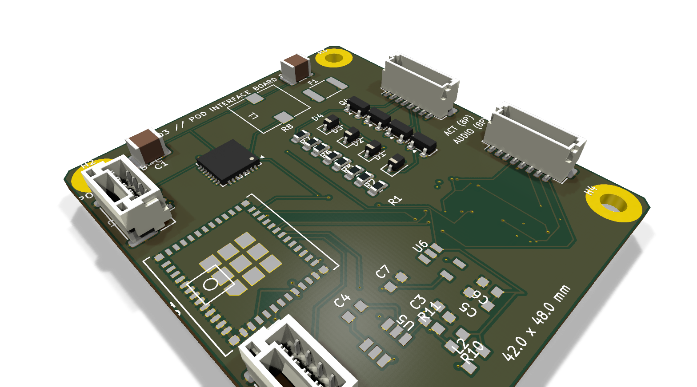
*Figure 7.3a: KiCad 3D view of the Satellite Pod Interface Board (PCBA 03, 42 x 48 mm) with ESP32-C6 Host MCU, SW3516 30W USB-PD charging controller, ES8388 audio codec, segregated bulkhead bus input & USB-C harness header, and rearward intercom and mechatronic headers.*

### 5.1 Board Specifications & Architecture
* **Dimensions:** $42.0 \times 48.0\,\text{mm}$ (4x M2.5 mounting holes on $36.0 \times 42.0\,\text{mm}$ pattern with vibration dampeners directly on the saddlebag pod floor).
  * **Length in X ($42.0\,\text{mm}$):** Strictly constrained towards the front (utilizing only the space gained by eliminating the legacy cassette faceplate). The entire volume behind the board remains 100% reserved for OEM cradles (Cardo Air-Mount, Sena SPIDER cradle, OMM) and the 15–85 mm actuator slide bracket.
  * **Width in Y ($48.0\,\text{mm}$):** Fully utilizes the clear width of the pod cavity ($63\,\text{mm}$) and actuator bracket ($54\,\text{mm}$). More than doubles the PCB area ($2016\,\text{mm}^2$ vs. legacy $875\,\text{mm}^2$), providing massive unbroken GND planes and relaxing the 4-layer routing.
* **Layer Stackup:** 4 Layers FR-4 High-TG150 ($1.6\,\text{mm}$ thickness, continuous GND plane L2, Power plane L3, ENIG gold finish).
* **Eliminated Legacy Overhead (Area Cleanup):**
  * **DW3110 UWB Subsystem:** IC `U2`, 38.4 MHz crystal `Y1`, U.FL socket `ANT_UWB`, and RF keepouts eliminated without replacement.
  * **4-Pin SWD Header (`J_PROG`):** Eliminated completely; ESP32-C6 features integrated USB-Serial/JTAG peripheral for flashing and DFU directly over USB.
  * **Blade-Slot Contacts (`J_DC_IN` / `PAD1`, `PAD2`):** Legacy 10 mm drawer contacts removed.
* **4-Pin Bus Input (`J_BUS` / 4-Pin JST-GH 1.25mm SMD):**
  * Located at the **lower left bulkhead edge** (exact position of former blade slot).
  * Direct, straight cable route (< 15 mm) to the saddlebag wall grommet without bend loops.
  * Carries the 4 conductors from the Central Box: `VCC_BUS` (+12V...+20V vehicle power / PD, fused 30W), `GND`, `USB_D+`, `USB_D-`.
* **Integrated 30W USB-PD Charging Zone & Chassis Socket Header (`J_USB_OUT` / 4-Pin JST-GH 1.25mm SMD):**
  * **Controller:** Ismartware `SW3516` or Injoinic `IP6538` (QFN-32, $5 \times 5\,\text{mm}$) synchronous step-down converter with integrated USB-PD 3.0 / PPS / QC4+ protocol controller and $7 \times 7\,\text{mm}$ shielded power inductor ($10\,\mu\text{H}$).
  * **Header `J_USB_OUT`:** Located at the **upper left bulkhead edge**.
* **Bulkhead Internal Headers & Enclosure Port Arrangement:**
  * **Short Bulkhead Wall Receptacle Layout (Port A & Port B):** Both external bulkhead ports are horizontally centered ($Y = 35.0\,\text{mm}$) and stacked vertically:
    * **Port A (Bus Socket):** Positioned above centerline at $Z = 26.5\,\text{mm}$ (with M8 protective collar / sealed cable gland to Central Box).
    * **Port B (USB-C Fast-Charge Receptacle):** Positioned below centerline at $Z = 11.5\,\text{mm}$ (with $7.0\,\text{mm}$ recessed plug-well for flush waterproof TPU sealing cap).
  * **Internal Silicone Pigtail Harnesses:** Connections from PCBA 03 to the bulkhead ports run through short, ultra-flexible 4-conductor silicone ribbon cables from headers `J_BUS` and `J_USB_OUT`. All insertion, pull, and leverage forces are absorbed 100% by the monolithic PA12 enclosure wall – the PCB remains completely free of mechanical strain!
  * **100% Bilateral Symmetry Guarantee (Left = Right):** Because both saddlebag pods are oriented identically at their bulkhead end-walls, the USB-C charging port remains ergonomically identical on both vehicle sides.
* **Rearward Interfaces (Facing right into the equipment chamber):**
  * **`J_AUDIO_PWR` (8-Pin JST-SH 1.0mm, top-right):** Direct connection to the OEM intercom harness (Sena, Cardo, OMM, Midland).
  * **`J_ACT` (8-Pin JST-SH 1.0mm, bottom-right):** Direct connection to up to 4 actuator channels (mini push-pull solenoids / micro-servos on the universal slide bracket `012_universal_actuator_slide_bracket.scad`).
  * **Advantage:** Spatial separation between Audio (top) and Actuators (bottom) prevents inductive switching spikes from coupling into sensitive analog audio lines. Both harnesses route backwards in parallel – zero cable crossings over the PCB!
* **Communication, Power & Audio ICs:**
  * `U1`: Espressif `ESP32-C6-MINI-1U` RISC-V MCU for charge monitoring, codec control, actuators, and USB audio bridge.
  * `U_PD`: Ismartware `SW3516` (QFN-32, $5 \times 5\,\text{mm}$) synchronous 30W USB-PD 3.0 / PPS / QC4+ step-down controller with $7 \times 7\,\text{mm}$ shielded power inductor `L_PD` ($10\,\mu\text{H}$) and 1210 solid polymer filter capacitors.
  * `U3`: Everest Semi `ES8388` 24-Bit / 48 kHz low-noise audio codec.
  * `U4`: TI `TS5A3159DBVR` analog/digital audio switch for automatic detection of analog OEM headsets vs. digital OMM modules via Pin 6 (`OMM_DETECT`).
  * `Q1..Q4`: 4x N-channel power MOSFETs (`AO3400A`, 30V/4A) with 4x flyback diodes (`1N4148WS`, D1..D4) for 4 independent actuator driver channels.
  * `F1`: 1812 SMD Polyfuse (PPTC) for protected 5V actuator and peripheral supply (`VCC_5V_PROT`).

### 5.2 External Connectors & Interfaces (J_BUS, J_USB_OUT, J_ACT, J_AUDIO_PWR)

<!-- AUTO_CONNECTORS_START: PCBA_03 -->

#### Connector `J1`: J_BUS (Backbone Bus-Eingang von Zentralbox)
> **Type:** `JST-GH 4-Pin 1.25mm SMD Vertikal (BM04B-GHS-TBT)` | **Mating Connector:** `JST GHR-04V-S (AWG26-30)`  

| Pin | Signal / KiCad Net | Signal Type | Electrical Specification & Function |
| :---: | :--- | :---: | :--- |
| **1** | `VCC_BUS` | **Power In (+12V...+20V)** | Bordnetz-/PD-Speisung von Zentralbox (abgesichert 30W) |
| **2** | `GND` | **Power Return** | Leistungs- und Signalmasse |
| **3** | `USB_DP` | **USB 2.0 D+** | USB 2.0 High-Speed D+ zur Zentralbox |
| **4** | `USB_DM` | **USB 2.0 D-** | USB 2.0 High-Speed D- zur Zentralbox |
| **MP** | `GND` | **Shield** | Rastlaschen auf Masse-Plane gelegt |

#### Connector `J2`: J_USB_OUT (In-Bag 30W USB-PD Ladedose)
> **Type:** `JST-GH 4-Pin 1.25mm SMD Vertikal (BM04B-GHS-TBT)` | **Mating Connector:** `JST GHR-04V-S (AWG26-30)`  

| Pin | Signal / KiCad Net | Signal Type | Electrical Specification & Function |
| :---: | :--- | :---: | :--- |
| **1** | `VBUS_30W` | **Power Out (+5V..+20V)** | Geregelte 30W USB-PD Ladespannung (SW3516) |
| **2** | `GND` | **Power Return** | Ladeleistungs-Rückstrom |
| **3** | `CC1` | **PD Config** | Configuration Channel 1 für USB-PD Aushandlung |
| **4** | `CC2` | **PD Config** | Configuration Channel 2 für USB-PD Aushandlung |
| **MP** | `GND` | **Shield** | Rastlaschen auf Masse-Plane |

#### Connector `J3`: J_ACT (4-Kanal Mechatronik-Aktuatorschiene)
> **Type:** `JST-SH 8-Pin 1.0mm SMD Vertikal (BM08B-SRSS-TB)` | **Mating Connector:** `JST SHR-08V-S-B (AWG28-30)`  

| Pin | Signal / KiCad Net | Signal Type | Electrical Specification & Function |
| :---: | :--- | :---: | :--- |
| **1** | `GND` | **Power Return** | Massebezug |
| **2** | `GND` | **Power Return** | Massebezug |
| **3** | `ACT_4` | **Open-Drain Out** | Aktuator 4 (Mesh-Taste, geschaltet via Q4 AO3400A) |
| **4** | `ACT_3` | **Open-Drain Out** | Aktuator 3 (Center-Taste, geschaltet via Q3 AO3400A) |
| **5** | `ACT_2` | **Open-Drain Out** | Aktuator 2 (Minus-Taste, geschaltet via Q2 AO3400A) |
| **6** | `ACT_1` | **Open-Drain Out** | Aktuator 1 (Plus-Taste, geschaltet via Q1 AO3400A) |
| **7** | `VCC_5V_PROT` | **Power Out (+5V)** | Polyfuse-geschützte 5V Speisung für Aktuatoren |
| **8** | `VCC_5V_PROT` | **Power Out (+5V)** | Polyfuse-geschützte 5V Speisung für Aktuatoren |
| **MP** | `GND` | **Shield** | Rastlaschen auf Masse |

#### Connector `J4`: J_AUDIO_PWR (Hybrid Intercom & OMM Module Header)
> **Type:** `JST-SH 8-Pin 1.0mm SMD Vertikal (BM08B-SRSS-TB)` | **Mating Connector:** `JST SHR-08V-S-B (AWG28-30)`  

| Pin | Signal / KiCad Net | Signal Type | Electrical Specification & Function |
| :---: | :--- | :---: | :--- |
| **1** | `GND` | **Power Return** | Gemeinsame Signal- und Lastmasse |
| **2** | `VCC_5V_PROT` | **Power Out (+5V)** | Polyfuse-geschützte 5V Speisung (F1 1.1A gesichert) |
| **3** | `GND` | **Power Return** | Massebezug |
| **4** | `POD_IO_DP_L` | **Dual-Mode I/O** | Modus A: Line-In Links / Modus B: OMM USB D+ |
| **5** | `POD_IO_DM_R` | **Dual-Mode I/O** | Modus A: Line-In Rechts / Modus B: OMM USB D- |
| **6** | `OMM_DETECT` | **Control In** | Mode-Sense (HIGH 3.3V = Analog-Codec, LOW 0V = Digital-OMM USB Host) |
| **7** | `VOICE_OUT` | **Analog Audio Out** | Modus A: Sprache vom ES8388 DAC an Headset Mic-In |
| **8** | `PTT_BTN` | **Digital In** | Hardware PTT-Taster (Active-Low gegen Masse, 10k PU) |
| **MP** | `GND` | **Shield** | Rastlaschen auf Masse |

<!-- AUTO_CONNECTORS_END: PCBA_03 -->

### 5.3 Sub-Chips & Peripheral Components (CH554E, TS5A23157, ES8388)

<!-- AUTO_SUBCHIPS_START: PCBA_03 -->

#### Sub-Chip `U7`: WCH CH554E USB 2.0 Full-Speed Host Controller (MSOP-10)
> **Manufacturer Datasheet:** [WCH CH554E USB 2.0 Full-Speed Host Controller](https://www.wch-ic.com/downloads/CH554DS1_PDF.html) | **Pin Definitions:** [Section 3: Pin Definitions (MSOP-10)](https://www.wch-ic.com/downloads/CH554DS1_PDF.html#page=5)  

| Pad | Pin Name | Signal / KiCad Net | Signal Type | Target / Source | Function & Electrical Spec |
| :---: | :--- | :--- | :---: | :--- | :--- |
| 3 | `RXD1 / P1.6` | `CH554_UART_TX` | **UART In** | U1.26 (ESP32-C6 GPIO20) | 3.0 Mbps UART RX vom ESP32-C6 (TX) |
| 4 | `TXD1 / P1.7` | `CH554_UART_RX` | **UART Out** | U1.27 (ESP32-C6 GPIO21) | 3.0 Mbps UART TX zum ESP32-C6 (RX) |
| 5 | `GND` | `GND` | **Power Return** | GND Plane | Massebezug |
| 6 | `UDM` | `OMM_USB_DM` | **USB D-** | U4.7 (TS5A23157) | USB 2.0 Host Datenleitung D- zum OMM-Modul via U4/J4 |
| 7 | `UDP` | `OMM_USB_DP` | **USB D+** | U4.9 (TS5A23157) | USB 2.0 Host Datenleitung D+ zum OMM-Modul via U4/J4 |
| 8 | `GND` | `GND` | **Power Return** | GND Plane | Massebezug |
| 9 | `V33` | `VCC_3V3` | **Power In** | 3.3V Rail (C8 100nF) | 3.3V Versorgungsspannung |
| 10 | `VCC` | `VCC_3V3` | **Power In** | 3.3V Rail | 3.3V Versorgungsspannung |

#### Sub-Chip `U4`: TI TS5A23157 Dual SPDT Analog/USB-Switch (MSOP-10)
> **Manufacturer Datasheet:** [TI TS5A23157 Dual SPDT Analog/USB-Switch](https://www.ti.com/lit/ds/symlink/ts5a23157.pdf) | **Pin Definitions:** [Pin Functions (MSOP-10 / VSSOP-10)](https://www.ti.com/lit/ds/symlink/ts5a23157.pdf#page=3)  

| Pad | Pin Name | Signal / KiCad Net | Signal Type | Target / Source | Function & Electrical Spec |
| :---: | :--- | :--- | :---: | :--- | :--- |
| 1 | `1IN` | `OMM_DETECT` | **Control In** | J4.6 / R9 Pull-Up | Steuereingang Schalter 1 (HIGH=Analog Codec, LOW=Digital OMM) |
| 2 | `1NO` | `AUDIO_IN_L` | **Analog Audio In** | U3.8 (ES8388 LIN1) | Schließer 1: Analog Line-In Links vom OEM Headset |
| 3 | `GND` | `GND` | **Power Return** | GND Plane | Massebezug |
| 4 | `2NO` | `AUDIO_IN_R` | **Analog Audio In** | U3.9 (ES8388 RIN1) | Schließer 2: Analog Line-In Rechts vom OEM Headset |
| 5 | `2IN` | `OMM_DETECT` | **Control In** | J4.6 / R9 Pull-Up | Steuereingang Schalter 2 |
| 6 | `2COM` | `POD_IO_DM_R` | **Dual-Mode I/O** | J4.5 | Gemeinsamer Kontakt 2 zu Pin 5 des Hybrid-Steckers J4 |
| 7 | `2NC` | `OMM_USB_DM` | **USB D-** | U7.6 (CH554E UDM) | Öffner 2: Digital USB D- Verbindung zum CH554E Host |
| 8 | `V+` | `VCC_3V3` | **Power In** | 3.3V Rail | 3.3V Versorgungsspannung |
| 9 | `1NC` | `OMM_USB_DP` | **USB D+** | U7.7 (CH554E UDP) | Öffner 1: Digital USB D+ Verbindung zum CH554E Host |
| 10 | `1COM` | `POD_IO_DP_L` | **Dual-Mode I/O** | J4.4 | Gemeinsamer Kontakt 1 zu Pin 4 des Hybrid-Steckers J4 |

#### Sub-Chip `U3`: Everest Semi ES8388 24-Bit Audio Codec (QFN-28 (4x4 mm))
> **Manufacturer Datasheet:** [Everest Semi ES8388 24-Bit Audio Codec](http://www.everest-semi.com/pdf/ES8388%20DS.pdf) | **Pin Definitions:** [Pin Configuration & Description (QFN-28)](http://www.everest-semi.com/pdf/ES8388%20DS.pdf#page=4)  

| Pad | Pin Name | Signal / KiCad Net | Signal Type | Target / Source | Function & Electrical Spec |
| :---: | :--- | :--- | :---: | :--- | :--- |
| 1 | `MCLK` | `I2S_MCLK` | **Clock In** | U1.15 (ESP32-C6) | I2S Master Clock (12.288 MHz) |
| 2 | `BCLK` | `I2S_BCLK` | **Clock In** | U1.16 (ESP32-C6) | I2S Bit Clock (3.072 MHz) |
| 3 | `LRCK` | `I2S_WS` | **Sync In** | U1.19 (ESP32-C6) | I2S Word Select / Frame Sync (48 kHz) |
| 4 | `DSOUT` | `I2S_DIN` | **Audio Out** | U1.24 (ESP32-C6) | Digitalisiertes Mikrofon-Signal an MCU |
| 5 | `DSIN` | `I2S_DOUT` | **Audio In** | U1.20 (ESP32-C6) | Downlink Audio vom DSP zum DAC |
| 8 | `LIN1` | `AUDIO_IN_L` | **Analog In** | U4.2 (via J4.4) | Analoger Audio-Eingang Links vom OEM-Intercom |
| 9 | `RIN1` | `AUDIO_IN_R` | **Analog In** | U4.4 (via J4.5) | Analoger Audio-Eingang Rechts vom OEM-Intercom |
| 12 | `LOUT1` | `VOICE_OUT` | **Analog Out** | J4.7 | Analoger Mikrofon-Pegel Ausgang an OEM-Headset Mic-In |
| 20 | `SCL` | `I2C_SCL` | **I2C SCL** | U1.13 (ESP32-C6) | I2C Taktleitung zur Codec-Registerprogrammierung |
| 21 | `SDA` | `I2C_SDA` | **I2C SDA** | U1.23 (ESP32-C6) | I2C Datenleitung zur Codec-Registerprogrammierung |

<!-- AUTO_SUBCHIPS_END: PCBA_03 -->

### 5.4 ESP32-C6-MINI-1U (`U1`) Complete Pinout Matrix

<!-- AUTO_PINOUT_START: PCBA_03 -->

| Pad | Signal / KiCad Net | ESP32 GPIO | Firmware Define | Target / IC | Signal Type & Electrical Spec |
| :---: | :--- | :---: | :--- | :--- | :--- |
| 3 | `VCC_3V3` | - | - | 3.3V Power Rail | **Power** – Betriebsspannung ESP32-C6 (3.0V - 3.6V) |
| 5 | `PTT_BTN` | GPIO 2 | `PIN_POD_PTT_BTN` | J4.8 | **Digital In** – Hardware PTT-Taster Eingang (Active Low, 10k Pull-Up) |
| 6 | `ACT3_GATE` | GPIO 3 | `PIN_ACT3_CENTER` | Q3 Gate (AO3400A) | **Digital Out** – Mechatronik Aktuator 3 Gate (Center / Phone Taste) |
| 8 | `VCC_3V3` | - | - | VCC_3V3 Pull-Up | **Power/Reset** – Chip Enable / Hardware Reset |
| 9 | `ACT4_GATE` | GPIO 4 | `PIN_ACT4_MESH` | Q4 Gate (AO3400A) | **Digital Out** – Mechatronik Aktuator 4 Gate (Mesh Taste) |
| 10 | `ACT1_GATE` | GPIO 5 | `PIN_ACT1_PLUS` | Q1 Gate (AO3400A) | **Digital Out** – Mechatronik Aktuator 1 Gate (Plus / Vol+ Taste, Active High via Q1 AO3400A) |
| 12 | `OMM_DETECT` | GPIO 0 | `PIN_OMM_DETECT` | J4.6 / U4.1, U4.5 / R9 Pull-Up | **Digital In** – OMM Kabelerkennung (HIGH = Sena/Cardo via Codec, LOW = OMM via CH554E USB-Host) |
| 13 | `I2C_SCL` | GPIO 1 | `PIN_CODEC_I2C_SCL` | U3.27 / SW3516 | **I2C_SCL** – I2C Taktleitung (SCL) für ES8388 Audio-Codec & SW3516 30W Ladecontroller |
| 15 | `I2S_MCLK` | GPIO 6 | `PIN_I2S_MCLK` | U3.1 | **I2S_MCLK** – I2S Master-Clock (12.288 MHz an ES8388 Audio-Codec) |
| 16 | `I2S_BCLK` | GPIO 7 | `PIN_I2S_BCLK` | U3.2 / J4 | **I2S_BCLK** – I2S Bit-Clock (3.072 MHz) |
| 17 | `USB_DM` | GPIO 12 | `PIN_POD_USB_DM` | J1.4 | **USB_D-** – Backbone USB 2.0 D- (J_BUS Pin 4) |
| 18 | `USB_DP` | GPIO 13 | `PIN_POD_USB_DP` | J1.3 | **USB_D+** – Backbone USB 2.0 D+ (J_BUS Pin 3) |
| 19 | `I2S_WS` | GPIO 14 | `PIN_I2S_WS` | U3.3 / J4 | **I2S_WS** – I2S Word Select / Frame Sync (48 kHz LRCLK an ES8388 & J4) |
| 20 | `I2S_DOUT` | GPIO 15 | `PIN_I2S_DOUT` | U3.4 / J4 | **I2S_DOUT** – I2S Serial Data Out (DAC Data an ES8388 & OMM via TMUX1574) |
| 22 | `ACT2_GATE` | GPIO 8 | `PIN_ACT2_MINUS` | Q2 Gate (AO3400A) | **Digital Out** – Mechatronik Aktuator 2 Gate (Minus / Vol- Taste, Active High via Q2 AO3400A) |
| 23 | `I2C_SDA` | GPIO 9 | `PIN_CODEC_I2C_SDA` | U3.28 / SW3516 | **I2C_SDA** – I2C Datenleitung (SDA) für ES8388 Audio-Codec & SW3516 |
| 24 | `I2S_DIN` | GPIO 18 | `PIN_I2S_DIN` | U3.5 / J4 | **I2S_DIN** – I2S Serial Data In (ADC Data vom ES8388 & OMM via TMUX1574) |
| 26 | `CH554_UART_TX` | GPIO 20 | `PIN_CH554_UART_TX` | U7.3 (CH554E RXD1) | **UART_TX** – High-Speed UART TX (2 Mbps) zu CH554E USB-Host Controller |
| 27 | `CH554_UART_RX` | GPIO 21 | `PIN_CH554_UART_RX` | U7.4 (CH554E TXD1) | **UART_RX** – High-Speed UART RX (2 Mbps) vom CH554E USB-Host Controller |

<!-- AUTO_PINOUT_END: PCBA_03 -->

### 5.5 Hardware Switching & 3.0 Mbps Bridge Operation

| Pin | Signal Name | Signal Type | Function & Specification (internal pigtail to Port A) |
| :---: | :--- | :---: | :--- |
| **1** | **`VCC_BUS`** | Power In (+12V...+20V) | Vehicle power / PD supply from Central Box (AWG20, fused 30W) |
| **2** | **`GND`** | Power Return | Power and signal ground |
| **3** | **`USB_DP`** | High-Speed Data | USB 2.0 data line D+ to Central Box (ESP32-S3 host) |
| **4** | **`USB_DM`** | High-Speed Data | USB 2.0 data line D- to Central Box (ESP32-S3 host) |
| **MP** | **`GND`** | Shield | JST-GH connector shield retention tabs tied to GND plane |

### 5.3 Pinout of Internal 30W USB-C Chassis Header (`J_USB_OUT` / 4-Pin JST-GH 1.25mm)

| Pin | Signal Name | Signal Type | Function: Internal Silicone Harness to Chassis Bulkhead (Port B) |
| :---: | :--- | :---: | :--- |
| **1** | **`VBUS_30W`** | Power Out | Regulated 5V/9V/12V/15V/20V USB-PD charging voltage (up to 30W) |
| **2** | **`GND`** | Power Return | Power ground return (AWG20 silicone wire) |
| **3** | **`CC1`** | PD Config In/Out | Configuration Channel 1 for USB-PD 3.0 / PPS negotiation |
| **4** | **`CC2`** | PD Config In/Out | Configuration Channel 2 for USB-PD 3.0 / PPS negotiation |
| **MP** | **`GND`** | Shield | Retention tabs tied to GND plane |

### 5.4 Pinout of Audio-Power Header (`J_AUDIO_PWR` / 8-Pin JST-SH 1.0mm)

| Pin | Signal Name | Direction | Function: Analog Intercom (Sena / Cardo / Midland) | Function: Digital OMM (PCBA 09 / PCBA 10) |
| :---: | :--- | :---: | :--- | :--- |
| **1** | **`GND`** | Power Return | **Power & Audio Return:** Common low-impedance ground ($0.2\dots 0.6\,\text{A}$) | **Power & RF Ground:** Return for charger & RF PA |
| **2** | **`VCC_5V_PROT`** | Power Out | Regulated, polyfuse-protected +5V supply for headset battery/charger | Regulated, protected +5V supply for OMM BQ24075 PMIC |
| **3** | **`GND`** | System GND | Reference and shielding ground | Reference and coax shield |
| **4** | **`AUDIO_IN_L`** | Audio In $\leftarrow$ | Left speaker line-out from headset $\rightarrow$ to ES8388 ADC | Unused (N/C) |
| **5** | **`AUDIO_IN_R`** | Audio In $\leftarrow$ | Right speaker line-out from headset $\rightarrow$ to ES8388 ADC | Unused (N/C) |
| **6** | **`OMM_DETECT`** | Control In $\leftarrow$ | **GND Bridge in Harness (0V):** Holds `U4` in normal closed state (NC) | **Open / N/C:** `R9` pulls HIGH ($3.3\,\text{V}$) $\rightarrow$ switches `U4` to Digital USB (NO) |
| **7** | **`AUDIO_IO_P`** | Dual-Mode I/O | **Analog `VOICE_OUT` (via U4 NC):** Voice from ES8388 DAC $\rightarrow$ OEM Mic | **Digital `USB_DP` (via U4 NO):** Native digital USB audio data stream D+ |
| **8** | **`PTT_BTN`** | Digital In $\leftarrow$ | **Physical PTT Button:** Pushbutton input direct to ESP32-C6 GPIO Pin 7 | **PTT Control / Digital Status:** Keying to GND |
| **MP** | **`GND`** | Shield | SMT connector side mounting tabs tied to solid GND plane | SMT connector side mounting tabs tied to solid GND plane |

### 5.5 Pinout of Mechatronic Actuator Header (`J_ACT` / 8-Pin JST-SH 1.0mm)

| Pin | Signal Name | Signal Type | Function & Protection |
| :---: | :--- | :---: | :--- |
| **1** | **`GND`** | Power Return | Power ground for actuator driver stage |
| **2** | **`GND`** | Power Return | Power ground for actuator driver stage |
| **3** | **`ACT_4`** | Open-Drain Out | Switched coil ground Actuator 4 (via AO3400A Q4 / flyback diode D4) |
| **4** | **`ACT_3`** | Open-Drain Out | Switched coil ground Actuator 3 (via AO3400A Q3 / flyback diode D3) |
| **5** | **`ACT_2`** | Open-Drain Out | Switched coil ground Actuator 2 (via AO3400A Q2 / flyback diode D2) |
| **6** | **`ACT_1`** | Open-Drain Out | Switched coil ground Actuator 1 (via AO3400A Q1 / flyback diode D1) |
| **7** | **`VCC_5V_PROT`** | Power Out (+5V) | Supply rail for actuator coils (polyfuse-protected via F1) |
| **8** | **`VCC_5V_PROT`** | Power Out (+5V) | Supply rail for actuator coils (polyfuse-protected via F1) |
| **MP** | **`GND`** | Shield | SMT mounting tabs tied to solid GND plane |

---

## 6. PCBA 04: Rear Pod 3 Transceiver (Retired without Replacement)

The rear transceiver board `PCBA 04` and its enclosure are completely eliminated:
* The Semtech SX1262 LoRa transceiver operates directly on the Central Box (`PCBA 01`).
* The u-blox SAM-M10Q GNSS module operates in the ram-air scoop of the Front Node (`PCBA 05`).

---

## 7. PCBA 05: Universal Front Node (`openmotorbridge_front_node`)

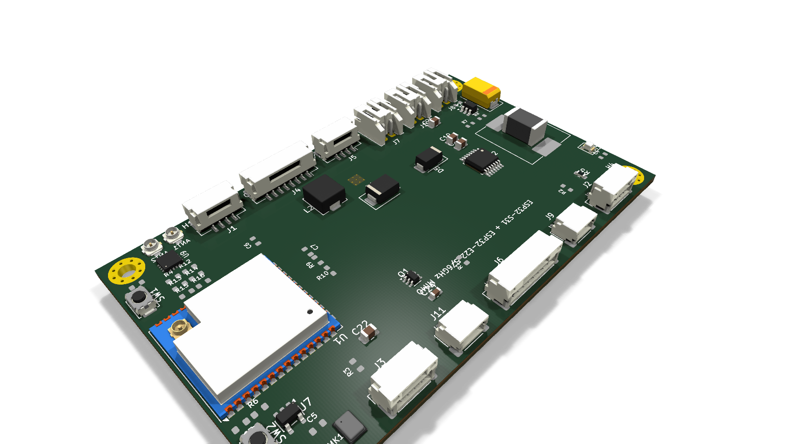
*Figure 7.5a: KiCad 3D view of the Universal Front Node Top (PCBA 05, 82 x 50 mm) featuring the ESP32-S31 Dual-Core RISC-V Host MCU (native 480 Mbps USB HS PHY, internal 2.4G disabled), ESP32-E22 Companion Radio (Wi-Fi 6E 5/6 GHz 2x2 MIMO with Dual-U.FL Ports via SDIO 3.0), USB2514Bi Industrial Hub, modular Sensor Puck interface, Knowles MEMS acoustic sensor, 60W Power Engine (SW3526 30W USB-PD, TPS54302 5V Buck, TPS2051B Dongle Gate, TPS1H100 Aux Switch), and modular JST automotive connectors.*

### 7.1 Board Specifications & v10 Dual-Chip Architecture (ESP32-S31 + ESP32-E22)
* **Dimensions:** $82.0 \times 50.0\,\text{mm}$ with 4x M2.5 mounting holes ($75.0 \times 43.0\,\text{mm}$ hole pitch, enclosure footprint $98 \times 68 \times 25\,\text{mm}$ in sealed IP68 monocoque housing at handlebar riser).
* **Layer Stackup:** 4 Layers FR-4 High-TG150 ($1.6\,\text{mm}$, ENIG gold finish, impedance-controlled 50 $\Omega$ single-ended / 90 $\Omega$ differential USB & SDIO).
* **Host Microcontroller (`U1`, ESP32-S31-WROOM-1U):**
  * Dual-Core RISC-V processor clocked up to 320 MHz, AI-SIMD pipeline, and native High-Speed USB 2.0 PHY (480 Mbps).
  * **2.4 GHz RF Disabled via Firmware:** The internal 2.4 GHz radio is permanently disabled in firmware (`front_node_config.h`) to keep the handlebar area 100% RF-clean and prevent interference with adjacent systems.
  * Native 480 Mbps USB link to Downstream Port 4 of the `USB2514Bi` Hub for ultra-low latency Harley Headset Emulation (MFi / USB Audio Class) and CDC-NCM Ethernet tethering across the backbone to the Central Box.
* **Wireless Companion Radio (`U9`, ESP32-E22-WROOM-2X2):**
  * High-performance Wi-Fi 6E transceiver operating on the 5 GHz and 6 GHz bands with 2x2 MIMO.
  * Dual U.FL coaxial RF connectors (`ANT1` Main, `ANT2` MIMO) on the top PCB surface for low-loss pigtails to external housing or riser antennas.
  * High-speed link to host MCU `ESP32-S31` via a 4-bit SDIO 3.0 bus (`SDIO_CLK`, `SDIO_CMD`, `SDIO_D0..D3`, `E22_IRQ`, `E22_EN`).
  * **Strict 5/6 GHz Frequency Isolation:** Cockpit Wi-Fi and telemetry operate exclusively on 5/6 GHz, guaranteeing zero co-channel interference with the Central Box Qualcomm QCC3084 / S31 Bluetooth / BLE mesh.
* **USB Subsystem (`U2`, Microchip USB2514Bi Industrial Hub):**
  * Upstream Port: Connected to `J1` Backbone (4-wire automotive harness to Central Box for bus-wide flashing, DFU, and telemetry).
  * Port 1 (`USB_DN1`): Glovebox / 30W USB-PD fast-charge controller (SW3526).
  * Port 2 (`USB_DN2`): JST-GH 4-pin receptacle (`J_DONGLE` / `J5`) with TPS2051B power-gating (`CP2AA_PWR_EN`) for wireless CarPlay/Android-Auto dongles (**Active in Scenario B: Universal / Aftermarket Display**; sealed with form-fitting TPU blind plug in Scenario A Touring).
  * Port 3 (`USB_DN3`): Glovebox media hub extension (`J4` header to `PCBA 05B` in glovebox).
  * Port 4 (`USB_HS`): Dedicated 480 Mbps point-to-point interconnect to the `ESP32-S31` native USB HS PHY (for digital headset emulation towards Skyline OS and CDC-NCM Ethernet tethering).
  * Service & DFU Architecture: Flashed centrally via Bus-DFU (`0x50`/`0x51`) over the vehicle backbone `J1` directly from the Central Box.
* **Automotive Backbone Connection (`J1`, Branch 1):** Shielded 4-wire cable from Central Box (12V-20V vehicle power, GND, USB 2.0 D+/D-) routed through the Harley backbone wire caddy (**ZERO tank lifting required!**).
* **60W Power Engine (Power Master):**
  * TPS54302 Synchronous Buck Converter (`U3`): Regulates clean +5V (up to 3A) for cockpit peripherals, mirror pods, and WS2812B LEDs.
  * SW3526 Synchronous Buck-Boost Fast-Charge Controller (`U5`): Up to 30W USB-PD (PPS, QC4+, AFC, FCP) for driver smartphone fast charging.
  * TLV75533P Low-Noise LDO (`U7`): Dedicated +3.3V system rail for ESP32-S31, ESP32-E22, and onboard sensors.
  * TPS2051B Load Switch (`U4`): Software-managed power gating for CP2AA wireless dongle at `J5` (Scenario B) with overcurrent fault reporting and 0.0 µA deep sleep.
  * TPS1H100 Smart High-Side Switch (`Q2`): Switched 12V high-side output (`J_AUX_LIGHT`) for auxiliary light pods or heated grips.
* **Modular Sensor-Puck ("Basket") Interface (`J_SENSOR_EXT` / `J6` / 8-Pin JST-GH):**
  * Routes power rails (`3V3`, `GND`), I2C bus (`SCL`, `SDA`), and dedicated GNSS hardware signals (`TIMEPULSE` 1PPS, `GNSS_TXD`, `GNSS_RXD`, `GNSS_RESET_N`) to the snap-on sensor cradle ([`sensor_puck_environmental.scad`](../../hardware/cad/scad/04_front_node/parts/sensor_puck_environmental.scad)).
  * Integrates u-blox SAM-M10Q Multi-GNSS, TI TMP117 precision thermometer, and OPT3001 light sensor (Knowles I2S MEMS microphone remains directly protected on the underside of PCBA 05).
  * Snaps directly onto the Front Node on bikes; unclips for remote mounting on car/van windshields via 1.5m extension lead.
* **Peripheral Ports & Enclosure Interfaces (100% Modular JST-GH SMD Horizontal Receptacles):**
  * **South Flank / Cockpit Wall (facing handlebars / rider, Y = 116.50 mm in KiCad / Y = 0 mm in enclosure, 3x oval ports $11.0 \times 5.5\,\text{mm}$):**
    * **`CKPT 1` (Right on enclosure, center $X = 33.50\,\text{mm}$):**
      * `J3` (JST-GH 4P, $X_{\text{rel}} = 19.73\,\text{mm}$, enclosure $X = 27.73\,\text{mm}$): Right Mirror Pod ([`PCBA 05C`](#73-pcba-05c-ultra-compact-bilateral-symmetric-under-perch-mirror-pod-board-openmotorbridge_mirror_pod)) (BSD Amber LED + Switch).
      * `J11` (JST-GH 4P, $X_{\text{rel}} = 31.24\,\text{mm}$, enclosure $X = 39.24\,\text{mm}$): Right Cockpit Speaker Corner Pod Display (I2C Bus + 3.3V + GND).
    * **`SENSOR` (Center on enclosure, center $X = 53.25\,\text{mm}$):**
      * `J6` (JST-GH 8P, $X_{\text{rel}} = 45.25\,\text{mm}$, enclosure $X = 53.25\,\text{mm}$): Environmental & GNSS Sensor Puck ([`PCBA 05D`](#74-pcba-05d-snap-on-sensor-puck-openmotorbridge_sensor_puck)) upward into snap cradle.
    * **`CKPT 2` (Left on enclosure, center $X = 73.00\,\text{mm}$):**
      * `J9` (JST-GH 4P, $X_{\text{rel}} = 59.26\,\text{mm}$, enclosure $X = 67.26\,\text{mm}$): Left Cockpit Speaker Corner Pod Display (I2C Bus + 3.3V + GND).
      * `J2` (JST-GH 4P, $X_{\text{rel}} = 70.77\,\text{mm}$, enclosure $X = 78.77\,\text{mm}$): Left Mirror Pod ([`PCBA 05C`](#73-pcba-05c-ultra-compact-bilateral-symmetric-under-perch-mirror-pod-board-openmotorbridge_mirror_pod)) (BSD Amber LED + Switch).
    * **Software-Defined Cockpit Ports:** The assignment of `CKPT 1` and `CKPT 2` to the left or right handlebar side is **100% freely configurable in firmware** (1-click swap in WebUI or automatic setup wizard *"Please press left mirror button"*). This **completely eliminates crossing cables at the handlebar riser**.
  * **North Flank / Vehicle & Accessory Wall (facing forward / downward, Y = 73.35 mm in KiCad / Y = 68 mm in enclosure):**
    * **`MAIN` (Enclosure center $X = 34.30\,\text{mm}$, Oval Port $11.0 \times 5.5\,\text{mm}$):**
      * `J1` (JST-GH 4P, $X_{\text{rel}} = 19.73\,\text{mm}$, enclosure $X = 27.73\,\text{mm}$): 4-wire automotive backbone (12V vehicle power, GND, USB 2.0 D+/D- to Central Box).
      * `J4` (JST-GH 8P, $X_{\text{rel}} = 32.85\,\text{mm}$, enclosure $X = 40.85\,\text{mm}$): Glovebox Hub ([`PCBA 05B`](#72-pcba-05b-glovebox-hub--cockpit-breakout-openmotorbridge_cockpit_breakout)) interconnect (30W PD, CC1/CC2, 5V, USB DN3).
    * **`DONGLE` (Enclosure center $X = 54.00\,\text{mm}$, Oval Port $11.0 \times 5.5\,\text{mm}$):**
      * `J5` (JST-GH 4P, $X_{\text{rel}} = 45.98\,\text{mm}$, enclosure $X = 53.98\,\text{mm}$): USB Downstream 2 with remote cold-boot reset (`TPS2051B`).
    * **`AUX 12V` (Enclosure center $X = 63.35\,\text{mm}$, Mini Port $6.5 \times 4.5\,\text{mm}$):**
      * `J7` (JST-GH 2P, $X_{\text{rel}} = 55.35\,\text{mm}$, enclosure $X = 63.35\,\text{mm}$): Switched 12V high-side output (up to 2.5 A / 30 W, `TPS1H100`) for auxiliary lights or heated grips.
    * **`NAV 12V` (Enclosure center $X = 71.48\,\text{mm}$, Mini Port $6.5 \times 4.5\,\text{mm}$):**
      * `J10` (JST-GH 2P, $X_{\text{rel}} = 63.48\,\text{mm}$, enclosure $X = 71.48\,\text{mm}$): Permanent 12V / 15W cockpit power feed for Garmin Zūmo XT2 / Tread / Chigee AIO-5 / Carpuride.
    * **`CAM 5V` (Enclosure center $X = 79.60\,\text{mm}$, Mini Port $6.5 \times 4.5\,\text{mm}$):**
      * `J8` (JST-GH 2P, $X_{\text{rel}} = 71.60\,\text{mm}$, enclosure $X = 79.60\,\text{mm}$): Filtered 5V / 10W power feed for GoPro / Insta360 action cams at handlebars.

---

### 7.1.1 Port Matrix & Deployment Scenarios

| Enclosure Port | PCB Header | Specification / Signal | Label | Scenario A: Touring (Skyline OS / GTS & Glovebox) | Scenario B: Universal (RKS, GS/GSA, Low Rider ST, Naked) |
| :--- | :--- | :--- | :--- | :--- | :--- |
| **Cockpit Right** | `J3` | JST-GH 4P (5V, BSD LED, Switch, GND) | `CKPT 1` | **Active:** Right Mirror Pod ([`PCBA 05C`](#73-pcba-05c-ultra-compact-bilateral-symmetric-under-perch-mirror-pod-board-openmotorbridge_mirror_pod)) | **Active:** Right Mirror Pod ([`PCBA 05C`](#73-pcba-05c-ultra-compact-bilateral-symmetric-under-perch-mirror-pod-board-openmotorbridge_mirror_pod)) |
| **Cockpit Right** | `J11` | JST-GH 4P (3.3V, GND, I2C SCL/SDA) | `CKPT 1` | **Active:** Speaker Corner Display Right | **Blanking Plug** (no fairing speakers) |
| **Cockpit Center**| `J6` | JST-GH 8P (3.3V, GND, I2C, 1PPS, UART, RST)| `SENSOR` | **Active:** Sensor Puck ([`PCBA 05D`](#74-pcba-05d-snap-on-sensor-puck-openmotorbridge_sensor_puck)) snapped top | **Active:** Sensor Puck ([`PCBA 05D`](#74-pcba-05d-snap-on-sensor-puck-openmotorbridge_sensor_puck)) snapped top |
| **Cockpit Left** | `J9` | JST-GH 4P (3.3V, GND, I2C SCL/SDA) | `CKPT 2` | **Active:** Speaker Corner Display Left | **Blanking Plug** (no fairing speakers) |
| **Cockpit Left** | `J2` | JST-GH 4P (5V, BSD LED, Switch, GND) | `CKPT 2` | **Active:** Left Mirror Pod ([`PCBA 05C`](#73-pcba-05c-ultra-compact-bilateral-symmetric-under-perch-mirror-pod-board-openmotorbridge_mirror_pod)) | **Active:** Left Mirror Pod ([`PCBA 05C`](#73-pcba-05c-ultra-compact-bilateral-symmetric-under-perch-mirror-pod-board-openmotorbridge_mirror_pod)) |
| **Vehicle West** | `J1` | JST-GH 4P (12V-20V, GND, USB HS D+/D-)| `MAIN` | **ALWAYS Active:** 4-wire lifeline from Central Box [`PCBA 01`](#1-pcba-01-zentralbox-main-controller) | **ALWAYS Active:** 4-wire lifeline from Central Box [`PCBA 01`](#1-pcba-01-zentralbox-main-controller) |
| **Vehicle West** | `J4` | JST-GH 8P (30W PD, CC1/CC2, 5V, USB DN3)| `MAIN` | **Active:** Dual-Rail Lifeline to Glovebox Hub ([`PCBA 05B`](#72-pcba-05b-glovebox-hub--cockpit-breakout-openmotorbridge_cockpit_breakout)) | **Optional:** Handlebar USB-C charger or **Blanking Plug** |
| **Vehicle Center**| `J5` | JST-GH 4P (5V gated, USB DN2 D+/D-) | `DONGLE` | **Blanking Plug:** CarPlay dongle resides in glovebox at [`PCBA 05B`](#72-pcba-05b-glovebox-hub--cockpit-breakout-openmotorbridge_cockpit_breakout) | **ONLY active** with aftermarket CP/AA display; else **Blanking Plug** |
| **Vehicle East 1**| `J7` | JST-GH 2P (12V switched, max 2.5A) | `AUX 12V`| **Optional:** Auxiliary lights or **Mini Blanking Plug** | **Optional:** Auxiliary lights or **Mini Blanking Plug** |
| **Vehicle East 2**| `J10` | JST-GH 2P (12V continuous, max 1.5A)| `NAV 12V`| **Mini Blanking Plug:** Factory display (Skyline OS / GTS) active | **Active:** 12V power for Garmin Zūmo XT2 / Chigee AIO-5 |
| **Vehicle East 3**| `J8` | JST-GH 2P (5V BC1.2 DCP, max 2.0A) | `CAM 5V` | **Mini Blanking Plug:** On action-cam ride plugged with mini cable seal | **Mini Blanking Plug:** On action-cam ride plugged with mini cable seal |

> [!IMPORTANT]
> **Poka-Yoke Overvoltage Protection & Port Identification:**
> To reliably prevent accidental destruction of sensitive 5V peripherals (action cams) by plugging into 12V ports, all openings in the HP MJF PA12 enclosure are **recessed 0.5 mm deep and indelibly embossed with voltage and function** (`CAM 5V`, `NAV 12V`, `AUX 12V`, `DONGLE`, `MAIN`, `CKPT 1`, `SENSOR`, `CKPT 2`). In addition, all TPU blanking plugs and cable seals feature raised text abbreviations (`CAM`, `NAV`, `AUX`, `DONGLE`).

---

### 7.1.2 ESP32-S31-WROOM-1U (`U1`) Complete Pinout Matrix on PCBA 05

<!-- AUTO_PINOUT_START: PCBA_05 -->

| Pad | Signal / KiCad Net | ESP32 GPIO | Firmware Define | Target / IC | Signal Type & Electrical Spec |
| :---: | :--- | :---: | :--- | :--- | :--- |
| 3 | `ESP_EN` | - | - | R1 / C3 / SW1 | **Power/Reset** – Chip Enable / Hardware Reset |
| 4 | `GNSS_TIMEPULSE` | GPIO 2 | - | J6.7 | **Digital In** – u-blox SAM-M10Q 1-PPS Timepulse Synchronization |
| 5 | `GNSS_TXD` | GPIO 3 | - | J6.5 | **UART_RX** – u-blox SAM-M10Q Primary NMEA / UBX Stream |
| 6 | `MIC_I2S_WS` | GPIO 4 | `PIN_MIC_I2S_WS` | MK1.2 / J6.6 | **I2S_WS** – Fahrtwindmikrofon Knowles SPH0645 Word Select |
| 7 | `MIC_I2S_BCLK` | GPIO 5 | `PIN_MIC_I2S_BCLK` | MK1.3 | **I2S_BCLK** – Fahrtwindmikrofon Knowles SPH0645 Bit Clock |
| 8 | `BTN_SIG_L_N` | GPIO 8 | `PIN_BTN_SIG_L_N` | J2.3 | **Digital In** – Linker Spiegeltaster (PTT / Intercom / HFP) |
| 9 | `BTN_SIG_R_N` | GPIO 9 | `PIN_BTN_SIG_R_N` | J3.3 | **Digital In** – Rechter Spiegeltaster (Action-Cam Tagging / Mode) |
| 10 | `GNSS_RXD` | GPIO 6 | - | J6.6 | **UART_TX** – u-blox SAM-M10Q Configuration Stream |
| 11 | `GNSS_RESET_N` | GPIO 7 | `PIN_GNSS_RESET_N` | J6.8 | **Digital Out** – u-blox SAM-M10Q Hardware Reset (Active Low) |
| 12 | `MIC_I2S_DATA` | GPIO 35 | `PIN_MIC_I2S_DATA` | MK1.1 / J6.5 | **I2S_DATA** – Fahrtwindmikrofon Knowles SPH0645 Serial Data |
| 13 | `C3_UART_RX` | GPIO 33 | `PIN_C3_UART_RX` | U10.28 | **UART_RX** – Auxiliary MCU (ESP32-C3) UART RX (Audio/SkylineOS Headset Bridge, U10 Pin 28 U0TXD) |
| 14 | `C3_UART_TX` | GPIO 34 | `PIN_C3_UART_TX` | U10.27 | **UART_TX** – Auxiliary MCU (ESP32-C3) UART TX (Audio/SkylineOS Headset Bridge, U10 Pin 27 U0RXD) |
| 15 | `C3_EN` | GPIO 15 | `PIN_C3_EN` | U10.7 | **GPIO_OUT** – Auxiliary MCU (ESP32-C3) Hardware Reset / Enable |
| 16 | `C3_BOOT` | GPIO 16 | `PIN_C3_BOOT` | U10.15 | **GPIO_OUT** – Auxiliary MCU (ESP32-C3) Boot Strap Mode Select |
| 17 | `I2C_SDA` | GPIO 22 | `PIN_I2C_SDA` | J6.3 / J9.4 / J11.4 | **I2C_SDA** – Cockpit I2C Data (Sensoren & Dual OLEDs) |
| 18 | `I2C_SCL` | GPIO 23 | `PIN_I2C_SCL` | J6.4 / J9.3 / J11.3 | **I2C_SCL** – Cockpit I2C Clock (400 kHz Fast-Mode) |
| 19 | `WS2812B_DIN` | GPIO 24 | `PIN_WS2812B_DIN` | LED1.4 | **Digital Out** – Onboard Status-LED WS2812B-2020 Data |
| 20 | `BSD_LED_LEFT` | GPIO 25 | `PIN_BSD_LED_LEFT` | Q1.2 -> J2.2 | **Digital Out** – Toter-Winkel-Warn-LED Spiegel Links (BSD) |
| 21 | `BSD_LED_RIGHT` | GPIO 26 | `PIN_BSD_LED_RIGHT` | Q1.5 -> J3.2 | **Digital Out** – Toter-Winkel-Warn-LED Spiegel Rechts (BSD) |
| 22 | `AUX_LIGHT_EN` | GPIO 27 | `PIN_AUX_LIGHT_EN` | Q2.3 -> J7.1 | **Digital Out** – Zusatzscheinwerfer High-Side Switch Enable (TPS1H100) |
| 23 | `C3_I2S_BCLK` | GPIO 7 | `PIN_C3_I2S_BCLK` | U10.6 | **I2S_BCLK** – Digital Audio I2S Bit Clock an U10 ESP32-C3 (Harley Headset-Emulation / Speaker Audio Streaming) |
| 24 | `C3_I2S_WS` | GPIO 10 | `PIN_C3_I2S_WS` | U10.8 | **I2S_WS** – Digital Audio I2S Word Select / Frame Sync an U10 ESP32-C3 |
| 25 | `C3_I2S_SDO` | GPIO 15 | `PIN_C3_I2S_SDO` | U10.9 | **I2S_DOUT** – Digital Audio I2S Serial Data Out an U10 (Lautsprecher-Wiedergabe Skyline OS / Boom! Box) |
| 27 | `ESP_BOOT` | GPIO 0 | `PIN_BOOT_BUTTON` | SW2 | **Digital In** – Boot Mode Strapping Pin / Service Taster |
| 28 | `C3_I2S_SDI` | GPIO 48 | `PIN_C3_I2S_SDI` | U10.10 | **I2S_DIN** – Digital Audio I2S Serial Data In von U10 (Mikrofon-/Sprachkanal von Skyline OS) |
| 30 | `SDIO_CLK` | GPIO 35 | `PIN_E22_SDIO_CLK` | U9.10 | **SDIO_CLK** – ESP32-E22 Wi-Fi 6E SDIO Clock (50 MHz) |
| 31 | `SDIO_CMD` | GPIO 36 | `PIN_E22_SDIO_CMD` | U9.11 | **SDIO_CMD** – ESP32-E22 Wi-Fi 6E SDIO Command Line |
| 32 | `SDIO_D0` | GPIO 37 | `PIN_E22_SDIO_D0` | U9.12 | **SDIO_D0** – ESP32-E22 Wi-Fi 6E SDIO Data Line 0 |
| 33 | `SDIO_D1` | GPIO 33 | `PIN_E22_SDIO_D1` | U9.13 | **SDIO_D1** – ESP32-E22 Wi-Fi 6E SDIO Data Line 1 |
| 34 | `SDIO_D2` | GPIO 34 | `PIN_E22_SDIO_D2` | U9.14 | **SDIO_D2** – ESP32-E22 Wi-Fi 6E SDIO Data Line 2 |
| 35 | `SDIO_D3` | GPIO 38 | `PIN_E22_SDIO_D3` | U9.15 | **SDIO_D3** – ESP32-E22 Wi-Fi 6E SDIO Data Line 3 |
| 36 | `E22_EN` | GPIO 59 | `PIN_E22_EN` | U9.3 | **Digital Out** – ESP32-E22 Wi-Fi 6E Chip Enable / Power Gate |
| 37 | `E22_IRQ` | GPIO 60 | `PIN_E22_IRQ` | U9.16 | **Digital In / IRQ** – ESP32-E22 Wi-Fi 6E Interrupt Request |
| 38 | `CP2AA_FAULT_N` | GPIO 56 | `PIN_CP2AA_FAULT_N` | U4.4 | **Digital In** – CarPlay / Android Auto USB Power Switch Fault (Active Low) |
| 39 | `CP2AA_PWR_EN` | GPIO 57 | `PIN_CP2AA_PWR_EN` | U4.3 | **Digital Out** – CarPlay / Android Auto USB 5V VBUS Power Enable |
| 54 | `USB_HS_DM` | - | `PIN_USB_HS_DM` | J1.4 | **USB_HS_DM** – Native USB 2.0 Device Controller Data Minus (Direct 4-Wire Backbone) |
| 55 | `USB_HS_DP` | - | `PIN_USB_HS_DP` | J1.3 | **USB_HS_DP** – Native USB 2.0 Device Controller Data Plus (Direct 4-Wire Backbone) |

<!-- AUTO_PINOUT_END: PCBA_05 -->

### 7.1.4 External Connectors & Interfaces (J1..J11)

<!-- AUTO_CONNECTORS_START: PCBA_05 -->

#### Connector `J1`: Backbone Bus-Eingang von Zentralbox (Molex J6.1-4)
> **Type:** `JST-GH 4-Pin 1.25mm SMD Vertikal (BM04B-GHS-TBT)` | **Mating Connector:** `JST GHR-04V-S (AWG26-30)`  

| Pin | Signal / KiCad Net | Signal Type | Electrical Specification & Function |
| :---: | :--- | :---: | :--- |
| **1** | `VCC_BUS` | **Power In (+12V/60W)** | Bordnetz-/PD-Speisung von Zentralbox |
| **2** | `GND` | **Power Return** | Masse Leistungsrückstrom |
| **3** | `USB_DP` | **USB 2.0 D+** | USB 2.0 High-Speed D+ zur Zentralbox |
| **4** | `USB_DM` | **USB 2.0 D-** | USB 2.0 High-Speed D- zur Zentralbox |
| **MP** | `GND` | **Shield** | Rastlaschen auf Masse |

#### Connector `J10`: Navi-Stromversorgungsbuchse (Garmin Zūmo / TomTom)
> **Type:** `JST-GH 2-Pin 1.25mm SMD Vertikal (BM02B-GHS-TBT)` | **Mating Connector:** `JST GHR-02V-S (AWG24-28)`  

| Pin | Signal / KiCad Net | Signal Type | Electrical Specification & Function |
| :---: | :--- | :---: | :--- |
| **1** | `VCC_12V_PROT` | **Power Out (+12V/2A)** | Polyfuse-geschützte 12V Speisung für Navi-Cradle |
| **2** | `GND` | **Power Return** | Masse Leistungsrückstrom |
| **MP** | `GND` | **Shield** | Rastlaschen auf Masse |

#### Connector `J6`: GNSS & Umweltsensor-Puck Interconnect (PCBA 05D)
> **Type:** `JST-GH 8-Pin 1.25mm SMD Vertikal (BM08B-GHS-TBT)` | **Mating Connector:** `JST GHR-08V-S (AWG28-30)`  

| Pin | Signal / KiCad Net | Signal Type | Electrical Specification & Function |
| :---: | :--- | :---: | :--- |
| **1** | `VCC_3V3` | **Power Out (+3.3V)** | Sensor-Versorgung 3.3V LDO |
| **2** | `GND` | **Power Return** | Sensor-Masse |
| **3** | `I2C_SDA` | **I2C SDA** | I2C Datenleitung für TMP117 / OPT3001 / BMP390 |
| **4** | `I2C_SCL` | **I2C SCL** | I2C Taktleitung für Umweltsensoren |
| **5** | `GNSS_TX` | **UART In** | u-blox SAM-M10Q NMEA/UBX TX an ESP32-S31 RX |
| **6** | `GNSS_RX` | **UART Out** | ESP32-S31 TX an u-blox SAM-M10Q RX |
| **7** | `GNSS_1PPS` | **Sync In** | u-blox SAM-M10Q 1-PPS Hochpräzisions-Zeittakt |
| **8** | `GND` | **Power Return** | Schirm-Masse |
| **MP** | `GND` | **Shield** | Rastlaschen auf Masse |

<!-- AUTO_CONNECTORS_END: PCBA_05 -->

### 7.1.5 Sub-Chips & Peripherals (USB2514Bi, C3-Bridge)

<!-- AUTO_SUBCHIPS_START: PCBA_05 -->

#### Sub-Chip `U10`: ESP32-C3FH4 Infotainment Client & WHIM Bypass Sub-MCU (QFN-32 (5x5 mm))
> **Manufacturer Datasheet:** [ESP32-C3FH4 Infotainment Client & WHIM Bypass Sub-MCU](https://www.espressif.com/sites/default/files/documentation/esp32-c3_datasheet_en.pdf) | **Pin Definitions:** [Table 2-2: Pin Description (QFN-32)](https://www.espressif.com/sites/default/files/documentation/esp32-c3_datasheet_en.pdf#page=17)  

| Pad | Pin Name | Signal / KiCad Net | Signal Type | Target / Source | Function & Electrical Spec |
| :---: | :--- | :--- | :---: | :--- | :--- |
| 12 | `GPIO18 / USB_D-` | `C3_USB_DM` | **USB D-** | U8 (TS3USB221) | USB 2.0 Client D- zu Boom! Box / Nachrüst-AA |
| 13 | `GPIO19 / USB_D+` | `C3_USB_DP` | **USB D+** | U8 (TS3USB221) | USB 2.0 Client D+ zu Boom! Box / Nachrüst-AA |
| 18 | `GPIO4 / I2S_MCLK` | `C3_I2S_MCLK` | **Clock In** | U1 (ESP32-S31) | I2S Master Clock vom S31 |
| 19 | `GPIO5 / I2S_BCLK` | `C3_I2S_BCLK` | **Clock In** | U1 (ESP32-S31) | I2S Bit Clock vom S31 |
| 20 | `GPIO6 / I2S_WS` | `C3_I2S_WS` | **Sync In** | U1 (ESP32-S31) | I2S Word Select vom S31 |
| 21 | `GPIO7 / I2S_SDO` | `C3_I2S_SDO` | **Audio In** | U1 (ESP32-S31) | Audio Playback Stream für Boom! Box Bordlautsprecher |
| 22 | `GPIO8 / I2S_SDI` | `C3_I2S_SDI` | **Audio Out** | U1 (ESP32-S31) | Mikrofon-Rückkanal an Zentralbox DSP |

#### Sub-Chip `U2`: Microchip USB2514Bi 4-Port USB 2.0 Hub (QFN-36 (6x6 mm))
> **Manufacturer Datasheet:** [Microchip USB2514Bi 4-Port USB 2.0 Hub](https://ww1.microchip.com/downloads/en/DeviceDoc/00001692C.pdf) | **Pin Definitions:** [Table 3-1: 36-Pin QFN Pin Descriptions](https://ww1.microchip.com/downloads/en/DeviceDoc/00001692C.pdf#page=12)  

| Pad | Pin Name | Signal / KiCad Net | Signal Type | Target / Source | Function & Electrical Spec |
| :---: | :--- | :--- | :---: | :--- | :--- |
| 15 | `USBUP_DM` | `HUB_UP_DM` | **USB D-** | U1 (ESP32-S31) | Upstream USB D- vom ESP32-S31 Host |
| 16 | `USBUP_DP` | `HUB_UP_DP` | **USB D+** | U1 (ESP32-S31) | Upstream USB D+ vom ESP32-S31 Host |
| 20 | `USBDN_DM1` | `HUB_P1_DM` | **USB D-** | J4 (Hub Ext JST-GH) | Port 1 D- zu PCBA 05B Handschuhfach |
| 21 | `USBDN_DP1` | `HUB_P1_DP` | **USB D+** | J4 (Hub Ext JST-GH) | Port 1 D+ zu PCBA 05B Handschuhfach |
| 24 | `USBDN_DM2` | `HUB_P2_DM` | **USB D-** | J5 (Wireless Dongle) | Port 2 D- an CP2AA CarPlay/AA Dongle |
| 25 | `USBDN_DP2` | `HUB_P2_DP` | **USB D+** | J5 (Wireless Dongle) | Port 2 D+ an CP2AA CarPlay/AA Dongle |

<!-- AUTO_SUBCHIPS_END: PCBA_05 -->

### 7.1.3 ESP32-C3FH4 (`U10`) Auxiliary MCU Pinout Matrix (USB Audio / SkylineOS Headset Bridge)

<!-- AUTO_PINOUT_START: PCBA_05_AUX -->

| Pad | Signal / KiCad Net | ESP32 GPIO | Firmware Define | Target / IC | Signal Type & Electrical Spec |
| :---: | :--- | :---: | :--- | :--- | :--- |
| 1 | `GND` | - | - | GND | **RF_GND** – HF-Masse / LNA Ground (Reine USB-Kabel-Headset-Emulation, kein RF/BLE aktiv) |
| 2 | `VCC_3V3` | - | - | VCC_3V3 | **Power** – Analoge Versorgungsspannung 3.3V (VDD3P3) |
| 3 | `VCC_3V3` | - | - | VCC_3V3 | **Power** – RTC Versorgungsspannung 3.3V (VDD3P3_RTC) |
| 4 | `C3_NC_GPIO0` | GPIO 0 | - | NC | **GPIO/NC** – Unbelegt / Nicht kontaktiert (XTAL_32K_P) |
| 5 | `C3_NC_GPIO1` | GPIO 1 | - | NC | **GPIO/NC** – Unbelegt / Nicht kontaktiert (XTAL_32K_N) |
| 6 | `C3_I2S_BCLK` | GPIO 2 | - | U1.23 | **I2S_BCLK** – Digital Audio I2S Bit Clock von U1 (ESP32-S31) |
| 7 | `C3_EN` | - | - | U1.15 | **Power/Reset** – Chip Enable / Hardware Reset von U1 (ESP32-S31 GPIO15, 10k PU / 100nF) |
| 8 | `C3_I2S_WS` | GPIO 3 | - | U1.24 | **I2S_WS** – Digital Audio I2S Word Select von U1 (ESP32-S31) |
| 9 | `C3_I2S_SDO` | GPIO 4 | - | U1.25 | **I2S_DIN** – Digital Audio I2S Serial Data In von U1 (Lautsprecher-Audio Streaming) |
| 10 | `C3_I2S_SDI` | GPIO 5 | - | U1.28 | **I2S_DOUT** – Digital Audio I2S Serial Data Out an U1 (Mikrofon-/Siri-Audio) |
| 11 | `VCC_3V3` | - | - | VCC_3V3 | **Power** – CPU Kern-Versorgungsspannung 3.3V (VDD3P3_CPU) |
| 12 | `C3_NC_GPIO6` | GPIO 6 | - | NC | **GPIO/NC** – Unbelegt / Nicht kontaktiert (MTCK) |
| 13 | `C3_NC_GPIO7` | GPIO 7 | - | NC | **GPIO/NC** – Unbelegt / Nicht kontaktiert (MTDO) |
| 14 | `C3_NC_GPIO8` | GPIO 8 | - | NC | **GPIO/NC** – Unbelegt / Strapping Pin (Logisch HIGH) |
| 15 | `C3_BOOT` | GPIO 9 | - | U1.16 | **Digital In** – Boot Mode Strapping Pin (GPIO9) von U1 (ESP32-S31 GPIO16, 10k PU) |
| 16 | `C3_NC_GPIO10` | GPIO 10 | - | NC | **GPIO/NC** – Unbelegt / Nicht kontaktiert (FSPICS0) |
| 17 | `VCC_3V3` | - | - | VCC_3V3 | **Power** – SPI Flash Betriebsspannung 3.3V (VDD_SPI) |
| 18 | `NC` | - | - | NC | **SIP_FLASH** – Intern belegt (C3FH4 SiP Flash VDD_SPI) – darf extern nicht kontaktiert werden |
| 19 | `NC` | - | - | NC | **SIP_FLASH** – Intern belegt (C3FH4 SiP Flash SPIHD) – darf extern nicht kontaktiert werden |
| 20 | `NC` | - | - | NC | **SIP_FLASH** – Intern belegt (C3FH4 SiP Flash SPIWP) – darf extern nicht kontaktiert werden |
| 21 | `NC` | - | - | NC | **SIP_FLASH** – Intern belegt (C3FH4 SiP Flash SPICS0) – darf extern nicht kontaktiert werden |
| 22 | `NC` | - | - | NC | **SIP_FLASH** – Intern belegt (C3FH4 SiP Flash SPICLK) – darf extern nicht kontaktiert werden |
| 23 | `NC` | - | - | NC | **SIP_FLASH** – Intern belegt (C3FH4 SiP Flash SPID) – darf extern nicht kontaktiert werden |
| 24 | `NC` | - | - | NC | **SIP_FLASH** – Intern belegt (C3FH4 SiP Flash SPIQ) – darf extern nicht kontaktiert werden |
| 25 | `USB_DN2_DM` | GPIO 18 | - | U2.11 | **USB_FS_DM** – Nativer Full-Speed USB Controller Data Minus (UAC / HID Headset Emulation) |
| 26 | `USB_DN2_DP` | GPIO 19 | - | U2.12 | **USB_FS_DP** – Nativer Full-Speed USB Controller Data Plus (UAC / HID Headset Emulation) |
| 27 | `C3_UART_TX` | GPIO 20 | - | U1.14 | **UART_RX** – C3 UART0 Receive Data (U0RXD) von U1 (ESP32-S31 GPIO34 / C3_UART_TX) |
| 28 | `C3_UART_RX` | GPIO 21 | - | U1.13 | **UART_TX** – C3 UART0 Transmit Data (U0TXD) an U1 (ESP32-S31 GPIO33 / C3_UART_RX) |
| 29 | `C3_XTAL_OUT` | - | - | Y2.3 | **Oscillator** – 40 MHz Quarz Oszillator Ausgang (XTAL_N) |
| 30 | `C3_XTAL_IN` | - | - | Y2.1 | **Oscillator** – 40 MHz Quarz Oszillator Eingang (XTAL_P) |
| 31 | `VCC_3V3` | - | - | VCC_3V3 | **Power** – Analoge Versorgungsspannung 3.3V (VDDA) |
| 32 | `VCC_3V3` | - | - | VCC_3V3 | **Power** – Analoge Versorgungsspannung 3.3V (VDDA) |
| 33 | `GND` | - | - | GND | **Ground** – Zentrales Massepads & Thermische Anbindung (EP) |

<!-- AUTO_PINOUT_END: PCBA_05_AUX -->

#### 7.1.3 Header J4 Pinout: Glovebox Hub Lifeline (JST-GH 1.25mm 8-Pin Horizontal)
Connects the Universal Front Node (`PCBA 05`) directly to the Glovebox Breakout Hub (`PCBA 05B`) over an 8-conductor shielded automotive harness:

| Pin | Signal Name | Type | Level / Current | Function & Description |
| :-: | :--- | :---: | :---: | :--- |
| **1** | `VBUS_PD1_OUT` | Power Out | 5V / 9V / 12V / 15V (up to 30W) | Dedicated USB-PD fast-charge power from SW3526 (`U5`), passed straight through to `J3` Phone |
| **2** | `GND` | Power | 0 V / Return | Power ground for USB-PD fast charging path |
| **3** | `USB_DN1_CC1` | Analog/Dig | $0\,\text{V} - 5.5\,\text{V}$ | Configuration Channel 1 for native USB-PD contract negotiation between smartphone and SW3526 |
| **4** | `USB_DN1_CC2` | Analog/Dig | $0\,\text{V} - 5.5\,\text{V}$ | Configuration Channel 2 for native USB-PD contract negotiation between smartphone and SW3526 |
| **5** | `VCC_5V` | Power Out | $5.0\,\text{V} \pm 2\,\%$ (max. 3.0A) | Clean 5V system rail from TPS54302 (`U3`) for Dongle, Media thumbdrive, and Hub controller |
| **6** | `GND` | Power | 0 V / Logic GND | System ground for 5V peripherals and USB 2.0 data bus |
| **7** | `USB_DN3_DP` | USB Diff | $90\,\Omega \text{ diff}, 480\,\text{Mbps}$ | USB 2.0 High-Speed Data Plus (Downstream 3 from USB2514Bi to upstream of `PCBA 05B` hub) |
| **8** | `USB_DN3_DM` | USB Diff | $90\,\Omega \text{ diff}, 480\,\text{Mbps}$ | USB 2.0 High-Speed Data Minus (Downstream 3 from USB2514Bi to upstream of `PCBA 05B` hub) |
| **MP**| `SHIELD` | Shield | Chassis GND / PE | 360° braided shield termination & strain relief (SMD retention solder tabs) |

#### 7.1.4 Header J6 Pinout: Sensor Puck Lifeline (`J_SENSOR_EXT`, JST-GH 1.25mm 8-Pin Horizontal)
Connects the Universal Front Node (`PCBA 05`) directly to the Environmental & GNSS Sensor Puck (`PCBA 05D`) via an 8-conductor shielded cable:

| Pin | Signal Name | Type | Level / Current | Function & Description |
| :-: | :--- | :---: | :---: | :--- |
| **1** | `VCC_3V3` | Power Out | $3.3\,\text{V} \pm 2\,\%$ (max. 300 mA) | Regulated system rail for SAM-M10Q, TMP117, and OPT3001 |
| **2** | `GND` | Power | 0 V / System Ground | Signal and RF return ground (direct ground plane tie) |
| **3** | `I2C_SDA` | Bidi Open-Drain | $0\,\text{V} - 3.3\,\text{V}$ | I2C Data Bus (SAM-M10Q DDC `0x42`, OPT3001 `0x44`, TMP117 `0x48`) from ESP32-S31 GPIO17 |
| **4** | `I2C_SCL` | Out Open-Drain | $0\,\text{V} - 3.3\,\text{V}$ (400 kHz) | I2C Clock Bus (Fast-Mode) from ESP32-S31 GPIO18 |
| **5** | `GNSS_TIMEPULSE` | Digital In | $0\,\text{V} - 3.3\,\text{V}$ | High-precision 1PPS hardware time synchronization pulse from SAM-M10Q to ESP32-S31 GPIO4 |
| **6** | `GNSS_TXD` | Digital In | $0\,\text{V} - 3.3\,\text{V}$ (UART) | High-speed serial telemetry stream (NMEA-0183 / UBX binary) from SAM-M10Q TXD to ESP32-S31 GPIO5 RX |
| **7** | `GNSS_RXD` | Digital Out | $0\,\text{V} - 3.3\,\text{V}$ (UART) | Serial control and configuration channel from ESP32-S31 GPIO10 TX to SAM-M10Q RXD |
| **8** | `GNSS_RESET_N` | Digital Out | $0\,\text{V} - 3.3\,\text{V}$ | Hardware reset line (Active-Low, 10k pull-up R3 on puck) from ESP32-S31 GPIO11 to SAM-M10Q RESET_N |
| **MP**| `SHIELD` | Shield | Chassis Ground / PE | Cable braided shield & mechanical strain relief (SMD tabs) |

---

### 7.2 PCBA 05B: Glovebox Hub & Cockpit Breakout (`openmotorbridge_cockpit_breakout`)

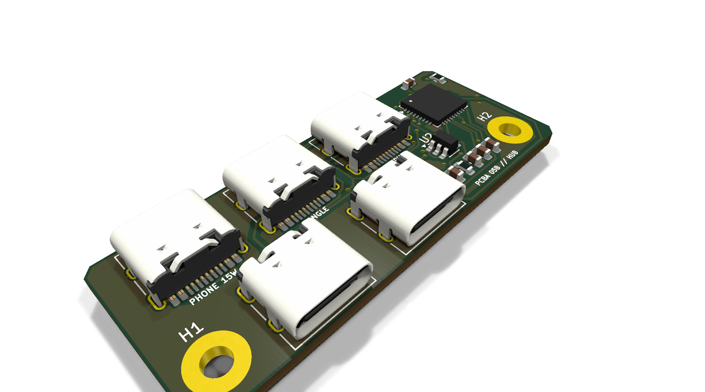
*Figure 7.5c: KiCad 3D render of the compact Glovebox Hub (PCBA 05B, 50.0 x 20.0 mm). Active 4-port automotive USB 2.0 High-Speed hub (Microchip USB2514Bi) with opposing USB-C rows (2x North edge: FRONT / HOST, 3x South edge: PHONE 15W / DONGLE / MEDIA) and bottom-side CC termination logic for Harley-Davidson Skyline OS / Boom! Box GTS.*

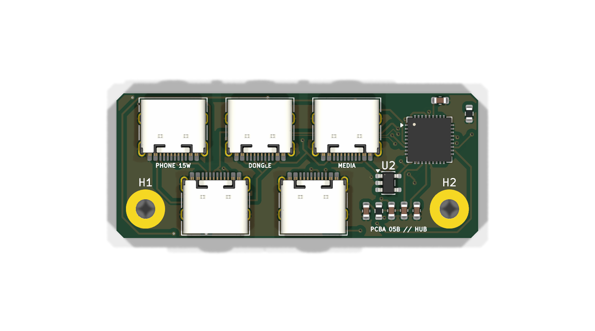
*Figure 7.5d: Component placement top view of PCBA 05B (50.0 x 20.0 mm) featuring 5x USB-C receptacles, M2.5 mounting holes (H1/H2 at 42 mm spacing), and Microchip USB2514Bi controller.*

#### 7.2.1 Technical Board Specifications & Port Topology
* **Dimensions:** $50.0 \times 20.0 \times 1.6\,\text{mm}$, 2 Layers FR-4 High-TG150, ENIG gold finish (2x M2.5 mounting holes spaced 42 mm).
* **Hub Controller (`U1`):** Microchip `USB2514Bi-AEZG` (QFN-36, $-40\,^\circ\text{C}\dots+85\,^\circ\text{C}$ Automotive-Grade) 4-port High-Speed 480 Mbps USB Hub.
* **Master Role Allocation:**
  * **Data Master (USB 2.0 Host):** **Skyline OS** connected at `J1 SKYLINE_HOST` is the sole Host for all data traffic.
  * **Power Master:** The Universal Front Node (`PCBA 05`) feeds the hub via `J2 FRONT_NODE` with regulated power from its 60W power engine.
* **Dual-Edge USB-C Architecture (5x USB-C Receptacles):**
  * **North Edge (Uplink / Host):** 2x USB-C receptacles (`J1 SKYLINE_HOST` to OEM head unit and `J2 FRONT_NODE` to Universal Front Node `PCBA 05` for headset emulation & power).
  * **South Edge (Glovebox Device Ports):** 3x USB-C receptacles (`J4 DONGLE` for wireless CarPlay/AA, `J5 MEDIA` for USB thumbdrives, `J3 PHONE_CHARGE` for smartphone fast charging).

#### 7.2.2 Pinout of the 5 USB-C Receptacles on PCBA 05B

| Receptacle | Signal Name / Pinout | Type | Function & Description |
| :---: | :--- | :---: | :--- |
| **`J1`** | **`SKYLINE_HOST`** (Upstream)<br>A6/B6: `USB_UP_DP`<br>A7/B7: `USB_UP_DM`<br>A4/B4/A9/B9: `VBUS_HOST_SENSE`<br>A5: `NET_J1_CC1`, B5: `NET_J1_CC2` | USB-C 16P | **OEM Upstream Host:** Connects to factory USB-C port of Harley-Davidson Boom! Box GTS / Skyline OS head unit. Pure data host without power extraction. |
| **`J2`** | **`FRONT_NODE`** (Dual-Rail Lifeline)<br>A4/B4/A9/B9: `VBUS_PD_30W`<br>A5: `PD_CC1`, B5: `PD_CC2`<br>A8/B8 (SBU1/SBU2): `VCC_5V`<br>A6/B6: `USB_DN3_DP`<br>A7/B7: `USB_DN3_DM`<br>A1/B1/A12/B12: `GND` | USB-C 24P | **Dual-Rail Front Node Lifeline:** Delivers isolated 30W USB-PD power (routed straight to `J3`), native CC1/CC2 PD negotiation, clean 5V system power (for Dongle `J4`, Media `J5`, and Hub LDO `U2`), and USB 2.0 High-Speed data from the Front Node (Header `J4`). |
| **`J4`** | **`DONGLE`** (Downstream 1)<br>A6/B6: `USB_DN1_DP`<br>A7/B7: `USB_DN1_DM`<br>A4/B4/A9/B9: `VCC_5V`<br>A5: `NET_J4_CC1`, B5: `NET_J4_CC2` | USB-C 16P | **Wireless CarPlay / AA Adapter:** Managed USB port for Ottocast / CarlinKit dongle with remote cold-boot reset via Front Node. Powered from separate 5V regulator (`TPS54302`). |
| **`J5`** | **`MEDIA`** (Downstream 2)<br>A6/B6: `USB_DN2_DP`<br>A7/B7: `USB_DN2_DM`<br>A4/B4/A9/B9: `VCC_5V`<br>A5: `NET_J5_CC1`, B5: `NET_J5_CC2` | USB-C 16P | **Media Storage:** Auxiliary USB 2.0 port for music thumbdrives, dashcam export, or software updates (5V power). |
| **`J3`** | **`PHONE_CHARGE`** (Downstream 4 & 30W PD)<br>A4/B4/A9/B9: `VBUS_PD_30W`<br>A5: `PD_CC1`, B5: `PD_CC2`<br>A6/B6: `NET_PHONE_D` (DP)<br>A7/B7: `NET_PHONE_D` (DM)<br>A1/B1/A12/B12: `GND` | USB-C 24P | **Dedicated 30W Smartphone Fast-Charging Port:** Exclusive USB-PD rail (5V/9V/12V/15V up to 3A) directly from the Front Node SW3526 controller with native CC negotiation. Fully isolated from the dongle power rail (zero brownouts!). Concurrent USB 2.0 data interconnect to the hub. |

---

### 7.3 PCBA 05C: Ultra-Compact Bilateral-Symmetric Under-Perch Mirror Pod Board (`openmotorbridge_mirror_pod`)

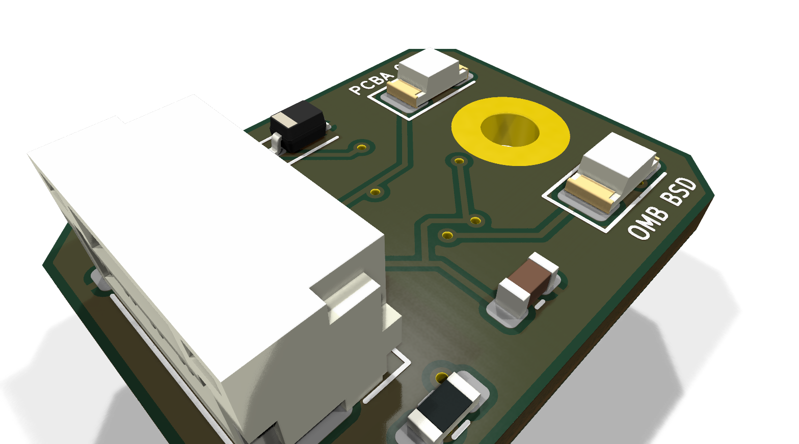
*Figure 7.5e: 3D CAD view of the ultra-compact, bilateral-symmetric Under-Perch Mirror Pod (PCBA 05C, 18.25 x 14.0 mm, double-sided Z-stacked SMT) with dual amber BSD blind-spot warning LEDs (LED1/LED2 symmetrically above and below the M2 fastener at X=15.0 mm), bottom-side IP67-sealed tactile microswitch (Omron B3SL-1002P on B.Cu at X=9.0 mm), and horizontal JST-GH 4-pin SMD receptacle on the inboard short edge (X=3.5 mm).*

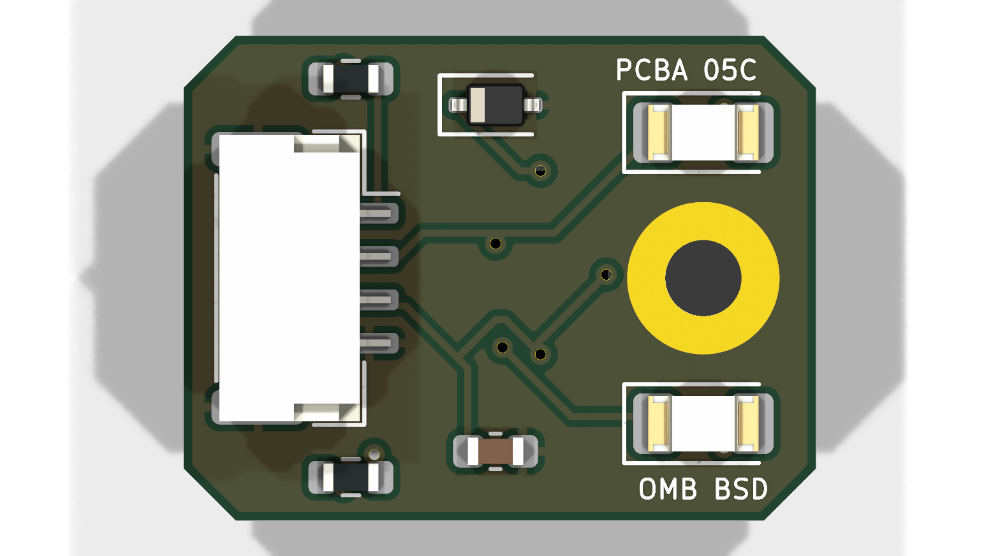
*Figure 7.5f: Component placement top view of PCBA 05C with TVS diode D1, debounce capacitor C1, and independent ballast resistors R1/R2 for maximum fault tolerance and bright sunlight visibility.*

#### 7.3.1 Technical Board Specifications & Components
* **Dimensions:** $18.25 \times 14.0\,\text{mm}$ (43% shorter via Z-stacking), 2 Layers FR4 High-TG150 ($1.6\,\text{mm}$, ENIG gold finish).
* **Bilateral-Symmetric Universal Design:** The PCB is mathematically and mechanically 100% symmetric along its central longitudinal axis ($Y = 7.0\,\text{mm}$). Consequently, **a single manufactured PCB variant serves both Left and Right mirror perches**. When mirroring the enclosure (`mirror([0, 1, 0])`), the end connector, central M2 screw boss, and bottom-mounted tactile button remain in identical positions on the $Y=0$ axis, while the dual synchronous LEDs simply swap top and bottom positions.
* **Form Factor:** Double-sided Z-stacked SMT (`F.Cu` & `B.Cu`), tailored for [`under_perch_mirror_pod.scad`](../../hardware/cad/scad/05_accessories/under_perch_mirror_pod.scad).
* **Components:**
  * **Dual `LED1` & `LED2` (Amber BSD Blind-Spot Warning LEDs on `F.Cu`):** Twin high-power SMD LEDs (1206, 590 nm amber, 120° viewing angle) located symmetrically above ($X = 15.0\,\text{mm}, Y = 11.2\,\text{mm}$) and below ($X = 15.0\,\text{mm}, Y = 2.8\,\text{mm}$) the M2 mounting hole (`H1` at $X = 15.0\,\text{mm}, Y = 7.0\,\text{mm}$), illuminating through the $38^\circ$ stadium diffuser lens for doubled lumen output in direct sunlight.
  * **`SW1` (Tactile Thumb Microswitch on `B.Cu`):** IP67-sealed tactile microswitch (Omron B3SL-1002P, centered on the bottom layer at $X = 9.0\,\text{mm}, Y = 7.0\,\text{mm}$) with crisp 300g actuation force for positive glove operation.
  * **Debouncing & ESD Protection:** 100 nF RC filter (`C1` at $X = 9.0\,\text{mm}, Y = 12.0\,\text{mm}$) for hardware debounce and bidirectional TVS diode (`D1`, PESD5V0S1BL at $X = 9.0\,\text{mm}, Y = 2.0\,\text{mm}$) against electrostatic discharge.
  * **Connector (`J1`):** 4-pin JST-GH SMD receptacle (`SM04B-GHS-TB`, 1.25 mm pitch) mounted axially on the short edge at $X = 3.50\,\text{mm}, Y = 7.0\,\text{mm}$ (runs cable cleanly along handlebar).

#### 7.3.2 Pinout of Mirror Pod Header (`J1` / 4-Pin JST-GH)

| Pin | Signal Name | Signal Type | Function & Level |
| :---: | :--- | :---: | :--- |
| **1** | **`VCC_LED`** | Power In (+5V / +12V) | Protected anode supply for blind-spot alert LED |
| **2** | **`BSD_LED_N`** | Cathode (Low-Side) | Switched ground from Front Node MOSFET (radar warning alert) |
| **3** | **`BTN_SIG_N`** | Digital In (Active-Low)| Switch signal to ground, hardware debounced with 100 nF RC filter |
| **4** | **`GND`** | Ground (0V) | Common signal and return ground |

#### 7.3.3 100% Software-Defined Button Mapping via PWA Dashboard
Both buttons are hardware-identical and freely assignable via the PWA dashboard across 5 gesture triggers (`SHORT_CLICK`, `DOUBLE_CLICK`, `TRIPLE_CLICK`, `LONG_PRESS`, `HOLD_GATE`):
* **Left Factory Default:** `HOLD_GATE` $\rightarrow$ PTT Intercom; `TRIPLE_CLICK` $\rightarrow$ Siri/Google Assistant; `DOUBLE_CLICK` $\rightarrow$ Mesh Channel Cycle.
* **Right Factory Default:** `SHORT_CLICK` $\rightarrow$ Action-Cam Highlight Tag (Insta360/GoPro BLE); `LONG_PRESS` $\rightarrow$ Video Record Start/Stop; 3s Hold $\rightarrow$ 868 MHz LoRa Emergency SOS.
* **Bindable Action Catalog:** 1-Click Hazard Pin Drop (Waze/OpenTrafficMap), Radar Acoustic Mute 30s, Garage Door Trigger (Shelly/Home Assistant), Auxiliary Lights, Heated Grips.

---

### 7.4 PCBA 05D: Snap-On Sensor Puck (`openmotorbridge_sensor_puck`)

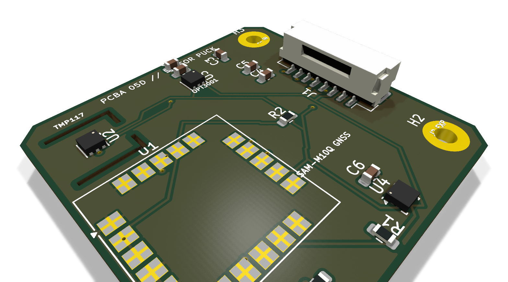
*Figure 7.5g: 3D CAD view of the snap-on 4-layer Sensor Puck (PCBA 05D, 34 x 34 mm) with u-blox SAM-M10Q patch antenna, thermal double-L isolation slot for TMP117, and horizontal 8-pin JST-GH receptacle.*

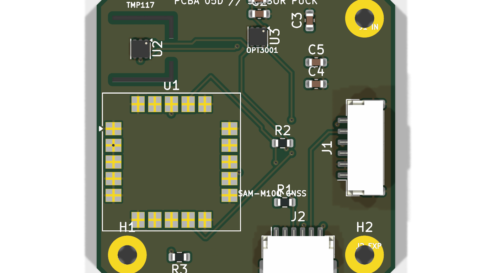
*Figure 7.5h: Component placement top view of PCBA 05D.*

#### 7.4.1 Technical Board Specifications & Components
* **Dimensions:** $34.0 \times 34.0\,\text{mm}$ with $2.0\,\text{mm}$ corner chamfers, 4 layers FR-4 High-TG150 ($1.6\,\text{mm}$, ENIG gold finish, Layer 2: 100% continuous RF GND plane for GNSS patch, Layer 3: 3.3V power plane).
* **Mounting:** Form-fitted inside custom $38.0 \times 38.0 \times 15.0\,\text{mm}$ snap enclosure ([`sensor_puck_environmental.scad`](../../hardware/cad/scad/04_front_node/parts/sensor_puck_environmental.scad), $34.8 \times 34.8\,\text{mm}$ internal cavity with $0.35\,\text{mm}$ clearance, perimeter snap lid & retention feet) docking directly in upper basket of Front Node lid or remote-mountable at windshield via 1.5m JST-GH cable. The North wall is completely solid (no `J2` cutout), ensuring optimal weather sealing (IP67).
* **Components:**
  * **`U1` (u-blox SAM-M10Q):** Multi-constellation GNSS module (GPS, GLONASS, Galileo, BeiDou) with integrated $15.5 \times 15.5\,\text{mm}$ ceramic patch antenna.
  * **`U2` (TI TMP117AIDRVR):** NIST-traceable digital temperature sensor ($\pm 0.1^\circ\text{C}$ accuracy) isolated on a thermally decoupled PCB tongue via a $0.8\,\text{mm}$ U-slot directly in the laminar frontal intake for black ice detection unaffected by engine waste heat.
  * **`U3` (TI OPT3001DNPR):** Ambient light sensor with human eye spectral response beneath the upper $\varnothing 4.5\,\text{mm}$ optical casing port (lux measurement for auto day/night mode switching in PWA and instrument clusters).
  * **`U4` (Bosch Sensortec BMP390):** High-precision barometric pressure and altimeter sensor in a 10-pin LGA 2x2mm package (I2C address `0x76`) for vertical ascent/descent rates, altitude profiling, and weather trend prediction.
  * **`J1` (Primary In / Lifeline):** 8-pin JST-GH SMD receptacle (`SM08B-GHS-TB`, 1.25 mm pitch) facing east (`+X`) to the Front Node wire harness.
  *(Note on architecture cleanup v10.0: The unused expansion connector `J2` and I2S lines have been retired. In place of `J2`, the Bosch BMP390 altimeter `U4` has been integrated. The 8-pin JST-GH lifeline now provides complete dedicated sensor and GNSS integration: I2C for TMP117, OPT3001 & BMP390, UART TX/RX for high-speed NMEA/UBX telemetry and commands, 1PPS timepulse for microsecond time synchronization, and active-low hardware reset to ESP32-S31 on Front Node. The Knowles SPH0645 I2S MEMS microphone remains sheltered from direct airflow on the underside of `PCBA 05`).*

#### 7.4.2 Pinout of Sensor Puck Primary In (`J1` / 8-Pin JST-GH)

| Pin | Signal Name | Signal Type | Function on PCBA 05D & Bus Behavior |
| :---: | :--- | :---: | :--- |
| **1** | **`VCC_3V3`** | Power (+3.3V) | Regulated system rail (supplies L3 power plane, U1, U2, U3, U4) |
| **2** | **`GND`** | Ground (0V) | Signal and RF ground (direct connection to L2 solid GND plane) |
| **3** | **`I2C_SDA`** | Bidi Open-Drain | I2C data bus (SAM-M10Q DDC addr `0x42`, OPT3001 addr `0x44`, TMP117 addr `0x48`, BMP390 addr `0x76`) |
| **4** | **`I2C_SCL`** | Input Open-Drain | I2C clock bus (400 kHz Fast-Mode from Front Node) |
| **5** | **`GNSS_TIMEPULSE`** | Digital Out | 1PPS hardware time synchronization pulse from SAM-M10Q (Pin 7) |
| **6** | **`GNSS_TXD`** | Digital Out | UART serial telemetry stream (NMEA/UBX) from SAM-M10Q (Pin 13) |
| **7** | **`GNSS_RXD`** | Digital In | UART serial control channel to SAM-M10Q (Pin 14) |
| **8** | **`GNSS_RESET_N`** | Digital In | Active-low hardware reset to SAM-M10Q (Pin 18, 10k pull-up R3 to 3.3V) |
| **MP** | **`GND`** | Shield | Mechanical latch tabs soldered to chassis / GND plane |

---

## 8. PCBA 06: MagSafe Frame Dock (Retired without Replacement)

The separate board `PCBA 06` has been **completely retired without replacement in v10.0**:
* Because the motorcycle pannier disconnect interface carries strictly 2-wire DC power, an **industrial 2-pin magnetic pogo connector (IP68 COTS)** is used instead of a custom PCB.
* Short-circuit protection and overload limiting are handled centrally on `PCBA 01` via the **TI TPS4H160-Q1 Smart Switch**.

---

## 9. PCBA 07: 2-in-1 LoRa Smart-Keyfob (`openmotorbridge_smart_keyfob`)

The PCBA 07 assembly constitutes the electronics core inside the pocket keyfob enclosure (`smart_keyfob_pager.scad`, $58 \times 34 \times 13\,\text{mm}$), overcoming the traditional weaknesses of motorcycle key fobs (exhausted CR2032 coin cells, winter sub-zero failure, and lack of two-way feedback):

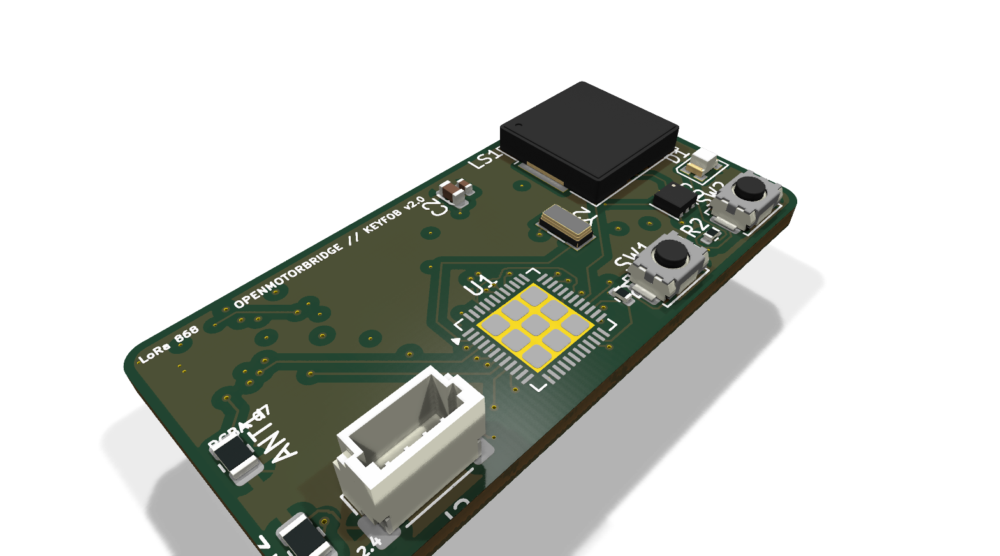

*Figure 7.7: 3D board render of the ultra-compact PCBA 07 carrier board ($38.0 \times 19.0\,\text{mm}$, 4-layer FR-4 ENIG) hosting the ESP32-C3FH4 RISC-V MCU (embedded 4MB Flash), Semtech SX1262 LoRa transceiver, TI BQ51050BRHLR all-in-one Qi direct-to-battery charger, CUI 9mm piezo buzzer, and centered 3-element control cluster.*

```
                                PCBA 07 SYSTEM ARCHITECTURE
+----------------------------------------------------------------------------------------+
|                      ESPRESSIF ESP32-C3FH4 RISC-V BLUETOOTH LE 5.0 SoC                 |
| * 32-bit RISC-V core @ 160 MHz * Embedded 4 MB Flash * QFN-32 5x5mm (0.5mm pitch)      |
| * Unified ESP-IDF firmware stack, internal calibrated RTC (zero external 32kHz crystal)|
+--------------+-------------------------+-------------------------+---------------------+
               | SPI                     | Power / LDO             | PWM / GPIO
               v                         v                         v
+---------------------------+ +---------------------+ +----------------------------------+
| SEMTECH SX1262 LoRa       | | TI TPS7A0233 LDO    | | STATUS & ACOUSTICS               |
| * 868 MHz Emergency RX    | | * Ultra-Low-Iq LDO  | | * WS2812B RGB Status LED (D1)    |
| * Up to 4.5 km range      | | * 25 nA Quiescent   | | * CUI CPT-9019S 9mm Piezo 85dBA  |
| * Receives 0xFE packets   | | * 3.3V / 200mA Rail | | * 11mm tactile button separation |
+---------------------------+ +---------------------+ +----------------------------------+
               ^
               | Direct LiPo Battery Bus (VBAT)
+--------------+-------------------------------------------------------------------------+
|                    ALL-IN-ONE QI WIRELESS CHARGING & LIPO SUB-SYSTEM                   |
| * 180-200 mAh 1S LiPo pouch cell with integrated PCM protection board                  |
| * TI BQ51050BRHLR: All-in-one Qi Wireless Receiver & Direct LiPo CC/CV Charger (VQFN-20)|
| * Eliminates separate 5V regulator & charger ICs; direct connection to battery (J1)    |
| * 100% solderless JST-SH connections for battery (J1), USB debug (J2) and Qi coil (J3) |
+----------------------------------------------------------------------------------------+
```

### 9.1 Technical Board Characteristics
* **Dimensions:** $38.0 \times 19.0 \times 1.0\,\text{mm}$ (Ultra-compact 4-layer FR-4, $35\,\mu\text{m}$ Cu, ENIG gold finish, corner radius $R = 3\,\text{mm}$).
* **Core Silicon:**
  * Espressif `ESP32-C3FH4` SoC (32-bit RISC-V @ 160 MHz, Bluetooth Low Energy 5.0, embedded 4 MB SPI Flash, internal LDO decoupling, QFN-32 $5 \times 5\,\text{mm}$, 0.5 mm pitch).
  * Semtech `SX1262` LoRa Transceiver (868.5 MHz Channel 3, receives emergency alerts up to 4.5 km range).
  * Texas Instruments `BQ51050BRHLR` All-in-One Qi Wireless Receiver & Direct Li-Ion Charger (VQFN-20 $3.5 \times 4.5\,\text{mm}$).
  * Texas Instruments `TPS7A0233PDBVR` Ultra-Low-$I_q$ 3.3V LDO (`U6`, SOT-23-5, $I_q = 25\,\text{nA}$).
  * CUI Devices `CPT-9019S-SMT` 9mm Piezo Buzzer (`LS1`, 85 dBA @ 10 cm, 2.7–4.0 kHz) for penetrating acoustic alert through thick motorcycle leather jackets.
* **Centered 3-Element Control Cluster Ergonomics:**
  * `SW1` (Arm / Disarm): $X = 117.0\,\text{mm}$.
  * `D1` (WS2812B-2020 RGB Status LED): $X = 122.5\,\text{mm}$ – centered precisely between switches beneath PMMA light pipe.
  * `SW2` (Panic / SOS): $X = 128.0\,\text{mm}$.
  * **$11.0\,\text{mm}$ physical tactile separation** prevents accidental trigger while wearing thick gloves; the 9mm buzzer `LS1` is isolated on the right board half ($X = 133.5\,\text{mm}$).
* **100% Solderless Assembly (`J3`, `J1` & `J2`):**
  * The 24–28 mm Qi inductive receiver coil plugs into an ultra-low-profile **2-pin JST-SH SMD header (`J3`, `BM02B-SRSS-TB`, 1.00 mm pitch)** on `B.Cu`.
  * The 180–200 mAh LiPo pouch battery plugs directly into an identical **2-pin JST-SH SMD header (`J1`, `BM02B-SRSS-TB`, 1.00 mm pitch)** on `B.Cu`.
  * The 4-pin **JST-SH SMD header (`J2`, `BM04B-SRSS-TB`, 1.00 mm pitch)** provides the native USB CDC / JTAG programming interface (`VCC_3V3`, `USB_DM`, `USB_DP`, `GND`).

### 9.2 Complete Interface & Pin-Mapping of ESP32-C3FH4 SoC (PCBA 07 `U1`)

<!-- AUTO_PINOUT_START: PCBA_07 -->

| Pad | Signal / KiCad Net | ESP32 GPIO | Firmware Define | Target / IC | Signal Type & Electrical Spec |
| :---: | :--- | :---: | :--- | :--- | :--- |
| 1 | `BLE_ANT_50R` | - | - | ANT2 (2.4 GHz Antenna) | **RF_50_OHM** – 2.4 GHz BLE HF-Antennenausgang (LNA_IN) |
| 2 | `VCC_3V3` | - | - | 3.3V Power Rail | **Power** – Analoge Betriebsspannung 3.3V |
| 3 | `VCC_3V3` | - | - | 3.3V Power Rail | **Power** – Analoge Betriebsspannung 3.3V |
| 4 | `BAT_SENSE` | GPIO 0 | `KEYFOB_PIN_BAT_SENSE` | R10/R11 (100k/100k) | **ADC1_CH0** – Analoge Akkuspannungsmessung LiPo |
| 5 | `LORA_DIO1` | GPIO 1 | `KEYFOB_PIN_LORA_DIO1` | U2.15 (SX1262) | **Digital In / IRQ** – SX1262 LoRa Packet RX/TX Interrupt |
| 6 | `LORA_MISO` | GPIO 2 | `KEYFOB_PIN_LORA_MISO` | U2.18 (SX1262) | **FSPI_MISO** – SX1262 LoRa SPI Master In Slave Out (FSPIQ) |
| 7 | `ESP_EN` | - | - | R3/C3 | **Power/Reset** – Chip Enable / Hardware Reset |
| 8 | `LORA_MOSI` | GPIO 3 | `KEYFOB_PIN_LORA_MOSI` | U2.19 (SX1262) | **FSPI_MOSI** – SX1262 LoRa SPI Master Out Slave In (FSPID) |
| 9 | `LORA_SCK` | GPIO 4 | `KEYFOB_PIN_LORA_SCK` | U2.20 (SX1262) | **FSPI_CLK** – SX1262 LoRa SPI Serial Clock (FSPIHD/CLK) |
| 10 | `LORA_NSS` | GPIO 5 | `KEYFOB_PIN_LORA_NSS` | U2.21 (SX1262) | **FSPI_CS** – SX1262 LoRa Chip Select (Active Low) |
| 11 | `VCC_3V3` | - | - | 3.3V Power Rail | **Power** – Betriebsspannung RTC Domäne |
| 12 | `LORA_BUSY` | GPIO 6 | `KEYFOB_PIN_LORA_BUSY` | U2.14 (SX1262) | **Digital In** – SX1262 LoRa Transceiver Busy Line |
| 13 | `LORA_RESET` | GPIO 7 | `KEYFOB_PIN_LORA_RESET` | U2.1 (SX1262) | **Digital Out** – SX1262 LoRa Transceiver Hardware Reset |
| 14 | `LED_DATA` | GPIO 8 | `KEYFOB_PIN_LED_DATA` | D1.4 | **Digital Out** – WS2812B-2020 Smart RGB Status-LED Datenleitung |
| 15 | `BTN_ARM_N` | GPIO 9 | `KEYFOB_PIN_BTN_ARM_N` | SW1 | **Digital In** – Arm / Disarm Taster (Active-Low, Boot Strapping) |
| 16 | `BTN_SOS_N` | GPIO 10 | `KEYFOB_PIN_BTN_SOS_N` | SW2 | **Digital In** – SOS Panik-Alarm Taster (Active-Low) |
| 17 | `VCC_3V3` | - | - | 3.3V Power Rail | **Power** – Betriebsspannung CPU Domäne |
| 18 | `NC` | - | - | NC | **SIP_FLASH_NC** – Intern für C3FH4 SIP Flash belegt (darf extern nicht kontaktiert werden) |
| 19 | `NC` | - | - | NC | **SIP_FLASH_NC** – Intern für C3FH4 SIP Flash belegt (darf extern nicht kontaktiert werden) |
| 20 | `NC` | - | - | NC | **SIP_FLASH_NC** – Intern für C3FH4 SIP Flash belegt (darf extern nicht kontaktiert werden) |
| 21 | `NC` | - | - | NC | **SIP_FLASH_NC** – Intern für C3FH4 SIP Flash belegt (darf extern nicht kontaktiert werden) |
| 22 | `NC` | - | - | NC | **SIP_FLASH_NC** – Intern für C3FH4 SIP Flash belegt (darf extern nicht kontaktiert werden) |
| 23 | `NC` | - | - | NC | **SIP_FLASH_NC** – Intern für C3FH4 SIP Flash belegt (darf extern nicht kontaktiert werden) |
| 24 | `NC` | - | - | NC | **SIP_FLASH_NC** – Intern für C3FH4 SIP Flash belegt (darf extern nicht kontaktiert werden) |
| 25 | `USB_DM` | GPIO 18 | `KEYFOB_PIN_USB_DM` | J2.2 (USB D-) | **USB_D-** – Nativer USB Serial/JTAG Controller D- |
| 26 | `USB_DP` | GPIO 19 | `KEYFOB_PIN_USB_DP` | J2.3 (USB D+) | **USB_D+** – Nativer USB Serial/JTAG Controller D+ |
| 27 | `BUZZER_PWM` | GPIO 20 | `KEYFOB_PIN_BUZZER_PWM` | LS1 (CPT-9019S) | **LEDC_PWM** – Akustischer Pager 9mm Piezo-Summer PWM |
| 28 | `CHG_STAT` | GPIO 21 | `KEYFOB_PIN_CHG_STAT` | U3.5 (BQ51050B) | **Digital In** – Qi Wireless Ladestatus (Active-Low) |
| 29 | `XTAL2` | - | - | Y1.3 (40 MHz) | **Oscillator** – 40 MHz Quarz Oszillator Eingang N |
| 30 | `XTAL1` | - | - | Y1.1 (40 MHz) | **Oscillator** – 40 MHz Quarz Oszillator Eingang P |
| 31 | `VCC_3V3` | - | - | 3.3V Power Rail | **Power** – Analoge Versorgungsspannung 3.3V |
| 32 | `VCC_3V3` | - | - | 3.3V Power Rail | **Power** – Analoge Versorgungsspannung 3.3V |
| 33 | `GND` | - | - | GND Plane mit Thermal Vias | **Power Ground** – Zentrales Massepads & Kühlung |

<!-- AUTO_PINOUT_END: PCBA_07 -->

### 9.3 Sub-Chips & Peripherals (SX1262 LoRa & BQ51050B Qi Charger)

<!-- AUTO_SUBCHIPS_START: PCBA_07 -->

#### Sub-Chip `U2`: Semtech SX1262 LoRa 868 MHz Transceiver (QFN-24 (4x4 mm))
> **Manufacturer Datasheet:** [Semtech SX1262 LoRa 868 MHz Transceiver](https://semtech.my.salesforce.com/sfc/p/#E0000000JelG/a/2R000000HT76/bvyK.51kF34K_iR49Q04kHjG4s3E2_q2kM8Q6u2k7d4) | **Pin Definitions:** [Section 4: Pinout & Pin Description (QFN-24)](https://semtech.my.salesforce.com/sfc/p/#E0000000JelG/a/2R000000HT76/bvyK.51kF34K_iR49Q04kHjG4s3E2_q2kM8Q6u2k7d4)  

| Pad | Pin Name | Signal / KiCad Net | Signal Type | Target / Source | Function & Electrical Spec |
| :---: | :--- | :--- | :---: | :--- | :--- |
| 1 | `NRESET` | `LORA_RST` | **Control In** | U1 (ESP32-C3) | Hardware Reset Active Low |
| 10 | `RFI_P / RFO` | `LORA_RF_868` | **RF 868 MHz** | Johanson 868M Chip-Antenne | LoRa HF-Ausgang |
| 14 | `BUSY` | `LORA_BUSY` | **Digital Out** | U1 (ESP32-C3) | LoRa Busy Status |
| 15 | `DIO1` | `LORA_DIO1` | **Digital Out** | U1 (ESP32-C3) | LoRa Interrupt IRQ |
| 18 | `MISO` | `SPI_MISO` | **SPI MISO** | U1 (ESP32-C3) | SPI Data Out |
| 19 | `MOSI` | `SPI_MOSI` | **SPI MOSI** | U1 (ESP32-C3) | SPI Data In |
| 20 | `SCK` | `SPI_SCK` | **SPI CLK** | U1 (ESP32-C3) | SPI Clock |
| 21 | `NSS` | `LORA_NSS` | **SPI CS** | U1 (ESP32-C3) | SPI Chip Select Active Low |

#### Sub-Chip `U4`: TI BQ51050B Qi Wireless Power Receiver & Li-Ion Charger (QFN-28 (4.5x3.5 mm))
> **Manufacturer Datasheet:** [TI BQ51050B Qi Wireless Power Receiver & Li-Ion Charger](https://www.ti.com/lit/ds/symlink/bq51050b.pdf) | **Pin Definitions:** [Pin Functions (QFN-28)](https://www.ti.com/lit/ds/symlink/bq51050b.pdf#page=4)  

| Pad | Pin Name | Signal / KiCad Net | Signal Type | Target / Source | Function & Electrical Spec |
| :---: | :--- | :--- | :---: | :--- | :--- |
| 1 | `AC1` | `QI_COIL_AC1` | **AC In** | J3.1 (Qi Spule) | Drahtlose Qi-Empfangsspule AC1 |
| 2 | `AC2` | `QI_COIL_AC2` | **AC In** | J3.2 (Qi Spule) | Drahtlose Qi-Empfangsspule AC2 |
| 12 | `BAT` | `BAT_3V7` | **Power Out** | J1.1 (LiPo Akku) | Geregelter 4.2V / 500mA Li-Ion Ladestrom |
| 15 | `CHG_STAT` | `QI_CHG_STAT` | **Digital Out** | U1 (ESP32-C3) | Qi Ladestatus (Active Low = lädt) |

<!-- AUTO_SUBCHIPS_END: PCBA_07 -->

### 9.4 External Connectors (J1 LiPo, J3 Qi Coil)

<!-- AUTO_CONNECTORS_START: PCBA_07 -->

#### Connector `J1`: LiPo Akku-Anschluss (150 mAh Zelle)
> **Type:** `JST-SH 2-Pin 1.0mm SMD Vertikal (BM02B-SRSS-TB)` | **Mating Connector:** `JST SHR-02V-S-B (AWG28-30)`  

| Pin | Signal / KiCad Net | Signal Type | Electrical Specification & Function |
| :---: | :--- | :---: | :--- |
| **1** | `BAT_3V7` | **Power (+3.7V)** | LiPo Akku Pluspol |
| **2** | `GND` | **Power Return** | LiPo Akku Masse |

#### Connector `J3`: Qi Drahtlos-Ladespule Eingang
> **Type:** `JST-SH 2-Pin 1.0mm SMD Vertikal (BM02B-SRSS-TB)` | **Mating Connector:** `JST SHR-02V-S-B (AWG28-30)`  

| Pin | Signal / KiCad Net | Signal Type | Electrical Specification & Function |
| :---: | :--- | :---: | :--- |
| **1** | `QI_COIL_AC1` | **AC In** | Resonanz-Empfangsspule Anschluss 1 |
| **2** | `QI_COIL_AC2` | **AC In** | Resonanz-Empfangsspule Anschluss 2 |

<!-- AUTO_CONNECTORS_END: PCBA_07 -->

| QFN-32 Pin | Signal Name | Signal Type | ESP-IDF GPIO | Function & Peripheral Assignment |
| :---: | :--- | :---: | :---: | :--- |
| **1** | `BLE_ANT_50R` | RF 2.4G | LNA_IN | 50 Ohm feedline to Johanson 2450AT ceramic chip antenna (`ANT2`) |
| **2, 3** | `VCC_3V3` | Power In | VDD3P3 | +3.3V VDD Main Supply |
| **4** | `BAT_SENSE` | Analog In | `GPIO0` (ADC1_CH0) | LiPo battery voltage divider (100k/100k) for state-of-charge tracking |
| **5** | `LORA_DIO1` | Digital In | `GPIO1` | IRQ interrupt line from Semtech SX1262 (`U2`) |
| **6** | `LORA_MISO` | Digital In | `GPIO2` (FSPIQ) | SPI Master-In Slave-Out from Semtech SX1262 (`U2`) |
| **7** | `CHIP_EN` | Reset In | CHIP_PU | Chip Enable / Reset (10k pull-up to 3.3V, 100nF to GND) |
| **8** | `LORA_MOSI` | Digital Out | `GPIO3` (FSPID) | SPI Master-Out Slave-In to Semtech SX1262 (`U2`) |
| **9** | `LORA_SCK` | Digital Out | `GPIO4` (FSPIHD) | SPI Serial Clock to Semtech SX1262 (`U2`) |
| **10** | `LORA_NSS` | Digital Out | `GPIO5` (FSPIWP) | SPI Chip-Select (Active-Low) to Semtech SX1262 (`U2`) |
| **11** | `VCC_3V3` | Power In | VDD3P3_RTC | +3.3V RTC Supply |
| **12** | `LORA_BUSY` | Digital In | `GPIO6` (FSPICLK) | Busy status line from Semtech SX1262 (`U2`) |
| **13** | `LORA_RESET` | Digital Out | `GPIO7` (FSPICS0) | Hardware reset line to Semtech SX1262 (`U2`) |
| **14** | `LED_DATA` | Digital Out | `GPIO8` (Strapping) | Serial data line for WS2812B-2020 RGB Status LED (`D1`) |
| **15** | `BTN_ARM_N` | Digital In | `GPIO9` (Strapping Boot) | Arm / Disarm switch `SW1` (Active-Low, 10k pull-up; bootloader strap on reset) |
| **16** | `BTN_SOS_N` | Digital In | `GPIO10` | Emergency / Panic switch `SW2` (Active-Low, 10k pull-up) |
| **17** | `VCC_3V3` | Power In | VDD3P3_CPU | +3.3V CPU Core Supply |
| **18–24** | `NC` | Internal | - | Internal SIP Flash connections (embedded 4 MB Flash, left NC) |
| **25** | `USB_DM` | USB D- | `GPIO18` | Native USB CDC / JTAG D- connection to `J2` Pin 2 |
| **26** | `USB_DP` | USB D+ | `GPIO19` | Native USB CDC / JTAG D+ connection to `J2` Pin 3 |
| **27** | `BUZZER_PWM` | PWM Out | `GPIO20` | 2.7 kHz / 4.0 kHz PWM drive for CUI 9mm piezo buzzer (`LS1`) |
| **28** | `CHG_STAT` | Digital In | `GPIO21` | Charge status input from TI BQ51050B Pin 14 (Active-Low / Open-Drain) |
| **29** | `XTAL_N` | Analog | - | 40.000 MHz RF crystal `Y1` Pin 3 |
| **30** | `XTAL_P` | Analog | - | 40.000 MHz RF crystal `Y1` Pin 1 |
| **31, 32**| `VCC_3V3` | Power In | VDDA | +3.3V Analog Supply |
| **33 (EP)**| `GND` | Power | - | Exposed Ground & Thermal Pad |

### 9.3 Bill of Materials (BOM) PCBA 07
| Ref | Component / Type | Package | Specification & Function | LCSC Part |
| :--- | :--- | :--- | :--- | :--- |
| **`U1`** | ESP32-C3FH4 | QFN-32 (5x5mm) | 32-Bit RISC-V SoC with BLE 5.0, 4MB embedded Flash, 160MHz | `C2877543` |
| **`U2`** | SX1262IMLTRT | QFN-24 (4x4mm) | Semtech 868 MHz LoRa Transceiver (+22 dBm, TCXO) | `C908200` |
| **`U4`** | BQ51050BRHLR | VQFN-20 (3.5x4.5mm) | TI 5W Qi Wireless Receiver & integrated LiPo Direct Charger (4.2V) | `C89715` |
| **`U6`** | TPS7A0233PDBVR | SOT-23-5 | TI Ultra-Low-Iq (25 nA) 3.3V / 200mA LDO Linear Regulator | `C444645` |
| **`LS1`** | CPT-9019S-SMT | SMD 9x9mm | CUI Devices Piezo Sounder (85 dBA @ 10 cm, 2.7–4.0 kHz) | `C966804` |
| **`ANT1`** | 868MHz Ceramic Antenna | SMD 0805 | 868 MHz SMD chip antenna for SX1262 LoRa | `C2909988` |
| **`ANT2`** | 2.4GHz Ceramic Antenna | SMD 0805 | 2.4 GHz SMD chip antenna for ESP32-C3 BLE 5.0 | `C2909988` |
| **`Y1`** | 40.000 MHz 10ppm | SMD 2016 (4-Pin) | Precision RF crystal for ESP32-C3FH4 | `C386341` |
| **`Y3`** | 32.000 MHz ±0.5ppm | SMD 2016 (4-Pin) | Temperature Compensated Crystal Oscillator (TCXO) for SX1262 | `C2836473` |
| **`SW1`** | Alps SKRK / EVQ-P2 | SMD 3.9x2.9mm | Tactile IP67 micro push-button: ARM / Alarm System (GPIO 9 Boot) | `C115357` |
| **`SW2`** | Alps SKRK / EVQ-P2 | SMD 3.9x2.9mm | Tactile IP67 micro push-button: SOS / Panic Alert (GPIO 10) | `C115357` |
| **`D1`** | WS2812B-2020 | SMD 2020 (PLCC-4) | Digital RGB status LED (centered below PMMA lightpipe, GPIO 8) | `C2843785` |
| **`J1`** | BM02B-SRSS-TB | JST-SH 2-Pin SMD Vertical | 100% solderless plug connection for 180–200 mAh LiPo pouch battery (with PCM) | `C145956` |
| **`J2`** | BM04B-SRSS-TB | JST-SH 4-Pin SMD Vertical | USB CDC / JTAG Flashing & Telemetry (3V3, USB_DM, USB_DP, GND) | `C145958` |
| **`J3`** | BM02B-SRSS-TB | JST-SH 2-Pin SMD Vertical | 100% solderless plug connection for 24 mm Qi receiver coil (AC1/AC2) | `C145956` |
| **`C1`** | 10µF 10V X5R | SMD 0603 | LiPo battery buffer capacitor (VBAT) for BQ51050B & LDO | `C19702` |
| **`C2`** | 10µF 6.3V X5R | SMD 0603 | 3.3V VDD main bulk capacitor for ESP32-C3 | `C19702` |
| **`C3`** | 100nF 16V X7R | SMD 0402 | ESP32-C3 MCU decoupling capacitor | `C1525` |
| **`C4`** | 100nF 16V X7R | SMD 0402 | SX1262 LoRa RF decoupling capacitor | `C1525` |
| **`R1, R2`** | 10kΩ 1% | SMD 0402 | Pull-up resistors for tactile buttons SW1 (ARM) and SW2 (SOS) | `C25744` |

---

## 10. PCBA 08: 77 GHz mmWave Radar Sub-MCU & Visual Warning Wings (`openmotorbridge_radar_submcu`)

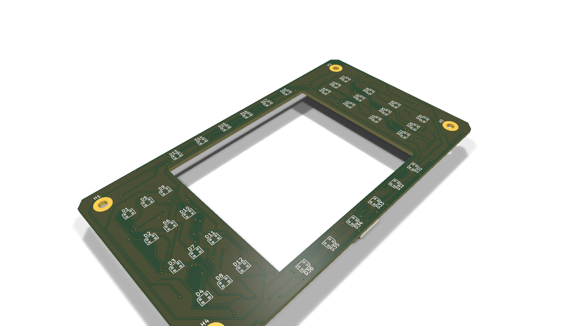

*Figure 7.8a: 3D CAD view of the routed PCBA 08 top side (115 x 65 mm) with centered 61 x 51 mm radar aperture for the Wheeltec MR20 horn array and 36x WS2812B-2020 halo warning wing LEDs.*

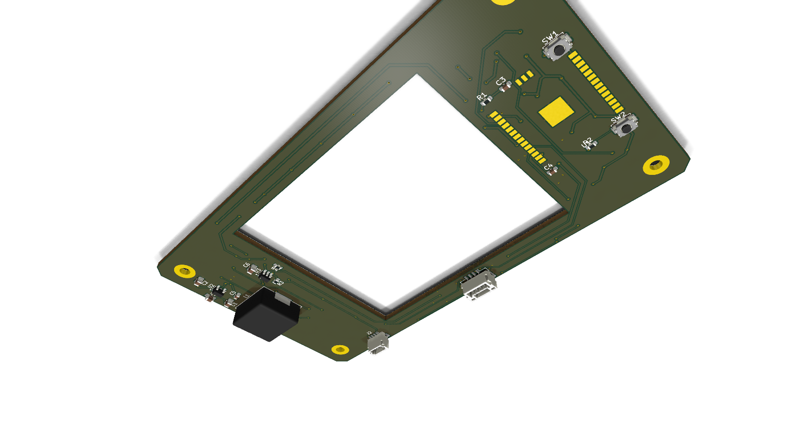

*Figure 7.8b: 3D CAD view of the PCBA 08 bottom side -- Right: 12V -> 5V/3.3V TI TPS54302 buck converter and TPS7A0533 LDO power stage; Left: ESP32-C3-WROOM-02U sub-MCU with external U.FL gold port; Bottom: Vertical JST-GH (J1, Bus/12V) and JST-SH (J2, Radar) connectors.*

### 10.1 Technical Board Specifications & Layer Stackup
* **Dimensions:** $115.0 \times 65.0 \times 1.6\,\text{mm}$ ($R = 5.0\,\text{mm}$ corner radii).
* **Central Radar Aperture:** $61.0 \times 51.0\,\text{mm}$ form-fitting aperture for the 77-GHz horn antenna array of the Wheeltec MR20 mmWave radar transceiver.
* **Layer Stackup:** 2-layer FR-4 High-TG150, $1.6\,\text{mm}$ board thickness, $35\,\mu\text{m}$ copper (1 oz), ENIG gold finish (Electroless Nickel Immersion Gold).
* **Fasteners:** 4x M3 mounting holes ($\varnothing 3.2\,\text{mm}$) spaced $107.0 \times 57.0\,\text{mm}$ for direct vibration-damped screw mounting inside the monocoque winged housing ([`radar_mr20_housing.scad`](../../hardware/cad/scad/05_accessories/radar_mr20_housing.scad)).
* **Design Rules:** OMB-v10 standard ($0.127\,\text{mm}$ trace/clearance, $0.25\,\text{mm}$ microvias with $0.15\,\text{mm}$ laser drill, $0.05\,\text{mm}$ annular ring).

### 10.2 Component Placement & Circuit Architecture

1. **Top Layer (`F.Cu`) -- 36-LED Halo Warning Wings (`D1` to `D36`):**
   * 36x ultra-bright **WS2812B-2020** addressable RGB LEDs in compact $2.0 \times 2.0\,\text{mm}$ PLCC-4 packages.
   * **Symmetrical Wing Array:** 18 LEDs along the left wing, 18 LEDs along the right wing.
   * **Clean Daisy-Chain:** Data signal originates at MCU GPIO8 (`WS2812_DATA`) via series resistor to `DIN` of D1, chained via `DOUT` sequentially through D36. Chain termination on D36 Pad 4 is cleanly terminated with `no_connect`.
   * **Solid 5V Power Delivery:** Full-plane 5V copper pour on `F.Cu` guarantees low-IR-drop current delivery up to $1.8\,\text{A}$ during simultaneous white-strobe emergency activation (blind spot / Prio-1 collision alert).

2. **Bottom Layer (`B.Cu`) -- Segregated Power & MCU Architecture:**
   * **Right Side (Integrated 12V Power Stage):**
     - **Texas Instruments TPS54302DDCR (`U3`):** 3A synchronous step-down converter (400 kHz, 4.5V--28V Vin) in SOT-23-6 package. Converts switched 12V vehicle input (`VCC_12V`) at $\approx 92\%$ efficiency to stable $5.0\,\text{V}$ (`VCC_5V`) for the 36 LEDs and radar sensor.
     - **Texas Instruments TPS7A0533PDBVR (`U2`):** Ultra-low-quiescent-current LDO ($I_Q = 1\,\mu\text{A}$) in SOT-23-5 package. Supplies clean, highly stable $3.3\,\text{V}$ (`VCC_3V3`) to the host MCU.
     - **Filtering & Support:** 4.7 µH shielded power choke (`L1`, SMD 4040), $10\,\mu\text{F}$ / 50V ceramic input capacitor (`C_IN1`), $22\,\mu\text{F}$ / 16V output capacitor (`C_OUT1`), and $100\,\text{nF}$ bootstrap capacitor (`C_BOOT`).
   * **Left Side (Sub-MCU & RF Subsystem):**
     - **Espressif ESP32-C5-WROOM-1U (`U1`):** 32-bit RISC-V dual-band Sub-MCU (2.4 GHz + 5 GHz / 5.9 GHz V2X) @ 160/240 MHz with 4 MB SPI flash and factory U.FL gold port. Enables real-time radar data evaluation alongside autonomous reception of Car-to-X / ITS-G5 safety messages (802.11p OCB) at the rear of the vehicle.
     - **Boot & Reset Circuitry:** Tactile SMD micro-switch `SW1` (boot mode strapping on GPIO9), pull-up resistors `R1` ($10\,\text{k}\Omega$ for `ESP_EN`), `R2` ($10\,\text{k}\Omega$ for `ESP_IO9_BOOT`), and decoupling capacitors `C3`/`C4` ($100\,\text{nF}$).

3. **Vertical Rear-Facing Headers (`B.Cu`):**
   * Both connectors mount vertically facing backwards into the enclosure cavity to eliminate harness bending stress:
     - **`J1` (Central Box Bus & 12V Power):** 4-pin **JST-GH** vertical header (`BM04B-GHS-TBT`, 1.25 mm pitch with positive locking latch).
     - **`J2` (Radar Module Direct Link):** 4-pin **JST-SH** vertical header (`BM04B-SRSS-TB`, 1.00 mm pitch).

---

### 10.3 Connector Pinout Definitions

<!-- AUTO_CONNECTORS_START: PCBA_08 -->

#### Connector `J1`: Backbone Bus-Eingang von Zentralbox (Molex J6.13-16)
> **Type:** `JST-GH 4-Pin 1.25mm SMD Vertikal (BM04B-GHS-TBT)` | **Mating Connector:** `JST GHR-04V-S (AWG26-30)`  

| Pin | Signal / KiCad Net | Signal Type | Electrical Specification & Function |
| :---: | :--- | :---: | :--- |
| **1** | `VCC_BUS` | **Power In (+12V/15W)** | Bordnetz-Speisung von Zentralbox (eFuse CH4) |
| **2** | `GND` | **Power Return** | Leistungs- und Signalmasse |
| **3** | `USB_DP` | **USB 2.0 D+** | USB 2.0 High-Speed D+ zur Zentralbox |
| **4** | `USB_DM` | **USB 2.0 D-** | USB 2.0 High-Speed D- zur Zentralbox |
| **MP** | `GND` | **Shield** | Rastlaschen auf Masse |

#### Connector `J2`: MR20 77 GHz Radar-Modul Verbindung
> **Type:** `JST-SH 4-Pin 1.0mm SMD Vertikal (BM04B-SRSS-TB)` | **Mating Connector:** `JST SHR-04V-S-B (AWG28-30)`  

| Pin | Signal / KiCad Net | Signal Type | Electrical Specification & Function |
| :---: | :--- | :---: | :--- |
| **1** | `VCC_5V` | **Power Out (+5V)** | +5V Radar-Sensor Versorgung |
| **2** | `GND` | **Power Return** | Sensor-Masse |
| **3** | `RADAR_TX` | **UART In** | Objekt-Target Stream vom Radar-Modul |
| **4** | `RADAR_RX` | **UART Out** | Konfigurationsbefehle an Radar-Modul |

<!-- AUTO_CONNECTORS_END: PCBA_08 -->

#### Header `J1` -- Central Box Bus & Vehicle Power Link (JST-GH 4-Pin Vertical)
| Pin | Signal Name | Signal Type | Description |
| :---: | :--- | :---: | :--- |
| **1** | `VCC_12V` | Power In | +12V switched vehicle power (Branch 3 of Central Box harness) |
| **2** | `GND` | Power | System ground / power return |
| **3** | `BUS_DP` | USB 2.0 D+ | Differential data pair (Port 5 of USB2517I Hub) / Native USB DFU |
| **4** | `BUS_DM` | USB 2.0 D- | Differential data pair (Port 5 of USB2517I Hub) / Native USB DFU |
| **MP**| `GND` | Shield | Mechanical SMD shield anchor tabs |

#### Header `J2` -- Wheeltec MR20 77-GHz Radar Interface (JST-SH 4-Pin Vertical)
| Pin | Signal Name | Signal Type | Description |
| :---: | :--- | :---: | :--- |
| **1** | `VCC_5V` | Power Out | +5.0V regulated power for MR20 radar sensor (max. 400 mA) |
| **2** | `GND` | Power | Signal and power ground |
| **3** | `MR20_TX` | UART In | 115,200 baud radar target vectors from MR20 (to MCU GPIO4 / U1 Pin 4) |
| **4** | `MR20_RX` | UART Out | Configuration commands to MR20 (from MCU GPIO5 / U1 Pin 5) |
| **MP**| `GND` | Shield | Mechanical SMD shield anchor tabs |

---

### 10.4 Complete Pinout of Host MCU U1 (ESP32-C5-WROOM-1U)

<!-- AUTO_PINOUT_START: PCBA_08 -->

| Pad | Signal / KiCad Net | ESP32 GPIO | Firmware Define | Target / IC | Signal Type & Electrical Spec |
| :---: | :--- | :---: | :--- | :--- | :--- |
| 1 | `GND` | - | - | Systemmasse | **Power Ground** – Power Ground |
| 2 | `VCC_3V3` | - | - | 3.3V Power Rail | **Power** – Betriebsspannung ESP32-C5 |
| 3 | `ESP_EN` | - | - | R1 / C1 / SW1 | **Power/Reset** – Chip Enable / Hardware Reset |
| 4 | `MR20_TX` | GPIO 2 | `PIN_MR20_RX` | J2.3 (MR20 TX) | **UART_RX** – Radar Zielvektoren Datenstrom vom Wheeltec MR20 mmWave Modul (115200 Baud) |
| 5 | `MR20_RX` | GPIO 3 | `PIN_MR20_TX` | J2.4 (MR20 RX) | **UART_TX** – Radar Konfigurationsbefehle zum Wheeltec MR20 mmWave Modul |
| 12 | `WS2812_DATA` | GPIO 10 | `PIN_NEOPIXEL` | D1..D36 (Halo Wings) | **Digital Out** – 36-LED Warnflügel Bitstream (18 Links / 18 Rechts für Brems-, Warn- & Abstands-Glow) |
| 13 | `BUS_DM` | GPIO 13 | `PIN_RADAR_USB_DM` | J1.4 | **USB_D-** – Backbone USB 2.0 Client Data Minus zur Zentralbox |
| 14 | `BUS_DP` | GPIO 14 | `PIN_RADAR_USB_DP` | J1.3 | **USB_D+** – Backbone USB 2.0 Client Data Plus zur Zentralbox |
| 15 | `ESP_IO28_BOOT` | GPIO 28 | `PIN_RADAR_BOOT` | SW1 | **Digital In** – Boot Mode Strapping Pin / Manueller Service-Taster |

<!-- AUTO_PINOUT_END: PCBA_08 -->

### 10.4.1 Sub-Chips (Wheeltec MR20 77GHz Radar)

<!-- AUTO_SUBCHIPS_START: PCBA_08 -->

#### Sub-Chip `U_MR20`: Wheeltec MR20 77 GHz mmWave FMCW Radar Sensor (Antenna-on-Package (AoP))
> **Manufacturer Datasheet:** [Wheeltec MR20 77 GHz mmWave FMCW Radar Sensor](https://wheeltec.net) | **Pin Definitions:** [MR20 4-Pin Interface Header](https://wheeltec.net)  

| Pad | Pin Name | Signal / KiCad Net | Signal Type | Target / Source | Function & Electrical Spec |
| :---: | :--- | :--- | :---: | :--- | :--- |
| 1 | `VCC_5V` | `VCC_5V` | **Power In** | U3.3 (TPS54302) | +5V Speisung für 77GHz Radar-Frontend |
| 2 | `GND` | `GND` | **Power Return** | GND Plane | Massebezug |
| 3 | `TX` | `RADAR_TX` | **UART Out** | U1 (ESP32-C5 RX) | 20 Hz Radar Objekt-Target Stream (921.6 kbps) |
| 4 | `RX` | `RADAR_RX` | **UART In** | U1 (ESP32-C5 TX) | Radar Konfigurations- und Schwellenwerte |

<!-- AUTO_SUBCHIPS_END: PCBA_08 -->

| Module Pad | Signal Name | MCU GPIO / Function | Description / Hardware Interconnect |
| :---: | :--- | :--- | :--- |
| **1** | `GND` | Ground | System ground return |
| **2** | `VCC_3V3` | Power In | +3.3V supply from TI TPS7A0533 (`U2`) |
| **3** | `ESP_EN` | CHIP_PU | Chip enable with $10\,\text{k}\Omega$ pull-up `R1` and $100\,\text{nF}$ `C3` |
| **4** | `MR20_TX` | GPIO2 / U0RXD | Radar UART RX (receives 20 Hz target vectors from J2 Pin 3) |
| **5** | `MR20_RX` | GPIO3 / U0TXD | Radar UART TX (transmits config packets to J2 Pin 4) |
| **6** | `WS2812_DATA` | GPIO10 | High-speed RMT/SPI data stream to DIN of first halo LED `D1` |
| **7..12** | *NC* | Reserved | Not connected / reserved |
| **13** | `BUS_DM` | GPIO13 / USB_D- | Native USB 2.0 D- to Central Box (`J1` Pin 4) |
| **14** | `BUS_DP` | GPIO14 / USB_D+ | Native USB 2.0 D+ to Central Box (`J1` Pin 3) |
| **15** | `ESP_IO28_BOOT`| GPIO28 / BOOT | Boot strapping pin with $10\,\text{k}\Omega$ pull-up `R2` and push-button `SW1` |
| **16** | `GND` | Ground | System ground |
| **17..28** | *NC* | Reserved | Not connected / reserved |
| **29** | `GND` | Thermal EP | Bottom thermal exposed pad / RF ground |
| **30** | `GND` | Ground | Perimeter termination ground |
| **31** | *NC* | Reserved | Not connected |
| **32** | `GND` | Ground | Perimeter termination ground |

---

### 10.5 5.9 GHz C-ITS / ITS-G5 RF Subsystem & Radar Telemetry
* **Autonomous V2X Uplink:**
  * Driven via the U.FL gold port through a short $40\,\text{mm}$ RG-178 coaxial whip to the external 5.9 GHz ceramic patch antenna mounted on the housing side cavity.
  * Operates ETSI ITS-G5 (802.11p OCB) on safety channels 176 and 180:
    - **SPATEM / SPaT:** Live signal phases and countdown timer in seconds.
    - **GLOSA:** Green Light Optimal Speed Advisory for wave tracking.
    - **MAPEM:** High-precision intersection map to prevent false alerts.
    - **CAM:** Proximity beacons from emergency responders, buses, and connected vehicles.
    - **DENM:** Decentralized hazard notifications (traffic jams, black ice, disabled vehicles).
* **Local Edge-AI TTC Computation:**
  * MR20 front-end streams 20-Hz target vectors (range, relative velocity, azimuth angle).
  * Sub-MCU evaluates Time-to-Collision ($\text{TTC} = \frac{d}{v_{\text{rel}}}$) in real time.
  * When $\text{TTC} < 2.5\,\text{s}$, the autonomous strobe pattern triggers on the 36 halo LEDs without USB stack latency, and a high-priority packet (`USB_PKT_RADAR_TARGETS` with `URGENT` flag) notifies the Central Box to duck helmet audio by $-12\,\text{dB}$ and inject the audible warning chime.

### 10.6 Hardware Power-On Self-Test (POST) 36-LED Diagnostic Matrix

Upon vehicle ignition (KL15), the system enters an optical **POST Diagnostic Mode for 2.5 seconds**. The 36 LEDs surrounding the radar aperture are mapped into **18 functional pairs of 2 LEDs each** ($18 \times 2 = 36$):

```text
                          TOP BROW: D13 .. D18 (6 LEDs = 3 Pairs)
                      +-------------------------------------------+
                      |   [GNSS]       [LoRa Mesh]      [V2X/Wi-Fi]|
                      +-------------------------------------------+
   LEFT WING                                                                 RIGHT WING
   D1 .. D12 (12 LEDs = 6 Pairs)                                             D19 .. D30 (12 LEDs = 6 Pairs)
 +---------------------------+   +-------------------------------------+   +---------------------------+
 | D1/D2:   Front Node       |   |                                     |   | D19/D20: Pod 2 Radio      |
 | D3/D4:   CAN-Bus          |   |         WHEELTEC MR20               |   | D21/D22: 4-Wire USB Bus   |
 | D5/D6:   Pod 1 Intercom   |   |       77-GHz mmWave Radar           |   | D23/D24: BSD Mirror R     |
 | D7/D8:   BSD Mirror L     |   |                                     |   | D25/D26: Rear TPMS        |
 | D9/D10:  Front TPMS       |   |                                     |   | D27/D28: Dallas DS18B20   |
 | D11/D12: Actioncam BLE    |   |                                     |   | D29/D30: MicroSD Logger   |
 +---------------------------+   +-------------------------------------+   +---------------------------+
                      +-------------------------------------------+
                      |   [12V KL15]     [18650 UPS]     [77GHz Radar]|
                      +-------------------------------------------+
                         BOTTOM CHIN: D31 .. D36 (6 LEDs = 3 Pairs)
```

#### The 2-LED Principle per Function:
* **LED A (Left / Top): Hardware & Bus Presence:**
  - **Green:** Subsystem acknowledges on bus (1-Wire ROM-ID, I2C ACK, UART ping, USB/BLE link OK).
  - **Amber:** Handshake / bootloader active.
  - **Blinking Red:** Hardware missing / short circuit / bus timeout.
  - **Dark:** Component declared as "uninstalled / optional" in bike profile.
* **LED B (Right / Bottom): Functional State & Data Stream:**
  - **Green:** Normal operation active (data stream flowing, valid 3D fix, TPMS pressure within spec).
  - **Amber:** Initializing (e.g. GNSS seeking satellites, road frost condition $T \le +3^\circ\text{C}$).
  - **Red:** Sensor error / plausibility failure.

#### Mapping of the 18 Motorcycle Subsystems:
1. **Left Wing (Cockpit, Bus & Left Side):**
   * **D1 / D2:** Front Node (PCBA 05) 4-wire automotive USB-PD link & cockpit power (KL15).
   * **D3 / D4:** Motorcycle CAN-Bus (HD-LAN / K-CAN) transceiver & telemetry stream.
   * **D5 / D6:** Pod 1 (Left Saddlebag Pod PCBA 03) 4-wire automotive USB bus & charging state ready.
   * **D7 / D8:** BSD Mirror Alert Left (Header `J9`) N-MOSFET & driver circuit ready.
   * **D9 / D10:** Front TPMS (Bluetooth LE Tire Pressure) packet received & pressure in spec.
   * **D11 / D12:** Actioncam BLE Shutter Link paired & camera ready.
2. **Right Wing (Radio, Rear & Right Side):**
   * **D19 / D20:** Pod 2 (Right Saddlebag Pod PCBA 03) 4-wire automotive USB bus & charging state ready.
   * **D21 / D22:** Automotive USB 2.0 Backbone link & WebUSB enumeration active.
   * **D23 / D24:** BSD Mirror Alert Right (Header `J9`) N-MOSFET & driver circuit ready.
   * **D25 / D26:** Rear TPMS (Bluetooth LE Tire Pressure) packet received & pressure in spec.
   * **D27 / D28:** Dallas DS18B20 Road Temperature Sensor (`J6`) 1-Wire responsive & plausible.
   * **D29 / D30:** MicroSD-Card & Telemetry Blackbox SDIO 4-bit mounted & logging ready.
3. **Top Brow (Navigation, Mesh & RF):**
   * **D13 / D14:** u-blox SAM-M10Q Multi-GNSS I2C link & 3D fix ($\ge 6$ satellites).
   * **D15 / D16:** Semtech SX1262 LoRa (OpenMotorMesh 868 MHz) SPI PLL lock & mesh beacon.
   * **D17 / D18:** 5.9 GHz ITS-G5 / Wi-Fi 6 (V2X) RF transceiver active & PWA hotspot online.
4. **Bottom Chin (Power & Radar Transceiver):**
   * **D31 / D32:** Vehicle 12V supply stable ($11.5\dots 14.8\,\text{V}$) & KL15 gate closed.
   * **D33 / D34:** Internal 18650 UPS battery charge IC `BQ25895` & capacity $> 50\%$.
   * **D35 / D36:** Wheeltec MR20 77-GHz radar transceiver 20 Hz UART clusters & zero tracking faults.

#### Non-Blocking Architecture (Optional Accessory Safe):
* **No Radar Installed / Garmin Varia:** If no Radar 2.0 Sub-MCU is detected on UART or `radar_type: "none"` is configured, Central Box boot proceeds **asynchronously in $< 800\,\text{ms}$** with zero blocking delays.
* **Cockpit Acknowledgment:** The two **BSD mirror LEDs (`J9`) illuminate amber for 1.0 second** upon ignition-on for immediate visual rider verification from the saddle.
* **Support Vehicle (Kit 5):** Because support vans do not mount the rear radar unit, all diagnostic telemetry is mirrored directly onto the tablet dashboard in the PWA.

---

### 10.7 Configurable Warning Macros & Pattern Management

All visual warning and lighting macros on the Radar 2.0 Sub-MCU are individually **configurable via NVS bitmask flags** (`RadarMacroConfigBits_t`), ensuring compliance with local vehicle lighting regulations (ECE / StVZO) and rider preferences:

| Macro ID | Name & Function | Trigger & Dynamics | Config Flag (JSON / NVS) | Default |
| :--- | :--- | :--- | :--- | :---: |
| **`0x01`** | **Welcome & POST Sweep** | 2.5s 18-pair diagnostic matrix $\rightarrow$ sweep wipe into taillight | `post_matrix_enabled` | `true` |
| **`0x02`** | **ESS Brake Strobe** | $4.5\,\text{Hz}$ full-intensity red strobe on deceleration $a_x < -0.6\,\text{g}$ | `ess_strobe_enabled` | `true` |
| **`0x03`** | **Hazard Beacon** | $1.2\,\text{Hz}$ amber double-flash (*"Flash-Flash-Pause"*) when stopped with 4-way flashers | `hazard_beacon_enabled` | `true` |
| **`0x04`** | **Theft Deterrent Strobe** | $12\,\text{Hz}$ disorienting white/red strobe + mirror alert flash on alarm trigger | `theft_strobe_enabled` | `true` |
| **`0x05`** | **Convoy / Follow-Me Pulse** | Gentle breathing wave glow for lead guide / sweep vehicles | `convoy_marker_enabled` | `false` |
| **`0x06`** | **Tailgating Guard** | Inward-flowing warning wipe on extreme vehicle tailgating ($d < 3\,\text{m}, v > 50$) | `tailgating_guard_enabled` | `false` |
| **`0x07`** | **Standby Taillight (Astro-Dim)**| Soft red position glow (18%-50% PWM, auto-dimmed via solar position engine) | `ambient_glow_enabled` | `true` |

* **PWA & Handlebar Activation:** Every macro can be toggled and tested in the PWA under *Lighting & Safety*. While stationary ($v = 0\,\text{km/h}$), tapping the Harley TRIP button or Front Node PTT switch 4 times launches the POST diagnostic matrix for 10 seconds for convenient visual hardware verification.

---

## 11. PCBA 09 / 10: OMM Universal Tri-Band & 2.4 GHz Autonomous Intercom Module (`openmotorbridge_omm_ucs`)

The **`PCBA 09`** and **`PCBA 10`** boards share the exact same unified $60.0 \times 30.0 \times 1.0\,\text{mm}$ layout for the OpenMotorMesh (OMM) UCS system ($68.0 \times 36.0 \times 16.0\,\text{mm}$ enclosure with **1000 mAh LiPo battery `Type 603040 / 602840`**). Because every component of `PCBA 09` sits at the exact same X/Y coordinate as on `PCBA 10`, **`PCBA 10` serves as the Universal Tri-Band single-board platform** (OMM 2.4 GHz Mesh + BT-Mesh/Bridge + 446 MHz Analog PMR446 & Digital DMR Tier I with **100% software-defined mode switching & combo modes**), while `PCBA 09` represents the same board with optional 2.4 GHz-only population (DNP `U3` / `J_RF`).

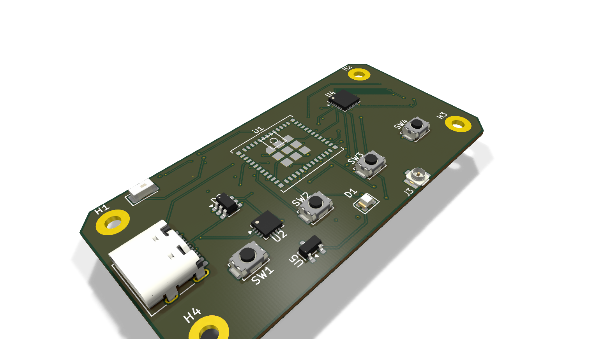
*Figure 7.9a: PCBA 09 Top 3D (Current Routing & Placement) -- ESP32-C6 Host MCU (U1), ES8388 Audio Codec (U4), BQ24075 PMIC (U2), ME6211 3.3V LDO (U3/U5), IP67 USB-C (J1), and 4-Button Inline Array.*

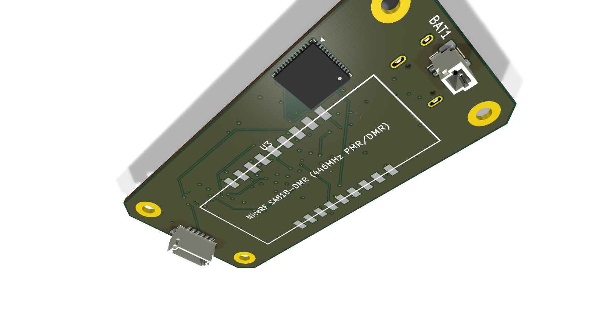
*Figure 7.9b: PCBA 09 Bottom 3D (Dual-Engine OMB Lite) -- 2-Pin LiPo Header `BAT1` directly underneath `J1` USB-C (`Local X=3.45, Y=15.05`), dedicated ESP32-PICO-V3-02 Bluetooth Classic/BLE Co-Processor (U5), Johanson 2450AT Chip Antenna (ANT1), and 6-Pin Helmet Header `J_HELMET` at the right edge (`Local X=57.05, Y=14.70`).*

### 11.1 Technical Board Specifications
* **Dimensions:** $60.0 \times 30.0 \times 1.0\,\text{mm}$ ($R = 2.5\,\text{mm}$ corner radii).
* **Layer Stackup:** 2/4-layer FR-4 High-TG150, $1.0\,\text{mm}$ board thickness, $35\,\mu\text{m}$ copper (1 oz), ENIG gold finish.
* **Fasteners:** 4x M2 mounting holes ($\varnothing 2.2\,\text{mm}$) spaced $52.0 \times 22.0\,\text{mm}$ for captive DIN 934 M2 hexagonal nut pockets in the $68.0 \times 36.0 \times 16.0\,\text{mm}$ UCS enclosure.

### 11.2 Key Components & Circuit Architecture
1. **Host MCU (`U1`):** Espressif ESP32-C6-MINI-1U (32-Bit RISC-V @ 160 MHz, 512 kB SRAM, 4 MB Flash, U.FL RF connector). Supports Wi-Fi 6, 802.15.4 TDMA mesh, and BLE 5.3 / LE Audio LC3.
2. **Power Path PMIC (`U2`):** Texas Instruments BQ24075RGTR with Dynamic Power Path Management (DPPM). Zero-reboot switching between external 5V USB-C and internal **1000 mAh LiPo cell (`Type 603040 / 602840`, $40 \times 28 \times 6.0\,\text{mm}$, $3.7\,\text{Wh}$)** in $< 10\,\mu\text{s}$ (**13–18 h** standalone helmet runtime). Internal cell acts as uninterruptible power supply (UPS). In standalone helmet mode, low-battery states trigger autonomous in-helmet voice prompts via the `ES8388` codec (20%: *“Battery low”*, 10%: *“Battery critical”*, 5%: *“Battery empty – shutting down”*).
3. **Stereo Audio Codec (`U4`):** Everest Semi ES8388 (24-Bit / 96 kHz I2S). Dedicated L/R headphone amplifiers for stereo helmet speakers and low-noise differential microphone preamplifier.
4. **2.4 GHz RF Antenna & Dual-/Triple-Engine Architecture:**
   * **Host MCU (`U1`):** Uses the factory-integrated U.FL gold port on the `ESP32-C6-MINI-1U` module.
   * **Helmet Default:** Uses compact stubby or internal FPC dipole antenna.
   * **Bluetooth Co-Processor (`U5/U6`):** The `ESP32-PICO-V3-02` operates on its own Johanson 2450AT ceramic chip antenna (`ANT1`, SMD 3216) for short-range smartphone, Cardo/Sena bridge, and cockpit links.
5. **User Interface:** 4x tactile IP67 micro-switches (`SW1` to `SW4`, C&K KMT0 / Alps SKRK) and 1x WS2812B-2020 RGB status LED.
6. **Interfaces & Symmetrical Connector Placement (`B.Cu`):**
   * `J1`: Waterproof IP67 USB-C receptacle (16-Pin) on `F.Cu` (`X=73.50, Y=100.00`) for on-the-go charging (powerbank/bike), WebUSB DFU flashing, and pod docking.
   * **`BAT1`: 2-Pin JST-SH micro receptacle (`BM02B-SRSS-TB` Vertical) on `B.Cu` directly underneath the USB-C port `J1` (`KiCad X=73.45, Y=100.05 mm` / `Local X=3.45, Y=15.05 mm`, `rot = -90°`)** to the **1S LiPo pouch cell (1000 mAh `Type 603040 / 602840`, $40 \times 28 \times 6.0\,\text{mm}$ with PCM)**.
   * **`J_HELMET`: 6-Pin JST-SH 1.0mm SMD Vertical Header (`BM06B-SRSS-TB`) on `B.Cu` symmetrically opposite at the right board edge (`KiCad X=127.05, Y=99.70 mm` / `Local X=57.05, Y=14.70 mm`, `rot = +90°`)**. Delivers pure, hum-free audio to helmet interior. Between `BAT1` and `J_HELMET`, a **completely unobstructed $48.0 \times 30.0\,\text{mm}$ central bay (`Local X = 6.0 .. 54.0 mm`)** houses the transceiver and 1000 mAh battery while keeping both connectors 100% uncovered.

### 11.3 Complete GPIO Pinout (ESP32-C6-MINI-1U)

<!-- AUTO_PINOUT_START: PCBA_09 -->

| Pad | Signal / KiCad Net | ESP32 GPIO | Firmware Define | Target / IC | Signal Type & Electrical Spec |
| :---: | :--- | :---: | :--- | :--- | :--- |
| 3 | `VCC_3V3` | - | - | 3.3V Power Rail | **Power** – Betriebsspannung ESP32-C6 |
| 5 | `BTN_1` | GPIO 2 | `OMM_PIN_SW_POWER` | SW1 / J_HELMET.6 | **Digital In** – Multifunktionstaster 1 (Power / PTT / MFB, Active Low) |
| 6 | `BTN_2` | GPIO 3 | `OMM_PIN_SW_MESH` | SW2 | **Digital In** – Mesh Taster 2 (Tri-Band Betriebsmodus-Umschaltung) |
| 8 | `VCC_3V3` | - | - | VCC_3V3 Pull-Up | **Power/Reset** – Chip Enable / Hardware Reset |
| 9 | `BTN_3` | GPIO 4 | `OMM_PIN_SW_VOL_UP` | SW3 | **Digital In** – Taster 3 (Lautstärke + / Kanal +) |
| 10 | `BTN_4` | GPIO 5 | `OMM_PIN_SW_VOL_DOWN` | SW4 | **Digital In** – Taster 4 (Lautstärke - / Kanal -) |
| 12 | `WS2812_DATA` | GPIO 0 | `OMM_PIN_WS2812B` | D1.4 | **Digital Out** – Onboard WS2812B-2020 Smart RGB Status-LED |
| 13 | `CHG_STAT` | GPIO 1 | `OMM_PIN_CHG_STAT` | U5.5 (BQ24075) | **Digital In** – Akku-Ladestatus BQ24075 (/STAT Active-Low) |
| 15 | `I2C_SCL` | GPIO 6 | `OMM_PIN_I2C_SCL` | U2.27 (ES8388) | **I2C_SCL** – ES8388 Audio-Codec I2C Taktleitung |
| 16 | `I2C_SDA` | GPIO 7 | `OMM_PIN_I2C_SDA` | U2.28 (ES8388) | **I2C_SDA** – ES8388 Audio-Codec I2C Datenleitung |
| 17 | `USB_DN` | GPIO 12 | `OMM_PIN_USB_DN` | J1.A7/B7 | **USB_D-** – USB Data Minus (UAC Audio / CDC Telemetrie) |
| 18 | `USB_DP` | GPIO 13 | `OMM_PIN_USB_DP` | J1.A6/B6 | **USB_D+** – USB Data Plus (UAC Audio / CDC Telemetrie) |
| 25 | `I2S_MCLK` | GPIO 19 | `OMM_PIN_I2S_MCLK` | U2.1 (ES8388) | **I2S_MCLK** – ES8388 Audio-Codec Master-Clock (12.288 MHz) |
| 26 | `I2S_BCLK` | GPIO 20 | `OMM_PIN_I2S_BCLK` | U2.2 (ES8388) | **I2S_BCLK** – ES8388 Audio-Codec Bit-Clock |
| 27 | `I2S_WS` | GPIO 21 | `OMM_PIN_I2S_WS` | U2.3 (ES8388) | **I2S_WS** – ES8388 Audio-Codec Word Select / Frame Sync (48 kHz) |
| 28 | `I2S_DOUT` | GPIO 22 | `OMM_PIN_I2S_DOUT` | U2.4 (ES8388) | **I2S_DOUT** – ES8388 Audio-Codec DAC Serial Data Out (Headphone Left/Right) |
| 29 | `I2S_DIN` | GPIO 23 | `OMM_PIN_I2S_DIN` | U2.5 (ES8388) | **I2S_DIN** – ES8388 Audio-Codec ADC Serial Data In (Mikrofon-Signal) |

<!-- AUTO_PINOUT_END: PCBA_09 -->

### 11.3.1 Sub-Chips (ES8388 Codec & BQ24075 Charger)

<!-- AUTO_SUBCHIPS_START: PCBA_09 -->

#### Sub-Chip `U4`: Everest Semi ES8388 24-Bit Audio Codec (QFN-28 (4x4 mm))
> **Manufacturer Datasheet:** [Everest Semi ES8388 24-Bit Audio Codec](http://www.everest-semi.com/pdf/ES8388%20DS.pdf) | **Pin Definitions:** [Pin Configuration & Description (QFN-28)](http://www.everest-semi.com/pdf/ES8388%20DS.pdf#page=4)  

| Pad | Pin Name | Signal / KiCad Net | Signal Type | Target / Source | Function & Electrical Spec |
| :---: | :--- | :--- | :---: | :--- | :--- |
| 1 | `MCLK` | `I2S_MCLK` | **Clock In** | U1 (ESP32-C6) | I2S Master Clock (12.288 MHz) |
| 2 | `BCLK` | `I2S_BCLK` | **Clock In** | U1 (ESP32-C6) | I2S Bit Clock (3.072 MHz) |
| 3 | `LRCK` | `I2S_WS` | **Sync In** | U1 (ESP32-C6) | I2S Word Select (48 kHz) |
| 4 | `DSOUT` | `I2S_DIN` | **Audio Out** | U1 (ESP32-C6) | Digitalisiertes Mikrofon-Signal an MCU |
| 5 | `DSIN` | `I2S_DOUT` | **Audio In** | U1 (ESP32-C6) | Mesh/Funk Audio Stream zum Kopfhörer DAC |

#### Sub-Chip `U2`: TI BQ24075 Li-Ion Akkulader & Power-Path PMIC (QFN-16 (3x3 mm))
> **Manufacturer Datasheet:** [TI BQ24075 Li-Ion Akkulader & Power-Path PMIC](https://www.ti.com/lit/ds/symlink/bq24075.pdf) | **Pin Definitions:** [Pin Functions (QFN-16)](https://www.ti.com/lit/ds/symlink/bq24075.pdf#page=4)  

| Pad | Pin Name | Signal / KiCad Net | Signal Type | Target / Source | Function & Electrical Spec |
| :---: | :--- | :--- | :---: | :--- | :--- |
| 13 | `IN` | `VBUS_USB` | **Power In (+5V)** | J1 (USB-C) | 5V Ladespannungseingang über USB-C |
| 2 | `OUT` | `SYS_PWR` | **Power Out** | LDO / System Rail | System-Betriebsspannung mit unterbrechungsfreier Umschaltung |
| 3 | `BAT` | `BAT_3V7` | **Power (3.7V)** | LiPo Akku | Li-Ion Akku Lade- und Entladeanschluss |
| 11 | `CHG` | `CHG_STAT` | **Digital Out** | U1 (ESP32-C6) | Ladestatusanzeige (Active Low) |

<!-- AUTO_SUBCHIPS_END: PCBA_09 -->

| Module Pad | ESP32-C6 GPIO | Net Name | Signal Type | Function / Hardware Connection |
| :---: | :---: | :--- | :--- | :--- |
| **Pad 8** | **`GPIO 2`** | `BTN_PWR` | Digital In (Pullup) | SW1 (Power / MFB tactile switch, active-low, boot pin) |
| **Pad 9** | **`GPIO 3`** | `BTN_MESH` | Digital In (Pullup) | SW2 (Mesh / Group toggle switch, active-low) |
| **Pad 4** | **`GPIO 4`** | `BTN_VOL_UP` | Digital In (Pullup) | SW3 (Volume +, Channel +, active-low) |
| **Pad 5** | **`GPIO 5`** | `BTN_VOL_DOWN` | Digital In (Pullup) | SW4 (Volume -, Channel -, active-low) |
| **Pad 6** | **`GPIO 6`** | `WS2812_DATA` | Digital Out | D1 (WS2812B-2020 RGB status LED & light pipe) |
| **Pad 7** | **`GPIO 7`** | `CHG_STAT` | Digital In (Pullup) | BQ24075 /STAT charge indicator (active-low) |
| **Pad 10** | **`GPIO 8`** | `I2C_SDA` | Open-Drain | ES8388 register control SDA (4.7k pullup) |
| **Pad 11** | **`GPIO 9`** | `I2C_SCL` | Open-Drain | ES8388 register control SCL (4.7k pullup) |
| **Pad 3** | **`GPIO 2 / PTT`**| `PTT_IO` | Digital In (Pullup) | Hardware PTT input from J_HELMET Pin 6 / handlebar switch |
| **Pad 21** | **`GPIO 19`** | `I2S_MCLK` | Digital Out | ES8388 Master Clock (12.288 MHz) |
| **Pad 22** | **`GPIO 20`** | `I2S_BCLK` | Digital Out | ES8388 Bit Clock (1.536 MHz) |
| **Pad 23** | **`GPIO 21`** | `I2S_WS` | Digital Out | ES8388 Frame Sync / Word Select (48 kHz) |
| **Pad 24** | **`GPIO 22`** | `I2S_DOUT` | Digital Out | ES8388 DAC Data Out (Stereo speakers L/R) |
| **Pad 25** | **`GPIO 23`** | `I2S_DIN` | Digital In | ES8388 ADC Data In (Microphone) |
| **U.FL** | **RF 2.4G** | `RF_ANT` | 50 Ohm Coaxial | ESP32-C6 integrated U.FL -> Coax pigtail -> IP67 SMA bulkhead |

### 11.4 External Connectors (J1 USB-C & J2 Helmet Audio)

<!-- AUTO_CONNECTORS_START: PCBA_09 -->

#### Connector `J1`: USB-C IP67 Service- & Ladeport
> **Type:** `USB-C 12-Pin IP67 Wasserdicht SMD (TYPE-C-31-M-12)` | **Mating Connector:** `Standard USB-C Kabel`  

| Pin | Signal / KiCad Net | Signal Type | Electrical Specification & Function |
| :---: | :--- | :---: | :--- |
| **A1/B12** | `GND` | **Power Return** | Massebezug |
| **A4/B9** | `VBUS_USB` | **Power In (+5V)** | 5V USB Ladespannung für BQ24075 |
| **A6/B6** | `USB_DP` | **USB D+** | USB 2.0 Full-Speed D+ zu ESP32-C6 |
| **A7/B7** | `USB_DM` | **USB D-** | USB 2.0 Full-Speed D- zu ESP32-C6 |

#### Connector `J2`: UCS ECE 22.06 Helm-Headset Audio-Interface
> **Type:** `JST-SH 6-Pin 1.0mm SMD Vertikal (BM06B-SRSS-TB)` | **Mating Connector:** `JST SHR-06V-S-B (AWG28-30)`  

| Pin | Signal / KiCad Net | Signal Type | Electrical Specification & Function |
| :---: | :--- | :---: | :--- |
| **1** | `HELMET_SPK_L` | **Analog Out** | Lautsprecher Links (32 Ohm Treiber) |
| **2** | `HELMET_SPK_R` | **Analog Out** | Lautsprecher Rechts (32 Ohm Treiber) |
| **3** | `GND` | **Power Return** | Gemeinsame Lautsprecher- und Mikrofonmasse |
| **4** | `HELMET_MIC_P` | **Analog In** | Mikrofonsignal Positiv (Bias 2.2V) |
| **5** | `HELMET_PTT` | **Digital In** | Helm PTT-Taster gegen Masse |
| **6** | `GND` | **Power Return** | Schirmmasse |

<!-- AUTO_CONNECTORS_END: PCBA_09 -->

#### 11.4.1 Multi-Use USB-C Details (`J1`)

The front-facing USB-C port `J1` (`TYPE-C-31-M-12_IP67`) serves as a universal multi-use interface for **charging**, **WebUSB/DFU flashing**, and **cartridge sled docking**:

| USB-C Pins | Net Name | Signal Type | Function / Adapter Connection |
| :---: | :--- | :--- | :--- |
| **A1, B12, A12, B1, SH** | `GND` / `PGND` | Power Ground | Pin 1 Cartridge Header `J_AUDIO_PWR` & Shield: Carries charge & operating return current |
| **A4, B9, A9, B4** | `VBUS_5V` | Power In (+5V) | Pin 2 Cartridge Header & USB charge cable: 5V supply & BQ24075 UPS battery charging |
| **A6, B6 (`DP1`, `DP2`)** | `USB_DP` | USB 2.0 PHY | Pin 7 Cartridge Header `AUDIO_IO_P` $\rightarrow$ ESP32-C6 GPIO 13 (via TVS `D2`): **Digital-Audio USB D+ & WebUSB** |
| **A7, B7 (`DN1`, `DN2`)** | `USB_DN` | USB 2.0 PHY | Pin 8 Cartridge Header `PTT_USB_N` $\rightarrow$ ESP32-C6 GPIO 12 (via TVS `D2`): **Digital-Audio USB D- & WebUSB** |
| **A5 (`CC1`)** | `CC1` | USB-C UFP | $5.1\,\text{k}\Omega$ Pull-Down to GND (UFP sink detection for standard 5V power) |
| **B5 (`CC2`)** | `CC2` | USB-C UFP | $5.1\,\text{k}\Omega$ Pull-Down to GND (UFP sink detection for standard 5V power) |
| **A8, B8 (`SBU1`, `SBU2`)** | `NC` | Unused | Free / Not connected (Analog audio remains 100% on `J_HELMET` on B.Cu) |

> [!NOTE]
> **Digital USB Audio instead of Analog Conversion:**
> In cartridge mode on the bike, audio between the Host MCU on `PCBA 03` and the OMM module (`PCBA 09`) is transmitted purely digitally as a USB audio stream (UAC / ESP USB serial) via `USB_DP` and `USB_DN`. No lossy D/A or A/D conversions occur in the sled; common-impedance ground loops are physically eliminated. Analog audio for helmet speakers and microphone is exclusively routed via the separate `J_HELMET` header on the bottom layer.

### 11.5 6-Pin Internal Helmet Audio & PTT Connector Pinout (`J_HELMET`)

The 6-pin header `J_HELMET` (JST-SH 1.0 mm, LCSC `C136657`) placed on `B.Cu` carries all analog audio and control lines directly into the helmet interior. By completely separating 5V charging power (which remains solely on USB-C `J1`), audio lines are 100% free of hum and charger noise:

| Pin # | Net Name (KiCad / Function) | Signal Type | Destination / Helmet Headset Peripheral | Electrical Specification |
| :---: | :--- | :--- | :--- | :--- |
| **1** | **`AUDIO_OUT_L`** (`HP_OUT_L`) | Audio Out | Left helmet speaker (Tip 3.5mm jack) | ES8388 `LOUT1`, $45\,\text{mW}$ @ $16\,\Omega$, AC-coupled |
| **2** | **`AUDIO_OUT_R`** (`HP_OUT_R`) | Audio Out | Right helmet speaker (Ring 3.5mm jack) | ES8388 `ROUT1`, $45\,\text{mW}$ @ $16\,\Omega$, AC-coupled |
| **3** | **`AGND_SPK`** | Audio Ground | Speaker ground reference (Sleeve 3.5mm jack) | Zero-current analog ground ($I = 0\,\text{mA}$), no charging noise |
| **4** | **`VOICE_IN`** (`MIC_IN+`) | Audio In | Microphone capsule (2-Pin Micro-JST Pin 1) | ES8388 `MIC1P` with programmable `MICBIAS` (2.2V) |
| **5** | **`AGND_MIC`** | Mic Ground | Microphone return (2-Pin Micro-JST Pin 2) | Isolated low-noise preamplifier ground |
| **6** | **`BTN_1`** (`BTN_PTT`) | Digital In | Helmet PTT button / chin bar clicker | ESP32-C6 GPIO 2, internal $45\,\text{k}\Omega$ pullup, active-low to GND |

---

## 12. PCBA 10: OMM Universal Tri-Band (2.4 GHz Mesh + BT-Mesh/Bridge + 446 MHz PMR/DMR) Intercom Module (`openmotorbridge_omm446_ucs`)

The **`PCBA 10`** board is the unified **Universal Tri-Band open-source hardware module** that integrates every component of `PCBA 09` (2.4 GHz OMM Mesh on `U1` + Bluetooth Classic/BLE Co-Processor on `U6`) at the exact same X/Y coordinates while adding the license-free 446 MHz transceiver (`U3` NiceRF SA818-DMR + `J_RF` U.FL). This enables **100% software-defined switching** between **OMM 2.4 GHz Mesh**, **BT-Mesh / Bridge**, **446 MHz Analog PMR446**, **446 MHz Digital DMR Tier I**, and simultaneous **Combo Modes**:


*Figure 7.10a: PCBA 10 Top 3D (Current Routing & Placement) -- ESP32-C6 Host MCU (U1), ES8388 Audio Codec (U4), BQ24075 PMIC (U2), ME6211 3.3V LDO (U5), IP67 USB-C (J1), U.FL Jack (J_RF), and 4-Button Inline Array.*

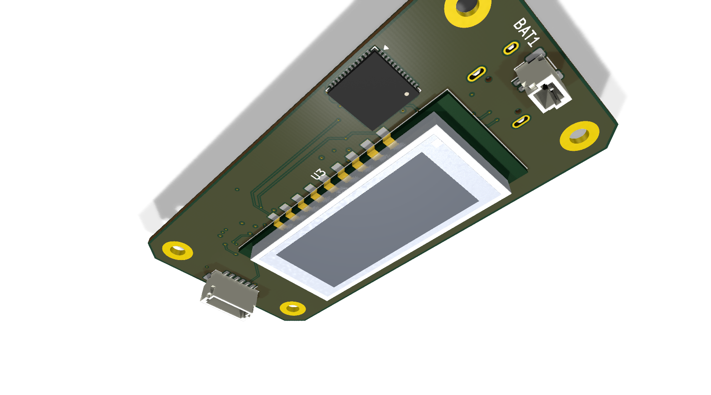
*Figure 7.10b: PCBA 10 Bottom 3D (Universal Tri-Band: SA818-DMR & Dual-Engine) -- 2-Pin LiPo Header `BAT1` directly underneath `J1` USB-C (`Local X=3.45, Y=15.05`), NiceRF SA818-DMR Transceiver (U3), ESP32-PICO-V3-02 Bluetooth Co-Processor (U6), Johanson 2450AT Chip Antenna (ANT1), and 6-Pin Helmet Header `J_HELMET` at the right edge (`Local X=57.05, Y=14.70`).*

* **Form-Factor Parity:** Exactly identical dimensions ($60.0 \times 30.0 \times 1.0\,\text{mm}$) and mounting points as `PCBA 09` inside the $68.0 \times 36.0 \times 16.0\,\text{mm}$ ECE 22.06 UCS enclosure.
* **Universal Application:** Operates autonomously in ECE 22.06 UCS helmet slots or docked into the cartridge sled (`PCBA 03`) on the motorcycle.
* **Tri-Band RF:** 2.4 GHz OMM HD-Mesh (`U1`), Bluetooth Classic HFP/A2DP/Bridge (`U6`), Analog FM (16 PMR446 channels, CTCSS/DCS), and Digital DMR Tier I (16 digital channels, TDMA 4FSK on `U3`).
* **Dual-Power RF Selection:**
  * **0.2 W ERP (Helmet Mode / SAR-Safe):** Minimized RF exposure and thermal dissipation near the head (1.5–2.5 km range).
  * **0.5 W ERP (Bike Mode / High-Power):** Full legal PMR446 maximum in cartridge sled (3–6 km range).
* **Power Management with 1000 mAh UPS:** TI BQ24075 with DPPM enables charging while operating via USB-C; internal **1000 mAh LiPo (`Type 603040 / 602840`, $40 \times 28 \times 6.0\,\text{mm}$, $3.7\,\text{Wh}$)** serves as seamless UPS (**13–18 h** standalone helmet runtime).
* **Tri-Band Antenna System (Twin-SMA at $+X$ Flank at $Y=12.5\,\text{mm}$ & $Y=23.5\,\text{mm}$):**
  * **2.4 GHz OMM Mesh Path (`SMA_24G` at $Y = 12.5\,\text{mm}$, $Z = 10.5\,\text{mm}$):** Uses the integrated U.FL port on `ESP32-C6-MINI-1U` (`U1`) via a $50\,\text{mm}$ coax pigtail to the first IP67 SMA bulkhead jack ($38\,\text{mm}$ 2.4 GHz stubby antenna on helmet or pod antenna).
  * **PMR/DMR 446 MHz Path (`SMA_446` at $Y = 23.5\,\text{mm}$, $Z = 10.5\,\text{mm}$):** NiceRF SA818-DMR feeds `J_RF` (U.FL on `F.Cu` at $(110.2, 113.5)\,\text{mm}$). A second $50\,\text{mm}$ micro-coax pigtail routes without cable crossing to the second IP67 SMA bulkhead jack ($48\,\text{mm}$ 446 MHz stubby antenna on helmet or 446 MHz pod antenna / 5V booster). Both SMA bulkheads sit captured in the bottom shell (zero lid cables during servicing) and project at $Z = 10.5\,\text{mm}$ freely above the UCS helmet slot rim ($Z = 5.2\,\text{mm}$).
  * **Bluetooth Co-Processor (`U6`):** Dedicated `ESP32-PICO-V3-02` with Johanson 2450AT ceramic chip antenna (`ANT1`).
* **Interfaces & Symmetrical Connector Placement (`B.Cu`):**
  * `J1`: Waterproof IP67 USB-C receptacle (16-Pin) on `F.Cu` (`X=73.50, Y=100.00`) for charging and WebUSB DFU.
  * **`BAT1`: 2-Pin JST-SH micro receptacle (`BM02B-SRSS-TB` Vertical) on `B.Cu` directly underneath the USB-C port `J1` (`KiCad X=73.45, Y=100.05 mm` / `Local X=3.45, Y=15.05 mm`, `rot = -90°`)** to the **1S LiPo pouch cell (1000 mAh `Type 603040 / 602840`, $40 \times 28 \times 6.0\,\text{mm}$ with PCM)**.
  * **`J_HELMET`: 6-Pin JST-SH 1.0mm SMD Vertical Header (`BM06B-SRSS-TB`) on `B.Cu` symmetrically opposite at the right board edge (`KiCad X=127.05, Y=99.70 mm` / `Local X=57.05, Y=14.70 mm`, `rot = +90°`)** -- 100% pinout-compatible with PCBA 09. Both bottom connectors sit outside the $48.0 \times 30.0\,\text{mm}$ central bay (`Local X = 6.0 .. 54.0 mm`) and remain 100% uncovered.

### 12.3 Complete GPIO Pinout (ESP32-C6 to SA818-DMR & Periphery)

<!-- AUTO_PINOUT_START: PCBA_10 -->

| Pad | Signal / KiCad Net | ESP32 GPIO | Firmware Define | Target / IC | Signal Type & Electrical Spec |
| :---: | :--- | :---: | :--- | :--- | :--- |
| 3 | `VCC_3V3` | - | - | 3.3V Power Rail | **Power** – Betriebsspannung ESP32-C6 |
| 5 | `BTN_1` | GPIO 2 | `OMM_PIN_SW_POWER` | SW1 / J_HELMET.6 | **Digital In** – Multifunktionstaster 1 (Power / Funk-PTT / MFB, Active Low) |
| 6 | `BTN_2` | GPIO 3 | `OMM_PIN_SW_MESH` | SW2 | **Digital In** – Funk-Modustaster 2 (PMR446 Analog / DMR Tier I Digital Umschaltung) |
| 8 | `VCC_3V3` | - | - | VCC_3V3 Pull-Up | **Power/Reset** – Chip Enable / Hardware Reset |
| 9 | `BTN_3` | GPIO 5 | `OMM_PIN_SW_VOL_UP` | SW3 | **Digital In** – Taster 3 (Funk-Kanal Up / Lautstärke +) |
| 10 | `BTN_4` | - | `OMM_PIN_SW_VOL_DOWN` | SW4 | **Digital In** – Taster 4 (Funk-Kanal Down / Lautstärke -) |
| 12 | `WS2812_DATA` | GPIO 4 | `OMM_PIN_WS2812B` | D1.4 | **Digital Out** – Onboard WS2812B-2020 Smart RGB Status-LED |
| 13 | `CHG_STAT` | GPIO 6 | `OMM_PIN_CHG_STAT` | U5.5 (BQ24075) | **Digital In** – Akku-Ladestatus BQ24075 (/STAT Active-Low) |
| 15 | `I2C_SCL` | - | `OMM_PIN_I2C_SCL` | U2.27 (ES8388) | **I2C_SCL** – ES8388 Audio-Codec I2C Taktleitung |
| 16 | `I2C_SDA` | GPIO 7 | `OMM_PIN_I2C_SDA` | U2.28 (ES8388) | **I2C_SDA** – ES8388 Audio-Codec I2C Datenleitung |
| 17 | `USB_DN` | GPIO 8 | `OMM_PIN_USB_DN` | J1.A7/B7 | **USB_D-** – USB Data Minus (UAC Audio / CDC Telemetrie) |
| 18 | `USB_DP` | GPIO 9 | `OMM_PIN_USB_DP` | J1.A6/B6 | **USB_D+** – USB Data Plus (UAC Audio / CDC Telemetrie) |
| 19 | `SA818_TXD` | - | `OMM_PIN_SA818_TXD` | U3.17 (SA818 RXD) | **UART_TX** – SA818-DMR Transceiver AT-Kommando Schnittstelle TXD |
| 20 | `SA818_RXD` | GPIO 12 | `OMM_PIN_SA818_RXD` | U3.18 (SA818 TXD) | **UART_RX** – SA818-DMR Transceiver Status / Telemetrie RXD |
| 22 | `SA818_PTT` | GPIO 0 | `OMM_PIN_SA818_PTT` | U3.15 (SA818 PTT) | **Digital Out** – SA818 Funk-Sendeaktivierung (Hardware PTT, Active Low) |
| 23 | `SA818_SQL` | GPIO 1 | `OMM_PIN_SA818_SQL` | U3.14 (SA818 SQL) | **Digital In** – SA818 Funk-Rauschsperre / Carrier Trägererkennung (Squelch, Active Low) |
| 24 | `SA818_PWR_HL` | GPIO 17 | `OMM_PIN_SA818_PWR_HL` | U3.16 (SA818 H/L) | **Digital Out** – SA818 Sendeleistungsumschaltung (0 = 0.2W Helm / 1 = 0.5W Bike Pod) |
| 25 | `I2S_MCLK` | - | `OMM_PIN_I2S_MCLK` | U2.1 (ES8388) | **I2S_MCLK** – ES8388 Audio-Codec Master-Clock (12.288 MHz) |
| 26 | `I2S_BCLK` | GPIO 16 | `OMM_PIN_I2S_BCLK` | U2.2 (ES8388) | **I2S_BCLK** – ES8388 Audio-Codec Bit-Clock |
| 27 | `I2S_WS` | - | `OMM_PIN_I2S_WS` | U2.3 (ES8388) | **I2S_WS** – ES8388 Audio-Codec Word Select / Frame Sync (48 kHz) |
| 28 | `I2S_DOUT` | GPIO 18 | `OMM_PIN_I2S_DOUT` | U2.4 (ES8388) | **I2S_DOUT** – ES8388 Audio-Codec DAC Serial Data Out |
| 29 | `I2S_DIN` | GPIO 19 | `OMM_PIN_I2S_DIN` | U2.5 (ES8388) | **I2S_DIN** – ES8388 Audio-Codec ADC Serial Data In |

<!-- AUTO_PINOUT_END: PCBA_10 -->

### 12.3.1 Sub-Chips (SA818-DMR & ES8388 Codec)

<!-- AUTO_SUBCHIPS_START: PCBA_10 -->

#### Sub-Chip `U3`: NiceRF SA818-DMR Tier I & Analog PMR446 Funk-Transceiver (18-Pad SMD Module)
> **Manufacturer Datasheet:** [NiceRF SA818-DMR Tier I & Analog PMR446 Funk-Transceiver](https://www.nicerf.com/item/dmr-walkie-talkie-module-sa818-dmr) | **Pin Definitions:** [Section 3: Pin Definitions (18-Pad Module)](https://www.nicerf.com/item/dmr-walkie-talkie-module-sa818-dmr)  

| Pad | Pin Name | Signal / KiCad Net | Signal Type | Target / Source | Function & Electrical Spec |
| :---: | :--- | :--- | :---: | :--- | :--- |
| 1 | `ANT` | `RF_446M_ANT` | **RF 446 MHz** | J3 (U.FL / Helix) | 446 MHz Funk-Antennenanschluss (1W TX / RX) |
| 4 | `PTT` | `SA818_PTT` | **Digital In** | U1 (ESP32-C6) | Sendetaste PTT (Active Low = Senden) |
| 5 | `PD / SLEEP` | `SA818_PD` | **Digital In** | U1 (ESP32-C6) | Power Down / Sleep Mode |
| 6 | `AUDIO_IN` | `VOICE_MIC_DMR` | **Analog Audio In** | U4.12 (ES8388) | Sprach-Modulationseingang vom Codec |
| 7 | `AUDIO_OUT` | `VOICE_RX_DMR` | **Analog Audio Out** | U4.8 (ES8388) | Empfangenes Sprachsignal an Codec ADC |
| 8 | `SQ / CARRIER` | `SA818_SQ` | **Digital Out** | U1 (ESP32-C6) | Squelch / Trägererkennung (Carrier Detect) |
| 9 | `UART_TX` | `SA818_UART_TX` | **UART Out** | U1 (ESP32-C6) | Konfigurations-UART TX (Kanal, CTCSS, DMR ID) |
| 10 | `UART_RX` | `SA818_UART_RX` | **UART In** | U1 (ESP32-C6) | Konfigurations-UART RX |

#### Sub-Chip `U4`: Everest Semi ES8388 24-Bit Audio Codec (QFN-28 (4x4 mm))
> **Manufacturer Datasheet:** [Everest Semi ES8388 24-Bit Audio Codec](http://www.everest-semi.com/pdf/ES8388%20DS.pdf) | **Pin Definitions:** [Pin Configuration & Description (QFN-28)](http://www.everest-semi.com/pdf/ES8388%20DS.pdf#page=4)  

| Pad | Pin Name | Signal / KiCad Net | Signal Type | Target / Source | Function & Electrical Spec |
| :---: | :--- | :--- | :---: | :--- | :--- |
| 1 | `MCLK` | `I2S_MCLK` | **Clock In** | U1 (ESP32-C6) | I2S Master Clock (12.288 MHz) |
| 2 | `BCLK` | `I2S_BCLK` | **Clock In** | U1 (ESP32-C6) | I2S Bit Clock (3.072 MHz) |
| 3 | `LRCK` | `I2S_WS` | **Sync In** | U1 (ESP32-C6) | I2S Word Select (48 kHz) |
| 4 | `DSOUT` | `I2S_DIN` | **Audio Out** | U1 (ESP32-C6) | Empfangenes Funk-Audio digital an ESP32-C6 |
| 5 | `DSIN` | `I2S_DOUT` | **Audio In** | U1 (ESP32-C6) | Sendesprache digital vom ESP32-C6 zum Funkmodul |

<!-- AUTO_SUBCHIPS_END: PCBA_10 -->

| Module Pad | ESP32-C6 GPIO | Net Name | Signal Type | Function / Hardware Connection |
| :---: | :---: | :--- | :--- | :--- |
| **Pad 8** | **`GPIO 2`** | `BTN_PTT` | Digital In (Pullup) | Button SW1: Push-To-Talk / MFB (active-low, boot pin) |
| **Pad 9** | **`GPIO 3`** | `BTN_MODE` | Digital In (Pullup) | Button SW2: Analog FM / Digital DMR Toggle |
| **Pad 4** | **`GPIO 4`** | `BTN_CH_UP` | Digital In (Pullup) | Button SW3: Channel Up (CH 1–16) |
| **Pad 5** | **`GPIO 5`** | `BTN_CH_DOWN` | Digital In (Pullup) | Button SW4: Channel Down (CH 16–1) |
| **Pad 6** | **`GPIO 6`** | `WS2812_DATA` | Digital Out | D1 (WS2812B RGB Status LED RX/TX/DMR) |
| **Pad 7** | **`GPIO 7`** | `CHG_STAT` | Digital In (Pullup) | BQ24075 /STAT charge indicator (active-low) |
| **Pad 10** | **`GPIO 8`** | `I2C_SDA` | Open-Drain | ES8388 Register SDA (4.7k pullup) |
| **Pad 11** | **`GPIO 9`** | `I2C_SCL` | Open-Drain | ES8388 Register SCL (4.7k pullup) |
| **Pad 14** | **`GPIO 12`** | `USB_DN` | USB 2.0 PHY | USB-C D- (WebUSB firmware flashing & DFU via D2) |
| **Pad 15** | **`GPIO 13`** | `USB_DP` | USB 2.0 PHY | USB-C D+ (WebUSB firmware flashing & DFU via D2) |
| **Pad 16** | **`GPIO 14`** | `SA818_TXD` | Digital Out (UART) | ESP32 TX -> SA818-DMR RXD (AT commands @ 9600 Bd) |
| **Pad 17** | **`GPIO 15`** | `SA818_RXD` | Digital In (UART) | ESP32 RX <- SA818-DMR TXD (status & telemetry) |
| **Pad 18** | **`GPIO 16`** | `SA818_PTT` | Digital Out | SA818 PTT control (active-low = transmit) |
| **Pad 19** | **`GPIO 17`** | `SA818_SQL` | Digital In | SA818 Squelch output (active-low = carrier detect / RX) |
| **Pad 20** | **`GPIO 18`** | `SA818_PWR_HL` | Digital Out | SA818 RF Power Select: Low = 0.2W (Helmet), High = 0.5W (Bike) |
| **Pad 21** | **`GPIO 19`** | `I2S_MCLK` | Digital Out | ES8388 Master Clock (12.288 MHz) |
| **Pad 22** | **`GPIO 20`** | `I2S_BCLK` | Digital Out | ES8388 Bit Clock (1.536 MHz) |
| **Pad 23** | **`GPIO 21`** | `I2S_WS` | Digital Out | ES8388 Frame Sync (48 kHz) |
| **Pad 24** | **`GPIO 22`** | `I2S_DOUT` | Digital Out | ES8388 DAC Out (Speaker / audio to central box) |
| **Pad 25** | **`GPIO 23`** | `I2S_DIN` | Digital In | ES8388 ADC In (Microphone from helmet / central DSP) |
| **J_RF** | **RF 446M** | `RF_ANT` | 50 Ohm Coaxial | U.FL socket (`B.Cu`) -> Coax pigtail -> IP67 SMA bulkhead |

### 12.4 External Connectors (J1 USB-C & J2 Helmet Audio)

<!-- AUTO_CONNECTORS_START: PCBA_10 -->

#### Connector `J1`: USB-C IP67 Service- & Ladeport
> **Type:** `USB-C 12-Pin IP67 Wasserdicht SMD (TYPE-C-31-M-12)` | **Mating Connector:** `Standard USB-C Kabel`  

| Pin | Signal / KiCad Net | Signal Type | Electrical Specification & Function |
| :---: | :--- | :---: | :--- |
| **A1/B12** | `GND` | **Power Return** | Massebezug |
| **A4/B9** | `VBUS_USB` | **Power In (+5V)** | 5V USB Ladespannung für BQ24075 |
| **A6/B6** | `USB_DP` | **USB D+** | USB 2.0 Full-Speed D+ zu ESP32-C6 |
| **A7/B7** | `USB_DM` | **USB 2.0 D-** | USB 2.0 Full-Speed D- zu ESP32-C6 |

#### Connector `J2`: UCS ECE 22.06 Helm-Headset Audio-Interface
> **Type:** `JST-SH 6-Pin 1.0mm SMD Vertikal (BM06B-SRSS-TB)` | **Mating Connector:** `JST SHR-06V-S-B (AWG28-30)`  

| Pin | Signal / KiCad Net | Signal Type | Electrical Specification & Function |
| :---: | :--- | :---: | :--- |
| **1** | `HELMET_SPK_L` | **Analog Out** | Lautsprecher Links (32 Ohm Treiber) |
| **2** | `HELMET_SPK_R` | **Analog Out** | Lautsprecher Rechts (32 Ohm Treiber) |
| **3** | `GND` | **Power Return** | Gemeinsame Lautsprecher- und Mikrofonmasse |
| **4** | `HELMET_MIC_P` | **Analog In** | Mikrofonsignal Positiv (Bias 2.2V) |
| **5** | `HELMET_PTT` | **Digital In** | Helm PTT-Taster gegen Masse |
| **6** | `GND` | **Power Return** | Schirmmasse |

<!-- AUTO_CONNECTORS_END: PCBA_10 -->

#### 12.4.1 Multi-Use USB-C Details (`J1`)

Identical to PCBA 09: Universal interface for **charging (5V bike / powerbank)**, **WebUSB/DFU flashing**, and **cartridge sled docking** in Smart Cartridge (`PCBA 03`).

### 12.5 6-Pin Internal Helmet Audio & PTT Connector Pinout (`J_HELMET`)

The `J_HELMET` header on `B.Cu` is **100% pinout-compatible with PCBA 09**:

| Pin # | Net Name (KiCad / Function) | Signal Type | Destination / Helmet Headset Peripheral | Electrical Specification |
| :---: | :--- | :--- | :--- | :--- |
| **1** | **`AUDIO_OUT_L`** (`HP_OUT_L`) | Audio Out | Left helmet speaker (Tip 3.5mm jack) | ES8388 `LOUT1`, $45\,\text{mW}$ @ $16\,\Omega$, AC-coupled |
| **2** | **`AUDIO_OUT_R`** (`HP_OUT_R`) | Audio Out | Right helmet speaker (Ring 3.5mm jack) | ES8388 `ROUT1`, $45\,\text{mW}$ @ $16\,\Omega$, AC-coupled |
| **3** | **`AGND_SPK`** | Audio Ground | Speaker ground reference (Sleeve 3.5mm jack) | Zero-current analog ground ($I = 0\,\text{mA}$), no charging noise |
| **4** | **`VOICE_IN`** (`MIC_IN+`) | Audio In | Microphone capsule (2-Pin Micro-JST Pin 1) | ES8388 `MIC1P` with programmable `MICBIAS` (2.2V) |
| **5** | **`AGND_MIC`** | Mic Ground | Microphone return (2-Pin Micro-JST Pin 2) | Isolated low-noise preamplifier ground |
| **6** | **`BTN_1`** (`BTN_PTT`) | Digital In | Helmet PTT button / chin bar clicker | ESP32-C6 GPIO 2, internal $45\,\text{k}\Omega$ pullup, active-low to GND |
