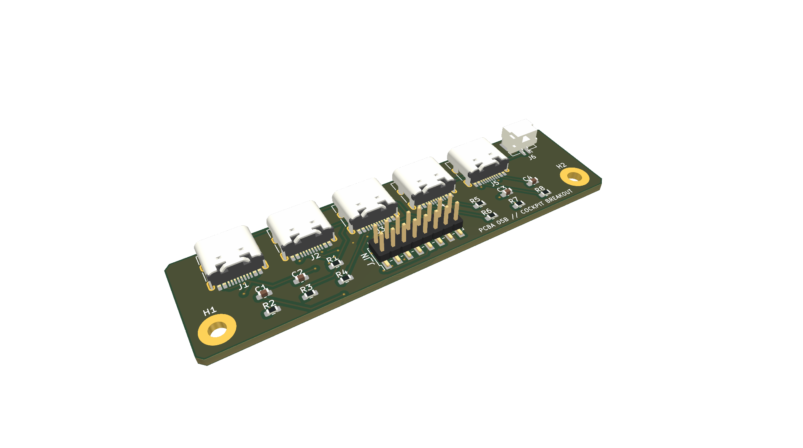

# 07 - Hardware Architecture & Board Pinouts (The Standardized v10.0 Lineup)

This document serves as the **authoritative hardware specification for all active board assemblies (`PCBA 01`, `03`, `05`, `05B`, `07`, `08`, `09`, `10`)** of the OpenMotorBridge system (v10.0 Standardized Node Architecture), detailing layer stackups, controlled impedance classes, zoning concepts, and complete pinout tables.

---

## 1. Overview of the v10.0 Hardware Lineup

OpenMotorBridge v10.0 replaces the legacy experimental UWB wireless backbone with a heavy-duty, shielded **4-wire automotive backbone** (`VCC_BUS` 12V/PD, `USB_D-`, `USB_D+`, `GND`). This provides all nodes (saddlebag pods and front node) with **massive charging power (up to 60W USB-PD)** and **rock-solid native USB 2.0 data throughput** simultaneously -- completely impervious to RF shadowing from wet rain suits, soaked luggage, or aluminum panniers.

```
+----------------------------------------------------------------------------------------+
|                     OPENMOTORBRIDGE v10.0 HARDWARE LINEUP                              |
+-------+-------------------------------+---------------+---------+----------------------+
| Assy  | Name & Function               | PCB Outline   | Layers  | Key ICs / Components |
+-------+-------------------------------+---------------+---------+----------------------+
| **PCBA 01**| **Central Box Main Controller**| 85 x 55 mm    | 4 Layer | ESP32-S31 AI RISC-V, |
|       | (Under-Seat, Audio/UPS/PD)    | (77x47 mm M3) | (ENIG)  | QCC3084 BT 5.4 SoC,  |
|       | Dual-Power: 12V DTM & USB-PD  |               |         | LM5164, BQ24075 UPS, |
|       | Sink (5-20V Ideal-Diode OR)   |               |         | SX1262 LoRa, 2-Cable |
+-------+-------------------------------+---------------+---------+----------------------+
| **PCBA 03**| **Satellite Pod Interface**   | 42 x 48 mm    | 4 Layer | ESP32-C6, ES8388,    |
|       | (Saddlebag Pod 1 & 2 Tub Floor| (36x42 mm M2.5| (ENIG)  | 4-Wire Bus, SW3516   |
|       | In-Bag 30W USB-PD Charge Port | 2-Sided SMT   |         | 30W PD, J_AUDIO_PWR  |
+-------+-------------------------------+---------------+---------+----------------------+
| **PCBA 05**| **Universal Front Node**      | 82 x 50 mm    | 4 Layer | ESP32-S3, SAM-M10Q,  |
|       | (Cockpit Riser Hub, GNSS/Sens)| (4x M2.5)     | (ENIG)  | Knowles MEMS Mic,    |
|       | 4-Wire Bus (Zero Tank Lift!)  |               |         | SC8102 PD, TMP117    |
+-------+-------------------------------+---------------+---------+----------------------+
| **PCBA 05B**| **Symmetrical Mirror Pod**    | 32 x 14 mm    | 2 Layer | Amber BSD LED,       |
|       | (2x Identical for Left/Right  | (M8/M10 Stud) | (ENIG)  | IP67 Tactile Switch, |
|       | 100% Software-Defined Gestures)| 100% SMT     |         | TVS ESD, JST-GH 4P   |
+-------+-------------------------------+---------------+---------+----------------------+
| **PCBA 07**| **2-in-1 LoRa Smart-Keyfob**  | 38 x 19 mm    | 2 Layer | Nordic nRF52840 SoC, |
|       | (Silent Pager, N52 Key & Qi)  | (Pocket M2)   | (ENIG)  | SX1262 LoRa, DRV2605L|
|       | Opens Pod Slide-in Lid Latch  |               |         | BQ51003 Qi, JST-ACH  |
+-------+-------------------------------+---------------+---------+----------------------+
| **PCBA 08**| **Radar 2.0 Sub-MCU & Wings** | 115 x 65 mm   | 2 Layer | ESP32-C5 Dual-Band,  |
|       | (Wheeltec 77GHz & V2X Patch)  | (Wing M2.5)   | (ENIG)  | Wheeltec MR20 (AoP), |
|       | 12V & UART Hardwire Link      |               |         | 36x WS2812B, JWPF 12V|
+-------+-------------------------------+---------------+---------+----------------------+
| **PCBA 09**| **OMM 2.4 GHz UCS Intercom**  | 60 x 30 mm    | 2 Layer | ESP32-C6 RISC-V,     |
|       | (ECE 22.06 Standalone & Pod)  | (UCS M2)      | (ENIG)  | TI BQ24075, ES8388,  |
|       | Native Digital USB Audio UAC  |               |         | 600mAh LiPo, FXP73   |
+-------+-------------------------------+---------------+---------+----------------------+
| **PCBA 10**| **OMM 446 MHz UCS Intercom**  | 60 x 30 mm    | 4 Layer | NiceRF SA818-DMR,    |
|       | (DMR Tier I & Analog PMR446)  | (UCS M2)      | (ENIG)  | ESP32-C6, BQ24075,   |
|       | Dual-Mode PMR/DMR via USB-Audio| (UCS M2)     | (ENIG)  | ES8388, Helical Ant. |
+-------+-------------------------------+---------------+---------+----------------------+
```

### 1.1 Breakdown by System Component
1. **Core Assemblies (Standard on Every Motorcycle):**
   * **`PCBA 01` (Central Box Main Controller):** Central under-seat compute hub for power management, UPS, DSP mixing, dual Bluetooth headsets, LoRa mesh, and USB-PD coordination. Equipped with **Dual-Power Input** (12V vehicle power via Deutsch DTM-6 or 5V–20V USB-PD Sink via ideal-diode OR-ing for benchtop flashing without a 12V lab power supply) and **Two-Cable Architecture** (Cable 1: 6-Pin Deutsch DTM `J1`; Cable 2: 16-Pin Automotive `J_PERIPH`).
   * **`PCBA 03` (Satellite Pod Interface Board):** Universal interface board mounted on the floor of both saddlebag pods (Pod 1 & Pod 2). Provides an integrated USB-C fast-charging port (up to 30W/60W) directly inside the bag and connects Sena, Cardo, or OMM losslessly to the 4-wire bus.
   * **`PCBA 05` (Universal Front Node):** Cockpit module at the handlebar riser for Multi-GNSS (SAM-M10Q), ram-air environmental sensing, ambient microphone, and Qi accessory power. Connected via the 4-wire backbone routed through the Harley wire caddy (**ZERO tank lifting required!**).
   * **`PCBA 05B` (Symmetrical Under-Perch Mirror Pods):** Two identical boards clamped under the mirror perch studs (Left & Right) for bilateral Blind Spot Detection (BSD amber LEDs) and software-defined thumb switches (PTT, Voice Assistant, 1-Click Hazard Pin Drop for Waze, Cam-Tags, SOS).
2. **Peripheral & Extension Modules:**
   * **`PCBA 07` (2-in-1 LoRa Smart-Keyfob & Silent Pager):** Wearable silent pager keyfob for 4.5 km alert range, N52 magnetic key for contactless release of the pod slide-in lid, and Qi inductive charging.
   * **`PCBA 08` (Radar 2.0 Sub-MCU & Warning Wings):** Tail module featuring 77-GHz mmWave sensor (AoP), autonomous collision strobe, and 5.9 GHz V2X uplink, hardwired via 12V and UART.
   * **`PCBA 09` / `PCBA 10` (OMM UCS Intercom Modules):** Standalone ECE 22.06 modules for helmets or plug-in audio engines in the saddlebag pods via USB Audio Class 2.0.
3. **Retired Assemblies (Architecture Consolidation v10.0):**
   * **`PCBA 02` (Former Pod Base Board):** Completely eliminated. The pod housing is a monocoque with slide-in lid and dry-flap; `PCBA 03` rests directly on dampers at the housing floor.
   * **`PCBA 04` (Rear Pod 3):** Completely eliminated; LoRa resides on `PCBA 01`, GNSS on `PCBA 05`.
   * **`PCBA 06` (MagSafe Frame Dock Board):** Replaced by standard COTS 4-pin IP67 magnetic breakaway couplers.
   * **Qorvo DW3110 UWB Transceiver:** Retired across all boards in favor of the robust 4-wire automotive backbone with native USB 2.0 data and WebUSB flashing.

---

## 2. JLCPCB 4-Layer Stackup & Controlled Impedances (JLC04161H-7628)

All 4-layer boards (`PCBA 01` and `PCBA 05`) utilize the identical, strictly impedance-controlled stackup:

```
+-------------------------------------------------------------+
| Layer 1 (F.Cu - Top): High-Speed Signals, USB-Diff, Parts   |  (35 µm / 1 oz Cu)
+-------------------------------------------------------------+
| -- Prepreg 7628 (Dielectric, Er = 4.4, Thickness 0.2 mm) -- |
+-------------------------------------------------------------+
| Layer 2 (In1.Cu): Continuous Ground Plane (GND_PWR / AGND)  |  (17.5 µm Standard)
+-------------------------------------------------------------+
| -- FR4 Core (Isolation Core, Thickness 1.0 mm) ------------ |
+-------------------------------------------------------------+
| Layer 3 (In2.Cu): Power Planes (VCC_3V3, VCC_5V, VBUS)      |  (17.5 µm Standard)
+-------------------------------------------------------------+
| -- Prepreg 7628 (Dielectric, Er = 4.4, Thickness 0.2 mm) -- |
+-------------------------------------------------------------+
| Layer 4 (B.Cu - Bottom): Secondary Routing, Ground Shield   |  (35 µm / 1 oz Cu)
+-------------------------------------------------------------+
```

### 2.1 Standardized Net Classes
* **`Default`:** Trace width $0.20\,	ext{mm}$, clearance $0.20\,	ext{mm}$ (logic signals, GPIOs).
* **`Power_5V_12V`:** Trace width $0.60\,	ext{mm}$ (current capability up to $2.2\,	ext{A}$ at $\Delta T < 10\,^\circ	ext{C}$).
* **`RF_50R`:** Trace width $0.35\,	ext{mm}$, coplanar gap $0.20\,	ext{mm}$ to ground (50 Ohm characteristic impedance for 868 MHz LoRa and 5.9 GHz V2X).
* **`USB_90R_DIFF`:** Trace width $0.20\,	ext{mm}$, differential pair spacing $0.15\,	ext{mm}$ ($90\,\Omega \pm 10\,\%$ differential impedance for USB 2.0 High-Speed 480 Mbps).
* **`Audio_Sensitive`:** Trace width $0.25\,	ext{mm}$, clearance $0.30\,	ext{mm}$ (shielded by flanking ground guard traces).

---

## 3. PCBA 01: Central Box Main Controller (`openmotorbridge_central_box`)


*Figure 7.1a: PCBA 01 Top 3D -- ESP32-S31 AI RISC-V Main MCU, Qualcomm QCC3084 BT 5.4 Audio SoC, LM5164-Q1 72V Buck, BQ24075 UPS, ES8388 DSP Codec, Semtech SX1262 LoRa, Multi-Port USB-PD Engine, Deutsch DTM-6 Flange J1, and 16-Pin Automotive Header J_PERIPH.*


*Figure 7.1b: PCBA 01 Bottom 3D -- Hirose DM3D MicroSD Push-Pull Slot, TI LM5050 Ideal-Diode OR-ing Circuit for Dual-Power (12V vehicle power vs. USB-PD Sink), Bosch BMI270 6-Axis IMU, and TCAN334G CAN-FD Transceiver.*

### 3.1 Board Specifications & Stackup
* **Dimensions:** $85.0 	imes 55.0\,	ext{mm}$ (Outer contour with 4x M2.5 mounting holes, $77.0 	imes 47.0\,	ext{mm}$ grid spacing).
* **Layer Stackup:** 4 Layers FR-4 High-TG150 ($1.6\,	ext{mm}$ thickness, $35\,\mu	ext{m}$ Cu on all 4 layers).
* **Dual-Power Input Circuitry:**
  * **12V Vehicle Power (Primary):** Deutsch DTM-6 flange `J1`, protected by automotive eFuses.
  * **USB-PD Sink (Service & Benchtop):** USB-C port on enclosure face with TI LM5050 / P-FET ideal-diode OR-ing. Enables complete operation, firmware flashing, and sensor calibration on a desk using any standard USB-C charger (5V–20V) without a laboratory power supply.
* **Top-Layer Components (F.Cu):**
  * **Main Compute Hub (`U2`):** Espressif `ESP32-S31` (Dual-Core RISC-V @ 320 MHz with 128-bit SIMD AI accelerator for on-device audio/voice recognition, 16 MB Flash, 8 MB Octal-PSRAM) for system control, CAN-FD bus, FreeRTOS DSP audio mixing, and PWA web server.
  * **Dedicated Helmet Audio SoC (`U9`):** **Qualcomm QCC3084** Bluetooth 5.4 Audio SoC ($13 	imes 18\,	ext{mm}$) for Dual-A2DP (aptX HD, Low Latency), LE Audio Auracast broadcast, and crystal-clear handsfree telephony (HFP 1.8 with Wideband Speech) with integrated ceramic chip antenna.
  * **Long-Range Telemetry (`U10`):** Semtech `SX1262` LoRa Transceiver (+22 dBm PA) with U.FL connector `ANT1` to Taoglas FXP895 antenna embedded in the housing lid.
  * **Automotive Power Stage (`U1`):** Texas Instruments `LM5164-Q1` synchronous 72V buck converter and TI `BQ24075` power-path controller with charging circuit for the internal 2,200 mAh UPS pouch cell.
  * **Status Smart-LED (`D1`):** WS2812B RGB Smart-LED for optical status and pairing indication.
  * **Controls & Interfaces:** Hardware switch `SW1` (Bluetooth/Audio pairing / factory reset), automotive Deutsch DTM-6 shrouded header `J1`, 16-Pin Automotive header `J_PERIPH`, plus IDC header `J3`.
* **Bottom-Layer Components (B.Cu):**
  * **MicroSD Socket (`J2`):** Hirose `DM3D-SF` push-pull MicroSD card holder mounted flush to the housing edge for tool-free accessibility.
  * **Audio Codec (`U3`):** Everest Semi `ES8388` 24-Bit / 48 kHz low-power stereo audio codec.
  * **Motion Sensor (`U5`):** Bosch `BMI270` 6-axis IMU (I2C) for wake-on-motion theft surveillance and crash logging.
  * **CAN-FD Transceiver (`U6`):** Texas Instruments `TCAN334G` / `TCAN1042V` 5 Mbps CAN-FD transceiver.
  * **Low-Noise LDO (`U11`):** Texas Instruments `TPS7A0533` 3.3V ultra-low-noise LDO for analog and sensor rails.

### 3.2 Central Box Two-Cable Architecture: Pinout of Header J1 (6-Pin DTM) & Header J_PERIPH (16-Pin Automotive)

To prevent wiring bottlenecks, pin count limitations, and thermal stress, OpenMotorBridge v10.0 strictly segregates vehicle power/CAN from the 4-channel OMB periphery bus across two dedicated, sealed automotive connectors:

#### 3.2.1 Header J1: Vehicle Power & CAN Bus (6-Pin Deutsch DTM04-6P Flange)
Direct interface to vehicle harness (battery, ignition switch, and OEM CAN network):

```
+---------------------------------------------------------------------------------------------------------------+
| HEADER J1: DEUTSCH DTM-6 PINOUT (VEHICLE POWER & CAN-FD)                                                      |
+-----+----------------+--------------------------+-------------+---------------------+-------------------------+
| Pin | Signal Name    | Signal Type / Level      | Wire Gauge  | Harness Branch      | Function & Protection   |
+-----+----------------+--------------------------+-------------+---------------------+-------------------------+
|  1  | KL30_IN        | +9V...+72V DC Constant+  | AWG20 0.50² | Cable 1 (Battery)   | Constant 12V Main (eFuse)|
|  2  | KL15_IGN       | +9V...+72V DC Ignition+  | AWG22 0.34² | Cable 1 (Ignition)  | Ignition Sense & Wake-Up|
|  3  | VEHICLE_GND    | Power Ground (0V)        | AWG20 0.50² | Cable 1 (Battery)   | Central Vehicle Ground  |
|  4  | CAN_H          | CAN-FD High (ISO 11898-2)| AWG24 0.22² | Cable 1 (Vehicle)   | Vehicle CAN-FD Bus High |
|  5  | CAN_L          | CAN-FD Low (ISO 11898-2) | AWG24 0.22² | Cable 1 (Vehicle)   | Vehicle CAN-FD Bus Low  |
|  6  | CHASSIS_SHIELD | Shield Ground / Chassis  | AWG20 0.50² | Cable 1 (Chassis)   | Enclosure & Shield Drain|
+-----+----------------+--------------------------+-------------+---------------------+-------------------------+
```

#### 3.2.2 Header J_PERIPH: OMB Periphery Bus (16-Pin Automotive Header, TE Superseal / DTM 16-Pin)
Supplies 4 independent system branches with 4 conductors each (`VCC`, `GND`, `D+`, `D-`). Each branch is protected on PCBA 01 via a dedicated **TI TPS25921 eFuse**:

```
+---------------------------------------------------------------------------------------------------------------+
| HEADER J_PERIPH: 16-PIN AUTOMOTIVE PERIPHERY BUS (4 INDEPENDENT 4-WIRE SYSTEM BRANCHES)                       |
+-----+----------------+--------------------------+-------------+---------------------+-------------------------+
| Pin | Signal Name    | Signal Type / Level      | Wire Gauge  | Target Component    | Function & Protection   |
+-----+----------------+--------------------------+-------------+---------------------+-------------------------+
|  1  | VBUS_FRONT_60W | +12V...+20V DC (60W Max) | AWG18 0.75² | Branch 1 (Front)    | Front Node 60W Power    |
|  2  | GND_FRONT      | Power Ground (0V)        | AWG18 0.75² | Branch 1 (Front)    | Power Return Lead       |
|  3  | FRONT_USB_DP   | USB 2.0 High-Speed D+    | AWG26 0.14² | Branch 1 (Front)    | Data Uplink 480 Mbps    |
|  4  | FRONT_USB_DN   | USB 2.0 High-Speed D-    | AWG26 0.14² | Branch 1 (Front)    | Data Uplink 480 Mbps    |
+-----+----------------+--------------------------+-------------+---------------------+-------------------------+
|  5  | POD1_VBUS_30W  | +12V DC (30W USB-PD)     | AWG20 0.50² | Branch 2 (Pod 1 L)  | Pod 1 Power & Charger   |
|  6  | POD1_GND       | Power Ground (0V)        | AWG20 0.50² | Branch 2 (Pod 1 L)  | Power Return Lead       |
|  7  | POD1_USB_DP    | USB 2.0 Audio/Data D+    | AWG28 0.08² | Branch 2 (Pod 1 L)  | Digital Audio & Control |
|  8  | POD1_USB_DN    | USB 2.0 Audio/Data D-    | AWG28 0.08² | Branch 2 (Pod 1 L)  | Digital Audio & Control |
+-----+----------------+--------------------------+-------------+---------------------+-------------------------+
|  9  | POD2_VBUS_30W  | +12V DC (30W USB-PD)     | AWG20 0.50² | Branch 3 (Pod 2 R)  | Pod 2 Power & Charger   |
| 10  | POD2_GND       | Power Ground (0V)        | AWG20 0.50² | Branch 3 (Pod 2 R)  | Power Return Lead       |
| 11  | POD2_USB_DP    | USB 2.0 Audio/Data D+    | AWG28 0.08² | Branch 3 (Pod 2 R)  | Digital Audio & Control |
| 12  | POD2_USB_DN    | USB 2.0 Audio/Data D-    | AWG28 0.08² | Branch 3 (Pod 2 R)  | Digital Audio & Control |
+-----+----------------+--------------------------+-------------+---------------------+-------------------------+
| 13  | RADAR_PWR_12V  | +12V switched (1.0A)     | AWG22 0.34² | Branch 4 (Radar)    | Power Rear Radar        |
| 14  | RADAR_GND      | Power Ground (0V)        | AWG22 0.34² | Branch 4 (Radar)    | Ground Rear Radar       |
| 15  | RADAR_CAN_H_TX | CAN_H / UART TX (3.3V)   | AWG24 0.22² | Branch 4 (Radar)    | Target Telemetry (20 Hz)|
| 16  | RADAR_CAN_L_RX | CAN_L / UART RX (3.3V)   | AWG24 0.22² | Branch 4 (Radar)    | Commands & Config       |
+-----+----------------+--------------------------+-------------+---------------------+-------------------------+
```

### 3.3 Pinout & System Interconnect: Qualcomm QCC3084 BT 5.4 Audio SoC (`U9`)

```
+----------------------------------------------------------------------------------------+
| QUALCOMM QCC3084 PINOUT & INTERCONNECTION TO ESP32-S31 / ES8388                        |
+-----+----------------+--------------------+-------------------+------------------------+
| Pin | Signal Name    | Signal Type        | Connected to      | Function & Protocol    |
+-----+----------------+--------------------+-------------------+------------------------+
|  1  | VCC_3V3        | Power In (+3.3V)   | LM5164 3.3V Rail  | Module Operating Power |
|  2  | GND            | Ground (0V)        | GND_PWR Plane     | RF and System Ground   |
|  3  | I2S_MCLK       | Digital In (Clock) | ESP32-S31 (GPIO 9)| Master Clock (12.288M) |
|  4  | I2S_BCLK       | Digital In (BitClk)| ESP32-S31 (GPIO10)| Bit Clock (3.072 MHz)  |
|  5  | I2S_WS         | Digital In (LRCK)  | ESP32-S31 (GPIO11)| Word Select (48 kHz)   |
|  6  | I2S_DOUT       | Digital In (Audio) | ESP32-S31 (GPIO12)| Stereo PCM to QCC3084  |
|  7  | I2S_DIN        | Digital Out (Mic)  | ESP32-S31 (GPIO13)| HFP Microphone to DSP  |
|  8  | GND            | Ground (0V)        | GND_PWR Plane     | RF Shield Ground       |
|  9  | BT_UART_TX     | Digital Out (UART) | ESP32-S31 (GPIO18)| QCC3084 Telemetry / AT |
| 10  | BT_UART_RX     | Digital In (UART)  | ESP32-S31 (GPIO17)| ESP32 AT Commands      |
| 11  | BT_EN          | Digital In (Reset) | ESP32-S31 (GPIO16)| Power-Down & Reset     |
| 12  | GND            | Ground (0V)        | GND_PWR Plane     | RF Shield Ground       |
+-----+----------------+--------------------+-------------------+------------------------+
```

---

## 4. Saddlebag Pod Enclosure & Retirement of PCBA 02

In OpenMotorBridge v10.0, the legacy cartridge bay system is completely superseded:
1. **Monolithic Pod Housing with Slide-in Lid:** The housing remains permanently inside the saddlebag. The slide-in lid self-latches upon insertion and releases contact-free using the N52 magnet in the Smart-Keyfob (`PCBA 07`).
2. **Intermediate Dry-Flap Splash Guard:** A protective EPDM/silicone flap hermetically shields the underlying `PCBA 03` board from dripping water when the luggage is opened.
3. **4-Wire Backbone & Magnetic Breakaway Dock:** Interconnection uses a 4-wire shielded cable (12V vehicle power, GND, USB 2.0 D+/D-), separating non-destructively at the saddlebag rim via an IP67 4-pin magnetic breakaway coupling.

---

## 5. PCBA 03: Satellite Pod Interface Board (`openmotorbridge_pod_interface`)


*Figure 7.3a: KiCad 3D view of the Satellite Pod Interface Board (PCBA 03, 42 x 48 mm) with ESP32-C6 Host MCU, SW3516 30W USB-PD charging controller, ES8388 audio codec, segregated bulkhead bus input & USB-C harness header, and rearward intercom and mechatronic headers.*

### 5.1 Board Specifications & Architecture
* **Dimensions:** $42.0 \times 48.0\,\text{mm}$ (4x M2.5 mounting holes on $36.0 \times 42.0\,\text{mm}$ pattern with vibration dampeners directly on the saddlebag pod floor).
  * **Length in X ($42.0\,\text{mm}$):** Strictly constrained towards the front (utilizing only the space gained by eliminating the legacy cassette faceplate). The entire volume behind the board remains 100% reserved for OEM cradles (Cardo Air-Mount, Sena SPIDER cradle, OMM) and the 15–85 mm actuator slide bracket.
  * **Width in Y ($48.0\,\text{mm}$):** Fully utilizes the clear width of the pod cavity ($63\,\text{mm}$) and actuator bracket ($54\,\text{mm}$). More than doubles the PCB area ($2016\,\text{mm}^2$ vs. legacy $875\,\text{mm}^2$), providing massive unbroken GND planes and relaxing the 4-layer routing.
* **Layer Stackup:** 4 Layers FR-4 High-TG150 ($1.6\,\text{mm}$ thickness, continuous GND plane L2, Power plane L3, ENIG gold finish).
* **Eliminated Legacy Overhead (Area Cleanup):**
  * **DW3110 UWB Subsystem:** IC `U2`, 38.4 MHz crystal `Y1`, U.FL socket `ANT_UWB`, and RF keepouts eliminated without replacement.
  * **4-Pin SWD Header (`J_PROG`):** Eliminated completely; ESP32-C6 features integrated USB-Serial/JTAG peripheral for flashing and DFU directly over USB.
  * **Blade-Slot Contacts (`J_DC_IN` / `PAD1`, `PAD2`):** Legacy 10 mm drawer contacts removed.
* **4-Pin Bus Input (`J_BUS` / 4-Pin JST-GH 1.25mm SMD):**
  * Located at the **lower left bulkhead edge** (exact position of former blade slot).
  * Direct, straight cable route (< 15 mm) to the saddlebag wall grommet without bend loops.
  * Carries the 4 conductors from the Central Box: `VCC_BUS` (+12V...+20V vehicle power / PD, fused 30W), `GND`, `USB_D+`, `USB_D-`.
* **Integrated 30W USB-PD Charging Zone & Chassis Socket Header (`J_USB_OUT` / 4-Pin JST-GH 1.25mm SMD):**
  * **Controller:** Ismartware `SW3516` or Injoinic `IP6538` (QFN-32, $5 \times 5\,\text{mm}$) synchronous step-down converter with integrated USB-PD 3.0 / PPS / QC4+ protocol controller and $7 \times 7\,\text{mm}$ shielded power inductor ($10\,\mu\text{H}$).
  * **Header `J_USB_OUT`:** Located at the **upper left bulkhead edge**.
  * **Internal Silicone Harness to Chassis Wall (Port B):** A 4-conductor ultra-flexible silicone ribbon cable leads from the header directly to the **chassis-mounted USB-C charging receptacle in the bulkhead of the pod enclosure**.
  * **100% Bilateral Symmetry Guarantee (Left = Right):** Because both saddlebag pods are oriented identically at their bulkhead end-walls, the USB-C charging port remains ergonomically identical on both vehicle sides (no upside-down mirroring as occurs with longitudinal side ports!).
  * **Mechanical Decoupling:** All insertion, pull, and lever forces from plugging charging cables or shifting luggage are absorbed 100% by the rigid PA12 chassis wall – the PCB remains completely free of mechanical strain and vibration!
* **Rearward Interfaces (Facing right into the equipment chamber):**
  * **`J_AUDIO_PWR` (8-Pin JST-SH 1.0mm, top-right):** Direct connection to the OEM intercom harness (Sena, Cardo, OMM, Midland).
  * **`J_ACT` (4-Pin JST-SH 1.0mm, bottom-right):** Direct connection to both 5V mini push-pull solenoids on the universal actuator bracket (`012_universal_actuator_slide_bracket.scad`).
  * **Advantage:** With $20\,\text{mm}$ vertical separation between Audio (top) and Actuators (bottom), inductive switching spikes from the solenoids cannot couple into sensitive analog microphone/speaker lines. Both harnesses route backwards in parallel – zero cable crossings over the PCB!
* **Communication & Audio ICs:**
  * `U1`: Espressif `ESP32-C6-MINI-1U` RISC-V MCU for charge monitoring, codec control, actuators, and USB audio bridge.
  * `U3`: Everest Semi `ES8388` 24-Bit / 48 kHz low-noise audio codec.
  * `U4`: TI `TS5A3159DBVR` analog/digital audio switch for automatic detection of analog OEM headsets vs. digital OMM modules via Pin 6 (`OMM_DETECT`).
  * `Q1`, `Q2`: Dual N-channel power MOSFETs (`AO3400A`, 30V/4A) with flyback diodes for 2.0 s cold-start pulse.

### 5.2 Pinout of 4-Pin Bus Input (`J_BUS` / 4-Pin JST-GH 1.25mm)

| Pin | Signal Name | Signal Type | Function & Specification |
| :---: | :--- | :---: | :--- |
| **1** | **`VCC_BUS`** | Power In (+12V...+20V) | Vehicle power / PD supply from Central Box (AWG20, fused 30W) |
| **2** | **`GND`** | Power Return | Power and signal ground |
| **3** | **`USB_D+`** | High-Speed Data | USB 2.0 data line D+ to Central Box (ESP32-S3 host) |
| **4** | **`USB_D-`** | High-Speed Data | USB 2.0 data line D- to Central Box (ESP32-S3 host) |
| **MP** | **`SHIELD_GND`** | Shield | JST-GH connector shield retention tabs tied to GND plane |

### 5.3 Pinout of Internal 30W USB-C Chassis Header (`J_USB_OUT` / 4-Pin JST-GH 1.25mm)

| Pin | Signal Name | Signal Type | Function: Internal Silicone Harness to Chassis Bulkhead (Port B) |
| :---: | :--- | :---: | :--- |
| **1** | **`VBUS_30W`** | Power Out | Regulated 5V/9V/12V/15V/20V USB-PD charging voltage (up to 30W) |
| **2** | **`GND`** | Power Return | Power ground return (AWG20 silicone wire) |
| **3** | **`CC1`** | PD Config In/Out | Configuration Channel 1 for USB-PD 3.0 / PPS negotiation |
| **4** | **`CC2`** | PD Config In/Out | Configuration Channel 2 for USB-PD 3.0 / PPS negotiation |
| **MP** | **`SHIELD_GND`** | Shield | Chassis shield ground of USB-C bulkhead receptacle |

### 5.4 Pinout of Audio-Power Header (`J_AUDIO_PWR` / 8-Pin JST-SH 1.0mm)

| Pin | Signal Name | Direction | Function: Analog Intercom (Sena / Cardo / Midland) | Function: Digital OMM (PCBA 09 / PCBA 10) |
| :---: | :--- | :---: | :--- | :--- |
| **1** | **`PGND` / `GND`** | Power Return | **High-Current Power Ground:** Carries charging & DC-DC return ($0.2\dots 0.6\,\text{A}$) | **High-Current Power Ground:** Power return for charger & RF PA ($0.2\dots 0.6\,\text{A}$) |
| **2** | **`VCC_5V_PROT`** | Power Out | Regulated, protected +5V supply for headset battery/charger | Regulated, protected +5V supply for OMM BQ24075 PMIC |
| **3** | **`AGND_AUDIO_IN`**| Audio GND Ref| **Clean Headphone Ground:** 3.5 mm TRS sleeve – **strictly zero DC current ($I = 0\,\text{mA}$)!** | Unused (N/C) or coax shield reference (zero DC current!) |
| **4** | **`AUDIO_IN_L`** | Audio In $\leftarrow$ | Left speaker line-out from headset $\rightarrow$ to ES8388 ADC | Unused (N/C) |
| **5** | **`AUDIO_IN_R`** | Audio In $\leftarrow$ | Right speaker line-out from headset $\rightarrow$ to ES8388 ADC | Unused (N/C) |
| **6** | **`OMM_DETECT`** | Control In $\leftarrow$ | **GND Bridge in Harness (0V):** Holds `U4` in normal closed state (NC) | **Open / N/C:** `R9` pulls HIGH ($3.3\,\text{V}$) $\rightarrow$ switches `U4` to Digital USB (NO) |
| **7** | **`AUDIO_IO_P`** | Dual-Mode I/O | **Analog `VOICE_OUT` (via U4 NC):** Voice from ES8388 DAC $\rightarrow$ OEM Mic | **Digital `USB_DP` (via U4 NO):** Native digital USB audio data stream D+ |
| **8** | **`PTT_USB_N`** | Dual-Mode I/O | **PTT_IO:** Push-to-Talk keying to ground (Midland PMR446 / N/C) | **Digital `USB_DN`:** Native digital USB audio data stream D- |
| **MP** | **`GND`** | Shield | SMT connector side mounting tabs tied to solid GND plane | SMT connector side mounting tabs tied to solid GND plane |

### 5.5 Pinout of Mechatronic Actuator Header (`J_ACT` / 4-Pin JST-SH 1.0mm)

| Pin | Signal Name | Signal Type | Function & Protection |
| :---: | :--- | :---: | :--- |
| **1** | **`VCC_5V_ACT`** | Power Out (+5V) | Supply rail for Solenoid 1 & 2 coils (fused via eFuse) |
| **2** | **`ACT1_DRAIN`** | Open-Drain Out | Switched coil ground Solenoid 1 (via AO3400A / flyback diode) |
| **3** | **`ACT2_DRAIN`** | Open-Drain Out | Switched coil ground Solenoid 2 (via AO3400A / flyback diode) |
| **4** | **`GND`** | Power Ground | Power ground for driver stage |

---

## 6. PCBA 04: Rear Pod 3 Transceiver (Retired without Replacement)

The rear transceiver board `PCBA 04` and its enclosure are completely eliminated:
* The Semtech SX1262 LoRa transceiver operates directly on the Central Box (`PCBA 01`).
* The u-blox SAM-M10Q GNSS module operates in the ram-air scoop of the Front Node (`PCBA 05`).

---

## 7. PCBA 05: Universal Front Node (`openmotorbridge_front_node`)


*Figure 7.5a: KiCad 3D view of the Universal Front Node Top (PCBA 05, 82 x 50 mm) with ESP32-S3-WROOM-1U, u-blox SAM-M10Q GNSS, Knowles MEMS acoustic sensor, Southchip SC8102 USB-PD, and connectors for symmetrical mirror pods.*

### 7.1 Board Specifications & 60W Power Engine
* **Dimensions:** $82.0 	imes 50.0\,	ext{mm}$ (enclosure footprint $98 	imes 68 	imes 25\,	ext{mm}$ in sealed IP68 monocoque housing at handlebar riser).
* **Layer Stackup:** 4 Layers FR-4 High-TG150 ($1.6\,	ext{mm}$, ENIG gold finish).
* **Automotive Backbone Connection (Branch 1):** Shielded 4-wire cable from Central Box (12V-20V vehicle power, GND, USB 2.0 D+/D-) routed through the Harley backbone wire caddy (**ZERO tank lifting required!**).
* **60W USB-PD Power Engine (`U8`, Southchip SC8721 / SC8102 Synchronous Buck-Boost):**
  * Reliably feeds the complete cockpit payload without brownouts:
    * Driver smartphone fast-charging: up to 27W USB-PD (9V/3A) at handlebar or via glove box hub.
    * Dedicated motorcycle GPS (Garmin Zūmo XT2 / Tread / Chigee AIO-5 / Carpuride): 15W (12V/1.25A or 5V/3A) directly at `J10`. **Power-Only:** Pure DC power without USB host data lines (`D+`, `D-`) so the navigation unit immediately starts active route guidance instead of entering PC mass storage mode.
    * Action-cam continuous power: 10W (5V/2A) weather-sealed USB-C lead directly on Front Node (`J8`) for GoPro / Insta360. **Power-Only / BC 1.2 DCP:** D+/D- shorted ($R < 200\,\Omega$) with zero USB2514B host connection, preventing PC connection / webcam lockups and avoiding cable detours through the glovebox.
    * Dual Cockpit OLED Displays: 2W for both speaker corner pods inside the speaker grilles.
    * ESP32-S3 host MCU, sensor processing & audio AGC: 3.5W.
    * Total peak load approx 57.5W – perfectly balanced, high efficiency, thermally sustained within the standard 60W power tier (20V / 3A).
* **Modular Sensor-Puck ("Basket") Interface (`J_SENSOR_EXT` / 6-Pin JST-GH):**
  * Routes I2C (`SCL`, `SDA`, `3V3`, `GND`) and I2S (`I2S_SD`, `I2S_WS`) to the snap-on sensor cradle ([`sensor_puck_environmental.scad`](../../hardware/cad/scad/04_front_node/parts/sensor_puck_environmental.scad)).
  * Integrates u-blox SAM-M10Q Multi-GNSS, TI TMP117 precision thermometer, OPT3001 light sensor, and Knowles I2S MEMS.
  * Snaps directly onto the Front Node on bikes; unclips for remote mounting on car/van windshields via 1.5m extension lead.
* **Peripheral Ports:**
  * 2x 4-pin JST-GH receptacles (`J_POD_L` and `J_POD_R`) to both symmetrical under-perch mirror pods (`PCBA 05B`).
  * 2x 4-pin JST-SH receptacles (`J_DISP_L` and `J_DISP_R`) to both Cockpit Speaker Corner Pod displays (`cockpit_speaker_corner_pod.scad`).
  * SP Connect / QuadLock handlebar charging lead (up to 27W) & Garmin Zūmo XT2 Power-Only GPS tap (`J10`, 15W).
  * Direct 10W Action-Cam Power-Only Port (`J8`, 2-Pin JST-PH / BC 1.2 DCP pigtail lead for GoPro/Insta360 at the cockpit).
  * 4-Port Glovebox Media & Power-Injection Hub interface ([`glovebox_power_injection_hub.scad`](../../hardware/cad/scad/04_front_node/glovebox_power_injection_hub.scad)): Combined Power & High-Speed USB 2.0 cable. Supplies regulated power injection (30W phone fast charge, 10W switched dongle, free media port) and routes the USB host data lines to Port 4 for **Harley Headset Emulation via USB** (MFi / USB Audio Class composite accessory, native Apple CarPlay enablement, and lossless digital helmet microphone audio).

---

### 7.2 PCBA 05B: Symmetrical Under-Perch Mirror Pod Board (`openmotorbridge_under_perch_pod`)


*Figure 7.5c: KiCad 3D view of the symmetrical Under-Perch Mirror Pod Board (PCBA 05B, 32 x 14 mm). Two identical boards operate on the left and right beneath the mirror perch studs.*

#### 7.2.1 Technical Board Specifications & Components
* **Dimensions:** $32.0 	imes 14.0\,	ext{mm}$, 2 Layers FR4 High-TG150 ($1.6\,	ext{mm}$, ENIG gold finish).
* **Form Factor:** 100% SMT, tailored for [`under_perch_mirror_pod.scad`](../../hardware/cad/scad/05_accessories/under_perch_mirror_pod.scad).
* **Components:**
  * **`LED1` (Amber BSD Blind-Spot Warning LED):** High-power SMD LED (590 nm amber, 120° viewing angle) projecting glare-free at a 38° angle into the mirror glass.
  * **`SW1` (Tactile Thumb Microswitch):** IP67-sealed tactile microswitch with crisp 300g actuation force for positive glove operation.
  * **Debouncing & ESD Protection:** 100 nF RC filter for hardware debounce and bidirectional TVS diode (`D1`, PESD5V0S1BL) against electrostatic discharge.
  * **Connector (`J1`):** 4-pin JST-GH SMD receptacle (`SM04B-GHS-TB`, 1.25 mm pitch) with positive mechanical latch.

#### 7.2.2 Pinout of Mirror Pod Header (`J1` / 4-Pin JST-GH)

| Pin | Signal Name | Signal Type | Function & Level |
| :---: | :--- | :---: | :--- |
| **1** | **`VCC_LED`** | Power In (+5V / +12V) | Protected anode supply for blind-spot alert LED |
| **2** | **`BSD_LED_N`** | Cathode (Low-Side) | Switched ground from Front Node MOSFET (radar warning alert) |
| **3** | **`BTN_SIG_N`** | Digital In (Active-Low)| Switch signal to ground, hardware debounced with 100 nF RC filter |
| **4** | **`GND`** | Ground (0V) | Common signal and return ground |

#### 7.2.3 100% Software-Defined Button Mapping via PWA Dashboard
Both buttons are hardware-identical and freely assignable via the PWA dashboard across 5 gesture triggers (`SHORT_CLICK`, `DOUBLE_CLICK`, `TRIPLE_CLICK`, `LONG_PRESS`, `HOLD_GATE`):
* **Left Factory Default:** `HOLD_GATE` $
ightarrow$ PTT Intercom; `TRIPLE_CLICK` $
ightarrow$ Siri/Google Assistant; `DOUBLE_CLICK` $
ightarrow$ Mesh Channel Cycle.
* **Right Factory Default:** `SHORT_CLICK` $
ightarrow$ Action-Cam Highlight Tag (Insta360/GoPro BLE); `LONG_PRESS` $
ightarrow$ Video Record Start/Stop; 3s Hold $
ightarrow$ 868 MHz LoRa Emergency SOS.
* **Bindable Action Catalog:** 1-Click Hazard Pin Drop (Waze/OpenTrafficMap), Radar Acoustic Mute 30s, Garage Door Trigger (Shelly/Home Assistant), Auxiliary Lights, Heated Grips.

---

## 8. PCBA 06: MagSafe Frame Dock (Retired without Replacement)

The separate board `PCBA 06` has been **completely retired without replacement in v9.6**:
* Because the motorcycle pannier disconnect interface carries strictly 2-wire DC power, an **industrial 2-pin magnetic pogo connector (IP68 COTS)** is used instead of a custom PCB.
* Short-circuit protection and overload limiting are handled centrally on `PCBA 01` via **TI TPS25921 eFuses**.

---

## 9. PCBA 07: 2-in-1 LoRa Smart-Keyfob (`openmotorbridge_smart_keyfob`)

The PCBA 07 assembly constitutes the electronics core inside the pocket keyfob enclosure (`smart_keyfob_pager.scad`, $58 \times 34 \times 13\,\text{mm}$), overcoming the traditional weaknesses of motorcycle key fobs (exhausted CR2032 coin cells, winter sub-zero failure, and lack of two-way feedback):


*Figure 7.7: 3D board render of the ultra-compact PCBA 07 carrier board ($38.0 \times 19.0\,\text{mm}$) hosting the Nordic nRF52840 SoC, Semtech SX1262 LoRa transceiver, TI DRV2605L haptic driver, BQ51003 Qi receiver, and BQ25100 LiPo charger.*

```
                                PCBA 07 SYSTEM ARCHITECTURE
+----------------------------------------------------------------------------------------+
|                        NORDIC nRF52840 BLUETOOTH LE 5.4 SoC                           |
| * ARM Cortex-M4F @ 64 MHz, 1 MB Flash, 256 KB RAM * Hardware AES-128 Crypto Engine    |
| * Manages BLE rider presence token, pager state, battery telemetry & smartphone bridge |
+--------------+-------------------------+-------------------------+---------------------+
               | SPI                     | I2C                     | PWM / GPIO
               v                         v                         v
+---------------------------+ +---------------------+ +----------------------------------+
| SEMTECH SX1262 LoRa       | | TI DRV2605L HAPTICS | | STATUS & ACOUSTICS               |
| * 868 MHz Emergency RX    | | * I2C Haptic Driver | | * WS2812B RGB Status LED         |
| * Up to 4.5 km range      | | * 10x3.6mm LRA Coin | | * Murata SMD Piezo Buzzer (85 dB)|
| * Receives 0xFE packets   | |   (Vybronics LRA)   | | * Diffuse lightpipe lens         |
+---------------------------+ +---------------------+ +----------------------------------+
               ^
               | DC 3.3V Power Rail
+--------------+-------------------------------------------------------------------------+
|                           POWER & INDUCTIVE CHARGING SUB-SYSTEM                        |
| * 180-200 mAh 1S LiPo pouch cell (25 x 18 x 3.8 mm) with PCM protection board          |
| * TI BQ51003 Qi Wireless Power Receiver: Charges inductively on PCBA 06 Cockpit Dock   |
| * TI BQ25100 Linear LiPo charger with quiescent current < 50 nA (Months of standby)    |
| * 2x Gold-plated pogo contact pads on bottom face for optional direct charging         |
+----------------------------------------------------------------------------------------+
```

### 9.1 Technical Board Characteristics
* **Dimensions:** $38.0 \times 19.0 \times 1.0\,\text{mm}$ (Ultra-compact 2-layer FR-4, $35\,\mu\text{m}$ Cu, ENIG gold finish, corner radius $R = 3\,\text{mm}$).
* **Magnetic Flux Shielding:** Adjacent to the PCB sits the pocket for the $20 \times 10 \times 5\,\text{mm}$ N52 neodymium key. A $0.5\,\text{mm}$ soft-iron / mu-metal shield isolates RF traces, the LRA actuator, and the LiPo cell from magnetic saturation.
* **LRA Haptic Signatures:** The TI DRV2605L generates distinct, crisp tactile patterns:
  * *Pre-Alarm (Minor Shock):* 2 short clicks ($150\,\text{Hz}$).
  * *Theft / Cartridge Tamper:* Piercing crescendo staccato (readily felt through heavy leather motorcycle jackets or on a nightstand).
* **100% Solderless Assembly (`J_QI` & `J_BAT`):**
  * The 24–28 mm Qi inductive receiver coil plugs into an ultra-low-profile **2-pin JST-ACH SMD header (`J_QI`)** (1.2 mm pitch, only 1.4 mm height).
  * The 180–200 mAh LiPo pouch battery (with integrated PCM) plugs directly into an identical **2-pin JST-ACH SMD header (`J_BAT`)** (1.2 mm pitch, 1.4 mm height).
  * No manual soldering is required during keyfob assembly, strictly adhering to the 100% solderless IKEA assembly principle.

### 9.2 Complete Interface & Pin-Mapping of Nordic nRF52840 SoC (PCBA 07 `U1`)

| SoC Pad | Signal Name | Signal Type | Function & Peripheral Assignment |
| :---: | :--- | :--- | :--- |
| **A8** | `BLE_ANT_50R` | RF 2.4G | 50 Ohm trace to Johanson 2450AT ceramic chip antenna (`ANT1`) |
| **A12 / A14** | `XTAL1` / `XTAL2` | Analog | 32.000 MHz precision RF crystal |
| **F23 / H23** | `RTC1` / `RTC2` | Analog | 32.768 kHz watch crystal (deep sleep timer & RTC) |
| **H2 / AC24** | `SWDCLK` / `SWDIO` | Digital In/Out | 4-Pin SWD programming header `J_SWD` |
| **B1** | `VCC_3V3` | Power | +3.3V System Power Rail (BQ25100 / LDO) |
| **B9, B11, EP** | `GND` | Power | System & RF Ground Reference |
| **C1** | `LORA_SCK` | Digital Out | SPI Serial Clock to Semtech SX1262 (`U2`) |
| **R1** | `LORA_NSS` | Digital Out | SPI Chip-Select (Active-Low) to SX1262 (`U2`) |
| **T2** | `LORA_MOSI` | Digital Out | SPI Master-Out Slave-In to SX1262 (`U2`) |
| **U1** | `LORA_MISO` | Digital In | SPI Master-In Slave-Out from SX1262 (`U2`) |
| **W1** | `LORA_BUSY` | Digital In | Busy status line from SX1262 (`U2`) |
| **D2** | `LORA_DIO1` | Digital In | IRQ line from SX1262 (Received 0xFE emergency packet) |
| **Y2** | `LORA_RESET` | Digital Out | Hardware Reset to SX1262 (`U2`) |
| **F2** | `BUZZER_PWM` | Digital Out | PWM drive (2.7 kHz / 4.0 kHz) for Murata SMD piezo transducer (`BZ1`) |
| **G1** | `BTN_ARM_N` | Digital In | Arm/Disarm tactile push-button `SW1` (Active-Low) |
| **J1** | `BTN_SOS_N` | Digital In | SOS/Emergency panic push-button `SW2` (Active-Low) |
| **K2** | `CHG_STAT` | Digital In | Charge status indicator from TI BQ25100 (Low = Charging, High = Done) |
| **L1** | `LED_DATA` | Digital Out | Data signal for onboard WS2812B-2020 RGB status LED (`D1`) |
| **M2** | `DRV_EN` | Digital Out | Hardware Enable for TI DRV2605L haptic driver (`U3`) |
| **N1** | `I2C_SDA` | Open-Drain | I2C Data line to TI DRV2605L haptic driver (`U3`) |
| **P2** | `I2C_SCL` | Open-Drain | I2C Clock line to TI DRV2605L haptic driver (`U3`) |

### 9.3 Bill of Materials (BOM) PCBA 07
| Ref | Component / Type | Package | Specification & Function | LCSC Part |
| :--- | :--- | :--- | :--- | :--- |
| **`U1`** | nRF52840-QIAA-R | aQFN-73 | 32-Bit ARM Cortex-M4F SoC with Bluetooth 5.4, NFC & Crypto | `C190767` |
| **`U2`** | SX1262IMLTRT | QFN-24 | Semtech 868 MHz LoRa Transceiver (+22 dBm, TCXO) | `C90039` |
| **`U3`** | DRV2605LDGSR | VSSOP-10 | TI ERM/LRA Haptic Driver with embedded effect waveform library | `C61633` |
| **`U4`** | BQ51003YFPR | DSBGA-28 | TI 2.5W Qi Wireless Power Receiver Controller | `C144862` |
| **`U5`** | BQ25100YFPR | DSBGA-6 | TI Linear LiPo Charger with 50 nA quiescent current | `C144857` |
| **`M1`** | VG1036001D | Coin 10x3.6mm | Vybronics LRA Linear Resonant Actuator (235 Hz resonance) | Custom / Distrelec |
| **`BZ1`**| PKLCS1212E4001 | SMD 12x12mm | Murata SMD Piezo Transducer (85 dB @ 10 cm, 4 kHz) | `C94511` |
| **`J_SWD`**| 1x04 1.27mm PinHeader | SMD 1.27mm Vert. | SWD programming header (3V3/SWDIO/SWDCLK/GND; populate for prototypes) | `C2883733` |
| **`SW1..2`**| Alps SKRK / EVQ-P2 | SMD 3.9x2.9mm | 2x Tactile IP67 micro push-buttons (Arm/Disarm, SOS/Aux) | `C115358` |
| **`D1`** | WS2812B-2020 | SMD 2020 | Intelligent RGB Status LED under PMMA lightpipe | `C2843785` |
| **`J_QI`**| BM02B-ACHSS-GAN-ETF | JST-ACH 2-Pin SMD (1.2mm) | 100% solderless plug connection for 24 mm Qi receiver coil (1.4 mm profile) | `C2843552` |
| **`J_BAT`**| BM02B-ACHSS-GAN-ETF | JST-ACH 2-Pin SMD (1.2mm) | 100% solderless plug connection for 180–200 mAh LiPo pouch battery with PCM | `C2843552` |

---

## 10. PCBA 08: 77 GHz mmWave Radar Sub-MCU & Visual Warning Wings (`openmotorbridge_radar_submcu`)


*Figure 7.8: 3D CAD view of the routed PCBA 08 (115 x 65 mm) with centered 61 x 51 mm radar aperture for the Wheeltec MR20 horn array, 36x WS2812B warning wing LEDs, ESP32-C5 Dual-Band Sub-MCU, and 5.9 GHz V2X ceramic patch antenna.*

### 10.1 Technical Board Specifications & Cable Link
* **Dimensions:** $115.0 	imes 65.0 	imes 1.6\,	ext{mm}$ (2-layer FR-4 High-TG150, ENIG gold finish).
* **Central Radar Aperture:** $61.0 	imes 51.0\,	ext{mm}$ for the Wheeltec MR20 77-GHz sensor module.
* **Hardwired Interconnect:** Connected to Central Box via Branch 4 of the 16-Pin Automotive harness (12V switched vehicle power) and a shielded 2-wire UART link for real-time target cluster streaming (115,200 baud).
* **5.9 GHz V2X Ceramic Patch Antenna:** Dedicated antenna chamber on the left housing flank for direct C-V2X / ITS-G5 communication.

---

## 11. PCBA 09: OMM 2.4 GHz Autonomous Intercom Module (`openmotorbridge_omm_ucs`)

The **`PCBA 09`** board is the universal open-source hardware for the OpenMotorMesh (OMM) 2.4 GHz intercom system. It meets all mechanical and electrical specifications for autonomous operation in standardized ECE 22.06 UCS helmet cavities as well as inside the cartridge sled (`PCBA 03`) on the motorcycle.


*Figure 7.9a: PCBA 09 Top 3D (Current Routing & Placement) -- ESP32-C6 Host MCU (U1), ES8388 Audio Codec (U4), BQ24075 PMIC (U2), ME6211 3.3V LDO (U3), IP67 USB-C (J1), and 4-Button Inline Array.*


*Figure 7.9b: PCBA 09 Bottom 3D (Dual-Engine OMB Lite) -- Dedicated ESP32-PICO-V3-02 Bluetooth Classic/BLE Co-Processor (U5) and Johanson 2450AT Chip Antenna (ANT1) for CoEx-free RF separation.*

### 11.1 Technical Board Specifications
* **Dimensions:** $60.0 \times 30.0 \times 1.0\,\text{mm}$ ($R = 2.5\,\text{mm}$ corner radii).
* **Layer Stackup:** 2-layer FR-4 High-TG150, $1.0\,\text{mm}$ board thickness, $35\,\mu\text{m}$ copper (1 oz), ENIG gold finish.
* **Fasteners:** 4x M2 mounting holes ($\varnothing 2.2\,\text{mm}$) spaced $52.0 \times 22.0\,\text{mm}$ for captive DIN 934 M2 hexagonal nut pockets in the 3D-printed enclosure.

### 11.2 Key Components & Circuit Architecture
1. **Host MCU (`U1`):** Espressif ESP32-C6-MINI-1U (32-Bit RISC-V @ 160 MHz, 512 kB SRAM, 4 MB Flash, U.FL RF connector). Supports Wi-Fi 6, 802.15.4 TDMA mesh, and BLE 5.3 / LE Audio LC3.
2. **Power Path PMIC (`U2`):** Texas Instruments BQ24075RGTR with Dynamic Power Path Management (DPPM). Zero-reboot switching between external 5V USB-C and internal 600-mAh LiPo cell ($< 10\,\mu\text{s}$). Internal cell acts as uninterruptible power supply (UPS).
3. **Stereo Audio Codec (`U4`):** Everest Semi ES8388 (24-Bit / 96 kHz I2S). Dedicated L/R headphone amplifiers for stereo helmet speakers and low-noise differential microphone preamplifier.
4. **2.4 GHz RF Antenna & Dual-Engine Architecture:**
   * **Host MCU (`U1`):** Uses the factory-integrated U.FL gold port on the `ESP32-C6-MINI-1U` module. A short $50\,\text{mm}$ RG-178 / 1.13mm micro-coax pigtail routes the RF signal to the watertight IP67 SMA bulkhead jack on the enclosure flank. (Redundant PCB U.FL connector deleted).
   * **Helmet Default:** In helmet mode, the ultra-compact $38\,\text{mm}$ 2.4 GHz Rubber-Duck stubby antenna screws directly onto the SMA jack ($+2.0\dots +2.5\,\text{dBi}$ omnidirectional, zero buffeting). In pod cartridge mode, a coax cable connects to an external vehicle antenna.
   * **Bluetooth Co-Processor (`U5`):** The `ESP32-PICO-V3-02` operates on its own Johanson 2450AT ceramic chip antenna (`ANT1`, SMD 3216) for short-range smartphone and cockpit links.
5. **User Interface:** 4x tactile IP67 micro-switches (`SW1` to `SW4`, C&K KMT0 / Alps SKRK) and 1x WS2812B-2020 RGB status LED.
6. **Interfaces & Connectors:**
   * `J1`: Waterproof IP67 USB-C receptacle (16-Pin) for on-the-go charging (powerbank/bike), WebUSB DFU flashing, and pod docking.
   * `J_HELMET`: 6-Pin JST-SH 1.0mm SMD Vertical Header (`BM06B-SRSS-TB`) on `B.Cu` ($X=127.05, Y=99.70\,\text{mm}$ in KiCad, vertical mating direction for strain-free routing directly into helmet cavity) in the rear enclosure compartment opposite USB-C behind battery cradle. Delivers pure, hum-free audio to helmet interior.
   * `BAT1`: 2-Pin JST-SH micro receptacle (`BM02B-SRSS-TB` Vertical) on `B.Cu` ($X=79.40, Y=112.00\,\text{mm}$) to 1S LiPo pouch cell (600 mAh with PCM).

### 11.3 Complete GPIO Pinout (ESP32-C6-MINI-1U)

| Module Pad | ESP32-C6 GPIO | Net Name | Signal Type | Function / Hardware Connection |
| :---: | :---: | :--- | :--- | :--- |
| **Pad 8** | **`GPIO 2`** | `BTN_PWR` | Digital In (Pullup) | SW1 (Power / MFB tactile switch, active-low, boot pin) |
| **Pad 9** | **`GPIO 3`** | `BTN_MESH` | Digital In (Pullup) | SW2 (Mesh / Group toggle switch, active-low) |
| **Pad 4** | **`GPIO 4`** | `BTN_VOL_UP` | Digital In (Pullup) | SW3 (Volume +, Channel +, active-low) |
| **Pad 5** | **`GPIO 5`** | `BTN_VOL_DOWN` | Digital In (Pullup) | SW4 (Volume -, Channel -, active-low) |
| **Pad 6** | **`GPIO 6`** | `WS2812_DATA` | Digital Out | D1 (WS2812B-2020 RGB status LED & light pipe) |
| **Pad 7** | **`GPIO 7`** | `CHG_STAT` | Digital In (Pullup) | BQ24075 /STAT charge indicator (active-low) |
| **Pad 10** | **`GPIO 8`** | `I2C_SDA` | Open-Drain | ES8388 register control SDA (4.7k pullup) |
| **Pad 11** | **`GPIO 9`** | `I2C_SCL` | Open-Drain | ES8388 register control SCL (4.7k pullup) |
| **Pad 3** | **`GPIO 2 / PTT`**| `PTT_IO` | Digital In (Pullup) | Hardware PTT input from J_HELMET Pin 6 / handlebar switch |
| **Pad 21** | **`GPIO 19`** | `I2S_MCLK` | Digital Out | ES8388 Master Clock (12.288 MHz) |
| **Pad 22** | **`GPIO 20`** | `I2S_BCLK` | Digital Out | ES8388 Bit Clock (1.536 MHz) |
| **Pad 23** | **`GPIO 21`** | `I2S_WS` | Digital Out | ES8388 Frame Sync / Word Select (48 kHz) |
| **Pad 24** | **`GPIO 22`** | `I2S_DOUT` | Digital Out | ES8388 DAC Data Out (Stereo speakers L/R) |
| **Pad 25** | **`GPIO 23`** | `I2S_DIN` | Digital In | ES8388 ADC Data In (Microphone) |
| **U.FL** | **RF 2.4G** | `RF_ANT` | 50 Ohm Coaxial | ESP32-C6 integrated U.FL -> Coax pigtail -> IP67 SMA bulkhead |

### 11.4 16-Pin Multi-Use USB-C Connector Pinout (`J1`)

The front-facing USB-C port `J1` (`TYPE-C-31-M-12_IP67`) serves as a universal multi-use interface for **charging**, **WebUSB/DFU flashing**, and **cartridge sled docking**:

| USB-C Pins | Net Name | Signal Type | Function / Adapter Connection |
| :---: | :--- | :--- | :--- |
| **A1, B12, A12, B1, SH** | `GND` / `PGND` | Power Ground | Pin 1 Cartridge Header `J_AUDIO_PWR` & Shield: Carries charge & operating return current |
| **A4, B9, A9, B4** | `VBUS_5V` | Power In (+5V) | Pin 2 Cartridge Header & USB charge cable: 5V supply & BQ24075 UPS battery charging |
| **A6, B6 (`DP1`, `DP2`)** | `USB_DP` | USB 2.0 PHY | ESP32-C6 GPIO 13 (via TVS `D2`): **Native USB D+ for WebUSB / DFU firmware flashing** |
| **A7, B7 (`DN1`, `DN2`)** | `USB_DN` | USB 2.0 PHY | ESP32-C6 GPIO 12 (via TVS `D2`): **Native USB D- for WebUSB / DFU firmware flashing** |
| **A5 (`CC1`)** | `HP_OUT_L` | Audio Out | Pin 4 Cartridge Header: Stereo Audio Left from ES8388 `LOUT1` in cartridge mode |
| **B5 (`CC2`)** | `HP_OUT_R` | Audio Out | Pin 5 Cartridge Header: Stereo Audio Right from ES8388 `ROUT1` in cartridge mode |
| **A8 (`SBU1`)** | `MIC_IN+` | Audio In | Pin 7 Cartridge Header: Rider microphone signal to ES8388 `MIC1P` in cartridge mode |
| **B8 (`SBU2`)** | `AGND_SPK` | Analog Ground | Pin 3 & 6 Cartridge Header: Zero-current audio ground ($I = 0\,\text{mA}$) |

### 11.5 6-Pin Internal Helmet Audio & PTT Connector Pinout (`J_HELMET`)

The 6-pin header `J_HELMET` (JST-SH 1.0 mm, LCSC `C136657`) placed on `B.Cu` carries all analog audio and control lines directly into the helmet interior. By completely separating 5V charging power (which remains solely on USB-C `J1`), audio lines are 100% free of hum and charger noise:

| Pin # | Net Name | Signal Type | Destination / Helmet Peripheral | Electrical Specification |
| :---: | :--- | :--- | :--- | :--- |
| **1** | `HP_OUT_L` | Audio Out | Left helmet speaker (Tip 3.5mm jack) | ES8388 `LOUT1`, $45\,\text{mW}$ @ $16\,\Omega$, AC-coupled |
| **2** | `HP_OUT_R` | Audio Out | Right helmet speaker (Ring 3.5mm jack) | ES8388 `ROUT1`, $45\,\text{mW}$ @ $16\,\Omega$, AC-coupled |
| **3** | `AGND_SPK` | Audio Ground | Speaker ground reference (Sleeve 3.5mm jack) | Zero-current analog ground ($I = 0\,\text{mA}$), no charging noise |
| **4** | `MIC_IN+` | Audio In | Microphone capsule (2-Pin Micro-JST Pin 1) | ES8388 `MIC1P` with programmable `MICBIAS` (2.2V) |
| **5** | `AGND_MIC` | Mic Ground | Microphone ground return (2-Pin Micro-JST Pin 2) | Isolated low-noise preamplifier ground |
| **6** | `BTN_PTT` | Digital In | Helmet PTT button / chin bar clicker | ESP32-C6 GPIO 2, internal $45\,\text{k}\Omega$ pullup, active-low to GND |

---

## 12. PCBA 10: OMM 446 Analog & Digital PMR446 Intercom Module (`openmotorbridge_omm446_ucs`)

The **`PCBA 10`** board solves the dilemma of bulky handheld two-way radios (which do not fit into $100 \times 50 \times 30\,\text{mm}$ motorcycle cartridges) and expensive, uneconomical teardowns:


*Figure 7.10a: PCBA 10 Top 3D (Current Routing & Placement) -- ESP32-C6 Host MCU (U1), ES8388 Audio Codec (U4), BQ24075 PMIC (U2), ME6211 3.3V LDO (U5), IP67 USB-C (J1), and 4-Button Inline Array.*


*Figure 7.10b: PCBA 10 Bottom 3D (NiceRF SA818 & Dual-Engine) -- NiceRF SA818-DMR Transceiver (U3), ESP32-PICO-V3-02 Bluetooth Co-Processor (U6), and Johanson 2450AT Chip Antenna (ANT1).*

* **Form-Factor Parity:** Exactly identical dimensions ($60.0 \times 30.0 \times 1.0\,\text{mm}$) and mounting points as `PCBA 09`.
* **Universal Application:** Operates autonomously in ECE 22.06 UCS helmet slots or docked into the cartridge sled (`PCBA 03`) on the motorcycle.
* **Dual-Mode RF:** Analog FM (16 PMR446 channels, CTCSS/DCS) and Digital DMR Tier I (16 digital channels, TDMA 4FSK).
* **Dual-Power RF Selection:**
  * **0.2 W ERP (Helmet Mode / SAR-Safe):** Minimized RF exposure and thermal dissipation near the head (1.5–2.5 km range).
  * **0.5 W ERP (Bike Mode / High-Power):** Full legal PMR446 maximum in cartridge sled (3–6 km range).
* **Power Management with UPS:** TI BQ24075 with DPPM enables charging while operating via USB-C; internal 600-mAh LiPo serves as seamless UPS.
* **Antenna System (Helical Stubby & External Coax):**
  * **PMR/DMR RF Path:** NiceRF SA818-DMR feeds via low-pass filter to `J_RF` (U.FL on `B.Cu` at $(110.5, 87.0)\,\text{mm}$). A parallel solder pad is omitted in favor of the 100% solderless plug architecture.
  * A 50 mm micro-coax pigtail routes to the watertight SMA bulkhead jack with EPDM O-ring.
  * **Helmet Default:** 48 mm helical stubby antenna ($430\dots 470\,\text{MHz}$, SMA-Male, $1.5\dots 2.5\,\text{km}$ range). In pod mode, external bike coax antenna ($3\dots 6\,\text{km}$).
  * **Bluetooth Co-Processor (`U6`):** Dedicated `ESP32-PICO-V3-02` with Johanson 2450AT ceramic chip antenna (`ANT1`).
* **Interfaces & Connectors:**
  * `J1`: Waterproof IP67 USB-C receptacle (16-Pin) for charging and WebUSB DFU.
  * `J_HELMET`: 6-Pin JST-SH 1.0mm SMD Vertical Header (`BM06B-SRSS-TB`) on `B.Cu` ($X=127.05, Y=99.70\,\text{mm}$ in KiCad, vertical mating direction for strain-free routing directly into helmet cavity) -- 100% pinout-compatible with PCBA 09.
  * `BAT1`: 2-Pin JST-SH micro receptacle (`BM02B-SRSS-TB` Vertical) on `B.Cu` ($X=79.40, Y=112.00\,\text{mm}$) to 1S LiPo pouch cell.

### 12.3 Complete GPIO Pinout (ESP32-C6 to SA818-DMR & Periphery)

| Module Pad | ESP32-C6 GPIO | Net Name | Signal Type | Function / Hardware Connection |
| :---: | :---: | :--- | :--- | :--- |
| **Pad 8** | **`GPIO 2`** | `BTN_PTT` | Digital In (Pullup) | Button SW1: Push-To-Talk / MFB (active-low, boot pin) |
| **Pad 9** | **`GPIO 3`** | `BTN_MODE` | Digital In (Pullup) | Button SW2: Analog FM / Digital DMR Toggle |
| **Pad 4** | **`GPIO 4`** | `BTN_CH_UP` | Digital In (Pullup) | Button SW3: Channel Up (CH 1–16) |
| **Pad 5** | **`GPIO 5`** | `BTN_CH_DOWN` | Digital In (Pullup) | Button SW4: Channel Down (CH 16–1) |
| **Pad 6** | **`GPIO 6`** | `WS2812_DATA` | Digital Out | D1 (WS2812B RGB Status LED RX/TX/DMR) |
| **Pad 7** | **`GPIO 7`** | `CHG_STAT` | Digital In (Pullup) | BQ24075 /STAT charge indicator (active-low) |
| **Pad 10** | **`GPIO 8`** | `I2C_SDA` | Open-Drain | ES8388 Register SDA (4.7k pullup) |
| **Pad 11** | **`GPIO 9`** | `I2C_SCL` | Open-Drain | ES8388 Register SCL (4.7k pullup) |
| **Pad 14** | **`GPIO 12`** | `USB_DN` | USB 2.0 PHY | USB-C D- (WebUSB firmware flashing & DFU via D2) |
| **Pad 15** | **`GPIO 13`** | `USB_DP` | USB 2.0 PHY | USB-C D+ (WebUSB firmware flashing & DFU via D2) |
| **Pad 16** | **`GPIO 14`** | `SA818_TXD` | Digital Out (UART) | ESP32 TX -> SA818-DMR RXD (AT commands @ 9600 Bd) |
| **Pad 17** | **`GPIO 15`** | `SA818_RXD` | Digital In (UART) | ESP32 RX <- SA818-DMR TXD (status & telemetry) |
| **Pad 18** | **`GPIO 16`** | `SA818_PTT` | Digital Out | SA818 PTT control (active-low = transmit) |
| **Pad 19** | **`GPIO 17`** | `SA818_SQL` | Digital In | SA818 Squelch output (active-low = carrier detect / RX) |
| **Pad 20** | **`GPIO 18`** | `SA818_PWR_HL` | Digital Out | SA818 RF Power Select: Low = 0.2W (Helmet), High = 0.5W (Bike) |
| **Pad 21** | **`GPIO 19`** | `I2S_MCLK` | Digital Out | ES8388 Master Clock (12.288 MHz) |
| **Pad 22** | **`GPIO 20`** | `I2S_BCLK` | Digital Out | ES8388 Bit Clock (1.536 MHz) |
| **Pad 23** | **`GPIO 21`** | `I2S_WS` | Digital Out | ES8388 Frame Sync (48 kHz) |
| **Pad 24** | **`GPIO 22`** | `I2S_DOUT` | Digital Out | ES8388 DAC Out (Speaker / audio to central box) |
| **Pad 25** | **`GPIO 23`** | `I2S_DIN` | Digital In | ES8388 ADC In (Microphone from helmet / central DSP) |
| **J_RF** | **RF 446M** | `RF_ANT` | 50 Ohm Coaxial | U.FL socket (`B.Cu`) -> Coax pigtail -> IP67 SMA bulkhead |

### 12.4 16-Pin Multi-Use USB-C Connector Pinout (`J1`)

Identical to PCBA 09: Universal interface for **charging (5V bike / powerbank)**, **WebUSB/DFU flashing**, and **cartridge sled docking** in Smart Cartridge (`PCBA 03`).

### 12.5 6-Pin Internal Helmet Audio & PTT Connector Pinout (`J_HELMET`)

The `J_HELMET` header on `B.Cu` is **100% pinout-compatible with PCBA 09**:

| Pin # | Net Name | Signal Type | Destination / Helmet Peripheral | Electrical Specification |
| :---: | :--- | :--- | :--- | :--- |
| **1** | `HP_OUT_L` | Audio Out | Left helmet speaker (Tip 3.5mm jack) | ES8388 `LOUT1`, $45\,\text{mW}$ @ $16\,\Omega$, AC-coupled |
| **2** | `HP_OUT_R` | Audio Out | Right helmet speaker (Ring 3.5mm jack) | ES8388 `ROUT1`, $45\,\text{mW}$ @ $16\,\Omega$, AC-coupled |
| **3** | `AGND_SPK` | Audio Ground | Speaker ground reference (Sleeve 3.5mm jack) | Zero-current analog ground ($I = 0\,\text{mA}$), no charging noise |
| **4** | `MIC_IN+` | Audio In | Microphone capsule (2-Pin Micro-JST Pin 1) | ES8388 `MIC1P` with programmable `MICBIAS` (2.2V) |
| **5** | `AGND_MIC` | Mic Ground | Microphone ground return (2-Pin Micro-JST Pin 2) | Isolated low-noise preamplifier ground |
| **6** | `BTN_PTT` | Digital In | Helmet PTT button / chin bar clicker | ESP32-C6 GPIO 2, internal $45\,\text{k}\Omega$ pullup, active-low to GND |

### 10.6 Hardware Power-On Self-Test (POST) 36-LED Diagnostic Matrix

Upon vehicle ignition (KL15), the system enters an optical **POST Diagnostic Mode for 2.5 seconds**. The 36 LEDs surrounding the radar aperture are mapped into **18 functional pairs of 2 LEDs each** ($18 \times 2 = 36$):

```text
                          TOP BROW: D13 .. D18 (6 LEDs = 3 Pairs)
                      +-------------------------------------------+
                      |   [GNSS]       [LoRa Mesh]      [V2X/Wi-Fi]|
                      +-------------------------------------------+
   LEFT WING                                                                 RIGHT WING
   D1 .. D12 (12 LEDs = 6 Pairs)                                             D19 .. D30 (12 LEDs = 6 Pairs)
 +---------------------------+   +-------------------------------------+   +---------------------------+
 | D1/D2:   Front Node       |   |                                     |   | D19/D20: Pod 2 Radio      |
 | D3/D4:   CAN-Bus          |   |         WHEELTEC MR20               |   | D21/D22: 4-Wire USB Bus   |
 | D5/D6:   Pod 1 Intercom   |   |       77-GHz mmWave Radar           |   | D23/D24: BSD Mirror R     |
 | D7/D8:   BSD Mirror L     |   |                                     |   | D25/D26: Rear TPMS        |
 | D9/D10:  Front TPMS       |   |                                     |   | D27/D28: Dallas DS18B20   |
 | D11/D12: Actioncam BLE    |   |                                     |   | D29/D30: MicroSD Logger   |
 +---------------------------+   +-------------------------------------+   +---------------------------+
                      +-------------------------------------------+
                      |   [12V KL15]     [18650 UPS]     [77GHz Radar]|
                      +-------------------------------------------+
                         BOTTOM CHIN: D31 .. D36 (6 LEDs = 3 Pairs)
```

#### The 2-LED Principle per Function:
* **LED A (Left / Top): Hardware & Bus Presence:**
  - **Green:** Subsystem acknowledges on bus (1-Wire ROM-ID, I2C ACK, UART ping, USB/BLE link OK).
  - **Amber:** Handshake / bootloader active.
  - **Blinking Red:** Hardware missing / short circuit / bus timeout.
  - **Dark:** Component declared as "uninstalled / optional" in bike profile.
* **LED B (Right / Bottom): Functional State & Data Stream:**
  - **Green:** Normal operation active (data stream flowing, valid 3D fix, TPMS pressure within spec).
  - **Amber:** Initializing (e.g. GNSS seeking satellites, road frost condition $T \le +3^\circ\text{C}$).
  - **Red:** Sensor error / plausibility failure.

#### Mapping of the 18 Motorcycle Subsystems:
1. **Left Wing (Cockpit, Bus & Left Side):**
   * **D1 / D2:** Front Node (PCBA 05) 4-wire automotive USB-PD link & cockpit power (KL15).
   * **D3 / D4:** Motorcycle CAN-Bus (HD-LAN / K-CAN) transceiver & telemetry stream.
   * **D5 / D6:** Pod 1 (Left Saddlebag Pod PCBA 03) 4-wire automotive USB bus & charging state ready.
   * **D7 / D8:** BSD Mirror Alert Left (Header `J9`) N-MOSFET & driver circuit ready.
   * **D9 / D10:** Front TPMS (Bluetooth LE Tire Pressure) packet received & pressure in spec.
   * **D11 / D12:** Actioncam BLE Shutter Link paired & camera ready.
2. **Right Wing (Radio, Rear & Right Side):**
   * **D19 / D20:** Pod 2 (Right Saddlebag Pod PCBA 03) 4-wire automotive USB bus & charging state ready.
   * **D21 / D22:** Automotive USB 2.0 Backbone link & WebUSB enumeration active.
   * **D23 / D24:** BSD Mirror Alert Right (Header `J9`) N-MOSFET & driver circuit ready.
   * **D25 / D26:** Rear TPMS (Bluetooth LE Tire Pressure) packet received & pressure in spec.
   * **D27 / D28:** Dallas DS18B20 Road Temperature Sensor (`J6`) 1-Wire responsive & plausible.
   * **D29 / D30:** MicroSD-Card & Telemetry Blackbox SDIO 4-bit mounted & logging ready.
3. **Top Brow (Navigation, Mesh & RF):**
   * **D13 / D14:** u-blox SAM-M10Q Multi-GNSS I2C link & 3D fix ($\ge 6$ satellites).
   * **D15 / D16:** Semtech SX1262 LoRa (OpenMotorMesh 868 MHz) SPI PLL lock & mesh beacon.
   * **D17 / D18:** 5.9 GHz ITS-G5 / Wi-Fi 6 (V2X) RF transceiver active & PWA hotspot online.
4. **Bottom Chin (Power & Radar Transceiver):**
   * **D31 / D32:** Vehicle 12V supply stable ($11.5\dots 14.8\,\text{V}$) & KL15 gate closed.
   * **D33 / D34:** Internal 18650 UPS battery charge IC `BQ25895` & capacity $> 50\%$.
   * **D35 / D36:** Wheeltec MR20 77-GHz radar transceiver 20 Hz UART clusters & zero tracking faults.

#### Non-Blocking Architecture (Optional Accessory Safe):
* **No Radar Installed / Garmin Varia:** If no Radar 2.0 Sub-MCU is detected on UART or `radar_type: "none"` is configured, Central Box boot proceeds **asynchronously in $< 800\,\text{ms}$** with zero blocking delays.
* **Cockpit Acknowledgment:** The two **BSD mirror LEDs (`J9`) illuminate amber for 1.0 second** upon ignition-on for immediate visual rider verification from the saddle.
* **Support Vehicle (Kit 5):** Because support vans do not mount the rear radar unit, all diagnostic telemetry is mirrored directly onto the tablet dashboard in the PWA.

---

### 10.7 Configurable Warning Macros & Pattern Management

All visual warning and lighting macros on the Radar 2.0 Sub-MCU are individually **configurable via NVS bitmask flags** (`RadarMacroConfigBits_t`), ensuring compliance with local vehicle lighting regulations (ECE / StVZO) and rider preferences:

| Macro ID | Name & Function | Trigger & Dynamics | Config Flag (JSON / NVS) | Default |
| :--- | :--- | :--- | :--- | :---: |
| **`0x01`** | **Welcome & POST Sweep** | 2.5s 18-pair diagnostic matrix $\rightarrow$ sweep wipe into taillight | `post_matrix_enabled` | `true` |
| **`0x02`** | **ESS Brake Strobe** | $4.5\,\text{Hz}$ full-intensity red strobe on deceleration $a_x < -0.6\,\text{g}$ | `ess_strobe_enabled` | `true` |
| **`0x03`** | **Hazard Beacon** | $1.2\,\text{Hz}$ amber double-flash (*"Flash-Flash-Pause"*) when stopped with 4-way flashers | `hazard_beacon_enabled` | `true` |
| **`0x04`** | **Theft Deterrent Strobe** | $12\,\text{Hz}$ disorienting white/red strobe + mirror alert flash on alarm trigger | `theft_strobe_enabled` | `true` |
| **`0x05`** | **Convoy / Follow-Me Pulse** | Gentle breathing wave glow for lead guide / sweep vehicles | `convoy_marker_enabled` | `false` |
| **`0x06`** | **Tailgating Guard** | Inward-flowing warning wipe on extreme vehicle tailgating ($d < 3\,\text{m}, v > 50$) | `tailgating_guard_enabled` | `false` |
| **`0x07`** | **Standby Taillight (Astro-Dim)**| Soft red position glow (18%-50% PWM, auto-dimmed via solar position engine) | `ambient_glow_enabled` | `true` |

* **PWA & Handlebar Activation:** Every macro can be toggled and tested in the PWA under *Lighting & Safety*. While stationary ($v = 0\,\text{km/h}$), tapping the Harley TRIP button or Front Node PTT switch 4 times launches the POST diagnostic matrix for 10 seconds for convenient visual hardware verification.


