# 07 - Hardware Architecture & Board Pinouts (The Streamlined Lineup)

This document serves as the **authoritative hardware specification for all active board assemblies (`PCBA 01`, `03`, `05`, `07`, `08`, `09`, `10`)** of the OpenMotorBridge system (v9.6 Clean All-UWB Architecture), detailing layer stackups, controlled impedance classes, zoning concepts, and complete pinout tables.

---

## 1. Overview of the Hardware Assemblies

OpenMotorBridge hardware follows the principle of radical signal decoupling: Data and audio streams are routed 100% wirelessly over a synchronous Ultra-Wideband backbone (UWB 6.5 GHz), while the physical vehicle wiring harness is reduced to pure 2-wire DC power (12V) and CAN bus.

```
+----------------------------------------------------------------------------------------+
|                     OPENMOTORBRIDGE v9.6 HARDWARE LINEUP                               |
+-------+-------------------------------+---------------+---------+----------------------+
| Assy  | Name & Function               | PCB Outline   | Layers  | Key ICs / Components |
+-------+-------------------------------+---------------+---------+----------------------+
| **PCBA 01**| **Central Box Main Controller**| 85 x 55 mm    | 4 Layer | ESP32-S3, QCC3084 BT,|
|       | (Under-Seat, Audio / UPS / BT)| (77x47 mm M3) | (ENIG)  | LM5164, BQ24075,     |
|       |                               |               |         | ES8388, SX1262 LoRa, |
|       |                               |               |         | DW3110 UWB, DTM-12   |
+-------+-------------------------------+---------------+---------+----------------------+
| **PCBA 03**| **Universal Smart Cartridge** | 35 x 25 mm    | 2 Layer | Qorvo DW3110 UWB,    |
|       | (Cartridge Carrier Bay 1 & 2) | (29x19 mm M2) | (ENIG)  | ESP32-C6, ES8388,    |
|       |                               | 2-Sided SMT   |         | 4x AO3400A, J_ACT    |
+-------+-------------------------------+---------------+---------+----------------------+
| **PCBA 05**| **Universal Front Node**      | 82 x 50 mm    | 4 Layers| ESP32-S3, DW3110 UWB,|
|            | (Cockpit, GNSS, Sensors, UWB) | (4x M2.5)     | (ENIG)  | SAM-M10Q, USB2514B,  |
|            |                               |               |         | SC8102 PD20W, TPS2051|
+-------+-------------------------------+---------------+---------+----------------------+
| **PCBA 07**| **2-in-1 LoRa Smart-Keyfob**  | 38 x 19 mm    | 2 Layer | Nordic nRF52840 SoC, |
|       | (Silent Pager, N52 Key & Qi)  | (Pocket M2)   | (ENIG)  | SX1262 LoRa, DRV2605L|
|       |                               |               |         | BQ51003 Qi, JST-ACH  |
+-------+-------------------------------+---------------+---------+----------------------+
| **PCBA 08**| **Radar 2.0 Sub-MCU & Wings** | 115 x 65 mm   | 2 Layer | ESP32-C5, DW3110 UWB,|
|       | (Wheeltec 77GHz & V2X Patch)  | (Wing M2.5)   | (ENIG)  | Wheeltec MR20 (AoP), |
|       |                               |               |         | 36x WS2812B, JWPF 12V|
+-------+-------------------------------+---------------+---------+----------------------+
| **PCBA 09**| **OMM 2.4 GHz UCS Intercom**  | 60 x 30 mm    | 2 Layer | ESP32-C6 RISC-V,     |
|       | (ECE 22.06 Standalone & Pod)  | (UCS M2)      | (ENIG)  | TI BQ24075, ES8388,  |
|       |                               |               |         | 600mAh LiPo, FXP73   |
+-------+-------------------------------+---------------+---------+----------------------+
| **PCBA 10**| **OMM 446 MHz UCS Intercom**  | 60 x 30 mm    | 4 Layer | NiceRF SA818-DMR,    |
|       | (DMR Tier I & Analog PMR446)  | (UCS M2)      | (ENIG)  | ESP32-C6, BQ24075,   |
|       |                               |               |         | ES8388, Helical Ant. |
+-------+-------------------------------+---------------+---------+----------------------+
```

### 1.1 Breakdown by System Component
1. **Core Assemblies (Standard on Every Motorcycle):**
   * **`PCBA 01` (Central Box Main Controller):** Central under-seat compute hub for power management, UPS, DSP mixing, dual Bluetooth headsets, LoRa mesh, and UWB coordination.
   * **`PCBA 03` (Universal Smart Cartridge):** Universal carrier board for Bay 1 and Bay 2. Accommodates Sena SPIDER X Slim, Cardo Packtalk Edge, OMM 2.4 GHz (`PCBA 09`), or OMM 446 MHz (`PCBA 10`).
   * **`PCBA 05` (Universal Front Node):** Cockpit module for Multi-GNSS (SAM-M10Q), ram-air environmental sensing, ambient microphone, USB hub, and CarPlay/Android Auto bridge.
2. **Peripheral & Extension Modules:**
   * **`PCBA 07` (2-in-1 LoRa Smart-Keyfob):** Wearable silent pager keyfob for 4.5 km alert range, N52 magnetic key, and Qi inductive charging.
   * **`PCBA 08` (Radar 2.0 Sub-MCU & Warning Wings):** Tail module featuring 77-GHz mmWave sensor (AoP), autonomous collision strobe, and 5.9 GHz V2X uplink.
   * **`PCBA 09` (OMM 2.4 GHz Standalone Intercom Module):** Open-source ECE 22.06 UCS intercom module for helmets and high-speed mesh cartridge operation.
   * **`PCBA 10` (OMM 446 MHz Standalone Radio Module):** Open-source ECE 22.06 UCS two-way radio module (Dual-Mode: Analog PMR446 + Digital DMR Tier I), fully compatible with Midland G-series and D-10.
3. **Retired Assemblies (Clean Architecture v9.6):**
   * **`PCBA 02` (Pod Base Board):** Retired without replacement. The 2-wire DC harness connects via a tool-free locking IP67 2-pin blade direct plug (`CON_POD_DC`) with axial NBR70 O-ring and stainless steel U-clip in the bulkhead of the monolithic pod enclosure.
   * **`PCBA 04` (Rear Pod 3):** Retired without replacement. LoRa resides on `PCBA 01`, GNSS on `PCBA 05`.
   * **`PCBA 06` (MagSafe Frame Dock Board):** Retired without replacement. Quick-disconnect luggage relies on COTS IP68 2-pin magnetic pogo connectors.


---

## 2. JLCPCB 4-Layer Stackup & Controlled Impedances (JLC04161H-7628)

All 4-layer boards (PCBA 01, PCBA 05, and PCBA 08) utilize an identical controlled-impedance stackup:

```
+-------------------------------------------------------------+
| Layer 1 (F.Cu - Top): High-Speed Signals, USB Diff, SMDs    |  (35 µm / 1 oz Cu)
+-------------------------------------------------------------+
| -- Prepreg 7628 (Dielectric, Er = 4.4, Thickness 0.2 mm) -- |
+-------------------------------------------------------------+
| Layer 2 (In1.Cu): Solid Ground Plane (GND_PWR / AGND)       |  (17.5 µm Standard / opt. 35 µm)
+-------------------------------------------------------------+
| -- FR4 Core (Dielectric Core, Thickness 1.0 mm) ----------- |
+-------------------------------------------------------------+
| Layer 3 (In2.Cu): Power Planes (VCC_3V3, VCC_5V Polygons)   |  (17.5 µm Standard / opt. 35 µm)
+-------------------------------------------------------------+
| -- Prepreg 7628 (Dielectric, Er = 4.4, Thickness 0.2 mm) -- |
+-------------------------------------------------------------+
| Layer 4 (B.Cu - Bottom): Secondary Routing & Sensors        |  (35 µm / 1 oz Cu)
+-------------------------------------------------------------+
```

### 2.1 Standardized Net Classes
* **`Default`:** Width $0{,}20\,\text{mm}$, Clearance $0{,}20\,\text{mm}$ (General I/O, logic).
* **`Power_5V_12V`:** Width $0{,}60\,\text{mm}$ (Up to $2{,}2\,\text{A}$ at $\Delta T < 10\,^\circ\text{C}$).
* **`RF_50R`:** Width $0{,}35\,\text{mm}$, Coplanar Gap $0{,}20\,\text{mm}$ to Ground ($50\,\Omega$ for 868 MHz LoRa & GNSS).
* **`USB_90R_DIFF`:** Width $0{,}20\,\text{mm}$, Differential Gap $0{,}15\,\text{mm}$ ($90\,\Omega \pm 10\,\%$ for USB 2.0 High-Speed 480 Mbps).
* **`Audio_Sensitive`:** Width $0{,}25\,\text{mm}$, Gap $0{,}30\,\text{mm}$ (Shielded by parallel ground guard traces).

---

## 3. PCBA 01: Central Box Main Controller (`openmotorbridge_central_box`)

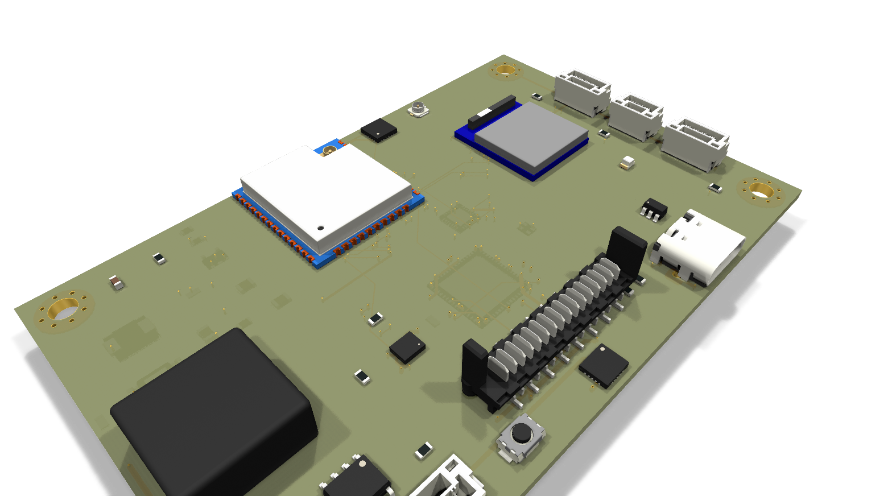
*Figure 7.1a: PCBA 01 Top 3D -- ESP32-S3 WROOM-1U Main MCU, Qualcomm QCC3084 BT 5.4 Audio SoC, LM5164-Q1 72V Buck, Semtech SX1262 LoRa, and Automotive Deutsch DTM-12 Header.*

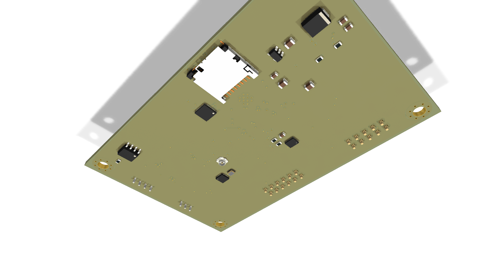
*Figure 7.1b: PCBA 01 Bottom 3D -- Hirose DM3D MicroSD Push-Pull Slot, Qorvo DW3110 UWB Transceiver, Everest Semi ES8388 Codec, Bosch BMI270 6-Axis IMU, and TCAN334G CAN-FD Transceiver.*

### 3.1 Board Specifications & Stackup
* **Dimensions:** $85{,}0 \times 55{,}0\,\text{mm}$ (Outer contour with 4x M2.5 mounting holes, $77{,}0 \times 47{,}0\,\text{mm}$ grid spacing).
* **Layer Stackup:** 4 Layers FR-4 High-TG150 ($1{,}6\,\text{mm}$ thickness, $35\,\mu\text{m}$ Cu on all 4 layers).
  * Layer 1 (Top): Components, RF traces, Semtech SX1262 LoRa 868 MHz transceiver (with U.FL to FXP895 in housing lid), and differential audio pairs.
  * Layer 2 (Inner 1): Continuous, unbroken ground plane (Solid GND).
  * Layer 3 (Inner 2): Split Power planes ($+3{,}3\,\text{V}$, $+5{,}0\,\text{V}$, `VBUS`, `VBAT_LIPO`) and quiet audio ground.
  * Layer 4 (Bottom): Qorvo DW3110 UWB Transceiver (6.489 GHz Ch. 5) with U.FL output into bottom housing floor pocket (Taoglas FXUWB10), secondary signal routing, shield copper, and thermal stitch vias.
* **Surface Finish:** ENIG (Electroless Nickel Immersion Gold, $0{,}05\dots 0{,}1\,\mu\text{m}$ Au over $3\dots 5\,\mu\text{m}$ Ni).
* **Galvanic Isolation Barrier:** $4{,}0\,\text{mm}$ clearance and creepage distance beneath Bourns transformers `T1` and `T2`.

### 3.2 Pinout of Automotive Deutsch DTM-12 Connector (`J1`)

```
+---------------------------------------------------------------------------------------------------------------+
| DEUTSCH DTM-12 PINOUT (CENTRAL BOX POWER, CAN & DC PIGTAILS 1 TO 4)                                           |
+-----+----------------+--------------------------+-------------+---------------------+-------------------------+
| Pin | Signal Name    | Signal Type / Level      | Wire Gauge  | Harness Branch      | Function & Protection   |
+-----+----------------+--------------------------+-------------+---------------------+-------------------------+
|  1  | KL30_IN        | +9V...+72V DC Constant+  | AWG20 0.50² | Branch 4 (Vehicle)  | Constant 12V Main Feed  |
|  2  | KL15_IGN       | +9V...+72V DC Ignition+  | AWG22 0.34² | Branch 4 (Vehicle)  | Ignition Sense (KL15)   |
|  3  | VEHICLE_GND    | Power Ground (0V)        | AWG20 0.50² | Branch 4 (Vehicle)  | Central Vehicle Ground  |
|  4  | CAN_H          | CAN-FD High (ISO 11898-2)| AWG24 0.22² | Branch 4 (Vehicle)  | Vehicle CAN-FD Bus High |
|  5  | CAN_L          | CAN-FD Low (ISO 11898-2) | AWG24 0.22² | Branch 4 (Vehicle)  | Vehicle CAN-FD Bus Low  |
|  6  | POD1_VCC       | +12V switched (0.5A)     | AWG22 0.34² | Branch 1 (Pod 1)    | DC Power Bay 1 (eFuse)  |
|  7  | POD1_GND       | Power Ground (0V)        | AWG22 0.34² | Branch 1 (Pod 1)    | Ground Bay 1 (Left)     |
|  8  | POD2_VCC       | +12V switched (0.5A)     | AWG22 0.34² | Branch 2 (Pod 2)    | DC Power Bay 2 (eFuse)  |
|  9  | POD2_GND       | Power Ground (0V)        | AWG22 0.34² | Branch 2 (Pod 2)    | Ground Bay 2 (Right)    |
| 10  | RADAR_PWR_12V  | +12V switched (1.0A)     | AWG22 0.34² | Branch 3 (Radar)    | DC Power Rear Radar     |
| 11  | RADAR_GND      | Power Ground (0V)        | AWG22 0.34² | Branch 3 (Radar)    | Ground Rear Radar       |
| 12  | CHASSIS_EARTH  | Shield Ground            | AWG20 0.50² | Branch 4 (Vehicle)  | Chassis & Shield Return |
+-----+----------------+--------------------------+-------------+---------------------+-------------------------+
```

### 3.3 Pinout & System Interconnect: Qualcomm QCC3084 BT 5.4 Audio SoC (`U9`)

Mounted on the top layer (`F.Cu` at $X=175.0, Y=106.0\,\text{mm}$), the **Qualcomm QCC3084** ($13 \times 18\,\text{mm}$ module with integrated ceramic chip antenna) connects rider and pillion helmets wirelessly via hardware-accelerated Dual-A2DP (aptX HD / Adaptive) and HFP 1.8:

```
+----------------------------------------------------------------------------------------+
| QUALCOMM QCC3084 PINOUT & INTERCONNECTION TO ESP32-S3 / ES8388                         |
+-----+----------------+--------------------+-------------------+------------------------+
| Pin | Signal Name    | Signal Type        | Connected to      | Function & Protocol    |
+-----+----------------+--------------------+-------------------+------------------------+
|  1  | VCC_3V3        | Power In (+3.3V)   | LM5164 3.3V Rail  | Module Operating Power |
|  2  | GND            | Ground (0V)        | GND_PWR Plane     | RF and System Ground   |
|  3  | I2S_MCLK       | Digital In (Clock) | ESP32-S3 (GPIO 9) | Master Clock (12.288M) |
|  4  | I2S_BCLK       | Digital In (BitClk)| ESP32-S3 (GPIO 10)| Bit Clock (3.072 MHz)  |
|  5  | I2S_WS         | Digital In (LRCK)  | ESP32-S3 (GPIO 11)| Word Select (48 kHz)   |
|  6  | I2S_DOUT       | Digital In (Audio) | ESP32-S3 (GPIO 12)| Stereo PCM to QCC3084  |
|  7  | I2S_DIN        | Digital Out (Mic)  | ESP32-S3 (GPIO 13)| HFP Microphone to DSP  |
|  8  | GND            | Ground (0V)        | GND_PWR Plane     | RF Shield Ground       |
|  9  | BT_UART_TX     | Digital Out (UART) | ESP32-S3 (GPIO 18)| QCC3084 Telemetry / AT |
| 10  | BT_UART_RX     | Digital In (UART)  | ESP32-S3 (GPIO 17)| ESP32 AT Commands      |
| 11  | BT_EN          | Digital In (Reset) | ESP32-S3 (GPIO 16)| Power-Down & Reset     |
| 12  | GND            | Ground (0V)        | GND_PWR Plane     | RF Shield Ground       |
+-----+----------------+--------------------+-------------------+------------------------+
```

### 3.4 Internal Connectors & Service Interfaces

| Connector | Type / Package | Pins | Function & Signal Assignment |
| :--- | :--- | :---: | :--- |
| **`J2`** | MicroSD Push-Push | 9-Pin | 4-Bit SDIO High-Speed Bus (`CLK`, `CMD`, `DAT0`-`DAT3`, `CD`, `3V3`, `GND`) for forensic telemetry blackbox. |
| **`J3`** | IDC Shrouded Header ($2{,}54\,\text{mm}$) | 10-Pin | Service, flashing, and debug interface: Pin 1: `3V3`, Pin 2: `TXD0`, Pin 3: `RXD0`, Pin 4: `GND`, Pin 5: `USB_D-`, Pin 6: `USB_D+`, Pin 7: `EN`, Pin 8: `IO0`, Pin 9: `CAN_H`, Pin 10: `CAN_L`. |
| **`J_BAT`**| Molex Micro-Fit 3.0 | 2-Pin | UPS LiPo Backup Cell: Pin 1: `VBAT_LIPO` ($+3{,}7\dots 4{,}2\,\text{V}$), Pin 2: `GND` (monitored by BQ24075 TS NTC). |
| **`J_AUD`**| JST-XH ($2{,}50\,\text{mm}$) | 4-Pin | Optional internal audio test port: `LINE_L+`, `LINE_L-`, `LINE_R+`, `LINE_R-`. |

---

## 4. Satellite Pod Enclosure & Retirement of PCBA 02 (Monolithic Enclosure)

The former pod base board (`PCBA 02`) has been **completely retired without replacement in v9.6**:
1. **Monolithic Enclosure Body:** The pod housing (`pod_base_housing.stl`) is a 100% passive, injection-molded / MJF PA12 precision component.
2. **Direct 2-Wire DC Blade Contact:** The 2-wire DC harness from the Deutsch DTM-12 connector enters through the housing rear wall via a tool-free locking IP67 2-pin blade direct plug (`CON_POD_DC`) with axial NBR70 O-ring and stainless steel U-retaining clip (100% solder-free) and mates positively into the factory SMT-assembled dual-beam slot socket `J_DC_IN` on `PCBA 03`.
3. **Zero Failure Surface:** No switches, no active semiconductors, and no vulnerable sockets exposed to rear-wheel water spray.

---

## 5. PCBA 03: Universal Smart Cartridge (`openmotorbridge_pod_cartridge` Rev 3.0)


*Figure 7.3a: PCBA 03 Top 3D -- ESP32-C6 Host MCU, 4x AO3400A MOSFETs, and J_ACT Mechatronics Header.*

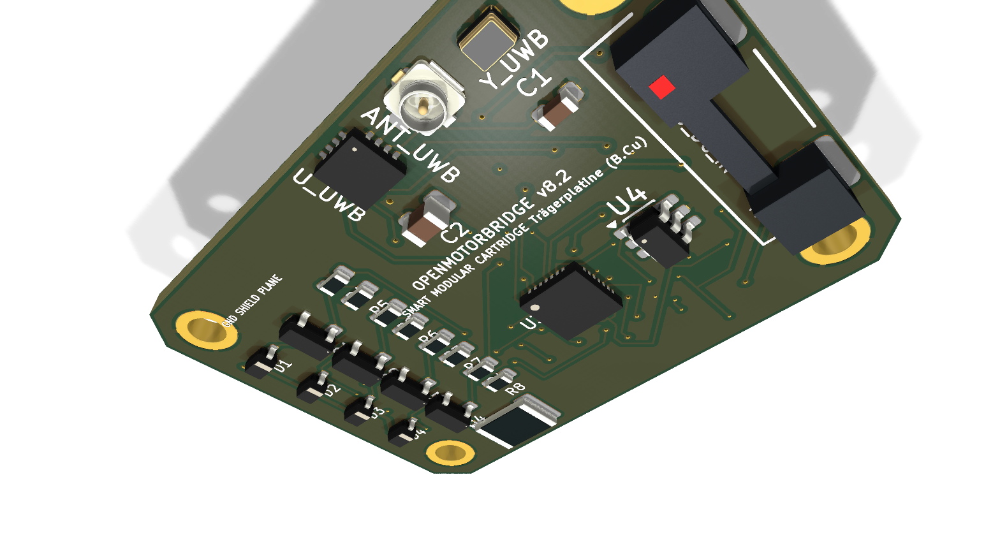
*Figure 7.3b: PCBA 03 Bottom 3D -- Qorvo DW3110 UWB Transceiver, Everest Semi ES8388 Stereo Codec, and J_AUDIO_PWR Header.*

### 5.1 Board Specifications & Layer Partitioning
* **Dimensions:** $35.0 \times 25.0\,\text{mm}$ (grid $29.0 \times 19.0\,\text{mm}$ with 4x M2 mounting holes H1..H4).
* **Layer Stackup:** 4 Layers FR-4 High-TG150 (JLC04161H, $1.2\,\text{mm}$ thickness, continuous GND plane L2 and Power plane L3, ENIG gold finish).
* **Top-Layer Components (F.Cu - Mechatronics, Host MCU & Control):**
  * `U1`: Espressif `ESP32-C6-MINI-1U` RISC-V Host MCU (manages cartridge profiles, UWB backbone, I2S codec control, USB audio, and actuator timings).
  * `Q1` - `Q4`: 4x N-Channel MOSFETs (`AO3400A`, SOT-23, $30\,\text{V} / 5.7\,\text{A}$) with flyback diodes `D1`-`D4` (`1N4148WS`, SOD-323). Positioned directly adjacent to header `J_ACT` for shortest trace runs to pushbutton actuators.
  * `R1` - `R4`: $100\,\Omega$ gate series resistors (0603).
  * `R5` - `R8`: $100\,\text{k}\Omega$ gate pulldowns (0603) for defined idle state.
  * `R9`: $10\,\text{k}\Omega$ pull-up resistor (0603) to `VCC_3V3` for the cartridge detection signal `OMM_DETECT`.
  * `J_ACT`: 8-Pin $1.0\,\text{mm}$ JST-SH Header (`BM08B-SRSS-TB` with vertical top-entry connection and SMD shield tabs `MP` to GND) driving the 4 miniature solenoids.
  * `J_AUDIO_PWR`: 8-Pin $1.0\,\text{mm}$ JST-SH Header (identical footprint to `J_ACT`, `BM08B-SRSS-TB` with vertical top-entry connection, shield tabs `MP` to GND) providing star-point Kelvin audio and power interfacing to the OEM headset or native OMM module.
  * `J_PROG`: 4-Pin $1.27\,\text{mm}$ SMD pin header (`PinHeader_1x04_P1.27mm_Vertical_SMD_Pin1Left`) for flashing and firmware recovery (`VCC_3V3`, `USB_DP`, `GND`, `PTT_USB_N`).
* **Bottom-Layer Components (B.Cu - RF, Audio Codec, Hardware Switching & Power Ingestion):**
  * `U_UWB`: Qorvo `DW3110` Ultra-Wideband Transceiver (6.489 GHz Ch. 5, QFN-16-1EP) with external Hirose U.FL receptacle `ANT_UWB` (`Taoglas FXUWB10`) and high-precision $38.4\,\text{MHz}$ crystal `Y_UWB`. Radiates downward through the dielectric plastic sled floor for optimum wireless connection to Central Box.
  * `U3`: Everest Semi `ES8388` 24-Bit / 48 kHz Low-Noise Audio Codec (QFN-28-1EP). Deliberately located on the **bottom layer (`B.Cu`)**: Hermetically shielded by the internal copper ground plane from the steep switching transients of the top-layer MOSFETs (`Q1`–`Q4`) and actuator solenoid coils. Converts analog mic and speaker audio directly on the cartridge, streaming it jitter-free over I2S/UWB.
  * `U4`: Texas Instruments `TS5A3159DBVR` Single-Pole Double-Throw (SPDT) Analog/Digital Audio Switch ($0.5\,\Omega$ on-resistance, SOT-23-6). Enables automatic, hardware-controlled switching between analog headset audio and digital OMM USB audio.
  * `J_DC_IN`: End-face, factory SMT-assembled 2-pin automotive dual-beam blade slot socket (10.0mm pitch, 5A, IP2X finger-safe, horizontal mounting on B.Cu) for positive engagement with the blade contacts of the IP67 direct plug (`CON_POD_DC`) of the pod bay (`Pin 1: +5V_IN`, `Pin 2: GND`). Completely immune to micro-bouncing and vibration wear.
  * `F1`: Resettable 500mA PPTC fuse (Bourns `MF-MSMF050-2`, 1812 SMD) ahead of `VCC_5V_PROT`.
  * `C1`, `C2`: Ceramic decoupling capacitors ($100\,\text{nF}$ 0603 / $10\,\mu\text{F}$ 0805) on `VCC_3V3`.
  * `H1` - `H4`: 4x M2 mounting holes with plated pads (`MountingHole_2.2mm_M2_Pad`) to system ground (`GND`).

### 5.2 Pinout of Internal Audio-Power Header (`J_AUDIO_PWR` / 8-Pin JST-SH 1.0mm) & Dual-Mode Switching

To seamlessly interface **analog OEM headsets (Sena, Cardo, Midland)** with pristine Kelvin grounds and **native digital OMM modules (PCBA 09 / PCBA 10)** losslessly over the identical connector, `J_AUDIO_PWR` is engineered as a **Dual-Mode Interface** with automatic hardware switching via `U4` (`TS5A3159DBVR`) and pull-up resistor `R9` ($10\,\text{k}\Omega$ to `VCC_3V3`):

| Pin | Signal Name | Direction | Function: Analog Intercom (Sena / Cardo / Midland) | Function: Digital OMM (PCBA 09 / PCBA 10) |
| :---: | :--- | :---: | :--- | :--- |
| **1** | **`PGND` / `GND`** | Power Return | **High-Current Power Ground:** Carries charging & DC-DC return ($0.2\dots 0.6\,\text{A}$) | **High-Current Power Ground:** Power return for charger & RF PA ($0.2\dots 0.6\,\text{A}$) |
| **2** | **`VCC_5V_PROT`** | Power Out | Regulated, protected +5V supply for headset battery/charger | Regulated, protected +5V supply for OMM BQ24075 PMIC |
| **3** | **`AGND_AUDIO_IN`**| Audio GND Ref| **Clean Headphone Ground:** 3.5 mm TRS sleeve – **strictly zero DC current ($I = 0\,\text{mA}$)!** | Unused (N/C) or coax shield reference (zero DC current!) |
| **4** | **`AUDIO_IN_L`** | Audio In $\leftarrow$ | Left speaker line-out from headset $\rightarrow$ to ES8388 ADC | Unused (N/C) |
| **5** | **`AUDIO_IN_R`** | Audio In $\leftarrow$ | Right speaker line-out from headset $\rightarrow$ to ES8388 ADC | Unused (N/C) |
| **6** | **`OMM_DETECT`** | Control In $\leftarrow$ | **GND Bridge in Harness (0V):** Holds `U4` in normal closed state (NC) | **Open / N/C:** `R9` pulls HIGH ($3.3\,\text{V}$) $\rightarrow$ switches `U4` to Digital USB (NO) |
| **7** | **`AUDIO_IO_P`** | Dual-Mode I/O | **Analog `VOICE_OUT` (via U4 NC):** Voice from ES8388 DAC $\rightarrow$ OEM Mic | **Digital `USB_DP` (via U4 NO):** Native digital USB audio data stream D+ |
| **8** | **`PTT_USB_N`** | Dual-Mode I/O | **PTT_IO:** Push-to-Talk keying to ground (Midland PMR446 / N/C) | **Digital `USB_DN`:** Native digital USB audio data stream D- |
| **MP** | **`GND`** | Shield | SMT connector side mounting tabs tied to solid GND plane | SMT connector side mounting tabs tied to solid GND plane |

> [!IMPORTANT]
> **Operation of Automatic Audio Switching via `U4` (`TS5A3159DBVR`):**
> 1. **Cartridge with Analog Intercom (Sena SPIDER X Slim / Cardo Packtalk Edge / Midland):**  
>    The adapter cable harness bridges Pin 6 (`OMM_DETECT`) internally to ground (GND Pin 1 or Pin 3). Switch `U4` remains in its normally-closed position (**NC**): Pin 7 (`AUDIO_IO_P`) connects directly to analog output `VOICE_OUT` of the ES8388 audio codec. Voice transmission proceeds zero-latency ($< 0.4\,\text{ms}$) into the headset mic input.
> 2. **Cartridge with Native OMM Module (`PCBA 09` Mesh / `PCBA 10` 446 PMR/DMR):**  
>    The 4-wire USB-C cable (VBUS, GND, D+, D-) leaves Pin 6 (`OMM_DETECT`) floating (**N/C**). Pull-up resistor `R9` on `PCBA 03` automatically pulls input IN of `U4` to HIGH ($3.3\,\text{V}$). SPDT switch `U4` engages in $< 35\,\text{ns}$ to normally-open (**NO**): Pin 7 is disconnected from analog audio and routed directly to native `USB_DP` of the ESP32-C6 host MCU. Together with Pin 8 (`PTT_USB_N` as `USB_DN`), a pristine digital USB 2.0 audio channel is formed directly between the intercom engine and OMB gateway. Mechatronic plungers, DAC/ADC degradation, and ground buzz loops are eliminated 100%!

### 5.3 Pinout of Mechatronic 8-Pin Actuator Header (`J_ACT` / $1.0\,\text{mm}$ JST-SH)
To control devices with different button layouts (Sena SPIDER X Slim vs. Cardo Packtalk Edge) flexibly, **4 discrete, independently positionable miniature actuators** are employed:

| Pin (J_ACT) | Signal Name | Driving Switch | Mapping: Sena SPIDER X Slim | Mapping: Cardo Packtalk Edge |
| :---: | :--- | :---: | :--- | :--- |
| **Pin 1 & 2** | `VCC_5V` | Continuous 5V | Common $+5\,\text{V}$ power rail for all 4 actuators | Common $+5\,\text{V}$ power rail |
| **Pin 3** | `ACT1_OUT` | MOSFET `Q1` | **Plus (+)** (Volume Up / Menu forward) | **Media Button** (Front/Top) |
| **Pin 4** | `ACT2_OUT` | MOSFET `Q2` | **Minus (-)** (Volume Down / Menu back) | **Mobile Button** (Phone/Pairing) |
| **Pin 5** | `ACT3_OUT` | MOSFET `Q3` | **Center / Phone** (Confirm / Select)  | **Intercom Button** (DMC Grouping) |
| **Pin 6** | `ACT4_OUT` | MOSFET `Q4` | **Mesh Button** (45° angled side)      | **Control Wheel Center-Press** |
| **Pin 7 & 8** | `GND` | Power Ground | Shield and return ground | Shield and return ground |

### 5.4 Autonomous Smart Cartridge Click Sequences & Opcode Table
| Opcode | Semantic Function | Sequence: Sena SPIDER X Slim | Sequence: Cardo Packtalk Edge |
| :---: | :--- | :--- | :--- |
| **`0x01`** | **Power Boot / Auto-On** | Simultaneous Plus + Center ($1000\,\text{ms}$) | Simultaneous Media + Mobile ($2000\,\text{ms}$) |
| **`0x02`** | **Power Off** | Simultaneous Plus + Center ($200\,\text{ms}$) | Simultaneous Media + Mobile ($2000\,\text{ms}$) |
| **`0x03`** | **Mute / Primary Action**| Single click Plus ($100\,\text{ms}$) | Wheel Center-Press $2000\,\text{ms}$ (DMC Group Mute) |
| **`0x04`** | **Stop / Secondary Action**| Single click Minus ($100\,\text{ms}$) | Wheel Center-Press $150\,\text{ms}$ tap (Audio Stop) |
| **`0x05`** | **Mesh Audio Toggle** | Mesh button $200\,\text{ms}$ tap (Open Mesh) | Intercom button $200\,\text{ms}$ tap (DMC Intercom) |
| **`0x06`** | **Group Pairing Mode** | Mesh button $3000\,\text{ms}$ hold pulse | Intercom button $5000\,\text{ms}$ hold pulse (Grouping) |
| **`0x07`** | **Channel / Macro 1** | Autonomous: 2x Mesh ($150\,\text{ms}$) + Pause + 1x Plus | Autonomous: 2x Intercom ($150\,\text{ms}$) (Private Chat) |
| **`0x08`** | **Channel / Macro 2** | Autonomous: 2x Mesh ($150\,\text{ms}$) + Pause + 1x Minus | Autonomous: 3x Intercom ($150\,\text{ms}$) (DMC Bridge) |
| **`0x09`** | **Phone / BLE Pairing** | Center button $5000\,\text{ms}$ hold pulse | Mobile button $5000\,\text{ms}$ hold pulse |


---

## 6. PCBA 04: Rear Pod 3 Transceiver (Retired in v8.0 / Ersatzlos entfallen)

> [!IMPORTANT]
> **Architectural Streamlining v8.0: Elimination of PCBA 04 & Pod 3**  
> In OpenMotorBridge v8.0, Rear Pod 3 and its dedicated board `PCBA 04` have been **retired without replacement**:
> 1. **No 3rd Satellite Enclosure at the Tail:** No cable pinching under pillion seats, no collision with Showa piggyback suspension reservoirs, no fender console brackets.
> 2. **Redistribution of RF Subsystems:**
>    * **LoRa 868 MHz (Semtech SX1262):** Sits directly on Central Box `PCBA 01` (powered via the UPS battery rail for 24/7 theft sentry) with a Taoglas FXP895 flex antenna in the enclosure lid.
>    * **Multi-GNSS (u-blox SAM-M10Q):** Sits with an integrated $15 \times 15\,\text{mm}$ patch antenna inside the Front Node `PCBA 05` laminar oncoming airflow scoop (port `J12` Qwiic).
>    * **Ambient Temperature Reliability:** TI TMP117 ($\pm 0.1\,^\circ\text{C}$ NIST-traceable precision) sits directly on Front Node `J12` in the airflow duct - thermally isolated from engine and exhaust radiant heat.
> 3. **System BOM Impact:** Total project PCB count drops to **7 active PCBAs**. The satellite base carrier `PCBA 02` is also completely retired without replacement in favor of a monolithic monocoque pod with direct 2-wire spring contacts.

---

## 7. PCBA 05: Universal Front Node (`openmotorbridge_front_node`)

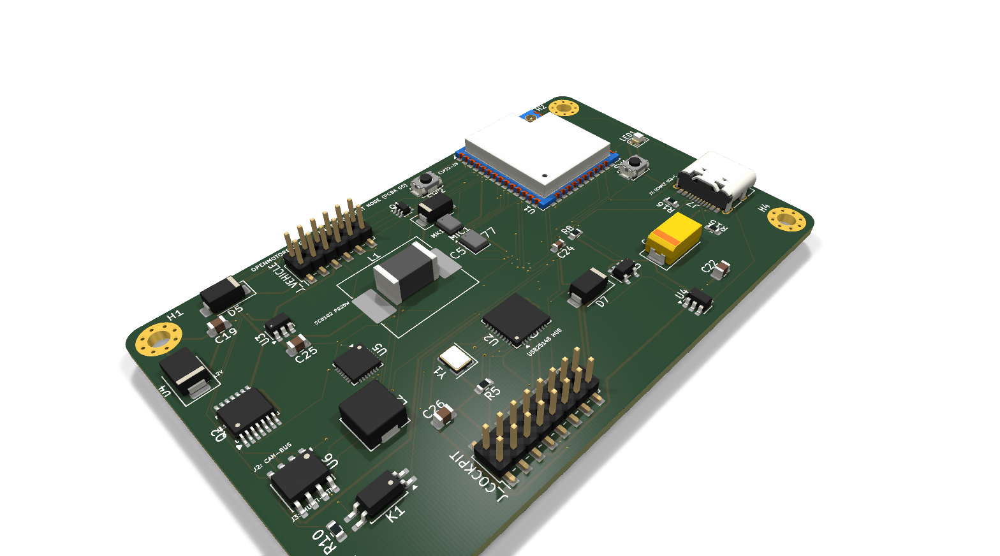
*Figure 7.5a: PCBA 05 Top 3D -- ESP32-S3-WROOM-1U, u-blox SAM-M10Q GNSS, Microchip USB2514B Hub, and Southchip SC8102 USB-PD 20W Fast-Charge.*

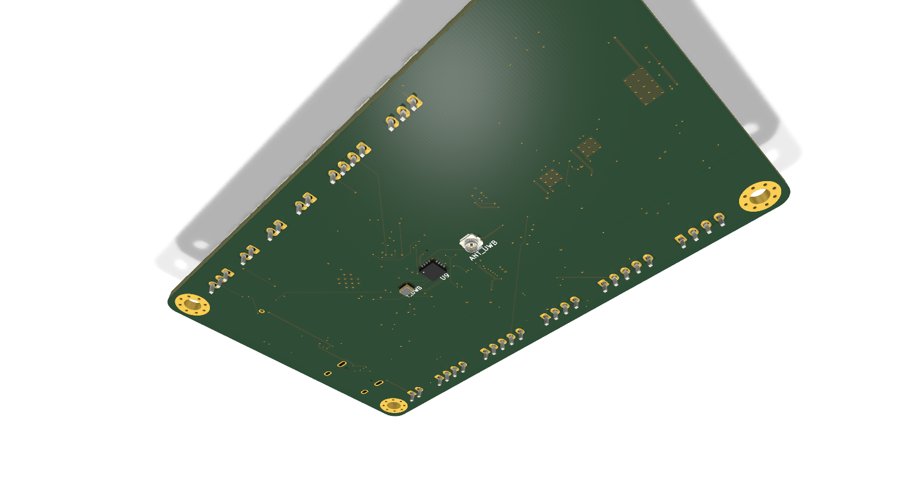
*Figure 7.5b: PCBA 05 Bottom 3D -- Qorvo DW3110 UWB Transceiver and U.FL RF Coaxial Receptacle.*

### 7.1 Board Specifications & Features
* **Dimensions:** $82{,}0 \times 50{,}0\,\text{mm}$ (Enclosed in a sealed IP68 monocoque housing $98 \times 68 \times 25\,\text{mm}$ with 4-in-1 mounting).
* **Layer Stackup:** 4 Layers FR-4 High-TG150 ($1{,}6\,\text{mm}$, ENIG gold finish).
  * Layer 1 (Top): ESP32-S3 controller, Microchip USB2514B hub (configured for 2 downstream ports: Smartphone Fast-Charge PD 20W & CP2AA Dongle), Knowles MEMS microphone, WS2812B RGB LED, $90\,\Omega$ USB differential pairs.
  * Layer 2 (Inner 1): Continuous low-impedance ground plane (Solid GND).
  * Layer 3 (Inner 2): Split Power planes ($+5{,}0\,\text{V}_{\text{MAIN}}$, $+5{,}0\,\text{V}_{\text{DONGLE}}$, $+9\dots 12\,\text{V}_{\text{PD}}$, $+12\,\text{V}_{\text{SW}}$, $+3{,}3\,\text{V}$).
  * Layer 4 (Bottom): Qorvo DW3110 UWB Transceiver (6.489 GHz Ch. 5) with U.FL output into bottom housing floor pocket (Taoglas FXUWB10), TI LMR36015 buck, single Southchip SC8102 (or SW3526) USB-PD 20W controller (`U5` for phone charging at handlebar or in glovebox), TI TPS2051B load switch, CPC1017N relay, DMN63D8 dual-MOSFET, TVS diodes, and filters.
  *(Consolidation Note: The former second 20W charger `U8` and inductor `L3` for glovebox MP3 have been eliminated without replacement. For custom multi-device glovebox setups, a standard COTS mini USB hub with PD passthrough is used instead).*
* **RF Backbone Concept (UWB instead of 2.4 GHz):** Qorvo DW3110 UWB Transceiver on bottom layer; ultrashort 20 mm U.FL micro-coax leads directly into $11 \times 11 \times 0.6\,\text{mm}$ antenna pocket in enclosure tub floor with Taoglas FXUWB10 flex antenna. Deterministic latency $< 0.4\,\text{ms}$ to Central Box, 100% continuous duty cycle legal per ETSI EN 302 065-3, zero 2.4 GHz interference in cockpit.

### 7.2 The 2-Harness Architecture & Master Connectors (`J_COCKPIT`, `J_VEHICLE`, `J12`)

Instead of routing 12 individual connectors along the PCB edges, the Universal Front Node employs a highly integrated **2-Harness Architecture with Modular Satellite Breakout Blocks ("Lego Principle")**.

The board features **two master latching connectors** (2.0 mm pitch, dual-row) for the outgoing round cable bundles, plus the external sensor bus:

```
                       [ PCBA 05 FRONT NODE PCB ]
     ┌─────────────────────────────────────────────────────────────┐
     │                                                             │
     │   [ J_COCKPIT ]                             [ J_VEHICLE ]   │
     │   (14-Pin Dual-Row 2.0 mm)                  (8-Pin 2.0 mm)  │
     │                                                             │
     │   • USB Upstream Host (Boom! Box)           • 12V In & GND  │
     │   • CP2AA Wireless Dongle                   • CAN Bus       │
     │   • Smartphone USB-PD 20W                   • Mirror LEDs   │
     │   • PTT Handlebar Button & Cam              • Aux Light     │
     │                                                             │
     │   [ J7 ] USB-C Service Port (Flank)                         │
     │   [ J12 ] JST-SH 4-Pin Qwiic Sensor Bus (SAM-M10Q GNSS)     │
     │   [ ANT_UWB ] U.FL 6.5 GHz Transceiver Port                 │
     └─────────────────────────────────────────────────────────────┘
```

#### 7.2.1 Cockpit & USB Header (`J_COCKPIT` / 16-Pin Dual-Row 2.0 mm)

Combines all cockpit, multimedia, and handlebar signals into a single shielded jacket cable ($\varnothing 6.0\,\text{mm}$) routed to the **Cockpit Satellite Breakout Block**:

| Pin | Signal Name | Level / Direction | Function & Connected Peripherals |
| :---: | :--- | :--- | :--- |
| **1** | `USB_UP_VBUS` | +5V VBUS In | USB Upstream Host: Connects to OEM motorcycle infotainment (Harley Boom! Box / Skyline OS) |
| **2** | `USB_UP_DM` | USB 2.0 D- | D- data line to host infotainment |
| **3** | `USB_UP_DP` | USB 2.0 D+ | D+ data line to host infotainment |
| **4** | `GND` | Ground (0V) | Signal ground reference for upstream host |
| **5** | `VCC_5V_OTTOCAST` | +5V switched (1.5A) | CP2AA Wireless Dongle: Switched power with cold-restart via TPS2051B (isolated from Cam/Navi) |
| **6** | `USB_DN2_DM` | USB 2.0 D- | D- data line to CP2AA Wireless CarPlay / Android Auto Dongle |
| **7** | `USB_DN2_DP` | USB 2.0 D+ | D+ data line to CP2AA Wireless CarPlay / Android Auto Dongle |
| **8** | `GND` | Ground (0V) | Signal ground for CP2AA Dongle |
| **9** | `VBUS_PD_OUT` | +5V / +9V / +12V Out | Smartphone Fast-Charge PD 20W: Power output via SC8102 / SW3526 controller `U5` |
| **10**| `USB_DN1_DM` | USB 2.0 D- | D- data line for Smartphone Fast-Charge port |
| **11**| `USB_DN1_DP` | USB 2.0 D+ | D+ data line for Smartphone Fast-Charge port |
| **12**| `USB_DN1_CC` | Configuration Channel | USB-C CC line for PD 3.0 / QC4+ negotiation |
| **13**| `PGND` | Power Ground | High-current power return for 20W USB-PD charging circuit |
| **14**| `PTT_IN1_N` | Digital In (Pull-Up) | Handlebar button: PTT intercom group voice / assistant (Active-Low) |
| **15**| `VCC_5V_AUX` | +5V protected (up to 2.0A)| Power-Only supply for Action Cam & 5V Navi via TPS54302 3A buck & PPTC |
| **16**| `GND` | Power Ground | Ground return for Action Cam & 5V Navi |

#### 7.2.2 Vehicle & Chassis Header (`J_VEHICLE` / 12-Pin Dual-Row 2.0 mm)

Combines all vehicle power, CAN bus, sensor, and auxiliary switching lines into a second sealed jacket cable ($\varnothing 6.0\,\text{mm}$) routed to the **Vehicle Satellite Breakout Block**:

| Pin | Signal Name | Level / Direction | Function & Connected Vehicle Peripherals |
| :---: | :--- | :--- | :--- |
| **1** | `KL15_12V_SW` | +9V...+16V In | 12V Switched Power In: Ignition+ (Parking light / BMW Cartool / Harley Neck) |
| **2** | `GND` | Power Ground | Central system ground of the Front Node |
| **3** | `CAN_H` | CAN-FD High | Vehicle CAN Bus: Direct tap in cockpit / DLC with TCAN334G & CPC1017N SSR |
| **4** | `CAN_L` | CAN-FD Low | Vehicle CAN Bus: Differential data line Low |
| **5** | `+12V_PROT` | +12V Common Anode | Protected common anode supply for blind-spot mirror warning LEDs (BSD) |
| **6** | `BSD_LEFT_N` | Cathode Left (Low-Side) | Switched ground for left blind-spot mirror warning LED (Dual-MOSFET `Q1`) |
| **7** | `BSD_RIGHT_N`| Cathode Right (Low-Side)| Switched ground for right blind-spot mirror warning LED (Dual-MOSFET `Q1`) |
| **8** | `+12V_AUX` | +12V switched (2.0A) | Auxiliary driving light / strobe or 12V active Navi cradle (Garmin Zūmo XT2 / BMW Cradle) via TI TPS1H100 `Q2` |
| **9** | `+3V3_SENS` | +3.3V protected Out | Supply for external GNSS & climate sensor puck (u-blox SAM-M10Q, TMP117, OPT3001) |
| **10**| `GND` | Sensor Ground | Ground return for I2C sensor bus |
| **11**| `I2C_SDA` | I2C Data (3.3V) | Bidirectional I2C data line with 4.7k pull-up for sensor puck on fairing beak |
| **12**| `I2C_SCL` | I2C Clock (3.3V) | I2C clock line (100 / 400 kHz) |

#### 7.2.3 Local Interfaces & Service Ports

| Header | Typ | Signal Name | Function & Features |
| :--- | :--- | :--- | :--- |
| **`J7`** | **USB-C SMD (16-Pin)** | `USB 2.0 + VBUS` | Watertight Service Port: Flush on right housing flank with TPU plug (Flashing & WebSerial) |
| **`ANT_UWB`**| **U.FL Hirose (SMD)** | `UWB_RF_CH5, GND` | 6.5 GHz UWB RF interface (50 Ohm) to Taoglas FXUWB10 flex antenna in tub floor |

---

### 7.2.4 The Modular Satellite Breakout Blocks ("Lego Principle")

The outgoing jacket cables from `J_COCKPIT` and `J_VEHICLE` terminate in two specialized, compact satellite breakout blocks:

1. **Cockpit Breakout Block (USB-C Strip with Mechanical Cable Clamp):**
   * Features 5 standardized, laser-etched / embossed **USB-C ports**:
     - `[ PHONE 20W ]`: Fast-Charge PD 20W + USB 2.0 High-Speed data for Smartphone (or glovebox with optional mini-hub).
     - `[ DONGLE ]`: 5V switched (1.5A via TPS2051B cold-restart switch) + USB 2.0 data for Ottocast/Carlinkit CP2AA.
     - `[ HOST ]`: 5V VBUS In + USB 2.0 data to OEM motorcycle infotainment (Harley Boom! Box GTS / Skyline OS) or standalone smart screens (Carpuride W502/W702, Chigee AIO-5).
     - `[ CAM 5V ]`: **Power-Only** USB-C (5V up to 2A, BC 1.2 DCP with shorted D+/D-). Prevents action cams (GoPro, Insta360) from entering PC mass-storage or webcam prompt mode.
     - `[ NAVI 5V ]`: **Power-Only** USB-C (5V up to 2A, BC 1.2 DCP) for USB-powered navigators (Garmin, TomTom, Beeline). *(Note: For 12V active cradles like Garmin Zūmo XT2 or BMW Cradle, power is tapped directly from `+12V_AUX` on the Vehicle Satellite).*
   * **PTT Terminal:** 2-pin screw/spring terminal for the handlebar PTT intercom button (`PTT_IN1_N` to `GND`).
   * **Integrated Cable Clamp:** A 3D-printed clamping bar secured by two M3 screws clamps over the rubber boots of commercial COTS USB-C plugs, providing absolute vibration immunity and rugged strain relief.
   * Users can plug in any standard COTS USB-C cable (20 cm, angled, braided, etc.) without tools.
2. **Vehicle Breakout Block (Weatherproof 5-Port Latching Terminal Box):**
   * Houses compact, keyed COTS click-latch connectors (JST-JWPF IP67 / JST-SM / Qwiic) for:
     - `[ 12V IN ]`: KL15 switched ignition power & power ground (2-pin)
     - `[ CAN BUS ]`: CAN_H, CAN_L, GND (3-pin)
     - `[ MIRROR BSD ]`: Blind-spot radar mirror LEDs (3-pin)
     - `[ AUX LIGHT ]`: Auxiliary driving light / 12V active Navi cradle (2-pin)
     - `[ GNSS / CLIMATE PUCK ]`: 4-pin I2C connector (3V3, GND, SDA, SCL) for SAM-M10Q & TMP117 sensor puck in fairing beak
   * **Service Advantage:** If a mirror, light, or sensor is damaged, the component is unplugged and replaced in 60 seconds without tools or soldering.
3. **Bike-Specific Modular Flexibility:**
   * **Adventure GS & Road King Special:** The two satellite blocks are **mounted separately** (Cockpit block at the handlebar/windshield, Vehicle block at the frame/beak). **Zero unnecessary high-current cables run across the steering head**.
   * **Touring Fairing (Road Glide):** Both satellite blocks slide together via lateral dovetail guides with a single click into a **unified combination block** secured inside the glovebox / fairing bracket.

### 7.4 Complete ESP32-S3 Controller Pin Mapping (PCBA 05 `U1`)

| Module Pad | Signal Name | Signal Type | Function & Peripheral Assignment |
| :---: | :--- | :---: | :--- |
| **Pad 1** | `GND` | Power | System Ground Reference |
| **Pad 2** | `VCC_3V3` | Power | +3.3V Main System Power (LMR36015 / TPS7A05) |
| **Pad 3** | `ESP_EN` | Digital In | Hardware Reset (10k Pull-Up, 100nF decoupling) |
| **Pad 5** | `CAN_SILENT` | Digital Out | Hardware Listen-Only Pin for TI TCAN334G CAN Transceiver |
| **Pad 6** | `MIC_I2S_WS` | Digital Out | I2S Word Select (LRCLK 48 kHz) for Knowles SPH0645LM4H Microphone (`MK1`) |
| **Pad 7** | `MIC_I2S_BCLK` | Digital Out | I2S Bit Clock (3.072 MHz) for Knowles SPH0645LM4H Microphone (`MK1`) |
| **Pad 8** | `PTT_IN1_N` | Digital In | Handlebar Switch 1: PTT Intercom / Voice (Active-Low) |
| **Pad 9** | `PTT_IN2_N` | Digital In | Handlebar Switch 2: Action-Cam Bookmark / Highlight (Active-Low) |
| **Pad 10** | `PTT_IN3_N` | Digital In | Handlebar Switch 3: Quick-Action / Nav Menu (Active-Low) |
| **Pad 12** | `MIC_I2S_DATA` | Digital In | I2S Serial Audio Data from Knowles SPH0645LM4H MEMS Microphone (`MK1`) |
| **Pad 13** | `USB_SERV_DM` | USB D- | Native USB-JTAG / CDC Service Port (`J7`) |
| **Pad 14** | `USB_SERV_DP` | USB D+ | Native USB-JTAG / CDC Service Port (`J7`) |
| **Pad 15** | `CAN_TERM_EN` | Digital Out | Control line for CPC1017N Solid-State Relay (120 Ohm CAN Termination) |
| **Pad 17** | `I2C_SDA` | Open-Drain | I2C Data Line for `J_VEHICLE` (Pins 11/12) to external sensor puck (SAM-M10Q, TMP117, OPT3001) |
| **Pad 18** | `I2C_SCL` | Open-Drain | I2C Clock Line for `J_VEHICLE` (Pins 11/12) |
| **Pad 19** | `WS2812B_DIN` | Digital Out | Data line for onboard WS2812B-2020 RGB Status LED (`D4`) |
| **Pad 20** | `BSD_LED_LEFT` | Digital Out | Gate drive for left blind-spot mirror LED MOSFET (`J9`, MOSFET `Q1`) |
| **Pad 21** | `BSD_LED_RIGHT`| Digital Out | Gate drive for right blind-spot mirror LED MOSFET (`J9`, MOSFET `Q1`) |
| **Pad 22** | `AUX_LIGHT_EN` | Digital Out | Enable control for TI TPS1H100 Smart High-Side Switch (`Q2` / `J11`) |
| **Pad 23** | `TWAI_TX` | Digital Out | CAN Bus transmit data to TCAN334G Transceiver |
| **Pad 27** | `ESP_BOOT` | Digital In | Boot mode tactile switch `SW1` (GPIO 0, Active-Low) |
| **Pad 30** | `UWB_SCK` | Digital Out | SPI Serial Clock to Qorvo DW3110 UWB Transceiver (`U9`) |
| **Pad 31** | `UWB_MOSI` | Digital Out | SPI Master-Out Slave-In to Qorvo DW3110 UWB Transceiver (`U9`) |
| **Pad 32** | `UWB_MISO` | Digital In | SPI Master-In Slave-Out from Qorvo DW3110 UWB Transceiver (`U9`) |
| **Pad 33** | `UWB_CS` | Digital Out | SPI Chip-Select (Active-Low) to Qorvo DW3110 UWB Transceiver (`U9`) |
| **Pad 34** | `UWB_IRQ` | Digital In | Interrupt-Request from Qorvo DW3110 UWB Transceiver (`U9`) |
| **Pad 35** | `UWB_RST` | Digital Out | Hardware Reset to Qorvo DW3110 UWB Transceiver (`U9`) |
| **Pad 36** | `TWAI_RX` | Digital In | CAN Bus receive data from TCAN334G Transceiver |
| **Pad 38** | `OTTOCAST_FAULT_N`| Digital In | Overcurrent & thermal fault flag from TPS2051B (Active-Low) |
| **Pad 39** | `OTTOCAST_PWR_EN` | Digital Out | VBUS enable control for CP2AA Dongle via TPS2051B Load Switch |
| **Pads 40-41**| `GND` | Power | Thermal Ground Pads (Vias to In1.Cu Solid Ground Plane) |

### 7.5 Digital I2S-MEMS Microphone `MK1` & Acoustic Porting

The wind-protected digital MEMS microphone `MK1` (Knowles `SPH0645LM4H` in LGA-5 package) is situated at $X = 172.00\,\text{mm}, Y = 82.25\,\text{mm}$ on `F.Cu`:
* **Acoustic Port:** The acoustic sound hole is located on Pad 5 and ports through a plated $\varnothing 0.8\,\text{mm}$ drill hole directly into the sheltered ram-air cold duct of the front enclosure.
* **3D Clearance Guarantee:** Shifting from the legacy `MIC1` coordinate to `MK1` ensures $> 3.5\,\text{mm}$ mechanical clearance against the buffer capacitor `C_BUF` and tactile boot button `SW1`.
* **Direct I2S Routing:** Clock and data traces (`MIC_I2S_BCLK`, `MIC_I2S_WS`, `MIC_I2S_DATA`) run entirely on Layer 1 with solid ground shielding without vias directly into the ESP32-S3.

### 7.6 Status & Diagnostic LED (WS2812B with Light Pipe)

Viewable through a flush polycarbonate light-pipe lens integrated into the top enclosure lid:
* **Green breathing (1 Hz):** Normal operation, 12V stable, CAN bus active, UWB synchronized to Central Box.
* **Blue blinking:** Bluetooth LE discovery/pairing active (Action-Cam search or PWA connection).
* **Yellow steady:** CP2AA CarPlay/Android Auto dongle currently booting on Port 2.
* **Red blinking (4 Hz):** USB overcurrent or cold restart in progress (dongle hard-reboot).

### 7.7 Device Recognition & Smart Docking Logic (Qi J10 vs Handlebar USB J5 vs Glovebox J5_MP3)

To reliably differentiate between local USB audio sticks, standalone MP3 players, and charging smartphones during rides and upon parking, the Front Node utilizes a 3-tier detection matrix:

```
+---------------------------------------------------------------------------------------------------+
|                     DEVICE RECOGNITION MATRIX (PCBA 05 FRONT NODE)                                |
+--------------------+------------------+-----------------+-----------------+-----------------------+
| Connected Device   | USB Enumeration  | Charging Draw   | BLE Rider Link  | System Response       |
+--------------------+------------------+-----------------+-----------------+-----------------------+
| **USB Stick**      | **Class 0x08**   | Minimal         | No / Irrelevant | * Mounts MP3/FLAC     |
| (Glove Box)        | (Mass Storage)   | < 100 mA (0.5W) |                 | * No false alarm!     |
+--------------------+------------------+-----------------+-----------------+-----------------------+
| **MP3 Player**     | **Class 0x08**   | Low             | No / Irrelevant | * Reads music catalog |
| (iPod / Clip)      | or MTP           | 200 - 500 mA    |                 | * Charges slowly (5V) |
+--------------------+------------------+-----------------+-----------------+-----------------------+
| **Rider Phone**    | Blocked (Data    | **USB-PD 20W**  | **YES (Active)**| * Ride mode enabled   |
| (Glovebox / J5)    | restricted)      | 9V / 1.5 - 2.2A | Phone reports   | * **"Phone left       |
|                    |                  | (> 15 Watts)    | 'charging=true' |    behind" on IGN OFF |
+--------------------+------------------+-----------------+-----------------+-----------------------+
| **Rider Phone**    | None (Pure Qi)   | **12V Qi Load** | **YES (Active)**| * Ride mode enabled   |
| (on Qi Dock J10)   |                  | 10W - 15W Qi    | Phone reports   | * **"Phone left       |
|                    |                  |                 | 'charging=true' |    behind" on IGN OFF |
+--------------------+------------------+-----------------+-----------------+-----------------------+
| **Guest Phone**    | Blocked          | USB-PD or Qi    | **NO**          | * Neutral charge mode |
| (Passenger)        |                  | Fast-charge     | (No handshake)  | * No dashboard switch |
+--------------------+------------------+-----------------+-----------------+-----------------------+
```

1. **USB Memory Stick / Jukebox in Glove Box (`J5_MP3`):**
   * Enumerates across the `USB2514B` as standard USB Mass Storage Class (`0x08`). Quiescent power draw remains negligible ($< 0{,}5\,\text{W}$).
   * The filesystem is mounted and handed off to the motorcycle headunit (Harley Skyline OS / Boom! Box) or local codec.
   * **Zero False Alarms on Departure:** Because the device is identified as permanent storage without a smartphone charging handshake, turning the ignition OFF never triggers a "Phone Left-Behind" alarm.
2. **Smartphone at Handlebar (`J5` / `J10`) or Glove Box (`J5_MP3`):**
   * The fast-charge controller registers heavy charging draw (USB-PD $9\,\text{V}$ or Qi $12\,\text{V}$) while the rider's phone simultaneously reports `battery.charging == true` over BLE $\rightarrow$ OMB confirms authorized rider docking.
   * **Single Edge-Triggered Cockpit Transition:** The WebApp switches to the Cockpit/Dashboard view **strictly once upon the rising edge** of docking. If the rider subsequently navigates to Settings, Media, or Diagnostics, that choice is strictly respected--the system never forcefully bounces the rider back.
   * **Phone Left-Behind Alert:** If the rider turns ignition OFF and walks away (BLE link drops) while Qi or USB still detects a seated device, the bike immediately gives a double horn chirp and the LoRa keyfob buzzes vigorously.

---

---

## 8. PCBA 06: MagSafe Frame Dock (Retired without Replacement)

The separate board `PCBA 06` has been **completely retired without replacement in v9.6**:
* Because the motorcycle pannier disconnect interface carries strictly 2-wire DC power, an **industrial 2-pin magnetic pogo connector (IP68 COTS)** is used instead of a custom PCB.
* Short-circuit protection and overload limiting are handled centrally on `PCBA 01` via **TI TPS25921 eFuses**.

---

## 9. PCBA 07: 2-in-1 LoRa Smart-Keyfob (`openmotorbridge_smart_keyfob`)

The PCBA 07 assembly constitutes the electronics core inside the pocket keyfob enclosure (`smart_keyfob_pager.scad`, $58 \times 34 \times 13\,\text{mm}$), overcoming the traditional weaknesses of motorcycle key fobs (exhausted CR2032 coin cells, winter sub-zero failure, and lack of two-way feedback):

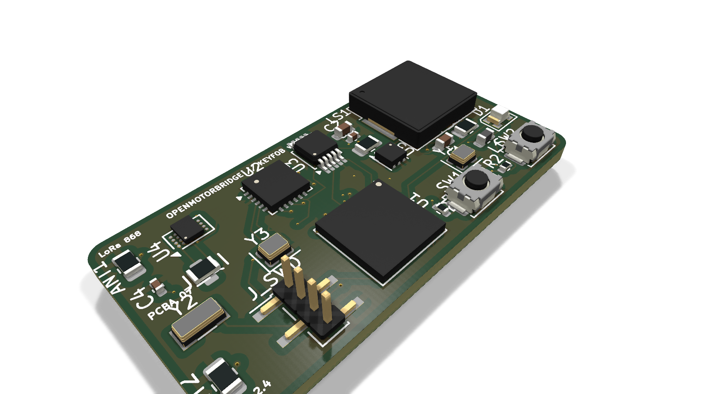

*Figure 7.7: 3D board render of the ultra-compact PCBA 07 carrier board ($38.0 \times 19.0\,\text{mm}$) hosting the Nordic nRF52840 SoC, Semtech SX1262 LoRa transceiver, TI DRV2605L haptic driver, BQ51003 Qi receiver, and BQ25100 LiPo charger.*

```
                                PCBA 07 SYSTEM ARCHITECTURE
+----------------------------------------------------------------------------------------+
|                        NORDIC nRF52840 BLUETOOTH LE 5.4 SoC                           |
| * ARM Cortex-M4F @ 64 MHz, 1 MB Flash, 256 KB RAM * Hardware AES-128 Crypto Engine    |
| * Manages BLE rider presence token, pager state, battery telemetry & smartphone bridge |
+--------------+-------------------------+-------------------------+---------------------+
               | SPI                     | I2C                     | PWM / GPIO
               v                         v                         v
+---------------------------+ +---------------------+ +----------------------------------+
| SEMTECH SX1262 LoRa       | | TI DRV2605L HAPTICS | | STATUS & ACOUSTICS               |
| * 868 MHz Emergency RX    | | * I2C Haptic Driver | | * WS2812B RGB Status LED         |
| * Up to 4.5 km range      | | * 10x3.6mm LRA Coin | | * Murata SMD Piezo Buzzer (85 dB)|
| * Receives 0xFE packets   | |   (Vybronics LRA)   | | * Diffuse lightpipe lens         |
+---------------------------+ +---------------------+ +----------------------------------+
               ^
               | DC 3.3V Power Rail
+--------------+-------------------------------------------------------------------------+
|                           POWER & INDUCTIVE CHARGING SUB-SYSTEM                        |
| * 180-200 mAh 1S LiPo pouch cell (25 x 18 x 3.8 mm) with PCM protection board          |
| * TI BQ51003 Qi Wireless Power Receiver: Charges inductively on PCBA 06 Cockpit Dock   |
| * TI BQ25100 Linear LiPo charger with quiescent current < 50 nA (Months of standby)    |
| * 2x Gold-plated pogo contact pads on bottom face for optional direct charging         |
+----------------------------------------------------------------------------------------+
```

### 9.1 Technical Board Characteristics
* **Dimensions:** $38.0 \times 19.0 \times 1.0\,\text{mm}$ (Ultra-compact 2-layer FR-4, $35\,\mu\text{m}$ Cu, ENIG gold finish, corner radius $R = 3\,\text{mm}$).
* **Magnetic Flux Shielding:** Adjacent to the PCB sits the pocket for the $20 \times 10 \times 5\,\text{mm}$ N52 neodymium key. A $0.5\,\text{mm}$ soft-iron / mu-metal shield isolates RF traces, the LRA actuator, and the LiPo cell from magnetic saturation.
* **LRA Haptic Signatures:** The TI DRV2605L generates distinct, crisp tactile patterns:
  * *Pre-Alarm (Minor Shock):* 2 short clicks ($150\,\text{Hz}$).
  * *Theft / Cartridge Tamper:* Piercing crescendo staccato (readily felt through heavy leather motorcycle jackets or on a nightstand).
* **100% Solderless Assembly (`J_QI` & `J_BAT`):**
  * The 24–28 mm Qi inductive receiver coil plugs into an ultra-low-profile **2-pin JST-ACH SMD header (`J_QI`)** (1.2 mm pitch, only 1.4 mm height).
  * The 180–200 mAh LiPo pouch battery (with integrated PCM) plugs directly into an identical **2-pin JST-ACH SMD header (`J_BAT`)** (1.2 mm pitch, 1.4 mm height).
  * No manual soldering is required during keyfob assembly, strictly adhering to the 100% solderless IKEA assembly principle.

### 9.2 Complete Interface & Pin-Mapping of Nordic nRF52840 SoC (PCBA 07 `U1`)

| SoC Pad | Signal Name | Signal Type | Function & Peripheral Assignment |
| :---: | :--- | :--- | :--- |
| **A8** | `BLE_ANT_50R` | RF 2.4G | 50 Ohm trace to Johanson 2450AT ceramic chip antenna (`ANT1`) |
| **A12 / A14** | `XTAL1` / `XTAL2` | Analog | 32.000 MHz precision RF crystal |
| **F23 / H23** | `RTC1` / `RTC2` | Analog | 32.768 kHz watch crystal (deep sleep timer & RTC) |
| **H2 / AC24** | `SWDCLK` / `SWDIO` | Digital In/Out | 4-Pin SWD programming header `J_SWD` |
| **B1** | `VCC_3V3` | Power | +3.3V System Power Rail (BQ25100 / LDO) |
| **B9, B11, EP** | `GND` | Power | System & RF Ground Reference |
| **C1** | `LORA_SCK` | Digital Out | SPI Serial Clock to Semtech SX1262 (`U2`) |
| **R1** | `LORA_NSS` | Digital Out | SPI Chip-Select (Active-Low) to SX1262 (`U2`) |
| **T2** | `LORA_MOSI` | Digital Out | SPI Master-Out Slave-In to SX1262 (`U2`) |
| **U1** | `LORA_MISO` | Digital In | SPI Master-In Slave-Out from SX1262 (`U2`) |
| **W1** | `LORA_BUSY` | Digital In | Busy status line from SX1262 (`U2`) |
| **D2** | `LORA_DIO1` | Digital In | IRQ line from SX1262 (Received 0xFE emergency packet) |
| **Y2** | `LORA_RESET` | Digital Out | Hardware Reset to SX1262 (`U2`) |
| **F2** | `BUZZER_PWM` | Digital Out | PWM drive (2.7 kHz / 4.0 kHz) for Murata SMD piezo transducer (`BZ1`) |
| **G1** | `BTN_ARM_N` | Digital In | Arm/Disarm tactile push-button `SW1` (Active-Low) |
| **J1** | `BTN_SOS_N` | Digital In | SOS/Emergency panic push-button `SW2` (Active-Low) |
| **K2** | `CHG_STAT` | Digital In | Charge status indicator from TI BQ25100 (Low = Charging, High = Done) |
| **L1** | `LED_DATA` | Digital Out | Data signal for onboard WS2812B-2020 RGB status LED (`D1`) |
| **M2** | `DRV_EN` | Digital Out | Hardware Enable for TI DRV2605L haptic driver (`U3`) |
| **N1** | `I2C_SDA` | Open-Drain | I2C Data line to TI DRV2605L haptic driver (`U3`) |
| **P2** | `I2C_SCL` | Open-Drain | I2C Clock line to TI DRV2605L haptic driver (`U3`) |

### 9.3 Bill of Materials (BOM) PCBA 07
| Ref | Component / Type | Package | Specification & Function | LCSC Part |
| :--- | :--- | :--- | :--- | :--- |
| **`U1`** | nRF52840-QIAA-R | aQFN-73 | 32-Bit ARM Cortex-M4F SoC with Bluetooth 5.4, NFC & Crypto | `C190767` |
| **`U2`** | SX1262IMLTRT | QFN-24 | Semtech 868 MHz LoRa Transceiver (+22 dBm, TCXO) | `C90039` |
| **`U3`** | DRV2605LDGSR | VSSOP-10 | TI ERM/LRA Haptic Driver with embedded effect waveform library | `C61633` |
| **`U4`** | BQ51003YFPR | DSBGA-28 | TI 2.5W Qi Wireless Power Receiver Controller | `C144862` |
| **`U5`** | BQ25100YFPR | DSBGA-6 | TI Linear LiPo Charger with 50 nA quiescent current | `C144857` |
| **`M1`** | VG1036001D | Coin 10x3.6mm | Vybronics LRA Linear Resonant Actuator (235 Hz resonance) | Custom / Distrelec |
| **`BZ1`**| PKLCS1212E4001 | SMD 12x12mm | Murata SMD Piezo Transducer (85 dB @ 10 cm, 4 kHz) | `C94511` |
| **`J_SWD`**| 1x04 1.27mm PinHeader | SMD 1.27mm Vert. | SWD programming header (3V3/SWDIO/SWDCLK/GND; populate for prototypes) | `C2883733` |
| **`SW1..2`**| Alps SKRK / EVQ-P2 | SMD 3.9x2.9mm | 2x Tactile IP67 micro push-buttons (Arm/Disarm, SOS/Aux) | `C115358` |
| **`D1`** | WS2812B-2020 | SMD 2020 | Intelligent RGB Status LED under PMMA lightpipe | `C2843785` |
| **`J_QI`**| BM02B-ACHSS-GAN-ETF | JST-ACH 2-Pin SMD (1.2mm) | 100% solderless plug connection for 24 mm Qi receiver coil (1.4 mm profile) | `C2843552` |
| **`J_BAT`**| BM02B-ACHSS-GAN-ETF | JST-ACH 2-Pin SMD (1.2mm) | 100% solderless plug connection for 180–200 mAh LiPo pouch battery with PCM | `C2843552` |

---

## 10. PCBA 08: 77 GHz mmWave Radar Sub-MCU & Visual Warning Wings (`openmotorbridge_radar_submcu`)

The **PCBA 08** assembly serves as the carrier board and intelligent pre-processing node for the **Wheeltec MR20 77-GHz mmWave radar** (integrated within `hardware/cad/scad/05_accessories/radar_mr20_housing.scad`). It offloads the Central Box via localized 20 Hz raw data parsing, operates the 5.9 GHz ITS-G5 (V2X) mesh uplink, and drives the integrated 36-LED visual warning wings with zero latency:

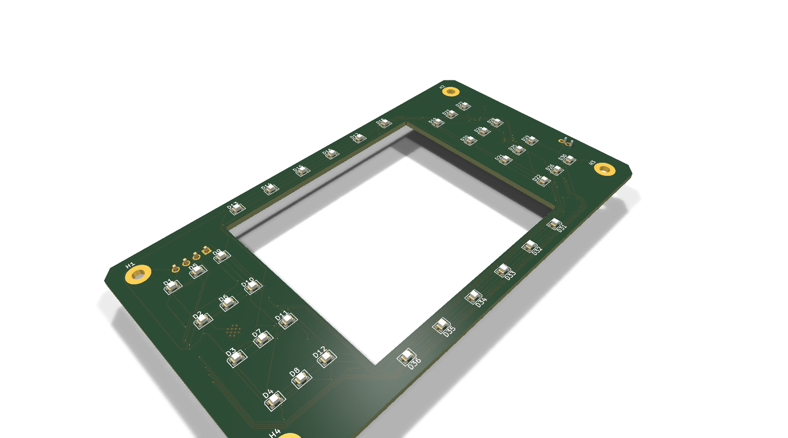

*Figure 7.8: 3D CAD view of the manufactured and routed PCBA 08 (`openmotorbridge_radar_submcu.kicad_pcb`). Depicted are the symmetrical $115 \times 65\,\text{mm}$ winged PCB body with centered $61 \times 51\,\text{mm}$ radar aperture, the 36x WS2812B-2020 LEDs arranged on the left and right warning wings, and the rear ESP32-C5 Dual-Band Sub-MCU with U.FL RF connector routed to the external 5.9 GHz V2X ceramic patch antenna.*

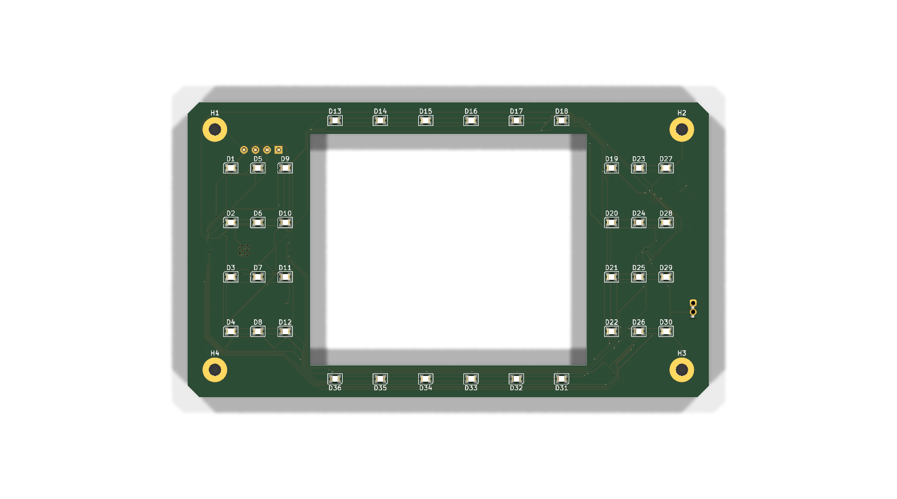

*Figure 7.8b: 2D PCB layout top view of PCBA 08 showing silkscreen and trace routing (820 tracks, 95 vias, 0 DRC violations).*

```
                                PCBA 08 SYSTEM ARCHITECTURE
+----------------------------------------------------------------------------------------+
|                   ESPRESSIF ESP32-C5 DUAL-BAND RISC-V SoC (240 MHz)                    |
| * 20 Hz UART driver for Wheeltec MR20 raw packet parsing                               |
| * 5.9 GHz ITS-G5 (V2X) mesh & 2.4/5GHz Wi-Fi 6 telemetry uplink                        |
| * Zero-latency visual warning wing drive (brake light strobe, collision alerts)        |
| * Macro command interface to Central Box (ESP32-S3) via Binder M5 4-pin                |
| * Remote bootloader flasher support (firmware push over UART directly from Central Box)|
+--------------+-------------------------+-------------------------+---------------------+
               | UART1 (MR20 Raw 115k2)  | GPIO8 (RMT / NeoPixel)  | UART0 (Central Box Macro)
               v                         v                         v
+---------------------------+ +---------------------+ +----------------------------------+
| WHEELTEC MR20 (77 GHz)    | | 36x WS2812B-2020    | | BINDER SERIES 707 M5 (4-Pin IP67)|
| * mmWave Horn Array       | | * Brake strobe      | | * Pin 1: +5.0V DC Power In       |
| * ±60° (120°) Azimuth     | | * Collision wings   | | * Pin 2: UART RX (Macro Command) |
| * Up to 90 m Range        | | * Dusk auto-dimming | | * Pin 3: UART TX (Target Array)  |
| * Fits in 61x51mm Aperture| | * 18 left /         | | * Pin 4: GND (Power & Signal)    |
|   behind optical PC window| |   18 right          | |   (Decoupled via JST-SH cable)   |
+---------------------------+ +---------------------+ +----------------------------------+
```

### 10.1 Technical Board Specifications & Geometry
* **Dimensions:** $115.0 \times 65.0 \times 1.6\,\text{mm}$ (2-layer FR-4 High-TG150, ENIG gold finish, JLC2313 stackup).
* **Central Cutout:** $61.0 \times 51.0\,\text{mm}$ rectangular pass-through with $R = 2.0\,\text{mm}$ corner radii, perfectly centered at $(X=0, Y=0)$. The Wheeltec MR20 77-GHz transceiver sinks flush into this window, emitting unimpeded through the transparent polycarbonate radome.
* **Symmetrical Warning Wings:** Flanking the radar cutout left and right are **$27.0\,\text{mm}$ wide visual warning wings** providing peripheral visibility into the rider's rear-view mirrors.
* **Mounting Pattern:** 4x M2.5 mounting holes ($\varnothing 2.7\,\text{mm}$) spaced $105.0 \times 55.0\,\text{mm}$ ($X = \pm 52.5, Y = \pm 27.5\,\text{mm}$), threading into captive DIN 934 M2.5 stainless steel nut pockets in the enclosure.
* **LED Matrix (36x WS2812B-2020 Addressable LEDs):**
  * **Left Warning Wing:** 18 LEDs (`D1` through `D18`) in 3 vertical columns of 6 LEDs each.
  * **Right Warning Wing:** 18 LEDs (`D19` through `D36`) in 3 vertical columns of 6 LEDs each.
* **RF Architecture (Strictly 2x U.FL, Zero 2.4 GHz at the Rear):**
  * **`U3` Qorvo DW3110 UWB Transceiver:** U.FL connector `J4` to Taoglas FXUWB10 flex antenna (6.5 GHz Ch. 5/9). All radar target clusters stream wirelessly via UWB to Central Box (**zero copper data lines to the bike**).
  * **`U1` Espressif ESP32-C5 Dual-Band SoC:** 5.9 GHz V2X uplink (C-V2X / ITS-G5 802.11p) via dedicated U.FL connector `U.FL_5G9_V2X` to Taoglas FXP524 flex antenna.
  * **CRITICAL RF RULE:** The 2.4 GHz Wi-Fi/BLE radio of the ESP32-C5 is **strictly disabled in software and unpopulated/unterminated** to completely eliminate RF intermodulation and interference with the bike's 2.4 GHz OMM and Sena/Cardo gateways.
  * **Wheeltec MR20 mmWave Radar:** Features integrated Antenna-on-Package (AoP) patch antennas on the sensor face; requires zero external RF coax lines.
* **Power Supply:** $+12.0\,\text{V}$ switched power via waterproof 2-pin JST-JWPF connector (`J1`). The obsolete Binder M5 connector is completely eliminated. Local low-dropout regulator `U2` (3.3V 500mA SOT-23-5) powers the ESP32-C5 and DW3110; the 36 LEDs and the MR20 sensor run from the conditioned 5V buck rail.
* **ESD & Transient Protection:** PESD5V0S2BT TVS array (`D37`) on UART lines; 10 µF MLCC bulk smoothing (`C1`, `C2`) and 100 nF X7R local decoupling (`C3`, `C4`).

### 10.2 Header Pinouts & Interfaces

| Receptacle | Type & Pins | Pinout | Function & Destination |
| :--- | :--- | :--- | :--- |
| **`J1`** | JST-JWPF 2-Pin IP67 | Pin 1: `RADAR_PWR_12V`<br>Pin 2: `RADAR_GND` | Switched 12V automotive power feed from Central Box (Peitsche 3) |
| **`J2`** | JST-SH 1.0mm 4-Pin Horiz. | Pin 1: `+5V_MR20`<br>Pin 2: `MR20_TX`<br>Pin 3: `MR20_RX`<br>Pin 4: `GND` | Direct UART link to Wheeltec MR20 mmWave radar (@ 115,200 baud) |
| **`J3`** | 4-Pin 2.54mm Header | Pin 1: `+3V3`<br>Pin 2: `TX`<br>Pin 3: `RX`<br>Pin 4: `GND` | **90° Right-Angle Flashing & Debug Header** at housing edge for in-system ESP32-C5 maintenance |
| **`J4`** | Hirose U.FL | SMT Vertical | 6.5 GHz UWB RF port to Taoglas FXUWB10 flex antenna |
| **`U.FL_5G9`**| Hirose U.FL | SMT Vertical | 5.9 GHz V2X RF port to Taoglas FXP524 flex antenna |

### 10.4 ESP32-C5 & DW3110 UWB Pin-Mapping (PCBA 08 `U1` & `U3`)

| Module Pad | Signal Name | Signal Type | Function & Peripheral Assignment |
| :---: | :--- | :---: | :--- |
| **U1.1** | `GND` | Power | System Ground Reference |
| **U1.2** | `VCC_3V3` | Power | +3.3V regulated power rail from LDO `U2` (TPS7A05) |
| **U1.4** | `MR20_TX` | Digital Out | UART1 TX to Wheeltec MR20 mmWave radar (`J2.3`) |
| **U1.5** | `MR20_RX` | Digital In | UART1 RX from Wheeltec MR20 mmWave radar (`J2.2`) |
| **U1.6** | `UWB_RST` | Digital Out | Hardware Reset to Qorvo DW3110 UWB Transceiver (`U3.12`) |
| **U1.7** | `ESP_EN` | Digital In | Hardware reset with 10k pull-up and 100nF filter capacitor |
| **U1.8** | `WS2812_DATA` | Digital Out | RMT/SPI clocked data stream for 36x WS2812B-2020 LEDs (`D1`–`D36`) |
| **U1.10** | `UWB_SCK` | Digital Out | SPI Serial Clock to Qorvo DW3110 UWB Transceiver (`U3.7`) |
| **U1.11** | `UWB_MOSI` | Digital Out | SPI Master-Out to Qorvo DW3110 UWB Transceiver (`U3.9`) |
| **U1.12** | `UWB_MISO` | Digital In | SPI Master-In from Qorvo DW3110 UWB Transceiver (`U3.8`) |
| **U1.13** | `ESP_IO9_BOOT`| Digital In | Boot-strap pin (GPIO 9, internal pull-up; LOW = UART bootloader flashing) |
| **U1.14** | `UWB_CS` | Digital Out | SPI Chip-Select (Active-Low) to DW3110 (`U3.10`) |
| **U1.15** | `UWB_IRQ` | Digital In | Interrupt-Request from DW3110 Transceiver (`U3.13`) |
| **U1.16** | `CENTRAL_TX` | Digital Out | UART0 TX: 90° right-angle programming header `J3.2` |
| **U1.17** | `CENTRAL_RX` | Digital In | UART0 RX: 90° right-angle programming header `J3.3` |
| **U1.18, 19** | `GND` | Power | Thermal Ground Pads |
| **U3.4 / 5** | `UWB_XTAL1/2`| Analog | 38.4 MHz precision RF crystal `Y1_UWB` for DW3110 |
| **U3.15** | `UWB_RF` | RF 6.5G | 50 Ohm UWB RF line to U.FL receptacle `J4` (Channel 5/9) |

### 10.5 Bill of Materials (BOM) PCBA 08
| Ref | Component / Type | Package | Specification & Function | LCSC Part |
| :--- | :--- | :--- | :--- | :--- |
| **`U1`** | ESP32-C5 | QFN-32 (5x5mm)| Dual-Band RISC-V SoC @ 240 MHz (5.9 GHz V2X, 2.4 GHz disabled) | `C5443210` |
| **`U2`** | TPS7A0533 / ME6211 | SOT-23-5 | LDO 3.3V 500mA, Ultra-Low-Noise, PSRR 65dB | `C505293` |
| **`U3`** | DW3110 | QFN-24 (4x4mm) | Qorvo UWB Transceiver (6.5 GHz Channel 5/9, All-UWB backbone) | `C2834570` |
| **`Y1`** | 40 MHz Crystal | SMD 2016-4P | 40.000 MHz precision crystal for ESP32-C5 | `C2843560` |
| **`D1`..`D36`** | WS2812B-2020 | SMD 2020 | 36x Smart addressable RGB LEDs ($2.0 \times 2.0\,\text{mm}$) in halo wings | `C2843530` |
| **`D37`** | PESD5V0S2BT | SOT-23 | Bidirectional TVS diode array for UART lines | `C2834580` |
| **`J1`** | JST-JWPF 2-Pin | Automotive IP67 | 12V Power input connector | `C2834590` |
| **`J2`** | JST-SH SM04B-SRSS-TB | 1x04 1.0mm | Horizontal 4-pin SMD connector (to MR20 radar) | `C136657` |
| **`J3`** | 4-Pin 2.54mm Header | 90° Right-Angle | In-system debugging and flashing header | `C12437` |
| **`J4`** | U.FL-R-SMT-1 | SMD Micro-Coax | 50 Ohm U.FL receptacle for 6.5 GHz UWB flex antenna | `C14894` |
| **`U.FL_5G9`** | U.FL-R-SMT-1 | SMD Micro-Coax | 50 Ohm U.FL receptacle for 5.9 GHz V2X patch antenna | `C14894` |
| **`C1`, `C2`** | 10uF 16V X7R | SMD 0805 | Ceramic filter capacitors (5V input, 3.3V output) | `C15850` |
| **`C3`, `C4`** | 100nF 50V X7R | SMD 0603 | Decoupling capacitors for VDD_3V3 and Reset | `C14663` |

---

## 11. PCBA 09: OMM 2.4 GHz Autonomous Intercom Module (`openmotorbridge_omm_ucs`)

The **`PCBA 09`** board is the universal open-source hardware for the OpenMotorMesh (OMM) 2.4 GHz intercom system. It meets all mechanical and electrical specifications for autonomous operation in standardized ECE 22.06 UCS helmet cavities as well as inside the cartridge sled (`PCBA 03`) on the motorcycle.

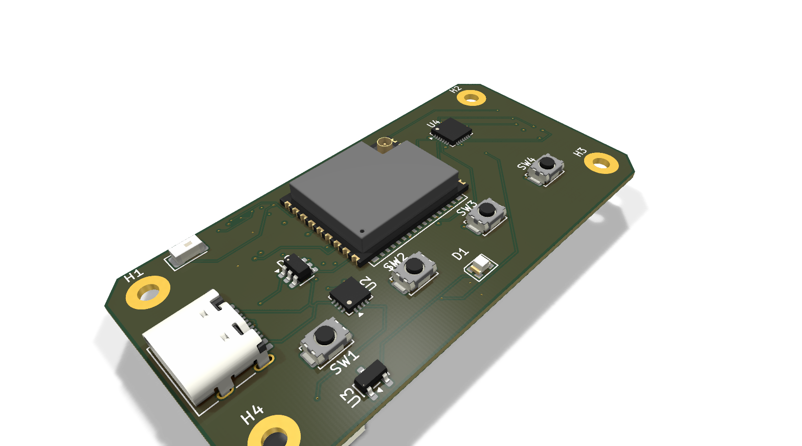
*Figure 7.9a: PCBA 09 Top 3D (Current Routing & Placement) -- ESP32-C6 Host MCU (U1), ES8388 Audio Codec (U4), BQ24075 PMIC (U2), ME6211 3.3V LDO (U3), IP67 USB-C (J1), and 4-Button Inline Array.*

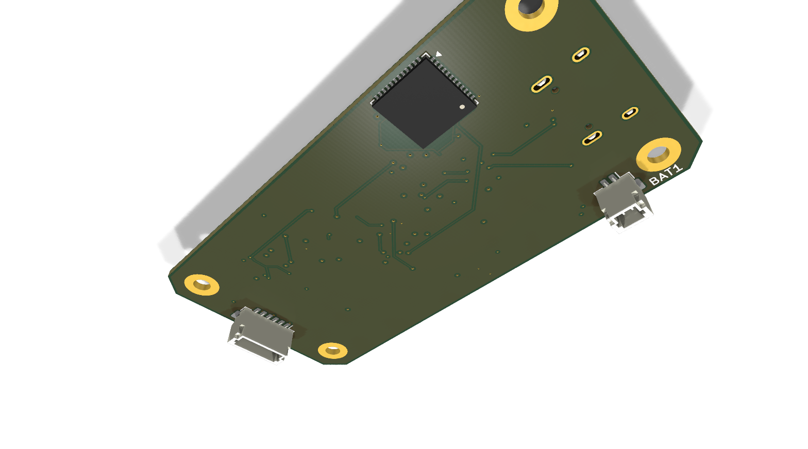
*Figure 7.9b: PCBA 09 Bottom 3D (Dual-Engine OMB Lite) -- Dedicated ESP32-PICO-V3-02 Bluetooth Classic/BLE Co-Processor (U5) and Johanson 2450AT Chip Antenna (ANT1) for CoEx-free RF separation.*

### 11.1 Technical Board Specifications
* **Dimensions:** $60.0 \times 30.0 \times 1.0\,\text{mm}$ ($R = 2.5\,\text{mm}$ corner radii).
* **Layer Stackup:** 2-layer FR-4 High-TG150, $1.0\,\text{mm}$ board thickness, $35\,\mu\text{m}$ copper (1 oz), ENIG gold finish.
* **Fasteners:** 4x M2 mounting holes ($\varnothing 2.2\,\text{mm}$) spaced $52.0 \times 22.0\,\text{mm}$ for captive DIN 934 M2 hexagonal nut pockets in the 3D-printed enclosure.

### 11.2 Key Components & Circuit Architecture
1. **Host MCU (`U1`):** Espressif ESP32-C6-MINI-1U (32-Bit RISC-V @ 160 MHz, 512 kB SRAM, 4 MB Flash, U.FL RF connector). Supports Wi-Fi 6, 802.15.4 TDMA mesh, and BLE 5.3 / LE Audio LC3.
2. **Power Path PMIC (`U2`):** Texas Instruments BQ24075RGTR with Dynamic Power Path Management (DPPM). Zero-reboot switching between external 5V USB-C and internal 600-mAh LiPo cell ($< 10\,\mu\text{s}$). Internal cell acts as uninterruptible power supply (UPS).
3. **Stereo Audio Codec (`U4`):** Everest Semi ES8388 (24-Bit / 96 kHz I2S). Dedicated L/R headphone amplifiers for stereo helmet speakers and low-noise differential microphone preamplifier.
4. **2.4 GHz RF Antenna & Dual-Engine Architecture:**
   * **Host MCU (`U1`):** Uses the factory-integrated U.FL gold port on the `ESP32-C6-MINI-1U` module. A short $50\,\text{mm}$ RG-178 / 1.13mm micro-coax pigtail routes the RF signal to the watertight IP67 SMA bulkhead jack on the enclosure flank. (Redundant PCB U.FL connector deleted).
   * **Helmet Default:** In helmet mode, the ultra-compact $38\,\text{mm}$ 2.4 GHz Rubber-Duck stubby antenna screws directly onto the SMA jack ($+2.0\dots +2.5\,\text{dBi}$ omnidirectional, zero buffeting). In pod cartridge mode, a coax cable connects to an external vehicle antenna.
   * **Bluetooth Co-Processor (`U5`):** The `ESP32-PICO-V3-02` operates on its own Johanson 2450AT ceramic chip antenna (`ANT1`, SMD 3216) for short-range smartphone and cockpit links.
5. **User Interface:** 4x tactile IP67 micro-switches (`SW1` to `SW4`, C&K KMT0 / Alps SKRK) and 1x WS2812B-2020 RGB status LED.
6. **Interfaces & Connectors:**
   * `J1`: Waterproof IP67 USB-C receptacle (16-Pin) for on-the-go charging (powerbank/bike), WebUSB DFU flashing, and pod docking.
   * `J_HELMET`: 6-Pin JST-SH 1.0mm SMD Vertical Header (`BM06B-SRSS-TB`) on `B.Cu` ($X=127.05, Y=99.70\,\text{mm}$ in KiCad, vertical mating direction for strain-free routing directly into helmet cavity) in the rear enclosure compartment opposite USB-C behind battery cradle. Delivers pure, hum-free audio to helmet interior.
   * `BAT1`: 2-Pin JST-SH micro receptacle (`BM02B-SRSS-TB` Vertical) on `B.Cu` ($X=79.40, Y=112.00\,\text{mm}$) to 1S LiPo pouch cell (600 mAh with PCM).

### 11.3 Complete GPIO Pinout (ESP32-C6-MINI-1U)

| Module Pad | ESP32-C6 GPIO | Net Name | Signal Type | Function / Hardware Connection |
| :---: | :---: | :--- | :--- | :--- |
| **Pad 8** | **`GPIO 2`** | `BTN_PWR` | Digital In (Pullup) | SW1 (Power / MFB tactile switch, active-low, boot pin) |
| **Pad 9** | **`GPIO 3`** | `BTN_MESH` | Digital In (Pullup) | SW2 (Mesh / Group toggle switch, active-low) |
| **Pad 4** | **`GPIO 4`** | `BTN_VOL_UP` | Digital In (Pullup) | SW3 (Volume +, Channel +, active-low) |
| **Pad 5** | **`GPIO 5`** | `BTN_VOL_DOWN` | Digital In (Pullup) | SW4 (Volume -, Channel -, active-low) |
| **Pad 6** | **`GPIO 6`** | `WS2812_DATA` | Digital Out | D1 (WS2812B-2020 RGB status LED & light pipe) |
| **Pad 7** | **`GPIO 7`** | `CHG_STAT` | Digital In (Pullup) | BQ24075 /STAT charge indicator (active-low) |
| **Pad 10** | **`GPIO 8`** | `I2C_SDA` | Open-Drain | ES8388 register control SDA (4.7k pullup) |
| **Pad 11** | **`GPIO 9`** | `I2C_SCL` | Open-Drain | ES8388 register control SCL (4.7k pullup) |
| **Pad 3** | **`GPIO 2 / PTT`**| `PTT_IO` | Digital In (Pullup) | Hardware PTT input from J_HELMET Pin 6 / handlebar switch |
| **Pad 21** | **`GPIO 19`** | `I2S_MCLK` | Digital Out | ES8388 Master Clock (12.288 MHz) |
| **Pad 22** | **`GPIO 20`** | `I2S_BCLK` | Digital Out | ES8388 Bit Clock (1.536 MHz) |
| **Pad 23** | **`GPIO 21`** | `I2S_WS` | Digital Out | ES8388 Frame Sync / Word Select (48 kHz) |
| **Pad 24** | **`GPIO 22`** | `I2S_DOUT` | Digital Out | ES8388 DAC Data Out (Stereo speakers L/R) |
| **Pad 25** | **`GPIO 23`** | `I2S_DIN` | Digital In | ES8388 ADC Data In (Microphone) |
| **U.FL** | **RF 2.4G** | `RF_ANT` | 50 Ohm Coaxial | ESP32-C6 integrated U.FL -> Coax pigtail -> IP67 SMA bulkhead |

### 11.4 16-Pin Multi-Use USB-C Connector Pinout (`J1`)

The front-facing USB-C port `J1` (`TYPE-C-31-M-12_IP67`) serves as a universal multi-use interface for **charging**, **WebUSB/DFU flashing**, and **cartridge sled docking**:

| USB-C Pins | Net Name | Signal Type | Function / Adapter Connection |
| :---: | :--- | :--- | :--- |
| **A1, B12, A12, B1, SH** | `GND` / `PGND` | Power Ground | Pin 1 Cartridge Header `J_AUDIO_PWR` & Shield: Carries charge & operating return current |
| **A4, B9, A9, B4** | `VBUS_5V` | Power In (+5V) | Pin 2 Cartridge Header & USB charge cable: 5V supply & BQ24075 UPS battery charging |
| **A6, B6 (`DP1`, `DP2`)** | `USB_DP` | USB 2.0 PHY | ESP32-C6 GPIO 13 (via TVS `D2`): **Native USB D+ for WebUSB / DFU firmware flashing** |
| **A7, B7 (`DN1`, `DN2`)** | `USB_DN` | USB 2.0 PHY | ESP32-C6 GPIO 12 (via TVS `D2`): **Native USB D- for WebUSB / DFU firmware flashing** |
| **A5 (`CC1`)** | `HP_OUT_L` | Audio Out | Pin 4 Cartridge Header: Stereo Audio Left from ES8388 `LOUT1` in cartridge mode |
| **B5 (`CC2`)** | `HP_OUT_R` | Audio Out | Pin 5 Cartridge Header: Stereo Audio Right from ES8388 `ROUT1` in cartridge mode |
| **A8 (`SBU1`)** | `MIC_IN+` | Audio In | Pin 7 Cartridge Header: Rider microphone signal to ES8388 `MIC1P` in cartridge mode |
| **B8 (`SBU2`)** | `AGND_SPK` | Analog Ground | Pin 3 & 6 Cartridge Header: Zero-current audio ground ($I = 0\,\text{mA}$) |

### 11.5 6-Pin Internal Helmet Audio & PTT Connector Pinout (`J_HELMET`)

The 6-pin header `J_HELMET` (JST-SH 1.0 mm, LCSC `C136657`) placed on `B.Cu` carries all analog audio and control lines directly into the helmet interior. By completely separating 5V charging power (which remains solely on USB-C `J1`), audio lines are 100% free of hum and charger noise:

| Pin # | Net Name | Signal Type | Destination / Helmet Peripheral | Electrical Specification |
| :---: | :--- | :--- | :--- | :--- |
| **1** | `HP_OUT_L` | Audio Out | Left helmet speaker (Tip 3.5mm jack) | ES8388 `LOUT1`, $45\,\text{mW}$ @ $16\,\Omega$, AC-coupled |
| **2** | `HP_OUT_R` | Audio Out | Right helmet speaker (Ring 3.5mm jack) | ES8388 `ROUT1`, $45\,\text{mW}$ @ $16\,\Omega$, AC-coupled |
| **3** | `AGND_SPK` | Audio Ground | Speaker ground reference (Sleeve 3.5mm jack) | Zero-current analog ground ($I = 0\,\text{mA}$), no charging noise |
| **4** | `MIC_IN+` | Audio In | Microphone capsule (2-Pin Micro-JST Pin 1) | ES8388 `MIC1P` with programmable `MICBIAS` (2.2V) |
| **5** | `AGND_MIC` | Mic Ground | Microphone ground return (2-Pin Micro-JST Pin 2) | Isolated low-noise preamplifier ground |
| **6** | `BTN_PTT` | Digital In | Helmet PTT button / chin bar clicker | ESP32-C6 GPIO 2, internal $45\,\text{k}\Omega$ pullup, active-low to GND |

---

## 12. PCBA 10: OMM 446 Analog & Digital PMR446 Intercom Module (`openmotorbridge_omm446_ucs`)

The **`PCBA 10`** board solves the dilemma of bulky handheld two-way radios (which do not fit into $100 \times 50 \times 30\,\text{mm}$ motorcycle cartridges) and expensive, uneconomical teardowns:

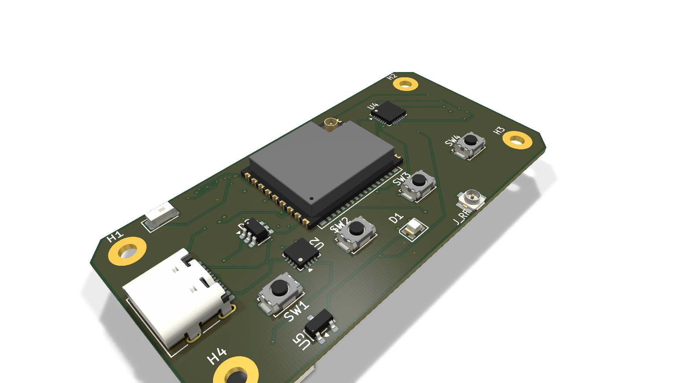
*Figure 7.10a: PCBA 10 Top 3D (Current Routing & Placement) -- ESP32-C6 Host MCU (U1), ES8388 Audio Codec (U4), BQ24075 PMIC (U2), ME6211 3.3V LDO (U5), IP67 USB-C (J1), and 4-Button Inline Array.*

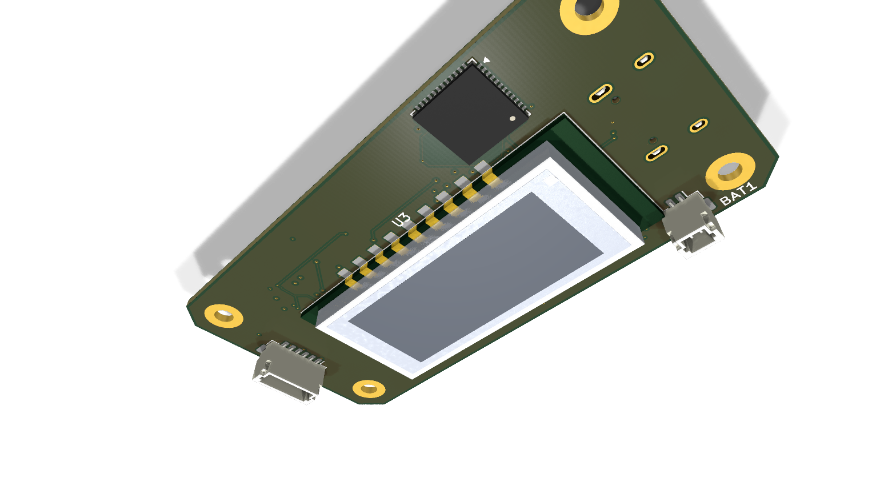
*Figure 7.10b: PCBA 10 Bottom 3D (NiceRF SA818 & Dual-Engine) -- NiceRF SA818-DMR Transceiver (U3), ESP32-PICO-V3-02 Bluetooth Co-Processor (U6), and Johanson 2450AT Chip Antenna (ANT1).*

* **Form-Factor Parity:** Exactly identical dimensions ($60.0 \times 30.0 \times 1.0\,\text{mm}$) and mounting points as `PCBA 09`.
* **Universal Application:** Operates autonomously in ECE 22.06 UCS helmet slots or docked into the cartridge sled (`PCBA 03`) on the motorcycle.
* **Dual-Mode RF:** Analog FM (16 PMR446 channels, CTCSS/DCS) and Digital DMR Tier I (16 digital channels, TDMA 4FSK).
* **Dual-Power RF Selection:**
  * **0.2 W ERP (Helmet Mode / SAR-Safe):** Minimized RF exposure and thermal dissipation near the head (1.5–2.5 km range).
  * **0.5 W ERP (Bike Mode / High-Power):** Full legal PMR446 maximum in cartridge sled (3–6 km range).
* **Power Management with UPS:** TI BQ24075 with DPPM enables charging while operating via USB-C; internal 600-mAh LiPo serves as seamless UPS.
* **Antenna System (Helical Stubby & External Coax):**
  * **PMR/DMR RF Path:** NiceRF SA818-DMR feeds via low-pass filter to `J_RF` (U.FL on `B.Cu` at $(110.5, 87.0)\,\text{mm}$). A parallel solder pad is omitted in favor of the 100% solderless plug architecture.
  * A 50 mm micro-coax pigtail routes to the watertight SMA bulkhead jack with EPDM O-ring.
  * **Helmet Default:** 48 mm helical stubby antenna ($430\dots 470\,\text{MHz}$, SMA-Male, $1.5\dots 2.5\,\text{km}$ range). In pod mode, external bike coax antenna ($3\dots 6\,\text{km}$).
  * **Bluetooth Co-Processor (`U6`):** Dedicated `ESP32-PICO-V3-02` with Johanson 2450AT ceramic chip antenna (`ANT1`).
* **Interfaces & Connectors:**
  * `J1`: Waterproof IP67 USB-C receptacle (16-Pin) for charging and WebUSB DFU.
  * `J_HELMET`: 6-Pin JST-SH 1.0mm SMD Vertical Header (`BM06B-SRSS-TB`) on `B.Cu` ($X=127.05, Y=99.70\,\text{mm}$ in KiCad, vertical mating direction for strain-free routing directly into helmet cavity) -- 100% pinout-compatible with PCBA 09.
  * `BAT1`: 2-Pin JST-SH micro receptacle (`BM02B-SRSS-TB` Vertical) on `B.Cu` ($X=79.40, Y=112.00\,\text{mm}$) to 1S LiPo pouch cell.

### 12.3 Complete GPIO Pinout (ESP32-C6 to SA818-DMR & Periphery)

| Module Pad | ESP32-C6 GPIO | Net Name | Signal Type | Function / Hardware Connection |
| :---: | :---: | :--- | :--- | :--- |
| **Pad 8** | **`GPIO 2`** | `BTN_PTT` | Digital In (Pullup) | Button SW1: Push-To-Talk / MFB (active-low, boot pin) |
| **Pad 9** | **`GPIO 3`** | `BTN_MODE` | Digital In (Pullup) | Button SW2: Analog FM / Digital DMR Toggle |
| **Pad 4** | **`GPIO 4`** | `BTN_CH_UP` | Digital In (Pullup) | Button SW3: Channel Up (CH 1–16) |
| **Pad 5** | **`GPIO 5`** | `BTN_CH_DOWN` | Digital In (Pullup) | Button SW4: Channel Down (CH 16–1) |
| **Pad 6** | **`GPIO 6`** | `WS2812_DATA` | Digital Out | D1 (WS2812B RGB Status LED RX/TX/DMR) |
| **Pad 7** | **`GPIO 7`** | `CHG_STAT` | Digital In (Pullup) | BQ24075 /STAT charge indicator (active-low) |
| **Pad 10** | **`GPIO 8`** | `I2C_SDA` | Open-Drain | ES8388 Register SDA (4.7k pullup) |
| **Pad 11** | **`GPIO 9`** | `I2C_SCL` | Open-Drain | ES8388 Register SCL (4.7k pullup) |
| **Pad 14** | **`GPIO 12`** | `USB_DN` | USB 2.0 PHY | USB-C D- (WebUSB firmware flashing & DFU via D2) |
| **Pad 15** | **`GPIO 13`** | `USB_DP` | USB 2.0 PHY | USB-C D+ (WebUSB firmware flashing & DFU via D2) |
| **Pad 16** | **`GPIO 14`** | `SA818_TXD` | Digital Out (UART) | ESP32 TX -> SA818-DMR RXD (AT commands @ 9600 Bd) |
| **Pad 17** | **`GPIO 15`** | `SA818_RXD` | Digital In (UART) | ESP32 RX <- SA818-DMR TXD (status & telemetry) |
| **Pad 18** | **`GPIO 16`** | `SA818_PTT` | Digital Out | SA818 PTT control (active-low = transmit) |
| **Pad 19** | **`GPIO 17`** | `SA818_SQL` | Digital In | SA818 Squelch output (active-low = carrier detect / RX) |
| **Pad 20** | **`GPIO 18`** | `SA818_PWR_HL` | Digital Out | SA818 RF Power Select: Low = 0.2W (Helmet), High = 0.5W (Bike) |
| **Pad 21** | **`GPIO 19`** | `I2S_MCLK` | Digital Out | ES8388 Master Clock (12.288 MHz) |
| **Pad 22** | **`GPIO 20`** | `I2S_BCLK` | Digital Out | ES8388 Bit Clock (1.536 MHz) |
| **Pad 23** | **`GPIO 21`** | `I2S_WS` | Digital Out | ES8388 Frame Sync (48 kHz) |
| **Pad 24** | **`GPIO 22`** | `I2S_DOUT` | Digital Out | ES8388 DAC Out (Speaker / audio to central box) |
| **Pad 25** | **`GPIO 23`** | `I2S_DIN` | Digital In | ES8388 ADC In (Microphone from helmet / central DSP) |
| **J_RF** | **RF 446M** | `RF_ANT` | 50 Ohm Coaxial | U.FL socket (`B.Cu`) -> Coax pigtail -> IP67 SMA bulkhead |

### 12.4 16-Pin Multi-Use USB-C Connector Pinout (`J1`)

Identical to PCBA 09: Universal interface for **charging (5V bike / powerbank)**, **WebUSB/DFU flashing**, and **cartridge sled docking** in Smart Cartridge (`PCBA 03`).

### 12.5 6-Pin Internal Helmet Audio & PTT Connector Pinout (`J_HELMET`)

The `J_HELMET` header on `B.Cu` is **100% pinout-compatible with PCBA 09**:

| Pin # | Net Name | Signal Type | Destination / Helmet Peripheral | Electrical Specification |
| :---: | :--- | :--- | :--- | :--- |
| **1** | `HP_OUT_L` | Audio Out | Left helmet speaker (Tip 3.5mm jack) | ES8388 `LOUT1`, $45\,\text{mW}$ @ $16\,\Omega$, AC-coupled |
| **2** | `HP_OUT_R` | Audio Out | Right helmet speaker (Ring 3.5mm jack) | ES8388 `ROUT1`, $45\,\text{mW}$ @ $16\,\Omega$, AC-coupled |
| **3** | `AGND_SPK` | Audio Ground | Speaker ground reference (Sleeve 3.5mm jack) | Zero-current analog ground ($I = 0\,\text{mA}$), no charging noise |
| **4** | `MIC_IN+` | Audio In | Microphone capsule (2-Pin Micro-JST Pin 1) | ES8388 `MIC1P` with programmable `MICBIAS` (2.2V) |
| **5** | `AGND_MIC` | Mic Ground | Microphone ground return (2-Pin Micro-JST Pin 2) | Isolated low-noise preamplifier ground |
| **6** | `BTN_PTT` | Digital In | Helmet PTT button / chin bar clicker | ESP32-C6 GPIO 2, internal $45\,\text{k}\Omega$ pullup, active-low to GND |

### 10.6 Hardware Power-On Self-Test (POST) 36-LED Diagnostic Matrix

Upon vehicle ignition (KL15), the system enters an optical **POST Diagnostic Mode for 2.5 seconds**. The 36 LEDs surrounding the radar aperture are mapped into **18 functional pairs of 2 LEDs each** ($18 \times 2 = 36$):

```text
                          TOP BROW: D13 .. D18 (6 LEDs = 3 Pairs)
                      +-------------------------------------------+
                      |   [GNSS]       [LoRa Mesh]      [V2X/Wi-Fi]|
                      +-------------------------------------------+
   LEFT WING                                                                 RIGHT WING
   D1 .. D12 (12 LEDs = 6 Pairs)                                             D19 .. D30 (12 LEDs = 6 Pairs)
 +---------------------------+   +-------------------------------------+   +---------------------------+
 | D1/D2:   Front Node       |   |                                     |   | D19/D20: Pod 2 Radio      |
 | D3/D4:   CAN-Bus          |   |         WHEELTEC MR20               |   | D21/D22: UWB Backbone     |
 | D5/D6:   Pod 1 Intercom   |   |       77-GHz mmWave Radar           |   | D23/D24: BSD Mirror R     |
 | D7/D8:   BSD Mirror L     |   |                                     |   | D25/D26: Rear TPMS        |
 | D9/D10:  Front TPMS       |   |                                     |   | D27/D28: Dallas DS18B20   |
 | D11/D12: Actioncam BLE    |   |                                     |   | D29/D30: MicroSD Logger   |
 +---------------------------+   +-------------------------------------+   +---------------------------+
                      +-------------------------------------------+
                      |   [12V KL15]     [18650 UPS]     [77GHz Radar]|
                      +-------------------------------------------+
                         BOTTOM CHIN: D31 .. D36 (6 LEDs = 3 Pairs)
```

#### The 2-LED Principle per Function:
* **LED A (Left / Top): Hardware & Bus Presence:**
  - **Green:** Subsystem acknowledges on bus (1-Wire ROM-ID, I2C ACK, UART ping, UWB/BLE link OK).
  - **Amber:** Handshake / bootloader active.
  - **Blinking Red:** Hardware missing / short circuit / bus timeout.
  - **Dark:** Component declared as "uninstalled / optional" in bike profile.
* **LED B (Right / Bottom): Functional State & Data Stream:**
  - **Green:** Normal operation active (data stream flowing, valid 3D fix, TPMS pressure within spec).
  - **Amber:** Initializing (e.g. GNSS seeking satellites, road frost condition $T \le +3^\circ\text{C}$).
  - **Red:** Sensor error / plausibility failure.

#### Mapping of the 18 Motorcycle Subsystems:
1. **Left Wing (Cockpit, Bus & Left Side):**
   * **D1 / D2:** Front Node (PCBA 05) UWB link & cockpit power (KL15 / USB-PD).
   * **D3 / D4:** Motorcycle CAN-Bus (HD-LAN / K-CAN) transceiver & telemetry stream.
   * **D5 / D6:** Pod 1 (Left Pannier / Intercom Bridge) 2-wire DC power & cartridge MCU ready.
   * **D7 / D8:** BSD Mirror Alert Left (Header `J9`) N-MOSFET & driver circuit ready.
   * **D9 / D10:** Front TPMS (Bluetooth LE Tire Pressure) packet received & pressure in spec.
   * **D11 / D12:** Actioncam BLE Shutter Link paired & camera ready.
2. **Right Wing (Radio, Rear & Right Side):**
   * **D19 / D20:** Pod 2 (Right Pannier / Radio & Aux) 2-wire DC power & cartridge MCU ready.
   * **D21 / D22:** UWB Backbone (DW3110) 6.5 GHz link & range-measurement active.
   * **D23 / D24:** BSD Mirror Alert Right (Header `J9`) N-MOSFET & driver circuit ready.
   * **D25 / D26:** Rear TPMS (Bluetooth LE Tire Pressure) packet received & pressure in spec.
   * **D27 / D28:** Dallas DS18B20 Road Temperature Sensor (`J6`) 1-Wire responsive & plausible.
   * **D29 / D30:** MicroSD-Card & Telemetry Blackbox SDIO 4-bit mounted & logging ready.
3. **Top Brow (Navigation, Mesh & RF):**
   * **D13 / D14:** u-blox SAM-M10Q Multi-GNSS I2C link & 3D fix ($\ge 6$ satellites).
   * **D15 / D16:** Semtech SX1262 LoRa (OpenMotorMesh 868 MHz) SPI PLL lock & mesh beacon.
   * **D17 / D18:** 5.9 GHz ITS-G5 / Wi-Fi 6 (V2X) RF transceiver active & PWA hotspot online.
4. **Bottom Chin (Power & Radar Transceiver):**
   * **D31 / D32:** Vehicle 12V supply stable ($11.5\dots 14.8\,\text{V}$) & KL15 gate closed.
   * **D33 / D34:** Internal 18650 UPS battery charge IC `BQ25895` & capacity $> 50\%$.
   * **D35 / D36:** Wheeltec MR20 77-GHz radar transceiver 20 Hz UART clusters & zero tracking faults.

#### Non-Blocking Architecture (Optional Accessory Safe):
* **No Radar Installed / Garmin Varia:** If no Radar 2.0 Sub-MCU is detected on UART or `radar_type: "none"` is configured, Central Box boot proceeds **asynchronously in $< 800\,\text{ms}$** with zero blocking delays.
* **Cockpit Acknowledgment:** The two **BSD mirror LEDs (`J9`) illuminate amber for 1.0 second** upon ignition-on for immediate visual rider verification from the saddle.
* **Support Vehicle (Kit 5):** Because support vans do not mount the rear radar unit, all diagnostic telemetry is mirrored directly onto the tablet dashboard in the PWA.

---

### 10.7 Configurable Warning Macros & Pattern Management

All visual warning and lighting macros on the Radar 2.0 Sub-MCU are individually **configurable via NVS bitmask flags** (`RadarMacroConfigBits_t`), ensuring compliance with local vehicle lighting regulations (ECE / StVZO) and rider preferences:

| Macro ID | Name & Function | Trigger & Dynamics | Config Flag (JSON / NVS) | Default |
| :--- | :--- | :--- | :--- | :---: |
| **`0x01`** | **Welcome & POST Sweep** | 2.5s 18-pair diagnostic matrix $\rightarrow$ sweep wipe into taillight | `post_matrix_enabled` | `true` |
| **`0x02`** | **ESS Brake Strobe** | $4.5\,\text{Hz}$ full-intensity red strobe on deceleration $a_x < -0.6\,\text{g}$ | `ess_strobe_enabled` | `true` |
| **`0x03`** | **Hazard Beacon** | $1.2\,\text{Hz}$ amber double-flash (*"Flash-Flash-Pause"*) when stopped with 4-way flashers | `hazard_beacon_enabled` | `true` |
| **`0x04`** | **Theft Deterrent Strobe** | $12\,\text{Hz}$ disorienting white/red strobe + mirror alert flash on alarm trigger | `theft_strobe_enabled` | `true` |
| **`0x05`** | **Convoy / Follow-Me Pulse** | Gentle breathing wave glow for lead guide / sweep vehicles | `convoy_marker_enabled` | `false` |
| **`0x06`** | **Tailgating Guard** | Inward-flowing warning wipe on extreme vehicle tailgating ($d < 3\,\text{m}, v > 50$) | `tailgating_guard_enabled` | `false` |
| **`0x07`** | **Standby Taillight (Astro-Dim)**| Soft red position glow (18%-50% PWM, auto-dimmed via solar position engine) | `ambient_glow_enabled` | `true` |

* **PWA & Handlebar Activation:** Every macro can be toggled and tested in the PWA under *Lighting & Safety*. While stationary ($v = 0\,\text{km/h}$), tapping the Harley TRIP button or Front Node PTT switch 4 times launches the POST diagnostic matrix for 10 seconds for convenient visual hardware verification.


