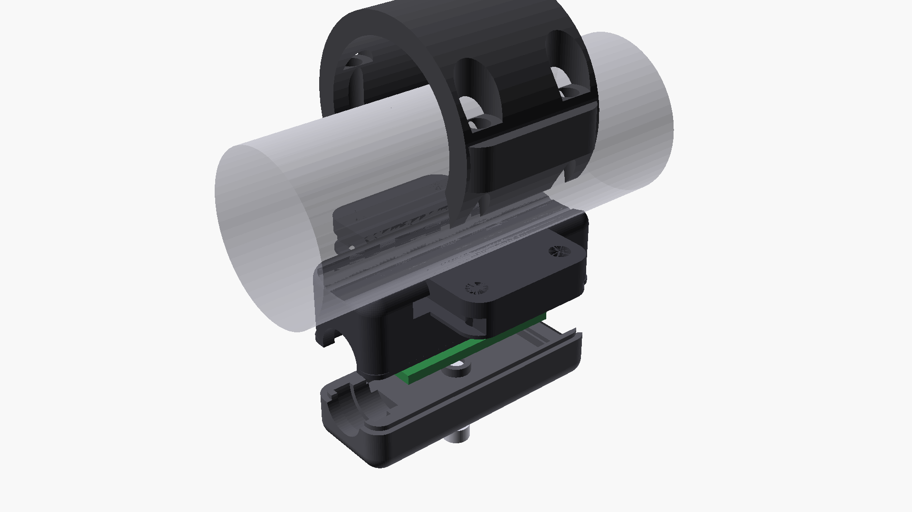

# 08 - Mechanical Enclosures, CAD Models & Sealing System (All Units)

This document specifies the mechanical engineering, thermal dissipation, IP67/IP69K sealing concepts, kinematics of the quick-change auto-eject system, and all CAD and STL assets of OpenMotorBridge v10.0 Standardized Node Architecture:
1. **Central Control Box (Type A):** 3-piece sandwich enclosure with intermediate tray ($70.0 \times 10.0\,\text{mm}$ open front cable bay), hinged battery bridge with dual-antenna pockets (Taoglas FXP895 LoRa-868 and Taoglas FXP73 2.4-GHz under a $0.8\,\text{mm}$ protective snap shroud and C-clip strain-relief clamps), 100% cable-free lid plate, bottom tub pocket ($12.0 \times 12.0 \times 0.8\,\text{mm}$) as sealed reserve cavity (historical UWB housing), rear SMA antenna bulkhead with waterproof $0.4\,\text{mm}$ knockout membrane (IP68/IP69K sealed by default), and planar 4-layer copper heat spreader.
2. **Universal Saddlebag Satellite Pod System (Type B):** Mechanically identical monocoque enclosure for both satellite pods (Pods 1 & 2 Audio/Intercom, 2x symmetric) featuring a tool-free slide-in lid, concealed FOB magnetic latch (unlocked via Smart Keyfob), internal intermediate splash shield (dry-flap), integrated in-bag USB charging port (5V/12V PD up to 30W/60W), direct EPDM contoured cradle for OEM communicators (Sena SPIDER X Slim, Cardo Packtalk Edge, OMM 2.4 GHz UCS, Midland PMR446) or 100% watertight dry box, and 4-wire automotive backbone with 4-pin IP67 magnetic breakaway dock.
3. **Universal Front Node (Type C):** Ultra-compact Cockpit & Sensor Hub ($98.0 \times 68.0 \times 25.0\,\text{mm}$) tailored for the $82 \times 50\,\text{mm}$ 4-layer PCBA 05 with a 4-in-1 universal mounting system (AMPS, riser clamp, silentblocks, 3M Dual-Lock), direct interfacing to symmetrical dual under-perch mirror pods, 4-wire automotive backbone (ZERO fuel tank removal!), integrated u-blox SAM-M10Q GNSS, TI TMP117 / OPT3001 airflow sensors, and Knowles MEMS wind noise microphone.
4. **2-in-1 LoRa Smart-Keyfob & Pager (Type D):** Ultra-compact pocket companion ($58.0 \times 34.0 \times 13.0\,\text{mm}$) molded in PA12-MJF with perimeter TPU shock bumper, integrated N52 neodymium ejection key, $0.5\,\text{mm}$ Mu-metal magnetic flux shield, MagSafe/Qi inductive charging receiver, LRA haptic motor, and wireless SX1262 LoRa/BLE alert pager.
5. **Vehicle-Specific Reference Mounting Kits (Zero-Drill):** Fully engineered, non-destructive bolt-on mounting kits for CVO Road Glide ST (Kit 1), Road King Special (Kit 2), Classic Bagger & Cruiser (Kit 3), and Adventure & Touring Enduros (BMW GS, KTM Adventure, Africa Twin - Kit 4 with minimal under-rack radar bracket).

---

## 1. Type A: Central Control Box (3-Piece Sandwich Architecture)

The Central Box enclosure is engineered in **PA12 (HP Multi Jet Fusion)** for harsh motorcycle environments (up to 20 g vibration, direct spray, under-seat heat soak):

- **External Dimensions:** $110.0 \times 74.0 \times 38.0\,\text{mm}$ (L x W x H; lower case $17.0\,\text{mm}$, upper case $15.0\,\text{mm}$, lid $6.0\,\text{mm}$).
- **Mounting:** 4x corner ears on lower case with **hole spacing $128.0 \times 56.0\,\text{mm}$** for M4 EPDM silentblocks (Shore 50A).
- **Internal Clearance:** $105.0 \times 69.0 \times 32.0\,\text{mm}$ (optimized for the $85.0 \times 55.0\,\text{mm}$ 4-layer main PCBA 01 with symmetric margins of $10.0\,\text{mm}$ in X and $7.0\,\text{mm}$ in Y).
- **Ingress Protection:** IP67 / IP69K (dust-tight, submersible to 1 m, steam-jet resistant).
- **100% Soldering-Iron Free Assembly:** Direct PA12-molded pilot holes ($\varnothing\,2.1\,\text{mm}$ for M2.5 plastic-forming screws) and form-fitting DIN 934 M3 hex nut pockets eliminate all brass heat-set threaded inserts.


*Figure 8.1: Photorealistic 3D CAD diagonal cutaway render of the Central Control Box. The 3-tier sandwich is exposed: bottom tub with 4-layer PCB (ENIG) on M2.5 standoffs, intermediate tray with open front 70x10mm cabling bay and convection cooling slots, upper LiPo UPS battery cradle with 2,200 mAh cell clamped under the hinged battery & dual-antenna bridge with cable strain reliefs, automotive Deutsch DTM flange, SW1 button, USB-C service port, and 100% cable-free solid lid with Gore ePTFE vent.*

### 1.1 3D CAD Model & 3-Piece Sandwich Architecture


*Figure 8.2: 3D CAD visualization of the Central Control Box (Type A).*

```
+------------------------------------------------------------+  ^
| 1. ENCLOSURE LID (6.0 mm Height / 3.0 mm Wall Thickness)   |  |
|    * Gore ePTFE pressure equalization vent (Ø 7.0 mm)      |  | 38.0 mm
|    * Perimeter groove with Shore 40A silicone cord gasket  |  | Total
|    * 100% cable-free, solid lid (zero antennas in lid;     |  | Height
|      stress-free opening during field maintenance)         |  |
|    * Homogeneous PA12 structure (>2.5 mm wall to exterior) |  |
+------------------------------------------------------------+  |
| 2. UPPER CASE WITH INTERMEDIATE TRAY (15.0 mm Height)      |  |
|    * Front Panel: Automotive flange (J1 & J_PERIPH),       |  |
|      SW1 button (silicone boot), USB-C service port,       |  |
|      diffuse PMMA light pipe (Ø 3.2 mm) for WS2812B RGB    |  |
|    * Rear Panel: SMA antenna port with 0.4 mm knockout     |  |
|      membrane (IP68/IP69K sealed by default; punch-out)    |  |
|    * Hinged Battery & Antenna Bridge (013_...bridge.scad): |  |
|      - Holds 1S LiPo (68x39x5.0 mm, 2,200 mAh) via EPDM   |  |
|      - Integrated pockets for Taoglas FXP895 (LoRa 868)    |  |
|        & Taoglas FXP73 (2.4 GHz) under 0.8 mm snap cover   |  |
|      - Integrated C-clip strain relief for coax/power leads|  |
|    * Intermediate Floor: Open front cable bay (70x10 mm)   |  |
|      & 9x convection / pressure equalization slots         |  |
+------------------------------------------------------------+  |
| 3. LOWER CASE (17.0 mm Height - Monocoque Tub)             |  |
|    * 4-Layer Main PCB (85 x 55 mm) on M2.5 standoffs       |  |
|      (77 x 47 mm hole pitch, Ø 2.1 mm PA12 pilot holes)    |  |
|    * Integrated cavity (12 x 12 x 0.8 mm) in floor         |  |
|      as reserve space / historical UWB housing             |  |
|    * Captive DIN 934 M3 hex nut pockets                    |  |
|    * 4x M4 silentblock mounting ears                       |  |
|    * 100% solid PA12 floor without through-holes (>2.2 mm) |  |
+------------------------------------------------------------+  v
```

### 1.2 3D Exploded View & Layer Architecture (1:1:1 CAD Fitting)


*Figure 8.3: 1:1:1 Euclidean CAD exploded view of the Central Box along the Z-axis.*

### 1.3 3D X-Ray Assembly & Component Clearance


*Figure 8.4: Transparent 3D X-ray view of the closed Central Box showing clean internal clearances.*

### 1.4 True-to-Scale Longitudinal & Cross Section (X-Z Thermal & Y-Z Cable Routing)


*Figure 8.5: True-to-scale 2D cross sections of the Central Box (X-Z and Y-Z planes).*

---

## 2. Thermal Dissipation & Planar PCB Heat Spreading

Total heat dissipation during standard riding is only **$\approx 1{,}5\,\text{W}$** (peaking at $2{,}45\,\text{W}$ during fast charging):

1. **Planar 4-Layer Copper Heat Spreader ($85 \times 55\,\text{mm}$):** Two continuous $35\,\mu\text{m}$ inner copper layers spread heat rapidly ($\lambda = 390\,\text{W/(m}\cdot\text{K)}$) across the entire board surface.
2. **11x Intermediate Convection Slots:** 5 rear slots, 4 side slots, and 2 front slots allow warm air to rise into the upper lid chamber.
3. **Worst-Case Thermal Margins ($45^\circ\text{C}$ ambient + $13^\circ\text{C}$ motor heat = $58^\circ\text{C}$ under seat):**
   * **LM5164-Q1:** $T_j = 93{,}8^\circ\text{C}$ (Max $+150^\circ\text{C}$ $\rightarrow$ $+56{,}2^\circ\text{C}$ margin).
   * **ESP32-S3:** $T_j = 90{,}2^\circ\text{C}$ (Max $+105^\circ\text{C}$ $\rightarrow$ $+14{,}8^\circ\text{C}$ margin, zero throttling).
   * **3.3V LDO:** $T_j = 110{,}4^\circ\text{C}$ (Max $+125^\circ\text{C}$).
   * **1S LiPo Battery:** Safely remains below $60^\circ\text{C}$ (JEITA NTC pauses charging above $45^\circ\text{C}$).

### 2.2 Upper Enclosure Tray: 1S LiPo Battery Cradle & Intermediate Pass-Throughs
* **Integrated LiPo Battery Pocket:** Form-fitting recess ($68{,}0 \times 39{,}0 \times 5{,}0\,\text{mm}$) molded into the top of the intermediate tray accommodating an ultra-flat **2,200 mAh 1S LiPo backup cell** (Type 504068 or 503870). By expanding horizontal footprint rather than vertical thickness, the overall Central Box height remains strictly at **$38{,}0\,\text{mm}$**, preserving crucial clearance beneath motorcycle seat pans.
* **100 % Free Cross-Section for all 11 Convective Slots:** The battery cradle is centrally located from $X = 17{,}0\dots 88{,}0\,\text{mm}$ and $Y = 13{,}0\dots 55{,}0\,\text{mm}$. This maintains a solid $2{,}5\dots 4{,}5\,\text{mm}$ clearance to all 11 perimeter ventilation slots (5 rear, 4 flanks, 2 front), preserving thermal chimney circulation for the LM5164-Q1 and BQ24075 regulators on the lower PCB.
* **Vibration Isolation:** A $1{,}0\,\text{mm}$ damping EPDM foam mat underneath and a transverse elastic EPDM strap ($40 \times 12\,\text{mm}$) anchored to molded retention lugs hold the cell securely under $20\,\text{g}$ shocks.
* **Molex Micro-Fit 3.0 Battery Header (`J_BAT`):**
  * Pin 1: `VBAT+` ($+3{,}7\,\text{V}$ LiPo positive via BQ24075)
  * Pin 2: `GND` (LiPo ground with embedded Murata 10k NTC thermistor for JEITA charging guard)
* **Pass-Through Slot & Cable Routing:**
  * Generous front cable aperture ($25{,}0 \times 4{,}0\,\text{mm}$ at $Y = 4\dots 8\,\text{mm}$) with radiused edges ($R = 1{,}5\,\text{mm}$) positioned $5{,}0\,\text{mm}$ ahead of the battery cradle.
  * Routes battery silicone wiring cleanly down to the `J_BAT` header on PCBA 01 alongside the wiring connecting to the front-panel automotive header `J1`.

---

## 3. Front Panel Interfaces, Antenna Accommodations & Rear Port

```
                      FRONT WALL OF UPPER TRAY
+-------------------------------------------------------------+
| +------------+  +--------+  +----------+  +---------------+ |
| | 1. USB-C   |  | 2. RGB |  | 3. SW1   |  | 4. Deutsch    | |
| |    Service |  |    LED |  |    Pair/ |  |    Automotive | |
| |    Alu Cap |  |  Ø3.2mm|  |    Reset |  |    Flange     | |
| +------------+  +--------+  +----------+  +---------------+ |
+-------------------------------------------------------------+
```

1. **Automotive Flange (Two-Cable Architecture J1 & J_PERIPH):** Automotive-grade flange with silicone perimeter seal and 2x M3 mounting screws ($28.0\,\text{mm}$ pitch). Routes the Central Box Two-Cable Architecture to the outside: Cable 1 (6-Pin Deutsch DTM06-6S `J1`: KL30, KL15, GND, CAN-H, CAN-L, Shield) and Cable 2 (16-Pin Automotive Header `J_PERIPH`: 4 branches of 4 conductors each for Front Node 60W, Pod 1 30W, Pod 2 30W, and Rear Radar MR20 12V/Telemetry).
2. **SW1 Push-Button (`SW_PAIR_RESET`):** IP67 waterproof momentary tactile switch with sealed silicone boot and M7 threaded bushing. Used for 3-second Bluetooth/audio pairing and 10-second factory reset / NVS key purge.
3. **USB-C Service Port:** Circular panel-mount waterproof receptacle sealed by a blue anodized aluminum screw cap with captive EPDM O-ring for firmware flashing, ESP-IDF live telemetry, and emergency diagnostics.
4. **RGB Status LED Viewing Window:** Diffuse PMMA light pipe ($\varnothing\,3.2\,\text{mm}$) with perimeter O-ring channeling light from the onboard WS2812B RGB LED directly to the front face (Green = normal / mesh OK, Blue = BT audio streaming, Orange = radar warning active, Red = theft tamper alert).

### 3.1 Integrated Antenna Pockets & RF Transparency

OpenMotorBridge implements a dual, fully integrated internal antenna concept eliminating protruding external antennas while maintaining maximum range:
1. **LoRa 868 MHz Primary Antenna (Taoglas FXP895):**
   * Form-fitting nest ($86.0 \times 16.0 \times 1.0\,\text{mm}$) molded into the top side of the hinged battery bridge (`013_battery_antenna_bridge.scad`) protected by a $0.8\,\text{mm}$ snap-on PA12 protective cover plate.
   * Radiates horizontally polarized RF upwards through the $2.5\,\text{mm}$ RF-neutral PA12 lid ($\varepsilon_r \approx 2.3\dots 2.7$, $\tan\delta \approx 0.015$), providing up to $15\,\text{km}$ LoRa mesh range.
   * Leaves the enclosure lid (`020_lid_plate.scad`) 100% passive and cable-free, allowing rapid field opening without risk of tearing fragile U.FL coax leads.
2. **Wi-Fi 4 / BLE 5.0 Antenna for ESP32-S3 (Taoglas FXP73):**
   * Securely encapsulated in a parallel nest on the battery bridge ($47.0 \times 7.5 \times 0.8\,\text{mm}$), feeding the ESP32-S3-WROOM-1U (`U2`) with 2.4 GHz RF for the web dashboard and OTA updates.
3. **LoRa 868 MHz Secondary Option (Rear SMA Bulkhead with 0.4 mm Knockout Membrane):**
   * Positioned on the upper tray rear wall (`012_front_cutouts.scad`) at $X = 85.0\,\text{mm}$ ($\varnothing\,6.5\,\text{mm}$ through-bore with $\varnothing\,9.5 \times 1.2\,\text{mm}$ O-ring counterbore).
   * **Factory IP68/IP69K Sealed:** Molded with a solid $0.4\,\text{mm}$ PA12 knockout membrane, keeping the enclosure 100% airtight and waterproof by default.
   * **Tool-Free Punch-Out:** For carbon fiber cowls or rally raid whip antennas, the $0.4\,\text{mm}$ membrane can be cleanly punched out with a small driver to install an IP67 SMA bulkhead socket with O-ring.
4. **Historical UWB Antenna Pocket (v10.0 Reserved Space / Legacy Compatibility):**
   * Recessed pocket ($12.0 \times 12.0 \times 0.8\,\text{mm}$) in the lower tub floor (`00_lower_deck.scad`) housed the Taoglas FXUWB10 UWB antenna for the superseded DW3110 transceiver in earlier prototypes. In v10.0, this area remains as mechanical reserve or is planar-sealed, with all vehicle interconnects running over the shielded 4-wire automotive bus.
   * Preserves $>2.2\,\text{mm}$ solid, homogeneous PA12 floor thickness underneath for hermetic IP67/IP69K sealing.
5. **Bluetooth 5.4 / LE Audio (Qualcomm QCC3084):**
   * Utilizes the onboard ceramic chip antenna with optimized copper keepout on `PCBA 01`, radiating cleanly through the RF-transparent PA12 mid-tray and lid.

---

---

## 4. Enclosure System Type B: Universal Satellite Pod (Slide-in Lid & Integrated Dry Box)

In OpenMotorBridge v10.0, the legacy modular cartridge system (with dual enclosure tunnels, Poka-Yoke guide rails, stainless steel ejection springs, and electromechanical plunger actuators) is completely eliminated.

Instead, both satellite pods (Pod 1 in the left saddlebag, Pod 2 in the right saddlebag) adopt an **ultra-compact, direct monocoque enclosure featuring a tool-free slide-in lid, concealed FOB magnetic latch, protective intermediate dry-flap, and integrated in-bag USB charging port**:

1. **Type B (Universal Monocoque Pod Enclosure):** A 100% symmetrical monocoque enclosure ($140.0 \times 65.0 \times 32.0\,\text{mm}$ with $128.0 \times 58.0 \times 26.0\,\text{mm}$ clear internal chamber) permanently mounted in the saddlebag, on the subframe, or on crash bars.
2. **Slide-in Lid with Push-to-Close Automatic Latching:** A sliding lid guided in perimeter sealing channels that positively latches at the end-stop with an audible mechanical click, compressing the perimeter silicone gasket (IP67).
1. **Type B (Universal Monocoque Pod Enclosure):** A 100% bilateral monocoque chassis ($150.0 \times 70.0 \times 38.0\,\text{mm}$ with $145.0 \times 65.0 \times 32.0\,\text{mm}$ clear internal chamber -- **over 40% more usable interior volume** than the former cartridge system), permanently mounted inside the saddlebag, onto the rear subframe, or to crash bars.
2. **Slot-in Lid with 4-Tooth Central Latch:** A true slot-in lid that positively enters the enclosure well, locking via 4 lateral locking teeth (2 on each flank) into sidewall undercut pockets. An ergonomic central pinch slider on the lid exterior compresses the return spring to retract the teeth for effortless opening.
3. **Invisible FOB Magnetic Latch:** Locking can additionally be secured and released contact-free via the Smart Keyfob (`PCBA 07` with N52 neodymium core) -- 100% tool-free, without external locks or pushbuttons, fully tamper- and theft-proof.
4. **Two-Zone Architecture with Intermediate Dry-Flap:**
   * **Lower Electronics Zone:** Houses the `PCBA 03` interface board ($42.0 \times 48.0\,\text{mm}$) with native USB-PD power supply and 4-wire automotive backbone.
   * **Chassis-Mounted Bulkhead Ports (Port A & Port B):** Both external interfaces are horizontally centered ($Y = 35.0\,\text{mm}$) on the short bulkhead end-wall and stacked vertically:
     * **Port A (Bus Interface, top at $Z = 26.5\,\text{mm}$):** Flush 4-Pin IP67 magnetic break-away receptacle (HytePro style) connected via an ultra-flat internal 4-conductor silicone ribbon cable (`VCC_BUS`, `USB_D-`, `USB_D+`, `GND`) directly to header `J_BUS` on `PCBA 03`.
     * **Port B (USB-C Charging Socket, bottom at $Z = 11.5\,\text{mm}$):** Deeply recessed ($7.0\,\text{mm}$) form-fitting USB-C socket (30W USB-PD) connected via an ultra-flexible 4-conductor internal silicone ribbon cable to header `J_USB_OUT` on `PCBA 03`.
     * This guarantees 100% bilateral symmetry (left and right saddlebag pods are ergonomically identical) and transfers all mechanical plugging and lever stresses directly into the rigid PA12 chassis wall -- leaving the PCB completely isolated from mechanical strain.
   * **Intermediate Splash-Guard Cover (Dry-Flap):** A hinged or removable silicone/EPDM intermediate barrier hermetically shields the PCB and cable headers from dirt and water.
   * **Upper Equipment Chamber / Dry Box:** Offers a generous $145 \times 65\,\text{mm}$ floor area directly accommodating Sena SPIDER X Slim, Cardo Packtalk Edge, OMM 2.4 GHz UCS, or Midland PMR446. When no intercom is installed, the entire compartment serves as a hermetic **Mini Dry Box** for vehicle registration, cash, and emergency keys.

---

### 4.1 3D CAD Model & Cutaway of Satellite Pod (Type B)


*Figure 8.6: Photorealistic 3D CAD cutaway view of the universal satellite pod (Type B). Clearly visible is the authentic slot-in guide mechanics: The housing sidewalls run up to the full height of $Z = 38.0\,\text{mm}$. On the inner face of both sidewalls is a deep horizontal C-groove ($Z = 32.0\dots 35.2\,\text{mm}$) in which the guide tongues of the slide-in lid glide. Above this groove is a solid $2.8\,\text{mm}$ thick PA12 upper retaining lip (housing ceiling overhang) that locks the lid positively against vertical lifting -- prying or lifting off from above is physically impossible (not a drop-on lid!). The lid can only slide horizontally through the rear entry slot. Inside the chamber: PCBA 03 beneath the protective EPDM dry-flap, end-wall Port A (upper) and Port B (lower), and the Cardo Packtalk Edge with the snapped-on ultra-flat 2D rocker actuator plate seated beneath the lid.*


*Figure 8.7: 3D CAD exploded assembly of the universal satellite pod illustrating authentic horizontal slide-in kinematics: The slide-in lid retracts backwards along the X-axis out of the rear entry slot. Clearly visible are the continuous lateral guide tongues along the lid flanks, the deep C-groove guide rails in the housing sidewalls with upper retaining lip, the monocoque chassis with tube saddle, Port A magnetic connector and Port B USB-C socket, PCBA 03 carrier board on M2.5 elastomer dampers, EPDM dry-flap protective shield, the ultra-flat 2D dual-rocker actuator plate snapped onto the Cardo Air-Mount cradle (for automatic ignition-coupled power-on/off), Cardo Packtalk Edge, and rear sealed SMA knockout membrane).*

---

### 4.2 Slide-in Lid Kinematics (C-Groove Rails with Retaining Overhang & 100% Internal Anti-Theft Lock)

Opening and closing the satellite pod operates as a genuine **Slide-in mechanism** with horizontal sliding along concealed internal C-groove rails:


*Figure 8.8: 3D CAD cross-section view of the 100% internal magnetic deadbolt mechanism. For maximum anti-theft security and tamper protection, the lid exterior features zero buttons, sliders, or pry gaps. An internal spring-loaded stainless steel / neodymium deadbolt pin (silver, $\varnothing\,4.0 \times 6.0\,\text{mm}$) is housed in a blind bore on the lid underside. When fully slid into the housing, the pin drops down under spring tension (gold) into a blind socket in the tub front bulkhead, deadlocking the lid positively. Approaching the Smart Keyfob (PCBA 07) over the exterior RFID target zone magnetically lifts the deadbolt upward into the lid, allowing the lid to slide freely backwards.*

```
      SLIDE-IN C-GROOVE WITH UPPER OVERHANG & 100% INTERNAL FOB DEADBOLT
=================================================================================

            EXTERIOR ENVIRONMENT (100% SMOOTH, TAMPER-PROOF LID SURFACE)
  ------------------------------------+------------------------------------------
   [SMART KEYFOB PCBA 07]             |  SMOOTH LID TOP SURFACE (Z = 35.2 mm)
    (N52 Neodymium Core)              |  (Zero external sliders, buttons, or gaps!)
             v                        |
       +-----------+                  |    +-----------------------------+
       | N52 MAGNET|                  |    | UPPER WALL OVERHANG (ROOF)  | (Z=35.2..38mm)
       |   (Key)   |                  |    | Locks lid against UPWARD pull!
       +-----+-----+                  |    +--------------+--------------+
  ===========|========================+===================|======================
   SLIDE-IN  | (Magnetic flux lifts   |  SLIDE-IN LID     | [C-GROOVE CHANNEL]
   LID       v  deadbolt upward)      |  (with lateral    v  (Z=32.0..35.2mm)
        +----+----+                   |   guide tongues)
        | [SPRING]| (Return spring)   |
        +----+----+                   |
             |                        |
        +----+----+                   |
        | DEAD-   |                   |
        | BOLT    |                   |
  ------+----+----+-------------------+------------------------------------------
   HOUSING   | (When locked, pin protrudes 3 mm into tub floor socket!)
   FLOOR     v
        [LATCH SOCKET]  <-- 100% INTERNAL! Physically inaccessible from outside!
```

1. **Horizontal Slide-in Action into C-Groove Rails (Zero Drop-on Lifting):**
   * The left and right sidewalls of the monocoque housing are not open at the top, but form a solid **C-channel profile**.
   * The actual **guide groove ($Z = 32.0\dots 35.2\,\text{mm}$)** is molded $2.0\,\text{mm}$ deep into the inside face of each sidewall.
   * Above this groove, the wall projects inward as a **continuous upper retaining lip ($Z = 35.2\dots 38.0\,\text{mm}$)**.
   * The lid's guide tongues glide completely underneath this lip. Upward lifting or prying is 100% blocked -- the lid can only slide horizontally out the rear slot!
   * At the forward end-stop, a perimeter EPDM compression seal hermetically seals the lid gap (IP67).

2. **100% Internal Anti-Theft Protection (Zero External Access):**
   * **Tamper Immunity:** An external slider or release button would allow any passerby to open the pod and steal communicators, registration documents, or cash.
   * The OpenMotorBridge locking mechanism is therefore **100% internal**.
   * The lid exterior is completely flush, gapless, and impervious to prying tools.

3. **Contactless Proximity Unlocking via Smart Keyfob (`PCBA 07`):**
   * The rider places their Smart Keyfob onto the subtly recessed RFID target zone on the lid exterior.
   * The powerful magnetic field of the N52 neodymium core overcomes the internal return spring and draws the stainless deadbolt $3.5\,\text{mm}$ upward into the lid cavity.
   * The lid is unlocked and slides out effortlessly backwards using the rear glove-grip push flutes.
   * **Passive & Fail-Safe:** Operates purely mechanically and via permanent magnetism -- requires 0 mA standby current, has zero batteries to deplete, and works reliably in freezing rain, mud, and dust.

3. **Concealed Internal Screws & Tamper Protection:**
   * The M4/M5 stainless mounting screws securing the pod inside the bag or to frame tubes reside beneath the lower electronics bay.
   * When the lid is closed and latched, the mounting hardware is physically inaccessible.
   * Any forced attempt to pry or tear the pod away triggers the 6-axis IMU in the Central Box, broadcasting a LoRa (868 MHz) theft alert to the pocket pager in $< 50\,\text{ms}$.

---

### 4.3 Internal Architecture: Two-Zone Layout, Dry-Flap & In-Bag USB

The interior of the satellite pod is partitioned into two vertically isolated levels:


*Figure 8.9: Transparent 3D X-Ray and kinematics view of the monocoque satellite pod with the slide-in lid partially retracted to the right (rearward) for demonstration: Clearly evident is the open right-hand insertion portal (bulkhead opening at the rear) through which the lid enters horizontally along the lateral C-groove guide rails. Revealed in the forward section: the low-profile 4-layer carrier board PCBA 03 beneath the EPDM dry-flap, internal cable routes to Port A (upper) and Port B (lower), and inside the upper equipment chamber the Cardo Packtalk Edge with snapped-on 2D rocker actuator plate.*

```
            POD INTERIOR: TWO-ZONE ARCHITECTURE & DRY-FLAP
+-----------------------------------------------------------------------------+
| SLIDE-IN LID (Guided tongue-and-groove, silicone IP67 seal, FOB latch)     |
+-----------------------------------------------------------------------------+
| UPPER ZONE: DEVICE COMPARTMENT / DRY BOX                                    |
| * OEM Intercom (Sena SPIDER X Slim, Cardo Packtalk Edge, OMM UCS, Midland)  |
| * OR: 100% watertight Mini Dry Box for papers, cash, keys                  |
+ - - - - - - - - - - - - - - - - - - - - - - - - - - - - - - - - - - - - - - +
| INTERMEDIATE DRY-FLAP (Hinged EPDM/silicone protective shield)              |
+ - - - - - - - - - - - - - - - - - - - - - - - - - - - - - - - - - - - - - - +
| LOWER ZONE: ELECTRONICS & POWER SUPPLY                                      |
| * PCBA 03 Interface Board (42x48 mm, MCU, ES8388, SW3516 30W PD, 4-Wire)    |
| * Port A Bus Socket at Bulkhead Top (M8/gland, internal silicone cable)      |
| * Port B USB-PD Socket at Bulkhead Bottom (30W PD, internal silicone cable)   |
+-----------------------------------------------------------------------------+
```

1. **Lower Electronics Zone (`PCBA 03`):**
   * The [PCBA 03](07_pcba_hardware_pinouts.md#5-pcba-03-satellite-pod-interface-board-openmotorbridge_pod_interface) ($42.0 \times 48.0\,\text{mm}$) board mounts on 4x M2.5 elastomer dampers directly to the floor ($36.0 \times 42.0\,\text{mm}$ hole pitch).
   * **Front-Constrained Length in X ($42.0\,\text{mm}$):** Strictly limited to the space freed forward by eliminating the legacy cassette faceplate. The entire rear chamber ($88\,\text{mm}$ clear length) remains fully reserved for OEM cradles (Cardo Air-Mount, Sena SPIDER cradle, OMM) and the universal dual-carriage actuator slide bracket (`012_universal_actuator_slide_bracket.scad`).
   * **Width in Y ($48.0\,\text{mm}$):** Optimally uses the clear pod tub width ($63\,\text{mm}$), more than doubling PCB area and enabling spacious 4-layer routing with solid thermal GND planes for the 30W step-down converter.
   * **Short Bulkhead End-Wall (Vehicle Interfaces):**
     * Both ports are horizontally centered on the short bulkhead wall ($Y = 35.0\,\text{mm}$) and stacked vertically:
     * **Port A (top, $Z = 26.5\,\text{mm}$):** Chassis-mounted Bus socket (4-wire automotive backbone `VCC_BUS`, `GND`, `USB_D+`, `USB_D-`), connected via a short internal 4-conductor silicone ribbon cable to header `J_BUS` (4-Pin JST-GH).
     * **Port B (bottom, $Z = 11.5\,\text{mm}$):** Chassis-mounted USB-C charging port (30W USB-PD), connected via an ultra-flexible 4-conductor internal silicone ribbon cable to PCB header `J_USB_OUT` (4-Pin JST-GH). Guarantees 100% bilateral symmetry for left and right saddlebag pods and insulates the PCB from all mechanical insertion and lever forces.
   * **Rearward Interfaces (Facing Equipment Chamber):**
     * **`J_AUDIO_PWR` (8-Pin JST-SH, top-right):** Intercom OEM harness interface (`AUDIO_IN_L/R`, `AUDIO_IO_P`, `OMM_DETECT`, `PTT_BTN`, `VCC_5V_PROT`, `GND`).
     * **`J_ACT` (8-Pin JST-SH, bottom-right):** Actuator drive for 5V cold-start solenoids on the slide bracket (4 channels `ACT_1`..`ACT_4` with flyback diodes `D1`..`D4`, dual `VCC_5V_PROT`, and dual `GND`).
     * Spatial clearance prevents solenoid inductive switching spikes from coupling into audio lines; both cable runs exit parallel to the rear.


*Figure 8.10: Photorealistic 3D CAD rendering of the PCBA 03 interface board ($42.0 \times 48.0\,\text{mm}$) with 100% SMT single-sided assembly on top layer F.Cu: 30W USB-PD sync buck stage with SW3516 and 7x7 mm power inductor, ESP32-C6-MINI-1U host MCU, ES8388 24-bit stereo audio codec, 4-channel actuator MOSFET array (Q1..Q4), and end-wall JST-GH headers `J_BUS` and `J_USB_OUT`.*


*Figure 8.11: Orthographic top view (F.Cu) of PCBA 03 showing 1.0 mm corner chamfers, 4x M2.5 mounting holes ($36.0 \times 42.0\,\text{mm}$ pitch), and clean topological zoning between power stage, host processor, and audio codec circuitry.*

2. **Intermediate Dry-Flap Splash Guard:**
   * Above `PCBA 03`, a hinged or slide-in Shore 50A silicone/EPDM flap hermetically seals the lower bay.
   * Opening the slide-in lid in torrential rain or with wet gloves will not expose the sensitive PCBA to dripping water.

3. **Upper Compartment & Watertight Dry Box:**
   * **With Intercom:** Serves as a tailored cradle for the communication module, cushioned on vibration-damping EPDM foam and plugged directly into `PCBA 03` via a short OEM cable whip.
   * **Without Intercom (Dry Box Mode):** When empty, the $120 \times 55 \times 18\,\text{mm}$ compartment functions as a secure, dry safe for registration documents, emergency cash, or toll transponders.

---

### 4.4 Direct Intercom Integration & Volume Gain (Zero Cartridges)

Eliminating the internal cartridge guide rails, double sled walls, and mechanical ejection springs expands the internal cavity dramatically to **$145.0 \times 65.0 \times 32.0\,\text{mm}$** -- yielding a **net usable interior volume increase of over 40%** compared to the previous cartridge concept!

In the following 4-variant inspection view (featuring an ergonomically cut-open front wall), the expansive interior floor and the low-profile `PCBA 03` with its 4-conductor flat silicone ribbon cable routing to the bulkhead 4-pin magnetic breakaway socket (Port A) are clearly visible:


*Figure 8.12: Universal modular equipment inlays for the monocoque satellite pod compared across all 4 configurations with revealed interior (from left to right): 1. Sena SPIDER X Slim in contoured EPDM bed, 2. Cardo Packtalk Edge docked on genuine OEM Air-Mount cradle, 3. OMM 2.4 GHz UCS Transceiver with 5V RF booster, 4. Hermetic Mini Dry Box with emergency key & backup fuse compartments. All variants share the exact same monocoque tub, same PCBA 03 carrier board, same protective dry-flap, and flush 4-pin IP67 magnetic break-away interface -- 100% cartridge-free with maximum room gain.*

1. **Sena SPIDER X Slim (Reference Setup):**
   * The ultra-flat OEM communicator rests in a contoured EPDM pocket in the upper chamber.
   * The factory 3-wire Sena micro-cable whip (DC power, audio-out, mic-in) plugs directly into `PCBA 03`.
   * All controls (Mesh toggle, channel cycling, volume) operate **100% digitally** via the Qualcomm QCC3084 Bluetooth 5.4 LE Audio gateway on the Central Box or via the handlebar under-perch thumb switches -- **zero wear parts, zero mechanical alignment!**

2. **Cardo Packtalk Edge / Pro:**
   * The original **Cardo Air-Mount magnetic cradle** screws directly to the housing bed with 2x M3 screws.
   * The Cardo clicks onto its OEM magnetic mount; the OEM audio whip exits at the rear underside of the cradle, routes protected under the cradle, and plugs beneath the EPDM dry-flap directly into `PCBA 03` (header `J_AUDIO_PWR`).
   * **The Hardware Reality of Commercial OEM Headsets (Power-On / Power-Off):**
     * While native OMB transceivers (OMM 2.4 GHz UCS) feature native **USB-Power-On** (booting automatically whenever 5V VBUS is energized), commercial intercoms (Cardo Packtalk Edge/Neo, Sena SPIDER X/50S) **have neither USB-Power-On nor Bluetooth-Wakeup in their powered-off state**:
       * When a headset is turned OFF, its internal processor is dormant -- waking it up over BLE is physically impossible.
       * To power on upon vehicle ignition ON (KL15), the Cardo strictly requires pressing **Media Key + Intercom Key simultaneously for 2.0 s**!
       * To power off when parking (preventing parasitic battery drain), the same key combination must be pressed again.
   * **The Mechatronic Solution: Ultra-Low-Profile 2D Rocker Actuator Plate (`012_universal_actuator_slide_bracket.scad`):**
     * To automate ignition-coupled power-on and power-off without colliding with the slide-in lid, a dedicated **2D rocker actuator plate** was engineered:


*Figure 8.13: Ultra-flat 2D rocker actuator plate (`012_universal_actuator_slide_bracket.scad`) snapped onto the Cardo Air-Mount cradle: 1. Overall height is only $6.5\,\text{mm}$ (fits with $> 4\,\text{mm}$ clearance inside the $10.5\,\text{mm}$ headroom below the slide-in lid). 2. Flat horizontal micro-actuators drive two $90^\circ$ bellcrank rockers -- vertical coil collisions are completely eliminated. 3. All pivot journals and domes point DOWNWARD into the negative space beside the keys, leaving the top surface flush. 4. Precise 2D key alignment: Front rocker (orange) at $X = 22.0\,\text{mm}, Y = 13.0\,\text{mm}$ (Media/Power); rear rocker (blue) at $X = 63.0\,\text{mm}, Y = 28.0\,\text{mm}$ (Intercom/Power -- $15\,\text{mm}$ lateral Y-axis offset!). Soft Shore A50 TPU pads press both keys simultaneously for 2.0 s upon KL15 ignition ON. The flat flex cable routes forward under the dry-flap directly to `J_ACT` on `PCBA 03`.*

3. **OpenMotorMesh (OMM 2.4 GHz UCS Transceiver Bed):**
   * The full-scale UCS transceiver module ($78 \times 44 \times 14\,\text{mm}$) and the 5V RF power booster ($32 \times 24 \times 9\,\text{mm}$) rest securely inside a tailored high-density EPDM equipment bed ($90 \times 52\,\text{mm}$).
   * The OMM system natively supports **USB-Power-On**: As soon as the Central Box energizes the 5V/12V bus at KL15, the transceiver boots automatically without requiring any physical button presses.
   * Digital USB audio and power route over a short 90° USB-C ribbon cable directly to `PCBA 03` (USB Audio Class 2.0). An internal coaxial pigtail connects the gold SMA output directly to the rear bulkhead antenna fitting.

4. **PMR446 Radios & Midland Communicators:**
   * Compact PMR446 radios or Midland devices (BTR1 / BT Mini) connect via pre-terminated spiral adapter whips to `PCBA 03`.
   * Hardware PTT is keyed via the onboard open-drain MOSFET on `PCBA 03`, triggered by the left handlebar thumb switch.

---

### 4.5 The 4-Wire Automotive Backbone (Power & USB 2.0)

Interconnection from the Central Box to both saddlebag pods utilizes a heavy-duty shielded **4-wire automotive cable harness** ($4 \times 0.34\,\text{mm}^2$, FLRY-B):

| Wire | Color | Signal | Function & Protection |
| :---: | :--- | :---: | :--- |
| **1** | **Red (RD)** | **`VCC_BUS`** | Switched DC power (12V vehicle, up to 60W USB-PD from Central Box) |
| **2** | **White (WH)** | **`USB_D-`** | USB 2.0 High-Speed data bus (inverted), TVS diode protected |
| **3** | **Green (GN)** | **`USB_D+`** | USB 2.0 High-Speed data bus (non-inverted), TVS diode protected |
| **4** | **Black (BK)** | **`GND`** | Common power and signal ground |

* **Saddlebag Magnetic Breakaway Dock (4-Pin IP67):**
  * Located at the saddlebag rim parting line is a flush-mount **4-pin magnetic breakaway connector (IP67)**.
  * Removing the saddlebag separates the connection 100% non-destructively without tools.
  * An onboard eFuse on the Central Box (`PCBA 01`) trips in $< 1\,\mu\text{s}$ upon any short circuit (e.g., road spray/metal contact while disconnected) and auto-resets when normal conditions return.
* **Advantages over UWB Wireless:**
  * **100% Signal Reliability:** Zero RF attenuation from wet rain suits, soaked luggage, or aluminum pannier walls.
  * **True In-Bag Charging Power:** Up to 30W/60W high-speed charging directly inside luggage.
  * **Zero-Disassembly Firmware Updates:** Communicators and pod MCUs can be updated directly via WebUSB from a smartphone or laptop.

---

## 5. Type C: Universal Front Node (Cockpit & Sensor Hub)

The Front Node enclosure was specially engineered for protected installation inside motorcycle front fairings (Batwing, Sharknose, BMW GS/RT beak) or on crash bars:

- **Outer Dimensions:** Compact **$98.0 \times 68.0 \times 25.0\,\text{mm}$** (L x W x H, tailored for the $82 \times 50\,\text{mm}$ 4-layer PCBA 05).
- **Material:** HP Multi Jet Fusion (MJF) PA12, black glass-bead blasted and chemically vapor smoothed.
- **Protection Class:** IP67 (submersion and high-pressure water jet proof) with integrated Gore-Tex pressure equalization vent (ePTFE vent) against condensation.
- **Automotive Backbone Integration:** Connection to the Central Box is handled via the shielded 4-wire automotive harness (12V vehicle power, GND, USB 2.0 D+/D-), routed directly through the Harley wire caddy or BMW frame channel without lifting the fuel tank (**ZERO tank lifting required!**).
- **Laminar GNSS & Climate Sensor Puck:** The remote sensor cluster (u-blox SAM-M10Q Multi-GNSS patch module with $15 \times 15\,\text{mm}$ ground plane, TI TMP117 laboratory-grade $\pm 0.1\,^\circ\text{C}$ temperature sensor, and TI OPT3001 ambient light sensor) sits in the laminar oncoming airflow scoop at the riser/beak.


*Figure 8.18: Closed Front Node IP67 enclosure.*


*Figure 8.19: 3D exploded view of the Front Node along the vertical Z-axis.*


*Figure 8.20: Transparent 3D cutaway view of the Front Node showing Knowles MEMS acoustic duct and VBUS load switch.*

### 5.1 The 4-in-1 Universal Mounting System of the Front Node


*Figure 8.21: Enclosure bottom view of the Front Node showing AMPS hole pattern, $120^\circ$ V-groove tube saddle, EPDM strap anchor tabs, silentblock mounting holes, and 3M Dual-Lock hook-and-loop channels.*

```
+----------------------------------------------------------------------------------------+
|                   THE 4-IN-1 UNIVERSAL MOUNTING SYSTEM (BOTTOM VIEW)                   |
+----------------------------------------------------------------------------------------+
| 1. AMPS HOLE PATTERN (30 x 38 mm):                                                     |
|    * 4x form-fitting DIN 934 M4 captive hex nut pockets in AMPS layout (100% iron-free)|
|    * Compatible with all RAM-Mount ball adapters, Garmin brackets & cockpit crossbars  |
+----------------------------------------------------------------------------------------+
| 2. TUBE SADDLE PRISM (120° V-Groove):                                                  |
|    * Integrated channel fitting tube diameters from Ø 22 mm to Ø 32 mm                 |
|    * 4x anchor tabs for 2x weatherproof EPDM elastic straps (BMW GS / crash bars)      |
|    * 100% toolless rapid mounting without scratching frame paint                       |
+----------------------------------------------------------------------------------------+
| 3. SILENTBLOCK VIBRATION ISOLATION:                                                    |
|    * Corner holes for M4 silentblocks (Shore 50A EPDM)                                 |
|    * Isolates high-frequency engine vibrations inside the fairing beak of 1-cyl / V2   |
+----------------------------------------------------------------------------------------+
| 4. 3M DUAL-LOCK VELCRO CHANNELS:                                                       |
|    * 2x recessed 20 mm channels for self-adhesive 3M Dual-Lock mushroom tape           |
|    * Perfect for flat plastic inner fairing surfaces in Batwing or Sharknose cowls     |
+-------------------------------------### 5.2 Front Node Enclosure & Interface Layout (The IP68 Monocoque 2-Harness Architecture)

In v9.6, the interface architecture of PCBA 05 ($82 \times 50\,\text{mm}$, [`openmotorbridge_front_node.kicad_pcb`](../../hardware/kicad_front_node/openmotorbridge_front_node.kicad_pcb)) shifts to a hermetically sealed **IP68 monocoque lower tub with exactly two sealed round jacket cable exits**, replacing the earlier 12 individual headers that relied on fragile EPDM cable combs:

> [!NOTE]
> **Rationale for Consolidation (Elimination of 12-Port EPDM Combs & 2nd PD Controller):**
> 1. **IP68 Hermetic Sealing vs. Flapping Lid:** The previous 70 mm wide cutouts along the 98 mm side walls severely compromised enclosure rigidity. Lacking vertical clamping pressure at the wall centers, the flexible EPDM combs degraded and leaked under temperature cycling and engine vibration. The new monocoque enclosure features continuous solid structural walls with an integrated perimeter groove for a 1.5 mm NBR/EPDM O-ring cord and 6 symmetrical clamping screws.
> 2. **Vertical Envelope:** Mated JST-PH headers with wire bends required 17.1 mm of vertical height inside a 25.0 mm box, forcing wires into severe 90° pinches directly beneath the lid.
> 3. **Elimination of Redundant Charging Stages:** Handlebar smartphone fast-charging (BMW GS / Road King) and glovebox media charging (Road Glide) are mutually exclusive vehicle archetypes. The second 20W buck controller `U8` (SC8102/SW3526), storage choke `L3`, and ports `J5_MP3` and `J6_AUX` are eliminated without replacement. A single 20W USB-PD controller (`U5`) powers the active charging zone.
> 4. **Cost & Sourcing:** Rather than requiring four separate 10-packs of niche micro-connectors (80–100 € sourcing overhead), the system relies on off-the-shelf standard COTS USB-C cables.

```
                         FRONT NODE IP68 MONOCOQUE LAYOUT (TOP VIEW)
+-----------------------------------------------------------------------------------------------------------------------------+
+------------------------------------+-------------------------------------------------+--------------------------------------+
| LEFT FLANK / WEST (X = 0 mm)       |              INTERNAL CHAMBER (82 x 50 mm PCB)  | RIGHT FLANK / EAST (X = 98 mm)       |
|                                    |                                                 |                                      |
| * Solid MJF PA12 Monocoque Wall    | * ESP32-S3-WROOM-1-N16R8 Dual-Core MC           | * J7: IP67 Waterproof USB-C Service  |
|   (100% solid, zero penetrations)  | * USB2514B Automotive 4-Port USB 2.0 Hub        |   Port with tethered TPU sealing cap |
| * Shields internal power stage:    | * Single SC8102 / SW3526 20W USB-PD Controller  |   (100% Hermetically Sealed)         |
|   - D4: SMCJ24CA 24V TVS Diode     | * L2: Shielded high-current power inductor      | * SW1 (Boot) & SW2 (Reset) Switches  |
|   - U3 / L1: TPS54302 5V/3A Buck   | * MK1: MSM261S4030 / SPH0645 I2S MEMS Micro     | * LED1: WS2812B RGB Status Display   |
|   - U6: TCAN334G CAN Transceiver   | * K1: CPC1017N 120 Ohm Bus-Termination Relay    |   (Polycarbonate Light-Pipe Dome)    |
|   - K1: CPC1017N CAN Auto-Sensing  | * Q1: DMN63D8LDW Mirror BSD Driver Stage        |                                      |
|   - Q2: DMP3017SFG Reverse-Polarity| * U4: TPS2051B USB Power Gate (Dongle restart)  |                                      |
| * M4/M5 Silentblock Flange Ear     | * U7: TLV75533P 3.3V Ultra-Low-Noise LDO        | * M4/M5 Silentblock Flange Ear       |
|   (Center Y = 34.0 mm, Z = 0..5 mm)| * J_COCKPIT: 16-Pin Dual-Row 2.0 mm SMT Header  |   (Center Y = 34.0 mm, Z = 0..5 mm)  |
|                                    | * J_VEHICLE: 12-Pin Dual-Row 2.0 mm SMT Header  |                                      |
+------------------------------------+-------------------------------------------------+--------------------------------------+
|       EXIT 1 (SOUTH FLANK): COCKPIT HARNESS         |          EXIT 2 (NORTH FLANK): VEHICLE HARNESS                        |
|       Shielded round cable Ø 6.0 mm (16-conductor)  |          Shielded round cable Ø 6.5 mm (12-conductor)                |
|       with molded TPU strain-relief boot            |          with molded TPU strain-relief boot                          |
|       ==> Connects to Cockpit Breakout Satellite    |          ==> Connects to Vehicle Breakout Satellite (5 Ports)        |
+-----------------------------------------------------+-----------------------------------------------------------------------+
```

1. **The Two Hermetic Round Cable Exits ($\\varnothing 6.0\\,\\text{mm}$ / $\\varnothing 6.5\\,\\text{mm}$):**
   - **Exit 1 (Cockpit Harness, South Flank):** Routes a 16-conductor shielded round jacket cable from PCB header `J_COCKPIT` (16-pin dual-row 2.0 mm positive-latch header) through a flexible TPU sealing boot directly to the **Cockpit Breakout Satellite**. Carries: OEM Upstream USB Host (Harley Skyline / Boom! Box), CP2AA Wireless Dongle power and data, Smartphone USB-PD 20W fast-charging power and CC lines, Action-Cam / 5V-Navi auxiliary power, and the handlebar PTT switch input.
   - **Exit 2 (Vehicle Harness, North Flank):** Routes a 12-conductor shielded round jacket cable from PCB header `J_VEHICLE` (12-pin dual-row 2.0 mm positive-latch header) through a flexible TPU sealing boot to the **Vehicle Breakout Satellite**. Carries: 12V switched ignition power (KL15) and ground, differential CAN-Bus (CAN_H, CAN_L), Blind Spot Detection mirror warning LED outputs L/R, 12V switched auxiliary light output, and the 4-pin I2C sensor bus (+3.3V, GND, SDA, SCL) to the remote puck.
2. **Right Short Flank / East Flank ($X = 98.0\\,\\text{mm}$):**
   - **Service & Diagnostics:** IP67 waterproof USB-C service receptacle (`J7`, $Y_{\\text{tub}} = 24.1\\,\\text{mm}$) with tethered TPU sealing cap (`front_node_usbc_cap_tpu.stl`) for direct on-bike firmware flashing, serial debugging, and WebSerial parameter configuration without tools or enclosure disassembly.
   - **100% Hermetically Sealed:** Because the sensor bus routes directly through the North vehicle harness `J_VEHICLE` to the 5-port Vehicle Satellite, the separate `J12` East-wall cable cutout is eliminated entirely—leaving the East flank permanently and reliably sealed.
   - **Tactile Switches & Indicators:** Miniature `SW1` (Boot) and `SW2` (Reset) buttons sealed beneath an elastic TPU overlay; optical polycarbonate light pipe in lid for the **WS2812B RGB Status LED** (`LED1`): Green = Normal Operation, Blue = 4-Wire Automotive USB Backbone Active, Yellow = USB Enumeration / Dongle Boot, Red = CAN Error / Failsafe.
3. **Left Short Flank / West Flank ($X = 0\,\text{mm}$):**
   - Solid continuous monocoque wall without cutouts. Provides maximum impact, vibration, and water spray protection for the adjacent internal power components (TVS diode `D4`, 12V buck `U3`, CAN transceiver `U6`, opto-relay `K1`, PMOS reverse-polarity `Q2`).
4. **Bottom Face ($Z = 0\,\text{mm}$):**
   - **Historical UWB Antenna Pocket:** Recessed pocket ($11 \times 11 \times 0.6\,\text{mm}$) in the lower tub floor accommodated the Taoglas FXUWB10 flex antenna in earlier prototypes. In v10.0, superseded by the shielded 4-wire automotive bus backbone.
   - **MEMS Acoustic Duct:** Acoustic canal ($\varnothing 2.5\,\text{mm}$) protected by a hydrophobic and oleophobic Gore ePTFE membrane ($\varnothing 6.0 \times 0.8\,\text{mm}$) for the Sipeed MSM261S4030 / Knowles SPH0645 $I^2S$ microphone (`MK1`) for dynamic speed-dependent volume control (Speed-Volume-Control).

---

### 5.3 Modular Satellite Breakout Blocks ("Lego Principle")

Instead of exposing delicate wire splices or open connectors to weather and road debris, both main cable harnesses terminate into dedicated, compact satellite distribution blocks:

```
                            THE MODULAR SATELLITE PRINCIPLE
 +-----------------------------------+             +-----------------------------------+
 |   COCKPIT BREAKOUT SATELLITE      |             |   VEHICLE BREAKOUT SATELLITE      |
 |   (cockpit_breakout_block.scad)   |             |   (vehicle_breakout_block.scad)   |
 +-----------------------------------+             +-----------------------------------+
 | * 5x Standard USB-C Receptacles:  |             | * 5x Weatherproof Latching Headers|
 |   - [ PHONE 20W ] USB-PD Fast-Chg |             |   (JST-JWPF IP67 / JST-SM COTS):  |
 |   - [ DONGLE ] CP2AA Wireless Hub |             |   - [ 12V IN ] KL15 & Power-GND   |
 |   - [ HOST ] Skyline / Boom! Box  |             |   - [ CAN BUS ] Differential Bus  |
 |   - [ CAM 5V ] Power-Only (DCP)   |             |   - [ MIRROR BSD ] Mirror LEDs    |
 |   - [ NAVI 5V ] Power-Only (DCP)  |             |   - [ AUX LIGHT ] 12V Aux / Navi  |
 | * Screw Terminal for PTT Button   |             |   - [ GNSS / CLIMATE PUCK ] 4P I2C|
 | * Mechanical Strain & Vibration   |             | * 60s Field Replacement of Lights |
 |   ung: 3D-Klemmspange mit 2x M3   |             +-----------------------------------+
 |   Clamp: 3D bar with 2x M3 screws |                               |
 +-----------------------------------+                               |
                   \                                                 /
                    \----------- Dovetail Modular Slide ------------/
                                  (Interlocking Tongue-in-Groove)
                                              |
                                              v
                          [ COMBINED BLOCK FOR FAIRING-EQUIPPED BIKES ]
                          (Road Glide Sharknose / Batwing Fairing)
```

1. **Cockpit Breakout Satellite (`cockpit_breakout_block.scad`):**
   - **Ports:** Rugged, clearly labeled **standard USB-C female receptacles** (`[ PHONE 20W ]`, `[ DONGLE ]`, `[ HOST ]`, `[ CAM 5V ]`, `[ NAVI 5V ]`) plus a 2-pole screw/spring terminal for the handlebar PTT push button.
   - **Power-Only for Cam & Navi:** Action cameras (GoPro, Insta360) and 5V USB navigators (Garmin, TomTom, Beeline) are designed as pure power-only ports (BC 1.2 DCP with shorted data pins). This eliminates camera lockups in PC mass-storage or webcam prompt mode and preserves all USB hub data bandwidth on the Front Node PCB.
   - **Integrated Mechanical Strain & Anti-Vibration Clamp:** A custom 3D-printed clamping bar secured with two M3 hex socket screws firmly clamps the connector collars of standard inserted USB-C cables. Even severe road shocks and high-frequency engine harmonics cannot loosen or dislodge the connections.
   - **COTS Cable Versatility:** Riders can plug in any standard off-the-shelf USB-C cable (short 20 cm, right-angled, braided nylon) without requiring expensive custom wiring assemblies.

   

2. **Vehicle Breakout Satellite (`vehicle_breakout_block.scad`):**
   - **5 Weatherproof COTS Ports:** Equipped with proven automotive-grade COTS positive-latch connectors (JST-JWPF IP67 waterproof or JST-SM with sealing boot) for:
     - `[ 12V IN ]`: KL15 switched ignition power & ground (2-pin)
     - `[ CAN BUS ]`: CAN_H, CAN_L, ground (3-pin)
     - `[ MIRROR BSD ]`: Blind-spot radar mirror LEDs left & right (3-pin)
     - `[ AUX LIGHT ]`: Switched 12V auxiliary driving light or active GPS cradle (2-pin)
     - `[ GNSS / CLIMATE PUCK ]`: 4-pole I2C sensor port (+3.3V, GND, SDA, SCL) for the remote u-blox SAM-M10Q / TMP117 / OPT3001 sensor puck on the fairing beak
   - **12V Active Cradles:** For motorcycle GPS units with 12V powered cradles (e.g., Garmin Zūmo XT/XT2 motorcycle mount or BMW ConnectedRide Cradle), power is supplied directly from the switched 12V output of the Vehicle Satellite.
   - **Field Serviceability:** If a mirror LED, auxiliary spotlight, or sensor is damaged, it can be disconnected and swapped in 60 seconds without opening the hermetic main enclosure.

   

3. **Modular Interlocking Flexibility ("Lego Principle"):**
   - **Separated Deployment (BMW GS Adventure & Harley Road King Special):** The Cockpit Satellite mounts directly on the handlebar or windshield bridge; the Vehicle Satellite mounts on the frame spine or beak subframe. Consequently, **no unnecessary high-current or chassis wiring crosses the moving steering head**!
   - **Interlocked Combined Deployment (Harley Road Glide / Sharknose & Batwing Fairing):** Both satellite housings incorporate matching dovetail slide rails. They snap securely together into a single unified distribution block installed inside the fairing cavity or media bay.

   

---

### 5.4 Vehicle-Specific Mounting & Integration Concepts

The pairing of an IP68 monocoque Front Node with modular satellite blocks solves the physical packaging challenges across all three vehicle archetypes:

```
+-----------------------------------------------------------------------------------------------------+
|                              MOUNTING STRATEGIES BY VEHICLE ARCHETYPE                               |
+------------------------------------+--------------------------------+-------------------------------+
| BMW GS / GSA ADVENTURE             | HARLEY ROAD KING SPECIAL (RKS) | HARLEY ROAD GLIDE / TOURING   |
+------------------------------------+--------------------------------+-------------------------------+
| * Location: On front subframe      | * Location: Low at riser clamp | * Location: On inner fairing  |
|   (Geweih) under beak behind side  |   / triple tree beneath head-  |   structure tubing (Ø 16-19mm |
|   fairing panels (like ezCAN)      |   light & windshield           |   via front_node_tube_clamp)  |
| * Harnessing: Exactly 1 shielded   | * "Front-to-Back Flip":        | * Satellites: Cockpit &       |
|   cockpit cable routed along OEM   |   - Cables exit FORWARD into   |   Vehicle satellite snapped   |
|   brake hose guide to handlebar    |     nacelle shadow             |   together via dovetail into  |
| * Vehicle Satellite remains fixed  |   - Rider sees clean, solid    |   a unified block in fairing  |
|   on frame / subframe              |     enclosure wall             | * Shortest runs to Display,   |
| * Zero steering head clutter       |   - Integrated dock for SAM-   |   Ottocast & Glovebox         |
|                                    |     M10Q GNSS puck             |                               |
|                                    | * No CAN forward (Central Box  |                               |
|                                    |   logs CAN at diag port)       |                               |
+------------------------------------+--------------------------------+-------------------------------+
```

1. **BMW R 1200 / 1250 / 1300 GS & Adventure (Beak & Subframe Mount):**
   - The Front Node enclosure is mounted in the sheltered space beneath the beak and behind the side fairing panels on the front subframe (Geweih) using its 4-in-1 AMPS pattern or M4 silentblocks (identical to professional auxiliary controllers like Hex ezCAN or Denali CANsmart).
   - From the Front Node, **exactly one** sealed cockpit jacket cable ($\varnothing 6.0\,\text{mm}$) routes vibration-protected along the factory BMW brake line and harness guide up the steering stem to the handlebars.
   - At the handlebars, the Cockpit Satellite provides the 20W USB-PD charging port for the phone mount (SP Connect / QuadLock) and the PTT switch. The Vehicle Satellite remains stationary on the subframe, feeding auxiliary spot lights and mirror BSD LEDs directly.
2. **Harley-Davidson Road King Special (RKS) & Naked Cruisers ("Front-to-Back Flip"):**
   - On purist unfaired motorcycles, the Front Node mounts low on the handlebar riser base or top triple clamp in front of the handlebars.
   - **The "Front-to-Back Flip" Principle:** The housing is installed rotated $180^\circ$:
     - Both round jacket cables exit **forward**, disappearing into the optical shadow behind the massive headlight nacelle and fork tin covers.
     - The wall facing the rider is a completely clean, solid, aesthetically pleasing surface without exposed plugs, sockets, or screw heads.
     - Mounted directly on this rider-facing wall is a low-profile **micro-dock for the external u-blox SAM-M10Q GNSS puck**, connected via a short concealed sensor cable to port `[ GNSS / CLIMATE PUCK ]` of the Vehicle Satellite. The rider sees a sleek, intentional instrument rather than brackets and wires.
     - Because the Road King Special lacks a cockpit CAN display, no CAN bus wiring is routed forward—the Central Box under the seat handles CAN logging directly at the 6-pin HD diagnostic port.
   - **The 3 Flexible Cockpit Operating Modes (Zero-Hardware-Change):**
     Through the modular Cockpit Satellite ([`cockpit_breakout_block.scad`](../../hardware/cad/scad/04_front_node/cockpit_breakout_block.scad)), the rider has three fully plug-and-play operating concepts available on a naked cruiser—without exchanging a single PCB or enclosure part:

     | Mode | Smartphone / `[ PHONE 20W ]` | `[ HOST ]` Port | `[ DONGLE ]` Port | `[ NAVI 5V ]` / `[ CAM 5V ]` |
     | :--- | :--- | :--- | :--- | :--- |
     | **Mode A: Purist / SP Connect** *(Default)* | Smartphone on handlebar (Navi & Display) | *Open / Spare* | *Open* | Action-Cam (GoPro / Insta360) |
     | **Mode B: Classic Navigator** | Smartphone in pocket (charging) | *Open* | *Open* | Garmin Zūmo XT / TomTom Rider |
     | **Mode C: Smart-Screen Upgrade** *(Optional)* | Smartphone in pocket (charging) | **Carpuride / Chigee Screen** | **Ottocast CP2AA Dongle** | Action-Cam (GoPro / Insta360) |

     * **The Inherent Elegance of Mode C (Standalone Smart-Screen):**
       * Instead of an OEM dashboard head unit (like on the Road Glide), an off-the-shelf 5" or 7" motorcycle touchscreen (Carpuride W502/W702, Chigee AIO-5, Ottocast Screen) connects directly to the **`[ HOST ]`** port. The screen functions as the USB host display.
       * Via the internal automotive USB hub (`USB2514B`) on PCBA 05, this screen communicates directly with the wireless adapter on **`[ DONGLE ]`**. Budget screens that only support *wired* CarPlay/Android Auto out of the box are immediately converted into **full wireless CarPlay & wireless Android Auto systems**!
       * **Zero-Power-Penalty:** A 5" or 7" screen draws approx. 5V @ 1.5–2.0A (7.5–10W) at peak daylight brightness. Because the screen replaces the standalone GPS navigator, the power demand of `[ NAVI 5V ]` is eliminated—the power budget is repurposed 1:1 by the smart screen. The 5V/3A buck converter (`U3`) operates completely within its thermal comfort envelope.
       * **Helmet Audio & Voice Control:** Audio prompts and high-fidelity music streaming continue to route directly from the smartphone to the helmet headset (Cardo/Sena) via Bluetooth / OMM. The handlebar PTT switch on the Cockpit Satellite continues to trigger Siri / Google Assistant.
       * **Vibration-Damped Clamping:** The short 20 cm USB-C link cable is firmly locked against handlebar vibrations by the 3D strain-relief clamping clamp.
3. **Harley-Davidson Road Glide / Street Glide (Touring Sharknose & Batwing Fairing):**
   - The Front Node is clamped directly to the round tubular steel subframe (Ø 16–19 mm) behind the fairing using the 2-piece clamp ([`front_node_fairing_tube_clamp.scad`](../../hardware/cad/scad/04_front_node/front_node_fairing_tube_clamp.scad)).
   - Both satellite blocks click together via their dovetail tracks to form a compact unified breakout box mounted inside the fairing cavity or media bay.
   - Provides ultra-short cable runs to the Harley Skyline OS / Boom! Box GTS head unit, Ottocast CP2AA wireless dongle, and cold air scoop sensor cluster.
4. **Bagger & Touring Cockpit-Glance Displays: Symmetrical Dual Speaker Corner-Pods ([`cockpit_speaker_corner_pod.scad`](../../hardware/cad/scad/04_front_node/cockpit_speaker_corner_pod.scad)):**
   - **Riding Ergonomics:** On modern touring baggers, the rider's smartphone charges safely and weather-protected in the right glove box (Media Compartment) via USB-PD (protecting optical camera stabilizers from engine vibrations and battery packs from direct solar heat). However, high-priority glanceable telemetry requires a dedicated, reflection-free display in the primary line of sight.
   - **Exclusion of Suboptimal Mounting Locations:**
     - *Handlebar Riser Plate:* The CVO ST features an exclusive, laser-etched/CNC-machined "CVO ST / Screamin' Eagle 121 High Output" emblem that must remain 100% visible and unmarred.
     - *Windshield Lip / Base:* Mounting above the cluster forces unsightly cables across the massive 12.3" Skyline OS display.
     - *Glove Box Lids:* Sits far too low in the rider's downward line of sight (near knees/fuel tank).
   - **The Winning Location: Lower Inner Corners of Rockford Fosgate Stage II Speaker Grilles:**
     - Two form-fitting display pods ([`cockpit_speaker_corner_pod.scad`](../../hardware/cad/scad/04_front_node/cockpit_speaker_corner_pod.scad)) clip securely onto the lower inner corners of the speaker grilles flanking the 12.3" Skyline OS display.
     - **Preservation of Factory Brand Heritage:** The upper Rockford Fosgate branding and Harley-Davidson Bar & Shield emblems remain 100% visible and untouched.
     - **Concealed Cable Routing (Zero Fairing Disassembly):** Leads drop directly into the natural shadow seam at the inner speaker pod rim, routing invisibly into the steering head / triple tree cavity to the Front Node (`PCBA 05`). **0 cm visible cable, 0 outer fairing screws removed!**
     - **Electronics & Display Architecture:** Two sunlight-readable miniature displays (e.g. 1.28" Round or 1.69" IPS) are driven locally by the Front Node's ESP32-S3 (`PCBA 05`) via high-speed SPI/QSPI (left: 24/77 GHz rear radar proximity bar & blind spot warnings; right: turn-by-turn navigation arrows, TPMS pressures, intercom speaking state, and smartphone battery level). Telemetry streams over the 4-wire automotive bus.

---

## 6. Vehicle-Specific Reference Mounting Kits (Zero-Drill / Bolt-On)

While the 5 hardware units (Type A through E) are **100% universally standardized**, OpenMotorBridge delivers fully engineered, non-destructive bolt-on mounting kits for selected motorcycle platforms. These kits exploit OEM factory mounting points or elastic clamping systems to integrate the system into the vehicle without paint damage or irreversible body drilling.

---

### 6.1 Reference Kit 1: Harley-Davidson CVO Road Glide ST (2024+) & New Touring Platform (v10.0)

For high-performance baggers with factory solo seat and forged carbon tail cowl (FLTRXSTSE):
Due to factory Showa inverted remote-reservoir shock absorbers with heavy hydraulic lines and the 2024 tail section, the v10.0 reference kit integrates all nodes 100% non-destructively without outer fairing removal or fuel tank lifting:

```
          CVO ROAD GLIDE ST (2024+) COMPLETE SYSTEM INTEGRATION (v10.0)
+-----------------------------------------------------------------------------+
| 1. COCKPIT (Handlebar Riser, Mirror Perch & Speaker Corners):               |
|    * Front Node (PCBA 05) at Riser / Triple Tree (Zero Fairing Removal)     |
|    * Symmetrical Dual Under-Perch Mirror Pods (PTT & BSD Warning LEDs)      |
|    * Dual Speaker Corner-Pods: 2x Cockpit Displays on Rockford Grilles      |
|      (Radar Bar, Turn-by-Turn, TPMS, Battery - 0 cm visible cable!)         |
|    * Glove Box Hub: 2-Port USB Hub in right compartment from BELOW via OEM  |
|    * SAM-M10Q GNSS + TMP117 + Knowles MEMS in cooling oncoming airflow      |
+-----------------------------------------------------------------------------+
| 2. WIRING (Backbone Wire Caddy - Zero Tank Lifting):                        |
|    * 4-Wire Automotive Bus (USB-PD & USB 2.0) pulled via nylon fish tape    |
|      in 5 minutes through the open frame caddy under the tank console       |
|    * Zero tank removal, zero tank unbolting or lifting!                     |
+-----------------------------------------------------------------------------+
| 3. CENTER (Under Rider Seat):                                               |
|    * Central Box centered on battery bridge (ESP32-S31 AI Host, QCC3084     |
|      Audio, SX1262 LoRa 868 MHz & Multi-Port Automotive USB-PD up to 60 W)  |
|    * UPS buffering via 1S LiPo (2,200 mAh) for 24/7 theft sentry            |
+-----------------------------------------------------------------------------+
| 4. REAR (Beneath Forged Carbon Cowl & License Plate):                       |
|    * Forged carbon cowl seats completely flush with OEM thumbscrew (100%    |
|      free of electronics/cables - zero pinching at thumbscrew!)             |
|    * Radar centered below license plate (radar_license_plate_bracket.scad)  |
|      fed via 4-wire bus, with downward drip-loop and roost deflector        |
+-----------------------------------------------------------------------------+
| 5. SADDLEBAGS (100% Zero-Drill OEM Ø 19 mm Egress & Magnetic Breakaway):     |
|    * Pod 1 (Sena) in left saddlebag, Pod 2 (Cardo) in right saddlebag       |
|    * Pre-assembled plug slides through bare OEM Ø 19.0 mm wall bore         |
|    * Split TPU Grommet (010_saddlebag_hole_grommet_split.scad)              |
|    * C-slotted tunnel-spacer ring (360° lever rotation, 0 cable pinch)      |
|    * 2-Pin/4-Pin IP68 magnetic breakaway coupling on frame (hands-free)     |
|    * Integrated in-bag USB-C charging port (5V/12V PD up to 30W)            |
+-----------------------------------------------------------------------------+
```

#### A. Rear Integration: 100% OEM Flush-Fit & Clearance
* **Original Forged Carbon Cowl Remains Untouched:** In v10.0, rear Pod 3 and the internal skeleton dock are deleted without replacement. The factory CVO ST forged carbon cowl rests completely flush on the rear fender with its perimeter rubber gasket, clamped securely by the OEM knurled thumbscrew. Because no wires are pinched beneath it, the factory paint is 100% protected.
* **Ambient Air & GNSS Sensing:** Thermally decoupled from engine and exhaust heat, positioned inside the undisturbed laminar oncoming airflow at the riser Front Node featuring the NIST-grade TI TMP117 precision sensor ($\pm 0.1\,^\circ\text{C}$) and the u-blox SAM-M10Q Multi-GNSS with unobstructed zenith sky view.
* **Radar Mounting:** Centered below the license plate via the vibration-proof bracket ([`radar_license_plate_bracket.scad`](../../hardware/cad/scad/02_pod_base/radar_license_plate_bracket.scad)), powered via branch 3 with a downward drip loop. Uncompromised clearance to Showa inverted remote reservoirs guaranteed.

#### B. Saddlebag Integration: 100% Zero-Drill Egress (OEM Ø 19 mm) & Magnetic Breakaway
* **100% Zero-Drill Feedthrough:** Neither the saddlebag floor nor the side walls are drilled. Removing the factory OEM rubber isolator exposes a bare ABS through-hole of **$\varnothing 19.0\,\text{mm}$**.
* **Tool-Free Pre-Assembled Plug Passage:** The pre-terminated harness plug (USB-C / JST-GH) glides through the bare $\varnothing 19\,\text{mm}$ hole with zero de-pinning, zero cutting, and zero soldering.
* **Split TPU Grommet & C-Slotted Tunnel Spacer Ring:** The two-piece EPDM/TPU grommet ([`010_saddlebag_hole_grommet_split.scad`](../../hardware/cad/scad/02_pod_base/parts/010_saddlebag_hole_grommet_split.scad)) seals water-tight (IP67) around cable and M8 steel sleeve. Beneath the OEM $\varnothing 25\,\text{mm}$ washer, a C-slotted 4 mm PA12-CF/Alu spacer ring transfers 100% of the bolt's axial clamping force directly into the sleeve while the cable exits uncompressed through the tunnel and the OEM lever knob retains full 360° rotation.
* **Hands-Free Saddlebag Removal (Magnetic Breakaway):** Detaching the bags simply requires loosening the two OEM lever knobs and lifting the bag. The external HytePro magnetic pogo coupling (`cots_pogo_magnetic_2pin`, IP68) separates cleanly at $10\dots 15\,\text{N}$ axial pull. No internal connectors are touched!
* **Slide-in Lid & FOB Magnetic Latch:** Both pods mount preferably to the saddlebag lids. The slide-in lid provides a positive mechanical seal and releases instantly upon proximity of the OMB Smart Keyfob.
* **Intermediate Dry-Flap Guard:** An internal spring-loaded flap protects internal electronics and intercom cradles even if the saddlebag lid is opened during torrential downpours.
* **Integrated In-Bag USB Charging Port:** Each pod provides a ruggedized USB-C charging port (5V/12V PD up to 30W) inside the bag, allowing action cams, smartphones, or helmet dryers to charge on the move.
* **Maximum RF Isolation ($> 40\,\text{dB}$):** Sena (left) and Cardo (right) are separated by over $60\,\text{cm}$, using rear fender and chassis as an RF shield.

---

### 6.2 Reference Kit 2: Harley-Davidson Bagger (FL Touring) vs. Cruiser (Softail Platform)

OpenMotorBridge v10.0 strictly differentiates between the **FL Touring Platform (Bagger)** and the **Softail Platform (Cruiser)**:

```
    HARLEY-DAVIDSON TOURING-BAGGER VS. SOFTAIL-CRUISER ARCHITECTURE
+-----------------------------------------------------------------------------+
| A. TOURING BAGGERS (Road Glide, Street Glide, CVO, CVO ST, Road King Special):|
|    * SADDLEBAGS: 100% IDENTICAL factory hard cases across all models.       |
|      Zero-Drill OEM Ø 19 mm egress (010_saddlebag_hole_grommet_split.scad), |
|      U-tunnel spacer (360° lever clearance) & magnetic breakaway coupling.  |
|      2x Saddlebag Pods (30W PD) with universal actuation ("One Size Fits All")|
|    * CENTER: Central Box on battery bridge, backbone inside frame tunnel caddy|
|    * THE 2 ARCHITECTURAL DIFFERENCES:                                       |
|      1. Faired Baggers (RG/SG/CVO): Front Node in fairing, Dual Speaker      |
|         Corner Pods (Displays), 5-Port Glovebox Hub (30W PD + Dongle).      |
|      2. Road King Special (RKS): Unfaired bagger. Smartphone/Garmin mounted |
|         on handlebar, Front Node in "Front-to-Back Flip" at nacelle/riser   |
|         (no glovebox hub required).                                         |
+-----------------------------------------------------------------------------+
| B. SOFTAIL CRUISERS (Low Rider ST, Fat Bob, Breakout, Heritage Classic):     |
|    * FRAME DOCKS: Models without bags mount Pods 1 & 2 externally on frame  |
|      tubes or fender struts (analogous to BMW GS cage dock). Weatherproof   |
|      outdoor USB port with IP68 cap and rain charging gasket collar.        |
|    * BAGGED CRUISERS: Heritage Classic / Sport Glide utilize saddlebag pods. |
|    * REAR RADAR: Optional under-fender radar mount with roost deflector     |
|      (radar_center_underfender_mount.scad) for clean custom/bobber tails.   |
+-----------------------------------------------------------------------------+
```

#### 6.2.1 Cockpit Mounts: Smartphone, Navigation & Action-Cam Power Supply (60W Front Engine)

For all Harley-Davidson cockpit concepts, robust, vibration-isolated solutions are provided:

1. **Smartphone & Navigation Mount (COTS SP Connect / QuadLock & Garmin Zūmo):**
   * **Mounting:** Clamped via 1-inch / 1.25-inch handlebar clamp or AMPS 4-hole flange on risers or inner fairing stay.
   * **Power:** Direct feed from the 60W USB-PD branch of Front Node (`PCBA 05`). Supplies up to **27W USB-PD Fast Charging** to phone on handlebars and **15W continuous power (Power-Only)** to dedicated motorcycle GPS (Garmin Zūmo XT2 / Tread / Chigee AIO-5 / Carpuride). Devoid of USB host data lines, the GPS starts navigation immediately on ignition ON without prompt dialogs.
   * **Glove Box Charging (Faired Baggers):** Alternatively, phone charges vibration- and weather-protected in right glove box via the **4-Port Glovebox Hub** ([`glovebox_power_injection_hub.scad`](../../hardware/cad/scad/04_front_node/glovebox_power_injection_hub.scad)) with thermally clamped **30W USB-PD**.

2. **Action-Cam Continuous Power Feed (10W Power-Only via Weather-Sealed USB-C):**
   * **Real Vehicle Power vs. Inductive Losses:** Avoids through-fairing inductive Qi docks (which suffer heavy heat build-up through thick ABS panels and poor efficiency).
   * **Direct Front Node Cabling:** A weather-sealed, form-fitting USB-C lead routes directly from Front Node Port `J8` to action cam (GoPro Hero 12/13, Insta360 X3/X4, DJI Osmo) on handlebar or fairing beak. Avoids cumbersome routing in and out of the glovebox.
   * **Power-Only / BC 1.2 DCP Wiring:** Data lines `D+` and `D-` are shorted ($R < 200\,\Omega$) inside the camera connector with zero connection to the `USB2514B` host hub. The camera detects a dedicated high-current bike charger and never halts in PC connection, MTP, or webcam mode!
   * **Automated BLE Shutter:** Starts and stops recording automatically on ignition ON/OFF and marks video highlight tags on double-clicking the right under-perch switch.

3. **4-Port Glovebox Media & Power-Injection Hub (`glovebox_power_injection_hub.scad`):**
   * Compact enclosure ($72 \times 46 \times 22\,\text{mm}$) tailored for right media compartment of Touring baggers.
   * Powered from Front Node (`PCBA 05`) via a combined High-Power & USB 2.0 High-Speed cable.
   * Taps the OEM Harley USB-C port to head unit (Skyline OS / Boom! Box GTS).
   * Provides:
     - Port 1: **30W USB-PD fast-charging port** for phone (thermally optimized against heat trap).
     - Port 2: **10W switched dongle port** for Wireless CarPlay / Android Auto (Ottocast / CarlinKit) with emergency thermal cut-off.
     - Port 3: **Free USB 2.0 media port** for FLAC/MP3 USB sticks and dealer software updates.
     - Port 4: **Harley Headset Emulation via USB** directly to head unit for native Apple CarPlay activation and digital helmet mic streaming.
   * **Result:** All connected devices stay 100% inside the compartment. Zero external cable egress!

4. **Modular Snap-On Environmental Sensor-Puck ("Basket" / `sensor_puck_environmental.scad`):**
   * Compact aerodynamic cradle ($44 \times 44 \times 15\,\text{mm}$) housing u-blox SAM-M10Q Multi-GNSS, TI TMP117 thermometer, OPT3001 light sensor, and Knowles MEMS wind microphone.
   * **On Motorcycle:** Snaps securely onto upper lid of Front Node monocoque.
   * **In Car / Support Van:** Unclips with one thumb gesture and docks onto windshield/dashboard wedge dock ([`car_dashboard_wedge_dock.scad`](../../hardware/cad/scad/05_accessories/car_dashboard_wedge_dock.scad)) via 1.5m extension lead.

5. **Universal Dual-Carriage Slide Bracket ("One Size Fits All" / `012_universal_actuator_slide_bracket.scad`):**
   * Universal internal chassis mounted at bottom of saddlebag pods (Pod 1 & Pod 2).
   * Two independent sliding carriages on longitudinal slotted rails allow continuous X-adjustment from **15 mm to 85 mm** button span.
   * Clamps two 5V miniature push-pull solenoids with soft Shore A50 silicone plunger tips directly over OEM power buttons of any headset (e.g. Cardo Packtalk Edge Intercom + Media with 50 mm distance, Sena 50S/Spider, Midland).
   * **Advantage:** Eliminates individual 3D printed cassettes for each intercom model. Resolves cold boot upon ignition ON via 2.0s simultaneous impulse – **zero marketing standby battery drain, zero warranty-voiding soldering, zero pod disassembly before rides!**

#### 6.2.1 Front Node Mounting on Road King Special ("Front-to-Back Flip" & GNSS-Puck Dock)

On unfaired custom and bagger models such as the **Harley-Davidson Road King Special (FLHRXS)**, no enclosed fairing cavity exists ahead of the rider. Intuitively routing cable exits rearwards toward the rider would clutter the triple clamp area and expose brackets directly in sight. OpenMotorBridge resolves this via the **"Front-to-Back Flip" mounting concept**:

```
            ROAD KING SPECIAL "FRONT-TO-BACK FLIP" MOUNTING
                    (Top view onto upper triple tree)

                 FORWARD DIRECTION / TOWARDS ROAD
               [ HEADLIGHT NACELLE (SHADOW ZONE) ]
                               ^
                               |
               Cable exits point FORWARD into nacelle:
               * Exit 1: Cockpit harness (16-pin) -> Nacelle
               * Exit 2: Vehicle harness (12-pin) -> Nacelle
                 +--------------------------------+
                 |     FRONT NODE ENCLOSURE       |
                 |     (Rotated 180° on Z-axis)   |
                 +--------------------------------+
                 | [SAM-M10Q GNSS PUCK DOCK]      |  <-- Rider sees only the
                 +--------------------------------+      low-profile GPS eye!
                               ^
                  COMPLETELY SOLID DESIGN WALL
                   (No plugs, no exposed screws)
                               |
                        RIDER'S VIEWPOINT
                    [ HANDLEBAR / RISER BASE ]
```

1. **Mounting Location & Orientation:**
   - The Front Node is mounted low on the **handlebar riser base or upper triple tree** immediately forward of the handlebar clamp.
   - The enclosure is installed **rotated $180^\circ$**: Both sealed round jacket cable exits ($\varnothing 6.0\,\text{mm}$) face **forward**, disappearing into the dead optical shadow of the massive headlight nacelle and fork tin cowls.
2. **Rider-Facing Solid Wall with GNSS-Puck Dock (`sam_m10q_rks_puck_dock.scad`):**
   - The wall facing the rider is a completely clean, solid, aesthetically pleasing surface without exposed plugs, sockets, or screws.
   - Form-fitted onto this surface is a low-profile **micro-dock for the external u-blox SAM-M10Q GNSS puck**, connected via a short concealed cable to port `[ GNSS / CLIMATE PUCK ]` of the Vehicle Satellite.
   - **Result:** Instead of unsightly brackets and wire bundles, the rider sees a sleek, intentional instrument surface with an integrated GNSS receiver eye.
3. **Satellites & Cable Routing:**
   - **Cockpit Satellite:** Positioned discreetly beneath the left handlebar switchgear or clamped to the riser base. Provides the 20W USB-PD charging port for phone mounts (SP Connect / QuadLock) and the PTT terminal.
   - **Vehicle Satellite:** Housed invisibly inside the headlight nacelle cavity. Taps 12V switched power (KL15 running light) and chassis ground, driving mirror BSD warning LEDs and auxiliary lights.
   - **Zero CAN Wiring Across the Tank:** Because the Road King Special lacks a cockpit CAN display, **no CAN bus wiring is routed forward**. The Central Box under the seat handles CAN logging directly at the 6-pin HD diagnostic port.

---

### 6.3 Reference Kit 3: Adventure & Touring Enduros (BMW GS / GSA, KTM Adventure, Africa Twin) (v10.0)

For high-displacement dual-sport and overland adventure bikes featuring open tubular subframes, tubular luggage racks, and aluminum 3-case systems (e.g. Touratech Zega Pro/Evo, BMW Adventure, or Wunderlich):

```
            ADVENTURE BIKE (BMW GS / KTM / AFRICA TWIN) INTEGRATION (v10.0)
+-----------------------------------------------------------------------------+
| 1. COCKPIT (Windscreen / Navigation Bar / Mirror Perch):                    |
|    * Front Node (PCBA 05) via 2-piece clamp on Ø 12 mm GPS navigation bar    |
|      above TFT display or on beak subframe                                  |
|    * All-in-One Under-Perch Mirror Pod on left mirror stem: Tactile PTT     |
|      thumb switch & upward-directed amber BSD radar alert LED               |
|    * SAM-M10Q GNSS + TMP117 black ice sentry in laminar cooling airflow     |
+-----------------------------------------------------------------------------+
| 2. WIRING (The GS Telelever Reality vs. Harley Backbone Caddy):             |
|    * 4-Wire Automotive Bus (USB-PD & USB 2.0) from Central Box to Cockpit   |
|    * Requires 20 min deliberate routing: Loosen upper tank side panel,      |
|      route parallel to factory BMW main harness, form Telelever swing loop  |
|      at steering head with 50 mm flex radius (prevents pinch on compression!)|
+-----------------------------------------------------------------------------+
| 3. CENTER (Under Rider Seat / Tool Bay):                                    |
|    * Central Box splash-proof on 4x M4 vibration bobbins                    |
|    * ESP32-S31 AI Host, QCC3084 Audio, SX1262 LoRa 868 MHz & USB-PD Engine  |
|    * 12V power tapped directly from battery & OBD-2 diagnostic under seat   |
+-----------------------------------------------------------------------------+
| 4. FORWARD SUBFRAME / FLANKS (Saddlebag Pods 1 & 2):                        |
|    * Option A (GSA & Heavy Duty): Inside tubular pannier racks (Ø 18 mm)    |
|      inside protected GSA Cage Dock (45 mm dead space)                      |
|    * Option B (Standard GS without racks): In Transition Dock under seat    |
|      along optical "waist crease" between rider and pillion                 |
|    * Slide-in lid with FOB magnetic latch, dry-flap & internal USB charger  |
|    * Strictly vehicle-fixed mounted (never inside aluminum cases!)          |
+-----------------------------------------------------------------------------+
| 5. REAR (Minimal Radar Mount Under Luggage Rack):                           |
|    * Minimal "Adventure Rack Radar Mount" under luggage bridge              |
|    * Swiveling Hirth mount for Wheeltec MR20 77 GHz with 45° roost deflector|
|    * Fed via 4-wire bus; topcases remain 100% quick-detachable              |
+-----------------------------------------------------------------------------+
```

#### 6.3.1 Front Node Mounting on BMW GS Subframe & Telelever Cable Routing

On the BMW R 1200 / 1250 / 1300 GS and GS Adventure, the Front Node is packaged following the proven paradigm of professional auxiliary electronics modules (Hex ezCAN, Denali CANsmart):

1. **Mounting on the Navigation Crossbar:**
   - The Front Node clamps directly to the OEM $\varnothing 12\,\text{mm}$ navigation bar above the 6.5" TFT display via the 2-piece clamp.
   - Provides clear zenith sky view for the u-blox SAM-M10Q GNSS, ambient temperature sensing (TMP117), and power for phone/navigation docks (QuadLock / SP Connect).
2. **GS/GSA Cable Routing Reality vs. Harley:**
   - While the 4-wire cable slips through Harley's open backbone caddy in 5 minutes via fish tape, the BMW GS/GSA features a 20L/30L wraparound tank and the **Telelever front suspension (A-arm trailing link)**:
   - The upper tank side panel (Torx T25) is loosened and slightly lifted. The shielded 4-wire cable runs along the frame tubes parallel to the factory BMW harness.
   - **Crucial Telelever Loop:** At the steering head, the cable must **strictly follow the curvature of the OEM brake lines**. Before securing zip-ties, cycle the steering lock-to-lock and compress the front suspension: the cable must never bind under tension or pinch between fork crowns and the Telelever A-arm!
3. **Symmetrical Dual Under-Perch Mirror Pods (Left & Right):**
   - Clamped cleanly under both the left and right mirror perch nuts on the BMW switchgear.
   - **Left Pod:** Rider's left thumb accesses the tactile PTT button blindly; directed amber BSD LED illuminates the left mirror (left overtaking traffic).
   - **Right Pod:** Rider's right thumb bookmarks action-cam highlights / tags; directed amber BSD LED illuminates the right mirror (right merging traffic).
   - True bilateral blind-spot awareness without taking eyes off the road.

#### 6.3.2 Satellite Pods 1 & 2 (Lateral Modules) - The Dual Mounting Options

Depending on luggage configurations, adventure bikes deploy two specialized mounting options:

* **Option A: BMW F850 GSA / R 1200 / R 1250 / R 1300 GS Adventure & Heavy-Duty Tubular Racks (Touratech, Givi Outback, Hepco&Becker): The "GSA Cage Dock"**
  * **Mounting:** Mounted on the inside of the massive $\varnothing 18\,\text{mm}$ stainless steel pannier rack structure inside the protected frame triangle via the heavy-duty **GSA Cage Dock** ([`adventure_gsa_cage_dock.scad`](../../hardware/cad/scad/02_pod_base/adventure_gsa_cage_dock.scad)).
  * **Design Philosophy (Expedition Armor + Stealth Niche):**
    Blends the indestructible aesthetic of professional rally raid and overland gear with stealth niche packaging: The pod is deeply recessed into the approx. $45\,\text{mm}$ wide dead space between the aluminum pannier case inner wall and the motorcycle subframe/wheel arch.
  * **4x Strap Hook Clearance Pockets:**
    The pod base housing (`pod_base_housing.scad`) integrates 4x lateral strap hook lugs ($X = 25.0\,\text{mm}$ and $X = 125.0\,\text{mm}$, protruding $3.0\,\text{mm}$). The $176.0\,\text{mm}$ long GSA Cage Dock (`CADDY_TOTAL_L`) features 4x matching clearance pockets ($14.0 \times 4.0 \times 8.5\,\text{mm}$) at $X = 37.0\,\text{mm}$ and $X = 137.0\,\text{mm}$ in its side flank walls, ensuring the pod drops in completely flush and bind-free without stressing the dock structure.
  * **Expanded Transverse Conduit & 2-Wire DC Strain Relief:**
    The rear wiring conduit spans $52.0\,\text{mm}$ across both Port A ($Y = 34.5\,\text{mm}$) and Port B ($Y = 50.5\,\text{mm}$). An integrated mini zip-tie tie-down bridge ($2.5 \times 1.2\,\text{mm}$) sheltered inside the tube clamp shadow anchors the 2-wire automotive DC harness ($2 \times 0.5\,\text{mm}^2$, $\varnothing 3.6\,\text{mm}$ PUR/FLRY) vibration-free, routing cleanly along the rack tube to the Central Box.


*Figure 8.29-A: CAD detailed view of the heavy-duty GSA Cage Dock (`adventure_gsa_cage_dock.scad`). Depicted are the deeply recessed Sena SPIDER X Slim Pod 1 nestled within the protective PA12-CF armor cage, the 4x strap hook clearance pockets in the flank walls, the broad 95 mm dual-saddle clamping base for Ø 18 mm stainless steel tubes with 4x M5 V4A socket bolts and DIN 985 locknut retention pockets, the 45° faceted deflection skid plate shielding against gravel roost from the rear wheel, and the concealed 2-wire DC cable conduit with zip-tie anchor in the tube's shadow.*

* **Option B: Standard BMW GS & Naked Adventure Bikes (Without Luggage Racks):**
  * **Mounting:** Mounted via a two-piece, aerodynamically sculpted **Transition Dock** ([`adventure_transition_dock.scad`](../../hardware/cad/scad/02_pod_base/adventure_transition_dock.scad)) in combination with a concealed **Under-Seat Saddle Bridge** ([`adventure_underseat_cross_rail.scad`](../../hardware/cad/scad/02_pod_base/adventure_underseat_cross_rail.scad)).
  * **Positioning:** Directly inside the optical waist crease ("Bügelfalte") at the transition between rider and passenger seats along the $\varnothing 28\,\text{mm}$ subframe tube.
  * **4x Clearance Pockets for Pod Lugs:**
    The Transition Dock base (`adventure_transition_dock_base.stl`) features 4x lateral relief pockets ($X = 25.0\,\text{mm}$ and $X = 125.0\,\text{mm}$) allowing the $150\,\text{mm}$ pod to nestle flush inside the $151\,\text{mm}$ aerodynamic cradle ($207.0\,\text{mm}$ total console length).
  * **Integrated 2-Wire DC Channel to Saddle Bridge:**
    The nose wiring chamber captures the 2-wire DC power cable form-fittingly and routes it through the inboard bridge tongue directly into the under-seat saddle bridge (`adventure_underseat_cross_rail.stl`)--routed invisibly under the seat foam to the Central Box.


*Figure 8.29-B: CAD detailed view of the GS Transition Dock with Under-Seat Saddle Bridge. Visible are the aerodynamic body shell with strap hook clearance pockets, M5 subframe clamp, and the shielded 2-wire DC conduit transitioning into the under-seat cross-rail.*

---

#### 6.4.2 Standalone Rear Radar - The Minimal "Adventure Rack Radar Mount" (`adventure_rack_radar_mount.scad`)

Because rear Pod 3 and its large balcony tray have been completely eliminated, adventure bikes require only a **minimal, heavy-duty, roost-shielded radar carrier** at the rear:


*Figure 8.29-B: 3D CAD model of the Adventure Rack Radar Mount (`adventure_rack_radar_mount.scad`). Visible: $\varnothing 18.2\,\text{mm}$ tube saddle for standard luggage rack tubes, bottom-accessible M5 clamping bores, integrated $45^\circ$ offroad stone/roost deflector wedge, $7.0\,\text{mm}$ clevis with dual 36-tooth radial Hirth rosettes ($10^\circ$ positive locking), and DIN 934 M5 hex nut pocket.*


*Figure 8.29-C: Complete 3D CAD assembly of the Adventure luggage bridge radar installation. Shown: $\varnothing 18\,\text{mm}$ stainless luggage rack tube, upper clamp cap (`adventure_rack_radar_clamp_cap.stl`), drop truss base with stone-deflector wedge, bolted 2x M4 heavy-duty swivel tilt cradle (`radar_swivel_tilt_cradle.scad`), and hermetically sealed Radar 2.0 housing (`radar_mr20_housing.scad`).*

1. **Direct Under-Bridge Tube Clamping ($\varnothing 18.0\,\text{mm}$ Tubes):**
   * The sleek mount ([`adventure_rack_radar_mount.scad`](../../hardware/cad/scad/02_pod_base/adventure_rack_radar_mount.scad)) clamps directly beneath the rear cross-tubes ($\varnothing 18\,\text{mm}$) of OEM BMW GS/GSA luggage bridges as well as Touratech, Wunderlich, Hepco&Becker, and Givi racks.
   * Two-piece clamp architecture: Lower Base Mount + Upper Clamp Cap ([`adventure_rack_radar_clamp_cap.stl`](../../hardware/cad/stl/02_pod_base/adventure_rack_radar_clamp_cap.stl)).
2. **100% Soldering-Iron Free & Bottom-Accessible Screws (Topcase-Baseplate Compatible):**
   * Fastened by 2x M5 socket head cap screws (DIN 912) tightening into **recessed DIN 934 M5 hex nut pockets** in the upper cap (zero heat-set brass inserts).
   * **Bottom Screw Head Access:** Screw heads are recessed on the underside of the base mount. Riders can adjust or remove the radar bracket from underneath **without** having to unbolt topcase adapter plates.
3. **Optimized Center-of-Gravity Drop ($Z_{\text{drop}} = 46.0\,\text{mm}$):**
   * The ~180 g Radar 2.0 housing ($71\,\text{mm}$ height) requires sufficient articulation clearance beneath luggage rack tubes.
   * The engineered $46\,\text{mm}$ drop provides full $\pm 18^\circ$ pitch adjustment (leveling across varied passenger and luggage loads) without contacting luggage bridge tubes or topcase bottoms.
4. **Heavy-Duty $45^\circ$ Offroad Stone & Roost Deflector Wedge:**
   * Knobby adventure tires (e.g., Continental TKC 80, Michelin Anakee Wild) fling gravel and wet slurry backward and upward toward the tail.
   * A solid forward-facing $45^\circ$ deflector wedge ($34\,\text{mm}$ width) shields the Hirth joint, swivel cradle, bottom M8 cable gland, and wiring against stone impacts.
5. **Form-Fit Hirth Rosette Joint & Universal M4 Swivel Tilt Cradle:**
   * The $7.0\,\text{mm}$ clevis mates seamlessly with the central Actioncam tongue of the interchangeable cradle ([`radar_swivel_tilt_cradle.scad`](../../hardware/cad/scad/02_pod_base/radar_swivel_tilt_cradle.scad)).
   * Dual 36-tooth radial Hirth rosettes ($10^\circ$ steps) provide 100% positive anti-vibration locking over washboard gravel tracks.
   * The Radar 2.0 housing is clamped with 2x M4 screws directly into its internal DIN 934 M4 captive nuts.
6. **Concealed Cable Routing in Tube Shadow:**
   * The M8 sensor cable routes upward through an integrated $\varnothing 6.0\,\text{mm}$ conduit directly behind the rack tube, hidden in the tube shadow along the subframe to the central controller box. Direct power from Branch 4 of the 16-Pin Automotive harness; radar cluster telemetry via isolated high-speed bus/UART.

---

#### 6.4.3 Invisible Magnetic Anti-Theft Lock on Expeditions

On exposed adventure bikes and remote expedition tracks (e.g. TET routes, alpine gravel passes, unattended fuel stops), the invisible magnetic locking mechanism safeguards the pods (Sena, Cardo, OMM) against opportunistic theft:
* **100% Mud, Dust & Ice Proof:** Hermetically sealed inside the pod wall with zero keyholes.
* **Concealed Rapid Release:** Contactless in fractions of a second using the N52 neodymium key of the Smart-Keyfob.

---

### 6.5 Universal Saddlebag Lid Dock (`saddlebag_lid_dock.scad`)

The universal Saddlebag Lid Dock ([`saddlebag_lid_dock.scad`](../../hardware/cad/scad/02_pod_base/saddlebag_lid_dock.scad)) was specifically developed for protected, vibration-proof, and 100% non-destructive interior mounting of satellite Pods 1 (Sena Mesh) and 2 (Cardo DMC) in hard saddlebags (Reference: Harley-Davidson One-Touch hard saddlebags 2014-2024+):


*Figure 8.30: 3D CAD visualization of the Saddlebag Lid Dock (`saddlebag_lid_dock.scad`) with seated translucent satellite pod (1:1 fit in $151 \times 71\,\text{mm}$ cradle cavity). Visible are the inboard-oriented $22\,\text{mm}$ wide Torx mounting flange for OEM Harley hinge screws ($52\,\text{mm}$ hole pitch), forward cable snout with integrated strain relief for the 4-wire automotive harness (routed along the check strap to the magnetic breakaway coupler), perimeter half-shell with EPDM strap slots, and upper drip lip shielding the pod entrance.*

#### 6.5.1 Zero-Drill Mounting & Mechanical Design
1. **OEM Mounting Point Utilization (Zero-Drill):**
   * The $4\,\text{mm}$ thick mounting flange picks up the two factory M5 / Torx T20 screws of the hinge/check-strap bracket (hole center spacing $52\,\text{mm}$).
   * Generous slotted holes ($\varnothing 5.6 \times 9.0\,\text{mm}$) accommodate manufacturing tolerances across ABS saddlebags.
   * **Zero holes drilled in the saddlebag:** The motorcycle and luggage remain 100% unmarred in original factory condition.
2. **Alternative / Additional Adhesive Mounting (3M VHB):**
   * Underside features four defined pockets ($18 \times 12 \times 0.8\,\text{mm}$) for 3M VHB acrylic foam tape.
3. **Half-Shell Architecture ($H = 26\,\text{mm}$):**
   * The $3\,\text{mm}$ thick PA12 cradle ($151.0 \times 71.0\,\text{mm}$ interior cavity, $154.0\,\text{mm}$ cradle outer length, $174.0\,\text{mm}$ total length incl. flange and snout) encloses the Pod housing ($150 \times 70 \times 38\,\text{mm}$) form-fittingly up to half its height. It provides expansive clearance inside Harley-Davidson Touring saddlebag lids (> 450 mm available length).
4. **Overhead Drip Lip Protection:**
   * An integrated **drip lip ($16 \times 2\,\text{mm}$ with $30^\circ$ roof angle)** deflects condensation or rainwater sideways when opening the lid in rain.
5. **Vibration-Proof EPDM Retention Strap:**
   * Two lateral slots ($25 \times 3\,\text{mm}$) accept an elastic retention strap that firmly secures the pod against harsh road impacts.
6. **4x Strap Hook Clearance Pockets ($X = 26.0\,\text{mm}$ and $X = 126.0\,\text{mm}$):**
   * The pod base housing (`pod_base_housing.scad`) features 4x exterior strap hook lugs protruding $3.0\,\text{mm}$ laterally (overall width $76\,\text{mm}$ vs. nominal $70\,\text{mm}$).
   * Four matching pockets ($14.0 \times 4.0 \times 8.5\,\text{mm}$) are molded into the dock walls, enabling full flush seating without wedging or binding.

#### 6.5.2 Cable Routing, Switched Power & Mechanic-Proof MagSafe Breakaway

Wiring the saddlebag lid pods resolves the quintessential operational requirement of daily riding and dealership maintenance: **Switched continuous power without battery anxiety coupled with 100% non-destructive saddlebag removal ("Mechanic Safety")**.


*Figure 8.30b: CAD system architecture of the saddlebag cable routing with self-centering MagSafe breakaway interface (IP67). Depicted are the switched 5V power supply from the Central Box (KL15/BQ24075 UPS), the stationary frame dock (`009_magsafe_frame_dock.scad`) with PCBA 06 TVS protection, the non-destructive magnetic breakaway separation (~10-15 N) during bag detachment, the 100% zero-drill feedthrough on the forward bag wall (above the swingarm pivot) via OEM Ø 19.0 mm bore with split TPU grommet (`010_saddlebag_hole_grommet_split.scad`) and U-slotted tunnel-spacer ring (leaving saddlebag floor and walls 100% intact and unpierced), the zero-load ribbon cable routing along the check strap, and the Stage 2 strain relief at the lid dock ensuring 0 Newton dynamic load on USB-C Port B.*

1. **Intelligent Power Delivery & UPS Buffering via Central Box (Ignition KL15 / BQ24075):**
   * Saddlebag pods are not fed unregulated 12V bike power directly, but conditioned 5.0V from the Central Box beneath the seat.
   * **Ignition-Switched Wake-Up & Cold-Crank Buffering:** The Central Box senses switched 12V (KL15). The onboard LM5164-Q1 regulates clean 5.0V, while the integrated **LiPo UPS (BQ24075)** absorbs severe starter crank dips (down to 6.5V) within $8.5\,\mu\text{s}$--pods and transceivers never reboot during engine start.
   * **Automated OEM Headset Boot via Optocouplers:** Toshiba TLP222A solid-state optocouplers trigger the power-on sequences of the Sena/Cardo modules inside the pods automatically upon ignition.
2. **Mechanic-Proof 4-Pin Magnetic Breakaway Coupling (IP67 COTS):**
   * During routine service (tires, brakes, belt tensioning), dealership technicians unbolt the saddlebags and lift them off in seconds without checking for aftermarket wiring. A rigid plug would shear or tear immediately.
   * The **4-pin IP67 magnetic coupling with N52 neodymium magnets and gold-plated pogo pins** releases cleanly at approx. $10\dots 15\,\text{N}$ axial tension with **zero mechanical damage**.
   * Re-installing the saddlebag pulls the coupling self-centering back together with a magnetic snap (*"Klack"*), instantly restoring power and USB.
3. **Two-Zone Cable Architecture (Automotive Bus):**
   * **Zone 1 (External Bike Chassis):** Heavy-duty 4-wire automotive cable ($4 \times 0.34\,\text{mm}^2$ FLRY-B) from Central Box (16-Pin Automotive Header Branches 2 & 3) to the frame dock.
   * **Zone 2 (Inside Saddlebag):** Flexible 4-wire ribbon harness running in the dry interior, taking zero luggage space.
4. **Direct Connection to Pod Headers:**
   * The internal saddlebag cable routes along the textile check strap straight into the pod base, connecting directly to `PCBA 03`--zero redundant adapter boards or intermediate solder joints inside the bag.
5. **100% Zero-Drill Feedthrough & Two-Stage Strain Relief ([`010_saddlebag_hole_grommet_split.scad`](../../hardware/cad/scad/02_pod_base/parts/010_saddlebag_hole_grommet_split.scad)):**
   * **Mounting Location (100% Drill-Free):** Cable routing utilizes the factory forward mounting bore on the saddlebag front wall (above the swingarm pivot, facing the frame). Neither the saddlebag floor nor the side walls are drilled (preserving resale value and avoiding stress cracks).
   * **Advantages over Floor Exit:**
     - **100% Spray & Dirt Protection:** Road spray and water puddle at the pannier floor. The forward mounting bore sits in the deep aerodynamic and splash-water shadow of the frame.
     - **Zero Abrasion on Ground Contact:** The bottom rubber cushions carry the entire dynamic luggage weight. The upper mounting stud carries zero vertical road impact weight.
   * **Stage 1 (OEM Ø 19.0 mm Bore, Split TPU Grommet & U-Tunnel Spacer Ring):**
     - *Pre-Assembled Connector Passage:* Removing the factory OEM solid rubber grommet exposes a bare through-hole of **$\varnothing 19.0\,\text{mm}$**. The pre-terminated OMB harness with connector plug (USB-C / JST-GH) glides through the bare opening with zero cutting, zero de-pinning, and zero soldering.
     - *Split TPU Grommet:* The two-piece EPDM/TPU grommet ([`010_saddlebag_hole_grommet_split.scad`](../../hardware/cad/scad/02_pod_base/parts/010_saddlebag_hole_grommet_split.scad)) seals the $\varnothing 19\,\text{mm}$ wall bore with circumferential dual sealing lips (IP67). The offset cable conduit ($Y = 6.0\,\text{mm}$) preserves a solid elastomeric sealing bridge to the M8 steel sleeve bore ($Y = -2.0\,\text{mm}$).
     - *U-Tunnel Spacer Ring:* A C-slotted 4 mm PA12-CF/Alu spacer ring slides laterally over the cable beneath the OEM $\varnothing 25\,\text{mm}$ steel washer. It transfers 100% of the bolt's axial clamping force directly into the sleeve, allowing the cable to exit uncompressed through the 4 mm tunnel and the OEM lever knob to rotate 360° freely.
     - *Integrated Clamp Tower:* Anchors the cable securely against axial pull forces ($10\dots 15\,\text{N}$ magnetic breakaway tension).
   * **Stage 2 (Lid Dock 2-Wire DC Snout):** Dedicated $\varnothing 4.4\,\text{mm}$ clamping channels and zip-tie ribs in the snout of [`saddlebag_lid_dock.scad`](../../hardware/cad/scad/02_pod_base/saddlebag_lid_dock.scad) capture the cable vibration-free.
   * **Result:** Internal wiring and pod contacts experience strictly **0 Newton dynamic or static strain**.

#### 6.5.3 RF Physics: Why Saddlebag Lids Beat Bag Floors
Mounting in the lid provides a $> 25\,\text{cm}$ elevated ground clearance, line-of-sight radiation through composite bag lids, and complete isolation from road heat.

#### 6.5.4 Stationary MagSafe Frame Dock (`009_magsafe_frame_dock.scad`) & Horizontal Clamshell Architecture



*Figure 8.31: 3D CAD view of the MagSafe Frame Dock (`009_magsafe_frame_dock.scad`). Visible: Upper case with integrated Ø 26 mm frame tube saddle and DIN 934 M3 nut pockets, center PCBA 06 protection board, lower case with half-shell cradles for M8 and MagSafe, upper clamp bracket (`009_magsafe_frame_clamp.stl`), and central M2.5 clamp bolt.*

1. **Stationary Bike-Side Docking:** Fixed to the frame tube beneath the side cover, providing safe pogo breakaway whenever the saddlebag is detached.
2. **Horizontal Clamshell Design:** Split along the central horizontal plane for water-tight assembly.

---

### 6.6 Decoupled License Plate Radar Bracket & Legal Compliance


*Figure 8.32: 3D CAD model of the decoupled license plate radar bracket with M6 clamping, M5 swivel hinge, bionic 36-tooth Hirth rosette, and concealed rear M8 cable channel.*

* **Legal Compliance (§ 10 Para. 6 FZV / ECE R138):**
  The license plate must remain fully visible from above at a vertical angle of at least $+30^\circ$. Suspending the radar directly below the plate preserves $100\%$ visibility of registration seals.
* **Heavy-Duty Center-of-Gravity Swivel Tilt Cradle (`radar_swivel_tilt_cradle.scad`):**
  * **Why Rigid Mounting Fails in Practice:** License plate bracket angles vary widely across motorcycle models ($20^\circ$ to $> 45^\circ$). Furthermore, rear suspension compression varies based on rider weight, baggage, and pillion passenger. A 77-GHz radar sensor with $90\,\text{m}$ detection range requires precise horizontal beam alignment ($\pm 2^\circ$). Rigid mounting without pitch tilt adjustment is practically non-viable.
  * **Bolted Enclosure + Actioncam Swivel Joint:** The $\approx 180\,\text{g}$ Radar 2.0 housing is bolted from behind using two DIN 912 M4 $\times$ 12 mm steel screws directly into internal captive DIN 934 M4 nuts in the rear wall of the housing, clamping into [`radar_swivel_tilt_cradle.scad`](../../hardware/cad/scad/02_pod_base/radar_swivel_tilt_cradle.scad). Solid shear register bosses absorb all dynamic impact loads.
  * **Positive Form-Fit Locking at Center of Gravity ($Z = 0$):** A 6.0 mm wide GoPro/Actioncam tongue on the cradle features dual 36-tooth radial Hirth rosettes ($10^\circ$ positive indexing) mating into the 7.0 mm clevis fork of the license plate bracket. A single through-bolt (DIN 912 M5 with DIN 934 nut) locks the elevation angle securely against 25g road shocks.
  * **Road Shock & Pothole Immunity:** Although the cradle adds $\approx 18\,\text{mm}$ of depth, suspending the radar at its center of mass completely prevents fatigue fractures and lost radar boxes.
* **Rear-Wheel Spray & Water Protection Architecture:**
  * **Monolithic Roost Deflector Shroud:** An aerodynamic PA12 shroud is molded directly in front of the bottom M8 cable gland on [`radar_mr20_housing.scad`](../../hardware/cad/scad/05_accessories/radar_mr20_housing.scad), deflecting high-velocity water roost and gravel thrown by the rear tire.
  * **IP68/IP69K EPDM O-Ring Chamber:** An enclosed $\varnothing 11.5 \times 2.2\,\text{mm}$ sealing chamber captures the gland O-ring with 100% radial confinement.
  * **Internal JST-JWPF 2-Pin Waterproof Connector:** The FLRY-B harness terminates in a submersible silicone-sealed JST-JWPF connector inside the housing.
  * **Spine Cable Conduit & Drip Loop:** The cable runs down the protected rear channel of the bracket spine and loops upward into the bottom gland, allowing water to drip off safely.


*Figure 8.32b: 3D CAD view of the complete Radar 2.0 assembly (`radar_tilt_mount_assembly_cad.png`). The Radar 2.0 housing is suspended below the license plate bracket via the heavy-duty swivel tilt cradle.*


*Figure 8.32c: 3D CAD rear isometric view of the swivel tilt cradle (`radar_tilt_mount_assembly_rear_cad.png`), showing the 2x M4 housing bolting, 36-tooth Hirth rosette, and M5 clamping bolt.*

---

### 6.7 Custom Bikes & Bobbers: Stealth Center Under-Fender Mount vs. Side License Plate Bracket


*Figure 8.33: 3D CAD model of the Stealth Center Under-Fender Mount (`radar_center_underfender_mount.scad`). Visible: curved base flange saddle plate ($R = 210\,\text{mm}$), lower drop neck ($Z_{\text{drop}} = 46\,\text{mm}$), forward-facing $42\,\text{mm}$ roost deflector shield against high-speed rear tire spray, ultra-compact clevis with radial 36-tooth Hirth rosettes ($10^\circ$ indexing), DIN 934 M5 nut pocket, and concealed M8 cable pass-through.*


*Figure 8.33-B: 3D CAD assembly view of the Stealth Under-Fender Mount installation. Visible: rear fender sheet segment, underfender mount with integrated roost deflector shield, bolted 2x M4 heavy-duty swivel tilt cradle (`radar_swivel_tilt_cradle.scad`), M5 clamping hardware with DIN 934 captive nut, and weather-sealed Radar 2.0 housing (`radar_mr20_housing.scad`).*

#### 6.7.1 Why Side-Mounted Radar Is Inherently Hazardous (The 3 Critical Flaws)
1. Asymmetric detection blind spots on the offside.
2. Severe lean-angle ground dip (multipath reflections and false alarms in left-hand turns).
3. Extreme vibration amplification on long unsprung bracket arms ($25\,g$ shocks).

#### 6.7.2 OpenMotorBridge Architecture: Rigid Centerline Alignment & Stealth Under-Fender Mount
The radar is strictly centered on the vehicle longitudinal symmetry axis and attached to the sprung chassis:
1. **Seamless Stealth Aesthetic:** Tucked directly under the trailing edge of the rear fender, keeping the wide rear tire 100% visible and unencumbered.
2. **Sprung Mass Vibration Damping:** Reduces road impacts from $25\,g$ down to $2\dots 4\,g$.
3. **Engineered Drop ($Z_{\text{drop}} = 46.0\,\text{mm}$):** Leaves $10.5\,\text{mm}$ clearance to the fender arch, enabling $\pm 20^\circ$ elevation leveling for lowered bobbers or varied spring preload.
4. **Integrated Roost Deflector Shield:** A monolithic $42\,\text{mm}$ wide apron deflector protects the pivot joint, cradle, and bottom M8 cable gland against high-velocity tire spray and mud.
5. **Formschluss Hirth Joint & Universal M4 Cradle (100% Soldering-Iron Free):** Mates with `radar_swivel_tilt_cradle.scad` via dual 36-tooth radial Hirth rosettes ($10^\circ$ indexing), clamping into internal DIN 934 captive nuts inside the radar housing.
6. **Flexible Installation:** Supports both 3M VHB 5952 adhesive tape (for pristine show-bike fenders) and 2x M4/M5 countersunk screws ($26\,\text{mm}$ pitch).
7. **Concealed Cable Routing:** Internal $\varnothing 6.0\,\text{mm}$ conduit routes the M8 cable into the fender under-belly channel directly forward to the central box.

---

### 6.8 Support Vehicle, Van & Rally Kit (Reference Kit 5: Car Support Kit)

For professional deployment in support vehicles (sweep vans on guided motorcycle tours, breakdown service vehicles, organizer vans on Alpine passes) and automotive convoys (e.g., sports car rallies), **Reference Kit 5** constitutes an autonomous fleet management setup. It enables real-time monitoring of all participating motorcycles via the 868 MHz LoRa mesh without requiring cellular reception or cloud services.

Mechanically and ergonomically, the Car Support Kit relies on well-engineered, non-destructive components:
1. The **Universal Sun Visor Clip for Pods 1 & 2 (2x)** ([`car_sun_visor_pod_clip.scad`](../../hardware/cad/scad/05_accessories/car_sun_visor_pod_clip.scad) / [`car_sun_visor_pod_clip.stl`](../../hardware/cad/stl/05_accessories/car_sun_visor_pod_clip.stl)) providing unobstructed forward RF radiation through the front windshield glass.
2. The compact **Cockpit Breakout Satellite (`PCBA 05B`)** in the center console / armrest storage bin with a $75\,\text{cm}$ drag-chain jacket cable routing to the Front Node under the driver seat.
3. The **Under-Seat Mounting Architecture** with the Front Node under the driver seat and the Central Box under the passenger seat, delivering thermal protection and cross-free cable routing.
4. The **External 868 MHz Magnetic Mount Roof Antenna** with $2.5\,\text{m}$ RG-174 coaxial cable for omnidirectional $360^\circ$ line-of-sight range ($15\dots 25\,\text{km}$) to the motorcycle group.
5. The remote **SAM-M10Q Multi-GNSS Puck** mounted near the base of the windshield / A-pillar.

---

#### 6.8.1 Universal Sun Visor Clip for Pod 1 & Pod 2 (`car_sun_visor_pod_clip.scad`)

Modern passenger cars (wagons, SUVs, sedans, vans) rarely feature rigid rear parcel shelves, and their closed metal bodywork attenuates RF signals like a Faraday cage. The Car Support Kit deploys **two identical universal clips** on both sun visors:
* **Driver Sun Visor:** Holds **Pod 1** (e.g., Sena SPIDER X Slim or OMM 2.4 GHz Swap Cartridge).
* **Passenger Sun Visor:** Holds **Pod 2** (e.g., Cardo Packtalk Edge or Midland PMR446).

```text
OPERATING MODES OF THE CAR SUPPORT KIT:
* Mode A (Sweep / Chase Vehicle for Motorcycle Group):
  - Driver Sun Visor: Pod 1 with Sena SPIDER X Slim (Mesh 3.0 / 2.0 Channels 1-9)
  - Passenger Sun Visor: Pod 2 with Cardo Packtalk Edge (DMC Gen 2 Group)
  - Grants tour guides and sweep drivers simultaneous voice communications into both intercom worlds!
* Mode B (Pure Automobile Convoy / Sports Car Rally):
  - Driver Sun Visor: Pod 1 with OMM 2.4 GHz Swap Cartridge (Channel-hopping Mesh)
  - Passenger Sun Visor: Pod 2 with Midland PMR446 (Civilian radio / analog fallback)
```


*Figure 8.33b: 3D CAD dual-perspective view of the Universal Sun Visor Clip for Pods 1 & 2 (`car_sun_visor_pod_clip.scad`). Right: Upper Pod docking cradle ($139 \times 73\,\text{mm}$) with lateral retention walls, corner spherical snap detents for positive vibration-proof retention, and forward cable exit channel. Left: Underside view depicting the solid U-channel bridge, compliant spring clamp tongue (14.5 mm rest gap for 14-22 mm visor thickness), transverse non-marring grip ribs, and 30° flared lead-in lip.*

* **Strict Separation of Docking Cavity and Clamp Tongue (100% Unobstructed Cavity):**
  * In the final geometry, the compliant spring clamp tongue is located strictly on the **exterior underside** ($Z \le 0$).
  * The upper receiving bed for Pod 1 or Pod 2 is 100% open and unobstructed. The pod presses into the cradle from above and locks securely into the lateral retaining lips and snap detents.
* **Universal Fit for All Automobile Sun Visors ($14\dots 22\,\text{mm}$):**
  * Printed in ductile PETG or tough PA12-MJF, the clamping tongue provides a $58\,\text{mm}$ reach and $42\,\text{mm}$ width.
  * A flared $30^\circ$ lead-in lip permits effortless one-handed sliding onto the visor without tools or paint risk.
  * Three rounded grip ridges guarantee zero slippage under chassis vibration without damaging delicate leather or fabric upholstery.
* **Hemispherical RF Line-of-Sight ($180^\circ$ Forward & Up):**
  * Stationed at the upper windshield margin, the mesh and Bluetooth antennas transmit unobstructed through windshield glass forward and upward.
  * Zero attenuation or reflections from metal roof skins or roof racks.
* **Stealth Anti-Theft Profile:**
  * Viewed from outside through tinted automotive glass, the clip and docked pod resemble a standard toll transponder (Telepass / FasTrak) or factory garage door opener, offering zero temptation to opportunistic thieves.

---

#### 6.8.2 Front Node & Central Box Mounting in Cars (The v10.0 All-in-One Core Unit)

In v10.0, the previous constraint requiring the Central Box and Front Node to be split between the driver and passenger seats is completely eliminated:  
Since Ultra-Wideband (UWB) is replaced by the wired 4-wire Automotive USB-PD bus, **zero near-field RF de-sensing exists**. In support vehicles, chase vans, and passenger cars, the Central Box (`PCBA 01`) and Front Node (`PCBA 05`) are now co-located into a **compact, unified "All-in-One Car Support Core Unit"**!

> [!NOTE]
> **Why the Dashboard Stays Clear, but Both Modules Unite:**
> 1. **Thermal Protection ($< 35\,^\circ\text{C}$):** Dashboard surfaces behind the windshield reach $85\dots 95\,^\circ\text{C}$ in summer sun. The unified Core Unit is placed in the cool footwell under the passenger seat or inside the center console tunnel.
> 2. **Single 12V Power Connection:** A single 12V automotive power lead feeds both boards (auxiliary cigarette socket or fuse tap). No messy Y-cable splitters running between seats!
> 3. **Direct Bus:** The 4-wire connection between Central Box and Front Node shrinks to an ultra-short $10\,\text{cm}$ internal patch lead.

```
            v10.0 CAR ALL-IN-ONE CORE UNIT & SATELLITE TOPOLOGY
+-----------------------------------------------------------------------------------------+
| WINDSHIELD BASE / A-PILLAR:                    SUN VISORS:                              |
| [ SAM-M10Q GPS Puck at Windshield Base ]       [ Pod 1 (Driver) & Pod 2 (Passenger) ]   |
| (Clear line-of-sight in toll aperture)         (2.4 GHz radiates unobstructed forward)  |
+-----------------------------------------------------------------------------------------+
       ^                                                        ^
       | Thin I2C Sensor Cable                                  | 2x 4-Wire USB-PD Leads
+---------------------------------------------------------------+-------------------------+
| UNDER PASSENGER SEAT OR INSIDE CENTER CONSOLE:                                          |
| [ UNIFIED CAR SUPPORT CORE UNIT (PCBA 01 + PCBA 05) ]                                   |
| * Central Box (ESP32-S31 AI Host, QCC3084 Audio, SX1262 LoRa SOS, LiPo UPS)             |
| * Front Node (Automotive USB Hub, 20W PD Ottocast Bypass, Cockpit Audio Routing)       |
| * Internal 10 cm 4-Wire Bus (USB-PD / USB 2.0); unified 12V vehicle power feed          |
| * SMA Output: 2.5 m RG-174 coaxial cable to rear 868 MHz magnetic roof antenna         |
+-----------------------------------------------------------------------------------------+
       |
       v 75 cm shielded cable
+-----------------------------------------------------------------------------------------+
| CENTER CONSOLE / ARMREST (The Single Visible Touchpoint):                               |
| [ COCKPIT CONTROLS & AAWIRELESS / CARPLAY CLEAN POWER-INJECTION ]                       |
| * [ HOST ]: USB cable to factory radio (pure high-speed data D+/D-, VBUS blocked)       |
| * [ DONGLE 5V/3A ]: AAWireless / Ottocast / Carlinkit with clean 5V 3A (zero crashes!)  |
| * [ PHONE 20W ]: USB-PD Fast-Charge cable for smartphone                                |
| * [ BTN_PTT ]: Tactile switch mounted on gear shift lever or handbrake                  |
+-----------------------------------------------------------------------------------------+
```

1. **Advantages of the Unified Core Unit:**
   * **10-Minute Rapid Setup:** The entire system deploys in any support van, rental car, or sweep vehicle in under 10 minutes without tools.
   * **Radial Clean Wiring:** All harnesses radiate from a single hidden location (up to roof/windshield, forward to center console, up to sun visors).
   * **Optimal Thermal Protection:** Under the passenger seat is the coolest cabin spot--shielded from direct sunlight and constantly cooled by footwell AC vents, preserving the 2,200 mAh LiPo UPS battery.
   * **Rock-Solid AAWireless / CarPlay Power-Bypass:** The internal 12V switching buck delivers clean, stable $5\,\text{V}\,/\,3\,\text{A}$ ($15\,\text{W}$) power directly to the AAWireless / Ottocast adapter. The pure data cable (`D+`, `D-`, `GND` with isolated `VBUS`) feeds into the car's OEM Media USB socket, completely eliminating brownouts and bootloops caused by weak factory $500\,\text{mA}$ car USB ports!

---

#### 6.8.3 RF Architecture in Car Kit: External Magnetic Roof Antenna as Default

Inside a car cabin, the steel chassis (Faraday cage) attenuates RF transmissions by $20\dots 30\,\text{dB}$. An internal LoRa antenna under the seat achieves an effective range of only $500\dots 1,000\,\text{m}$--on guided motorcycle tours or rallies, the chase vehicle drops communication behind the first ridge.

Therefore, **Reference Kit 5 (Car Support Kit)** includes the **external magnetic roof antenna as standard equipment (Default)**:
1. **Rear SMA Port on Central Box:** The $0.4\,\text{mm}$ knockout membrane on the rear of the Central Box is punched out and fitted with an IP67 SMA bulkhead connector linked to `ANT1` on `PCBA 01`.
2. **Compact 868 MHz Magnetic Mount on Vehicle Roof:**
   - A rubberized mini-magnetic base ($\varnothing 30\,\text{mm}$) with an $8\,\text{cm}$ flexible stainless steel whip adheres scratch-free to the roof.
   - The entire vehicle roof serves as a large metallic ground plane ($+3\,\text{dBi}$ gain, $360^\circ$ omnidirectional radiation).
   - Delivers **$15\dots 25\,\text{km}$ true LoRa range** to the motorcycle group--even across alpine passes!
3. **Weatherproof Cable Pass-Through:**
   - The $2.5\,\text{m}$ long, $2.8\,\text{mm}$ thin RG-174 coaxial cable routes concealed under interior carpet and through the rubber weatherstrip of the rear tailgate or door. The seal compresses around the cable without leaks or wind noise.

---

#### 6.8.4 Telemetry: Autonomous Bluetooth OBD2 Coupling vs. Hardwired CAN

For vehicle telemetry (speed, RPM, fuel level, coolant temperature per ISO 15765-4), the system supports dual operation:
1. **Hardwired 90° Flat Cable to Vehicle Satellite (Affordable, Robust & Pedal-Safe):**
   - An ultra-flat, $80\,\text{cm}$ right-angle cable ([`cable_obd2_flat_jwpf_3p`](../../data/bom_parts.json)) protrudes merely $10\,\text{mm}$ from the OBD2 port, routing CAN lines (Pin 6 CAN_H, Pin 14 CAN_L, Pin 4/5 GND) safely behind rocker trim and floor carpet into the Vehicle Satellite ([`vehicle_breakout_block`](#)) at the driver seat base.
   - **Advantage:** No expensive dongle required, zero wireless dropouts, and zero foot/clutch interference while driving.
2. **Wireless BLE Dongle (Rapid Swap / Rental Cars):**
   - Suitable when the diagnostic port is in an unencumbered position (e.g. glove compartment or center console) or no wiring is desired. The Central Box acts as the autonomous BLE Master, pairing automatically with an off-the-shelf *vGate iCar Pro BLE 4.0* or *OBDLink CX*. (Pro-tip: If a bulky 7.5 cm BT dongle conflicts with the clutch pedal, a flat 10 cm ribbon extension allows tucking the dongle behind knee bolster trim).
3. **Live Fleet Mesh Broadcasting:**
   - Vehicle telemetry is automatically multiplexed into the 25-byte OMM radar packets, keeping the motorcycle convoy informed of the chase vehicle's location and fuel status in real time.
   * Runs down behind the soft rubber weatherstripping of the passenger A-pillar into the glovebox space and center console.
   * **Result:** Zero exposed wiring, zero drill holes, 100% reversible in under 3 minutes (perfect for rental or leased vans).
2. **Autonomous Power Supply:**
   * Powered directly via a standard 12V/24V cigarette lighter socket using a compact 30W USB-PD adapter.
3. **Off-Grid Fleet Live Tracking (PWA Fleet Dashboard):**
   * An iPad or Android tablet mounted on the passenger dashboard runs the OpenMotorBridge PWA in offline map mode.
   * Receiving real-time 868 MHz LoRa mesh telemetry, the sweep team tracks motorcycle positions, speeds, tire pressures, and crash/SOS alerts up to $15\,\text{km}$ away without cellular infrastructure.
4. **Infotainment & Vehicle Audio Integration:**
   * Connecting the Central Box to the vehicle's USB media port activates wired Apple CarPlay / Android Auto. Group voice intercom and audible safety alerts stream directly through the car's sound system.

---

## 7. Type D: 2-in-1 LoRa Smart-Keyfob & Pager (`smart_keyfob_pager.scad`)

The **OpenMotorBridge 2-in-1 Smart-Keyfob** ([`smart_keyfob_pager.scad`](../../hardware/cad/scad/05_accessories/smart_keyfob_pager.scad)) eliminates the drawbacks of traditional motorcycle transponders (weak coin cells, cold susceptibility, lack of return channel, and the need for separate mechanical release tools). It combines an ultra-strong N52 neodymium release key with an autonomous 868 MHz LoRa alarm pager inside an ergonomic, pocket-sized enclosure:


*Figure 8.34: 3D CAD overall view of the 2-in-1 LoRa Smart-Keyfob (`smart_keyfob_pager.scad`). Visible: ergonomically rounded PA12-MJF housing ($58 \times 34 \times 13\,\text{mm}$), perimeter orange TPU shock-absorbing bumper, 316L stainless keyring eyelet, and side-mounted N52 neodymium ejection key with tactile orientation rib.*


*Figure 8.35: 3D CAD exploded view of the Smart-Keyfob. From bottom to top: PA12-MJF lower shell with rear MagSafe alignment pocket, 180-200 mAh LiPo pouch cell ($25 \times 18 \times 3.8\,\text{mm}$), PCBA 07 carrier board ($38 \times 19\,\text{mm}$), Semtech SX1262 LoRa transceiver, LRA haptic motor, Mu-metal magnetic flux shield ($0.5\,\text{mm}$), N52 neodymium key block ($20 \times 10 \times 5\,\text{mm}$), and upper shell with optical diffuser aperture for the RGB status LED.*

### 7.1 Mechanical Architecture & Enclosure Parameters
* **Outer Dimensions:** $58.0 \times 34.0 \times 13.0\,\text{mm}$ (Length x Width x Thickness; lower shell $6.5\,\text{mm}$, upper shell $6.5\,\text{mm}$).
* **Materials & Manufacturing:** High-strength PA12 printed via HP Multi Jet Fusion (MJF), glass-bead blasted, chemically smoothed, and hydrophobically sealed.
* **Shock-Absorbing TPU Bumper:** Perimeter $0.8\,\text{mm}$ TPU-95A protective rim (Orange `#ff9f0a`) with side clearance for magnet contact. Reliably protects housing and internal electronics during drops onto asphalt from up to $2\,\text{m}$.
* **316L Stainless Steel Eyelet:** Solid keyhole bushing ($\varnothing 4.5\,\text{mm}$ ID, $3.5\,\text{mm}$ wall thickness) for standard motorcycle keyrings and carabiners.
* **Integrated N52 Neodymium Key Block ($20 \times 10 \times 5\,\text{mm}$):**
  * Press-fitted flush into the narrow lateral edge with a corrosion-resistant Ni-Cu-Ni triple plating (bright metallic finish, clearly depicted in the CAD renders) and equipped with a tactile North-pole index rib.
  * When brought within proximity of the $X = 64\,\text{mm}$ target circle on the Pod housing, the concentrated B-field ($B_r \approx 1.48\,\text{T}$) attracts the internal steel rocker anchor and trips the ejection springs.
* **0.5 mm Mu-Metal / Soft Iron Flux Shield:**
  * Positioned immediately behind the N52 magnet. Hermetically shields internal RF and battery components (SX1262 LoRa, Nordic BLE, LiPo cell) against magnetic flux saturation, directing 100% of magnetic force outward.
* **Silent Alarm Pager with LRA Haptic Motor:**
  * A $\varnothing 10 \times 3.6\,\text{mm}$ Linear Resonant Actuator (LRA) vibrates silently in the rider's jacket pocket upon tamper detection, jacking attempts, or unauthorized cassette prying.
* **MagSafe / Qi Inductive Charging:**
  * Rear face integrates a magnetic alignment ring ($\varnothing 28\,\text{mm}$ OD, $\varnothing 22\,\text{mm}$ ID). Snaps onto the cockpit dock (`009_magsafe_frame_dock.stl`) with standard Qi charging pad during rides for automated wireless replenishment.
* **Zero-False-Alarm Presence Token:**
  * Proximity BLE beacon authenticates the legitimate owner. Tamper alarms are suppressed when the owner ejects the cartridge, triggering only during unauthorized physical prying attempts.

### 7.2 Architectural Decision: Why N52 Neodymium + LoRa + MagSafe over UWB / Active Servos?

| Criterion | Active Bluetooth / UWB Lock | N52 Permanent Magnet + LoRa Pager (OpenMotorBridge) |
| :--- | :--- | :--- |
| **Emergency Release with Dead Battery** | **Impossible** (Cartridge locked inside bike) | **100% Fail-Safe** (Permanent magnet requires zero battery power) |
| **Standby Current Consumption** | 15-45 mA (UWB drains keyfob cell in weeks) | **< 50 nA Standby** (Months of runtime, recharges on cockpit dock) |
| **Mechanical Reliability** | Miniature electric servo jams from road grime/grit | **Solid N52 Neodymium Block** (Indestructible, zero moving parts in key) |
| **Tamper Alarm Pager Range** | 10-30 m (BLE fails through hotel/garage walls) | **Up to 4.5 km** (Semtech SX1262 868 MHz penetrates reinforced concrete) |
| **False-Alarm Mitigation** | Pure shock sensors trigger false alerts | **Zero-False-Alarm:** Presence beacon verifies owner intent |

---

## 8. Cockpit Accessories & Ergonomic Controls (`05_accessories/`)

### 8.1 Symmetrical Dual Under-Perch Mirror Pods (`under_perch_mirror_pod.scad`)

The **Symmetrical Dual Under-Perch Mirror Pods** ([`under_perch_mirror_pod.scad`](../../hardware/cad/scad/05_accessories/under_perch_mirror_pod.scad)) integrate tactile switches and radar blind-spot warnings into an elegant, form-fitted assembly clamped directly beneath both mirror mounting studs:


*Figure 8.36: 3D CAD view of the Under-Perch Mirror Pod (`under_perch_mirror_pod_cad.png`). Depicted are the M8/M10 mirror flange with anti-rotation shoulder to the switchgear, the ergonomic thumb tactile button dome (IP67 micro-switch), and the upward-aimed light tunnel diffuser for the amber Blind Spot Detection (BSD) warning LED.*

* **Symmetrical Ergonomics & Functional Division (Left & Right):**
  * **Left Under-Perch Pod (Intercom & Voice Communication):**
    * **Tactile Thumb PTT Button:** Zero-latency Push-to-Talk intercom transmission for Sena, Cardo, Midland, or OMM Mesh; triple-click triggers Siri / Google Assistant.
    * **Left Blind-Spot Alert LED (BSD Amber):** Projects glare-free at a $38^\circ$ inward angle directly onto the left mirror glass when the rear radar detects approaching traffic on the left.
  * **Right Under-Perch Pod (Action-Cam & Media Bookmarks):**
    * **Tactile Thumb Action-Cam Button:** Short-press instantly sets a highlight bookmark / chapter tag in ongoing footage (BLE connection with Insta360 X3/X4, GoPro Hero 11/12/13, or DJI Osmo Action 4/5); long-press starts or stops recording (3s hold triggers emergency SOS).
    * **Right Blind-Spot Alert LED (BSD Amber):** Projects glare-free onto the right mirror glass when traffic is detected in the right blind spot (critical when merging right after passing).
  * **Bilateral Safety Advantage:** Delivers intuitive, side-specific blind-spot warnings directly in the peripheral sightline of the exact mirror the rider checks naturally.

* **Mechanical & Electrical Economy:**
  * **0 mm Straight Handlebar Space:** Consumes zero millimeter of straight handlebar tube, leaving upper master cylinder clamps **100% free for valved exhaust switches (Dr. Jekill & Mr. Hyde / KessTech)**.
  * **Identical PCBA (`PCBA 05B`):** Both left and right pods deploy the exact same miniature printed circuit board (`PCBA 05B` All-in-One Under-Perch Board). Side allocation is assigned via the wiring harness (`J_POD_L` and `J_POD_R` on Front Node).
  * **Universal Mounting:** Clamps directly beneath mirror perch threads (M8 / M10 / M12 or Harley Torx bolt).
  * **Automotive Integration (Reference Kit 5 - Chase Van):** Handlebar brackets are omitted; a discrete switch rests on the center console or shift lever, with primary voice handled handsfree via CarPlay or headset.

#### 8.1.1 Software-Defined Multi-Action Button Architecture & Action Catalog

The functions of both physical tactile thumb buttons are **100% software-defined** and never hardwired to a single purpose. The factory default division (Left = PTT/Intercom, Right = Action-Cam) represents solely the optimized **Factory Default Profile**.

Via the local **OMB PWA Dashboard**, each button (Left and Right completely independent) can be freely customized and mapped across multiple gesture triggers.

* **Hardware Layer (Zero-Hardcoding):**
  * `PCBA 05B` incorporates a high-reliability, IP67-sealed tactile microswitch (`SW1`) with crisp tactile feedback ($300\,\text{g}$ actuation force, ensuring positive actuation even with heavy leather winter gloves).
  * The switch operates as an active-low input pulling to GND, protected by an onboard 100 nF RC debounce filter and a bidirectional TVS diode against electrostatic discharge (ESD).
  * The signal travels via the 4-pin JST-GH harness directly to interrupt-capable GPIOs on the Front Node MCU (`PCBA 05`).

* **Firmware Gesture Recognition Engine (Front Node & ESP32-S3):**
  The firmware samples the edge transitions using an autonomous, state-driven gesture engine:
  1. `SHORT_CLICK` (Short press $< 300\,\text{ms}$, release pause $> 250\,\text{ms}$): Rapid impulse for bookmarking, toggling, or photo snapshot.
  2. `DOUBLE_CLICK` (Two clicks within $400\,\text{ms}$): Secondary shortcuts or channel cycling.
  3. `TRIPLE_CLICK` (Three clicks within $500\,\text{ms}$): Explicit triggering of system services (e.g., Voice Assistant).
  4. `LONG_PRESS` (Sustained hold $> 800\,\text{ms}$ until release): Confirmation-critical commands like recording start/stop or mode switching.
  5. `HOLD_GATE` (Continuous active state while held): Classic gate state for half-duplex radio (PTT active while depressed, immediately muted upon release).

* **The OMB Action Catalog (Freely Assignable via PWA):**

| Category | Action ID | Description | Typical Mapping |
| :--- | :--- | :--- | :--- |
| **Intercom & Voice** | `INTERCOM_PTT_GATE` | Push-to-Talk active while held (Sena / Cardo / OMM / PMR446) | Left: `HOLD_GATE` |
| | `INTERCOM_TOGGLE` | Click once = mic open, click again = mic closed | Alternative |
| | `VOICE_ASSISTANT` | Triggers Siri / Google Assistant via Bluetooth HFP on QCC3084 | Left: `TRIPLE_CLICK` |
| | `MIC_MUTE_TOGGLE` | Immediately mutes helmet microphone | User choice |
| | `MESH_CHANNEL_NEXT` | Cycles Open Mesh group channels (Channels 1 to 9) | Left: `DOUBLE_CLICK` |
| **Action-Cam & Media** | `CAM_HIGHLIGHT_TAG` | Sends BLE bookmark to Insta360, GoPro, or DJI (highlight tag in video) | Right: `SHORT_CLICK` |
| | `CAM_RECORD_TOGGLE` | Starts or stops Action-Cam video recording via BLE | Right: `LONG_PRESS` |
| | `CAM_PHOTO_SNAP` | Instantly takes a high-resolution still image | Alternative |
| | `MEDIA_PLAY_PAUSE` | Pause / resume music playback | User choice |
| | `MEDIA_TRACK_NEXT` | Skip to next music track in CarPlay / Android Auto audio stream | User choice |
| **Navigation & Community**| `HAZARD_PIN_DROP` | **1-Click Hazard Pin Drop:** Instantly drops GPS marker and reports road hazards (pothole, oil slick, speed trap, breakdown) to Waze, Apple Maps, or OpenTrafficMap via companion app | User choice |
| | `NAV_ZOOM_IN` / `OUT` | Incremental zooming of cockpit map view | User choice |
| | `NAV_MUTE_PROMPTS` | Mute voice navigation prompts for 10 minutes | User choice |
| **Safety & Radar** | `RADAR_MUTE_30S` | Temporarily mutes acoustic radar collision alerts for 30s during stop-and-go | User choice |
| | `EMERGENCY_SOS_BROADCAST`| Broadcasts 868 MHz LoRa emergency beacon with GPS coordinates to convoy members | Right: 3s `LONG_PRESS` |
| **Smart Vehicle / Home** | `GARAGE_DOOR_TRIGGER` | Sends webhook / BLE impulse to Home Assistant or Shelly relay to open garage door | User choice |
| | `AUX_LIGHTS_TOGGLE` | Toggles accessory high-beam/fog lights via switched Front Node output | User choice |
| | `HEATED_GRIPS_CYCLE` | Cycles heated grip power levels (0% $\rightarrow$ 33% $\rightarrow$ 66% $\rightarrow$ 100%) | User choice |

* **Factory Default Profile:**
  * **Left Button:** `HOLD_GATE` $\rightarrow$ `INTERCOM_PTT_GATE`; `TRIPLE_CLICK` $\rightarrow$ `VOICE_ASSISTANT`; `DOUBLE_CLICK` $\rightarrow$ `MESH_CHANNEL_NEXT`.
  * **Right Button:** `SHORT_CLICK` $\rightarrow$ `CAM_HIGHLIGHT_TAG`; `LONG_PRESS` $\rightarrow$ `CAM_RECORD_TOGGLE`; 3s Hold $\rightarrow$ `EMERGENCY_SOS_BROADCAST`.

### 8.2 Blind Spot Detection (BSD) Mirror Indicator Pod (`bsd_mirror_indicator_pod.scad`)

The **BSD Mirror Indicator Pod** ([`bsd_mirror_indicator_pod.scad`](../../hardware/cad/scad/05_accessories/bsd_mirror_indicator_pod.scad)) aerodynamically integrates rear radar alerts (Port `J9` on Front Node PCBA 05) into the rider's peripheral cockpit vision:


*Figure 8.37: 3D CAD view of the aerodynamic BSD Mirror Indicator Pod (`bsd_mirror_indicator_pod_cad.png`). Visible: low-drag teardrop shape on the Ø 10 mm mirror stem, 2-point M3 stainless clamp collar, 38° inward-angled anti-glare visor hood, and amber translucent diffuser lens.*

### 8.3 Radar 2.0 mmWave Winged Housing & Garmin Bayonet (`radar_mr20_housing.scad`)

The **Radar 2.0 Winged Housing** ([`radar_mr20_housing.scad`](../../hardware/cad/scad/05_accessories/radar_mr20_housing.scad)) integrates the Wheeltec MR20 77-GHz mmWave radar transceiver, the routed carrier board PCBA 08 (featuring 36-LED visual warning wings and ESP32-C5 Dual-Band Sub-MCU), the Garmin Quarter-Turn Bayonet interface, and an autonomous 5.9 GHz ITS-G5 (V2X) ceramic patch antenna:


*Figure 8.38: 3D CAD front view of the Radar 2.0 Winged Housing (`radar_mr20_housing_cad.png`). Visible: symmetrical $121 \times 71 \times 34\,\text{mm}$ PA12-MJF monocoque enclosure, flat optical polycarbonate radome window ($116 \times 66 \times 1.6\,\text{mm}$) with 4x M2.5 Torx corner fasteners, centered $61 \times 51\,\text{mm}$ radar cutout for the MR20 77-GHz horn array, dual-side LED warning wing chambers, and left-side dedicated antenna cradle for the 5.9 GHz V2X ceramic patch antenna.*


*Figure 8.38b: 3D CAD rear view of the Radar 2.0 Housing (`radar_mr20_housing_bayonet_cad.png`). Depicted are the monolithic Garmin Quarter-Turn male bayonet lug (compatible with `radar_varia_gopro_lock_dock.scad` and standard Garmin Varia mounts), the compliant snap-lock anti-theft detent, the symmetrical M4 threaded insert bolt pattern ($40\,\text{mm}$ center spacing), and the centered Binder Series 707 M5 IP67 bulkhead connector bore on the floor.*

* **Key Architectural & RF Features:**
  * **Symmetrical Winged Rectangle ($121.0 \times 71.0 \times 34.0\,\text{mm}$):** Aerodynamic airfoil profile blending seamlessly with motorcycle license plate brackets and rear fender arches.
  * **Garmin Quarter-Turn Bayonet with Anti-Theft Snap Lock:** Tool-free 90° twist lock. An integrated compliant latch detent prevents accidental road-vibration twist-off and deters casual opportunistic theft.
  * **5.9 GHz V2X Ceramic Patch Antenna Chamber:** Monolithically molded cradle on the left flank houses either $20 \times 20\,\text{mm}$ or $25 \times 25\,\text{mm}$ ceramic patch antennas. Guarantees maximum antenna gain with zero enclosure attenuation and zero internal PCB antenna ground detuning.
  * **Generous Cavity for Cable Adapter & Harness Loops ($112 \times 62 \times 17\,\text{mm}$):** Seamlessly encloses the original MR20 in-line breakout board and harness loops with zero wire pinching.
  * **Optical Polycarbonate Radome & IP67 Sealing:** Flat, untextured PC radome ($116 \times 66 \times 1.6\,\text{mm}$) with perimeter EPDM cord groove provides zero RF insertion loss at 77 GHz and IK08 impact resistance.

### 8.4 Harley Touring: Glove Box Media & Power-Injection Hub (`glovebox_power_injection_hub.scad`) & Cockpit Periphery

The **4-Port Glove Box Media & Power-Injection Hub** ([`glovebox_power_injection_hub.scad`](../../hardware/cad/scad/04_front_node/glovebox_power_injection_hub.scad)) solves power delivery and infotainment stability issues inside the right glove compartment (media compartment) of Harley-Davidson Touring Baggers (Street Glide, Road Glide, CVO, CVO ST) **with 100% zero drilled holes and zero paint damage**:

#### 8.4.1 System Architecture & Clean Power-Injection

```text
 +-------------------------------------------------------------------------+
 | HARLEY TOURING RIGHT GLOVE COMPARTMENT (CVO / ST / RG / SG)             |
 |                                                                         |
 |  +-------------------------------------------------------------------+  |
 |  | 4-PORT COMPARTMENT HUB (glovebox_power_injection_hub.scad)        |  |
 |  | * Port 1 (30W USB-PD): Smartphone Fast-Charging (stays inside)   |  |
 |  | * Port 2 (Switched 10W): Wireless CarPlay / AA Dongle (in pocket) |  |
 |  | * Port 3 (Service/Flash): Free USB-A media stick port (in pocket) |  |
 |  | * Port 4 (Upstream USB-C): Uplink to OEM Head Unit (Boom! Box)   |  |
 |  |   --> Enables Harley Headset Emulation via USB & Apple CarPlay     |  |
 |  +-----------------------------------+-------------------------------+  |
 |                                      ^                                  |
 |                                      | Factory Bottom Rubber Grommet    |
 =======================================|===================================
   Glove Compartment Floor (100% Zero-Drill! Door perimeter seal unpinched)
                                        |
       Single Combined Feed Line from Front Node PCBA 05 (Power & USB 2.0)
       [Action-Cam & Navi connect DIRECTLY at Front Node - zero compartment pass-through!]
```

1. **Mechanical Design & Zero-Drill Installation:**
   * **Form-Fitted Base Cradle:** The compact enclosure ([`glovebox_power_injection_hub.stl`](../../hardware/cad/stl/04_front_node/glovebox_power_injection_hub.stl)) rests vibration-isolated at the floor of the right glove box.
   * **Bottom OEM Grommet Entry:** Wiring feeds strictly from *below* through the factory Harley rubber grommet. The door perimeter gasket remains completely unpinched, ensuring 100% watertight door closure.
2. **Infotainment Clean-Power Injection & Harley Headset Emulation via USB:**
   * **Harley Headset Emulation via USB (Port 4):** Over the integrated High-Speed data pair of the feed line, OpenMotorBridge connects to the head unit (Skyline OS / Boom! Box GTS) as a fully compliant MFi / USB Audio Class headset. Apple CarPlay is unlocked immediately; voice commands and helmet microphone streams route digitally without analog hum or engine noise.
   * **Eliminates Head Unit Bootloops:** Commercial Wireless CarPlay / Android Auto dongles (Ottocast U2-Air, Carlinkit 5.0, AAWireless) routinely overload the weak 500 mA factory USB port on the head unit (Skyline OS / Boom! Box GTS), causing random reboot loops. The OMB Hub isolates the power pin and supplies a clean, regulated 5V/2A (10W) rail while passing high-speed USB data (`D+`, `D-`) transparently to the head unit.
   * **30W Smartphone Fast-Charging:** A secondary internal USB-C port charges the stored smartphone at up to 30W USB-PD.
3. **Direct Action-Cam Lead at Front Node (Power-Only / BC 1.2 DCP):**
   * Rather than suffering high thermal losses through 2.8 mm ABS fairing shells with inductive Qi coils, the system delivers a **direct, weather-sealed 10W USB-C cable (Power-Only / BC 1.2 DCP)** from the Front Node's 60W engine directly to the camera (Insta360 X3/X4, GoPro Hero, DJI Osmo Action) at the handlebar or fairing.
   * **Zero Glovebox Detour:** The action cam lead connects directly at the cockpit, eliminating redundant cabling into and out of the glovebox floor grommet.
   * **PC Mode Prevention:** Data lines `D+` and `D-` are shorted ($R < 200\,\Omega$) inside the camera connector with zero host connection, ensuring the camera starts loop recording upon ignition ON and never freezes in a PC connection / webcam dialog!
   * On-handlebar smartphone Qi charging is handled via proven COTS brackets (SP Connect / QuadLock Wireless Charging Head).
4. **Modular Snap-On Environmental Sensor Puck ("Körbchen", `sensor_puck_environmental.scad`):**
   * High-accuracy environmental sensing (u-blox SAM-M10Q GNSS, TI TMP117 temperature sensor, OPT3001 ambient light sensor, and Knowles I2S MEMS wind microphone) is housed in a **modular snap-on puck** ([`sensor_puck_environmental.stl`](../../hardware/cad/stl/04_front_node/sensor_puck_environmental.stl)).
   * On motorcycles, it clicks securely onto the Front Node tub.
   * In support vehicles (Car-Kit) or custom builds, it unclips in one second and connects via a 1.5 m 6-pin lead to an ideal windshield location ([`car_dashboard_wedge_dock.scad`](../../hardware/cad/scad/05_accessories/car_dashboard_wedge_dock.scad)).

---

## 9. CAD File Structure & OpenSCAD Parametric Library (STL Library)
 
The OpenMotorBridge CAD repository follows a strict hierarchical Constructive Solid Geometry (CSG) architecture:
- **Root Directories (`01_main_box/`, `02_pod_base/`, `03_pod_cartridges/`, `04_front_node/`, `05_accessories/`)**: Contain **exclusively monolithic, directly 3D-printable production STLs** (100% single-manifold, watertight, 0 disconnected bodies).
- **Subdirectories (`components/`)**: Contain parametric modular subcomponents (e.g. un-cut solid base bodies, mounting ears, screw bosses, EPDM sealing combs, and PCB/battery inspection dummies) for assembly visualization and custom adaptations.

### 9.1 Ready-to-Print Production STLs (Root Folders)

| Assembly | Component / Function | Ready-to-Print STL | Parametric OpenSCAD Source |
| :--- | :--- | :--- | :--- |
| **Central Box** | Lower tub with seal groove & mounting ears | `01_main_box/main_box_lower_case.stl` | `01_main_box/00_lower_deck.scad` |
| **Central Box** | Upper case with mid-tray partition | `01_main_box/main_box_mid_tray.stl` | `01_main_box/01_upper_deck.scad` |
| **Central Box** | Enclosure lid with Gore vent recess | `01_main_box/main_box_lid.stl` | `01_main_box/02_colsure.scad` |
| **Satellite Pod**| 5-sided monocoque housing (tunnel) | `02_pod_base/pod_base_housing.stl` | `02_pod_base/pod_base_housing.scad` |
| **Satellite Pod**| Universal Dual-Carriage Actuator Slide Bracket (15–85 mm continuous span) | `02_pod_base/012_universal_actuator_slide_bracket.stl` | `02_pod_base/parts/012_universal_actuator_slide_bracket.scad` |
| **Satellite Pod**| Touring Saddlebag Lid Dock (Pods 1 & 2) | `02_pod_base/saddlebag_lid_dock.stl` | `02_pod_base/saddlebag_lid_dock.scad` |
| **Adventure Radar**| Luggage bridge radar mount base (Ø 18 mm tube) | `02_pod_base/adventure_rack_radar_mount.stl` | `02_pod_base/adventure_rack_radar_mount.scad` |
| **Adventure Radar**| Luggage bridge radar clamp cap | `02_pod_base/adventure_rack_radar_clamp_cap.stl` | `02_pod_base/adventure_rack_radar_mount.scad` |
| **Adventure Pods 1/2**| GS Transition Dock Base Cradle (Waist crease lower tub) | `02_pod_base/adventure_transition_dock_base.stl` | `02_pod_base/adventure_transition_dock.scad` |
| **Adventure Pods 1/2**| GS Transition Dock Bodywork Cowl (Waist crease top lid) | `02_pod_base/adventure_transition_dock_lid.stl` | `02_pod_base/adventure_transition_dock.scad` |
| **Adventure-Kit** | Under-seat saddle bridge rail (Left-right cross rail) | `02_pod_base/adventure_underseat_cross_rail.stl` | `02_pod_base/adventure_underseat_cross_rail.scad` |
| **Adventure Pods 1/2**| GSA Heavy-Duty Cage Dock Body (Ø 18 mm Tube) | `02_pod_base/adventure_gsa_cage_dock_body.stl` | `02_pod_base/adventure_gsa_cage_dock.scad` |
| **Adventure Pods 1/2**| GSA Heavy-Duty Clamp Cap (Ø 18 mm Tube) | `02_pod_base/adventure_gsa_clamp_cap.stl` | `02_pod_base/adventure_gsa_cage_dock.scad` |
| **Adventure Pods 1/2**| GSA Pannier Rack Clamp Base (Minimal Option) | `02_pod_base/adventure_pannier_rack_clamp_base.stl` | `02_pod_base/adventure_pannier_rack_clamp.scad` |
| **Adventure Pods 1/2**| GSA Pannier Rack Clamp Cap (Minimal Option) | `02_pod_base/adventure_pannier_rack_clamp_cap.stl` | `02_pod_base/adventure_pannier_rack_clamp.scad` |
| **Frame Dock** | MagSafe Frame Dock Upper Shell (Tube Saddle, Wings & M2.5 Nut-Pocket) | `02_pod_base/components/009_magsafe_frame_dock.stl` | `02_pod_base/parts/009_magsafe_frame_dock.scad` |
| **Frame Dock** | MagSafe Tube Clamp Strap (Ø 26 mm) | `02_pod_base/components/009_magsafe_frame_clamp.stl` | `02_pod_base/parts/009_magsafe_frame_dock.scad` |
| **Frame Dock** | MagSafe Frame Dock Lower Shell (PCB Ledge & M2.5 Counterbore) | `02_pod_base/components/009_magsafe_frame_lid.stl` | `02_pod_base/parts/009_magsafe_frame_dock.scad` |
| **Saddlebag Lid Dock** | Harley One-Touch Saddlebag Lid Dock Half-Shell | `02_pod_base/saddlebag_lid_dock.stl` | `02_pod_base/saddlebag_lid_dock.scad` |
| **Radar Mount** | Decoupled License-Plate Radar Bracket | `02_pod_base/radar_license_plate_bracket.stl` | `02_pod_base/radar_license_plate_bracket.scad` |
| **Radar Mount** | Stealth Center Under-Fender Radar Mount (Custom / Bobber) | `02_pod_base/radar_center_underfender_mount.stl` | `02_pod_base/radar_center_underfender_mount.scad` |
| **Radar Swivel**| Radar 2.0 Heavy-Duty Swivel Tilt Cradle (Actioncam/GoPro Hirth) | `02_pod_base/radar_swivel_tilt_cradle.stl` | `02_pod_base/radar_swivel_tilt_cradle.scad` |
| **Radar Accessories**| Garmin Varia Quarter-Turn Anti-Theft Lock Dock | `02_pod_base/radar_varia_gopro_lock_dock.stl` | `02_pod_base/radar_varia_gopro_lock_dock.scad` |
| **Cartridge** | Universal base sled with O-ring groove | `03_pod_cartridges/cartridge_base_sled.stl` | `03_pod_cartridges/00_base_sled.scad` |
| **Cartridge** | Magnetic anti-theft locking latch (Sawtooth mechanics) | `03_pod_cartridges/cartridge_magnetic_lock_latch.stl` | `03_pod_cartridges/parts/05_magnetic_lock_latch.scad` |
| **Cartridge** | Sena SPIDER X Slim adapter cartridge | `03_pod_cartridges/cartridge_insert_sena.stl` | `03_pod_cartridges/parts/01_insert_sena.scad` |
| **Cartridge** | Cardo Packtalk Edge adapter cartridge | `03_pod_cartridges/cartridge_insert_cardo.stl` | `03_pod_cartridges/parts/02_insert_cardo.scad` |
| **Cartridge** | IP67 Blank dry box insert dummy | `03_pod_cartridges/cartridge_insert_blindkassette.stl` | `03_pod_cartridges/parts/03_insert_blindkassette.scad` |
| **Cartridge** | OMM 2.4 GHz Swap Cartridge | `03_pod_cartridges/cartridge_omm_transceiver.stl` | `03_pod_cartridges/cartridge_omm_transceiver.scad` |
| **Front Node** | Lower tub with 4-in-1 base & mounting ears | `04_front_node/front_node_lower_tub.stl` | `04_front_node/00_front_node_tub.scad` |
| **Front Node** | Upper lid with LED tunnel & FPC antenna pocket | `04_front_node/front_node_upper_lid.stl` | `04_front_node/01_front_node_lid.scad` |
| **Front Node** | EPDM/TPU cable glands (pair with sprue runner) | `04_front_node/front_node_cable_glands_tpu.stl` | `04_front_node/02_front_node_cable_glands.scad` |
| **Front Node** | TPU USB-C protective sealing plug | `04_front_node/front_node_usbc_cap_tpu.stl` | `04_front_node/03_front_node_usbc_plug.scad` |
| **Front Node** | Modular Snap-On Sensor Puck ("Körbchen" for GNSS/Temp/MEMS) | `04_front_node/sensor_puck_environmental.stl` | `04_front_node/parts/sensor_puck_environmental.scad` |
| **Front Node** | 4-Port Glove Box Media & Power-Injection Hub | `04_front_node/glovebox_power_injection_hub.stl` | `04_front_node/glovebox_power_injection_hub.scad` |
| **Smart-Keyfob** | PA12-MJF Lower Shell with MagSafe Pocket | `05_accessories/smart_keyfob_lower_shell.stl` | `05_accessories/smart_keyfob_pager.scad` |
| **Smart-Keyfob** | PA12-MJF Upper Shell with Diffuser Bore | `05_accessories/smart_keyfob_upper_shell.stl` | `05_accessories/smart_keyfob_pager.scad` |
| **Smart-Keyfob** | TPU Shock Bumper Rim (Orange) | `05_accessories/smart_keyfob_tpu_rim.stl` | `05_accessories/smart_keyfob_pager.scad` |
| **Smart-Keyfob** | Silicone Keypad (Dual-Keypad, Orange) | `05_accessories/smart_keyfob_silicone_keypad.stl` | `05_accessories/smart_keyfob_pager.scad` |
| **Switch Bracket**| Under-Perch Switch Bracket for M4 Harley Switchgear | `05_accessories/under_perch_switch_bracket.stl` | `05_accessories/under_perch_switch_bracket.scad` |
| **Switch Bracket**| Mirror Stem Adapter Plate (M8/M10) | `05_accessories/under_perch_mirror_plate.stl` | `05_accessories/under_perch_switch_bracket.scad` |
| **Mirror Radar** | BSD Mirror Indicator Pod Upper Cowl (38° Tunnel) | `05_accessories/bsd_mirror_upper_pod.stl` | `05_accessories/bsd_mirror_indicator_pod.scad` |
| **Mirror Radar** | BSD Mirror Clamp Strap Lower Halfshell (Ø 10 mm) | `05_accessories/bsd_mirror_lower_clamp.stl` | `05_accessories/bsd_mirror_indicator_pod.scad` |
| **Mirror Radar** | BSD Diffuser Lens Disc (Amber / Translucent) | `05_accessories/bsd_mirror_lens.stl` | `05_accessories/bsd_mirror_indicator_pod.scad` |
| **Radar 2.0** | Wheeltec MR20 77GHz Housing with Binder M5 Flange & Radome | `05_accessories/radar_mr20_housing.stl` | `05_accessories/radar_mr20_housing.scad` |
| **Car Support** | Support Vehicle / Car Universal Sun Visor Clip for Pods 1 & 2 | `05_accessories/car_sun_visor_pod_clip.stl` | `05_accessories/car_sun_visor_pod_clip.scad` |
| **Cartridge** | Universal 2D Slot-Grid Plate & Lateral Actuator Outriggers | `03_pod_cartridges/cartridge_universal_actuator_rails.stl` | `03_pod_cartridges/cartridge_universal_actuator_rails.scad` |

### 9.2 Modular Component Breakdowns & Dummies (`components/` Folders)

The `components/` directories host isolated base bodies (prior to CSG difference operations) and inspection parts:
- **`01_main_box/components/`**: `01_lower_tub_empty.stl`, `02_corner_screws_enclosure.stl`, `03_pcb_standoffs.stl`, `04_mounting_ears.stl`, `05_sealing_groove.stl`, `06_mid_tray_frame.stl`, `07_mid_partition_floor.stl`, `08_lid_plate.stl`, `dummy_main_pcb.stl`, `dummy_lipo_battery.stl`.
- **`02_pod_base/components/`**: `01_pod_tunnel_base.stl`, `02_pod_rear_m8_gland.stl`, `03_pod_bulkhead_partition.stl`, `04_pod_guide_grooves.stl`, `05_pod_strap_hooks.stl`, `06_fender_curved_saddle.stl`, `07_pod_slide_dock_core.stl`, `011_gopro_hirth_lock.stl` (Radial Hirth lock), `dummy_m8_connector.stl`.
- **`03_pod_cartridges/components/`**: `dummy_adapter_pcb.stl`, `cartridge_insert_omm_ucs.stl`.
- **`04_front_node/components/`**:
  - `01_front_node_base_tub.stl`: Monolithic solid base tub with hollowed inner chamber (CSG base cube).
  - `02_pcb_standoffs.stl`: 4x M2.5 threaded boss standoffs for PCBA05.
  - `03_mounting_ears.stl`: 2x M4/M5 silentblock flange mounting ears.
  - `dummy_front_node_pcb.stl`: 3D inspection dummy of PCBA05 with component envelope heights.

---

## 10. Manufacturing Specifications & 3D Printing Parameters (HP MJF vs. FDM)

### 10.1 Industrial Production (HP MJF PA12)
* **Process:** HP Multi Jet Fusion (MJF), dyed black, glass-bead blasted, and chemically vapor smoothed.
* **Tolerances:** $\pm 0{,}15\,\text{mm}$ (DIN ISO 2768-m).
* **Mechanical Properties:** Isotropic tensile strength $48\,\text{MPa}$, heat deflection temperature $+95\,^\circ\text{C}$, 100% airtight and watertight.

### 10.2 Prototyping on Desktop FDM (Bambu Lab / Prusa / Voron)
* **Filaments:** ASA or PETG (PLA strictly prohibited due to heat distortion under seat).
* **Perimeters:** 4 to 5 wall lines ($1{,}6\dots 2{,}0\,\text{mm}$ solid shell).
* **Infill:** $25\dots 40\,\%$ Gyroid pattern.
* **Extrusion Multiplier:** $102\dots 104\,\%$ to seal layer micro-porosity.
